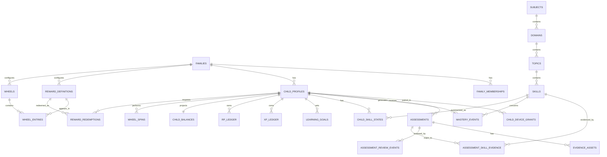

# Data & Authorization Model v0.1

This document defines the first durable data model and authorization boundary for LearnWard.

The design assumes the current mobile architecture:

- Flutter client for Android and iOS,
- Supabase Auth + Postgres + Storage,
- local SQLite/Drift cache,
- one application with parent and child modes,
- external-learning-first product model.

The objective is not to freeze every SQL column before implementation. The objective is to freeze the **ownership model, trust boundaries, core entities, immutable ledgers, and access rules** so implementation does not accidentally weaken the product model later.

---

## 1. Core decisions

### 1.1 Family is the tenant boundary

Every user-visible record belongs to exactly one family.

```text
Family
├── Adult memberships
├── Child profiles
├── Assessments
├── Goals
├── Rewards
├── Wheel configuration
├── XP/RP ledgers
└── Evidence
```

No client query should depend on application code alone to enforce family isolation.

Postgres Row Level Security (RLS) is the database-level enforcement boundary.

### 1.2 A child profile is not necessarily an Auth user

A child is modeled first as a family-owned profile.

```text
auth.users
   │
   └── adults / paired-device identities

families
   │
   └── child_profiles
```

For v1, creating a child should **not require an email address, phone number, or password**.

This minimizes friction and unnecessary collection of child PII.

### 1.3 Separate identity from role

Authentication answers:

> Who is making this request?

Authorization answers:

> What may this identity do inside this family?

Roles must therefore live in application-owned database records, not editable user metadata.

### 1.4 Economy is server-authoritative

The mobile client must never directly create or edit:

- XP ledger entries,
- RP ledger entries,
- balances,
- wheel outcomes,
- mastery events,
- verified approval events.

These are derived or authoritative records produced by validated commands.

### 1.5 Ledgers are append-only

XP and RP history must remain auditable.

Incorrect transactions are reversed with compensating entries rather than deleting or rewriting history.

### 1.6 Mastery is independent of reward

Academic evidence may update mastery.

XP/RP values must never update mastery merely because a reward was large.

This preserves the separation established in the Learning Engine specification.

---

## 2. Identity model

### Parent / adult identity

Adults use permanent Supabase Auth identities.

Initial authentication options may include:

- email OTP / magic link,
- Google,
- Apple.

Password-based authentication is not required for the initial product.

### Child identity

A child has a row in `child_profiles`.

A child may use LearnWard in two ways.

#### Shared-device child mode

The parent is authenticated and switches the app into a child-specific restricted UI.

No additional Supabase Auth identity is required.

Parent mode must be protected from casual switching by a local parent gate such as biometric confirmation or parent PIN.

#### Dedicated child device

The child device receives a restricted identity through a pairing flow.

Recommended v1 model:

```text
Parent creates pairing request
        ↓
QR / short-lived code
        ↓
Child device creates anonymous Auth identity
        ↓
Pairing command binds auth.uid()
to exactly one child profile
        ↓
child_device_grants
```

The anonymous Auth identity is not itself trusted. It gains child permissions only while an active `child_device_grants` record exists.

If the app is removed, local auth is lost, or the grant is revoked, the device must be paired again.

---

## 3. Family tenancy

### `families`

Represents the household/account boundary.

Suggested fields:

```text
id uuid PK
name text
timezone text
locale text
created_by_user_id uuid
created_at timestamptz
archived_at timestamptz nullable
```

### `family_memberships`

Adult membership only.

```text
family_id uuid
auth_user_id uuid
role enum(owner, parent)
status enum(active, invited, revoked)
joined_at timestamptz
revoked_at timestamptz nullable
```

Unique constraint:

```text
(family_id, auth_user_id)
```

Additional index:

```text
(auth_user_id)
```

because authorization policies frequently begin from the current Auth user.

### Roles

#### Owner

Can:

- manage the family,
- add/remove adults,
- create/archive child profiles,
- manage pairings,
- manage rewards,
- approve learning evidence,
- perform ordinary parent actions.

#### Parent

Can:

- manage learning records,
- approve evidence,
- manage goals,
- manage rewards,
- fulfill rewards,
- view all children in the family.

Cannot:

- delete/transfer the family,
- remove the family owner.

The owner/parent distinction may be simplified in the first UI but should exist in the data model.

---

## 4. Child model

### `child_profiles`

```text
id uuid PK
family_id uuid NOT NULL
display_name text NOT NULL
school_grade smallint nullable
birth_year smallint nullable
avatar_key text nullable
status enum(active, archived)
created_at timestamptz
archived_at timestamptz nullable
```

Avoid collecting exact date of birth unless a later legal/product requirement makes it necessary.

`birth_year` itself should remain optional.

### Tenant-safe foreign keys

For family-owned entities, duplicate `family_id` deliberately even when it can be derived from `child_id`.

Example:

```text
assessments
- id
- family_id
- child_id
```

Use a unique constraint on:

```text
child_profiles(id, family_id)
```

and a composite foreign key:

```text
assessments(child_id, family_id)
  → child_profiles(id, family_id)
```

This prevents a programming bug from connecting a record in Family A to a child in Family B.

The duplicated tenant key is intentional defense in depth.

---

## 5. High-level entity map



---

## 6. Learning catalog

The catalog implements:

```text
Subject
  ↓
Domain
  ↓
Topic
  ↓
Skill
```

### `subjects`

Examples:

```text
Mathematics
English
Literature
Science
```

### `domains`

Examples inside Mathematics:

```text
Arithmetic
Algebra
Geometry
Statistics
```

### `topics`

Example:

```text
Algebra
  └── Linear equations
```

### `skills`

Example:

```text
Solve one-step linear equations
Solve two-step linear equations
Translate word problems into equations
```

Catalog rows may later carry:

- locale,
- curriculum namespace,
- grade range,
- prerequisite relationships,
- version.

Do not hard-code a single national curriculum into the identity of the core entity.

---

## 7. Assessments

### `assessments`

This is the factual learning-result record.

Suggested fields:

```text
id uuid PK
family_id uuid
child_id uuid
subject_id uuid
topic_id uuid nullable
assessment_type enum(...)
source_type enum(school, tutor, worksheet, app, self_study, other)
source_label text nullable
grade_level smallint nullable
difficulty_band enum(below_level, normal, hard, challenge)
raw_score numeric
max_score numeric
normalized_score numeric
verification_status enum(draft, submitted, verified, rejected)
submitted_by_user_id uuid nullable
occurred_at timestamptz
created_at timestamptz
updated_at timestamptz
version integer
```

Original score + denominator are retained even though the normalized score is used by the v0.1 Growth Engine.

### Assessment lifecycle

```text
DRAFT
  ↓
SUBMITTED
  ├──→ REJECTED
  └──→ VERIFIED
          ↓
     Growth event
     Mastery event(s)
     XP/RP ledger entry
```

Once a verified assessment has produced economic/mastery events, the factual record should not be silently edited.

Material corrections should create a correction workflow and compensating/recalculation events.

---

## 8. Evidence

### `evidence_assets`

Metadata for photos/files uploaded as assessment evidence.

```text
id uuid PK
family_id uuid
child_id uuid
assessment_id uuid
storage_path text
mime_type text
size_bytes bigint
sha256 text nullable
uploaded_by_user_id uuid
created_at timestamptz
```

Files live in a **private Supabase Storage bucket**.

Recommended path convention:

```text
family/{family_id}/child/{child_id}/assessment/{assessment_id}/{asset_id}.jpg
```

Do not make evidence URLs public.

The client requests authorized access through Supabase Storage under RLS or short-lived signed URLs where appropriate.

Storage object metadata should not be treated as the domain source of truth; `evidence_assets` remains the application record.

---

## 9. Verification and approval audit

### `assessment_review_events`

Append-only review history.

```text
id uuid PK
family_id uuid
assessment_id uuid
action enum(submitted, approved, rejected, corrected)
actor_user_id uuid nullable
actor_kind enum(parent, child_device, system)
note text nullable
created_at timestamptz
```

The current `verification_status` on `assessments` is a projection for convenient querying.

The event history explains how that status was reached.

A child may never approve their own assessment.

---

## 10. Assessment-to-skill evidence

### `assessment_skill_evidence`

Links an assessment to the skill(s) it actually provides evidence about.

```text
id uuid PK
family_id uuid
assessment_id uuid
skill_id uuid
evidence_score numeric nullable
coverage_weight numeric
source enum(manual, inferred, item_level, integration)
created_at timestamptz
```

A broad Math score does not automatically justify confident skill-level mastery.

If evidence is broad, it may update a higher-level topic/subject state or create low-confidence skill evidence only when supported by the Learning Engine rules.

---

## 11. Mastery model persistence

Use event + projection rather than storing only a mutable percentage.

### `mastery_events`

Append-only events generated from verified academic evidence.

```text
id uuid PK
family_id uuid
child_id uuid
skill_id uuid
assessment_id uuid nullable
previous_mastery numeric nullable
new_mastery numeric
evidence_weight numeric
confidence_delta numeric nullable
engine_version text
inputs_snapshot jsonb
created_at timestamptz
```

### `child_skill_states`

Current read model / projection.

```text
family_id uuid
child_id uuid
skill_id uuid
mastery_score numeric
confidence enum(low, medium, high)
evidence_count integer
last_evidence_at timestamptz nullable
freshness_status enum(fresh, aging, needs_refresh)
engine_version text
updated_at timestamptz
```

Unique:

```text
(child_id, skill_id)
```

Only the Learning Engine may update this projection.

---

## 12. Goals

### `learning_goals`

```text
id uuid PK
family_id uuid
child_id uuid
goal_type enum(score, mastery, recovery, consistency)
subject_id uuid nullable
topic_id uuid nullable
skill_id uuid nullable
target_value numeric nullable
baseline_snapshot jsonb
set_by enum(child, parent, joint)
child_accepted_at timestamptz nullable
starts_at timestamptz
due_at timestamptz nullable
status enum(active, achieved, missed, cancelled)
created_at timestamptz
```

A parent-created stretch goal should normally require child acceptance before receiving the same Goal Bonus as a self-chosen goal.

This preserves learner autonomy.

---

## 13. XP/RP economy

### Never store balance as the only truth

The source of truth is the ledger.

### `xp_ledger`

```text
id uuid PK
family_id uuid
child_id uuid
amount integer
reason_code text
source_type text
source_id uuid nullable
engine_version text nullable
idempotency_key text
metadata jsonb
created_at timestamptz
```

XP entries are normally non-negative, except explicit administrative correction entries.

### `rp_ledger`

Use integer minor units rather than floating-point values.

Recommended:

```text
100 rp_minor = 1.00 RP
```

Fields:

```text
id uuid PK
family_id uuid
child_id uuid
amount_minor bigint
reason_code text
source_type text
source_id uuid nullable
idempotency_key text
metadata jsonb
created_at timestamptz
```

Examples:

```text
+1250 = +12.50 RP
-1000 = -10.00 RP for wheel spin
-3000 = -30.00 RP for store redemption
```

This avoids binary floating-point currency errors in client code.

### `child_balances`

Read projection:

```text
family_id uuid
child_id uuid
xp_total bigint
rp_balance_minor bigint
updated_at timestamptz
```

Clients may read this table.

Clients may not update it.

It must remain reconcilable against the ledgers.

---

## 14. Growth calculation audit

Recommended additional entity:

### `growth_events`

Records exactly why an assessment generated its RP/XP result.

```text
id uuid PK
family_id uuid
child_id uuid
assessment_id uuid
engine_version text
baseline_score numeric nullable
normalized_score numeric
growth_delta numeric nullable
score_component_minor bigint
growth_component_minor bigint
goal_component_minor bigint
personal_best_component_minor bigint
challenge_component_minor bigint
recovery_component_minor bigint
total_rp_minor bigint
xp_awarded bigint
inputs_snapshot jsonb
created_at timestamptz
```

This makes the Growth Engine explainable and reproducible even after formulas change in a later version.

---

## 15. Reward catalog

### `reward_definitions`

```text
id uuid PK
family_id uuid
title text
description text nullable
reward_kind enum(privilege, experience, family, physical, money, other)
store_enabled boolean
store_cost_minor bigint nullable
wheel_enabled boolean
stock_limit integer nullable
cooldown_hours integer nullable
estimated_cost_minor bigint nullable
currency_code text nullable
active boolean
created_at timestamptz
updated_at timestamptz
```

`estimated_cost_minor` is for parent budget planning; it is not RP value.

### `wheels`

```text
id uuid PK
family_id uuid
name text
spin_cost_minor bigint
active boolean
created_at timestamptz
```

### `wheel_entries`

```text
id uuid PK
family_id uuid
wheel_id uuid
reward_id uuid
weight integer
active boolean
```

Probability is derived from active weights.

The eligible reward set and weight configuration used for a completed spin should be auditable.

---

## 16. Wheel spins

### `wheel_spins`

```text
id uuid PK
family_id uuid
child_id uuid
wheel_id uuid
reward_id uuid
rp_debit_ledger_id uuid
selection_version text
eligibility_snapshot jsonb
created_at timestamptz
```

The server chooses the reward.

The Flutter client only animates the already-decided result.

This prevents a modified client from selecting its own prize.

A spin must atomically:

1. verify child access,
2. verify wheel eligibility,
3. verify RP balance,
4. debit RP,
5. choose an eligible reward,
6. create the spin,
7. create a reward redemption/claim.

If any step fails, none of the state changes should commit.

---

## 17. Reward redemption and fulfillment

### `reward_redemptions`

```text
id uuid PK
family_id uuid
child_id uuid
reward_id uuid
method enum(store, wheel)
rp_cost_minor bigint
status enum(pending, approved, fulfilled, cancelled)
requested_at timestamptz
fulfilled_at timestamptz nullable
fulfilled_by_user_id uuid nullable
reward_snapshot jsonb
```

The snapshot prevents later edits to the reward definition from rewriting history.

A wheel reward normally creates a redemption with zero additional RP cost because the spin debit has already happened.

Store redemption debits the exact store price atomically with creation of the redemption.

---

## 18. Child device pairing

### `child_device_grants`

```text
id uuid PK
family_id uuid
child_id uuid
auth_user_id uuid UNIQUE
device_label text nullable
status enum(active, revoked)
paired_by_user_id uuid
paired_at timestamptz
last_seen_at timestamptz nullable
revoked_at timestamptz nullable
```

A dedicated child device Auth identity is restricted to the linked child.

### Pairing secret

Pairing codes must not be stored in plaintext after issuance.

Recommended internal record in a non-exposed schema:

```text
private.child_pairing_requests
- id
- family_id
- child_id
- token_hash
- expires_at
- created_by_user_id
- consumed_at
```

Properties:

- short expiry,
- one-time use,
- high-entropy underlying token,
- rate-limited attempts,
- revocable by parent.

Do not use a permanent family PIN as the network authentication secret.

---

## 19. Permission matrix

| Capability | Owner | Parent | Paired child device |
|---|---:|---:|---:|
| Read family basics | Yes | Yes | Minimal |
| Manage adult memberships | Yes | No | No |
| Create/archive child | Yes | Yes | No |
| Read all children | Yes | Yes | No |
| Read own child profile | — | — | Yes |
| Create assessment | Yes | Yes | Own only |
| Submit assessment evidence | Yes | Yes | Own only |
| Approve/reject assessment | Yes | Yes | No |
| Read mastery | All children | All children | Own only |
| Modify mastery directly | No | No | No |
| Create/propose goal | Yes | Yes | Own only |
| Accept child goal | N/A | N/A | Own only |
| Manage reward catalog | Yes | Yes | No |
| Read active rewards | Yes | Yes | Yes |
| Spin wheel | On behalf | On behalf | Own only |
| Redeem store reward | On behalf | On behalf | Own only |
| Fulfill reward | Yes | Yes | No |
| Write XP/RP ledger | No direct access | No direct access | No direct access |
| Pair/revoke child device | Yes | Yes | No |
| Access sibling data | Yes | Yes | No |
| Delete family | Yes | No | No |

---

## 20. RLS strategy

All tables reachable through the Supabase Data API must have RLS enabled.

Do not rely on a broad rule such as:

```text
TO authenticated
```

without a row ownership/membership predicate.

### Family authorization source

Use `family_memberships` and `child_device_grants` as live authorization records.

Do **not** use `raw_user_meta_data` / `user_metadata` to decide permissions.

Avoid encoding active family memberships exclusively in JWT `app_metadata` because membership changes would remain stale until token refresh.

### Suggested helper predicates

Conceptually:

```text
is_family_adult(family_id)
is_family_owner(family_id)
has_child_access(family_id, child_id)
is_paired_child(family_id, child_id)
```

Where helper functions are required to avoid recursive membership policies, place privileged helpers in a non-exposed schema such as `private`, use an empty `search_path`, explicitly revoke default execution privileges, and grant only what is required.

### Index every policy path

At minimum index commonly filtered columns:

```text
family_memberships.auth_user_id
family_memberships.family_id
child_device_grants.auth_user_id
child_device_grants.child_id
child_profiles.family_id
assessments.family_id
assessments.child_id
learning_goals.child_id
xp_ledger.child_id
rp_ledger.child_id
reward_redemptions.child_id
```

---

## 21. Anonymous child-device security

Supabase anonymous users still operate under the Postgres `authenticated` role.

Therefore:

```text
TO authenticated
```

must never be interpreted as "adult only".

Adult-only operations must additionally require an active `family_memberships` row.

Child-device operations must require an active matching `child_device_grants` row.

If anonymous sign-in is enabled, production setup must include abuse protection such as CAPTCHA/Turnstile and rate limits appropriate to the sign-in flow.

A random unpaired anonymous user must receive no LearnWard family data.

---

## 22. Storage authorization

Evidence bucket is private.

Storage policies must enforce that the authenticated actor may access the family/child represented in the object path.

Parent:

```text
can access evidence for any child in their active family membership
```

Paired child device:

```text
can upload/read evidence only for its bound child profile
```

Child may not enumerate sibling folders.

Storage writes must use the Storage API; application code should not mutate `storage.objects` directly.

---

## 23. Server-authoritative commands

The following actions should be commands rather than raw client table writes:

```text
submit_assessment
approve_assessment
correct_verified_assessment
pair_child_device
revoke_child_device
spin_wheel
redeem_reward
fulfill_reward
apply_recovery_result
```

Each command must:

- resolve the authenticated actor,
- validate family/child authorization,
- validate current entity state,
- be idempotent,
- perform related mutations atomically,
- emit auditable events/ledger entries.

The client must never possess a Supabase `service_role`/secret key.

Implementation may use a thin server/Edge Function boundary plus transactional database routines. Exact RPC layout should be decided in the implementation spec and security-tested before release.

---

## 24. Idempotency

Mobile clients retry requests because networks fail.

Every economy-affecting command must accept an idempotency key.

Example:

```text
approve-assessment:<assessment_id>:<verification_version>
spin:<client_generated_uuid>
redeem:<client_generated_uuid>
```

A repeated request must return the original result rather than create another RP credit/debit.

This is especially important for:

- assessment approval,
- wheel spins,
- store redemption,
- recovery rewards.

---

## 25. Optimistic concurrency

Mutable workflow rows should have a `version` integer or equivalent compare-and-set mechanism.

Example:

```text
Parent A opens submitted assessment version 3
Parent B approves it → version 4
Parent A attempts edit against version 3
→ reject as stale
```

Do not allow last-write-wins behavior on financially or academically consequential state.

---

## 26. Offline model

SQLite/Drift is a **cache and command queue**, not the authority.

Safe to cache:

- child dashboard read models,
- mastery state,
- goals,
- active rewards,
- recent assessment history,
- current displayed balance.

The displayed balance may be cached but must be treated as provisional when offline.

Offline-safe local commands include:

- draft an assessment,
- capture evidence,
- draft a goal,
- queue submission.

Do not finalize offline:

- RP awards,
- spins,
- redemptions,
- approval,
- mastery commits.

Those require authoritative server reconciliation.

---

## 27. Privacy minimization

LearnWard is designed for minors, so collect the minimum data needed for the learning/motivation function.

Prefer:

```text
display name
school grade
optional birth year
```

over:

```text
exact DOB
school identity
home address
unnecessary contact information
```

Evidence images may contain school/teacher/student information and should therefore be treated as sensitive family data:

- private bucket,
- minimum retention necessary,
- parent-visible deletion controls,
- no public URLs,
- no use for unrelated model training without explicit future consent/legal review.

A dedicated privacy/legal review is required before public launch; this data model is not a substitute for jurisdiction-specific child privacy compliance.

---

## 28. Deletion and correction model

### Child archive

Default parent action should be archive rather than hard delete so ledger/audit integrity is preserved.

### Evidence deletion

A parent should be able to delete evidence assets when they are no longer required.

The assessment may retain non-image factual metadata if appropriate under the final retention policy.

### Economy corrections

Never edit prior ledger amounts.

Example:

```text
Original award   +1250
Correction       -1250
Corrected award  +1050
```

History remains explainable.

---

## 29. Read models vs sources of truth

| Domain | Source of truth | Projection / cache |
|---|---|---|
| Family membership | `family_memberships` | JWT/app UI cache only |
| Child access | `child_device_grants` | local session state |
| Assessment | `assessments` + review events | dashboard lists |
| Mastery | `mastery_events` | `child_skill_states` |
| XP | `xp_ledger` | `child_balances.xp_total` |
| RP | `rp_ledger` | `child_balances.rp_balance_minor` |
| Reward history | redemptions/spins | dashboard summaries |
| Evidence file | Storage object | local upload cache |

Projections must always be rebuildable from authoritative records where practical.

---

## 30. Security test matrix

Before implementation is considered complete, automated tests should verify at least:

1. Parent A can read Child A in Family A.
2. Parent A cannot read any row in unrelated Family B.
3. Parent role cannot remove owner membership.
4. Paired Child A can read Child A mastery.
5. Paired Child A cannot read sibling Child B mastery.
6. Paired Child A can submit evidence only for Child A.
7. Paired child cannot approve an assessment.
8. Unpaired anonymous Auth user sees no family records.
9. Revoked child device immediately loses family data access on the next authorized request/session policy evaluation.
10. Client cannot insert XP/RP ledger rows directly.
11. Client cannot update `child_balances` directly.
12. Duplicate assessment approval does not duplicate RP/XP.
13. Duplicate spin request does not debit twice.
14. Store redemption cannot make RP balance negative.
15. Storage policy prevents sibling/family cross-access.
16. Views used by clients obey underlying RLS (`security_invoker` where applicable).

RLS allow **and deny** behavior should be tested, not merely happy paths.

---

## 31. Supabase-specific security requirements

Verified against current Supabase guidance at the time of this v0.1 document:

- Enable RLS on every table in an exposed schema.
- Explicitly manage grants as well as RLS policies.
- Never expose the service-role/secret key in Flutter.
- Never use user-editable metadata for authorization.
- Remember anonymous Auth users use the `authenticated` database role.
- UPDATE policies need suitable SELECT access and should constrain both existing and resulting rows.
- Views exposed to clients should use `security_invoker = true` where supported.
- Treat the `storage` schema as service-owned/read-only; use Storage APIs for file operations.
- Index columns used in RLS membership predicates.

References:

- https://supabase.com/docs/guides/database/postgres/row-level-security
- https://supabase.com/docs/guides/api/securing-your-api
- https://supabase.com/docs/guides/auth/auth-anonymous
- https://supabase.com/docs/guides/storage/security/access-control

---

## 32. Proposed implementation order

Do not create all tables at once.

Recommended first schema slice:

```text
1. families
2. family_memberships
3. child_profiles
4. assessments
5. assessment_review_events
6. evidence_assets
7. growth_events
8. xp_ledger
9. rp_ledger
10. child_balances
11. reward_definitions
12. wheels / wheel_entries
13. wheel_spins
14. reward_redemptions
```

Then add:

```text
15. subject/domain/topic/skill catalog
16. assessment_skill_evidence
17. mastery_events
18. child_skill_states
19. learning_goals
20. child-device pairing
```

This sequencing keeps the first implementation aligned with the pilot's core loop while preserving the target architecture.

---

## 33. Frozen v0.1 architecture rules

The following should be treated as product/architecture invariants until explicitly revised:

1. Family is the tenant boundary.
2. Child profiles do not require standalone PII credentials.
3. Parent authorization comes from live family membership records.
4. Dedicated child devices use explicit, revocable pairing.
5. A paired child can access only its own child profile data.
6. RLS is mandatory for all exposed family data.
7. XP/RP ledgers are append-only and server-authoritative.
8. Client cannot determine wheel outcomes.
9. Mastery is derived only from academic evidence.
10. Verified assessment processing is idempotent and auditable.
11. Tenant IDs are duplicated on family-owned rows for defense in depth.
12. Offline state is not authoritative for economy/mastery decisions.
13. Evidence storage is private.
14. Authorization never relies on user-editable metadata.
15. Cross-family and sibling isolation must have automated deny tests.

These rules form the bridge from the current product documentation into an implementable secure mobile architecture.
