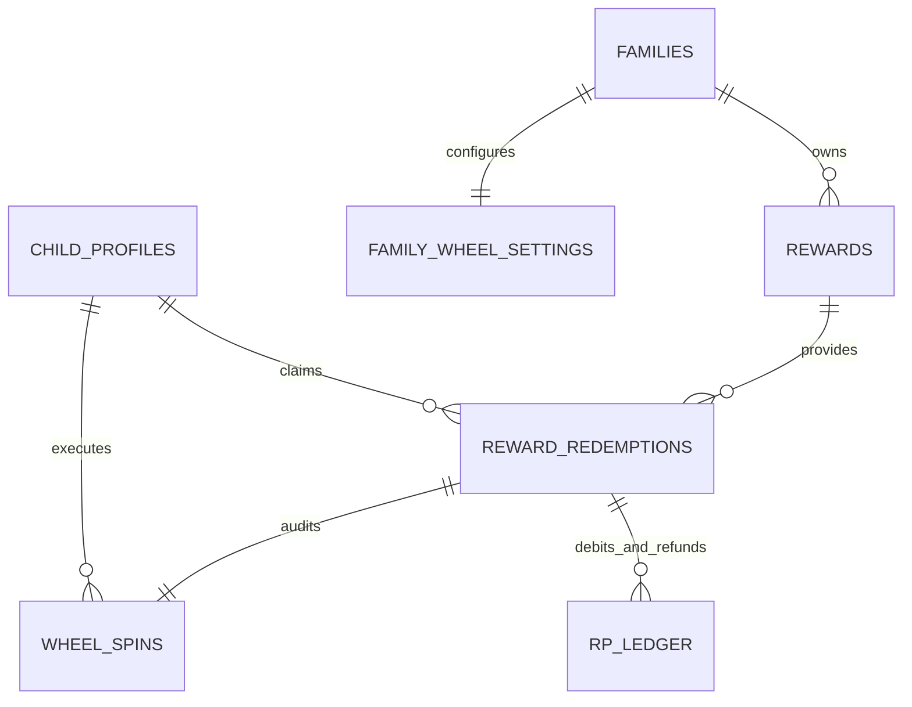

# Phase 4 Detailed Design — Reward Economy & Wheel Experience v0.1

**Status:** PROPOSED (Updated with resolved product decisions & architectural hardening)  
**Document Version:** `v0.1.1`  
**Date:** 2026-11-01  
**Target Milestone:** Phase 4 — Reward Economy & Wheel Experience  
**Frozen Code Baseline:** `c6721497bfbde7cb436467cccaad5b2234d23cc4`  
**Latest Green Main:** `624f6b0d23f0789325ebeadd357f09a8172330c6`  

---

## 1. Product Objective

The primary objective of Phase 4 is to connect a child's verified academic growth with meaningful, tangible family recognition. While Study XP provides permanent, non-spendable developmental progression (identity, levels, mastery), **Reward Points (RP)** empower children with real economic agency within their family environment.

Phase 4 delivers two complementary avenues for spending earned RP:
1. **The Reward Store:** Fosters delayed gratification, goal setting, budgeting, and certainty.
2. **The Celebration Wheel:** Provides joyful, immediate celebration, variety, and delightful surprise following verified learning milestones.

Every aspect of Phase 4 anchors back to LearnWard's foundational thesis: **Help children see themselves getting better.** Gamification must celebrate real academic effort—it must never become an addictive casino simulator or an extractive engagement loop.

---

## 2. Non-Goals

Phase 4 strictly rejects the following mechanics and feature scopes:

- **No gambling or casino mechanics:** No slot-machine aesthetics, no variable-ratio dopamine traps, no near-miss animations, no artificial hype audio, and no "jackpot" visual language.
- **No losing outcomes:** Valid Wheel spins will never produce "Better luck next time," zero points, or empty slots. Every spin awards an active, parent-approved positive prize.
- **No monetized randomness or microtransactions:** Real money cannot buy spins, buy RP, speed up cooldowns, or unlock premium reward tiers.
- **No ads-for-rewards or paid rerolls:** A child cannot watch an advertisement or pay currency to reroll an outcome.
- **No punishment deductions:** Earned RP cannot be confiscated as disciplinary punishment or decremented due to low academic scores.
- **No cash-out or monetary conversion:** RP has zero real-world monetary value outside the family agreement.
- **No sibling competition:** Sibling redemptions, balances, and wheel outcomes are private. There are no public family leaderboards for reward consumption.
- **No complex enterprise inventory warehouse:** Phase 4 does not build a multi-warehouse ERP system for family chores; parents retain high-level oversight through simple active/inactive toggles and fulfillment tracking.

---

## 3. Safety Principles & Constitutional Invariants

LearnWard's product constitution dictates non-negotiable safety rules for Phase 4:

1. **Learning Comes First:** RP can only be created as the output of an immutable `VerifiedLearningEvent` processed by the frozen Growth Engine (`growth-v0.1`). Gamification is strictly downstream of verified academic work.
2. **Study XP Immutability:** Study XP is never spent, debited, or transferred. Spending RP has zero effect on Study XP progression.
3. **Integer Minor-Unit Conservation:** RP balance is strictly tracked in integer minor units ($1.00\text{ RP} = 100\text{ minor units}$). Balance must equal the exact sum of authoritative append-only `rp_ledger` rows:
   $$\text{rp\_balance\_minor} = \sum \text{rp\_ledger.amount\_minor}$$
4. **Non-Negative Balance Invariant:** Spendable RP balance must never drop below zero. Any operation attempting to overdraw spendable RP fails immediately and atomically without side effects.
5. **Guaranteed Positive Value on Wheel:** Every slot on the Wheel must represent a genuine, positive reward approved by the parent.
6. **Separation of Selection from Animation:** The winning outcome is chosen server-authoritatively and committed to the database before the client receives the payload. The client's sole responsibility is rendering an animation that lands on the already-decided reward.
7. **Compensating Refunds Only (LW102):** Historical debit records in `rp_ledger` are strictly immutable. If a reward cannot be fulfilled, the system issues a compensating positive credit entry in `rp_ledger`.
8. **No Reroll on Cancellation:** Cancelling/refunding a Wheel redemption restores the spent RP via a compensating ledger credit, but **never** deletes the spin from history, never offers an automatic reroll, and does not restore the child's daily spin count.

---

## 4. Recommended Economy Model (Model C — Unified RP)

### Formal Decision: Model C (Unified RP Economy)

Phase 4 adopts **Model C (Unified RP Economy)**:
- There is **exactly one spendable reward currency**: **Reward Points (RP)**, represented as integer minor units (`amount_minor`).
- Children earn RP strictly through verified academic achievements.
- When children hold spendable RP, they have full autonomy to make a classic self-regulation choice:
  - **Save for Store:** Fixed cost, guaranteed specific prize (delayed gratification, goal focus).
  - **Spin the Wheel:** Fixed low cost (default 10 RP = 1,000 minor units), random selection among parent-approved treats/privileges (immediate celebration, surprise).
- This model aligns with `docs/04-reward-economy-v0.1.md` Section 15 ("A visible ticket may be used as UI language for the wheel, but it should not become a third economy").

---

## 5. RP → Store / Wheel Relationship & Valuation Guidance

### Distinct Psychological Roles

```text
                  Child's Spendable RP
                           │
            ┌──────────────┴──────────────┐
            ▼                             ▼
       Reward Store                  Reward Wheel
  (Certainty & Planning)       (Surprise & Celebration)
  ─────────────────────         ──────────────────────
  • Fixed parent-priced cost    • Fixed low cost (default 10 RP)
  • Child selects exact prize   • Server selects random prize
  • Delayed gratification       • Immediate milestone ritual
  • High-value goals            • Light privileges & treats
  • Zero variance               • Positive-only variance
```

### Valuation Guidance (Advisory, Not Server-Hardcoded)
- **Parent Configuration Guidance:** In v0.1, the database does not enforce subjective real-world valuations. Instead, LearnWard provides explicit UI guidance to parents:
  - The Store is the recommended surface for expensive, specific long-term goals (e.g. items priced $\ge 50$ or $\ge 100\text{ RP}$).
  - The Wheel should contain lightweight, repeatable treats and privileges (e.g. 15–30m screen time, pick dessert, family board game night).
  - The parent configuration UI displays an advisory warning if a parent enables an unusually high-priced Store item on the Wheel pool.
- **Automated Budgeting Deferred:** Complex real-currency budget tracking and algorithmic expected-value optimization are explicitly deferred to post-pilot phases.

---

## 6. Reward Catalog Model

The reward catalog is family-scoped. LearnWard does not hardcode static rewards; every reward belongs to a family tenant.

### Entity Attributes (`public.rewards`)
- `id` (UUID, PK): Unique reward identifier.
- `family_id` (UUID, FK): Owning family tenant boundary.
- `title` (Text): Name of reward (e.g. "Choose Friday Family Movie", "30 Minutes Extra Gaming").
- `description` (Text, Nullable): Clarifying terms (e.g. "Applies on weekend afternoons only").
- `category` (Text): High-level category for filtering and icon display (`privilege`, `experience`, `treat`, `item`, `choice`, `custom`).
- `icon_key` (Text): Visual representation key from design system tokens.
- `store_enabled` (Boolean): Whether the item can be directly purchased in the Store.
- `store_cost_minor` (BigInt, Nullable): Cost in RP minor units if Store-enabled (e.g. $40.00\text{ RP} = 4000\text{ minor units}$).
- `wheel_enabled` (Boolean): Whether the item can be won on the Celebration Wheel.
- `wheel_tier` (Text, Nullable): Relative weight tier (`common`, `special`, `rare`).
- `target_child_id` (UUID, Nullable, FK): If null, eligible for all children in the family. If set, restricted to a specific child (allowing age-appropriate prizes).
- `is_active` (Boolean): Soft-toggle allowing parents to pause rewards without deleting history.
- `created_at` / `updated_at` (Timestamptz): Audit timestamps.

### Deletion and Soft-Disable Policy
- Rewards with historical redemptions or wheel spins **must never be hard-deleted**.
- Parents deactivate rewards by toggling `is_active = false`.
- If a child profile is deleted, any child-specific reward has `target_child_id` protected via `ON DELETE RESTRICT` (or soft-deactivated) rather than `ON DELETE SET NULL`, preventing a child-specific reward from accidentally becoming family-wide.

---

## 7. Fulfillment Lifecycle & State Machine

Redemptions follow a strict, auditable lifecycle that protects both parent authority and child trust:

```text
[Child Action]
Store Redemption / Wheel Spin
       │
       ▼
status = 'pending_fulfillment'
(RP debited immediately via rp_ledger)
       │
       ├───► [Parent Delivers in Real Life] ───► status = 'fulfilled'
       │     (via fulfill_reward_redemption)     (fulfilled_at, fulfilled_by set)
       │
       └───► [Parent Cannot Fulfill] ─────────► status = 'cancelled'
             (via cancel_reward_redemption)      (Compensating refund credited to rp_ledger;
                                                  cancellation_reason recorded)
```

### Lifecycle Rules:
1. **Immediate Debit with Confirmation:** When a child confirms redemption or spin, RP is debited immediately and the claim enters `pending_fulfillment`.
2. **Terminal States:** `fulfilled` and `cancelled` are strictly **terminal**. A redemption cannot transition once in a terminal state.
3. **Concurrency-Safe Transitions:** Both `fulfill_reward_redemption` and `cancel_reward_redemption` acquire a row-level lock (`SELECT ... FOR UPDATE`) on the target `reward_redemptions` row.
4. **Immutable Core Fields:** Once created, core fields (`family_id`, `child_id`, `reward_id`, `origin`, `rp_cost_minor`, `reward_snapshot`, `created_at`) are strictly immutable. Only lifecycle state fields (`status`, `cancellation_reason`, `fulfilled_at`, `fulfilled_by_user_id`, `updated_at`) may be updated.
5. **Retry Safety via Command Receipts:** Fulfill and cancel RPCs accept `p_command_id uuid`. Retrying a lost response returns the existing terminal redemption record idempotently without creating duplicate ledger entries.

---

## 8. Wheel Probability Model

### Tier-Based Relative Weights (Not Fixed Percentages)

The tier system uses **relative selection weights**, NOT hardcoded percentages:

| Wheel Tier | Configured Relative Weight | Meaning |
| :--- | :---: | :--- |
| **Common** | 60 | Baseline relative weight for everyday privileges. |
| **Special** | 30 | Half the relative weight of a Common item. |
| **Rare** | 10 | One-sixth the relative weight of a Common item. |

### Mathematical Truth: Probability is a Function of Active Pool Composition

The actual probability of winning reward $i$ depends on the entire set of eligible active items currently in the pool:
$$P(\text{reward}_i) = \frac{w_i}{\sum_{j=1}^{N} w_j}$$

#### Worked Example:
Suppose a family has configured a 6-item active Wheel pool:
- 3 Common items ($w = 60, 60, 60$)
- 2 Special items ($w = 30, 30$)
- 1 Rare item ($w = 10$)

$$\text{Total Weight } W = (3 \times 60) + (2 \times 30) + (1 \times 10) = 180 + 60 + 10 = 250$$

- **Each Common item:** $\frac{60}{250} = 24.0\%$ (aggregate Common probability = $72.0\%$)
- **Each Special item:** $\frac{30}{250} = 12.0\%$ (aggregate Special probability = $24.0\%$)
- **The Rare item:** $\frac{10}{250} = 4.0\%$ (aggregate Rare probability = $4.0\%$)

### UI Presentation Standards:
- **Parent UI:** Displays tier names ("Common", "Special", "Rare") and optionally the *current computed mathematical probability* based on the family's active pool. It **never** displays misleading static percentages like "Common (60%)" on the tier picker.
- **Child UI:** The visual angular width of each wedge on the Wheel is rendered in exact proportion to its mathematical probability ($w_i / W$).

---

## 9. Server-Authoritative Spin Architecture & Auditable Snapshot

Under zero circumstances does the client device determine or bias the winning prize.

```text
CLIENT                                      SERVER (PostgreSQL RPC: spin_reward_wheel)
  │                                                    │
  │── 1. spin_reward_wheel(command_id, child_id) ────►│
  │                                                    ├── 2. Authenticate & Authorize family adult
  │                                                    ├── 3. Lock child_balances FOR UPDATE
  │                                                    ├── 4. Check balance >= spin_cost_minor
  │                                                    ├── 5. Check daily spin cap (family timezone)
  │                                                    ├── 6. Lock & snapshot active pool (N >= 3)
  │                                                    ├── 7. Deterministic random selection
  │                                                    ├── 8. Append negative rp_ledger row
  │                                                    ├── 9. Insert reward_redemptions row
  │                                                    ├── 10. Insert wheel_spins audit row
  │                                                    ├── 11. Atomic child_balances update
  │                                                    └── 12. Record command_receipt
  │                                                    │
  │◄─ 13. Returns: {spin_id, winning_reward} ─────────┤
  │                                                    │
  ├── 14. UI constructs wheel layout                   │
  ├── 15. Animates deceleration to winner              │
  └── 16. Displays celebratory reward card            │
```

### Deterministic Selection Algorithm:
1. Gather all active rewards where `wheel_enabled = true` and `(target_child_id IS NULL OR target_child_id = v_child_id)`.
2. Enforce minimum pool size: if count $< 3$, abort with error `LW203: Minimum 3 active wheel rewards required`.
3. Order eligible rewards deterministically: `ORDER BY id ASC`.
4. Calculate cumulative weight boundaries:
   $$\text{Candidate } k \text{ occupies } [S_k, S_k + w_k) \quad \text{where } S_0 = 0 \text{ and } S_k = \sum_{j=0}^{k-1} w_j$$
5. Compute total weight $W = \sum w_j$.
6. Draw random integer $R = \text{floor}(\text{random}() \times W)$, ensuring $0 \le R < W$.
7. Find the unique candidate $k$ where $S_k \le R < S_k + w_k$.
8. Persist the complete `selection_snapshot` into `wheel_spins`.

### Auditable `selection_snapshot` JSON Structure:
```json
{
  "wheel_config_version": "wheel-v0.1",
  "spin_cost_minor": 1000,
  "deterministic_ordering": "reward_id_asc",
  "total_weight": 250,
  "random_draw": 142,
  "winning_reward_id": "8b5f3a12-...",
  "ordered_pool": [
    {
      "reward_id": "1c2d3e4f-...",
      "title": "15 min extra game time",
      "tier": "common",
      "weight": 60,
      "interval_start": 0,
      "interval_end": 60,
      "probability_pct": 24.0
    },
    {
      "reward_id": "8b5f3a12-...",
      "title": "Choose Friday movie",
      "tier": "special",
      "weight": 30,
      "interval_start": 120,
      "interval_end": 150,
      "probability_pct": 12.0
    }
  ]
}
```
*Auditability Invariant:* Any historical spin can be mathematically verified years later without reading mutable current catalog state.

---

## 10. Idempotency & Retry Model

Network dropouts during transaction submission must never cause double debits or lost spins:

1. **Client-Generated Command ID:** Every spin, store redemption, fulfillment, or cancellation generates a unique UUID (`p_command_id`) stored locally before transmission.
2. **Command Receipts Table:**
   - Extended operations: `'redeem_reward'`, `'spin_wheel'`, `'fulfill_reward'`, `'cancel_reward'`.
   - If `p_command_id` was already committed, the RPC returns the existing outcome without re-executing debits, random draws, or refunds.
3. **Ledger Idempotency Keys:**
   - Store redemption: `'rp:redemption:' || v_redemption_id`
   - Wheel spin: `'rp:wheel_spin:' || v_spin_id`
   - Refund: `'rp:refund:' || v_redemption_id`
   - Database unique constraint on `rp_ledger.idempotency_key` guarantees duplicate inserts fail closed.

---

## 11. Concurrency Model & Stabilized Authoritative Reads

### Row-Locked Concurrency on Child Balance
1. Spending RPCs acquire an exclusive row lock:
   ```sql
   select rp_balance_minor into v_current_balance
   from public.child_balances
   where child_id = v_child_id
   for update;
   ```
2. If `v_current_balance < v_cost_minor`, aborts immediately with `LW201: Insufficient RP balance`.

### Stabilizing Catalog Reads During Spending
To prevent a child from redeeming a price while a parent concurrently edits the catalog:
1. `redeem_store_reward` locks the target `rewards` row:
   ```sql
   select * into v_reward from public.rewards where id = p_reward_id for update;
   ```
2. Verifies `v_reward.is_active = true` and `v_reward.store_enabled = true`.
3. Evaluates eligibility: `v_reward.target_child_id IS NULL OR v_reward.target_child_id = v_child_id`.
4. Uses authoritative locked price `v_reward.store_cost_minor`. If parent disabled the item concurrently, transaction aborts cleanly with `LW205: Reward no longer available`.

---

## 12. Refund Mechanics & No-Reroll Invariant

When a parent cancels a redemption:
1. The original debit entry in `rp_ledger` remains **strictly unchanged** (`LW102`).
2. A new compensating credit row is inserted into `rp_ledger`:
   - `amount_minor = +v_cost_minor`
   - `reason_code = 'redemption_refund'`
   - `source_type = 'reward_redemption'`
   - `source_id = v_redemption_id`
   - `idempotency_key = 'rp:refund:' || v_redemption_id`
   - `metadata = jsonb_build_object('cancellation_reason', p_reason)`
3. `child_balances.rp_balance_minor` is updated atomically.
4. **No-Reroll Invariant for Wheel Spins:**
   - The original `wheel_spins` record remains in historical audit logs.
   - The child receives their RP back, but **does NOT receive a free spin or automatic redraw**.
   - The cancelled spin **still counts toward the child's daily spin cap**. This prevents gaming where families cancel "disappointing" prizes to fish for rarer ones.

---

## 13. Proposed Database Schema (Tenant-Hardened)

The schema utilizes composite foreign keys to enforce tenant isolation at the database constraint level:



### Table Definitions (Draft DDL)

```sql
-- 1. Family Reward Catalog
create table if not exists public.rewards (
  id uuid primary key default gen_random_uuid(),
  family_id uuid not null references public.families(id) on delete cascade,
  title text not null check (char_length(trim(title)) between 2 and 100),
  description text null check (description is null or char_length(description) <= 500),
  category text not null check (category in ('privilege', 'experience', 'treat', 'item', 'choice', 'custom')),
  icon_key text not null default 'default_star',
  store_enabled boolean not null default true,
  store_cost_minor bigint null check (store_cost_minor is null or store_cost_minor > 0),
  wheel_enabled boolean not null default false,
  wheel_tier text null check (wheel_tier is null or wheel_tier in ('common', 'special', 'rare')),
  target_child_id uuid null,
  is_active boolean not null default true,
  created_at timestamptz not null default now(),
  updated_at timestamptz not null default now(),

  -- Composite unique key to support composite FK references
  constraint uq_rewards_id_family unique (id, family_id),

  -- Composite FK: target_child_id must belong to the exact same family_id
  constraint fk_rewards_target_child_family
    foreign key (target_child_id, family_id)
    references public.child_profiles(id, family_id)
    on delete restrict,

  constraint chk_reward_cost_if_store check (not store_enabled or store_cost_minor is not null),
  constraint chk_reward_tier_if_wheel check (not wheel_enabled or wheel_tier is not null)
);

create index if not exists idx_rewards_family_active on public.rewards(family_id, is_active);

-- 2. Family Wheel Settings
create table if not exists public.family_wheel_settings (
  family_id uuid primary key references public.families(id) on delete cascade,
  spin_cost_minor bigint not null default 1000 check (spin_cost_minor between 500 and 5000), -- 5.00 to 50.00 RP
  daily_spin_cap integer not null default 3 check (daily_spin_cap between 1 and 5),           -- 1 to 5 spins/day
  is_enabled boolean not null default true,
  updated_at timestamptz not null default now()
);

-- 3. Reward Redemptions (Claims)
create table if not exists public.reward_redemptions (
  id uuid primary key default gen_random_uuid(),
  family_id uuid not null references public.families(id) on delete cascade,
  child_id uuid not null,
  reward_id uuid not null,
  origin text not null check (origin in ('store', 'wheel')),
  rp_cost_minor bigint not null check (rp_cost_minor >= 0),
  status text not null default 'pending_fulfillment' check (status in ('pending_fulfillment', 'fulfilled', 'cancelled')),
  reward_snapshot jsonb not null,
  cancellation_reason text null,
  fulfilled_at timestamptz null,
  fulfilled_by_user_id uuid null references auth.users(id),
  created_at timestamptz not null default now(),
  updated_at timestamptz not null default now(),

  -- Composite unique key for downstream references
  constraint uq_reward_redemptions_id_family_child unique (id, family_id, child_id),

  -- Composite FK: child_id must belong to family_id
  constraint fk_redemptions_child_family
    foreign key (child_id, family_id)
    references public.child_profiles(id, family_id)
    on delete cascade,

  -- Composite FK: reward_id must belong to family_id
  constraint fk_redemptions_reward_family
    foreign key (reward_id, family_id)
    references public.rewards(id, family_id)
    on delete restrict
);

create index if not exists idx_redemptions_child_status on public.reward_redemptions(child_id, status, created_at desc);
create index if not exists idx_redemptions_family_status on public.reward_redemptions(family_id, status);

-- 4. Wheel Spins Audit Record
create table if not exists public.wheel_spins (
  id uuid primary key default gen_random_uuid(),
  family_id uuid not null references public.families(id) on delete cascade,
  child_id uuid not null,
  reward_id uuid not null,
  redemption_id uuid not null unique,
  spin_cost_minor bigint not null check (spin_cost_minor between 500 and 5000),
  selection_snapshot jsonb not null,
  created_at timestamptz not null default now(),

  -- Composite FKs: enforce tenant consistency across all relations
  constraint fk_wheel_spins_child_family
    foreign key (child_id, family_id)
    references public.child_profiles(id, family_id)
    on delete cascade,

  constraint fk_wheel_spins_reward_family
    foreign key (reward_id, family_id)
    references public.rewards(id, family_id)
    on delete restrict,

  constraint fk_wheel_spins_redemption_family_child
    foreign key (redemption_id, family_id, child_id)
    references public.reward_redemptions(id, family_id, child_id)
    on delete restrict
);

create index if not exists idx_wheel_spins_child_date on public.wheel_spins(child_id, created_at desc);

-- 5. Command Receipts Operation Constraint Extension
alter table public.command_receipts
  drop constraint if exists command_receipts_operation_check,
  add constraint command_receipts_operation_check
    check (operation in (
      'create_draft', 'submit', 'verify', 'reject', 'process_growth',
      'redeem_reward', 'spin_wheel', 'fulfill_reward', 'cancel_reward'
    ));
```

---

## 14. Proposed Trusted SECURITY DEFINER RPCs

All mutating operations run through hardened `SECURITY DEFINER` RPCs with `search_path = ''`:

### 1. `redeem_store_reward`
```text
public.redeem_store_reward(
  p_reward_id uuid,
  p_command_id uuid,
  p_child_id uuid default null
) returns public.reward_redemptions
```
- Authenticates caller (`auth.uid() is not null`).
- Resolves family: if caller is active family adult, acts for target child profile within that family. (If caller is paired child device, verifies `auth.uid()` matches linked child).
- Checks `command_receipts` for `operation = 'redeem_reward'`.
- Locks `child_balances` row `FOR UPDATE`.
- Locks `rewards` row `FOR UPDATE`. Verifies active, store-enabled, child-eligible.
- Verifies balance $\ge$ `store_cost_minor`.
- Appends negative debit to `rp_ledger`, inserts `reward_redemptions`, updates `child_balances`, records `command_receipts`.

### 2. `spin_reward_wheel`
```text
public.spin_reward_wheel(
  p_command_id uuid,
  p_child_id uuid default null
) returns jsonb
```
- Authenticates and authorizes caller.
- Resolves family and reads `families.timezone`.
- Checks `command_receipts` for idempotent replay.
- Locks `child_balances` `FOR UPDATE`.
- Locks `family_wheel_settings` `FOR UPDATE`. Verifies `is_enabled = true`.
- Verifies balance $\ge$ `spin_cost_minor`.
- Daily Cap Check: Evaluates family-local calendar day using `families.timezone`. If spins today $\ge \text{daily\_spin\_cap}$, aborts with `LW202: Daily spin cap reached`.
- Pool Check: Gathers active eligible items (`wheel_enabled = true`). If distinct items $< 3$, aborts with `LW203: Minimum 3 active wheel rewards required`.
- Performs deterministic random selection; builds `selection_snapshot`.
- Appends negative debit to `rp_ledger`, inserts `reward_redemptions` (`origin = 'wheel'`), inserts `wheel_spins`, updates `child_balances`, records `command_receipts`.

### 3. `fulfill_reward_redemption`
```text
public.fulfill_reward_redemption(
  p_redemption_id uuid,
  p_command_id uuid
) returns public.reward_redemptions
```
- Authenticates caller; authorizes caller as active family adult.
- Checks `command_receipts` for idempotent replay.
- Locks `reward_redemptions` row `FOR UPDATE`.
- Verifies status is `pending_fulfillment`.
- Updates status to `fulfilled`, sets `fulfilled_at = now()`, `fulfilled_by_user_id = auth.uid()`.
- Records `command_receipts`.

### 4. `cancel_reward_redemption`
```text
public.cancel_reward_redemption(
  p_redemption_id uuid,
  p_command_id uuid,
  p_cancellation_reason text
) returns public.reward_redemptions
```
- Authenticates caller; authorizes caller as active family adult.
- Checks `command_receipts` for idempotent replay.
- Locks `reward_redemptions` row `FOR UPDATE`.
- Verifies status is `pending_fulfillment`.
- Updates status to `cancelled`, sets `cancellation_reason = p_cancellation_reason`.
- Appends compensating credit to `rp_ledger` (`amount_minor = +rp_cost_minor`, `reason_code = 'redemption_refund'`).
- Restores `child_balances.rp_balance_minor`.
- Records `command_receipts`.

---

## 15. Security & Authorization Matrix

### Shared Child Mode Authorization Contract (Clarified)
In Phase 1 identity architecture, **Shared Child Mode operates under the parent's Supabase Auth session**.
- **Server Authority:** The server identifies an active adult of the family via `is_active_family_adult(family_id)`. The server **cannot** cryptographically verify which sibling is currently holding the phone. An adult session has server-level authority to act for any child profile in their family.
- **Client Containment:** The mobile UI (Child Mode shell, active child selection in Riverpod) provides local UX containment. It ensures children do not see sibling screens or parent settings, but this is a **UX boundary, not a cryptographic server authorization boundary**.
- **Paired Child Devices (Future):** When dedicated child devices are authenticated via `child_device_grants`, the server restricts `auth.uid()` to exactly its linked `child_id`.

| Table / Action | Active Adult Session (Parent Mode or Shared Child Mode) | Paired Child Device (Future) | Anonymous / Other Family |
| :--- | :---: | :---: | :---: |
| **`rewards` (SELECT)** | All family rewards | Active eligible rewards only | Denied |
| **`rewards` (INSERT/UPDATE/DELETE)** | Allowed via RLS (family-scoped) | Denied | Denied |
| **`family_wheel_settings` (SELECT)** | Allowed | Allowed | Denied |
| **`family_wheel_settings` (UPDATE)** | Allowed via RLS | Denied | Denied |
| **`reward_redemptions` (SELECT)** | All family redemptions | Own redemptions only | Denied |
| **`reward_redemptions` (Direct Mutations)** | Denied (RPC only) | Denied (RPC only) | Denied (RPC only) |
| **`wheel_spins` (SELECT)** | All family spins | Own spins only | Denied |
| **`wheel_spins` (Direct Mutations)** | Denied (RPC only) | Denied (RPC only) | Denied (RPC only) |
| **`redeem_store_reward` (EXECUTE)** | Allowed for any family child | Allowed for linked child only | Denied |
| **`spin_reward_wheel` (EXECUTE)** | Allowed for any family child | Allowed for linked child only | Denied |
| **`fulfill_reward_redemption` (EXECUTE)**| Allowed | Denied | Denied |
| **`cancel_reward_redemption` (EXECUTE)** | Allowed | Denied | Denied |

---

## 16. Child UX & Confirmation Safeguards

No spending action may occur on a single tap. The child must confirm before an immediate debit:

### Store Redemption Confirmation Dialog
```text
┌──────────────────────────────────────────┐
│ Get "30 minutes gaming"?                │
│                                          │
│ Cost: 40 RP                              │
│ Balance after: 55 RP → 15 RP             │
│                                          │
│ [Cancel]                    [Get reward] │
└──────────────────────────────────────────┘
```

### Wheel Spin Confirmation Dialog
```text
┌──────────────────────────────────────────┐
│ Spin the Celebration Wheel?             │
│                                          │
│ Cost: 10 RP                              │
│ Balance after: 55 RP → 45 RP             │
│                                          │
│ Every spin awards one approved prize!   │
│                                          │
│ [Cancel]                          [Spin] │
└──────────────────────────────────────────┘
```

---

## 17. Family Timezone Policy & Calendar Day Calculation

To ensure fair daily caps, "day" is evaluated using the family's registered `timezone` from `public.families`:

```sql
-- Retrieve family timezone (persisted in families table)
select timezone into v_family_tz from public.families where id = v_family_id;
v_family_tz := coalesce(nullif(trim(v_family_tz), ''), 'UTC');

-- Evaluate calendar day boundaries in family-local time
v_today_start := (date_trunc('day', now() at time zone v_family_tz) at time zone v_family_tz);
v_today_end := v_today_start + interval '1 day';

-- Count spins today
select count(*) into v_spins_today
from public.wheel_spins
where child_id = v_child_id
  and created_at >= v_today_start
  and created_at < v_today_end;
```

### Edge-Case Testing Requirements:
1. Spin executed at 23:59:58 local time counts toward Day 1.
2. Spin executed at 00:00:02 local time counts toward Day 2.
3. Daylight Saving Time (DST) transitions do not corrupt the 24-hour day boundary.
4. Families across UTC+7 (Vietnam), UTC-5 (US Eastern), etc., calculate resets at their true local midnight.

---

## 18. Failure Handling Matrix

| Scenario | System Response | User Experience |
| :--- | :--- | :--- |
| **Device Offline** | Mobile client detects offline state; disables "Redeem" and "Spin" buttons. | Friendly snackbar: *"Reward spending requires an active internet connection."* |
| **Network Timeout After Commit** | Client retries command with same `p_command_id`. | Server returns committed outcome without double debit. UI displays success. |
| **Insufficient RP** | RPC aborts with `LW201`; zero ledger writes. | Button disabled in UI; if raced, dialog shows *"You need X more RP to unlock this."* |
| **Reward Deactivated Mid-Claim** | RPC checks `is_active = true` inside transaction; aborts with `LW205`. | Error dialog: *"This reward is no longer available. Your RP was not deducted."* |
| **Wheel Pool Drops Below 3 Items** | RPC aborts with `LW203`; zero RP deducted. | Dialog: *"The wheel needs at least 3 active rewards. Ask your parent to configure the wheel!"* |
| **Daily Spin Cap Reached** | RPC aborts with `LW202`; zero RP deducted. | Dialog: *"Daily spin limit reached (3/3). Come back tomorrow or save for the Store!"* |
| **Concurrent Spins Attempted** | Row lock on `child_balances` serializes requests. Second request sees reduced balance or exceeded cap and aborts cleanly. | Exactly one spin succeeds. No balance overdraw. |
| **App Closes During Spin Animation** | Transaction was already finalized before animation started. | On next launch, claimed reward is safely waiting in Redemptions history. |
| **Parent Cancels Reward** | Status updated to `cancelled`; compensating `rp_ledger` refund created; daily cap NOT restored. | Child receives friendly notification: *"Reward cancelled. 40 RP refunded to your balance."* |

---

## 19. Phased Implementation Sequence

To enforce rigorous architectural boundaries, Phase 4 is partitioned into two independent implementation PRs:

### PR 4.1: Reward Catalog + Store Redemption Foundation
*Goal:* Deliver full catalog management, Store redemptions, ledger spending, and fulfillment lifecycle without randomness complexity.
- Schema: `rewards`, `reward_redemptions`, composite FKs, RLS policies.
- RPCs: `redeem_store_reward`, `fulfill_reward_redemption`, `cancel_reward_redemption`.
- Tests: pgTAP tests for catalog RLS, balance overdraft protection, single-transaction atomic debits, compensating refunds, terminal lifecycle transitions, command idempotency, and multi-session concurrency.
- Mobile UI: Parent reward catalog editor and fulfillment inbox; Child Store screen and confirmation dialog.
- **Gating Rule:** PR 4.1 must pass independent review and CI before PR 4.2 begins.

### PR 4.2: Celebration Wheel Experience
*Goal:* Layer server-authoritative random selection, wheel configuration, and celebratory presentation on top of the validated redemption foundation.
- Schema: `family_wheel_settings`, `wheel_spins`, operation check constraint extension.
- RPC: `spin_reward_wheel` with daily cap, timezone evaluation, selection snapshot, and pool validation ($\ge 3$).
- Tests: Mathematical distribution tests, pool constraint validation, daily cap reset tests, timezone boundary tests.
- Mobile UI: Interactive celebration wheel widget, landing animation, celebratory reward presentation dialog.
