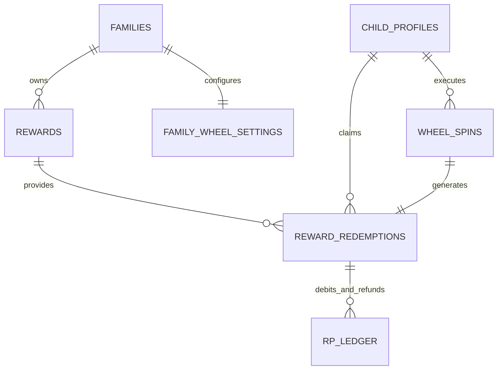

# Phase 4 Detailed Design — Reward Economy & Wheel Experience v0.1

**Status:** PROPOSED  
**Document Version:** `v0.1`  
**Date:** 2026-11-01  
**Target Milestone:** Phase 4 — Reward Economy & Wheel Experience  
**Frozen Code Baseline:** `c6721497bfbde7cb436467cccaad5b2234d23cc4`  
**Latest Green Main:** `624f6b0d23f0789325ebeadd357f09a8172330c6`  

---

## 1. Product Objective

The primary objective of Phase 4 is to connect a child's verified academic growth with meaningful, tangible family recognition. While Study XP provides permanent, non-spendable developmental progression (identity, levels, mastery), **Reward Points (RP)** empower children with real economic agency within their family environment.

Phase 4 delivers two complementary avenues for spending earned RP:
1. **The Reward Store:** Fosters delayed gratification, goal setting, budgeting, and certainty.
2. **The Celebration Wheel:** Provides joyful, immediate celebration, variety, and delightful surprise following verified learning milestones.

Every aspect of Phase 4 must anchor back to LearnWard's foundational thesis: **Help children see themselves getting better.** Gamification must celebrate real academic effort—it must never become an addictive casino simulator or an extractive engagement loop.

---

## 2. Non-Goals

Phase 4 strictly rejects the following mechanics and feature scopes:

- **No gambling or casino mechanics:** No slot-machine aesthetics, no variable-ratio dopamine traps, no near-miss animations, no artificial hype audio, and no "jackpot" visual language.
- **No losing outcomes:** Valid Wheel spins will never produce "Better luck next time," zero points, or empty slots. Every spin awards an active, parent-approved positive prize.
- **No monetized randomness or microtransactions:** Real money cannot buy spins, buy RP, speed up cooldowns, or unlock premium reward tiers.
- **No ads-for-rewards or paid rerolls:** A child cannot watch an advertisement or pay currency to reroll an outcome.
- **No punishment deductions:** Earned RP cannot be confiscated as disciplinary punishment or decremented due to low academic scores.
- **No cash-out or monetary conversion:** RP has zero real-world monetary value outside the family agreement.
- **No sibling competition:** Sibling redemptions, balances, and wheel outcomes are private. There are no public family leaderboards for reward consumption.
- **No complex enterprise inventory warehouse:** Phase 4 does not build a multi-warehouse ERP system for family chores; parents retain high-level oversight through simple active/inactive toggles and fulfillment tracking.

---

## 3. Safety Principles & Constitutional Invariants

LearnWard's product constitution dictates non-negotiable safety rules for Phase 4:

1. **Learning Comes First:** RP can only be created as the output of an immutable `VerifiedLearningEvent` processed by the frozen Growth Engine (`growth-v0.1`). Gamification is strictly downstream of verified academic work.
2. **Study XP Immutability:** Study XP is never spent, debited, or transferred. Spending RP has zero effect on Study XP progression.
3. **Integer Minor-Unit Conservation:** RP balance is strictly tracked in integer minor units ($1.00\text{ RP} = 100\text{ minor units}$). Balance must equal the exact sum of authoritative append-only `rp_ledger` rows:
   $$\text{rp\_balance\_minor} = \sum \text{rp\_ledger.amount\_minor}$$
4. **Non-Negative Balance Invariant:** Spendable RP balance must never drop below zero. Any operation attempting to overdraw spendable RP fails immediately and atomically without side effects.
5. **Guaranteed Positive Value on Wheel:** Every slot on the Wheel must represent a genuine, positive reward approved by the parent.
6. **Separation of Selection from Animation:** The winning outcome is chosen server-authoritatively and committed to the database before the client receives the payload. The client's sole responsibility is rendering an animation that lands on the already-decided reward.
7. **Compensating Refunds Only:** Historical debit records in `rp_ledger` are strictly immutable. If a reward cannot be fulfilled, the system issues a compensating positive credit entry in `rp_ledger`.

---

## 4. Recommended Economy Model

### Comparative Analysis of Candidate Models

| Dimension | Model A: Direct RP Spend for Spins | Model B: Separate Spin Tickets | Model C: Unified RP (Store + Wheel) [Recommended] |
| :--- | :--- | :--- | :--- |
| **Mechanic** | RP is directly converted to spins (e.g. 10 RP = 1 spin). | Learning milestones grant tickets; RP is only for Store. | One unified RP balance. Child chooses to spend RP in Store (certainty) or on Wheel (surprise). |
| **Child Simplicity** | High: One currency, clear exchange rate. | Low: Two currencies (RP + Tickets) creates cognitive friction and confusion. | **Highest:** One currency. Child sees balance and decides how to budget it. |
| **Parental Control** | High: Parents set spin cost in RP. | Moderate: Parents must manage two separate reward faucets. | **High:** Parents set Store prices and Wheel spin cost within a unified system. |
| **Economic Predictability** | High: Directly linked to academic RP generation. | Fragile: Dual faucets risk runaway inflation in one currency. | **Highest:** Mathematical parity between earning and total redemption liability. |
| **Farming Risk** | Low: RP generation is already rate-limited by Phase 3 rules. | Moderate: Children may game easy milestones specifically to farm tickets. | **Lowest:** Bound by frozen Phase 3 anti-farming rules (below-level 25%, practice caps). |
| **Disappointment Risk** | Moderate: If Wheel rewards are too trivial compared to Store items. | Low: Tickets feel "free," so low expectations on wheel. | **Low:** Parent curates Wheel pool so all prizes are genuinely appealing. |
| **Gambling Perception** | Moderate if spin cost is variable. | Low, but feels arbitrary. | **Lowest:** Fixed spin cost (e.g. 10 RP), daily spin cap (max 3/day), guaranteed prize. |
| **Architecture Overhead** | Minimal: Uses existing `rp_ledger`. | High: Requires new `ticket_ledger`, new projection, new reconciliation. | **Minimal:** Zero new currency tables; reuses frozen `rp_ledger` and `child_balances`. |

### Recommendation for LearnWard v0.1: Model C (Unified RP Economy)

**Model C is strongly recommended.** In LearnWard v0.1:
- There is **exactly one spendable reward currency**: **Reward Points (RP)**, represented as integer minor units (`amount_minor`).
- Children earn RP strictly through verified academic achievements.
- When children hold spendable RP, they have full autonomy to make a classic self-regulation choice:
  - **Save for Store:** Fixed cost, guaranteed specific prize (delayed gratification, goal focus).
  - **Spin the Wheel:** Fixed low cost (e.g. 10 RP = 1,000 minor units), random selection among parent-approved treats/privileges (immediate celebration, surprise).
- This model aligns with `docs/04-reward-economy-v0.1.md` Section 15 ("A visible ticket may be used as UI language for the wheel, but it should not become a third economy").

---

## 5. RP → Store / Wheel Relationship

The relationship between the Store and the Wheel is defined by distinct psychological roles, not mathematical dominance:

```text
                  Child's Spendable RP
                           │
            ┌──────────────┴──────────────┐
            ▼                             ▼
       Reward Store                  Reward Wheel
  (Certainty & Planning)       (Surprise & Celebration)
  ─────────────────────         ──────────────────────
  • Fixed high/mid cost         • Low fixed cost (default 10 RP)
  • Child selects exact prize   • Server selects random prize
  • Delayed gratification       • Immediate milestone ritual
  • High-value goals            • Light privileges & treats
  • Zero variance               • Positive-only variance
```

### Expected Value (EV) Guardrail

To prevent the Wheel from cannibalizing the Store (or conversely feeling like a scam):
- **High-Value Exclusive Items:** Expensive items (e.g. "Lego set", "Major amusement park trip", items priced $\ge 100\text{ RP}$) must be **Store-Only**. They are never placed on the Wheel.
- **Fair Valuation on Wheel:** Wheel items should have a subjective value roughly corresponding to 10–25 RP. A child spending 10 RP on a spin is guaranteed to receive a treat that is worth at least 10 RP.
- **Mathematical Dominance Prevention:** The Store must remain the only way to obtain specific, coveted goals with 100% certainty.

---

## 6. Reward Catalog Model

The reward catalog is family-scoped. LearnWard does not hardcode static rewards; every reward belongs to a family tenant.

### Entity Attributes (`public.rewards`)

- `id` (UUID, PK): Unique reward identifier.
- `family_id` (UUID, FK): Owning family tenant boundary.
- `title` (Text): Name of reward (e.g. "Choose Friday Family Movie", "30 Minutes Extra Gaming").
- `description` (Text, Nullable): Clarifying terms (e.g. "Applies on weekend afternoons only").
- `category` (Text): High-level category for filtering and icon display (`privilege`, `experience`, `treat`, `item`, `choice`, `custom`).
- `icon_key` (Text): Visual representation key from design system tokens.
- `store_enabled` (Boolean): Whether the item can be directly purchased in the Store.
- `store_cost_minor` (BigInt, Nullable): Cost in RP minor units if Store-enabled (e.g. $40.00\text{ RP} = 4000\text{ minor units}$).
- `wheel_enabled` (Boolean): Whether the item can be won on the Celebration Wheel.
- `wheel_tier` (Text, Nullable): Rarity tier determining relative selection weight (`common`, `special`, `rare`).
- `target_child_id` (UUID, Nullable, FK): If null, eligible for all children in the family. If set, restricted to a specific child (allowing age-appropriate prizes).
- `is_active` (Boolean): Soft-toggle allowing parents to pause rewards without deleting history.
- `created_at` / `updated_at` (Timestamptz): Audit timestamps.

---

## 7. Fulfillment Lifecycle

Redemptions follow a strict, auditable lifecycle that protects both parent authority and child trust:

```text
[Child Action]
Redeem Store Item / Spin Wheel
      │
      ▼
status = 'pending_fulfillment'
(RP debited atomically via rp_ledger)
      │
      ├───► [Parent Fulfills in Real Life] ───► status = 'fulfilled'
      │                                         (fulfilled_at, fulfilled_by set)
      │
      └───► [Parent Cannot Fulfill] ─────────► status = 'cancelled'
                                                (Compensating credit in rp_ledger;
                                                 cancellation_reason recorded)
```

### Lifecycle Rules:
1. **No "Approval Required to Debit":** When a child redeems an active, parent-configured reward or spins the Wheel, the RP is debited immediately. The claim enters `pending_fulfillment`. This avoids ambiguity over whether the RP was spent.
2. **Parent Fulfillment:** When the parent delivers the real-world privilege/treat, the parent taps **Mark Fulfilled**. The status changes to `fulfilled` with timestamp and user ID.
3. **Cancellation & Automatic Refund:** If a parent cannot fulfill a reward (e.g. bad weather cancels a park visit), the parent taps **Cancel & Refund**. This:
   - Sets status to `cancelled`;
   - Automatically appends a compensating positive refund entry to `rp_ledger`;
   - Immediately restores the child's spendable balance in `child_balances`.
4. **Child Cancellation:** To prevent impulsive buyer's remorse, children cannot unilaterally cancel claims in v0.1; cancellations are handled via parent dialogue.

---

## 8. Wheel Probability Model

### Tier-Based Relative Weighting

Instead of requiring parents to calculate complex percentages that must manually sum to 100%, LearnWard v0.1 adopts a **Tier-Based Relative Weight Model**:

| Wheel Tier | Base Relative Weight | Typical Probability in 6-Item Pool | Intended Purpose |
| :--- | :---: | :---: | :--- |
| **Common** | 60 | ~60% | Everyday privileges ("Pick dinner", "15 min extra game time"). |
| **Special** | 30 | ~30% | Enhanced treats ("Dessert of choice", "Choose family movie"). |
| **Rare** | 10 | ~10% | High excitement ("Weekend outing", "Stay up 30m late"). |

### Probability Calculation

For any given spin, the server dynamically calculates each eligible reward's probability:
$$P(\text{reward}_i) = \frac{w_i}{\sum_{j=1}^{N} w_j}$$
- The parent configuration UI translates these weights into intuitive, transparent descriptions: *"Common (~60% chance)"*, *"Special (~30% chance)"*, *"Rare (~10% chance)"*.
- The child sees visible wedge sizes on the Wheel corresponding directly to true mathematical probability. There are no hidden weighting tricks or misleading wedge sizes.

---

## 9. Server-Authoritative Spin Architecture

Under zero circumstances does the client device determine the winning prize. The client is treated as an untrusted presentation layer.

```text
CLIENT                                      SERVER (PostgreSQL RPC)
  │                                                    │
  │── 1. spin_reward_wheel(command_id, child_id) ────►│
  │                                                    ├── 2. Auth & Tenant Validation
  │                                                    ├── 3. Row lock on child_balances
  │                                                    ├── 4. Check balance >= spin_cost
  │                                                    ├── 5. Check daily spin cap
  │                                                    ├── 6. Snapshot active pool (N >= 2)
  │                                                    ├── 7. Secure random selection
  │                                                    ├── 8. Append negative rp_ledger row
  │                                                    ├── 9. Insert reward_redemptions row
  │                                                    ├── 10. Insert wheel_spins row
  │                                                    ├── 11. Atomic child_balances update
  │                                                    └── 12. Record command_receipt
  │                                                    │
  │◄─ 13. Returns: {spin_id, winning_reward} ─────────┤
  │                                                    │
  ├── 14. UI constructs wheel layout                   │
  ├── 15. Animates deceleration to winner              │
  └── 16. Displays celebratory reward card            │
```

### Invariant:
If the mobile app crashes, loses connectivity, or is closed during the spin animation, **the transaction remains completely valid**. When the app reopens, the winning reward is already in the child's `pending_fulfillment` history.

---

## 10. Idempotency Model

Network dropouts during transaction submission must never cause double debits or lost spins:

1. **Client-Generated Command ID:** Every spin or store redemption generates a unique UUID (`p_command_id`) stored in local SQLite before network transmission.
2. **Command Receipts Table:** The RPC checks `public.command_receipts`:
   - If `p_command_id` was already processed for `spin_wheel` or `redeem_reward`, the RPC returns the existing outcome without re-executing debits or random draws.
3. **Ledger Idempotency Constraints:**
   - Redemptions use unique natural idempotency keys: `'rp:redemption:' || v_redemption_id`.
   - Wheel spins use: `'rp:wheel_spin:' || v_spin_id`.
   - The database unique constraint on `rp_ledger.idempotency_key` guarantees that duplicate inserts fail closed.

---

## 11. Concurrency Model

To prevent double-spending when a child taps rapidly or issues concurrent requests from multiple devices:

1. **Row-Level Serialization:** The trusted RPC acquires an exclusive row lock on the child's balance record:
   ```sql
   select rp_balance_minor into v_current_balance
   from public.child_balances
   where child_id = v_child_id
   for update;
   ```
2. **Strict Verification:** If `v_current_balance < v_cost_minor`, the transaction aborts with an explicit exception (`LW201: Insufficient RP balance`).
3. **Atomic State Transition:** The balance deduction, ledger append, redemption insert, and spin record occur within the single serialized database transaction.
4. **Single-MVCC-Snapshot Reconciliation:** Reconciliations running concurrently read an MVCC-consistent view, ensuring `rp_balance_minor == sum(amount_minor)` is always verified.

---

## 12. Refund Model

When a parent cancels a redemption:
1. The original debit entry in `rp_ledger` remains **strictly unchanged** (preserving frozen trigger `LW102`).
2. A new compensating credit row is inserted into `rp_ledger`:
   - `amount_minor = +v_original_cost_minor` (positive value)
   - `reason_code = 'redemption_refund'`
   - `source_type = 'reward_redemption'`
   - `source_id = v_redemption_id`
   - `idempotency_key = 'rp:refund:' || v_redemption_id`
   - `metadata = jsonb_build_object('cancellation_reason', p_reason)`
3. `child_balances.rp_balance_minor` is updated atomically:
   $$\text{rp\_balance\_minor} \leftarrow \text{rp\_balance\_minor} + v\_original\_cost\_minor$$
4. The redemption status is updated to `cancelled`.

---

## 13. Proposed Database Schema



### Table Definitions (Draft DDL)

```sql
-- 1. Family Reward Catalog
create table if not exists public.rewards (
  id uuid primary key default gen_random_uuid(),
  family_id uuid not null references public.families(id) on delete cascade,
  title text not null check (char_length(trim(title)) between 2 and 100),
  description text null check (description is null or char_length(description) <= 500),
  category text not null check (category in ('privilege', 'experience', 'treat', 'item', 'choice', 'custom')),
  icon_key text not null default 'default_star',
  store_enabled boolean not null default true,
  store_cost_minor bigint null check (store_cost_minor is null or store_cost_minor > 0),
  wheel_enabled boolean not null default false,
  wheel_tier text null check (wheel_tier is null or wheel_tier in ('common', 'special', 'rare')),
  target_child_id uuid null references public.child_profiles(id) on delete set null,
  is_active boolean not null default true,
  created_at timestamptz not null default now(),
  updated_at timestamptz not null default now(),

  constraint chk_reward_cost_if_store check (not store_enabled or store_cost_minor is not null),
  constraint chk_reward_tier_if_wheel check (not wheel_enabled or wheel_tier is not null)
);

create index if not exists idx_rewards_family_active on public.rewards(family_id, is_active);

-- 2. Family Wheel Settings
create table if not exists public.family_wheel_settings (
  family_id uuid primary key references public.families(id) on delete cascade,
  spin_cost_minor bigint not null default 1000 check (spin_cost_minor between 100 and 10000), -- default 10.00 RP
  daily_spin_cap integer not null default 3 check (daily_spin_cap between 1 and 20),
  is_enabled boolean not null default true,
  updated_at timestamptz not null default now()
);

-- 3. Reward Redemptions (Claims)
create table if not exists public.reward_redemptions (
  id uuid primary key default gen_random_uuid(),
  family_id uuid not null references public.families(id) on delete cascade,
  child_id uuid not null references public.child_profiles(id) on delete cascade,
  reward_id uuid not null references public.rewards(id) on delete restrict,
  origin text not null check (origin in ('store', 'wheel')),
  rp_cost_minor bigint not null check (rp_cost_minor >= 0),
  status text not null default 'pending_fulfillment' check (status in ('pending_fulfillment', 'fulfilled', 'cancelled')),
  reward_snapshot jsonb not null, -- immutable copy of title, category, cost, icon at redemption time
  cancellation_reason text null,
  fulfilled_at timestamptz null,
  fulfilled_by_user_id uuid null references auth.users(id),
  created_at timestamptz not null default now(),
  updated_at timestamptz not null default now(),

  constraint fk_redemptions_child_family
    foreign key (child_id, family_id)
    references public.child_profiles(id, family_id)
    on delete cascade
);

create index if not exists idx_redemptions_child_status on public.reward_redemptions(child_id, status, created_at desc);
create index if not exists idx_redemptions_family_status on public.reward_redemptions(family_id, status);

-- 4. Wheel Spins Audit Record
create table if not exists public.wheel_spins (
  id uuid primary key default gen_random_uuid(),
  family_id uuid not null references public.families(id) on delete cascade,
  child_id uuid not null references public.child_profiles(id) on delete cascade,
  reward_id uuid not null references public.rewards(id) on delete restrict,
  redemption_id uuid not null unique references public.reward_redemptions(id) on delete restrict,
  spin_cost_minor bigint not null check (spin_cost_minor >= 0),
  pool_snapshot jsonb not null, -- list of all candidate rewards, weights, and tiers available during this spin
  random_draw numeric not null, -- recorded draw value for mathematical verification
  created_at timestamptz not null default now(),

  constraint fk_wheel_spins_child_family
    foreign key (child_id, family_id)
    references public.child_profiles(id, family_id)
    on delete cascade
);

create index if not exists idx_wheel_spins_child_date on public.wheel_spins(child_id, created_at desc);
```

---

## 14. Proposed RPCs

Four trusted `SECURITY DEFINER` functions encapsulate all Phase 4 mutations:

### 1. `redeem_store_reward`
```text
public.redeem_store_reward(
  p_reward_id uuid,
  p_command_id uuid,
  p_child_id uuid default null
) returns public.reward_redemptions
```
- **Validation:** Verifies caller authorization (active adult or exact child). Locks `child_balances` row `FOR UPDATE`. Checks `is_active`, `store_enabled`, child eligibility, and balance $\ge$ `store_cost_minor`.
- **Execution:** Appends negative entry to `rp_ledger`, creates `reward_redemptions` record with `origin = 'store'`, updates `child_balances`, logs `command_receipts`.

### 2. `spin_reward_wheel`
```text
public.spin_reward_wheel(
  p_command_id uuid,
  p_child_id uuid default null
) returns jsonb -- returns { spin: wheel_spins, redemption: reward_redemptions, reward: rewards }
```
- **Validation:** Verifies caller authorization. Locks `child_balances` `FOR UPDATE`. Checks Wheel is enabled and balance $\ge$ `spin_cost_minor`.
- **Daily Cap Check:** Counts spins today (`created_at >= date_trunc('day', now())`). If count $\ge$ `daily_spin_cap`, aborts with error `LW202: Daily spin cap reached`.
- **Pool Validation:** Finds all active rewards with `wheel_enabled = true` eligible for this child. If count $< 2$, aborts with error `LW203: Insufficient active wheel rewards (minimum 2 required)`.
- **Random Selection:** Calculates weights, draws random outcome, appends negative entry to `rp_ledger`, inserts `reward_redemptions` (`origin = 'wheel'`, `rp_cost_minor = spin_cost`), inserts `wheel_spins`, updates `child_balances`, logs `command_receipts`.

### 3. `fulfill_reward_redemption`
```text
public.fulfill_reward_redemption(
  p_redemption_id uuid
) returns public.reward_redemptions
```
- **Validation:** Enforces caller is an active family adult. Redemption must be in `pending_fulfillment`.
- **Execution:** Updates status to `fulfilled`, records `fulfilled_at = now()`, `fulfilled_by_user_id = auth.uid()`.

### 4. `cancel_reward_redemption`
```text
public.cancel_reward_redemption(
  p_redemption_id uuid,
  p_cancellation_reason text
) returns public.reward_redemptions
```
- **Validation:** Enforces caller is an active family adult. Redemption must be in `pending_fulfillment`.
- **Execution:** Updates status to `cancelled`, appends compensating positive refund to `rp_ledger`, restores `child_balances.rp_balance_minor`, logs audit details.

---

## 15. RLS / Authorization Matrix

| Table / Action | Parent (Active Adult) | Child (Shared Mode) | Child (Paired Device) | Anonymous / Other Family |
| :--- | :---: | :---: | :---: | :---: |
| **`rewards` (SELECT)** | All family rewards | Active eligible only | Active eligible only | Denied |
| **`rewards` (INSERT/UPDATE/DELETE)** | Allowed (own family) | Denied | Denied | Denied |
| **`family_wheel_settings` (SELECT)** | Allowed | Allowed | Allowed | Denied |
| **`family_wheel_settings` (UPDATE)** | Allowed | Denied | Denied | Denied |
| **`reward_redemptions` (SELECT)** | All family claims | Own claims only | Own claims only | Denied |
| **`reward_redemptions` (Direct Mutations)** | Denied (RPC only) | Denied (RPC only) | Denied (RPC only) | Denied |
| **`wheel_spins` (SELECT)** | All family spins | Own spins only | Own spins only | Denied |
| **`wheel_spins` (Direct Mutations)** | Denied (RPC only) | Denied (RPC only) | Denied (RPC only) | Denied |
| **`redeem_store_reward` (EXECUTE)** | Allowed for family child | Allowed for self | Allowed for self | Denied |
| **`spin_reward_wheel` (EXECUTE)** | Allowed for family child | Allowed for self | Allowed for self | Denied |
| **`fulfill_reward_redemption` (EXECUTE)**| Allowed | Denied | Denied | Denied |
| **`cancel_reward_redemption` (EXECUTE)** | Allowed | Denied | Denied | Denied |

---

## 16. Child UX

The Child UX is designed to be joyful, clear, and calming, deliberately avoiding addictive patterns:

### Rewards Hub Navigation
- Top app bar displays real-time spendable RP balance with clear coin/point token iconography.
- Direct toggle between **Reward Store** (grid of goals to save for) and **Celebration Wheel** (interactive festive wheel).

### Wheel Presentation Rules
- **No Slot Machine Sounds or Visuals:** The wheel uses clean, festive, physical spinning-wheel animations (warm wood/pastel aesthetic).
- **Static Wheel Segments:** The wedges rendered on the wheel correspond in angular width to true mathematical probabilities.
- **Spin Activation:** Big, friendly "Spin for 10 RP" button. Button is disabled with an explanatory tooltip if balance is insufficient or daily cap is reached.
- **Celebration Modal:** Upon landing, a friendly celebration banner pops up: *"Hooray! You won [Prize]!"* with an action button *"Add to my rewards"*.

---

## 17. Parent UX

Parents are given full transparency over reward liability without overwhelming complexity:

### Reward Management Screen
- List of current family rewards with clear tags: `[Store: 40 RP]`, `[Wheel: Common]`, `[Active/Paused]`.
- Simple FAB to "Add Family Reward". Pre-populated with popular non-monetary suggestions ("Pick dinner", "30m game time", "Movie night").
- Wheel settings drawer: toggle Wheel on/off, adjust spin cost (5–50 RP), adjust daily spin cap (1–10).

### Fulfillment Inbox
- Dedicated badge on Parent Dashboard: *"2 pending rewards"*.
- Tapping opens the fulfillment inbox showing child name, prize won/claimed, date, and whether it was from Store or Wheel.
- One-tap action: **"Mark Fulfilled"** or secondary **"Cancel & Refund"**.

---

## 18. Failure Handling Matrix

| Scenario | System Response | User Experience |
| :--- | :--- | :--- |
| **Device Offline** | Mobile client detects offline state; disables "Redeem" and "Spin" buttons. | Friendly snackbar: *"Reward spending requires an active internet connection."* |
| **Network Dropout During Spin** | Server has committed transaction. Client command retry uses same `command_id`. | Server returns committed outcome. Client resumes or displays prize modal immediately. |
| **Insufficient RP** | RPC aborts with `LW201`; zero ledger writes. | Button disabled in UI; if raced, dialog shows *"You need X more RP to unlock this."* |
| **Reward Deactivated Mid-Claim** | RPC checks `is_active = true` inside transaction; aborts if false. | Error dialog: *"This reward is no longer available. Your RP was not deducted."* |
| **Wheel Pool Drops Below 2 Items** | RPC aborts with `LW203`; zero RP deducted. | Dialog: *"The wheel needs at least 2 active rewards. Ask your parent to configure the wheel!"* |
| **Concurrent Spins Attempted** | Row lock on `child_balances` serializes requests. Second request sees reduced balance and aborts cleanly. | Exactly one spin succeeds. No balance overdraw. |
| **App Closes During Spin Animation** | Transaction was already finalized before animation started. | On next launch, claimed reward is safely waiting in Redemptions history. |
| **Parent Cancels Reward** | Status updated to `cancelled`; compensating `rp_ledger` refund created. | Child receives friendly notification: *"Reward cancelled. 40 RP refunded to your balance."* |

---

## 19. Analytics & Health Metrics

Telemetry must measure product health, fulfillment reliability, and learning connection—**never** addiction:

1. **Reward Fulfillment Rate:** Percentage of claimed rewards successfully fulfilled by parents within 7 days (Target: $\ge 85\%$).
2. **RP Circulation Velocity:** Median days between earning RP from academic assessments and spending RP in Store/Wheel.
3. **Store vs. Wheel Ratio:** Ratio of RP spent on Store certainty vs. Wheel randomness (helps balance pool appeal).
4. **Child Saving Rate:** Percentage of children who save RP for higher-tier Store rewards ($\ge 50\text{ RP}$) vs. spending immediately.
5. **Anti-Metric Guardrail:** Average spins per child per week. If this spikes without corresponding verified learning events, investigate for balance leakage.

---

## 20. Test Strategy

Phase 4 testing will follow LearnWard's established multi-layer verification pyramid:

1. **Domain Tests (`learnward_domain`):**
   - Pure Dart tests for Wheel probability calculation, cumulative weight intervals, and random selection mapping.
   - Verification of zero-reward rejection and empty-pool validation.
2. **Database & RLS Tests (`supabase/tests/database` pgTAP):**
   - Tenant isolation: Family B cannot view or claim Family A rewards.
   - Child authorization: Child A cannot read Child B redemptions.
   - Balance protection: Overdraft attempts fail closed (`LW201`).
   - Daily cap enforcement: Attempting $N+1$ spins on the same day fails (`LW202`).
   - Immutability: Direct updates/deletes on `rp_ledger`, `reward_redemptions`, and `wheel_spins` are blocked.
   - Compensating refund: Verifying cancellation restores balance and appends positive ledger entry.
3. **Concurrency Regression Test (`scripts/test_reward_concurrency.mjs`):**
   - Multi-session concurrency test: 5 simultaneous spin requests with balance for only 1 spin. Proves exactly 1 succeeds, 4 fail with `LW201`, balance is exactly 0.
4. **Flutter Widget Tests (`apps/mobile`):**
   - Testing Store card states (affordable vs locked).
   - Testing Wheel presentation, animation decoupling, and result dialog.
   - Testing Parent fulfillment actions and refund flows.

---

## 21. Explicit Deferred Scope

To protect the Phase 4 delivery schedule, the following features are explicitly deferred:

- **Complex Warehouse Inventory:** Finite stock counters (e.g. "Only 2 remaining") are deferred. In v0.1, availability is controlled via the `is_active` toggle.
- **Multiple Named Wheels:** Multiple specialized wheels (e.g. "Food Wheel", "Weekend Wheel") are deferred. v0.1 provides one unified Celebration Wheel per family.
- **Child-to-Child Gifting:** Gifting RP or rewards to siblings is deferred.
- **Automated Expiry / Expiration Dates:** Automated time-decay on unfulfilled redemptions is deferred.
- **Custom Sound Effects / Heavy Particle Shaders:** Custom audio synthesis and GPU particle engines are deferred in favor of clean Flutter design-system animations.

---

## 22. Open Product Decisions for Review

The following product decisions are highlighted for independent product review:

1. **Default Spin Cost:** We propose a default of **10 RP** ($1,000\text{ minor units}$). Given that a solid assessment yields ~8–12 RP in Phase 3, this allows roughly 1 celebration spin per successful verified assessment. Is 10 RP the desired target baseline?
2. **Daily Spin Cap Value:** We propose a default limit of **3 spins per day per child** to prevent rapid-fire compulsive spinning. Should this cap be hardcoded or parent-customizable (range 1–10)?
3. **Minimum Active Wheel Rewards:** We propose requiring a minimum of **2 distinct active rewards** in the Wheel pool before spinning is permitted. Would a minimum of 3 or 4 provide a better celebration experience?
4. **Parent Approval on Claims:** We propose that Store claims and Wheel spins enter `pending_fulfillment` directly (deducting RP immediately) rather than requiring a two-phase "request -> parent approval -> debit" flow. Does product agree with immediate deduction upon child claim?

---

## 23. Recommended Implementation Sequence

To minimize architectural risk and deliver rapid value, Phase 4 should be implemented in three strictly decoupled vertical slices:

### Slice 4.1: Core Reward Catalog & Store Redemptions (Foundation)
- Create `rewards` and `reward_redemptions` tables with RLS.
- Implement `redeem_store_reward` RPC with row-locked balance deduction.
- Implement parent `fulfill_reward_redemption` and `cancel_reward_redemption` (with refund).
- Flutter UI: Parent reward management and Child Store view.

### Slice 4.2: Celebration Wheel Engine & Randomness (Gamification Layer)
- Create `family_wheel_settings` and `wheel_spins` tables with RLS.
- Implement `spin_reward_wheel` RPC with secure server selection, daily cap, and audit snapshots.
- pgTAP tests for Wheel selection distribution and concurrency.
- Flutter UI: Celebratory Wheel spinning widget and win presentation.

### Slice 4.3: Integration, Telemetry & Hardening
- End-to-end integration journeys from assessment verification to RP award to Wheel spin.
- Multi-session concurrency test script for racing redemptions.
- Android debug build & iOS simulator verification.
- Phase 4 Freeze documentation.
