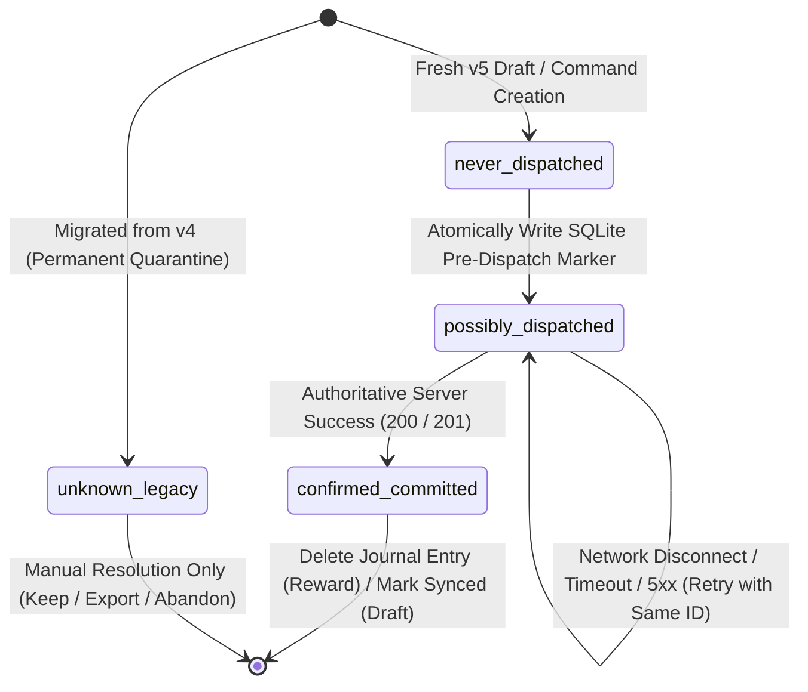
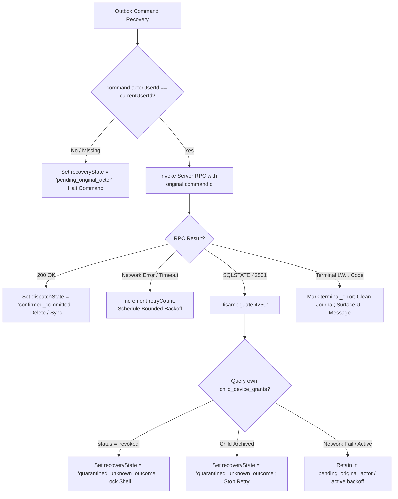
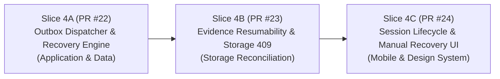

# Phase 6 Dependency & Readiness Review — Actor-Aware Offline Command Recovery

**Status:** READY FOR IMPLEMENTATION PLANNING  
**Date:** 2026-11-07  
**Target:** Phase 6 Slice 4 — Actor-Aware Offline Command Recovery & Outbox Architecture  
**Upstream Contracts:**
- [ADR 0008 — Phase 6 Pilot Hardening](adr/0008-phase-6-pilot-hardening.md) (`ACCEPTED`)
- [Phase 6 Detailed Design v0.1](17-phase-6-pilot-hardening-design-v0.1.md) (`ACCEPTED`)
- [Phase 6 Drift v5 Foundation Freeze](freezes/phase-6-drift-v5-foundation-freeze.md) (`FROZEN` @ `7b0d6ce9d179a7945bcb217f15dcd32274d649b0`)

---

## 1. Executive Summary & Readiness Assessment

Following the successful merge and verification of PR #21 (Drift v5 Foundation @ `7b0d6ce9d179a7945bcb217f15dcd32274d649b0`), the local SQLite persistence layer has been safely upgraded with non-destructive additive schemas, atomic multi-version migrations, legacy quarantine markers, and fail-closed actor matching.

The next engineering priority is **Actor-Aware Offline Command Recovery**, enabling the mobile application to reliably process outbox commands across network drops, app restarts, actor switches, child profile archival, and device lifecycle transitions without risking duplicate economic operations or privacy violations.

This review formalizes the exact architectural contracts, state machines, lifecycle policies, and testing requirements before implementation begins.

---

## 2. Core Architectural Contracts

### 2.1 Durable Outbox Dispatch State Machine

Both `pending_reward_commands` and `local_assessment_drafts` utilize the canonical `CommandDispatchState` enum:



1. **Pre-Dispatch SQLite Barrier:**
   - **Before** opening any network socket or invoking a Supabase RPC, `dispatchState` must be committed to SQLite as `possibly_dispatched`.
   - If the application crashes, runs out of battery, or is force-killed immediately after the SQLite commit but before network transmission, the operation is intentionally treated as *potentially committed on the server*.
2. **Idempotent Replay Invariance:**
   - When recovering an operation in `possibly_dispatched`, the dispatcher **MUST REUSE THE EXACT SAME `command_id`**.
   - Regenerating a command UUID for an unresolved operation is strictly prohibited, as it would cause duplicate ledger debits or multiple assessment submissions if the original command had actually succeeded on the server.
3. **Receipt Absence Contract:**
   - Absence of an entry in `public.command_receipts` or absence of a domain row **NEVER PROVES NON-EXECUTION**, because:
     - The query may be filtered by RLS (e.g. paired-child devices cannot select from `command_receipts`).
     - Network replication or transaction commit may be in-flight.
   - Recovery relies entirely on invoking the server's `SECURITY DEFINER` mutation RPC with the original `p_command_id`, which performs authoritative server-side idempotency checks.

---

### 2.2 Dual State Machine: `RecoveryState` vs. `DispatchState`

To prevent conflating network transmission history with authorization and lifecycle readiness, the outbox enforces two orthogonal dimensions:

| Dimension | Enum / Field | Responsibility | Values |
|---|---|---|---|
| **Network Dispatch** | `dispatch_state` | Physical network boundary tracking | `unknown_legacy`, `never_dispatched`, `possibly_dispatched`, `confirmed_committed` |
| **Lifecycle & Recovery** | `recovery_state` | Execution eligibility & authorization | `active`, `pending_original_actor`, `quarantined_unknown_outcome`, `terminal_error` |

#### Valid State Combinations:
1. `(never_dispatched, active)`: Newly created draft/command, eligible for initial transmission by current actor.
2. `(possibly_dispatched, active)`: Dispatched but interrupted; eligible for idempotent retry by the bound actor.
3. `(possibly_dispatched, pending_original_actor)`: Interrupted under Actor A; current user is Actor B. Paused until Actor A logs in.
4. `(unknown_legacy, quarantined_unknown_outcome)`: Migrated v4 record with unknown network status; permanently quarantined from automated dispatch.
5. `(possibly_dispatched, quarantined_unknown_outcome)`: Target child was archived or operation encountered an unresolvable authorization barrier. Preserved locally for parental audit/export.
6. `(*, terminal_error)`: Permanent business error (e.g. `LW202: Insufficient RP`, `LW203: Daily cap reached`).

---

### 2.3 Original-Actor Session Verification & Error Disambiguation

Every outbox operation is bound to an immutable `actor_user_id`. Before any dispatch or replay attempt, the dispatcher executes the following authorization pipeline:



#### SQLSTATE `42501` Disambiguation Rules:
- **Rule 1 — Never Infer Revocation from 42501 Alone:** `42501 (insufficient_privilege)` is returned by PostgreSQL for RLS policy rejections, child archival, caller mismatches, role mismatches, and revoked grants.
- **Rule 2 — Positive Proof of Device Revocation:** For a paired child device, revocation is confirmed **only** by querying its own grant row:
  ```sql
  SELECT id, status, revoked_at FROM public.child_device_grants WHERE auth_user_id = auth.uid();
  ```
  If and only if `status = 'revoked' AND revoked_at IS NOT NULL`, the client confirms `DEVICE_REVOKED`.
- **Rule 3 — Child Archival Detection:** When a child profile is archived, server mutation RPCs return `42501: Child profile is archived`. The dispatcher catches this specific error and transitions the outbox entry to `quarantined_unknown_outcome`.

---

### 2.4 Bounded Exponential Backoff & Retry Classification

Retries must prevent server thundering herds while remaining responsive after transient drops:
- **Base delay:** $t_{\text{base}} = 2\text{ seconds}$.
- **Multiplier:** $2^{\text{retryCount}}$.
- **Maximum ceiling:** $t_{\max} = 60\text{ seconds}$.
- **Full Jitter:** $t_{\text{wait}} = \text{random}(0, \min(t_{\max}, t_{\text{base}} \times 2^{\text{retryCount}}))$.
- **Invariance:** `retryCount` tracks execution attempts only. A value of `retryCount == 0` does **not** equal `never_dispatched`.

---

### 2.5 Assessment Evidence & Storage Reconciliation Dependencies

The draft submission flow involves three coordinated steps:
1. **Local Compression:** Generate stably compressed JPEG ($\le 1.5\text{ MB}$ target) and compute SHA-256 hash. Store hash and compressed path in `local_assessment_drafts`.
2. **Storage Upload:** Upload bytes via `uploadBinary` with `upsert: false` to `assessment-evidence` bucket at `familyId/childId/clientEvidenceUuid.jpg`.
   - **HTTP 409 Resolution:** If storage reports object already exists, download the object bytes, verify length and SHA-256 digest against the local record.
   - If SHA-256 matches: proceed to database registration.
   - If SHA-256 differs: mark `evidence_conflict`; do not overwrite or replace UUID.
3. **Database Registration:** Call `register_assessment_evidence` with `p_assessment_id`.
   - If registration response is lost, query `public.assessment_evidence` for matching `storage_path`.
   - If row exists: record `serverEvidenceId` without mutation.
   - If assessment was submitted by another device before registration completed: enter `registration_unresolved` without retrying registration.

---

### 2.6 Per-Data-Class Device Containment & Session Lifecycle

A blanket `clearAllTables()` wipe on sign-out is strictly prohibited. The system enforces the lifecycle matrix established in [ADR 0008 §3.4](adr/0008-phase-6-pilot-hardening.md):

| Data Class | Storage Medium | User Sign-Out | Family Switch | Child Mode Exit | Paired Child Revoked | Account Deletion |
|---|---|---|---|---|---|---|
| **Parent PIN Hash & Salt** | `local_metadata_entries` | **Retained** | **Retained** | **Purged** | **Retained** | **Purged** |
| **Active Child Session** | `local_metadata_entries` | **Purged** | **Purged** | **Purged** | **Purged** | **Purged** |
| **Assessment Drafts** | `local_assessment_drafts` | **Retained** | **Retained** | **Purged** | **Quarantined** | **Purged** |
| **Pending Reward Commands** | `pending_reward_commands` | **Paused** (`pending_original_actor`) | **Paused** | **Purged** | **Quarantined** | **Purged** |
| **Evidence Photo Files** | App Documents Dir | **Retained** | **Retained** | **Purged** | **Quarantined** | **Purged** |
| **Cached Read Models** | SQLite Read Tables | **Purged** | **Purged** | **Purged** | **Purged** | **Purged** |

---

### 2.7 Manual Recovery Actions for Quarantined Records

For records in `quarantined_unknown_outcome` or `unknown_legacy`, automated network retry is disabled. The UI must provide three explicit, safe user choices:
1. **Keep Quarantined:** Leaves the record preserved in local SQLite without attempting network mutations.
2. **Export Unsynced Work:** Exports the draft text, scores, subject, timestamps, and local photos to an external portable JSON bundle via the platform share sheet.
3. **Abandon Local Copy:** Discards the local record from SQLite after displaying an explicit cautionary confirmation dialog warning that if a remote server operation occurred, its remote effects remain committed.

---

## 3. Minimal Implementation Slice Decomposition

To ensure safe, testable, and non-breaking incremental delivery, Phase 6 Client Recovery is divided into three distinct PR slices:



---

### Slice 4A: Application & Data Actor-Aware Outbox Recovery Dispatcher (Recommended Next PR)

- **Target Package:** `packages/learnward_application` and `packages/learnward_data`.
- **Exact Scope:**
  1. Define `OutboxRecoveryDispatcher` and `PendingCommandRecoveryService` interfaces.
  2. Implement queue drainage for `PendingRewardCommands` and `LocalAssessmentDrafts`:
     - Verification of bound `actorUserId == currentUserId`.
     - Transition of mismatched commands to `pending_original_actor`.
     - Pre-dispatch SQLite marker update (`possibly_dispatched`).
     - Invocation of repository mutation with exact original `commandId`.
     - Authoritative idempotent outcome handling and journal clearance.
     - Detection of child archival (`42501`) and transition to `quarantined_unknown_outcome`.
     - Bounded exponential backoff with jitter and retry count increments.
  3. Real SQLite test suite with simulated network crashes, actor switches, and response loss.
- **Known Limitations & Deferrals:**
  - Zero UI components or Flutter widgets (handled in Slice 4C).
  - Storage byte download and SHA-256 verification deferred to Slice 4B.
  - Zero modifications to frozen Supabase migrations.

---

### Slice 4B: Evidence Resumability, Storage 409 & Registration Reconciliation

- **Target Package:** `packages/learnward_application`, `packages/learnward_data`, and `apps/mobile`.
- **Exact Scope:**
  1. Adaptive image compression service maintaining handwriting legibility.
  2. Storage upload with `upsert: false`.
  3. HTTP 409 conflict detection: private byte download, length and SHA-256 verification.
  4. Database registration reconciliation on lost response without duplicate rows.
  5. Handling non-draft/submitted assessment transitions (`registration_unresolved`).

---

### Slice 4C: Session Lifecycle, Device Containment & Manual Recovery UI

- **Target Package:** `apps/mobile` and `packages/learnward_design_system`.
- **Exact Scope:**
  1. `AppLifecycleManager` implementing the Per-Data-Class sign-out/switch/revocation matrix.
  2. Positive revocation check on `child_device_grants`.
  3. `AppErrorStateWidget`, `AppOfflineBanner`, and `RetryActionCard`.
  4. Manual recovery dialogs: Keep quarantined, Export unsynced work, Abandon local copy.

---

## 4. Acceptance Criteria & Test Verification Plan for Slice 4A

Before Slice 4A can be accepted:
1. **Actor Mismatch Test:** Command queued by User A remains untouched and paused in `pending_original_actor` when User B runs the dispatcher.
2. **Crash Before Send Test:** Pre-dispatch SQLite marker persists across forced process death; restart reuses identical command ID.
3. **Response Loss Test:** Server commits command; client experiences simulated network timeout; dispatcher retries with identical command ID; server returns committed receipt; journal clears without double debit/spin.
4. **Archived Child Test:** Mutation on archived child receives `42501`; command transitions to `quarantined_unknown_outcome`; automated retry ceases permanently.
5. **Backoff Schedule Test:** Verifies backoff interval doubles with jitter and respects 60-second ceiling.
6. **Zero Churn:** Frozen migrations, ADR 0008, and Phase 0–5 contracts remain unchanged.
