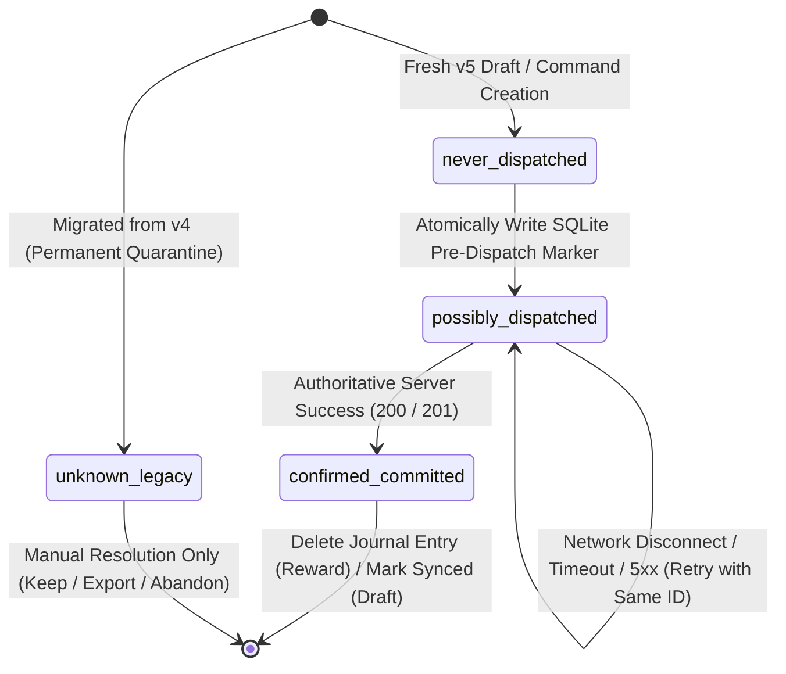
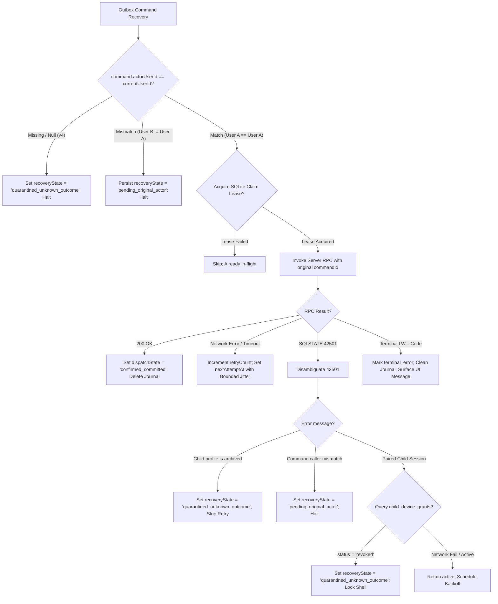
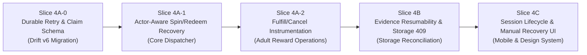

# Phase 6 Dependency & Readiness Review — Actor-Aware Offline Command Recovery

**Status:** READY FOR IMPLEMENTATION PLANNING (REFINED & AUDITED)  
**Date:** 2026-11-07  
**Target:** Phase 6 Slice 4 — Actor-Aware Offline Command Recovery & Outbox Architecture  
**Upstream Contracts:**
- [ADR 0008 — Phase 6 Pilot Hardening](adr/0008-phase-6-pilot-hardening.md) (`ACCEPTED`)
- [Phase 6 Detailed Design v0.1](17-phase-6-pilot-hardening-design-v0.1.md) (`ACCEPTED`)
- [Phase 6 Drift v5 Foundation Freeze](freezes/phase-6-drift-v5-foundation-freeze.md) (`FROZEN` @ `7b0d6ce9d179a7945bcb217f15dcd32274d649b0`)

---

## 1. Executive Summary & Readiness Assessment

Following the successful merge and verification of PR #21 (Drift v5 Foundation @ `7b0d6ce9d179a7945bcb217f15dcd32274d649b0`), the local SQLite persistence layer has been safely upgraded with non-destructive additive schemas, atomic multi-version migrations, legacy quarantine markers, and fail-closed actor matching.

This document formalizes the resolved architectural dependencies, durable state machine, concurrency-claim protocol, and implementation slicing for **Actor-Aware Offline Command Recovery (Phase 6 Slice 4)**.

---

## 2. Core Architectural Contracts & Resolved Dependencies

### 2.1 Durable Outbox Dispatch State Machine

Both `pending_reward_commands` and `local_assessment_drafts` utilize the canonical `CommandDispatchState` enum:



1. **Pre-Dispatch SQLite Barrier:**
   - **Before** opening any network socket or invoking a Supabase RPC, `dispatchState` must be committed to SQLite as `possibly_dispatched`.
   - If the application crashes, runs out of battery, or is force-killed immediately after the SQLite commit but before network transmission, the operation is intentionally treated as *potentially committed on the server*.
2. **Idempotent Replay Invariance:**
   - When recovering an operation in `possibly_dispatched`, the dispatcher **MUST REUSE THE EXACT SAME `command_id`**.
   - Regenerating a command UUID for an unresolved operation is strictly prohibited, as it would cause duplicate ledger debits or multiple assessment submissions if the original command had actually succeeded on the server.
3. **Receipt Absence Contract:**
   - Absence of an entry in `public.command_receipts` or absence of a domain row **NEVER PROVES NON-EXECUTION**, because:
     - The query may be filtered by RLS (e.g. paired-child devices cannot select from `command_receipts`).
     - Network replication or transaction commit may be in-flight.
   - Recovery relies entirely on invoking the server's `SECURITY DEFINER` mutation RPC with the original `p_command_id`, which performs authoritative server-side idempotency checks.

---

### 2.2 Dual State Machine & Schema Harmonization Decision

To prevent conflating network transmission history with authorization and lifecycle readiness, the outbox enforces two orthogonal dimensions:

| Dimension | Enum / Field | Responsibility | Values |
|---|---|---|---|
| **Network Dispatch** | `dispatch_state` | Physical network boundary tracking | `unknown_legacy`, `never_dispatched`, `possibly_dispatched`, `confirmed_committed` |
| **Lifecycle & Recovery** | `recovery_state` | Execution eligibility & authorization | `active`, `pending_original_actor`, `quarantined_unknown_outcome`, `terminal_error` |

#### Analysis of Drift v5 Schema Asymmetry & Additive v6 Decision:
- **`pending_reward_commands` (Drift v5):** Contains `recovery_state`, `dispatch_state`, `actor_user_id`, `actor_role`. It does **not** persist `retry_count`, `next_attempt_at`, or `last_error_message`.
- **`local_assessment_drafts` (Drift v5):** Contains `submission_status`, `retry_count`, `dispatch_state`, `last_error_message`, `actor_user_id`, `actor_role`. It does **not** persist `next_attempt_at` or `recovery_state`.

#### Architectural Decision for Sub-Slice 4A-0:
To guarantee **restart-safe bounded exponential backoff** without resetting timers on application restart or memory pressure:
1. An explicitly versioned additive Drift migration (**schemaVersion = 6**, `from == 5`) is introduced in sub-slice 4A-0.
2. `pending_reward_commands` adds:
   - `retry_count`: `INTEGER NOT NULL DEFAULT 0`
   - `next_attempt_at`: `DATETIME NULL`
   - `last_error_message`: `TEXT NULL`
3. `local_assessment_drafts` adds:
   - `next_attempt_at`: `DATETIME NULL`
4. Draft recovery status maps directly to its existing `submission_status` (`draft`, `failed_retryable`, `terminal_error`) and `dispatch_state` (`unknown_legacy` $\implies$ quarantined); no redundant `recovery_state` column is required on drafts.

---

### 2.3 Concurrency Claims & Foreground/Background Coordination

To prevent race conditions where a background recovery timer and a user foreground action attempt to dispatch the same command concurrently:

1. **Atomic Claim Lease Pattern:**
   Before a worker (background dispatcher or foreground use case) dispatches a command, it acquires an atomic lease in SQLite:
   ```sql
   UPDATE pending_reward_commands
   SET next_attempt_at = :leaseExpiresAt
   WHERE command_id = :id
     AND recovery_state = 'active'
     AND (next_attempt_at IS NULL OR next_attempt_at <= :now);
   ```
   If 0 rows are affected, another invocation is currently processing this command; the worker immediately yields.
2. **Foreground Use Case Protection:**
   When `spinRewardWheel` or `redeemStoreReward` is invoked by the user, it checks `_commandStore.findPending...`. If an unresolved command exists with an active lease, the foreground action does not overwrite the journal entry or launch a duplicate network call; it safely waits for the in-flight claim or returns an actionable in-progress notification.

---

### 2.4 Original-Actor Verification & State Resumption Protocol

Every outbox operation is bound to an immutable `actor_user_id`. Before any dispatch or replay attempt, the dispatcher executes the following authorization pipeline:



#### Safe Resumption Protocol:
- When User B logs in, User A's pending commands are persisted with `recovery_state = 'pending_original_actor'` and skipped during queue drainage.
- When User A logs back in, the dispatcher detects `actor_user_id == User_A.id AND recovery_state = 'pending_original_actor'`, resets them to `recovery_state = 'active'` with `next_attempt_at = now()`, and resumes execution.

---

### 2.5 Authoritative Error Code Classification & SQLSTATE `42501` Disambiguation

The server returns SQLSTATE `42501 (insufficient_privilege)` across diverse authorization conditions. The client **MUST NOT** treat all `42501` errors as device revocation.

#### Verified PostgreSQL Error Codes:
- **`LW201`:** Insufficient RP balance (terminal business error)
- **`LW202`:** Daily wheel spin cap reached (terminal business error)
- **`LW203`:** Insufficient eligible rewards in wheel pool (terminal business error)
- **`LW204`:** Reward redemption is already in a terminal state / invalid transition
- **`LW205`:** Reward no longer available
- **`LW206`:** Celebration wheel is disabled for this family

#### Disambiguation Rules:
1. **Rule 1 — Never Infer Revocation from 42501 Alone:** A raw `42501` can mean child archival, caller mismatch, role mismatch, or RLS block.
2. **Rule 2 — Child Archival Detection:** When the error message indicates `Child profile is archived`, the dispatcher transitions the outbox entry to `quarantined_unknown_outcome` and halts retries permanently.
3. **Rule 3 — Positive Proof of Device Revocation:** For a paired child device, revocation is confirmed **only** by querying its own grant row:
   ```sql
   SELECT id, status, revoked_at FROM public.child_device_grants WHERE auth_user_id = auth.uid();
   ```
   If and only if `status = 'revoked' AND revoked_at IS NOT NULL`, the client confirms `DEVICE_REVOKED`.
4. **Rule 4 — Terminal Business Codes:** On `LW201`, `LW202`, `LW203`, `LW204`, `LW205`, `LW206`, the command is permanently rejected. The journal entry is deleted (or stamped `terminal_error`), and a user-friendly error is surfaced.

---

### 2.6 Operation Safety & Scope Partitioning

- **Safe to Dispatch in Slice 4A-1:**
  - `spinRewardWheel`: Already accepts `actorUserId`, validates caller match, commits `possibly_dispatched` before RPC.
  - `redeemStoreReward`: Already accepts `actorUserId`, validates caller match, commits `possibly_dispatched` before RPC.
- **Requires Instrumentation in Slice 4A-2:**
  - `fulfillRewardRedemption`: Does not currently accept or persist `actorUserId`; does not commit `possibly_dispatched`.
  - `cancelRewardRedemption`: Does not currently accept or persist `actorUserId`; does not commit `possibly_dispatched`.
- **Excluded from Slice 4A-1:**
  - `local_assessment_drafts`: Draft submission requires prior evidence compression, Storage upload (`upsert: false`), and database registration (`register_assessment_evidence`). Attempting automated submission of drafts with unresolved evidence before Slice 4B is strictly prohibited.

---

### 2.7 Bounded Exponential Backoff & Retry Classification

Retries must prevent server thundering herds while remaining responsive after transient drops:
- **Base delay:** $t_{\text{base}} = 2\text{ seconds}$.
- **Multiplier:** $2^{\text{retryCount}}$.
- **Maximum ceiling:** $t_{\max} = 60\text{ seconds}$.
- **Full Jitter:** $t_{\text{wait}} = \text{random}(0, \min(t_{\max}, t_{\text{base}} \times 2^{\text{retryCount}}))$.
- **Invariance:** `retryCount` tracks execution attempts only. A value of `retryCount == 0` does **not** equal `never_dispatched`.

---

## 3. Refined Implementation Slicing

To maintain strict architectural boundaries and incremental testability, Slice 4 is decomposed into the following sequence:



---

### Sub-Slice 4A-0: Durable Retry Foundation & Concurrency Claim Schema
- **Scope:** `packages/learnward_data` and `packages/learnward_application`.
- **Deliverables:**
  - Additive Drift schema migration v5 $\to$ v6:
    - `pending_reward_commands`: add `retry_count`, `next_attempt_at`, `last_error_message`.
    - `local_assessment_drafts`: add `next_attempt_at`.
  - Atomic migration unit tests (v1 $\to$ v6, v4 $\to$ v6, v5 $\to$ v6).
  - Concurrency lease query and claim methods on `PendingRewardCommandStore`.
- **Target:** Smallest safe prerequisite PR.

---

### Sub-Slice 4A-1: Actor-Aware Recovery Dispatcher for Spin & Redeem (Core Recovery Engine)
- **Scope:** `packages/learnward_application` and `packages/learnward_data`.
- **Deliverables:**
  - `OutboxRecoveryDispatcher` service.
  - Queue drainage for `spinWheel` and `redeemReward`.
  - Original actor identity verification (`currentUserId` check).
  - Persistence of `recovery_state = 'pending_original_actor'` on mismatch.
  - Re-invoking server mutation RPC with original `commandId`.
  - Bounded exponential backoff with jitter and persistent `next_attempt_at`.
  - Archived-child detection (`42501`) and transition to `quarantined_unknown_outcome`.
  - Positive device revocation query handling for paired children.
  - Comprehensive unit and integration tests with real SQLite files and simulated network drops.
- **Explicit Limit:** No draft auto-submission; no fulfill/cancel dispatching; zero UI changes.

---

### Sub-Slice 4A-2: Fulfill & Cancel Reward Instrumentation
- **Scope:** `packages/learnward_application` and `packages/learnward_data`.
- **Deliverables:**
  - Instrument `fulfillRewardRedemption` and `cancelRewardRedemption` with actor identity and pre-dispatch `possibly_dispatched` marker.
  - Extend `OutboxRecoveryDispatcher` to handle adult fulfillment/cancellation operations.

---

### Slice 4B: Evidence Resumability, Storage 409 & Registration Reconciliation
- **Scope:** `packages/learnward_application`, `packages/learnward_data`, and `apps/mobile`.
- **Deliverables:**
  - Adaptive JPEG compression preserving handwriting legibility.
  - Storage upload with `upsert: false`.
  - HTTP 409 conflict detection: byte download and SHA-256 verification.
  - Database registration reconciliation without duplicate rows.
  - Handling `registration_unresolved` when assessment is already submitted.

---

### Slice 4C: Session Lifecycle, Device Containment & Manual Recovery UI
- **Scope:** `apps/mobile` and `packages/learnward_design_system`.
- **Deliverables:**
  - `AppLifecycleManager` implementing Per-Data-Class sign-out/switch/revocation matrix.
  - `AppErrorStateWidget`, `AppOfflineBanner`, and `RetryActionCard`.
  - Manual recovery dialogs: Keep quarantined, Export unsynced work, Abandon local copy.

---

## 4. Acceptance Criteria & Test Verification Plan for Slice 4A-1

Before Slice 4A-1 can be accepted:

1. **Different Authenticated Actors:**
   - Command queued by User A remains untouched and persisted as `pending_original_actor` when User B runs the dispatcher.
   - When User A signs in, the command transitions back to `active` and executes cleanly.
2. **Missing Original Actor:**
   - Migrated legacy command with `actorUserId == null` is stamped `quarantined_unknown_outcome` and is never automatically replayed.
3. **App Crash Between Local Commit and Request:**
   - Pre-dispatch marker (`possibly_dispatched`) is written to SQLite before RPC dispatch.
   - Forced process death before network call leaves command intact; restart reuses identical `commandId`.
4. **Response Lost After Server Commit:**
   - Server commits RPC and records `command_receipts`, but client times out before receiving HTTP response.
   - Dispatcher retries with identical `commandId`.
   - Server returns existing committed outcome; client marks `confirmed_committed` and deletes journal row with zero double debit/spin.
5. **Concurrent Foreground and Background Processing:**
   - Dispatcher acquiring claim lease prevents duplicate foreground execution.
   - User attempting foreground operation while background recovery is in-flight does not duplicate network call or corrupt journal.
6. **Archived Children:**
   - Mutation RPC on archived child profile receives `42501 (Child profile is archived)`.
   - Command transitions to `quarantined_unknown_outcome`; automated retry ceases permanently.
7. **Permission Errors & Revoked Devices:**
   - For paired child devices receiving `42501`, dispatcher executes dedicated `child_device_grants` query.
   - Revocation confirmed only upon positive proof (`status = 'revoked' AND revoked_at IS NOT NULL`).
8. **Restart-Safe Backoff & Zero Economic Duplication:**
   - Bounded exponential backoff persists `next_attempt_at` and `retry_count` in SQLite across app restarts.
   - Ledger parity and daily cap invariance verified across 100% of test scenarios.
