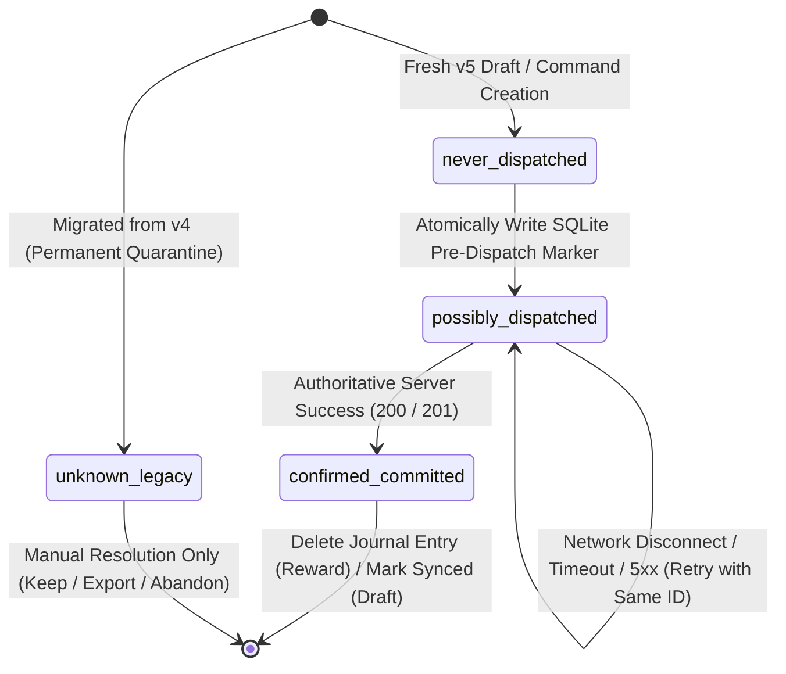
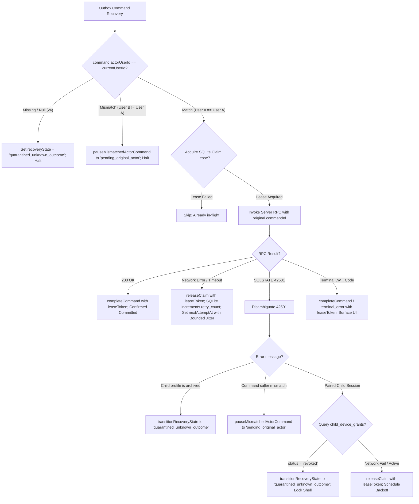
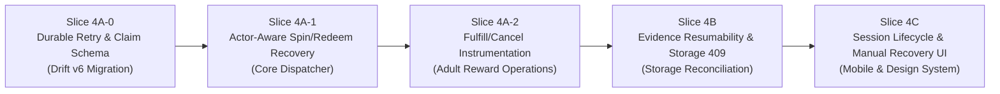

# Phase 6 Dependency & Readiness Review — Actor-Aware Offline Command Recovery

**Status:** READY FOR IMPLEMENTATION PLANNING (REFINED & AUDITED)  
**Date:** 2026-11-07  
**Target:** Phase 6 Slice 4 — Actor-Aware Offline Command Recovery & Outbox Architecture  
**Upstream Contracts:**
- [ADR 0008 — Phase 6 Pilot Hardening](adr/0008-phase-6-pilot-hardening.md) (`ACCEPTED`)
- [Phase 6 Detailed Design v0.1](17-phase-6-pilot-hardening-design-v0.1.md) (`ACCEPTED`)
- [Phase 6 Drift v5 Foundation Freeze](freezes/phase-6-drift-v5-foundation-freeze.md) (`FROZEN` @ `7b0d6ce9d179a7945bcb217f15dcd32274d649b0`)

---

## 1. Executive Summary & Readiness Assessment

Following the successful merge and verification of PR #21 (Drift v5 Foundation @ `7b0d6ce9d179a7945bcb217f15dcd32274d649b0`), the local SQLite persistence layer has been safely upgraded with non-destructive additive schemas, atomic multi-version migrations, legacy quarantine markers, and fail-closed actor matching.

This document formalizes the resolved architectural dependencies, durable state machine, concurrency-claim and fencing protocol, store-port contracts, and implementation slicing for **Actor-Aware Offline Command Recovery (Phase 6 Slice 4)**.

---

## 2. Core Architectural Contracts & Resolved Dependencies

### 2.1 Durable Outbox Dispatch State Machine

Both `pending_reward_commands` and `local_assessment_drafts` utilize the canonical `CommandDispatchState` enum:



1. **Pre-Dispatch SQLite Barrier:**
   - **Before** opening any network socket or invoking a Supabase RPC, `dispatchState` must be committed to SQLite as `possibly_dispatched`.
   - If the application crashes, runs out of battery, or is force-killed immediately after the SQLite commit but before network transmission, the operation is intentionally treated as *potentially committed on the server*.
2. **Idempotent Replay Invariance:**
   - When recovering an operation in `possibly_dispatched`, the dispatcher **MUST REUSE THE EXACT SAME `command_id`**.
   - Regenerating a command UUID for an unresolved operation is strictly prohibited, as it would cause duplicate ledger debits or multiple assessment submissions if the original command had actually succeeded on the server.
3. **Receipt Absence Contract:**
   - Absence of an entry in `public.command_receipts` or absence of a domain row **NEVER PROVES NON-EXECUTION**, because:
     - The query may be filtered by RLS (e.g. paired-child devices cannot select from `command_receipts`).
     - Network replication or transaction commit may be in-flight.
   - Recovery relies entirely on invoking the server's `SECURITY DEFINER` mutation RPC with the original `p_command_id`, which performs authoritative server-side idempotency checks.

---

### 2.2 Dual State Machine & Schema Harmonization Decision

To prevent conflating network transmission history with authorization and lifecycle readiness, the outbox enforces two orthogonal dimensions:

| Dimension | Enum / Field | Responsibility | Values |
|---|---|---|---|
| **Network Dispatch** | `dispatch_state` | Physical network boundary tracking | `unknown_legacy`, `never_dispatched`, `possibly_dispatched`, `confirmed_committed` |
| **Lifecycle & Recovery** | `recovery_state` | Execution eligibility & authorization | `active`, `pending_original_actor`, `quarantined_unknown_outcome`, `terminal_error` |

#### Analysis of Drift v5 Schema Asymmetry:
- **`pending_reward_commands` (Drift v5):** Contains `recovery_state`, `dispatch_state`, `actor_user_id`, `actor_role`. It does **not** persist `retry_count`, `next_attempt_at`, `last_error_message`, `lease_token`, or `lease_expires_at`.
- **`local_assessment_drafts` (Drift v5):** Contains `submission_status`, `retry_count`, `dispatch_state`, `last_error_message`, `actor_user_id`, `actor_role`. It does **not** persist `next_attempt_at`, `lease_token`, or `lease_expires_at`.

#### Architectural Decision for Sub-Slice 4A-0 (Drift Schema v6):
To guarantee **restart-safe bounded exponential backoff** and **stale-worker fencing** without resetting timers on application restart or memory pressure:
1. An explicitly versioned additive Drift migration (**schemaVersion = 6**, supporting direct upgrades from v1, v2, v3, v4, and v5) is introduced in sub-slice 4A-0.
2. `pending_reward_commands` adds:
   - `retry_count`: `INTEGER NOT NULL DEFAULT 0`
   - `next_attempt_at`: `DATETIME NULL` (scheduled retry eligibility)
   - `last_error_message`: `TEXT NULL`
   - `lease_token`: `TEXT NULL` (unique claim ownership / fencing identity)
   - `lease_expires_at`: `DATETIME NULL` (claim expiration timestamp)
3. `local_assessment_drafts` adds:
   - `next_attempt_at`: `DATETIME NULL` (scheduled retry eligibility)
   - `lease_token`: `TEXT NULL` (unique claim ownership / fencing identity)
   - `lease_expires_at`: `DATETIME NULL` (claim expiration timestamp)
4. Draft recovery status maps directly to its existing `submission_status` (`draft`, `failed_retryable`, `terminal_error`) and `dispatch_state` (`unknown_legacy` $\implies$ quarantined); no redundant `recovery_state` column is required on drafts.

#### Distinct Roles of Claim & Schedule Fields:
- **`next_attempt_at`:** Scheduled retry eligibility. Represents the earliest instant the command is permitted to be attempted after exponential backoff.
- **`lease_expires_at`:** Claim expiration timestamp. Represents the deadline after which a claimed command is considered abandoned by an in-flight worker.
- **`lease_token`:** Unique claim ownership and fencing identity. A unique UUID generated per claim acquisition to ensure conditional updates and deletions only affect the active lease holder.

---

### 2.3 Atomic Concurrency Claim, Fencing & Coordination Protocol

To prevent race conditions where a background recovery timer and a user foreground action attempt to dispatch the same command concurrently, or where a stale worker overwrites a newer worker's state:

#### 2.3.1 Atomic SQLite Claim Predicate
Before a worker (background dispatcher or foreground use case) dispatches a command, it acquires an atomic lease in SQLite:
```sql
UPDATE pending_reward_commands
SET lease_token = :newLeaseToken,
    lease_expires_at = :leaseExpiresAt
WHERE command_id = :commandId
  AND actor_user_id = :authenticatedActorId
  AND recovery_state = 'active'
  AND operation IN ('spin_wheel', 'redeem_reward')
  AND dispatch_state IN (
    'never_dispatched',
    'possibly_dispatched'
  )
  AND (
    next_attempt_at IS NULL
    OR next_attempt_at <= :now
  )
  AND (
    (lease_token IS NULL AND lease_expires_at IS NULL)
    OR
    (lease_token IS NOT NULL AND lease_expires_at <= :now)
  );
```

**Claim Invariants:**
1. **Target Identity:** The command row must match `:commandId`.
2. **Actor Authentication:** `actor_user_id = :authenticatedActorId` guarantees that a command can only ever be claimed by its original authenticating actor at the database query boundary, preventing cross-actor claim race conditions.
3. **Active Recovery State:** The command must be in `recovery_state = 'active'`. Commands in `quarantined_unknown_outcome`, `terminal_error`, or `pending_original_actor` can never be claimed.
4. **Permitted Automated Operations:** `operation IN ('spin_wheel', 'redeem_reward')` strictly restricts automated recovery to proven idempotent economic operations (excluding fulfill/cancel until pre-dispatch markers are established in 4A-2).
5. **Dispatch Provenance:** `dispatch_state IN ('never_dispatched', 'possibly_dispatched')` ensures that quarantined `unknown_legacy` records and terminal `confirmed_committed` rows can never be claimed for automated dispatch.
6. **Schedule Eligibility:** Current time must be past scheduled retry backoff: `(next_attempt_at IS NULL OR next_attempt_at <= :now)`.
7. **Strict Lease Exclusivity & Expiration:** `((lease_token IS NULL AND lease_expires_at IS NULL) OR (lease_token IS NOT NULL AND lease_expires_at <= :now))` enforces strict mutual exclusion: unclaimed rows require both token and expiration to be NULL; expired leases require an existing token with expiration $\le$ now. Any partial or active lease blocks acquisition.
8. **Atomic Outcome:** Rows affected == 1 confirms exclusive acquisition. Rows affected == 0 indicates claim failure (command not found, actor mismatch, operation ineligible, or actively owned by another worker); the worker immediately yields.

#### 2.3.2 Stale-Worker Fencing & Conditional Mutations
Every subsequent mutation, state change, retry rescheduling, or journal clearance **MUST be conditional on `lease_token`**:

1. **Completion & Journal Deletion on Success:**
   ```sql
   DELETE FROM pending_reward_commands
   WHERE command_id = :commandId AND lease_token = :leaseToken;
   ```
2. **Retry Reschedule / Release on Failure (Authoritative SQLite Increment):**
   ```sql
   UPDATE pending_reward_commands
   SET retry_count = retry_count + 1,
       next_attempt_at = :nextAttemptAt,
       last_error_message = :errorMessage,
       lease_token = NULL,
       lease_expires_at = NULL
   WHERE command_id = :commandId AND lease_token = :leaseToken;
   ```
   *Retry Counter Semantics:* The retry counter is atomically evaluated and incremented directly within the SQLite engine (`retry_count = retry_count + 1`). Callers never supply a retry count, ensuring that delayed or stale caller-side values cannot overwrite newer attempts.
3. **State Transitions Under Active Lease (e.g. `quarantined_unknown_outcome`):**
   ```sql
   UPDATE pending_reward_commands
   SET recovery_state = :newRecoveryState,
       last_error_message = :errorMessage,
       lease_token = NULL,
       lease_expires_at = NULL
   WHERE command_id = :commandId AND lease_token = :leaseToken;
   ```

**Fencing Guarantees:**
- If worker A's lease expires while an RPC is in-flight, worker B may claim the command with `:tokenB`.
- When worker A later attempts to delete or update the row with `:tokenA`, rows affected == 0. Worker A cannot overwrite worker B's active claim or clear a newer command state.

#### 2.3.3 Leases Expiring In-Flight & Server Idempotency
- In distributed mobile architectures, a network RPC may remain in flight across cellular transitions longer than `lease_expires_at`.
- Lease ownership alone **does not guarantee exactly-once network transmission**.
- The system fundamentally relies on **server-authoritative same-command-ID idempotency** (`public.command_receipts`), guaranteeing that if two workers dispatch the same `p_command_id`, the server executes it exactly once and returns the committed entity without duplicate ledger debits or spins.
- Client fencing ensures that the stale worker cannot corrupt SQLite journal records.

#### 2.3.4 Coordination with Foreground Dispatch & `InsertMode`
- **Current Vulnerability in v5:** `AppDatabase.savePendingCommand()` uses `InsertMode.insertOrReplace`. If a foreground use case calls this blindly, it replaces the entire SQLite row, wiping out active leases, resetting `retry_count`, and overriding `recovery_state`.
- **Slice 4A-1 Replacement:**
  1. Initial insertion of genuinely new commands uses `insert(..., mode: InsertMode.insert)` (failing if row already exists).
  2. Unconditional `insertOrReplace` is eliminated for existing records.
  3. When a foreground use case retries an existing pending command, it **MUST acquire the claim lease** via `acquireClaim`.
  4. If the lease cannot be acquired (because the background dispatcher is actively processing it), the foreground action does not launch a duplicate RPC and does not overwrite the journal; it yields or reports an in-progress status.
  5. No deletion or rescheduling is permitted without verifying lease ownership.
  6. Original command ID and authenticated actor identity are strictly preserved; concurrent operations never silently regenerate command IDs.
  7. Background workers can never promote quarantined commands to active.
  8. Crash/restart releases claims naturally: when `clock.now() > lease_expires_at`, the atomic predicate allows the command to be reclaimed without special startup sweeps.

#### 2.3.5 Store-Port API Additions (`PendingRewardCommandStore`)
```dart
abstract interface class PendingRewardCommandStore {
  // Existing methods preserved...
  
  /// Atomically attempts to acquire an exclusive execution claim lease.
  /// Returns granted leaseToken on success, or null if claim failed / already in-flight.
  /// [actorUserId] MUST be sourced from the authenticated session context, NEVER copied from the pending command.
  Future<String?> acquireClaim({
    required String commandId,
    required String actorUserId,
    required Duration leaseDuration,
  });

  /// Releases an active claim back to scheduled retry with updated backoff.
  /// Atomically increments the retry counter directly within SQLite (`retry_count = retry_count + 1`).
  /// The caller MUST NOT supply a retryCount parameter.
  /// Conditional on [leaseToken].
  Future<bool> releaseClaim({
    required String commandId,
    required String leaseToken,
    required DateTime nextAttemptAt,
    String? lastErrorMessage,
  });

  /// Deletes a successfully completed command from the journal.
  /// Conditional on [leaseToken].
  Future<bool> completeCommand({
    required String commandId,
    required String leaseToken,
  });

  /// Transitions recovery state (e.g. to quarantinedUnknownOutcome).
  /// Conditional on [leaseToken].
  Future<bool> transitionRecoveryState({
    required String commandId,
    required String leaseToken,
    required CommandRecoveryState newState,
    String? lastErrorMessage,
  });

  /// Atomically transitions an active mismatched command to pendingOriginalActor.
  /// Non-dispatch SQLite CAS: requires actor_user_id IS NOT NULL AND actor_user_id <> [authenticatedActorId].
  /// Respects unexpired active leases; clears lease metadata only on success.
  Future<bool> pauseMismatchedActorCommand({
    required String commandId,
    required String familyId,
    required String authenticatedActorId,
    String? mismatchReason,
  });

  /// Atomically transitions a pendingOriginalActor command back to active upon original actor sign-in.
  /// Non-dispatch SQLite CAS: requires actor_user_id == [authenticatedActorId].
  /// Respects active leases; clears lease metadata only on success.
  Future<bool> resumeOriginalActorCommand({
    required String commandId,
    required String familyId,
    required String authenticatedActorId,
  });

  /// Lists claimable commands due for execution by the authenticated actor.
  /// Matches rows where actor_user_id == [actorUserId], recovery_state == 'active',
  /// operation IN ('spin_wheel', 'redeem_reward'), dispatch_state IN ('never_dispatched', 'possibly_dispatched'),
  /// (next_attempt_at IS NULL OR next_attempt_at <= clock.now()),
  /// and ((lease_token IS NULL AND lease_expires_at IS NULL) OR (lease_token IS NOT NULL AND lease_expires_at <= clock.now())).
  Future<List<PendingRewardCommand>> listClaimableCommands({
    required String actorUserId,
    required int limit,
  });

  /// Discovers active commands belonging to a different actor for the family.
  /// Used by the outbox scanner to discover candidates for [pauseMismatchedActorCommand].
  Future<List<PendingRewardCommand>> listMismatchedActiveCommands({
    required String familyId,
    required String authenticatedActorId,
    required int limit,
  });

  /// Discovers paused commands belonging to the current actor for the family.
  /// Used upon actor sign-in to discover candidates for [resumeOriginalActorCommand].
  Future<List<PendingRewardCommand>> listPausedOriginalActorCommands({
    required String familyId,
    required String authenticatedActorId,
    required int limit,
  });
}
```

---

### 2.4 Original-Actor Verification & State Resumption Protocol

Every outbox operation is bound to an immutable `actor_user_id`. Before any dispatch or replay attempt, the dispatcher executes the following authorization pipeline:



#### 2.4.1 Trusted Actor Sourcing & Authorization Boundary
- **Trusted Session Context:** `:authenticatedActorId` **MUST** be positively established from the active, verified client authentication session (e.g. `AuthSessionState.currentUserId` or `supabase.auth.currentUser!.id`).
- **Strict Prohibition Against Self-Validation:** `:authenticatedActorId` **MUST NEVER** be read, copied, or defaulted from `PendingRewardCommands.actorUserId` or the local command payload as proof of authorization. Sourcing identity from the pending record would create an unverified circular authorization vulnerability.
- **Legacy Quarantine Isolation:** Commands migrated from v4 with `actor_user_id IS NULL` remain permanently quarantined in `unknown_legacy` / `recovery_state = 'quarantined_unknown_outcome'`. They are **never** transitioned to `pending_original_actor` and **never** reactivated to `active`.

#### 2.4.2 Actor Mismatch State Transition CAS (`active` $\to$ `pending_original_actor`)
When an active command belonging to User A is encountered while User B is signed in, the client executes an atomic, non-dispatch compare-and-swap transition:

```sql
UPDATE pending_reward_commands
SET recovery_state = 'pending_original_actor',
    last_error_message = :mismatchReason,
    lease_token = NULL,
    lease_expires_at = NULL
WHERE command_id = :commandId
  AND family_id = :familyId
  AND actor_user_id IS NOT NULL
  AND actor_user_id <> :authenticatedActorId
  AND recovery_state = 'active'
  AND operation IN ('spin_wheel', 'redeem_reward')
  AND dispatch_state IN ('never_dispatched', 'possibly_dispatched')
  AND (
    (lease_token IS NULL AND lease_expires_at IS NULL)
    OR
    (lease_token IS NOT NULL AND lease_expires_at <= :now)
  );
```

**Mismatch Transition Invariants:**
1. **Authenticated Session Actor:** `:authenticatedActorId` is sourced strictly from the trusted session context, never from the pending row.
2. **Actor Mismatch Condition:** `actor_user_id IS NOT NULL AND actor_user_id <> :authenticatedActorId` guarantees that only commands positively authored by another distinct user are paused. Legacy rows with `actor_user_id IS NULL` cannot match and remain quarantined.
3. **Family Boundary:** `family_id = :familyId` scopes the mutation strictly to the current active family context.
4. **Operation Scope:** `operation IN ('spin_wheel', 'redeem_reward')` restricts pausing to supported Slice 4A-1 operations.
5. **Dispatch Provenance:** `dispatch_state IN ('never_dispatched', 'possibly_dispatched')` requires eligible uncommitted provenance. Quarantined `unknown_legacy` and terminal `confirmed_committed` records are rejected.
6. **Active State Precondition:** `recovery_state = 'active'` prevents mutating rows that are already paused (`pending_original_actor`), quarantined (`quarantined_unknown_outcome`), or terminal (`terminal_error`).
7. **Lease Protection:** `((lease_token IS NULL AND lease_expires_at IS NULL) OR (lease_token IS NOT NULL AND lease_expires_at <= :now))` prevents modifying an unexpired active lease held by an in-flight worker.
8. **Conditional Lease Clearance:** `lease_token = NULL, lease_expires_at = NULL` clears lease metadata **only** when the conditional transition succeeds. If rows affected == 0, active lease metadata is untouched.
9. **History & Identity Preservation:** `command_id`, `actor_user_id`, `actor_role`, `dispatch_state`, and `retry_count` are strictly preserved.
10. **Zero Network RPC:** Pure local SQLite state transition; zero network requests are dispatched.

#### 2.4.3 Discovery Strategy for Mismatched Active Commands
Because `listClaimableCommands(:authenticatedActorId)` filters strictly by `actor_user_id = :authenticatedActorId`, mismatched commands belonging to another actor are invisible to the primary drainage query. To guarantee timely transition to `pending_original_actor`:

1. **Discovery Query (`listMismatchedActiveCommands`):**
   ```sql
   SELECT command_id, actor_user_id, operation, created_at
   FROM pending_reward_commands
   WHERE family_id = :familyId
     AND actor_user_id IS NOT NULL
     AND actor_user_id <> :authenticatedActorId
     AND recovery_state = 'active'
     AND operation IN ('spin_wheel', 'redeem_reward')
     AND dispatch_state IN ('never_dispatched', 'possibly_dispatched')
     AND (
       (lease_token IS NULL AND lease_expires_at IS NULL)
       OR
       (lease_token IS NOT NULL AND lease_expires_at <= :now)
     )
   ORDER BY created_at ASC
   LIMIT :limit;
   ```
2. **Execution Triggers:**
   - **Session Initialization / Profile Switch:** Run immediately whenever authentication state changes or the active profile switches.
   - **Pre-Drainage Maintenance Sweep:** Run as a prerequisite step before draining claimable commands, ensuring commands from previous sessions are safely paused before new claims are granted.
3. **Execution Loop:**
   For each discovered command, the worker invokes `pauseMismatchedActorCommand(...)`. If the row was concurrently claimed or modified (rows affected == 0), the worker yields without throwing.

#### 2.4.4 Original Actor Resumption CAS (`pending_original_actor` $\to$ `active`)
When the original author (`:authenticatedActorId`) logs back in, paused commands are atomically reactivated for recovery:

```sql
UPDATE pending_reward_commands
SET recovery_state = 'active',
    last_error_message = NULL,
    lease_token = NULL,
    lease_expires_at = NULL
WHERE command_id = :commandId
  AND family_id = :familyId
  AND actor_user_id = :authenticatedActorId
  AND recovery_state = 'pending_original_actor'
  AND operation IN ('spin_wheel', 'redeem_reward')
  AND dispatch_state IN ('never_dispatched', 'possibly_dispatched')
  AND (
    (lease_token IS NULL AND lease_expires_at IS NULL)
    OR
    (lease_token IS NOT NULL AND lease_expires_at <= :now)
  );
```

**Resumption Invariants:**
1. **Original Actor Identity:** `actor_user_id = :authenticatedActorId` requires positive identity match with the trusted active session.
2. **Family Scope:** `family_id = :familyId` scopes resumption strictly to the current active family context.
3. **Paused State Precondition:** `recovery_state = 'pending_original_actor'` targets only paused commands. Records in `quarantined_unknown_outcome` or `unknown_legacy` can **never** be reactivated.
4. **Operation & Provenance:** Requires supported operation and eligible dispatch state (`never_dispatched`, `possibly_dispatched`).
5. **Lease Mutual Exclusion:** Respects active leases; ensures clean lease state upon transition.
6. **Command Identity Preservation:** Preserves original `command_id`, preserving exact idempotency contracts on subsequent dispatch.
7. **Zero RPC Side-Effect:** State reactivation is strictly local. It does **not** trigger network RPC calls as a side effect.
8. **Subsequent Execution Gate:** Once reactivated to `recovery_state = 'active'`, the command becomes visible to `listClaimableCommands(:authenticatedActorId)` and must acquire an exclusive lease via `acquireClaim(...)` before any dispatch attempt.

#### 2.4.5 Discovery Strategy for Paused Original Actor Commands
To discover paused commands ready for reactivation when the original actor authenticates:

1. **Resumption Discovery Query (`listPausedOriginalActorCommands`):**
   ```sql
   SELECT command_id, operation, created_at
   FROM pending_reward_commands
   WHERE family_id = :familyId
     AND actor_user_id = :authenticatedActorId
     AND recovery_state = 'pending_original_actor'
     AND operation IN ('spin_wheel', 'redeem_reward')
     AND dispatch_state IN ('never_dispatched', 'possibly_dispatched')
     AND (
       (lease_token IS NULL AND lease_expires_at IS NULL)
       OR
       (lease_token IS NOT NULL AND lease_expires_at <= :now)
     )
   ORDER BY created_at ASC
   LIMIT :limit;
   ```
2. **Execution Triggers:**
   - **Actor Sign-In / Re-Authentication:** Triggered on session bootstrap when `auth.currentUserId` matches stored pending commands.
   - **Online Network Recovery:** Executed on connectivity restoration when draining outbox queues.
3. **Execution Loop:**
   For each discovered command, the client calls `resumeOriginalActorCommand(...)`. Successfully transitioned rows (`rowsAffected == 1`) immediately enter the claimable pool for execution.

#### 2.4.6 Concurrency & Race Hazard Testing Matrix (Pause, Resume, Claim)
The combination of atomic predicates and SQLite row locks guarantees strict serializability across concurrent operations:

| Race Scenario | Worker 1 Action | Worker 2 Action | Serialization & Guaranteed Outcome |
| :--- | :--- | :--- | :--- |
| **Pause vs Claim Race** | User B session runs `pauseMismatchedActorCommand` | User A session runs `acquireClaim` | SQLite serializes updates on the single row:<br>• If Worker 2 claims first: `lease_token` is set; Worker 1's lease availability check fails (`rowsAffected == 0`), yielding safely.<br>• If Worker 1 pauses first: `recovery_state` becomes `'pending_original_actor'`; Worker 2's claim precondition `recovery_state = 'active'` fails (`rowsAffected == 0`), preventing in-flight dispatch. |
| **Resume vs Pause Race** | Process 1 attempts `resumeOriginalActorCommand` (Session A) | Process 2 attempts `pauseMismatchedActorCommand` (Session B) | For any single session actor, `actor_user_id = :id` and `actor_user_id <> :id` are mutually exclusive. Across concurrent processes with different session tokens, SQLite serializes the writes: whichever commits first sets the state; the subsequent query's `recovery_state` precondition matches or fails cleanly with 0 rows affected. |
| **Resume vs Claim Race** | Worker 1 runs `resumeOriginalActorCommand` | Worker 2 runs `acquireClaim` | Worker 2 cannot claim until Worker 1 commits (`recovery_state` is `'pending_original_actor'`). Once Worker 1 commits, `recovery_state = 'active'`, allowing Worker 2's claim to succeed atomically. |
| **Fenced Stale Release vs Pause** | Stale Worker with expired lease runs `releaseClaim` | Outbox maintenance runs `pauseMismatchedActorCommand` | If Worker lease expired and Pause committed, Worker's conditional update on `:staleLeaseToken` affects 0 rows, preventing state corruption. |

---

### 2.5 Authoritative Error Code Classification & SQLSTATE `42501` Disambiguation

The server returns SQLSTATE `42501 (insufficient_privilege)` across diverse authorization conditions. The client **MUST NOT** treat all `42501` errors as device revocation.

#### Verified PostgreSQL Error Codes:
- **`LW201`:** Insufficient RP balance (terminal business error)
- **`LW202`:** Daily wheel spin cap reached (terminal business error)
- **`LW203`:** Insufficient eligible rewards in wheel pool (terminal business error)
- **`LW204`:** Reward redemption is already in a terminal state / invalid transition
- **`LW205`:** Reward no longer available
- **`LW206`:** Celebration wheel is disabled for this family

#### Disambiguation Rules:
1. **Rule 1 — Never Infer Revocation from 42501 Alone:** A raw `42501` can mean child archival, caller mismatch, role mismatch, or RLS block.
2. **Rule 2 — Child Archival Detection:** When the error message indicates `Child profile is archived`, the dispatcher transitions the outbox entry to `quarantined_unknown_outcome` and halts retries permanently.
3. **Rule 3 — Positive Proof of Device Revocation:** For a paired child device, revocation is confirmed **only** by querying its own grant row:
   ```sql
   SELECT id, status, revoked_at FROM public.child_device_grants WHERE auth_user_id = auth.uid();
   ```
   If and only if `status = 'revoked' AND revoked_at IS NOT NULL`, the client confirms `DEVICE_REVOKED`.
4. **Rule 4 — Terminal Business Codes:** On `LW201`, `LW202`, `LW203`, `LW204`, `LW205`, `LW206`, the command is permanently rejected. The journal entry is deleted (or stamped `terminal_error`), and a user-friendly error is surfaced.

---

### 2.6 Operation Safety & Scope Partitioning

- **Safe to Dispatch in Slice 4A-1:**
  - `spinRewardWheel`: Already accepts `actorUserId`, validates caller match, commits `possibly_dispatched` before RPC.
  - `redeemStoreReward`: Already accepts `actorUserId`, validates caller match, commits `possibly_dispatched` before RPC.
- **Requires Instrumentation in Slice 4A-2:**
  - `fulfillRewardRedemption`: Does not currently accept or persist `actorUserId`; does not commit `possibly_dispatched`.
  - `cancelRewardRedemption`: Does not currently accept or persist `actorUserId`; does not commit `possibly_dispatched`.
- **Excluded from Slice 4A-1:**
  - `local_assessment_drafts`: Draft submission requires prior evidence compression, Storage upload (`upsert: false`), and database registration (`register_assessment_evidence`). Attempting automated submission of drafts with unresolved evidence before Slice 4B is strictly prohibited.

---

### 2.7 Bounded Exponential Backoff & Retry Classification

Retries must prevent server thundering herds while remaining responsive after transient drops:
- **Base delay:** $t_{\text{base}} = 2\text{ seconds}$.
- **Multiplier:** $2^{\text{retryCount}}$.
- **Maximum ceiling:** $t_{\max} = 60\text{ seconds}$.
- **Full Jitter:** $t_{\text{wait}} = \text{random}(0, \min(t_{\max}, t_{\text{base}} \times 2^{\text{retryCount}}))$.
- **Invariance:** `retryCount` tracks execution attempts only. A value of `retryCount == 0` does **not** equal `never_dispatched`.

---

## 3. Refined Implementation Slicing

To maintain strict architectural boundaries and incremental testability, Slice 4 is decomposed into the following sequence:



---

### Sub-Slice 4A-0: Durable Retry Foundation & Concurrency Claim Schema
- **Scope:** `packages/learnward_data` and `packages/learnward_application`.
- **Deliverables:**
  - Additive Drift schema migration to **schemaVersion = 6**:
    - `pending_reward_commands`: add `retry_count`, `next_attempt_at`, `last_error_message`, `lease_token`, `lease_expires_at`.
    - `local_assessment_drafts`: add `next_attempt_at`, `lease_token`, `lease_expires_at`.
  - Atomic migration code in `AppDatabase.migration.onUpgrade` applying missing historical steps and v6 additions in order, wrapped in an explicit SQLite `transaction()` with foreign keys safely toggled (`PRAGMA foreign_keys = OFF / ON`).
  - Store-port API extensions on `PendingRewardCommandStore` (`acquireClaim`, `releaseClaim`, `completeCommand`, `transitionRecoveryState`, `pauseMismatchedActorCommand`, `resumeOriginalActorCommand`, `listClaimableCommands`, `listMismatchedActiveCommands`, `listPausedOriginalActorCommands`).
  - Multi-version migration test matrix:
    - **v1 $\to$ v6:** Direct migration from initial schema to v6.
    - **v2 $\to$ v6:** Direct migration from v2 schema to v6.
    - **v3 $\to$ v6:** Direct migration from v3 schema to v6.
    - **v4 $\to$ v6:** Direct migration from v4 schema to v6.
    - **v5 $\to$ v6:** Additive migration from v5 schema to v6.
    - **Interrupted v5 $\to$ v6:** Transaction rollback on injected exception, verifying zero partial columns and clean reopen.
    - **Provenance Preservation:** Verification that existing v4/v5 drafts and commands retain all original NULL values, IDs, and quarantine status across upgrade.
- **Target:** Smallest safe prerequisite PR.

---

### Sub-Slice 4A-1: Actor-Aware Recovery Dispatcher for Spin & Redeem (Core Recovery Engine)
- **Scope:** `packages/learnward_application` and `packages/learnward_data`.
- **Deliverables:**
  - `OutboxRecoveryDispatcher` service.
  - Queue drainage for `spinWheel` and `redeemReward`.
  - Original actor identity verification (`currentUserId` check).
  - Persistence of `recovery_state = 'pending_original_actor'` on mismatch.
  - Re-invoking server mutation RPC with original `commandId` under atomic claim lease.
  - Stale worker fencing: conditional completion and retry rescheduling using `lease_token`.
  - Bounded exponential backoff with jitter and persistent `next_attempt_at`.
  - Archived-child detection (`42501`) and transition to `quarantined_unknown_outcome`.
  - Positive device revocation query handling for paired children.
  - Comprehensive unit and integration tests with real SQLite files, simulated network drops, and concurrent claim conflicts.
- **Explicit Limit:** No draft auto-submission; no fulfill/cancel dispatching; zero UI changes.

---

### Sub-Slice 4A-2: Fulfill & Cancel Reward Instrumentation
- **Scope:** `packages/learnward_application` and `packages/learnward_data`.
- **Deliverables:**
  - Instrument `fulfillRewardRedemption` and `cancelRewardRedemption` with actor identity and pre-dispatch `possibly_dispatched` marker.
  - Extend `OutboxRecoveryDispatcher` to handle adult fulfillment/cancellation operations.

---

### Slice 4B: Evidence Resumability, Storage 409 & Registration Reconciliation
- **Scope:** `packages/learnward_application`, `packages/learnward_data`, and `apps/mobile`.
- **Deliverables:**
  - Adaptive JPEG compression preserving handwriting legibility.
  - Storage upload with `upsert: false`.
  - HTTP 409 conflict detection: byte download and SHA-256 verification.
  - Database registration reconciliation without duplicate rows.
  - Handling `registration_unresolved` when assessment is already submitted.

---

### Slice 4C: Session Lifecycle, Device Containment & Manual Recovery UI
- **Scope:** `apps/mobile` and `packages/learnward_design_system`.
- **Deliverables:**
  - `AppLifecycleManager` implementing Per-Data-Class sign-out/switch/revocation matrix.
  - `AppErrorStateWidget`, `AppOfflineBanner`, and `RetryActionCard`.
  - Manual recovery dialogs: Keep quarantined, Export unsynced work, Abandon local copy.

---

## 4. Acceptance Criteria & Test Verification Plan for Slice 4A-1

Before Slice 4A-1 can be accepted:

1. **Different Authenticated Actors & State Resumption:**
   - Active command queued by User A is discovered via `listMismatchedActiveCommands` and transitioned to `pending_original_actor` via atomic mismatch CAS when User B runs the outbox scanner; zero network RPC is dispatched.
   - When User A signs in, the command is discovered via `listPausedOriginalActorCommands`, transitioned back to `active` via atomic resumption CAS without network RPC, and subsequently claimed via `acquireClaim` for normal execution.
   - Simultaneous pause, resume, and claim races are tested and verified serializable without journal corruption.
2. **Missing Original Actor:**
   - Migrated legacy command with `actorUserId == null` is stamped `quarantined_unknown_outcome` and is never automatically replayed.
3. **App Crash Between Local Commit and Request:**
   - Pre-dispatch marker (`possibly_dispatched`) is written to SQLite before RPC dispatch.
   - Forced process death before network call leaves command intact; restart reuses identical `commandId`.
4. **Response Lost After Server Commit:**
   - Server commits RPC and records `command_receipts`, but client times out before receiving HTTP response.
   - Dispatcher retries with identical `commandId`.
   - Server returns existing committed outcome; client marks `confirmed_committed` and deletes journal row with zero double debit/spin.
5. **Concurrent Foreground and Background Processing & Fencing:**
   - Dispatcher acquiring claim lease prevents duplicate foreground execution.
   - User attempting foreground operation while background recovery is in-flight does not duplicate network call or corrupt journal.
   - A stale worker whose lease expired in-flight cannot delete or overwrite a newer worker's claim (fenced by `lease_token`).
6. **Archived Children:**
   - Mutation RPC on archived child profile receives `42501 (Child profile is archived)`.
   - Command transitions to `quarantined_unknown_outcome`; automated retry ceases permanently.
7. **Permission Errors & Revoked Devices:**
   - For paired child devices receiving `42501`, dispatcher executes dedicated `child_device_grants` query.
   - Revocation confirmed only upon positive proof (`status = 'revoked' AND revoked_at IS NOT NULL`).
8. **Restart-Safe Backoff & Zero Economic Duplication:**
   - Bounded exponential backoff persists `next_attempt_at`, `retry_count`, and `lease_token` in SQLite across app restarts.
   - Ledger parity and daily cap invariance verified across 100% of test scenarios.
