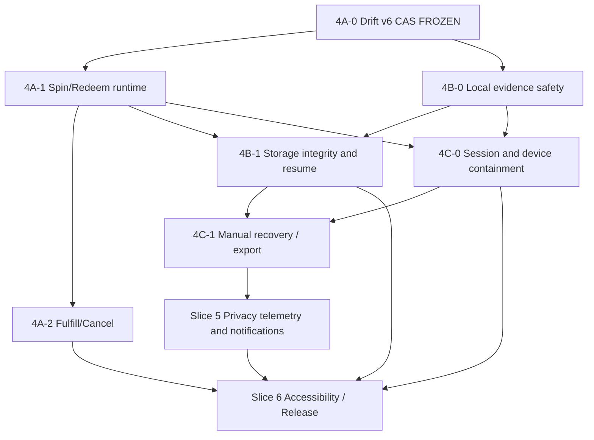

# LearnWard — Phase 6 Master Delivery Plan and Pilot Readiness Gates

**Status:** PLANNED (implementation delegated to coding agent; independent acceptance required)  
**Planning date:** 2026-11-07  
**Baseline:** `main` `7584147a3ca906c87dccb6daf52f5b7415ba8a54`  
**Governance:** Frozen ADRs 0001–0008, Phase 0–5 and Phase 6 completed slices. No server economic rewrite, no silent schema changes.  
**Working principle:** The planning owner defines contracts, dependencies, acceptance tests and release gates; the coding agent implements exactly one reviewed slice/PR at a time and does not independently expand scope.

## 1. Current verified ledger

| Unit | State | Evidence |
|---|---|---|
| Phase 6 Slice 1 — child lifecycle/RLS | MERGED / FROZEN | PR #16/17; frozen server contract |
| Phase 6 Slice 2 — archival/deadlock protection | MERGED / FROZEN | PR #18/19; server concurrency tests |
| Phase 6 Slice 3 — family data export | MERGED / FROZEN | PR #20 |
| Phase 6 Slice 4 — Drift v5 foundation | MERGED / FROZEN | PR #21 |
| Phase 6 readiness / actor-aware design | MERGED | PR #22 |
| Phase 6 Slice 4A-0 — Drift v6 / retry persistence / CAS | MERGED / FROZEN | PR #23, merge `88908ac309cda0eddcd549121ea0638c6979a384`, run `42366631328`, success 4/4 |
| Documentation main | VERIFIED | `7584147a3ca906c87dccb6daf52f5b7415ba8a54`, run `42368090260`, success 4/4 |
| Slice 4A-1 | DESIGN LOCKED in separate contract | `docs/20-phase-6-slice-4a-1-final-implementation-contract.md` (this planning set) |
| Slice 4A-2, 4B, 4C, 5, 6 | NOT IMPLEMENTED | Plans below; no release readiness implied |

## 2. Ordered workstream / PR boundaries

### PR #24 — Slice 4A-1: Actor-aware Spin/Redeem runtime

**Goal:** One safe foreground/background path with durable `possibly_dispatched` CAS, session verification, original ID replay, same-family authorization and bounded recovery. **No native OS background guarantee.**

**Authoritative implementation details:** `docs/20-phase-6-slice-4a-1-final-implementation-contract.md`, including WP0–WP6, A01–A24 and error matrix. Do not reinterpret its acceptance tests.

**Gate:** CI green at exact HEAD, independent code review confirms no mutation RPC before token-fenced durable marker; no cross-actor/family replay; no duplicate economic effects. Do not merge without sign-off.

### PR #25 (provisional) — Slice 4A-2: Adult Fulfill/Cancel reliability

**Dependency:** PR #24 merged and frozen; reuse its session verification, claim marker, execution coordinator and error classifier but extend eligibility explicitly for `fulfill_reward` and `cancel_reward` only after new tests. Existing v6 claim predicate intentionally excludes these operations; implement a narrowly scoped, reviewed CAS extension, NOT a blanket operation filter removal.

**Design contract:**
1. Preserve the original adult `actorUserId`, redemption ID and cancellation reason per command ID; no child actor fulfillment/cancellation.
2. Before RPC, require current adult membership of the command's family and active target child eligibility as frozen server contract permits; after archive, quarantine unknown outcomes.
3. Durable pre-dispatch marker, token-fenced completion, idempotent same-ID retry; receipt absence never proves no effect.
4. Refund from Cancel is **only** performed by frozen server RPC; client never credits RP locally. A response lost after refund must not cause duplicate refund.
5. False terminal assumptions are prohibited: changed reward/redemption state or `42501` may conceal a prior successful original command; classify conservatively and preserve journal.
6. On original actor absent, pause; another adult cannot inherit or regenerate the command UUID.

**Tests:** fulfill server commit + response loss; cancel + refund response loss; concurrent cancel/fulfill; adult A/B switch; child archive; mixed reward command operations; stale lease; no duplicate refund or redemption state change. All account/receipt constraints unchanged.

**Gate:** independent review and CI; no release/deploy.

### PR #26 (provisional) — Slice 4B-0: Immediate local evidence safety

**Priority:** P1 user-data-loss prevention, can be scheduled directly after PR #24 and ahead of 4A-2 if staffing/time allows. Do not wait for complete upload resumability to stop unsafe local deletion.

**Scope:**
1. `AddAssessmentScreen` must not physically delete a referenced image until a new draft save is committed and reference switch is confirmed. On cancel/back/error, keep existing file and draft intact.
2. The child draft-list Delete action must require an explicit confirmation, warn if work is unsynced/quarantined, and use an atomic tombstone/retention strategy if a remote operation may have committed. No automatic deletion of unknown-outcome or legacy drafts.
3. A file may be garbage-collected only after proving there are zero local references and the user explicitly approved deletion. Preserve compressed photo path and original evidence UUID.
4. UI remains minimal and accessible; no automatic Storage delete after ambiguous registration outcome.

**Tests:** edit/remove photo -> navigate back without Save; edit -> failed Save; successful Save -> safe cleanup; duplicate file references; restart; delete quarantined draft requires confirmation and retains exportable evidence. **Gate:** no silent local evidence loss.

### PR #27 (provisional) — Slice 4B-1: Evidence resumability and 409 reconciliation

**Dependency:** v6 draft persistence, PR #26 local-deletion safety, validated actor/session port and original command markers.

**Scope:** Persist stable compressed JPEG bytes, SHA-256, original evidence UUID, exact storage path, draft/create/submit command IDs and original actor. On HTTP 409 or upload-response loss, **download authorized private Storage bytes**, compare SHA-256 **and size** to local bytes. No upsert/overwrite based on matching path, metadata or file size alone.

**Registration reconciliation:** authorized SELECT on evidence row + assessment status before repeating `register_assessment_evidence`; frozen RPC can reject repeat registration after assessment leaves draft even if original registration succeeded. Preserve all evidence on unknown result, offline, revoked actor and archived child; never infer absence from RLS zero-row. Explicit manual conflict state if same path/different bytes; do not generate new UUID automatically.

**Tests:** identical 409; same-size/different-content; missing custom metadata; server commit/response loss; local file survives restart; assessment submitted on another device; RLS visibility failure; revoked device; conflict quarantine. **Gate:** no data loss, no silent overwrite.

### PR #28 (provisional) — Slice 4C-0: Auth, Child Mode and device containment

**Dependencies:** shared auth/session port in PR #24, local evidence safety and recoverability.

**Scope:** Tie restored Child Mode state to the verified current actor, family and child; invalidate stale Riverpod providers on sign-out or account switch; route auth guard must outrank persisted child overlay. Preserve Parent PIN/salt across parent sign-out on shared hardware until explicit legitimate exit/reset; write PIN + salt atomically. Add attempt throttling / timed lockout, with resistant password derivation after compatibility/migration review. Preserve pending commands/drafts and photos by data lifecycle classification; no blanket SQLite wipe.

**Tests:** child mode while signed out; A->B account switch; family switch; restart on shared hardware; PIN cracking attempts; salted hash migration; lost auth session; revoked paired child grant; child profile archived; data kept quarantined for an adult export path. **Gate:** no cross-user data presentation or child containment bypass.

### PR #29 (provisional) — Slice 4C-1: Manual recovery and export UX

**Scope:** Parent-facing command/draft states and explicit `Keep quarantined`, `Export unsynced work`, `Abandon local copy`. Separate definitive terminal rejection from unknown outcome; clear duplicate-charge warnings. Allow export of unsynced text and evidence without automatic mutation. No hidden command UUID regeneration. Require authorized parent for destructive actions; retained files removed only after durable confirmation and no references.

**Tests:** accessibility labels, state-appropriate copy, no RPC from manual quarantine display, guarded destructive confirmation, export integrity, actor mismatch returns, unknown legacy record visible only to permitted adult. **Gate:** no unrecoverable local data under normal user workflows.

### PR #30 (provisional) — Phase 6 Slice 5: Coordination notifications and privacy telemetry

**Scope:** Only notification and telemetry behavior approved in ADR 0008, with opt-in/parent control where applicable, minimal personal data, retention windows, scrubbed logs, failure containment and fallback if permissions denied. Never put schoolwork, child identifiers or private evidence into push payloads or analytics.

**Tests:** permission denied, duplicate notification suppression, sign-out/device revocation, data minimization, retention cleanup, no PII in logs. **Gate:** privacy sign-off.

### PR #31 (provisional) — Phase 6 Slice 6: Accessibility and actual release readiness

**Scope:** TalkBack/VoiceOver semantics, minimum touch targets, meaningful labels, reduced motion for spinning animation, keyboard/focus order, empty/error states, accessible parent confirmation, child-friendly guidance; Android production signing (not debug keystore), iOS distribution signing/provisioning, production `APP_ENV` and Supabase publishable key checks, release pipeline artifact validation, store privacy policies and family pilot runbook.

**Tests:** Android release build and iOS release archive with authorized signing environment; AppConfig fails closed when release misconfigured; device smoke tests on Android/iOS; screen reader and reduced-motion checks; legal/privacy and retention approval. CI simulator/debug alone does **not** satisfy distribution gate.

**Order can vary between PR #25 and PR #26 when justified by risk, but never combine unrelated slices merely to reduce PR count. PR numbers above are provisional and must be resolved against GitHub before opening.**

## 3. Explicit dependency graph

Every node has a separate definition of done and reviewed PR/freeze receipt. Any newly discovered severe data-loss issue may be handled through a small isolated hotfix ahead of the diagram, not by weakening finished contracts.

## 4. Cross-cutting mandatory invariants

1. **Server-authoritative economics:** RP ledger and wheel results only change in frozen server RPCs, never in mobile speculative code.
2. **Idempotent intent:** stable command ID and target; no new UUID on unresolved retries.
3. **Original actor:** only the original currently authenticated actor may attempt replay; another adult cannot adopt original commands.
4. **Family/child isolation:** process only the currently authorized family and active target child; do not confuse shared child UI with paired child Auth identities.
5. **No receipt fallacy:** read failure, filtered row or 42501 is not proof the operation never happened.
6. **Evidence retention:** bytes remain available until server-authoritative reconciliation or explicit, safe deletion.
7. **Old data:** v4 unknown legacy stays quarantined; do not invent command IDs/actors.
8. **Offline means durable, not always running:** iOS/Android may suspend the app; no guaranteed headless recovery promised.
9. **Release quality:** green unit tests and debug builds are required but insufficient for pilot.
10. **Frozen contracts:** No changes to Supabase migrations, RLS, SQL economics, or Drift v5/v6 historical migration semantics without explicit new ADR and independent approval.

## 5. Risk register, severity and closure evidence

| ID | Severity | Risk | Where to close | Evidence required |
|---|---|---|---|---|
| LW-AUD-01 | HIGH | Local evidence removed before Save or on uncertain cleanup | 4B-0 / 4B-1 | File-backed draft + photo rollback and 409 tests |
| LW-AUD-02 | HIGH | Unconfirmed Storage 409 treated as same bytes | 4B-1 | SHA-256+size checks over downloaded private object |
| LW-AUD-03 | HIGH | Child Mode restored without verified actor | 4C-0 | Auth switch/restart routing tests |
| LW-AUD-04 | HIGH | Foreground/background reward double-execution race | 4A-1 | Two SQLite connections + same server receipt tests |
| LW-AUD-05 | MEDIUM | PIN brute force/partial write | 4C-0 | throttling and atomic migration tests |
| LW-AUD-06 | RELEASE BLOCKER | Android debug signing, iOS release proof absent | Slice 6 | verified release artifacts |
| LW-AUD-07 | RELEASE BLOCKER | `APP_ENV=development` default used in unqualified builds | Slice 6 | mandatory release config validation |
| LW-AUD-08 | RELEASE BLOCKER | Pilot privacy/child data process not signed off | Slice 5/6 | documented consent, retention, incident handling |
| LW-AUD-09 | MEDIUM | Unclear accessibility for spinning wheel/recovery | Slice 6 | VoiceOver/TalkBack/reduced-motion checks |
| LW-AUD-10 | MEDIUM | Unimplemented family export UI | 4C-1 | permission-scoped parent export end-to-end test |

The risk register is not a claim that vulnerabilities have been exploited. It lists confirmed source-level flaws and release readiness gaps that require separate regression evidence.

## 6. Uniform PR template and freeze process

Each agent implementation PR must include:

- Exact base/main and implementation HEAD SHAs; issue/slice code.
- Files changed with rationale and protected frozen contracts unchanged.
- Explicit compliance matrix mapping each acceptance test ID to a test file/result.
- Concrete server/mock evidence for idempotency and RLS assertions; no claim of real device test unless performed.
- Full CI run ID and each job outcome; distinguish PR run from post-merge main run.
- Remaining deviations/risks and no silent follow-up promises.
- No merge until independent review. Once approved, squash-merge, verify main CI, write freeze receipt and move to next dependency.

**Stop conditions:** CI red, auth/RLS unknown, uncertain ledger/evidence outcome being deleted, schema contract altered without approval, untested migration, release signing missing, or an attempt to merge a blocked PR. Stop and report the exact evidence and the smallest proposed change.

## 7. Pilot entry and acceptance criteria

**No external pilot** until all of the following are demonstrably complete:

- Every unresolved reward/evidence operation is recoverable or explicitly quarantined; no duplicate RP debit/spin/refund in race tests.
- Child auth/account switch cannot leak the previous user's data or bypass containment.
- Parent can export and safely manage quarantined work; no silent photo deletion.
- Production build configuration and both platform signing/distribution flows have been tested with real devices or documented device farm equivalents.
- RLS and 659 pgTAP checks plus all designated real Postgres concurrency scripts remain green after any relevant change.
- Accessibility and privacy review findings resolved or explicitly accepted with a documented rationale and non-disqualifying impact.
- Documented rollback procedure, incident contact, pilot cohort size, consent/terms, and telemetry retention.

## 8. Delivery responsibility matrix

| Activity | Planner / independent reviewer | Coding agent |
|---|---|---|
| Architecture and sequencing | **OWN** | Follow; report concrete incompatibilities only |
| API/state/error contracts | **OWN** | Implement exactly |
| Acceptance and negative tests | **OWN SPEC** | Write/run tests |
| Dart/Flutter/SQLite code | Audit only | **OWN** |
| Git branch/PR/CI receipts | Review/approve | **OWN** |
| SQL/ADR contract changes | Approve explicit deviation | Propose, never perform unilaterally |
| Merge decision | **OWN sign-off** | Merge only after approval |
| Pilot/release authorization | **OWN sign-off with user** | Produce evidence, never self-release |

**Next action:** begin implementation of 4A-1 using the final contract, without another independent planning round by the coding agent. Any unavoidable ambiguity is returned as a sharply scoped factual blocker, not a redesign proposal.
