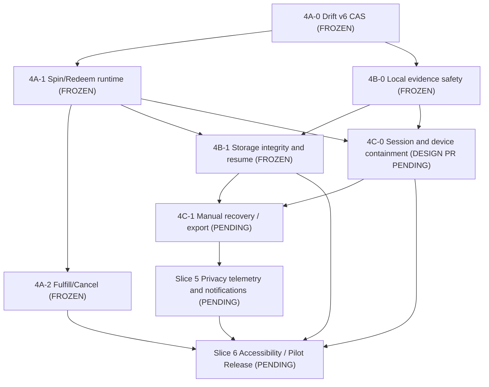

# LearnWard — Phase 6 Master Delivery Plan and Pilot Readiness Gates

**Status:** PLANNED (implementation delegated to coding agent; independent acceptance required)  
**Planning date:** 2026-11-07  
**Baseline:** `main` `6b1d4da03254264ac180e4b1503de93e146c963e`  
**Governance:** Frozen ADRs 0001–0008, Phase 0–5 and Phase 6 completed slices. No server economic rewrite, no silent schema changes.  
**Working principle:** The planning owner defines contracts, dependencies, acceptance tests and release gates; the coding agent implements exactly one reviewed slice/PR at a time and does not independently expand scope.

## 1. Current verified ledger

| Unit | State | Evidence |
|---|---|---|
| Phase 6 Slice 1 — child lifecycle/RLS | MERGED / FROZEN | PR #16/17; frozen server contract |
| Phase 6 Slice 2 — archival/deadlock protection | MERGED / FROZEN | PR #18/19; server concurrency tests |
| Phase 6 Slice 3 — family data export | MERGED / FROZEN | PR #20 |
| Phase 6 Slice 4 — Drift v5 foundation | MERGED / FROZEN | PR #21 |
| Phase 6 readiness / actor-aware design | MERGED | PR #22 |
| Phase 6 Slice 4A-0 — Drift v6 / retry persistence / CAS | MERGED / FROZEN | PR #23, merge `88908ac309cda0eddcd549121ea0638c6979a384`, run `42366631328`, success 4/4 |
| Phase 6 Slice 4A-1 — Actor-aware Spin/Redeem recovery runtime | MERGED / FROZEN | PR #24, merge `6b1d4da03254264ac180e4b1503de93e146c963e`, run `42509975267`, success 4/4, freeze receipt `docs/freezes/phase-6-slice-4a-1-recovery-dispatcher-freeze.md` |
| Phase 6 Slice 4B-0 — Immediate local evidence safety | MERGED / FROZEN | PR #26, merge `f921bb67b67e4e0d528911f0da2b90f7b693fc00`, run `42643730956`, success 4/4, freeze receipt `docs/freezes/phase-6-slice-4b-0-local-evidence-safety-freeze.md` |
| Phase 6 Slice 4A-2 — Adult Fulfill/Cancel reliability | MERGED / FROZEN | PR #28 (design), PR #29 (impl), merge `9b253a268be01498266f86013d7db903f6cb01b9`, run `42844354262`, success 4/4, freeze receipt `docs/freezes/phase-6-slice-4a-2-adult-fulfill-cancel-freeze.md` |
| Phase 6 Slice 4B-1 — Evidence resumability & Storage 409 reconciliation | MERGED / FROZEN | PR #31 (design), PRs #32–#36 (WP1–WP5, impl merge `06d4d7253c1b234ab11e51ab7a7e53d7739a5a1c`, run `43999993238`), WP6 freeze PR #37 merge `d49e39af66978fe4315411789e367e8eb8a51233` (tree `ce7a81fd4c29d72fb77f0be705674642c093dcb1`), main CI `45378350261`, success 4/4, freeze receipt `docs/freezes/phase-6-slice-4b-1-evidence-resumability-freeze.md` |
| Phase 6 Slice 4C-0 — Auth, Child Mode & device containment | DESIGN PR PENDING REVIEW | Design contract `docs/25-phase-6-slice-4c-0-auth-child-mode-containment-design-contract.md` (WP0 pending independent review; runtime NOT IMPLEMENTED) |
| Slice 4C-1, 5, 6 | NOT IMPLEMENTED | Plans below; no release readiness implied |

## 2. Ordered workstream / PR boundaries

### PR #24 — Slice 4A-1: Actor-aware Spin/Redeem runtime (MERGED / FROZEN)

**Status:** MERGED and FROZEN (Merge commit `6b1d4da03254264ac180e4b1503de93e146c963e`, run `42509975267`).

**Goal:** One safe foreground/background path with durable `possibly_dispatched` CAS, session verification, original ID replay, same-family authorization and bounded recovery. **No native OS background guarantee.**

**Authoritative implementation details:** `docs/20-phase-6-slice-4a-1-final-implementation-contract.md`, including WP0–WP6, A01–A24 and error matrix. Freeze receipt recorded in `docs/freezes/phase-6-slice-4a-1-recovery-dispatcher-freeze.md`.

**Gate:** COMPLETED. CI green on exact merge commit (4/4 jobs, 479 Dart tests, 659 pgTAP + 19 concurrency scripts). All acceptance criteria A01–A24 verified. Schema v6 and backend contracts preserved with 0 diff.

### PR #29 — Slice 4A-2: Adult Fulfill/Cancel reliability (MERGED / FROZEN)

**Status:** MERGED and FROZEN (Design PR #28, merge `d48fe4bc331c724a6ff262bf8594e2aca554c2d7`; Implementation PR #29, merge `9b253a268be01498266f86013d7db903f6cb01b9`, post-merge main CI run `42844354262`).

**Goal:** Reliable, restart-safe, idempotent adult reward fulfillment and cancellation with server-authoritative refunds, verified adult role provenance, cross-operation mutual exclusion, bounded unverified-target recovery, and non-overflowing presentation banners with dynamic due-time promotion.

**Authoritative implementation details:** Freeze receipt recorded in `docs/freezes/phase-6-slice-4a-2-adult-fulfill-cancel-freeze.md` and approved design contract in `docs/23-phase-6-slice-4a-2-adult-fulfill-cancel-design-contract.md`.

**Gate:** COMPLETED. CI green on exact merge commit (4/4 jobs, 449 workspace Dart tests, 659 pgTAP + 19 concurrency scripts). All acceptance criteria A2-01–A2-20 and review findings R29-01 through R29-07 verified. Schema v6 and backend contracts preserved with 0 diff.

### PR #26 — Slice 4B-0: Immediate local evidence safety (MERGED / FROZEN)

**Status:** MERGED and FROZEN (Merge commit `f921bb67b67e4e0d528911f0da2b90f7b693fc00`, run `42643730956`).

**Goal:** Zero client evidence loss. Conservative physical evidence retention, atomic CAS draft deletion rejecting uncommitted/conflicting/legacy states, full 30-field persisted state comparison, path containment sanitization, exclusive file creation, fail-closed attachment restoration, and resilient evidence picker persistence.

**Authoritative implementation details:** Freeze receipt recorded in `docs/freezes/phase-6-slice-4b-0-local-evidence-safety-freeze.md`.

**Gate:** COMPLETED. CI green on exact merge commit (4/4 jobs, 556 Dart tests, 659 pgTAP + 19 concurrency scripts). All acceptance criteria B01–B05 and review dispositions R26-01 through R26-6-01 verified. Schema v6 and backend contracts preserved with 0 diff.

### PRs #31–#37 — Slice 4B-1: Evidence resumability and 409 reconciliation (MERGED / FROZEN)

**Status:** MERGED and FROZEN (Design PR #31, merge `2fc02ac10bf7b994d28274c23a52c134c182a3a7`; WP1 PR #32, merge `2d2369a57c7b9ba4f19b227c88592b8e86a83f42`; WP2 PR #33, merge `d226f1b043ebcb9b13d19287bffa327251af8704`; WP3 PR #34, merge `eb7cef1ef52e3e15b4a4de967da017839c9716a9`; WP4 PR #35, merge `a24b391514720dafaa487188f06624d2815bad25`; WP5 PR #36, merge `06d4d7253c1b234ab11e51ab7a7e53d7739a5a1c`, main CI run `43999993238`; WP6 freeze PR #37, merge `d49e39af66978fe4315411789e367e8eb8a51233`, tree `ce7a81fd4c29d72fb77f0be705674642c093dcb1`, post-merge main CI run `45378350261`, 4/4 `SUCCESS`).

**Goal:** Byte-identical canonical JPEG/PNG snapshots, `upsert: false` Storage uploads with byte-length and SHA-256 409/lost-response reconciliation, read-only `LW109` & distinct `serverEvidenceId` reconciliation, token-fenced Drift v6 draft CAS/leases, derived read-only quarantine for unbound/legacy/unknown-wire drafts, unified staged `AssessmentSubmissionOrchestrator` with per-stage session/target revalidation, and authorized foreground recovery UI.

**Authoritative implementation details:** Freeze receipt recorded in `docs/freezes/phase-6-slice-4b-1-evidence-resumability-freeze.md` and approved design contract in `docs/24-phase-6-slice-4b-1-evidence-resumability-design-contract.md`.

**Gate:** COMPLETED. CI green on exact WP6 freeze merge commit (`45378350261`: 4/4 jobs; implementation main CI `43999993238`: 4/4 jobs, 833 workspace Dart/Flutter tests, 659 pgTAP + 19 concurrency/security scripts incl. `test_storage_evidence_security.mjs` Tests A–T; acceptance criteria `B1-01`–`B1-30`, invariants `I01`–`I16`, and review findings `R31`–`R37` verified; schema v6, backend RPC/RLS/Storage contracts, and `RECOVERY_DISPATCHER_ENABLED=false` preserved with 0 diff). Pilot and production gates remain strictly **CLOSED**.

### Slice 4C-0: Auth, Child Mode and device containment (WP0 DESIGN PR PENDING REVIEW)

**Status:** DESIGN PR PENDING REVIEW — RUNTIME NOT IMPLEMENTED.

**Dependencies:** shared auth/session port in PR #24, adult recovery reliability in PR #29, local evidence safety and resumability in PR #26 / PRs #31–#37.

**Scope:** Tie restored Child Mode state to the verified current actor, family and child (including `ValidatedActorContext.isAnonymous` and DB-authoritative `child_device_grants` / `family_memberships` checks over optional `appMetadata.role` hints); invalidate stale Riverpod providers and stateful screen scopes on sign-out, account switch, or family switch; route auth guard must outrank all containment overlays while requiring positive active adult verification for `ParentMode` (zero implicit `default -> ParentMode` fallback) and routing archived/legacy/corrupt/unverified/clean-zero-row states into restricted data-free containment shells (`ChildModeContainmentLocked`, `PairedChildUnverified`, `PairedChildRevoked`, `AuthorizationUnverified`, `AdultAccessRestricted`, neutral `NoActiveFamilyMembership`) alongside offline same-actor PIN containment (`ChildModeOfflineContained`). Preserve Parent PIN/lockout across parent sign-out on shared hardware with household ownership binding (`ownerFamilyId`), explicit 3-level legacy ownership provenance (`BoundOwner`, `CorroboratedLegacyOwner`, `UnresolvableLegacyOwnership`) distinguishing legacy hints from positive adult membership, and explicit cross-family/corrupt/forgotten/restricted manual unbound recovery rules (forbidding automatic `requiredOwnerFamilyId == null` lock clearance); total-order asynchronous PIN commits, lockout CAS, and durable fence transitions through controller-owned single-writer `_ContainmentArbiter` + immediate synchronous fail-closed UI mask + persisted `containment_fence_v1` + synchronous `preCommitGuard()` (explicit pre-guard rejection vs committed-wins post-guard linearization, zero preemption claims, zero compensating re-writes, explicit local vs external Postgres boundary); strictly separate **Normal Adult Sign Out** (`ParentMode` only when zero unresolved lock exists) from **`ChildModeContainmentLocked` Recovery Sign Out (`Exit Path B`)** backed by durable `containment_recovery_lock_v1` surviving sign-out, restarts, failed reauth, and unrelated/paired-child/zero-family sign-ins; persist PIN credentials and concurrency-safe attempt reservations atomically via `LocalMetadataStore.applyMetadataBatch` and `compareAndSwapMetadataBatch` (pre-KDF pessimistic reserve, no long DB lock across PBKDF2-HMAC-SHA-256 `>= 100,000` iterations, constant-time verify, isolate offload, in-process `MonotonicClock` + persistent progressive lockout with honest cross-reboot wall-clock boundary, and atomic v1→v2 upgrade-on-verify). Preserve pending commands/drafts and photos by data lifecycle classification (no blanket SQLite wipe; supersedes `docs/17` §3.4).

**Authoritative design contract:** `docs/25-phase-6-slice-4c-0-auth-child-mode-containment-design-contract.md` (WP0 design PR pending independent review; runtime implementation WP1–WP4 not started).

**Tests:** Deterministic acceptance matrix `C0-01`–`C0-39` covering signed-out child mode, expired/errored session, legacy v1/malformed child envelope containment lock (no auto-unlock), normal adult sign-out vs Exit Path B recovery sign-out (`containment_recovery_lock_v1` surviving restart, failed login, stale generation, unrelated `Family_B` adult, paired-child, and `0`-family sign-in), legacy unknown-owner & correlated `(family_id, child_id)` provenance (`C0-39` covering v1 child + v1 PIN + no `ownerFamilyId`, unrelated `Family_B` login, corroborated original family, malformed hint + single `Family_B` outbox row refusing auto-clear, contradictory `Family_A` hint + `Family_B` outbox, missing child correlation, and completely unresolvable ownership manual recovery), A->B account switch (incl. `FamilyHomeScreen` family bleed fix), family switch, shared-hardware restart, Airplane-Mode restart containment + offline post-PIN `AuthorizationUnverified` hold, async PIN unlock/mutation suspended across sign-out / A->B / session rotation / family switch / in-flight archive or revocation (`abortFencedAttempt` preserving attempt count), **two-barrier commit-path `Completer` ordering** (`C0-37` testing both pre-guard Barrier 1 rejection and post-guard/pre-COMMIT Barrier 2 arbiter linearization + immediate fail-closed UI + restart durability), `appMetadata.role` independence & `child_device_grants` precedence, RLS `0`-row `NoActiveFamilyMembershipObserved` neutrality (new vs former-revoked-family adults), `isAnonymous` enforcement, concurrent `Completer`-barrier `verifyPin()` attempt accounting & lockout bypass prevention, dual clock manipulation tests, cross-family PIN ownership & corrupt credential recovery, salted SHA-256 v1→v2 atomic migration, RFC 7914 Section 11 PBKDF2-HMAC-SHA-256 vectors, revoked vs unverified paired child grant (`PairedChildUnverified`), archived child profile (incl. Phase 6.1 RLS 0-row) containment lock, revoked adult access restriction, and local data preserved quarantined for adult export path. **Gate:** no cross-user data presentation, no child containment bypass or unguarded `ParentMode` promotion, and 0 unintended schema/SQL/dispatcher diffs.

### Slice 4C-1: Manual recovery and export UX (PR: TBD / not allocated)

**Scope:** Parent-facing command/draft states and explicit `Keep quarantined`, `Export unsynced work`, `Abandon local copy`. Separate definitive terminal rejection from unknown outcome; clear duplicate-charge warnings. Allow export of unsynced text and evidence without automatic mutation. No hidden command UUID regeneration. Require authorized parent for destructive actions; retained files removed only after durable confirmation and no references.

**Tests:** accessibility labels, state-appropriate copy, no RPC from manual quarantine display, guarded destructive confirmation, export integrity, actor mismatch returns, unknown legacy record visible only to permitted adult. **Gate:** no unrecoverable local data under normal user workflows.

### Phase 6 Slice 5: Coordination notifications and privacy telemetry (PR: TBD / not allocated)

**Scope:** Only notification and telemetry behavior approved in ADR 0008, with opt-in/parent control where applicable, minimal personal data, retention windows, scrubbed logs, failure containment and fallback if permissions denied. Never put schoolwork, child identifiers or private evidence into push payloads or analytics.

**Tests:** permission denied, duplicate notification suppression, sign-out/device revocation, data minimization, retention cleanup, no PII in logs. **Gate:** privacy sign-off.

### Phase 6 Slice 6: Accessibility and actual release readiness (PR: TBD / not allocated)

**Scope:** TalkBack/VoiceOver semantics, minimum touch targets, meaningful labels, reduced motion for spinning animation, keyboard/focus order, empty/error states, accessible parent confirmation, child-friendly guidance; Android production signing (not debug keystore), iOS distribution signing/provisioning, production `APP_ENV` and Supabase publishable key checks, release pipeline artifact validation, store privacy policies and family pilot runbook.

**Tests:** Android release build and iOS release archive with authorized signing environment; AppConfig fails closed when release misconfigured; device smoke tests on Android/iOS; screen reader and reduced-motion checks; legal/privacy and retention approval. CI simulator/debug alone does **not** satisfy distribution gate.

**Execution prioritized Slice 4B-0 ahead of Slice 4A-2 to prevent data loss. Future PR numbers are TBD / not allocated and must be resolved against GitHub before opening. Never combine unrelated slices merely to reduce PR count.**

## 3. Explicit dependency graph

Every node has a separate definition of done and reviewed PR/freeze receipt. Any newly discovered severe data-loss issue may be handled through a small isolated hotfix ahead of the diagram, not by weakening finished contracts.

## 4. Cross-cutting mandatory invariants

1. **Server-authoritative economics:** RP ledger and wheel results only change in frozen server RPCs, never in mobile speculative code.
2. **Idempotent intent:** stable command ID and target; no new UUID on unresolved retries.
3. **Original actor:** only the original currently authenticated actor may attempt replay; another adult cannot adopt original commands.
4. **Family/child isolation:** process only the currently authorized family and active target child; do not confuse shared child UI with paired child Auth identities.
5. **No receipt fallacy:** read failure, filtered row or 42501 is not proof the operation never happened.
6. **Evidence retention:** bytes remain available until server-authoritative reconciliation or explicit, safe deletion.
7. **Old data:** v4 unknown legacy stays quarantined; do not invent command IDs/actors.
8. **Offline means durable, not always running:** iOS/Android may suspend the app; no guaranteed headless recovery promised.
9. **Release quality:** green unit tests and debug builds are required but insufficient for pilot.
10. **Frozen contracts:** No changes to Supabase migrations, RLS, SQL economics, or Drift v5/v6 historical migration semantics without explicit new ADR and independent approval.

## 5. Risk register, severity and closure evidence

| ID | Severity | Risk | Where to close | Evidence required |
|---|---|---|---|---|
| LW-AUD-01 | HIGH | Local evidence removed before Save or on uncertain cleanup | 4B-0 / 4B-1 | File-backed draft + photo rollback and 409 tests |
| LW-AUD-02 | HIGH | Unconfirmed Storage 409 treated as same bytes | 4B-1 | SHA-256+size checks over downloaded private object |
| LW-AUD-03 | HIGH | Child Mode restored without verified actor | 4C-0 | Auth switch/restart routing tests |
| LW-AUD-04 | HIGH | Foreground/background reward double-execution race | 4A-1 | Two SQLite connections + same server receipt tests |
| LW-AUD-05 | MEDIUM | PIN brute force/partial write | 4C-0 | throttling and atomic migration tests |
| LW-AUD-06 | RELEASE BLOCKER | Android debug signing, iOS release proof absent | Slice 6 | verified release artifacts |
| LW-AUD-07 | RELEASE BLOCKER | `APP_ENV=development` default used in unqualified builds | Slice 6 | mandatory release config validation |
| LW-AUD-08 | RELEASE BLOCKER | Pilot privacy/child data process not signed off | Slice 5/6 | documented consent, retention, incident handling |
| LW-AUD-09 | MEDIUM | Unclear accessibility for spinning wheel/recovery | Slice 6 | VoiceOver/TalkBack/reduced-motion checks |
| LW-AUD-10 | MEDIUM | Unimplemented family export UI | 4C-1 | permission-scoped parent export end-to-end test |

The risk register is not a claim that vulnerabilities have been exploited. It lists confirmed source-level flaws and release readiness gaps that require separate regression evidence.

## 6. Uniform PR template and freeze process

Each agent implementation PR must include:

- Exact base/main and implementation HEAD SHAs; issue/slice code.
- Files changed with rationale and protected frozen contracts unchanged.
- Explicit compliance matrix mapping each acceptance test ID to a test file/result.
- Concrete server/mock evidence for idempotency and RLS assertions; no claim of real device test unless performed.
- Full CI run ID and each job outcome; distinguish PR run from post-merge main run.
- Remaining deviations/risks and no silent follow-up promises.
- No merge until independent review. Once approved, squash-merge, verify main CI, write freeze receipt and move to next dependency.

**Stop conditions:** CI red, auth/RLS unknown, uncertain ledger/evidence outcome being deleted, schema contract altered without approval, untested migration, release signing missing, or an attempt to merge a blocked PR. Stop and report the exact evidence and the smallest proposed change.

## 7. Pilot entry and acceptance criteria

**No external pilot** until all of the following are demonstrably complete:

- Every unresolved reward/evidence operation is recoverable or explicitly quarantined; no duplicate RP debit/spin/refund in race tests.
- Child auth/account switch cannot leak the previous user's data or bypass containment.
- Parent can export and safely manage quarantined work; no silent photo deletion.
- Production build configuration and both platform signing/distribution flows have been tested with real devices or documented device farm equivalents.
- RLS and 659 pgTAP checks plus all designated real Postgres concurrency scripts remain green after any relevant change.
- Accessibility and privacy review findings resolved or explicitly accepted with a documented rationale and non-disqualifying impact.
- Documented rollback procedure, incident contact, pilot cohort size, consent/terms, and telemetry retention.

## 8. Delivery responsibility matrix

| Activity | Planner / independent reviewer | Coding agent |
|---|---|---|
| Architecture and sequencing | **OWN** | Follow; report concrete incompatibilities only |
| API/state/error contracts | **OWN** | Implement exactly |
| Acceptance and negative tests | **OWN SPEC** | Write/run tests |
| Dart/Flutter/SQLite code | Audit only | **OWN** |
| Git branch/PR/CI receipts | Review/approve | **OWN** |
| SQL/ADR contract changes | Approve explicit deviation | Propose, never perform unilaterally |
| Merge decision | **OWN sign-off** | Merge only after approval |
| Pilot/release authorization | **OWN sign-off with user** | Produce evidence, never self-release |

**Next action / Planning Status:**
- Slice 4B-1 (WP0–WP6): **MERGED & FROZEN ON `main`** (PRs #31–#37; impl merge `06d4d7253c1b234ab11e51ab7a7e53d7739a5a1c`, main CI `43999993238`; WP6 freeze merge `d49e39af66978fe4315411789e367e8eb8a51233`, tree `ce7a81fd4c29d72fb77f0be705674642c093dcb1`, post-merge `main` CI run `45378350261`, 4/4 `SUCCESS`).
- Slice 4C-0 — *Auth, Child Mode & Device Containment* (WP0): **DESIGN PR PENDING INDEPENDENT REVIEW** (`docs/25-phase-6-slice-4c-0-auth-child-mode-containment-design-contract.md`; runtime NOT IMPLEMENTED; no merge without independent review).
- Pilot and production distribution gates: remain strictly **CLOSED**.
