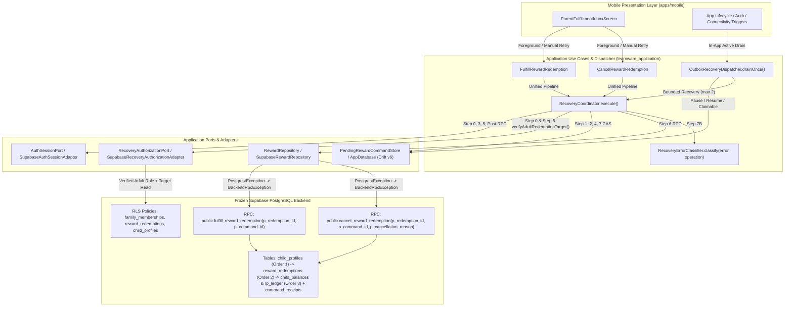

# LearnWard — Phase 6 Slice 4A-2 Detailed Design Contract: Adult Fulfill/Cancel Reliability

**Status:** DESIGN-ONLY — ROUND 1 REVIEW CORRECTIONS APPLIED (**NOT IMPLEMENTED**)  
**Plan Date:** 2026-11-10  
**Repository:** `https://github.com/thedusk4203/LearnWard`  
**Authoritative Baseline `main`:** `f59061a555ab4e5e0df4116aa18de1be7b232a33`  
**Verified Baseline CI:** [`42737521175`](https://github.com/thedusk4203/LearnWard/actions/runs/42737521175) — **SUCCESS (4/4 jobs green)**  
**Prior Frozen Slices:**
- Phase 6 Slice 4A-0 (Drift v6 Foundation): Merge `88908ac309cda0eddcd549121ea0638c6979a384` ([Freeze Receipt](freezes/phase-6-slice-4a-0-drift-v6-foundation-freeze.md))
- Phase 6 Slice 4A-1 (Spin/Redeem Recovery Dispatcher): Merge `6b1d4da03254264ac180e4b1503de93e146c963e` ([Freeze Receipt](freezes/phase-6-slice-4a-1-recovery-dispatcher-freeze.md))
- Phase 6 Slice 4B-0 (Immediate Local Evidence Safety): Merge `f921bb67b67e4e0d528911f0da2b90f7b693fc00` ([Freeze Receipt](freezes/phase-6-slice-4b-0-local-evidence-safety-freeze.md))

**Governing Sources:**
- [Phase 6 Master Delivery and Pilot Gates](21-phase-6-master-delivery-and-pilot-gates.md) (§2 Slice 4A-2, §4 Cross-Cutting Mandatory Invariants)
- [Phase 6 Slice 4A-1 Final Implementation Contract](20-phase-6-slice-4a-1-final-implementation-contract.md)
- [ADR 0005 — Phase 4 Reward Economy and Wheel Experience](adr/0005-phase-4-reward-economy-wheel.md) (`ACCEPTED`)
- [ADR 0008 — Phase 6 Pilot Hardening Decisions](adr/0008-phase-6-pilot-hardening.md) (`ACCEPTED`)

---

## 1. Exact Source Inventory & Baseline Audit (WP0)

Every file below was audited directly against `main` @ `f59061a555ab4e5e0df4116aa18de1be7b232a33`. No invented paths or method names are used. All descriptions below reflect **current implemented source** on `main` and the **identified gaps** to be closed in Slice 4A-2.

| Current Implemented File Path | Audited Symbols & Line Ranges | Verified Baseline Behavior on `main` & Identified Gaps for Slice 4A-2 |
|---|---|---|
| `packages/learnward_application/lib/src/services/recovery_coordinator.dart` | `CommandExecutionTrigger` (L19–L28), `CommandExecutionResult` hierarchy (L31–L164), `RecoveryCoordinator` (L168–L786), `execute()` (L203–L775) | Implements the 8-step locked pipeline for `spinWheel` and `redeemReward`. **Gaps:** (1) `execute()` lacks `redemptionId` and `cancellationReason` parameters; (2) Step 0 (L287–L291) returns `CommandAuthUnavailableResult` on `unverified` without advancing `next_attempt_at` or bounding repeated RLS-filtered `null` target lookups; (3) Step 1 target matching (L308–L313) only checks `rewardId` for `redeemReward` and does not validate `redemptionId`, `cancellationReason`, or verified adult `actorRole` for `fulfillReward`/`cancelReward`; (4) Step 6 (L659–L661) throws `UnsupportedError('Operation ${command.operation} is out of scope for Slice 4A-1')` for `fulfillReward` and `cancelReward`; (5) Step 7B (L687) calls `RecoveryErrorClassifier.classify(e)` without operation context. |
| `packages/learnward_application/lib/src/services/outbox_recovery_dispatcher.dart` | `OutboxRecoveryDispatcher` (L12–L181), `drainOnce()` (L52–L180) | Scans mismatched active commands to pause, paused original-actor commands to resume, and claimable commands to execute with bounded concurrency (`maxConcurrentRpcs = 2`). **Gaps:** L150–L157 invokes `_coordinator.execute(...)` passing `operation`, `familyId`, `childId`, `rewardId`, `requestedCommandId`, and `trigger`, omitting `redemptionId: cmd.redemptionId` and `cancellationReason: cmd.cancellationReason`. |
| `packages/learnward_application/lib/src/use_cases/fulfill_reward_redemption.dart` | `FulfillRewardRedemption` (L8–L81), `call()` (L19–L60), `_isTerminalError()` (L62–L71) | **Critical Gap:** Completely bypasses `RecoveryCoordinator`, `AuthSessionPort`, and `RecoveryAuthorizationPort`. Calls `findPendingRedemptionCommand`, writes a partial `PendingRewardCommand` via `savePendingCommand` (omitting `childId`, `actorUserId`, `actorRole`), calls `_repository.fulfillRewardRedemption` directly without a SQLite lease or `markPossiblyDispatched`, and uses `_isTerminalError()` substring matching (`msg.contains('LW204') \|\| msg.contains('42501')`) to call `deletePendingCommand()`. |
| `packages/learnward_application/lib/src/use_cases/cancel_reward_redemption.dart` | `CancelRewardRedemption` (L8–L85), `call()` (L19–L64), `_isTerminalError()` (L66–L75) | **Critical Gap:** Completely bypasses `RecoveryCoordinator`, `AuthSessionPort`, and `RecoveryAuthorizationPort`. Writes a partial `PendingRewardCommand` (omitting `childId`, `actorUserId`, `actorRole`), calls `_repository.cancelRewardRedemption` without a lease or `markPossiblyDispatched`, does not check for conflicting `fulfill_reward` rows on the same `redemptionId`, and deletes the journal on `LW204` or `42501` via substring matching. |
| `packages/learnward_application/lib/src/ports/pending_reward_command_store.dart` | `RewardCommandOperation` (L4–L19), `PendingRewardCommand` (L22–L153), `isCommandUnresolved()` (L177–L213), `RegisterFreshCommandResult` (L158–L227), `PendingRewardCommandStore` (L230–L393) | Defines the v6 command model and store interface. `RewardCommandOperation` already defines `fulfillReward('fulfill_reward')` and `cancelReward('cancel_reward')`. `PendingRewardCommand` already includes `redemptionId` (L51) and `cancellationReason` (L52). **Gaps:** `PendingRewardCommand.canAutoReplay` (L91–L96) and store port contracts on `registerFreshCommand`, `acquireClaim`, `markPossiblyDispatched`, `pauseMismatchedActorCommand`, `resumeOriginalActorCommand`, `listClaimableCommands`, `listMismatchedActiveCommands`, and `listPausedOriginalActorCommands` specify `operation IN ('spin_wheel', 'redeem_reward')` only. |
| `packages/learnward_application/lib/src/ports/recovery_authorization_port.dart` | `TargetAuthorizationStatus` (L5–L17), `RecoveryAuthorizationPort` (L20–L29), `verifyTarget()` (L23–L28) | `verifyTarget()` accepts `{context, familyId, childId, operation}` and returns only `TargetAuthorizationStatus`. **Gaps (`R28-01`, `R28-02`):** (1) Returns no authoritative adult membership role (`owner` vs `parent`) from `public.family_memberships`; (2) does not accept `redemptionId` to verify `public.reward_redemptions(id, family_id, child_id)`; (3) does not distinguish RLS-filtered missing target rows from transient network failures when returning `unverified`. |
| `packages/learnward_data/lib/src/database/app_database.dart` | `AppDatabase` (L20–L1445), `schemaVersion => 6` (L25), `registerFreshCommand()` (L665–L739), `savePendingCommand()` (L741–L913), `acquireClaim()` (L1065–L1105), `releaseClaim()` (L1108–L1134), `markPossiblyDispatched()` (L1137–L1166), `completeCommand()` (L1169–L1183), `transitionRecoveryState()` (L1186–L1211), `pauseMismatchedActorCommand()` (L1214–L1254), `resumeOriginalActorCommand()` (L1257–L1294), `listClaimableCommands()` (L1297–L1337), `listMismatchedActiveCommands()` (L1340–L1379), `listPausedOriginalActorCommands()` (L1382–L1420) | Drift schema v6 already contains all required columns on `pending_reward_commands` (`redemption_id`, `cancellation_reason`, `actor_user_id`, `actor_role`, `recovery_state`, `dispatch_state`, `retry_count`, `next_attempt_at`, `last_error_message`, `lease_token`, `lease_expires_at`). `releaseClaim()` (L1108–L1134) unconditionally sets `retry_count = retry_count + 1`. **Gaps:** (1) `registerFreshCommand()` (L674–L685) filters by `familyId`, `operation`, `childId`, and `rewardId` — it does not scope by `redemption_id` for adult operations and does not detect cross-operation conflicts between `fulfill_reward` and `cancel_reward` on the same redemption; (2) `acquireClaim`, `markPossiblyDispatched`, `pauseMismatchedActorCommand`, `resumeOriginalActorCommand`, `listClaimableCommands`, `listMismatchedActiveCommands`, and `listPausedOriginalActorCommands` hardcode `AND operation IN ('spin_wheel', 'redeem_reward')`. |
| `packages/learnward_data/lib/src/repositories/supabase_reward_repository.dart` | `SupabaseRewardRepository` (L7–L268), `redeemStoreReward()` (L141–L164), `fulfillRewardRedemption()` (L167–L180), `cancelRewardRedemption()` (L183–L198) | `redeemStoreReward()` catches `PostgrestException` and rethrows `BackendRpcException(message: e.message, code: e.code, details: e.details)`. **Critical Gap:** `fulfillRewardRedemption()` (L167–L180) and `cancelRewardRedemption()` (L183–L198) do **not** catch `PostgrestException` or wrap it in `BackendRpcException`, preventing typed `BackendRpcError` classification in `RecoveryErrorClassifier`. |
| `apps/mobile/lib/app/bootstrap/supabase_recovery_authorization_adapter.dart` | `SupabaseRecoveryAuthorizationAdapter` (L22–L130), `verifyTarget()` (L29–L129) | **Critical Gaps (`R28-01`, `R28-02`):** (1) Step 1 (L39–L78) checks `public.child_device_grants` first and returns `TargetAuthorizationStatus.authorized` for any active paired-child grant + active child profile **without checking `operation`**; (2) Step 2 (L80–L120) reads `role` from `public.family_memberships` (`owner` or `parent`) but discards it instead of returning the verified role to the coordinator; (3) does not verify `public.reward_redemptions(id, family_id, child_id)`; (4) collapses RLS-filtered `null` target responses and caught `TimeoutException`/transport exceptions into the same undifferentiated `TargetAuthorizationStatus.unverified`. |
| `apps/mobile/lib/features/rewards/presentation/parent_fulfillment_inbox_screen.dart` | `ParentFulfillmentInboxScreen` (L11–L605), `_loadData()` (L36–L86), `_fulfill()` (L88–L133), `_cancelAndRefund()` (L135–L236), `_resolvePendingUpdate()` (L238–L293) | **Gaps:** (1) Instantiates `FulfillRewardRedemption` and `CancelRewardRedemption` without `RecoveryCoordinator`; (2) uses `e.toString().contains('LW204')` substring matching; (3) fabricates fallback `'Cancelled by parent'` at L265 if `pending.cancellationReason` is null; (4) displays one generic recovery banner without distinguishing scheduled retry, `pendingOriginalActor` pause, `quarantinedUnknownOutcome` quarantine, or terminal rejection. |
| `supabase/migrations/20261105120000_phase6_2_child_archive_concurrency.sql` | `public.fulfill_reward_redemption(uuid, uuid)` (L1421–L1528), `public.cancel_reward_redemption(uuid, uuid, text)` (L1530–L1679) | **Frozen Server Contract:** Both RPCs are `SECURITY DEFINER` and enforce: (1) `auth.uid()` non-null (`42501`); (2) non-null UUIDs and for cancel `char_length(trim(coalesce(p_cancellation_reason, ''))) >= 2` (`22000`); (3) resolve `(family_id, child_id)` from `public.reward_redemptions` (`P0002` if missing); (4) require `private.is_active_family_adult(v_family_id)` (`42501`); (5) **Order 1 lock:** `PERFORM 1 FROM public.child_profiles WHERE id = v_child_id AND family_id = v_family_id AND status = 'active' FOR SHARE` (`42501: Child profile is archived` if archived — **executed at Step 4 BEFORE Step 6 receipt replay!**); (6) **Order 2 lock:** `SELECT * FROM public.reward_redemptions WHERE id = p_redemption_id FOR UPDATE`; (7) **Receipt replay:** inspect `public.command_receipts WHERE command_id = p_command_id` (validating `operation`, `actor_user_id = v_user_id`, `family_id = v_family_id`, `resource_id = p_redemption_id`) and return `v_redemption` immediately if matched; (8) check `v_redemption.status = 'pending_fulfillment'` (`LW204` if already `fulfilled` or `cancelled`); (9) for cancel, **Order 3 lock:** `SELECT rp_balance_minor FROM public.child_balances WHERE child_id = v_redemption.child_id FOR UPDATE`, update redemption to `cancelled`, insert compensating `+rp_cost_minor` into `public.rp_ledger` with `idempotency_key = 'rp:refund:' \|\| p_redemption_id::text`, and increment `child_balances`; (10) insert `command_receipts` row and return `v_redemption`. |

### Additional Audited Supporting Files on `main`

| Current Implemented File Path | Audited Symbols & Line Ranges | Relevance to Slice 4A-2 |
|---|---|---|
| `packages/learnward_application/lib/src/ports/auth_session_port.dart` & `apps/mobile/lib/app/bootstrap/supabase_auth_session_adapter.dart` | `ValidatedActorContext` (L8–L54), `SupabaseAuthSessionAdapter.validateForMutation()` (L98–L136) | `SupabaseAuthSessionAdapter.validateForMutation()` populates `role: user.appMetadata['role'] as String?` (L134). Because per-family adult roles (`'owner'` vs `'parent'`) live in `public.family_memberships`, `context.role` may be `null`, stale, or untrusted and **must never** be used as authority or defaulted to `'parent'` (`R28-01`). |
| `packages/learnward_application/lib/src/services/recovery_error_classifier.dart` | `ClassifiedErrorAction` (L6–L22), `RecoveryErrorClassifier.classify()` (L66–L148) | Currently uses a single static `_terminalWhitelistedCodes = {'LW201', 'LW202', 'LW203', 'LW205', 'LW206'}`. Must become operation-aware so `LW201`–`LW206` are never treated as whitelisted terminal deletions for `fulfill_reward` or `cancel_reward`. |
| `packages/learnward_test_support/lib/src/in_memory_pending_reward_command_store.dart` | `InMemoryPendingRewardCommandStore` (L6–L569) | Must maintain 100% behavioral parity with `AppDatabase` for `registerFreshCommand` cross-operation redemption conflict detection and adult operation CAS predicates. |
| `apps/mobile/lib/app/bootstrap/in_memory_repositories.dart` | `InMemoryPendingRewardCommandStore` (L216–L779), `InMemoryRewardRepository` (L1336–L1556), `InMemoryRecoveryAuthorizationPort` (L2297–L2314) | Mobile demo/test in-memory implementations must maintain parity with `AppDatabase`, `SupabaseRewardRepository`, and `SupabaseRecoveryAuthorizationAdapter`. |
| `supabase/migrations/20261105000000_phase6_1_child_lifecycle_rls.sql` | `child_profiles_select` (L123–L136), `command_receipts_select` (L260–L297), `reward_redemptions_select` (L349–L357) | **Frozen RLS Contract:** All three `SELECT` policies require `status = 'active'` / `private.is_child_active_in_family(child_id, family_id)`. When a child is archived, direct PostgREST `SELECT` queries return `0` rows (`null`). |

---

## 2. Dependency and Call Graph



---

## 3. Frozen Architecture Decisions (WP1: D1–D8, incorporating R28-01 through R28-04)

### D1. Unified Coordinator Execution Pipeline
Both `RewardCommandOperation.fulfillReward` and `RewardCommandOperation.cancelReward` execute exclusively through `RecoveryCoordinator.execute()`:
1. **Step 0 — Session, Active Family, Existing-Row Pre-Check & Verified Adult Target Gate:**
   - Validate authenticated actor via `AuthSessionPort.validateForMutation()`.
   - Verify active UI family matches `familyId` via `activeFamilyIdProvider`. Pre-claim family mismatch returns `CommandFamilyMismatchResult` without mutating SQLite or releasing any lease.
   - If `requestedCommandId != null` (retry/recovery of an existing row):
     - Load `existing = await _commandStore.getPendingCommand(requestedCommandId)` **before** calling authorization or acquiring a claim.
     - Enforce legacy/quarantine check (`unknownLegacy`, `quarantinedUnknownOutcome`, `terminalError`), actor-mismatch check (`existing.actorUserId != context.userId` -> pause on `recovery` trigger and return `CommandPendingOriginalActorResult`), non-fabricated completeness check (`A2-19`), and immutable payload match (`operation`, `familyId`, `childId`, `redemptionId`, trimmed `cancellationReason`).
   - For `fulfillReward` and `cancelReward`, call `RecoveryAuthorizationPort.verifyAdultRedemptionTarget(context: context, familyId: familyId, childId: childId, redemptionId: redemptionId ?? '', operation: operation)` returning `AdultTargetAuthorizationResult`:
     - Contains `status` (`TargetAuthorizationStatus`), `reason` (`AdultTargetVerificationReason`), and `verifiedRole` (`VerifiedAdultRole?` — guaranteed non-null `'owner'` or `'parent'` iff `status == TargetAuthorizationStatus.authorized`, derived strictly from active `public.family_memberships`).
     - If `existing != null` and `status == TargetAuthorizationStatus.authorized`, verify `authResult.verifiedRole!.wireValue == existing.actorRole`. If the verified DB role no longer matches the persisted immutable `existing.actorRole`, treat as `definitelyDenied` (`inconsistentRoleClaim`) and quarantine `existing` via short claim + `transitionRecoveryState`.
     - If `status == TargetAuthorizationStatus.definitelyDenied` or `confirmedRevoked`: for fresh intent return `CommandQuarantinedResult` with `0` SQLite writes; for existing `active` command acquire a 10s claim and transition to `CommandRecoveryState.quarantinedUnknownOutcome`.
     - If `status == TargetAuthorizationStatus.unverified`: for fresh intent return `CommandAuthUnavailableResult` with `0` SQLite writes; for existing `active` command apply the **Bounded Unverified / Backoff Disposition (D6 / `R28-02`)** by acquiring a short claim and either releasing with backoff (`releaseClaim`) or transitioning to `quarantined_unknown_outcome` when the RLS-filtered/missing-row verification budget (`maxUnverifiedTargetAttempts = 3`) is exhausted.
2. **Step 1 — Immutable Command Registration or Validated Retry Lookup:**
   - Fresh foreground intent (`requestedCommandId == null`, `trigger == foreground`): validate required adult payload (`redemptionId != null`, and for `cancelReward`, `cancellationReason.trim().length >= 2`), take `actorRole = step0AdultAuth.verifiedRole!.wireValue` (positively verified `'owner'` or `'parent'` from `public.family_memberships` — **never** from `context.role` and **never** defaulted to `'parent'`), and atomically invoke `PendingRewardCommandStore.registerFreshCommand()`.
   - Retry/Recovery (`requestedCommandId != null`): use the validated `existing` row loaded in Step 0.
3. **Step 2 — Exclusive SQLite Lease Acquisition:**
   - Acquire a 30-second token-fenced lease via `acquireClaim(commandId, actorUserId: context.userId, leaseDuration, now)`.
4. **Step 3 — Post-Claim Session Generation Revalidation (`R28-03`):**
   - Verify `_authSessionPort.currentSessionGeneration == context.sessionGeneration`. If changed, call token-fenced `releaseClaim(commandId, leaseToken, nextAttemptAt: now + 1s, lastErrorMessage: ...)` (which atomically increments `retry_count = retry_count + 1` and clears the lease) and abort with `CommandAuthUnavailableResult` and `0` RPCs.
5. **Step 4 — Durable Pre-Dispatch Marker (`possibly_dispatched`):**
   - Commit token-fenced `markPossiblyDispatched(commandId, leaseToken, authenticatedActorId: context.userId, now)`. If CAS returns `false`, abort with `CommandAlreadyInFlightResult` and `0` RPCs.
6. **Step 5 — Final Live Auth, Session Epoch, Active Family & Verified Adult Target Gate:**
   - Immediately prior to network dispatch, re-run `validateForMutation()`, verify `freshContext.userId == context.userId` and unchanged `sessionGeneration`, and re-verify `activeFamilyIdProvider() == command.familyId`. On session or family change, call token-fenced `releaseClaim` (`retry_count = retry_count + 1`) and abort with `0` RPCs.
   - For adult operations, re-run `_authorizationPort.verifyAdultRedemptionTarget(context: freshContext, familyId: command.familyId, childId: command.childId!, redemptionId: command.redemptionId!, operation: command.operation)`:
     - Require `freshAdultAuth.status == TargetAuthorizationStatus.authorized` **and** `freshAdultAuth.verifiedRole!.wireValue == command.actorRole`.
     - On `definitelyDenied`, `confirmedRevoked`, or role mismatch with `command.actorRole`: transition to `CommandRecoveryState.quarantinedUnknownOutcome` under `leaseToken` with `0` RPCs.
     - On `unverified`: apply the Step 5 **Bounded Unverified / Backoff Disposition (D6 / `R28-02`)** under `leaseToken` with `0` RPCs.
7. **Step 6 — Authoritative Server RPC Execution:**
   - Invoke `RewardRepository.fulfillRewardRedemption(commandId: command.commandId, redemptionId: RewardRedemptionId(command.redemptionId!))` or `RewardRepository.cancelRewardRedemption(commandId: command.commandId, redemptionId: RewardRedemptionId(command.redemptionId!), cancellationReason: command.cancellationReason!)`.
8. **Step 7 — Post-RPC Session Check & Token-Fenced Outcome Disposition:**
   - Re-verify `validateForMutation()` matches `context.userId` and `context.sessionGeneration`. If session changed in flight, call token-fenced `releaseClaim(nextAttemptAt: now + 1s)` (`retry_count = retry_count + 1`) and retain unresolved journal state for later reconciliation by the original adult.
   - On RPC success: execute token-fenced `completeCommand(commandId, leaseToken)` and return `CommandCommittedResult(commandId: command.commandId, redemption: result)`.
   - On RPC failure: classify via `RecoveryErrorClassifier.classify(e, operation: command.operation)` and execute token-fenced `releaseClaim` (for transient network/5xx errors, incrementing `retry_count = retry_count + 1`) or `transitionRecoveryState(..., CommandRecoveryState.quarantinedUnknownOutcome)` (for `42501`, `LW204`, `P0002`, `22000`, or unknown errors).

### D2. Target Identity and Cross-Operation Conflict Control
- **Logical Target Key for Adult Redemption Operations:** `(family_id, redemption_id)` across `operation IN ('fulfill_reward', 'cancel_reward')`.
- **Single-Redemption Mutual Exclusion:** For any given `(family_id, redemption_id)`, at most **one** unresolved command (`isCommandUnresolved == true`) may exist in `pending_reward_commands` across **both** `fulfill_reward` and `cancel_reward`.
  - If an unresolved `fulfill_reward` row exists for `redemption_1`, a fresh `cancel_reward` attempt for `redemption_1` (or another `fulfill_reward` attempt) receives `PreexistingCommandFound(existingCommand)` from `registerFreshCommand()` and is rejected with `CommandAlreadyInFlightResult(commandId: existingCommand.commandId)` without allocating a new UUID or dispatching a second RPC.
  - Conversely, if an unresolved `cancel_reward` row exists for `redemption_1`, a fresh `fulfill_reward` attempt for `redemption_1` is blocked identically.
- **Cross-Redemption Independence:** Conflict detection for `fulfill_reward` and `cancel_reward` scopes strictly by `(family_id, redemption_id)` — **never** by `(family_id, child_id)` alone. Unresolved commands on `redemption_1` never block fresh or recovery execution on `redemption_2` (`redemption_2 != redemption_1`), even when both redemptions belong to the same child.
- **Immutable Command Payload:** Once persisted, `command_id`, `operation`, `family_id`, `child_id`, `reward_id`, `redemption_id`, `cancellation_reason`, `actor_user_id`, and `actor_role` are immutable. `cancellation_reason` is trimmed once before initial persistence and replayed verbatim on every retry.

### D3. Adult-Only Authorization and Verified Role Provenance (`R28-01`)
1. **Authoritative Role Source:**
   - An actor's adult role (`'owner'` or `'parent'`) is derived **exclusively** from a positively verified row in `public.family_memberships(family_id, auth_user_id, role, status)` where `family_id = familyId`, `auth_user_id = context.userId`, `status = 'active'`, and `role IN ('owner', 'parent')`.
   - Client-provided role hints or `ValidatedActorContext.role` (sourced from `user.appMetadata['role']`) are **never** trusted as authority to authorize an adult operation or populate `PendingRewardCommand.actorRole`, and the coordinator **never** defaults a missing role to `'parent'`.
2. **Typed Adult Verification Contract (`verifyAdultRedemptionTarget`):**
   - `RecoveryAuthorizationPort` preserves `verifyTarget(...)` unchanged for `spin_wheel` and `redeem_reward`, and adds `verifyAdultRedemptionTarget(...)` returning `AdultTargetAuthorizationResult(status, reason, verifiedRole)`.
   - `verifiedRole` (`VerifiedAdultRole.owner` or `VerifiedAdultRole.parent`) is non-null if and only if `status == TargetAuthorizationStatus.authorized`.
3. **Handling of `ValidatedActorContext.role` vs. Verified `family_memberships.role`:**
   - **Missing Session Role (`context.role == null`):** Allowed when `public.family_memberships` positively verifies an active `'owner'` or `'parent'` row. The command records `actorRole = verifiedRole.wireValue` (`'owner'` or `'parent'`).
   - **Paired-Child Claim (`context.role == 'child'` or active `public.child_device_grants` row):** Immediately rejected as `definitelyDenied(reason: pairedChildSessionDenied)` (or `confirmedRevoked` if the grant is revoked with `revoked_at != null`).
   - **Inconsistent Session Role Claim (`context.role != null && context.role != verifiedRole.wireValue`):** If `context.role` is non-null and disagrees with the verified `family_memberships.role` (e.g., `context.role == 'owner'` when `family_memberships.role == 'parent'`, `context.role == 'parent'` when `family_memberships.role == 'owner'`, or any unrecognized string), `verifyAdultRedemptionTarget` fails closed with `definitelyDenied(reason: inconsistentRoleClaim)`.
   - **Immutable Stored Role Re-Verification on Retry / Step 5:** On any existing command (`requestedCommandId != null`) and at Step 5 immediately before RPC, the coordinator compares `authResult.verifiedRole!.wireValue` against the persisted `command.actorRole`. If `authResult.verifiedRole!.wireValue != command.actorRole` (e.g., membership role changed or row was tampered with), the coordinator fails closed and transitions the command to `CommandRecoveryState.quarantinedUnknownOutcome`.
   - **Missing, Stale, or RLS-Filtered Membership Proof:** If `public.family_memberships` returns `null` (`0` rows), `verifyAdultRedemptionTarget` returns `unverified(reason: missingOrUnverifiedMembership)` and never fabricates a role.

### D4. Narrow SQLite CAS Extension & `releaseClaim` Counter Semantics (`R28-03`)
1. **Narrow SQLite CAS Extension (Zero Drift v6 Migration):**
   - Extend `acquireClaim`, `markPossiblyDispatched`, `pauseMismatchedActorCommand`, `resumeOriginalActorCommand`, `listClaimableCommands`, `listMismatchedActiveCommands`, and `listPausedOriginalActorCommands` using the compound operation-specific SQL predicate (§6.1) that preserves `spin_wheel` and `redeem_reward` unchanged while requiring full adult payload invariants (`child_id`, `redemption_id`, `actor_role IN ('owner', 'parent')`, and for `cancel_reward` `length(trim(cancellation_reason)) >= 2`).
2. **Explicit `releaseClaim` Retry Counter Policy (`R28-03`):**
   - **Selected Policy:** Slice 4A-2 uses the existing `AppDatabase.releaseClaim()` atomic CAS operation (`SET retry_count = retry_count + 1, next_attempt_at = ?, last_error_message = ?, lease_token = NULL, lease_expires_at = NULL WHERE command_id = ? AND lease_token = ?`) across **all** claim-release paths. No separate non-incrementing release operation is added.
   - **Exact Semantics of `retry_count`:** `retry_count` is the monotonic **lease-attempt / claim-release counter** for a persisted command. Every acquired lease that exits via `releaseClaim()` (whether due to Step 3 session-generation change, Step 5 pre-RPC session/family/unverified exit, Post-RPC session invalidation, or Step 7B transient network/5xx error) increments `retry_count` by `1`.
   - **Effect on Backoff:**
     - *Session-generation or actor-invalidation release (Step 3, Step 5 auth, Post-RPC auth):* sets `next_attempt_at = now + 1s`.
     - *Active-family switch release (Step 5 family check):* sets `next_attempt_at = now` (immediately claimable when the user switches back to `command.familyId`).
     - *Transient RPC error (Step 7B) or unverified target backoff (Step 0 / Step 5):* computes bounded full-jitter exponential backoff $\text{cap} = \min(60\text{s}, 2\text{s} \cdot 2^{n-1})$ where $n = \text{currentRetry} + 1$. Because $\text{cap}$ is bounded at `60s`, any prior session/family release increments cannot push backoff beyond the `60s` maximum ceiling.
   - **Effect on Queue Fairness:** `listClaimableCommands` orders strictly by `created_at ASC` (immutable creation timestamp) among commands with `next_attempt_at IS NULL OR next_attempt_at <= now`. Incrementing `retry_count` does not alter FIFO ordering, while advancing `next_attempt_at` prevents a repeatedly failing or unverified command from head-of-line blocking newer commands in the active family.
   - **Effect on Stale Leases & Slice 4A-1 Tests:** Token fencing (`WHERE command_id = ? AND lease_token = ?`) guarantees a stale worker cannot increment `retry_count` or release another worker's lease. All Slice 4A-1 tests (`A01`–`A24`) remain 100% unchanged and green.

### D5. Fail-Closed Result Classification
- `SupabaseRewardRepository.fulfillRewardRedemption` and `cancelRewardRedemption` catch `PostgrestException` and throw `BackendRpcException(message: e.message, code: e.code, details: e.details)`.
- `RecoveryErrorClassifier.classify(Object error, {RewardCommandOperation? operation})` is operation-aware:
  - For `fulfill_reward` and `cancel_reward`, **zero** backend error codes are whitelisted for automatic journal deletion (`terminalWhitelisted` is empty for adult operations).
  - `LW204`, `42501`, `P0002`, `22000`, and any unwhitelisted `BackendRpcError` transition the command to `CommandRecoveryState.quarantinedUnknownOutcome` via token-fenced `transitionRecoveryState`, keeping the journal row intact and blocking conflicting fresh intents.
  - Transient transport/timeout/5xx errors release the claim via `releaseClaim` with atomic `retry_count = retry_count + 1` and bounded jittered exponential backoff.

### D6. Archive Visibility and Bounded Unverified State (`R28-02`)
Under frozen Supabase SQL (`20261105120000_phase6_2_child_archive_concurrency.sql`) and frozen RLS (`20261105000000_phase6_1_child_lifecycle_rls.sql`), `child_profiles`, `reward_redemptions`, and `command_receipts` `SELECT` policies require `status = 'active'` / `private.is_child_active_in_family(child_id, family_id)`, while `fulfill_reward_redemption` and `cancel_reward_redemption` check `child_profiles.status = 'active'` at Step 4 (raising `42501: Child profile is archived`) **before** Step 6 `command_receipts` replay.

Slice 4A-2 splits target verification and archive handling into **four explicit, mutually exclusive cases** without treating an RLS-filtered `null` as archive proof and without allowing an infinite app-active verification loop:

1. **Case 1 — Positive Archived Proof (`AdultTargetVerificationReason.childConfirmedArchived` -> `TargetAuthorizationStatus.definitelyDenied`):**
   - *Condition:* `child_profiles` lookup returns a row with `status == 'archived'`.
   - *Fresh Intent (`requestedCommandId == null`):* Rejected at Step 0 with `CommandQuarantinedResult`; `0` SQLite writes; `0` RPCs.
   - *Existing `active` Command (`requestedCommandId != null`, at Step 0 or Step 5):* Acquires a short claim (if at Step 0) or uses the active `leaseToken` (if at Step 5) and transitions immediately via `transitionRecoveryState` to `CommandRecoveryState.quarantinedUnknownOutcome` with `lastErrorMessage: 'Target child profile is confirmed archived.'`, preserving `dispatch_state` (`'never_dispatched'` or `'possibly_dispatched'`) and `command_id`. `0` RPCs; `0` future retries.
2. **Case 2 — RLS-Filtered Missing Row with No Archive Proof (`AdultTargetVerificationReason.rlsFilteredOrMissingTargetRow` or `missingOrUnverifiedMembership` -> `TargetAuthorizationStatus.unverified`):**
   - *Condition:* PostgREST queries complete without network/transport exceptions, but `reward_redemptions` or `child_profiles` (after active adult membership is verified) — or `family_memberships` — returns `null` (`0` rows). Under frozen RLS, `null` may be caused by an archived child hidden by RLS or by a missing/inaccessible row, so the client **never** claims positive archive proof.
   - *Fresh Intent (`requestedCommandId == null`):* Rejected at Step 0 with `CommandAuthUnavailableResult`; `0` SQLite writes; `0` RPCs.
   - *Existing `active` Command (`requestedCommandId != null`, at Step 0 or Step 5) — Bounded Verification Budget (`maxUnverifiedTargetAttempts = 3`):*
     - To prevent a tight app-active verification loop in `OutboxRecoveryDispatcher.drainOnce()`, Step 0 does **not** exit without updating the command's schedule. Instead, Step 0 acquires a short exclusive lease via `acquireClaim(commandId, actorUserId: context.userId, leaseDuration: 10s, now: now)` (or Step 5 uses the active `leaseToken`).
     - Let `nextRetryCount = currentCommand.retryCount + 1`.
     - **If `nextRetryCount < maxUnverifiedTargetAttempts` (Attempts 1 and 2 -> `retry_count` becomes `1`, `2`):**
       - Compute bounded exponential backoff `nextAttemptAt` ($\text{cap} = \min(60\text{s}, 2\text{s} \cdot 2^{n-1})$, with a `5s` minimum floor when using non-deterministic jitter, or exact deterministic value in tests).
       - Call token-fenced `releaseClaim(commandId, leaseToken, nextAttemptAt: nextAttemptAt, lastErrorMessage: 'Target row unverified (missing or RLS-filtered, no archive proof); attempt $nextRetryCount/$maxUnverifiedTargetAttempts.')`.
       - Because `next_attempt_at > now`, `listClaimableCommands` and `acquireClaim` cannot re-select the row until the backoff window expires. Returns `CommandScheduledResult`.
     - **If `nextRetryCount >= maxUnverifiedTargetAttempts` (Attempt 3 -> budget exhausted):**
       - Call token-fenced `transitionRecoveryState(commandId, leaseToken, newState: CommandRecoveryState.quarantinedUnknownOutcome, lastErrorMessage: 'Target remained unverified (missing or RLS-filtered row, no positive archive proof) after $maxUnverifiedTargetAttempts attempts; quarantined for manual review.')`.
       - Preserves `command_id`, `dispatch_state` (`'never_dispatched'` or `'possibly_dispatched'`), `actor_user_id`, `actor_role`, `redemption_id`, and `cancellation_reason`. Halts all future automatic retries and returns `CommandQuarantinedResult`.
3. **Case 3 — Temporary Network / Authorization Unavailability (`AdultTargetVerificationReason.transientVerificationFailure` -> `TargetAuthorizationStatus.unverified`):**
   - *Condition:* `verifyAdultRedemptionTarget` (or `verifyTarget`) encounters a `TimeoutException`, `SocketException`, HTTP/PostgREST 5xx, or transport error while querying authorization tables (or `validateForMutation()` returns `null`).
   - *Fresh Intent (`requestedCommandId == null`):* Returns `CommandAuthUnavailableResult`; `0` SQLite writes; `0` RPCs.
   - *Existing `active` Command (`requestedCommandId != null`, at Step 0 or Step 5):*
     - If `validateForMutation()` is `null`: returns `CommandAuthUnavailableResult` without SQLite mutation (`OutboxRecoveryDispatcher.drainOnce()` aborts the pass immediately).
     - If `verifyAdultRedemptionTarget` returns `transientVerificationFailure`: acquires a short claim (at Step 0) or uses the active `leaseToken` (at Step 5) and calls token-fenced `releaseClaim` with bounded exponential backoff ($\text{cap} = \min(60\text{s}, 2\text{s} \cdot 2^{n-1})$, `5s` floor when non-deterministic). This increments `retry_count = retry_count + 1` and sets `next_attempt_at > now` (preventing tight verification loops while keeping `recovery_state = 'active'` so the command recovers when connectivity returns, without quarantining due to offline state). Returns `CommandAuthUnavailableResult`.
4. **Case 4 — Direct RPC `42501` After Possible Dispatch (`BackendRpcError(code: '42501')`):**
   - *Condition:* Step 0 and Step 5 passed before child archival committed, or a `possibly_dispatched` command reaches Step 6 RPC and PostgreSQL raises `42501: Child profile is archived` at Order 1 lock (before Step 6 `command_receipts` replay).
   - *Coordinator Disposition:* Step 7B classifies `42501` as `ClassifiedErrorAction.quarantineUnknownOutcome` and executes token-fenced `transitionRecoveryState(commandId, leaseToken, newState: CommandRecoveryState.quarantinedUnknownOutcome, lastErrorMessage: classified.sanitizedMessage)`.
   - *Durable State:* `recovery_state = 'quarantined_unknown_outcome'`, `dispatch_state = 'possibly_dispatched'`, original `command_id` and payload preserved. `0` future automatic retries; returns `CommandQuarantinedResult`.

### D7. Server-Authoritative Economics
- Only `public.fulfill_reward_redemption` and `public.cancel_reward_redemption` mutate `public.reward_redemptions`, `public.rp_ledger`, and `public.child_balances`.
- The mobile client never computes or increments RP balances locally.
- Repeated `cancel_reward_redemption` calls with the same `p_command_id` return the committed redemption via `command_receipts` replay without inserting a second `rp_ledger` row or incrementing `child_balances` twice.
- Concurrent distinct `cancel_reward_redemption` commands on the same redemption serialize on `SELECT * FROM public.reward_redemptions WHERE id = p_redemption_id FOR UPDATE`; the first commits the status transition and `'rp:refund:' || p_redemption_id::text` ledger entry, while the second is rejected at Step 7 with `LW204`.

### D8. UI Safety in `ParentFulfillmentInboxScreen`
- All Fulfill, Cancel, and Retry actions route through `FulfillRewardRedemption` and `CancelRewardRedemption` backed by `recoveryCoordinatorProvider`.
- While any command for `redemption.id.value` satisfies `isCommandUnresolved`, both `"Cancel & Refund"` and `"Mark as Delivered"` buttons for that redemption are disabled.
- The UI renders distinct, non-misleading states for:
  1. **Confirmed Success (`CommandCommittedResult`):** Only state permitted to display `"Delivered ..."` or `"Cancelled. ... RP refunded to balance."`
  2. **Scheduled Retry (`CommandScheduledResult` / `active` unresolved):** Displays verification-pending banner/badge with explicit `"Retry"` action that reuses the exact stored `commandId`, `childId`, `redemptionId`, and `cancellationReason`.
  3. **Original-Actor Pause (`CommandPendingOriginalActorResult` / `pendingOriginalActor`):** Displays original-parent-required notice and disables retry and fresh actions for other signed-in adults.
  4. **Ambiguous Quarantine (`CommandQuarantinedResult` / `quarantinedUnknownOutcome` / `unknownLegacy`):** Displays quarantine warning and locks automatic/manual RPC retry and conflicting actions.
  5. **Definitive Rejection / Auth Unavailable / Family Mismatch:** Displays sanitized error feedback without leaking cross-family information.

---

## 4. Proposed Interface & Port Changes

> [!NOTE]
> The code blocks in this section define the **proposed interfaces** to be implemented in Slice 4A-2 after design approval.

### 4.1 `RecoveryAuthorizationPort` (`packages/learnward_application/lib/src/ports/recovery_authorization_port.dart`)

The existing `verifyTarget()` method used by `SpinRewardWheel` and `RedeemStoreReward` is preserved with **zero** signature changes. Add `VerifiedAdultRole`, `AdultTargetVerificationReason`, `AdultTargetAuthorizationResult`, and `verifyAdultRedemptionTarget()`:

```dart
/// Authoritative adult family membership role verified from `public.family_memberships`.
enum VerifiedAdultRole {
  owner('owner'),
  parent('parent');

  const VerifiedAdultRole(this.wireValue);
  final String wireValue;

  static VerifiedAdultRole? tryFromWire(String? value) {
    for (final role in VerifiedAdultRole.values) {
      if (role.wireValue == value) return role;
    }
    return null;
  }
}

/// Specific verification outcome reason for adult redemption target checks.
enum AdultTargetVerificationReason {
  /// Active `owner`/`parent` in `family_memberships`, matching `reward_redemptions(id, family_id, child_id)`,
  /// and active `child_profiles(id, family_id, status = 'active')`.
  authorizedActiveAdultAndChild,

  /// Positive proof of paired-child device grant revocation (`status = 'revoked' AND revoked_at != null`).
  childDeviceGrantRevoked,

  /// Caller is a paired-child session (`context.role == 'child'` or active `child_device_grants` row).
  pairedChildSessionDenied,

  /// `family_memberships` row has `status = 'revoked'` or `role NOT IN ('owner', 'parent')`.
  adultMembershipRevokedOrNonAdult,

  /// Non-null `context.role` conflicts with verified `family_memberships.role`, or stored
  /// `command.actorRole` conflicts with verified `family_memberships.role`.
  inconsistentRoleClaim,

  /// Missing/empty `redemptionId` or `childId`, or non-adult `operation`.
  invalidTargetInput,

  /// `reward_redemptions` row belongs to a different `family_id` or `child_id`.
  redemptionTargetMismatch,

  /// Positive proof that `child_profiles.status == 'archived'`.
  childConfirmedArchived,

  /// `family_memberships` query completed without transport error but returned `null` (0 rows / RLS-filtered).
  missingOrUnverifiedMembership,

  /// Active adult membership verified, but `reward_redemptions` or `child_profiles` query completed
  /// without transport error and returned `null` (0 rows — e.g. RLS-hidden archived child or missing row).
  rlsFilteredOrMissingTargetRow,

  /// Network timeout, `SocketException`, or PostgREST/transport exception during verification.
  transientVerificationFailure,
}

/// Typed result of authoritative adult redemption target and role verification.
final class AdultTargetAuthorizationResult {
  const AdultTargetAuthorizationResult._({
    required this.status,
    required this.reason,
    this.verifiedRole,
  }) : assert(
         status != TargetAuthorizationStatus.authorized || verifiedRole != null,
         'TargetAuthorizationStatus.authorized requires a non-null verifiedRole.',
       ),
       assert(
         status == TargetAuthorizationStatus.authorized || verifiedRole == null,
         'Non-authorized status must not carry a verifiedRole.',
       );

  const AdultTargetAuthorizationResult.authorized({
    required VerifiedAdultRole verifiedRole,
  }) : this._(
         status: TargetAuthorizationStatus.authorized,
         reason: AdultTargetVerificationReason.authorizedActiveAdultAndChild,
         verifiedRole: verifiedRole,
       );

  const AdultTargetAuthorizationResult.definitelyDenied({
    required AdultTargetVerificationReason reason,
  }) : this._(
         status: TargetAuthorizationStatus.definitelyDenied,
         reason: reason,
       );

  const AdultTargetAuthorizationResult.confirmedRevoked({
    AdultTargetVerificationReason reason =
        AdultTargetVerificationReason.childDeviceGrantRevoked,
  }) : this._(
         status: TargetAuthorizationStatus.confirmedRevoked,
         reason: reason,
       );

  const AdultTargetAuthorizationResult.unverified({
    required AdultTargetVerificationReason reason,
  }) : this._(
         status: TargetAuthorizationStatus.unverified,
         reason: reason,
       );

  final TargetAuthorizationStatus status;
  final AdultTargetVerificationReason reason;

  /// Positively verified role (`owner` or `parent`) from `public.family_memberships`.
  /// Non-null iff [status] == [TargetAuthorizationStatus.authorized].
  final VerifiedAdultRole? verifiedRole;
}

abstract interface class RecoveryAuthorizationPort {
  /// Existing Spin/Redeem target check (signature and behavior unchanged).
  Future<TargetAuthorizationStatus> verifyTarget({
    required ValidatedActorContext context,
    required String familyId,
    required String childId,
    required RewardCommandOperation operation,
  });

  /// Authoritative adult target and role verification for `fulfill_reward` and `cancel_reward`.
  Future<AdultTargetAuthorizationResult> verifyAdultRedemptionTarget({
    required ValidatedActorContext context,
    required String familyId,
    required String childId,
    required String redemptionId,
    required RewardCommandOperation operation,
  });
}
```

### 4.2 `SupabaseRecoveryAuthorizationAdapter.verifyAdultRedemptionTarget()` (`apps/mobile/lib/app/bootstrap/supabase_recovery_authorization_adapter.dart`)

```dart
@override
Future<AdultTargetAuthorizationResult> verifyAdultRedemptionTarget({
  required ValidatedActorContext context,
  required String familyId,
  required String childId,
  required String redemptionId,
  required RewardCommandOperation operation,
}) async {
  if (operation != RewardCommandOperation.fulfillReward &&
      operation != RewardCommandOperation.cancelReward) {
    return const AdultTargetAuthorizationResult.definitelyDenied(
      reason: AdultTargetVerificationReason.invalidTargetInput,
    );
  }
  if (familyId.trim().isEmpty ||
      childId.trim().isEmpty ||
      redemptionId.trim().isEmpty) {
    return const AdultTargetAuthorizationResult.definitelyDenied(
      reason: AdultTargetVerificationReason.invalidTargetInput,
    );
  }
  if (context.role == 'child') {
    return const AdultTargetAuthorizationResult.definitelyDenied(
      reason: AdultTargetVerificationReason.pairedChildSessionDenied,
    );
  }

  try {
    // 1. Reject paired-child device grants (`child_device_grants_select` allows reading own row).
    final grantResponse = await _client
        .from('child_device_grants')
        .select('status, revoked_at')
        .eq('family_id', familyId)
        .eq('auth_user_id', context.userId)
        .maybeSingle()
        .timeout(const Duration(seconds: 5));

    if (grantResponse != null) {
      final grantStatus = grantResponse['status'] as String?;
      final revokedAt = grantResponse['revoked_at'];
      if (grantStatus == 'revoked' && revokedAt != null) {
        return const AdultTargetAuthorizationResult.confirmedRevoked();
      }
      return const AdultTargetAuthorizationResult.definitelyDenied(
        reason: AdultTargetVerificationReason.pairedChildSessionDenied,
      );
    }

    // 2. Positively verify active adult membership and derive authoritative role (`owner` or `parent`).
    final memberResponse = await _client
        .from('family_memberships')
        .select('status, role')
        .eq('family_id', familyId)
        .eq('auth_user_id', context.userId)
        .maybeSingle()
        .timeout(const Duration(seconds: 5));

    if (memberResponse == null) {
      return const AdultTargetAuthorizationResult.unverified(
        reason: AdultTargetVerificationReason.missingOrUnverifiedMembership,
      );
    }

    final memberStatus = memberResponse['status'] as String?;
    final verifiedRole = VerifiedAdultRole.tryFromWire(
      memberResponse['role'] as String?,
    );

    if (memberStatus == 'revoked' ||
        memberStatus != 'active' ||
        verifiedRole == null) {
      return const AdultTargetAuthorizationResult.definitelyDenied(
        reason: AdultTargetVerificationReason.adultMembershipRevokedOrNonAdult,
      );
    }

    // If session metadata carries a non-null role claim, it must match the verified DB role.
    if (context.role != null && context.role != verifiedRole.wireValue) {
      return const AdultTargetAuthorizationResult.definitelyDenied(
        reason: AdultTargetVerificationReason.inconsistentRoleClaim,
      );
    }

    // 3. Verify target redemption belongs to (familyId, childId).
    final redemptionResponse = await _client
        .from('reward_redemptions')
        .select('id, family_id, child_id')
        .eq('id', redemptionId)
        .maybeSingle()
        .timeout(const Duration(seconds: 5));

    if (redemptionResponse != null) {
      final redFamilyId = redemptionResponse['family_id'] as String?;
      final redChildId = redemptionResponse['child_id'] as String?;
      if (redFamilyId != familyId || redChildId != childId) {
        return const AdultTargetAuthorizationResult.definitelyDenied(
          reason: AdultTargetVerificationReason.redemptionTargetMismatch,
        );
      }
    }

    // 4. Verify target child profile status (even if redemptionResponse was null, check child_profiles
    // in case observable archive status is available).
    final childResponse = await _client
        .from('child_profiles')
        .select('status')
        .eq('id', childId)
        .eq('family_id', familyId)
        .maybeSingle()
        .timeout(const Duration(seconds: 5));

    if (childResponse != null) {
      final childStatus = childResponse['status'] as String?;
      if (childStatus == 'archived') {
        return const AdultTargetAuthorizationResult.definitelyDenied(
          reason: AdultTargetVerificationReason.childConfirmedArchived,
        );
      }
      if (childStatus == 'active' && redemptionResponse != null) {
        return AdultTargetAuthorizationResult.authorized(
          verifiedRole: verifiedRole,
        );
      }
    }

    // Active adult membership was positively verified, and no network error occurred,
    // but redemptionResponse or childResponse returned null (e.g. RLS-filtered archived child or missing row).
    return const AdultTargetAuthorizationResult.unverified(
      reason: AdultTargetVerificationReason.rlsFilteredOrMissingTargetRow,
    );
  } on TimeoutException {
    return const AdultTargetAuthorizationResult.unverified(
      reason: AdultTargetVerificationReason.transientVerificationFailure,
    );
  } catch (_) {
    return const AdultTargetAuthorizationResult.unverified(
      reason: AdultTargetVerificationReason.transientVerificationFailure,
    );
  }
}
```

### 4.3 `RecoveryCoordinator` (`packages/learnward_application/lib/src/services/recovery_coordinator.dart`)

```dart
static const int maxUnverifiedTargetAttempts = 3;

Future<CommandExecutionResult> execute({
  required RewardCommandOperation operation,
  required String familyId,
  required String childId,
  String? rewardId,
  String? redemptionId,
  String? cancellationReason,
  String? requestedCommandId,
  CommandExecutionTrigger trigger = CommandExecutionTrigger.foreground,
  Duration? overrideLeaseDuration,
})
```

**Coordinator Validation & Execution Rules for `fulfillReward` and `cancelReward`:**
1. **Existing Command Pre-Check (`requestedCommandId != null`) — Executed Before Target Verification:**
   - Load `existing = await _commandStore.getPendingCommand(requestedCommandId)`.
   - If `existing == null`, return `CommandQuarantinedResult(commandId: requestedCommandId, reason: 'Pending command not found...')`.
   - If `existing.dispatchState == CommandDispatchState.unknownLegacy || existing.recoveryState == CommandRecoveryState.quarantinedUnknownOutcome || existing.recoveryState == CommandRecoveryState.terminalError`, return `CommandQuarantinedResult(...)`.
   - **Actor mismatch check (`R24-3-02`):** If `existing.actorUserId != null && existing.actorUserId!.isNotEmpty && existing.actorUserId != context.userId`:
     - If `trigger == CommandExecutionTrigger.recovery`, call `_commandStore.pauseMismatchedActorCommand(...)`.
     - Return `CommandPendingOriginalActorResult(commandId: existing.commandId, originalActorId: existing.actorUserId!, reason: 'Actor mismatch with authenticated session')`.
   - **Non-fabricated identity completeness gate (`A2-19`):**
     - Require non-empty `existing.actorUserId` and `existing.childId`.
     - For `fulfillReward` and `cancelReward`, require non-empty `existing.redemptionId` and `existing.actorRole == 'owner' || existing.actorRole == 'parent'`.
     - For `cancelReward`, require `existing.cancellationReason != null && existing.cancellationReason!.trim().length >= 2`.
     - For `fulfillReward`, require `existing.cancellationReason == null`.
     - If any completeness check fails, return `CommandQuarantinedResult(commandId: existing.commandId, reason: 'Incomplete or legacy command identity')` with **zero** identity fabrication and **zero** RPCs.
   - **Immutable target match check:**
     ```dart
     final cleanRequestedReason = cancellationReason?.trim();
     final matchesTarget =
         existing.operation == operation &&
         existing.familyId == familyId &&
         existing.childId == childId &&
         (operation != RewardCommandOperation.redeemReward ||
             existing.rewardId == rewardId) &&
         ((operation != RewardCommandOperation.fulfillReward &&
                 operation != RewardCommandOperation.cancelReward) ||
             existing.redemptionId == redemptionId) &&
         (operation != RewardCommandOperation.cancelReward ||
             existing.cancellationReason == cleanRequestedReason);
     ```
     If `!matchesTarget`, return `CommandQuarantinedResult(commandId: existing.commandId, reason: 'Mismatched command payload...')`.
   - **Recovery schedule check:** If `trigger == CommandExecutionTrigger.recovery && existing.nextAttemptAt != null && existing.nextAttemptAt!.isAfter(now)`, return `CommandScheduledResult(commandId: existing.commandId, nextAttemptAt: existing.nextAttemptAt!, retryCount: existing.retryCount)` **before** making network calls to `verifyAdultRedemptionTarget`.

2. **Step 0 & Step 5 Adult Target Verification & Provenance Enforcement (`R28-01`, `R28-02`):**
   - Call `adultAuth = await _authorizationPort.verifyAdultRedemptionTarget(context: context, familyId: familyId, childId: childId, redemptionId: redemptionId ?? '', operation: operation)`.
   - **Verified Role Consistency Check for Existing Commands:** If `existing != null` (or at Step 5 for `command`) and `adultAuth.status == TargetAuthorizationStatus.authorized`:
     - Verify `adultAuth.verifiedRole!.wireValue == command.actorRole`.
     - If `adultAuth.verifiedRole!.wireValue != command.actorRole`, treat as `AdultTargetAuthorizationResult.definitelyDenied(reason: AdultTargetVerificationReason.inconsistentRoleClaim)` and quarantine the command.
   - **Definitive Denial / Confirmed Revocation (`definitelyDenied` or `confirmedRevoked`):**
     - Fresh intent (`requestedCommandId == null`): return `CommandQuarantinedResult(commandId: 'unassigned', reason: ...)` with `0` SQLite writes and `0` RPCs.
     - Existing `active` command (`requestedCommandId != null` at Step 0, or Step 5 under `leaseToken`): acquire a 10s lease if at Step 0, call `transitionRecoveryState(commandId, leaseToken, newState: CommandRecoveryState.quarantinedUnknownOutcome, lastErrorMessage: reason)`, and return `CommandQuarantinedResult`.
   - **Unverified Target (`unverified`):**
     - Fresh intent (`requestedCommandId == null`): return `CommandAuthUnavailableResult(reason: ...)` with `0` SQLite writes and `0` RPCs.
     - Existing `active` command (`requestedCommandId != null` at Step 0, or Step 5 under `leaseToken`):
       - Acquire a 10s lease if at Step 0 (if `acquireClaim` returns `null`, return `CommandAlreadyInFlightResult` / `CommandScheduledResult`).
       - Read `latest = await _commandStore.getPendingCommand(commandId)` and compute `n = (latest?.retryCount ?? command.retryCount) + 1`.
       - If `adultAuth.reason == AdultTargetVerificationReason.rlsFilteredOrMissingTargetRow || adultAuth.reason == AdultTargetVerificationReason.missingOrUnverifiedMembership`:
         - If `n >= maxUnverifiedTargetAttempts` (`3`): call `transitionRecoveryState(commandId, leaseToken, newState: CommandRecoveryState.quarantinedUnknownOutcome, lastErrorMessage: 'Target remained unverified (missing or RLS-filtered row, no positive archive proof) after $maxUnverifiedTargetAttempts attempts; quarantined for manual review.')` and return `CommandQuarantinedResult`.
         - If `n < maxUnverifiedTargetAttempts` (`1` or `2`): compute bounded backoff `nextAttemptAt` ($\text{cap} = \min(60\text{s}, 2\text{s} \cdot 2^{n-1})$, `5s` minimum floor when non-deterministic), call `releaseClaim(commandId, leaseToken, nextAttemptAt: nextAttemptAt, lastErrorMessage: ...)` (incrementing `retry_count` to `n`), and return `CommandScheduledResult(commandId: commandId, nextAttemptAt: nextAttemptAt, retryCount: n, errorMessage: ...)`.
       - Else (`adultAuth.reason == AdultTargetVerificationReason.transientVerificationFailure`):
         - Compute bounded backoff `nextAttemptAt` ($\text{cap} = \min(60\text{s}, 2\text{s} \cdot 2^{n-1})$, `5s` minimum floor when non-deterministic), call `releaseClaim(commandId, leaseToken, nextAttemptAt: nextAttemptAt, lastErrorMessage: ...)` (incrementing `retry_count` to `n`), and return `CommandAuthUnavailableResult(reason: ...)`.

3. **Fresh Command Registration (`requestedCommandId == null`, `trigger == CommandExecutionTrigger.foreground`):**
   - For `cancelReward`: let `cleanReason = cancellationReason?.trim() ?? ''`; if `cleanReason.length < 2`, return `CommandQuarantinedResult(commandId: 'unassigned', reason: 'Cancellation reason must be at least 2 characters.')` with `0` SQLite writes.
   - Persist `PendingRewardCommand` with `actorUserId: context.userId`, `actorRole: adultAuth.verifiedRole!.wireValue` (positively verified `'owner'` or `'parent'`), `childId: childId`, `redemptionId: redemptionId`, and `cancellationReason: operation == RewardCommandOperation.cancelReward ? cleanReason : null`.

### 4.4 `FulfillRewardRedemption` & `CancelRewardRedemption` Use Cases (Proposed Refactor)

Both use cases are refactored to delegate all execution to `RecoveryCoordinator`:
- Require either an explicit `RecoveryCoordinator` or both `AuthSessionPort` and `RecoveryAuthorizationPort`.
- Remove direct `_commandStore.savePendingCommand`, `_commandStore.deletePendingCommand`, `_isTerminalError`, and direct `_repository` mutation calls.
- Expose both:
  - `Future<CommandExecutionResult> executeResult({required FamilyId familyId, required RewardRedemptionId redemptionId, required ChildId childId, String? commandId, CommandExecutionTrigger trigger = CommandExecutionTrigger.foreground})` (and `required String cancellationReason` on `CancelRewardRedemption`), returning the typed `CommandExecutionResult` directly for UI state handling.
  - `Future<RewardRedemption> call({required FamilyId familyId, required RewardRedemptionId redemptionId, ChildId? childId, String? commandId})` (and `required String cancellationReason` on `CancelRewardRedemption`), delegating to `executeResult` and unwrapping `CommandCommittedResult.redemption` or throwing a typed exception for backward-compatible callers.
  - When `childId` is omitted by legacy unit-test callers of `call()`, resolve `childId` strictly from: (a) the stored command in `_commandStore.getPendingCommand(commandId)` if `commandId != null` (failing closed if `existing?.childId == null`), or (b) authorized read-only `_repository.listRedemptions(familyId: familyId)` lookup for `redemptionId` before coordinator execution (failing closed if not found). `ParentFulfillmentInboxScreen` and `OutboxRecoveryDispatcher` always supply `childId` explicitly.

### 4.5 `SupabaseRewardRepository` Error Normalization (`packages/learnward_data/lib/src/repositories/supabase_reward_repository.dart`)

```dart
@override
Future<RewardRedemption> fulfillRewardRedemption({
  required String commandId,
  required RewardRedemptionId redemptionId,
}) async {
  try {
    final response = await _client.rpc<Map<String, dynamic>>(
      'fulfill_reward_redemption',
      params: {
        'p_redemption_id': redemptionId.value,
        'p_command_id': commandId,
      },
    );

    return _mapRedemption(response);
  } on PostgrestException catch (e) {
    throw BackendRpcException(
      message: e.message,
      code: e.code,
      details: e.details,
    );
  }
}

@override
Future<RewardRedemption> cancelRewardRedemption({
  required String commandId,
  required RewardRedemptionId redemptionId,
  required String cancellationReason,
}) async {
  try {
    final response = await _client.rpc<Map<String, dynamic>>(
      'cancel_reward_redemption',
      params: {
        'p_redemption_id': redemptionId.value,
        'p_command_id': commandId,
        'p_cancellation_reason': cancellationReason,
      },
    );

    return _mapRedemption(response);
  } on PostgrestException catch (e) {
    throw BackendRpcException(
      message: e.message,
      code: e.code,
      details: e.details,
    );
  }
}
```

---

## 5. Immutable Command Identity & Conflict Control Contract

### 5.1 Logical Identity & Conflict Scope Matrix

| Operation | Required Non-Null Identity Columns in `pending_reward_commands` | Logical Conflict Scope in `registerFreshCommand()` | Conflicting Operations |
|---|---|---|---|
| `spin_wheel` | `command_id`, `operation`, `family_id`, `child_id`, `actor_user_id` | `family_id = :familyId AND child_id = :childId AND operation = 'spin_wheel'` | `spin_wheel` |
| `redeem_reward` | `command_id`, `operation`, `family_id`, `child_id`, `reward_id`, `actor_user_id` | `family_id = :familyId AND child_id = :childId AND reward_id = :rewardId AND operation = 'redeem_reward'` | `redeem_reward` |
| `fulfill_reward` | `command_id`, `operation`, `family_id`, `child_id`, `redemption_id`, `actor_user_id`, `actor_role IN ('owner', 'parent')` (`cancellation_reason IS NULL`) | `family_id = :familyId AND redemption_id = :redemptionId AND operation IN ('fulfill_reward', 'cancel_reward')` | `fulfill_reward`, `cancel_reward` |
| `cancel_reward` | `command_id`, `operation`, `family_id`, `child_id`, `redemption_id`, `cancellation_reason` (`length(trim) >= 2`), `actor_user_id`, `actor_role IN ('owner', 'parent')` | `family_id = :familyId AND redemption_id = :redemptionId AND operation IN ('fulfill_reward', 'cancel_reward')` | `fulfill_reward`, `cancel_reward` |

### 5.2 Immutability Rules Across Restarts and Retries
1. **No UUID Regeneration on Unresolved Intent:** Once `registerFreshCommand()` inserts a `PendingRewardCommand` for `(family_id, redemption_id)`, any subsequent foreground or background retry for that redemption MUST use the existing `command_id`.
2. **Cross-Operation Blocking:** While a `fulfill_reward` command for `redemption_id` has `isCommandUnresolved == true` (`active` + `never_dispatched`/`possibly_dispatched`, `pending_original_actor`, `quarantined_unknown_outcome`, or `unknown_legacy`), `registerFreshCommand()` for `cancel_reward` on the same `redemption_id` returns `PreexistingCommandFound(existingFulfillCommand)`. Neither a new `cancel_reward` row nor a new UUID can be created. The symmetric rule holds when `cancel_reward` is unresolved and a fresh `fulfill_reward` is attempted.
3. **8-Field Identity Guard in `savePendingCommand()`:** `AppDatabase.savePendingCommand()` (L792–L806 and SQL WHERE clause L872–L880) already enforces strict equality on all 8 identity columns (`operation`, `family_id`, `child_id`, `reward_id`, `redemption_id`, `cancellation_reason`, `actor_user_id`, `actor_role`). Any attempt to alter any of these fields on an existing `command_id` throws `StateError`.

---

## 6. SQLite CAS Predicate Matrix (Drift Schema v6 — Zero Migration)

Drift `schemaVersion` remains **6** with **zero** table or column changes.

### 6.1 Shared Operation-Eligibility SQL Predicate

All CAS and discovery queries in `AppDatabase` (`acquireClaim`, `markPossiblyDispatched`, `pauseMismatchedActorCommand`, `resumeOriginalActorCommand`, `listClaimableCommands`, `listMismatchedActiveCommands`, `listPausedOriginalActorCommands`) replace:
```sql
AND operation IN ('spin_wheel', 'redeem_reward')
```
with the scoped operation-eligibility predicate:
```sql
AND (
  operation IN ('spin_wheel', 'redeem_reward')
  OR (
    operation = 'fulfill_reward'
    AND child_id IS NOT NULL AND trim(child_id) <> ''
    AND redemption_id IS NOT NULL AND trim(redemption_id) <> ''
    AND cancellation_reason IS NULL
    AND actor_role IN ('owner', 'parent')
  )
  OR (
    operation = 'cancel_reward'
    AND child_id IS NOT NULL AND trim(child_id) <> ''
    AND redemption_id IS NOT NULL AND trim(redemption_id) <> ''
    AND cancellation_reason IS NOT NULL AND length(trim(cancellation_reason)) >= 2
    AND actor_role IN ('owner', 'parent')
  )
)
```

### 6.2 Complete SQLite Store Method Matrix

| Store Method | SQL Operation | Required Predicates / Guards | Mutation / Return Contract |
|---|---|---|---|
| `registerFreshCommand` | `SELECT` + `INSERT` inside `transaction()` | For `fulfill_reward` / `cancel_reward`: `SELECT * FROM pending_reward_commands WHERE family_id = ? AND redemption_id = ? AND operation IN ('fulfill_reward', 'cancel_reward')`. For `spin_wheel` / `redeem_reward`: existing `(family_id, operation, child_id, [reward_id])` filter. Evaluates `isCommandUnresolved()` on every candidate. | Returns `PreexistingCommandFound(existing)` if any candidate is unresolved; otherwise inserts with `lease_token = NULL, lease_expires_at = NULL` and returns `FreshCommandRegistered(command)`. |
| `acquireClaim` | `UPDATE` CAS | `command_id = ? AND actor_user_id = ? AND recovery_state = 'active'` + **Operation-Eligibility Predicate (§6.1)** + `dispatch_state IN ('never_dispatched', 'possibly_dispatched', 'confirmed_committed') AND (next_attempt_at IS NULL OR next_attempt_at <= ?) AND ((lease_token IS NULL AND lease_expires_at IS NULL) OR (lease_token IS NOT NULL AND lease_expires_at <= ?))` | Sets `lease_token = :newToken, lease_expires_at = :expiresAt`. Returns `newLeaseToken` iff `rowsAffected == 1`, else `null`. |
| `markPossiblyDispatched` | `UPDATE` CAS | `command_id = ? AND lease_token = ? AND lease_expires_at > ? AND actor_user_id = ? AND recovery_state = 'active'` + **Operation-Eligibility Predicate (§6.1)** + `dispatch_state IN ('never_dispatched', 'possibly_dispatched')` | Sets `dispatch_state = 'possibly_dispatched'`. Preserves `lease_token` and `lease_expires_at`. Returns `rowsAffected == 1`. |
| `releaseClaim` | `UPDATE` CAS | `command_id = ? AND lease_token = ?` | Unconditionally sets `retry_count = retry_count + 1, next_attempt_at = ?, last_error_message = ?, lease_token = NULL, lease_expires_at = NULL` (`R28-03`). Returns `rowsAffected == 1`. |
| `completeCommand` | `DELETE` CAS | `command_id = ? AND lease_token = ?` | Deletes row iff `lease_token` matches active claim. Returns `rowsAffected == 1`. |
| `transitionRecoveryState` | `UPDATE` CAS | `command_id = ? AND lease_token = ?` | Sets `recovery_state = ?, last_error_message = ?, lease_token = NULL, lease_expires_at = NULL`. Returns `rowsAffected == 1`. |
| `pauseMismatchedActorCommand` | `UPDATE` CAS | `command_id = ? AND family_id = ? AND actor_user_id IS NOT NULL AND actor_user_id <> ? AND recovery_state = 'active'` + **Operation-Eligibility Predicate (§6.1)** + `dispatch_state IN ('never_dispatched', 'possibly_dispatched', 'confirmed_committed') AND ((lease_token IS NULL AND lease_expires_at IS NULL) OR (lease_token IS NOT NULL AND lease_expires_at <= ?))` | Sets `recovery_state = 'pending_original_actor', last_error_message = ?, lease_token = NULL, lease_expires_at = NULL`. Returns `rowsAffected == 1`. |
| `resumeOriginalActorCommand` | `UPDATE` CAS | `command_id = ? AND family_id = ? AND actor_user_id = ? AND recovery_state = 'pending_original_actor'` + **Operation-Eligibility Predicate (§6.1)** + `dispatch_state IN ('never_dispatched', 'possibly_dispatched', 'confirmed_committed') AND ((lease_token IS NULL AND lease_expires_at IS NULL) OR (lease_token IS NOT NULL AND lease_expires_at <= ?))` | Sets `recovery_state = 'active', last_error_message = NULL, lease_token = NULL, lease_expires_at = NULL`. Returns `rowsAffected == 1`. |
| `listClaimableCommands` | `SELECT` | `actor_user_id = ? [AND family_id = ?] AND recovery_state = 'active'` + **Operation-Eligibility Predicate (§6.1)** + `dispatch_state IN ('never_dispatched', 'possibly_dispatched', 'confirmed_committed') AND (next_attempt_at IS NULL OR next_attempt_at <= ?) AND ((lease_token IS NULL AND lease_expires_at IS NULL) OR (lease_token IS NOT NULL AND lease_expires_at <= ?)) ORDER BY created_at ASC LIMIT ?` | Returns ordered list of eligible commands for `actorUserId` in `familyId`. |
| `listMismatchedActiveCommands` | `SELECT` | `family_id = ? AND actor_user_id IS NOT NULL AND actor_user_id <> ? AND recovery_state = 'active'` + **Operation-Eligibility Predicate (§6.1)** + `dispatch_state IN ('never_dispatched', 'possibly_dispatched', 'confirmed_committed') AND ((lease_token IS NULL AND lease_expires_at IS NULL) OR (lease_token IS NOT NULL AND lease_expires_at <= ?)) ORDER BY created_at ASC LIMIT ?` | Discovers active commands from another actor eligible for `pauseMismatchedActorCommand`. |
| `listPausedOriginalActorCommands` | `SELECT` | `family_id = ? AND actor_user_id = ? AND recovery_state = 'pending_original_actor'` + **Operation-Eligibility Predicate (§6.1)** + `dispatch_state IN ('never_dispatched', 'possibly_dispatched', 'confirmed_committed') AND ((lease_token IS NULL AND lease_expires_at IS NULL) OR (lease_token IS NOT NULL AND lease_expires_at <= ?)) ORDER BY created_at ASC LIMIT ?` | Discovers paused commands belonging to the returning actor eligible for `resumeOriginalActorCommand`. |

Both in-memory stores (`packages/learnward_test_support/lib/src/in_memory_pending_reward_command_store.dart` and `apps/mobile/lib/app/bootstrap/in_memory_repositories.dart`) must implement the exact same predicate and `releaseClaim` counter logic.

---

## 7. State-Transition Diagram & 16-State Precedence Matrix

### 7.1 Command Lifecycle State Diagram

```mermaid
stateDiagram-v2
    [*] --> Active_NeverDispatched : registerFreshCommand() (Verified Owner/Parent Role)

    Active_NeverDispatched --> Leased_NeverDispatched : acquireClaim() (Token T)
    Active_NeverDispatched --> PendingOriginalActor_NeverDispatched : pauseMismatchedActorCommand() (Adult B signs in)

    PendingOriginalActor_NeverDispatched --> Active_NeverDispatched : resumeOriginalActorCommand() (Adult A returns)

    Leased_NeverDispatched --> Active_NeverDispatched : releaseClaim() (retry_count + 1; Session/Family change OR Unverified attempt 1..2 OR Transient auth error)
    Leased_NeverDispatched --> Quarantined_NeverDispatched : transitionRecoveryState() (Positive archive / Denied / Role mismatch / Unverified attempt 3)
    Leased_NeverDispatched --> Leased_PossiblyDispatched : markPossiblyDispatched() (Token T fenced)

    Leased_PossiblyDispatched --> Active_PossiblyDispatched : releaseClaim() (retry_count + 1; Pre-RPC gate / Unverified attempt 1..2 / Transient RPC error / Lease expiry)
    Active_PossiblyDispatched --> Leased_PossiblyDispatched : acquireClaim() (Same Adult A retry after nextAttemptAt)
    Active_PossiblyDispatched --> PendingOriginalActor_PossiblyDispatched : pauseMismatchedActorCommand() (Adult B signs in)
    PendingOriginalActor_PossiblyDispatched --> Active_PossiblyDispatched : resumeOriginalActorCommand() (Adult A returns)

    Leased_PossiblyDispatched --> Completed_Deleted : completeCommand() (RPC 200 OK or Receipt Replay under Token T)
    Leased_PossiblyDispatched --> Quarantined_PossiblyDispatched : transitionRecoveryState() (42501 / LW204 / P0002 / Positive archive / Unverified attempt 3)

    Completed_Deleted --> [*]
```

### 7.2 16-State Recovery × Dispatch Precedence Matrix (`R24-6-01` Preserved)

| `recovery_state` \ `dispatch_state` | `never_dispatched` | `possibly_dispatched` | `confirmed_committed` | `unknown_legacy` |
|---|---|---|---|---|
| **`active`** | **Unresolved (`true`)** — Claimable by original adult when `next_attempt_at <= now`; blocks fresh Fulfill & Cancel on same redemption. | **Unresolved (`true`)** — Claimable by original adult when `next_attempt_at <= now`; blocks fresh Fulfill & Cancel on same redemption. | **Resolved (`false`)** — Reconciled if row still present; does not block fresh intent on other redemptions. | **Unresolved (`true`)** — Quarantined legacy; NOT claimable; blocks fresh Fulfill & Cancel on same redemption. |
| **`pending_original_actor`** | **Unresolved (`true`)** — Paused; NOT claimable until resumed by original adult; blocks fresh Fulfill & Cancel. | **Unresolved (`true`)** — Paused; NOT claimable until resumed by original adult; blocks fresh Fulfill & Cancel. | **Unresolved (`true`)** — Paused for original actor; fails closed; blocks fresh Fulfill & Cancel. | **Unresolved (`true`)** — Quarantined legacy; fails closed; blocks fresh Fulfill & Cancel. |
| **`quarantined_unknown_outcome`** | **Unresolved (`true`)** — Quarantined; zero auto-retry; blocks fresh Fulfill & Cancel. | **Unresolved (`true`)** — Quarantined (e.g. post-dispatch archive `42501`, `LW204`, or exhausted unverified budget); zero auto-retry; blocks fresh Fulfill & Cancel. | **Unresolved (`true`)** — Uncertain provenance takes precedence; fails closed. | **Unresolved (`true`)** — v4/v5 migrated quarantine; zero claim/RPC; blocks fresh Fulfill & Cancel. |
| **`terminal_error`** | **Resolved (`false`)** — Not claimable; permits fresh intent if non-legacy. | **Resolved (`false`)** — Not claimable; permits fresh intent if non-legacy. | **Resolved (`false`)** — Not claimable. | **Unresolved (`true`)** — Uncertain legacy provenance takes precedence; fails closed. |

---

## 8. Adult Authorization & Archive Visibility Decision Matrix (`R28-01`, `R28-02`)

`SupabaseRecoveryAuthorizationAdapter.verifyAdultRedemptionTarget()` for `operation IN (RewardCommandOperation.fulfillReward, RewardCommandOperation.cancelReward)`:

| Check Order | Condition Observed | `AdultTargetVerificationReason` | `TargetAuthorizationStatus` | `verifiedRole` | Coordinator Action (Fresh Intent, `requestedCommandId == null`) | Coordinator Action (Existing `active` Command, `requestedCommandId != null`, at Step 0 or Step 5) |
|---|---|---|---|---|---|---|
| **1. Input Gate** | `redemptionId.isEmpty \|\| childId.isEmpty \|\| familyId.isEmpty` or non-adult `operation` | `invalidTargetInput` | `definitelyDenied` | `null` | Return `CommandQuarantinedResult`; `0` SQLite writes; `0` RPCs | Acquire 10s claim (if Step 0) -> `transitionRecoveryState(quarantinedUnknownOutcome)`; `0` RPCs |
| **2. Context Child Role** | `context.role == 'child'` | `pairedChildSessionDenied` | `definitelyDenied` | `null` | Return `CommandQuarantinedResult`; `0` SQLite writes; `0` RPCs | Acquire 10s claim (if Step 0) -> `transitionRecoveryState(quarantinedUnknownOutcome)`; `0` RPCs |
| **3. Device Grant Revoked** | `child_device_grants` row for `(family_id, auth_user_id)` has `status = 'revoked' AND revoked_at != null` | `childDeviceGrantRevoked` | `confirmedRevoked` | `null` | Return `CommandQuarantinedResult`; `0` SQLite writes; `0` RPCs | Acquire 10s claim (if Step 0) -> `transitionRecoveryState(quarantinedUnknownOutcome)`; `0` RPCs |
| **4. Active Device Grant** | `child_device_grants` row for `(family_id, auth_user_id)` exists (paired-child device) | `pairedChildSessionDenied` | `definitelyDenied` | `null` | Return `CommandQuarantinedResult`; `0` SQLite writes; `0` RPCs | Acquire 10s claim (if Step 0) -> `transitionRecoveryState(quarantinedUnknownOutcome)`; `0` RPCs |
| **5. Transport / Timeout Error** | Any query throws `TimeoutException`, `SocketException`, or PostgREST transport error | `transientVerificationFailure` | `unverified` | `null` | Return `CommandAuthUnavailableResult`; `0` SQLite writes; `0` RPCs | Acquire 10s claim (if Step 0) -> `releaseClaim(nextAttemptAt: now + backoff)` (`retry_count + 1`, remains `active`); return `CommandAuthUnavailableResult`; `0` RPCs |
| **6. Missing / RLS-Filtered Membership** | `family_memberships` query returns `null` (`0` rows, no transport error) | `missingOrUnverifiedMembership` | `unverified` | `null` | Return `CommandAuthUnavailableResult`; `0` SQLite writes; `0` RPCs | Acquire 10s claim (if Step 0): if `retry_count + 1 < 3`, `releaseClaim(nextAttemptAt: now + backoff)` (`retry_count + 1`) and return `CommandScheduledResult`; if `retry_count + 1 >= 3`, `transitionRecoveryState(quarantinedUnknownOutcome)` and return `CommandQuarantinedResult`; `0` RPCs |
| **7. Revoked or Non-Adult Membership** | `family_memberships` row has `status != 'active'` or `role NOT IN ('owner', 'parent')` | `adultMembershipRevokedOrNonAdult` | `definitelyDenied` | `null` | Return `CommandQuarantinedResult`; `0` SQLite writes; `0` RPCs | Acquire 10s claim (if Step 0) -> `transitionRecoveryState(quarantinedUnknownOutcome)`; `0` RPCs |
| **8. Inconsistent Role Claim** | `(context.role != null && context.role != verifiedRole.wireValue)` OR `(existing != null && existing.actorRole != verifiedRole.wireValue)` | `inconsistentRoleClaim` | `definitelyDenied` | `null` | Return `CommandQuarantinedResult`; `0` SQLite writes; `0` RPCs | Acquire 10s claim (if Step 0) -> `transitionRecoveryState(quarantinedUnknownOutcome)`; `0` RPCs |
| **9. Redemption Target Mismatch** | `reward_redemptions` row for `id = redemptionId` has `family_id != familyId` or `child_id != childId` | `redemptionTargetMismatch` | `definitelyDenied` | `null` | Return `CommandQuarantinedResult`; `0` SQLite writes; `0` RPCs | Acquire 10s claim (if Step 0) -> `transitionRecoveryState(quarantinedUnknownOutcome)`; `0` RPCs |
| **10. Positive Archived Proof (`R28-02` Case 1)** | `child_profiles` row for `(id = childId, family_id = familyId)` has `status = 'archived'` | `childConfirmedArchived` | `definitelyDenied` | `null` | Return `CommandQuarantinedResult`; `0` SQLite writes; `0` RPCs | Acquire 10s claim (if Step 0) -> `transitionRecoveryState(quarantinedUnknownOutcome)` preserving `dispatch_state` and `command_id`; `0` RPCs |
| **11. RLS-Filtered / Missing Target Row (`R28-02` Case 2)** | Active `owner`/`parent` verified, no transport error, but `reward_redemptions` or `child_profiles` returns `null` (`0` rows — no positive archive proof) | `rlsFilteredOrMissingTargetRow` | `unverified` | `null` | Return `CommandAuthUnavailableResult`; `0` SQLite writes; `0` RPCs | Acquire 10s claim (if Step 0): if `retry_count + 1 < 3`, `releaseClaim(nextAttemptAt: now + backoff)` (`retry_count + 1`) and return `CommandScheduledResult`; if `retry_count + 1 >= 3`, `transitionRecoveryState(quarantinedUnknownOutcome, 'Target remained unverified (missing or RLS-filtered row, no positive archive proof) after 3 attempts...')` and return `CommandQuarantinedResult`; `0` RPCs |
| **12. All Checks Pass** | Active `owner`/`parent` (`context.role == null \|\| context.role == verifiedRole.wireValue`) + redemption matches `(familyId, childId)` + child `status = 'active'` | `authorizedActiveAdultAndChild` | `authorized` | `VerifiedAdultRole.owner` or `VerifiedAdultRole.parent` | Proceed to Step 1 (`registerFreshCommand` with `actorRole = verifiedRole.wireValue`) | Proceed to Step 2 (`acquireClaim`) / Step 6 (RPC) |

---

## 9. Error Classification, `releaseClaim` Counter, and Retry Matrix (`R28-02`, `R28-03`)

`RecoveryErrorClassifier.classify(Object error, {RewardCommandOperation? operation})` and Coordinator Lease Disposition:

| Error / Exit Source | Operation Scope | `ClassifiedErrorAction` / Gate | Coordinator SQLite Disposition (`retry_count` & State) | UI / Caller Result |
|---|---|---|---|---|
| **RPC 200 OK** (Fresh commit or same-ID `command_receipts` replay) | `fulfill_reward`, `cancel_reward`, `spin_wheel`, `redeem_reward` | N/A (Success) | Token-fenced `completeCommand(commandId, leaseToken)` deletes journal row | `CommandCommittedResult(commandId, redemption)` |
| **`BackendRpcError` (`code: 'LW204'`)** (`Reward redemption is already in a terminal state: fulfilled \| cancelled`) | `fulfill_reward`, `cancel_reward` | `quarantineUnknownOutcome` | Token-fenced `transitionRecoveryState(..., quarantinedUnknownOutcome, lastErrorMessage)`; `dispatch_state = 'possibly_dispatched'` and `retry_count` preserved; auto-retry halted | `CommandQuarantinedResult(commandId, reason, originalError)` |
| **`BackendRpcError` (`code: '42501'`)** (`Child profile is archived` [`R28-02` Case 4], `Permission denied`, `Invalid command replay`, `Authentication required`) | `fulfill_reward`, `cancel_reward`, `spin_wheel`, `redeem_reward` | `quarantineUnknownOutcome` | Token-fenced `transitionRecoveryState(..., quarantinedUnknownOutcome, lastErrorMessage)`; `dispatch_state = 'possibly_dispatched'` and `command_id` preserved; auto-retry halted | `CommandQuarantinedResult(commandId, reason, originalError)` |
| **`BackendRpcError` (`code: 'P0002'`)** (`Reward redemption not found`, `Child balance record not found`) | `fulfill_reward`, `cancel_reward`, `spin_wheel`, `redeem_reward` | `quarantineUnknownOutcome` | Token-fenced `transitionRecoveryState(..., quarantinedUnknownOutcome, lastErrorMessage)`; row preserved | `CommandQuarantinedResult(commandId, reason, originalError)` |
| **`BackendRpcError` (`code: '22000'`)** (`Command ID / Redemption ID / Cancellation reason is required`) | `fulfill_reward`, `cancel_reward`, `spin_wheel`, `redeem_reward` | `quarantineUnknownOutcome` | Token-fenced `transitionRecoveryState(..., quarantinedUnknownOutcome, lastErrorMessage)`; row preserved | `CommandQuarantinedResult(commandId, reason, originalError)` |
| **`BackendRpcError` (`code: 'LW201'`, `'LW202'`, `'LW203'`, `'LW206'`)** | `spin_wheel` (`LW201`–`LW203`, `LW206`); `redeem_reward` (`LW201`, `LW205`); **adult ops allow NONE** | `terminalWhitelisted` for child ops; `quarantineUnknownOutcome` for adult ops | For `spin_wheel`/`redeem_reward`: `completeCommand()`. For `fulfill_reward`/`cancel_reward`: `transitionRecoveryState(..., quarantinedUnknownOutcome)`. | `CommandTerminalRejectionResult` (child ops) / `CommandQuarantinedResult` (adult ops) |
| **Transient Transport / Timeout / 5xx RPC Error** (`SocketException`, `TimeoutException`, `ClientException`, `HttpException`, `BackendRpcError` `500`/`502`/`503`/`504`) | All operations | `transientRetryable` | Token-fenced `releaseClaim()` atomically increments `retry_count = retry_count + 1` ($n$) and sets `nextAttemptAt = postFailureNow + uniform(0, min(60s, 2s * 2^(n-1)))` (1s floor when non-deterministic) | `CommandScheduledResult(commandId, nextAttemptAt, retryCount: n, errorMessage, originalError)` |
| **Step 0 / Step 5 RLS-Filtered or Missing Target Row (`R28-02` Case 2)** (`rlsFilteredOrMissingTargetRow` or `missingOrUnverifiedMembership` on existing `active` row) | `fulfill_reward`, `cancel_reward` | Bounded Unverified Gate (`maxUnverifiedTargetAttempts = 3`) | **Attempts 1 & 2 (`n < 3`):** Token-fenced `releaseClaim()` increments `retry_count = retry_count + 1` ($n$) and sets `nextAttemptAt = now + backoff` (min 5s floor when non-deterministic). **Attempt 3 (`n >= 3`):** Token-fenced `transitionRecoveryState(..., quarantinedUnknownOutcome)` with non-fabricated reason | Attempts 1 & 2: `CommandScheduledResult(commandId, nextAttemptAt, retryCount: n)`. Attempt 3: `CommandQuarantinedResult(commandId, reason)` |
| **Step 0 / Step 5 Transient Auth Verification Failure (`R28-02` Case 3)** (`transientVerificationFailure` on existing `active` row) | All operations | Transient Verification Gate | Token-fenced `releaseClaim()` increments `retry_count = retry_count + 1` ($n$) and sets `nextAttemptAt = now + backoff` (min 5s floor when non-deterministic); row remains `active` | `CommandAuthUnavailableResult(reason)` |
| **Step 3 / Step 5 / Post-RPC Session Invalidation (`R28-03`)** (`sessionGeneration` changed or `validateForMutation()` null/mismatched after lease acquired) | All operations | Session Epoch Gate | Token-fenced `releaseClaim(nextAttemptAt: now + 1s)` increments `retry_count = retry_count + 1` and clears lease; retains unresolved journal row | `CommandAuthUnavailableResult(reason)` |
| **Step 5 In-Flight Active Family Switch (`R28-03`)** (`activeFamilyIdProvider() != command.familyId` after lease acquired) | All operations | Active Family Gate | Token-fenced `releaseClaim(nextAttemptAt: now)` increments `retry_count = retry_count + 1` and clears lease; row remains `active` for `command.familyId` | `CommandFamilyMismatchResult(commandId, commandFamilyId, activeFamilyId)` |

---

## 10. Fulfill/Cancel Concurrency and Server-Authoritative Refund Invariants

### 10.1 Two-Tier Concurrency Serialization
1. **Tier 1 — Client-Side Multi-Connection SQLite Serialization:**
   - Concurrent foreground taps or simultaneous foreground + `OutboxRecoveryDispatcher` sweeps on the same device serialize through SQLite transactions in `registerFreshCommand()` (preventing duplicate UUID creation for the same `(family_id, redemption_id)` across both `fulfill_reward` and `cancel_reward`) and atomic `UPDATE ... WHERE command_id = ? AND ((lease_token IS NULL AND lease_expires_at IS NULL) OR (lease_token IS NOT NULL AND lease_expires_at <= ?))` in `acquireClaim()`.
2. **Tier 2 — Server-Side PostgreSQL Lock Hierarchy (`20261105120000_phase6_2_child_archive_concurrency.sql`):**
   - When two different devices (e.g. Parent A on Device 1 and Parent B on Device 2) concurrently issue `fulfill_reward_redemption` or `cancel_reward_redemption` for the same `p_redemption_id`:
     - **Order 1:** Both acquire `FOR SHARE` on `public.child_profiles` (`status = 'active'`). (Serializes against `archive_child_profile` which requires `FOR UPDATE` at Order 1.)
     - **Order 2:** Both request `FOR UPDATE` on `public.reward_redemptions WHERE id = p_redemption_id`. One transaction wins the lock first; the second blocks until the first commits.
     - **Winner Transaction:** Sees `status = 'pending_fulfillment'`, transitions `status` to `'fulfilled'` or `'cancelled'`, (if cancel) locks `public.child_balances FOR UPDATE` at **Order 3**, inserts the compensating `+rp_cost_minor` row into `public.rp_ledger` with `idempotency_key = 'rp:refund:' || p_redemption_id::text`, increments `child_balances.rp_balance_minor`, inserts `public.command_receipts`, and commits.
     - **Loser Transaction:** Wakes from `FOR UPDATE` on `reward_redemptions`, checks `command_receipts` for its own `p_command_id` (not found), sees `v_redemption.status != 'pending_fulfillment'`, and aborts with `ERROR LW204: Reward redemption is already in a terminal state: fulfilled|cancelled`.

### 10.2 Refund & Economic Invariants
1. **At-Most-Once Refund per Redemption:**
   - Same-ID retry after response loss hits Step 6 (`command_receipts` lookup) and returns the already-cancelled `reward_redemptions` row without touching `rp_ledger` or `child_balances`.
   - Distinct-ID concurrent cancellation attempts hit Step 7 (`LW204`) after the first cancellation commits, and are additionally backstopped by the database unique constraint on `public.rp_ledger(idempotency_key)` where `idempotency_key = 'rp:refund:' || p_redemption_id::text`.
2. **Append-Only Ledger & Balance Projection Parity:**
   - Original debit (`-rp_cost_minor`, `reason_code = 'store_redemption'` or `'wheel_spin'`) is never deleted or modified.
   - Cancellation appends exactly one compensating row (`+rp_cost_minor`, `reason_code = 'redemption_refund'`, `source_type = 'reward_redemption'`, `source_id = p_redemption_id`).
   - $\text{child\_balances.rp\_balance\_minor} = \sum \text{rp\_ledger.amount\_minor}$ holds before and after every transaction.
3. **Wheel No-Reroll Invariant (ADR 0005 Decision 4):**
   - Cancelling a redemption with `origin = 'wheel'` refunds `rp_cost_minor` to `child_balances`, leaves the `public.wheel_spins` row intact, and does **not** decrement the child's daily spin count or grant a free spin.

---

## 11. Mandatory Deterministic Acceptance Test Matrix (WP2: A2-01 through A2-20)

All client/coordinator tests use injected `TestClock` and `DeterministicJitterSource`, real file-backed SQLite (`NativeDatabase(File(...))`) with two independent `AppDatabase` connections where concurrency is tested, explicit `Completer<void>` synchronization barriers (`R28-04`), and server-faithful RPC/repository harnesses.

### A2-01: New Fulfill, confirmed success, verified adult role provenance (`R28-01`)
- **Fixture:** Active family `fam-1`, active child `child-1`, pending redemption `red-1` (`status: pending_fulfillment`, `rpCostMinor: 1500`). Tested across three verified adult session subcases:
  - *Subcase 1a (Verified `'owner'` with `context.role == 'owner'`):* `family_memberships` has `status: 'active', role: 'owner'`.
  - *Subcase 1b (Verified `'parent'` with `context.role == 'parent'`):* `family_memberships` has `status: 'active', role: 'parent'`.
  - *Subcase 1c (Missing session role `context.role == null` with verified `'owner'` in `family_memberships`):* `ValidatedActorContext.role` is `null`; `verifyAdultRedemptionTarget` resolves `VerifiedAdultRole.owner` from `family_memberships`.
- **Initial Durable State:** `pending_reward_commands` is empty (`0` rows).
- **Execution:** Invoke `FulfillRewardRedemption.executeResult` / `RecoveryCoordinator.execute(operation: fulfillReward, familyId: 'fam-1', childId: 'child-1', redemptionId: ...)` using an in-flight RPC inspection hook before `completeCommand`.
- **Expected SQLite State:** During in-flight inspection before RPC returns, `1` row exists with `dispatch_state == 'possibly_dispatched'`, `actor_user_id == context.userId`, `child_id == 'child-1'`, `redemption_id == redId`, and `actor_role` equal to the exact verified membership role (`'owner'` in 1a, `'parent'` in 1b, `'owner'` in 1c — proving `context.role == null` is never defaulted to `'parent'`). Upon completion, token-fenced `completeCommand` deletes the row (`0` rows remaining).
- **RPC Invocation Count:** `1` (`fulfill_reward_redemption`) per subcase.
- **Final Server State:** `redemption.status == 'fulfilled'`, `fulfilled_by_user_id == context.userId`, `command_receipts` has `1` row for `commandId`, `child_balances` unchanged (`0` refunds).
- **Failure Evidence:** Fails if `markPossiblyDispatched` is skipped before RPC, if `actor_role` in Subcase 1c is `'parent'` instead of verified `'owner'`, if `child_id` is null, or if journal row remains after success.

### A2-02: New Cancel, confirmed success, one refund, verified adult role provenance (`R28-01`)
- **Fixture:** Active family `fam-1`, active child `child-1` (initial balance `3500` minor units after a `1500` minor unit redemption `red-2`), `cancellationReason: 'Out of stock this week'`. Tested across:
  - *Subcase 2a:* `context.role == null` with verified `family_memberships.role == 'parent'` -> persists `actor_role == 'parent'`.
  - *Subcase 2b:* `context.role == null` with verified `family_memberships.role == 'owner'` -> persists `actor_role == 'owner'`.
- **Initial Durable State:** `pending_reward_commands` is empty (`0` rows).
- **Execution:** Invoke `CancelRewardRedemption.executeResult` / `RecoveryCoordinator.execute(operation: cancelReward, familyId: 'fam-1', childId: 'child-1', redemptionId: ..., cancellationReason: 'Out of stock this week', trigger: foreground)`.
- **Expected SQLite State:** Row inserted as `never_dispatched` with `cancellation_reason == 'Out of stock this week'` and verified `actor_role` (`'parent'` in 2a, `'owner'` in 2b), leased, marked `possibly_dispatched`, and deleted by `completeCommand` after RPC success. Final SQLite row count: `0`.
- **RPC Invocation Count:** `1` (`cancel_reward_redemption`) per subcase.
- **Final Server State:** `red-2.status == 'cancelled'`, `red-2.cancellation_reason == 'Out of stock this week'`, `rp_ledger` has `1` new `'redemption_refund'` entry of `+1500`, `child_balances` is `5000` (`refundCount == 1`), `command_receipts` has `1` row for `commandId`.
- **Failure Evidence:** Fails if `refundCount != 1`, if client mutates balance locally, if `actor_role` is fabricated, or if `cancellation_reason` is altered.

### A2-03: Fulfill commits, response lost, same-ID replay
- **Fixture:** Same as A2-01, with `simulateLossOnNextCommit = true` on the server repository.
- **Initial Durable State:** `pending_reward_commands` is empty (`0` rows).
- **Execution:**
  1. Call `execute(operation: fulfillReward, ...)` -> server commits `red-1.status = 'fulfilled'` and receipt for `cmd-1`, then throws `TimeoutException` / `SocketException`.
  2. Advance `TestClock` past `nextAttemptAt` backoff deadline.
  3. Call `OutboxRecoveryDispatcher.drainOnce()` (or `execute(..., requestedCommandId: 'cmd-1', trigger: recovery)`).
- **Expected SQLite State:** After Step 1: `1` row with `command_id == 'cmd-1'`, `recovery_state == 'active'`, `dispatch_state == 'possibly_dispatched'`, `retry_count == 1`, `next_attempt_at > t0`, `lease_token == null`. After Step 3: `0` rows (completed and removed).
- **RPC Invocation Count:** `2` total calls to `fulfill_reward_redemption`, both carrying the **exact same** `p_command_id = 'cmd-1'`.
- **Final Server State:** `red-1.status == 'fulfilled'`, `1` receipt in `command_receipts` for `'cmd-1'`, `0` `LW204` errors thrown.
- **Failure Evidence:** Fails if Step 3 generates a new UUID, if Step 3 fails with `LW204`, or if SQLite row is deleted after Step 1.

### A2-04: Cancel commits and refunds, response lost, same-ID replay, no duplicate refund
- **Fixture:** Same as A2-02 (`red-2`, `rpCostMinor: 1500`, initial balance `3500`), with `simulateLossOnNextCommit = true`.
- **Initial Durable State:** `pending_reward_commands` is empty (`0` rows).
- **Execution:**
  1. Call `execute(operation: cancelReward, redemptionId: 'red-2', cancellationReason: 'Item unavailable', ...)` -> server commits cancellation and `+1500` refund, records receipt for `cmd-cancel-1`, then throws `SocketException`.
  2. Advance `TestClock` past `nextAttemptAt`.
  3. Replay via `OutboxRecoveryDispatcher.drainOnce()` (or `execute(..., requestedCommandId: 'cmd-cancel-1', trigger: foregroundRetry)`).
- **Expected SQLite State:** After Step 1: `1` row (`command_id == 'cmd-cancel-1'`, `dispatch_state == 'possibly_dispatched'`, `retry_count == 1`, `cancellation_reason == 'Item unavailable'`). After Step 3: `0` rows.
- **RPC Invocation Count:** `2` total calls to `cancel_reward_redemption` with `p_command_id = 'cmd-cancel-1'`.
- **Final Server State:** `red-2.status == 'cancelled'`, `refundCount == 1`, `child_balances == 5000` (never `6500`), `1` `'redemption_refund'` row in `rp_ledger`.
- **Failure Evidence:** Fails if `refundCount > 1`, if balance exceeds `5000`, or if replay throws `LW204`.

### A2-05: Concurrent Fulfill/Fulfill for same redemption with deterministic barriers (`R28-04`)
- **Fixture & Deterministic Execution Subcases:**
  - **Part A (Same-Device Multi-Connection In-Flight Barrier):**
    1. Two `AppDatabase` connections (`db1`, `db2`) on the same SQLite file; repository configured with `Completer<void> rpcEnteredBarrier` and `Completer<void> allowRpcFinishBarrier`.
    2. Start Worker 1 (`coord1.execute(operation: fulfillReward, redemptionId: 'red-5', ...)` with UUID `'cmd-5-w1'`) without awaiting completion; await `rpcEnteredBarrier.future`.
    3. **Mid-Flight Assertion (before releasing Worker 1):** Query `db1.listPendingCommands()`; assert `rows.length == 1`, `rows.single.commandId == 'cmd-5-w1'`, `rows.single.dispatchState == CommandDispatchState.possiblyDispatched`, and `rows.single.leaseToken != null`.
    4. While Worker 1 is still suspended at `allowRpcFinishBarrier`, invoke Worker 2 (`coord2.execute(operation: fulfillReward, redemptionId: 'red-5', ...)` with candidate UUID `'cmd-5-w2'`) on `db2`.
    5. Assert Worker 2 immediately returns `CommandAlreadyInFlightResult(commandId: 'cmd-5-w1')`; assert `db1.listPendingCommands()` still has `rows.length == 1` with `commandId == 'cmd-5-w1'` and `rpcCount == 1`.
    6. Release `allowRpcFinishBarrier.complete()`; await Worker 1 (`CommandCommittedResult(commandId: 'cmd-5-w1')`); assert `db1.listPendingCommands()` is empty (`0` rows) and `rpcCount == 1`.
  - **Part B (Same-Device Post-Completion Attempt):**
    1. After Part A completes (`0` rows in SQLite, `'red-5'` is `'fulfilled'` on server), invoke a new foreground `coord2.execute(operation: fulfillReward, redemptionId: 'red-5', ...)` with UUID `'cmd-5-post'`.
    2. Because `'cmd-5-w1'` already completed and was removed from SQLite, `'cmd-5-post'` registers, dispatches to the server, receives `BackendRpcException(code: 'LW204')`, and transitions `'cmd-5-post'` in SQLite to `CommandRecoveryState.quarantinedUnknownOutcome` (`dispatch_state: 'possibly_dispatched'`).
  - **Part C (Cross-Device Server Race with Barrier):**
    1. Two separate SQLite files (`device1Db`, `device2Db`) representing two physical adult devices (`'cmd-5-dev1'`, `'cmd-5-dev2'`).
    2. Both register locally on their respective devices and dispatch to the shared server repository; `'cmd-5-dev1'` wins the server lock (`CommandCommittedResult`, `0` rows on `device1Db`), while `'cmd-5-dev2'` receives `BackendRpcException(code: 'LW204')` and transitions to `quarantined_unknown_outcome` on `device2Db`.
- **RPC Invocation Count:** *Part A:* `1` RPC. *Part B:* `1` additional RPC (returning `LW204`). *Part C:* `2` RPCs (`1` commits, `1` rejected with `LW204`).
- **Final Server State:** `red-5.status == 'fulfilled'`, `1` winning receipt in `command_receipts`.
- **Failure Evidence:** Fails if Part A allocates two UUIDs or dispatches 2 RPCs while Worker 1 is unresolved, or if Part B/C deletes the losing command instead of quarantining on `LW204`.

### A2-06: Concurrent Cancel/Cancel for same redemption with deterministic barriers (`R28-04`)
- **Fixture & Deterministic Execution Subcases:**
  - **Part A (Same-Device Multi-Connection In-Flight Barrier):**
    1. Two `AppDatabase` connections (`db1`, `db2`) on the same SQLite file for `'red-6'` (`rpCostMinor: 2000`, initial balance `3000`); repository configured with `rpcEnteredBarrier` and `allowRpcFinishBarrier`.
    2. Start Worker 1 (`coord1.execute(operation: cancelReward, redemptionId: 'red-6', cancellationReason: 'Duplicate claim', ...)` with UUID `'cmd-6-w1'`); await `rpcEnteredBarrier.future`.
    3. **Mid-Flight Assertion (before releasing Worker 1):** Query `db1.listPendingCommands()`; assert `rows.length == 1`, `rows.single.commandId == 'cmd-6-w1'`, `rows.single.dispatchState == CommandDispatchState.possiblyDispatched`, and `rows.single.cancellationReason == 'Duplicate claim'`.
    4. While Worker 1 is suspended at `allowRpcFinishBarrier`, invoke Worker 2 (`coord2.execute(operation: cancelReward, redemptionId: 'red-6', cancellationReason: 'Second reason', ...)`) on `db2`.
    5. Assert Worker 2 returns `CommandAlreadyInFlightResult(commandId: 'cmd-6-w1')`; assert `db1.listPendingCommands()` has `rows.length == 1` (`commandId == 'cmd-6-w1'`, `cancellationReason == 'Duplicate claim'`) and `rpcCount == 1`.
    6. Release `allowRpcFinishBarrier.complete()`; await Worker 1 (`CommandCommittedResult(commandId: 'cmd-6-w1')`); assert `0` rows in SQLite, `rpcCount == 1`, `refundCount == 1`, `child_balances == 5000`.
  - **Part B (Same-Device Post-Completion Attempt):**
    1. After Part A completes (`0` rows in SQLite, `'red-6'` is `'cancelled'` on server), invoke fresh `coord2.execute(operation: cancelReward, redemptionId: 'red-6', cancellationReason: 'Late cancel', ...)` (`'cmd-6-post'`).
    2. `'cmd-6-post'` dispatches to server, receives `BackendRpcException(code: 'LW204')`, and transitions to `quarantined_unknown_outcome` in SQLite. Assert `refundCount == 1` and `child_balances == 5000` (no second refund).
  - **Part C (Cross-Device Server Race):**
    1. Two separate device databases (`device1Db`, `device2Db`) concurrently dispatch `'cmd-6-dev1'` and `'cmd-6-dev2'` for `'red-6b'` (`rpCostMinor: 2000`, initial balance `3000`).
    2. Winner commits (`0` rows on `device1Db`, `+2000` refunded once); Loser receives `LW204` and transitions `'cmd-6-dev2'` to `quarantined_unknown_outcome` on `device2Db`. Assert `refundCount == 1` and `child_balances == 5000`.
- **RPC Invocation Count:** *Part A:* `1` RPC. *Part B:* `1` additional RPC (`LW204`). *Part C:* `2` RPCs (`1` commits, `1` `LW204`).
- **Final Server State:** `status == 'cancelled'`, `refundCount == 1`, `child_balances == 5000`.
- **Failure Evidence:** Fails if `refundCount != 1` in any part, or if two UUIDs are persisted concurrently on the same device in Part A.

### A2-07: Concurrent Fulfill/Cancel cross-operation conflict with deterministic barriers (`R28-04`)
- **Fixture & Deterministic Execution Subcases:**
  - **Scenario 1 (Unresolved Fulfill blocks fresh Cancel across all unresolved states):** Seed `cmd-fulfill-7` in SQLite for `red-7` (tested across `active` + `never_dispatched`, `active` + `possibly_dispatched`, `pending_original_actor`, and `quarantined_unknown_outcome`). Adult invokes fresh `execute(operation: cancelReward, redemptionId: 'red-7', cancellationReason: 'Changed mind')`. Assert `CommandAlreadyInFlightResult(commandId: 'cmd-fulfill-7')`, `rows.length == 1`, `rows.single.commandId == 'cmd-fulfill-7'`, `rows.single.operation == RewardCommandOperation.fulfillReward`, and `0` RPCs.
  - **Scenario 2 (Unresolved Cancel blocks fresh Fulfill across all unresolved states):** Seed `cmd-cancel-7` in SQLite for `red-7`. Adult invokes fresh `execute(operation: fulfillReward, redemptionId: 'red-7')`. Assert `CommandAlreadyInFlightResult(commandId: 'cmd-cancel-7')`, `rows.length == 1`, `rows.single.commandId == 'cmd-cancel-7'`, `rows.single.operation == RewardCommandOperation.cancelReward`, and `0` RPCs.
  - **Scenario 3 (Same-Device Multi-Connection In-Flight Fulfill vs. Cancel Barrier):**
    1. Start Worker 1 (`coord1.execute(operation: fulfillReward, redemptionId: 'red-7c')`, UUID `'cmd-7c-fulfill'`) on `db1`; await `rpcEnteredBarrier.future`.
    2. **Mid-Flight Assertion (before releasing Worker 1):** Query `db1.listPendingCommands()`; assert `rows.length == 1` and `rows.single.commandId == 'cmd-7c-fulfill'`.
    3. While Worker 1 is suspended at `allowRpcFinishBarrier`, invoke Worker 2 (`coord2.execute(operation: cancelReward, redemptionId: 'red-7c', cancellationReason: 'Race cancel')`, candidate UUID `'cmd-7c-cancel'`) on `db2`.
    4. Assert Worker 2 immediately returns `CommandAlreadyInFlightResult(commandId: 'cmd-7c-fulfill')`; assert SQLite still has `rows.length == 1` (`commandId == 'cmd-7c-fulfill'`) and `0` Cancel RPCs.
    5. Release `allowRpcFinishBarrier.complete()`; await Worker 1 (`CommandCommittedResult`); assert `0` rows in SQLite and `1` Fulfill RPC total (`0` Cancel RPCs).
  - **Scenario 4 (Post-Completion Cross-Operation Attempt & Cross-Device Fulfill vs. Cancel Race):**
    1. After `'red-7c'` is fulfilled (`0` rows in SQLite), invoking fresh `cancelReward` on `'red-7c'` registers `'cmd-7c-post-cancel'`, dispatches `1` RPC to server, receives `BackendRpcException(code: 'LW204')`, and transitions `'cmd-7c-post-cancel'` to `quarantined_unknown_outcome` with `0` refunds.
    2. On two separate device databases (`device1Db` Fulfill vs. `device2Db` Cancel on `'red-7d'`), Winner commits and deletes its local row, while Loser receives `LW204` and transitions its local row to `quarantined_unknown_outcome`.
- **RPC Invocation Count:** Scenarios 1 & 2: `0` RPCs. Scenario 3: `1` RPC total. Scenario 4: `1` post-completion RPC (`LW204`) and `2` cross-device RPCs (`1` commits, `1` `LW204`).
- **Final Server State:** Matches the single winning operation with `0` illegal status transitions or duplicate refunds.
- **Failure Evidence:** Fails if a fresh `cancel_reward` bypasses an unresolved `fulfill_reward` (or vice versa) on the same device by using a different operation wire value and new UUID.

### A2-08: Independent redemptions proceed without false family-wide blocking
- **Fixture:** Active family `fam-1`, active child `child-1`, two distinct redemptions `red-8A` and `red-8B` for the same child `child-1`. `red-8A` has an unresolved command `cmd-8A` (`possibly_dispatched`, scheduled for retry or quarantined).
- **Initial Durable State:** `1` unresolved row (`cmd-8A` for `red-8A`) in `pending_reward_commands`.
- **Execution:** Adult invokes fresh `execute(operation: fulfillReward, familyId: 'fam-1', childId: 'child-1', redemptionId: 'red-8B', trigger: foreground)` (and in a second sub-case, concurrent `execute` for `red-8A` and `red-8B` via `OutboxRecoveryDispatcher.drainOnce()`).
- **Expected SQLite State:** `cmd-8B` registers as `FreshCommandRegistered`, claims lease, marks `possibly_dispatched`, executes RPC, and completes (`cmd-8B` removed; `cmd-8A` remains intact in its expected state).
- **RPC Invocation Count:** `1` RPC for `red-8B`.
- **Final Server State:** `red-8B.status == 'fulfilled'`; `red-8A` unchanged.
- **Failure Evidence:** Fails if `cmd-8A` blocks `cmd-8B` due to sharing `family_id` and `child_id`.

### A2-09: Adult A to Adult B account switch
- **Fixture:** Family `fam-1` has two active adults: `parent-A` (`userId: 'user-parent-A'`, verified `'owner'`) and `parent-B` (`userId: 'user-parent-B'`, verified `'parent'`). `parent-A` initiates `cancel_reward` (`cmd-9`, `redemptionId: 'red-9'`, `cancellationReason: 'Unavailable'`), which fails transiently after `markPossiblyDispatched` (`active`, `possibly_dispatched`, `actor_user_id: 'user-parent-A'`, `actor_role: 'owner'`). `parent-A` signs out and `parent-B` signs in on the shared device.
- **Initial Durable State:** `1` row (`cmd-9`, `actor_user_id: 'user-parent-A'`, `actor_role: 'owner'`, `recovery_state: 'active'`, `dispatch_state: 'possibly_dispatched'`).
- **Execution:**
  1. `OutboxRecoveryDispatcher.drainOnce()` runs under `parent-B`'s validated context.
  2. `parent-B` also attempts manual retry `execute(requestedCommandId: 'cmd-9')` and fresh `execute(operation: fulfillReward, redemptionId: 'red-9')`.
- **Expected SQLite State:** `cmd-9` transitions to `recovery_state == 'pending_original_actor'` with `actor_user_id == 'user-parent-A'`, `actor_role == 'owner'`, and `command_id == 'cmd-9'` preserved. `parent-B`'s manual retry returns `CommandPendingOriginalActorResult`; `parent-B`'s fresh conflicting Fulfill returns `CommandAlreadyInFlightResult(commandId: 'cmd-9')` with `0` new rows inserted.
- **RPC Invocation Count:** `0` RPCs executed under `parent-B`.
- **Final Server State:** `red-9` remains `pending_fulfillment` (no cross-actor replay, no `42501` triggered on server).
- **Failure Evidence:** Fails if `parent-B` claims or dispatches `cmd-9`, overwrites `actor_user_id` or `actor_role`, or allocates a new UUID for `red-9`.

### A2-10: Original adult returns, original UUID and verified role retained
- **Fixture:** Continuation of A2-09: `cmd-9` is in `recovery_state == 'pending_original_actor'`, `dispatch_state == 'possibly_dispatched'`, `actor_user_id == 'user-parent-A'`, `actor_role == 'owner'`, `cancellation_reason == 'Unavailable'`.
- **Initial Durable State:** `1` paused row (`cmd-9`) in SQLite.
- **Execution:** `parent-A` signs back in (`userId: 'user-parent-A'`, `sessionGeneration: 'gen-A2'`, `role: null` in session metadata, verified `'owner'` in `family_memberships`). `OutboxRecoveryDispatcher.drainOnce()` runs.
- **Expected SQLite State:** `resumeOriginalActorCommand` atomically transitions `cmd-9` from `pending_original_actor` to `active`; `listClaimableCommands` discovers `cmd-9`; `RecoveryCoordinator` claims, verifies `verifiedRole == VerifiedAdultRole.owner` matches `cmd-9.actorRole == 'owner'`, dispatches `cancel_reward_redemption` with `p_command_id = 'cmd-9'` and `p_cancellation_reason = 'Unavailable'`, and completes `cmd-9` (`0` rows remaining).
- **RPC Invocation Count:** `1` RPC under `parent-A` using original `command_id = 'cmd-9'`.
- **Final Server State:** `red-9.status == 'cancelled'`, `cancellation_reason == 'Unavailable'`, `1` refund credited.
- **Failure Evidence:** Fails if `cmd-9` is not resumed, if a new UUID is generated, or if `cancellation_reason` is lost.

### A2-11: Paired-child account and inconsistent role claims cannot execute adult operation (`R28-01`)
- **Fixture:** Active family `fam-1`, active child `child-1`, redemption `red-11`.
  - *Subcase 11a (Paired-child fresh attempt):* Authenticated session `child-actor-1` (`context.role: 'child'` or active grant in `child_device_grants` with `context.role: null`).
  - *Subcase 11b (Crafted/tampered SQLite row with `actor_role: 'child'` or spoofed `actor_role: 'parent'` under paired-child session):* `1` row seeded in SQLite.
  - *Subcase 11c (Inconsistent session role claim — `context.role: 'owner'` while `family_memberships.role == 'parent'`, and `context.role: 'parent'` while `family_memberships.role == 'owner'`):* Fresh attempt and existing-row retry.
  - *Subcase 11d (Stored `command.actorRole` mismatch with current `family_memberships.role`):* Existing command `cmd-11d` persisted with `actor_role: 'owner'` while adult's current `family_memberships.role` in DB is `'parent'` (`context.role: null`).
- **Execution:** Invoke `execute(operation: fulfillReward, ...)`, `execute(operation: cancelReward, ...)`, and `OutboxRecoveryDispatcher.drainOnce()`.
- **Expected SQLite State:**
  - *Subcase 11a:* `0` rows inserted (`verifyAdultRedemptionTarget` returns `definitelyDenied(reason: pairedChildSessionDenied)` at Step 0).
  - *Subcase 11b:* Row with `actor_role: 'child'` is rejected by SQLite CAS (`acquireClaim` returns `null`, `listClaimableCommands` returns empty) and quarantined by coordinator completeness check; row with spoofed `actor_role: 'parent'` is rejected by `verifyAdultRedemptionTarget` (`pairedChildSessionDenied`) and transitioned to `quarantined_unknown_outcome`.
  - *Subcase 11c:* `verifyAdultRedemptionTarget` returns `definitelyDenied(reason: inconsistentRoleClaim)`; fresh attempt inserts `0` rows; existing row transitions to `quarantined_unknown_outcome`.
  - *Subcase 11d:* Coordinator detects `verifiedRole.wireValue ('parent') != cmd-11d.actorRole ('owner')` (`inconsistentRoleClaim`) and transitions `cmd-11d` to `quarantined_unknown_outcome` with `cmd-11d.actorRole == 'owner'` preserved (never overwritten).
- **RPC Invocation Count:** `0` RPCs across all subcases.
- **Final Server State:** `red-11` remains `pending_fulfillment`; `0` refunds.
- **Failure Evidence:** Fails if paired-child grant or inconsistent role claim is authorized, if `actor_role` is overwritten, or if any RPC is sent.

### A2-12: Revoked adult membership and missing/RLS-filtered membership proof (`R28-01`, `R28-02`)
- **Fixture:**
  - *Subcase 12a (Confirmed revoked membership):* `parent-A` has an unresolved `fulfill_reward` command `cmd-12a` (`possibly_dispatched`) for `red-12a` in `fam-1`. Before retry (and in a sub-step, between Step 4 `markPossiblyDispatched` and Step 5 pre-RPC check), `parent-A`'s row in `public.family_memberships` is set to `status = 'revoked'`.
  - *Subcase 12b (Missing / RLS-filtered `family_memberships` row with `context.role == null` or `context.role == 'parent'`):* `family_memberships` query returns `null` (`0` rows, `missingOrUnverifiedMembership`) for both a fresh attempt and an existing `active` command `cmd-12b`.
- **Initial Durable State:** Subcase 12a: `1` row (`cmd-12a`, `active`, `possibly_dispatched`); Subcase 12b: `1` row (`cmd-12b`, `active`, `possibly_dispatched`, `retry_count: 0`).
- **Execution:**
  - *Subcase 12a:* `parent-A` triggers retry on `cmd-12a` and fresh `execute` on another redemption.
  - *Subcase 12b:* `parent-A` triggers fresh `execute` (rejected) and runs `OutboxRecoveryDispatcher.drainOnce()` across 3 verification attempts (advancing `TestClock` past backoff after attempts 1 and 2).
- **Expected SQLite State:**
  - *Subcase 12a:* `verifyAdultRedemptionTarget` observes `memberStatus == 'revoked'`, returns `definitelyDenied(reason: adultMembershipRevokedOrNonAdult)`, and transitions `cmd-12a` to `quarantined_unknown_outcome`. Fresh attempt inserts `0` rows.
  - *Subcase 12b:* Fresh attempt returns `CommandAuthUnavailableResult` with `0` rows inserted (never fabricates `'parent'` role). For `cmd-12b`, Attempts 1 and 2 release the claim with backoff (`retry_count = 1, 2`, `next_attempt_at > now`, preventing tight loop); Attempt 3 (`retry_count + 1 >= 3`) transitions `cmd-12b` to `quarantined_unknown_outcome`.
- **RPC Invocation Count:** `0` RPCs across all subcases.
- **Final Server State:** Unchanged.
- **Failure Evidence:** Fails if `cmd-12a` or `cmd-12b` is deleted, dispatched, or spins in an unbounded retry loop.

### A2-13: Active family switched during an operation (`R28-03`)
- **Fixture:** `parent-A` belongs to both `fam-1` and `fam-2`. Active UI family is initially `fam-1`.
  - *Subcase 13a (Pre-claim mismatch):* `cmd-13` belongs to `fam-1`, active UI family is `fam-2`.
  - *Subcase 13b (Mid-flight switch between Step 4 `markPossiblyDispatched` and Step 5 pre-RPC check):* Active UI family switches from `fam-1` to `fam-2` while `execute()` is between Step 4 and Step 5.
- **Initial Durable State:** `cmd-13` in SQLite for `fam-1` (`retry_count: 0`).
- **Execution:** Run `RecoveryCoordinator.execute()` and `OutboxRecoveryDispatcher.drainOnce(activeFamilyId: 'fam-2')`.
- **Expected SQLite State:**
  - *Subcase 13a:* Returns `CommandFamilyMismatchResult` immediately without mutating `cmd-13` (`retry_count` remains `0`) or releasing any other worker's lease (`R24-5-01`).
  - *Subcase 13b:* Step 5 detects `activeFamilyIdProvider() == 'fam-2' != 'fam-1'`, calls token-fenced `releaseClaim` (`nextAttemptAt: now`), and returns `CommandFamilyMismatchResult`. `cmd-13` remains `active` (`retry_count == 1` per `R28-03`, `lease_token == null`, dormant for `fam-1`, not quarantined or deleted).
- **RPC Invocation Count:** `0` RPCs for `fam-1` while `fam-2` is active.
- **Final Server State:** Unchanged.
- **Failure Evidence:** Fails if an RPC for `fam-1` fires while `fam-2` is active, or if `cmd-13` is quarantined/deleted due to a normal UI family switch.

### A2-14: Child archived before dispatch — observable archive vs. RLS-hidden archive (`R28-02`)
- **Fixture:** Active adult `parent-A` (verified `'owner'`) in `fam-1`. Target child `child-14` is archived **before** any RPC is dispatched.
  - *Subcase 14a (Fresh attempt — observable archive vs. RLS-hidden `null` row):*
    - `14a-i`: Adapter observes `child_profiles.status == 'archived'` (`childConfirmedArchived` -> `definitelyDenied`).
    - `14a-ii`: Frozen RLS hides archived child so `reward_redemptions` and `child_profiles` return `null` (`rlsFilteredOrMissingTargetRow` -> `unverified`).
  - *Subcase 14b (Existing `never_dispatched` command `cmd-14b` — observable archive proof `childConfirmedArchived`):* `cmd-14b` queued while offline; adapter returns `definitelyDenied(reason: childConfirmedArchived)`.
  - *Subcase 14c (Existing `never_dispatched` command `cmd-14c` — RLS-hidden missing row `rlsFilteredOrMissingTargetRow` with no positive archive proof):* `cmd-14c` queued while offline (`retry_count: 0`); adapter returns `unverified(reason: rlsFilteredOrMissingTargetRow)`.
- **Initial Durable State:** Subcase 14a: `0` rows; Subcase 14b: `1` row (`cmd-14b`, `never_dispatched`, `retry_count: 0`); Subcase 14c: `1` row (`cmd-14c`, `never_dispatched`, `retry_count: 0`).
- **Execution:**
  - Run `execute()` for `14a-i`, `14a-ii`, and `14b`.
  - For `14c`, run `OutboxRecoveryDispatcher.drainOnce()` at `t0` (Attempt 1), verify immediate second `drainOnce()` at `t0 + 1s` selects `0` claimable rows (proving no tight loop!), advance clock past backoff `t1` and run `drainOnce()` (Attempt 2), advance clock past backoff `t2` and run `drainOnce()` (Attempt 3).
- **Expected SQLite State:**
  - *Subcase 14a:* `0` rows inserted in SQLite for both `14a-i` (`CommandQuarantinedResult`) and `14a-ii` (`CommandAuthUnavailableResult`).
  - *Subcase 14b:* `cmd-14b` transitions immediately on Attempt 1 to `quarantined_unknown_outcome` with `dispatch_state == 'never_dispatched'` and `command_id == 'cmd-14b'` preserved.
  - *Subcase 14c:*
    - After Attempt 1 (`t0`): `cmd-14c` remains `active` + `never_dispatched`, `retry_count == 1`, `next_attempt_at == t0 + 2s` (with deterministic jitter `1.0`), `lease_token == null`.
    - At `t0 + 1s`: `listClaimableCommands` returns empty (`0` rows processed).
    - After Attempt 2 (`t0 + 2s`): `cmd-14c` remains `active` + `never_dispatched`, `retry_count == 2`, `next_attempt_at == t0 + 6s`.
    - After Attempt 3 (`t0 + 6s`): `cmd-14c` transitions to `recovery_state == 'quarantined_unknown_outcome'`, `dispatch_state == 'never_dispatched'`, `command_id == 'cmd-14c'`, with `lastErrorMessage` stating `missing or RLS-filtered row, no positive archive proof` (never fabricating archive proof). Subsequent `drainOnce()` passes select `0` rows.
- **RPC Invocation Count:** `0` RPCs across all subcases.
- **Final Server State:** `red-14` remains `pending_fulfillment`; `0` refunds; `0` receipts.
- **Failure Evidence:** Fails if `cmd-14b` or `cmd-14c` is deleted, if `14c` claims positive archive proof, or if `14c` spins in an unbounded verification loop.

### A2-15: Child archived after RPC commit but before response/replay — all 4 archive/visibility paths (`R28-02`)
- **Fixture:** Active adult `parent-A` (verified `'parent'`) in `fam-1`, active child `child-15`, redemption `red-15` (`rpCostMinor: 1000`).
- **Initial Durable State:** `0` rows in SQLite.
- **Execution & Subcases:**
  1. **Common Step 1 (Commit + Response Loss):** `parent-A` executes `cancel_reward` (`cmd-15`, `cancellationReason: 'Damaged box'`) with `simulateLossOnNextCommit = true`. Server **commits** `red-15.status = 'cancelled'`, appends `+1000` refund to `rp_ledger`, and writes `command_receipts` for `cmd-15`, then throws `SocketException`. `cmd-15` is persisted in SQLite as `active` + `possibly_dispatched`, `retry_count == 1`.
  2. **Server Archives Child:** `child-15` is archived (`status = 'archived'`).
  3. **Replay Path Subcases:**
     - *Subcase 15a (Direct RPC `42501: Child profile is archived` — `R28-02` Case 4):* Archival commits between Step 5 (`verifyAdultRedemptionTarget` returning `authorized`) and Step 6 (`cancel_reward_redemption` RPC). The RPC raises `BackendRpcException(code: '42501', message: 'Child profile is archived')` at Order 1 lock (before Step 6 `command_receipts` inspection).
     - *Subcase 15b (Observable archive at preflight — `R28-02` Case 1):* `verifyAdultRedemptionTarget` observes `child_profiles.status == 'archived'` (`childConfirmedArchived`).
     - *Subcase 15c (RLS-hidden archive returning `null` — `R28-02` Case 2):* Under frozen RLS, `reward_redemptions` and `child_profiles` return `null` (`rlsFilteredOrMissingTargetRow`). Since `cmd-15` already has `retry_count == 1` from Step 1, the next unverified attempt increments `retry_count` to `2` (`CommandScheduledResult` with backoff `next_attempt_at > now`), and the following attempt (`retry_count + 1 == 3 >= maxUnverifiedTargetAttempts`) transitions `cmd-15` to `quarantined_unknown_outcome` with non-fabricated reason.
     - *Subcase 15d (Transient verification timeout followed by recovery — `R28-02` Case 3):* When child is **not** archived, `verifyAdultRedemptionTarget` throws `TimeoutException` (`transientVerificationFailure`), releasing claim with backoff (`retry_count == 2`, remains `active`); on next attempt after backoff, verification succeeds and same-ID replay (`cmd-15`) completes with `0` duplicate refunds.
- **Expected SQLite State:**
  - *Subcases 15a, 15b, 15c:* `cmd-15` converges to `recovery_state == 'quarantined_unknown_outcome'` with `dispatch_state == 'possibly_dispatched'`, `command_id == 'cmd-15'`, `actor_role == 'parent'`, and `cancellation_reason == 'Damaged box'` preserved in SQLite. Zero further retries occur after quarantine.
  - *Subcase 15d:* `cmd-15` completes and is removed (`0` rows remaining).
- **RPC Invocation Count:** *Subcase 15a:* `2` RPCs (`1` commit + `1` returning `42501`). *Subcases 15b & 15c:* `1` RPC (Step 1 only; `0` RPCs during post-archive preflight). *Subcase 15d:* `2` RPCs (`1` commit + `1` receipt replay).
- **Final Server State:** Historical committed cancellation and single `+1000` refund (`refundCount == 1`) remain intact on server; client never fabricates a receipt and never deletes `cmd-15` in 15a/15b/15c.
- **Failure Evidence:** Fails if `cmd-15` is deleted from SQLite in 15a/15b/15c, if 15c spins indefinitely without quarantining at budget exhaustion, or if 15d quarantines on a transient timeout.

### A2-16: Stale lease takeover and stale worker response (`R28-03`)
- **Fixture:** Two independent SQLite connections (`db1`, `db2`) on the same file. `cmd-16` (`fulfill_reward`, `redemptionId: 'red-16'`, `actor_role: 'parent'`) is in SQLite (`retry_count: 0`).
- **Initial Durable State:** `1` row (`cmd-16`, `active`, `possibly_dispatched`).
- **Execution:**
  1. Worker 1 (`db1`) acquires claim on `cmd-16` at `t0` with `leaseDuration = 30s` (`tokenA`) and starts a slow RPC.
  2. Clock advances to `t1 = t0 + 31s` (lease expired).
  3. Worker 2 (`db2`) acquires claim on `cmd-16` at `t1` (`tokenB != tokenA`), marks `possibly_dispatched`, and starts its RPC.
  4. Worker 1's slow RPC returns (tested for both success and error) and attempts `completeCommand`, `releaseClaim`, `markPossiblyDispatched`, and `transitionRecoveryState` with stale `tokenA`.
  5. Worker 2's RPC succeeds and calls `completeCommand` with `tokenB`.
- **Expected SQLite State:** All Worker 1 mutations with `tokenA` return `false` (`0` rows affected), do **not** increment `retry_count`, and leave Worker 2's `tokenB` lease untouched. Worker 2's `completeCommand(tokenB)` returns `true` and deletes `cmd-16`.
- **RPC Invocation Count:** `2` (both with `p_command_id = 'cmd-16'`; server receipt guarantees idempotency).
- **Final Server State:** `red-16.status == 'fulfilled'`, `1` receipt.
- **Failure Evidence:** Fails if Worker 1's stale `tokenA` overwrites, increments `retry_count`, releases, transitions, or deletes Worker 2's active lease.

### A2-17: Crash between command persistence, pre-dispatch marker and RPC
- **Fixture:** File-backed SQLite database `dbFile`.
  - *Subcase 17a (Crash after `registerFreshCommand` + `acquireClaim`, before `markPossiblyDispatched`):* Close DB before `markPossiblyDispatched`.
  - *Subcase 17b (Crash after `markPossiblyDispatched`, before network RPC is sent):* Commit `markPossiblyDispatched`, then close DB before RPC call.
- **Initial Durable State:** Created during Step 1 on `dbFile`.
- **Execution:**
  1. Reopen `AppDatabase(NativeDatabase(dbFile))` at `t0 + 5s` (while 30s lease is still unexpired) -> verify live lease is respected (`listClaimableCommands` empty, `acquireClaim` returns `null`, `deletePendingCommand` does not delete).
  2. Advance clock to `t0 + 31s` (lease expired) and run `OutboxRecoveryDispatcher.drainOnce()`.
- **Expected SQLite State:**
  - At `t0 + 5s`: `Subcase 17a` has `dispatch_state == 'never_dispatched'`, `Subcase 17b` has `dispatch_state == 'possibly_dispatched'`; both retain original `command_id` and unexpired lease.
  - At `t0 + 31s`: Both are reclaimed with a new `leaseToken`, preserve the exact original `command_id`, mark `possibly_dispatched`, execute `1` RPC, and complete (`0` rows remaining).
- **RPC Invocation Count:** `0` before crash; `1` after lease expiry and recovery.
- **Final Server State:** Committed once on recovery.
- **Failure Evidence:** Fails if reopen clears an unexpired lease prematurely or generates a second UUID.

### A2-18: Cancellation reason and immutable target survive restart
- **Fixture:** File-backed SQLite database `dbFile`. Adult `parent-A` (verified `'owner'`) initiates `cancel_reward` on `red-18` with `cancellationReason: '  Weather delay — rescheduled to next month  '`. First attempt fails with `SocketException` after `markPossiblyDispatched`.
- **Initial Durable State:** Persisted on `dbFile` during first attempt.
- **Execution:**
  1. Close and reopen `AppDatabase(NativeDatabase(dbFile))`.
  2. Inspect persisted row in SQLite.
  3. Attempt illegal mutations via `savePendingCommand`: changing `cancellationReason`, `redemptionId`, `childId`, `operation`, `actorUserId`, or `actorRole`.
  4. Advance clock past `nextAttemptAt` and run `OutboxRecoveryDispatcher.drainOnce()`.
- **Expected SQLite State:** Persisted row has trimmed `cancellation_reason == 'Weather delay — rescheduled to next month'`, `redemption_id == 'red-18'`, `child_id == 'child-18'`, `actor_user_id == 'parent-A'`, `actor_role == 'owner'`, `retry_count == 1`. All mutation attempts in Step 3 throw `StateError` and leave the row byte-for-byte unchanged. Step 4 completes and removes the row.
- **RPC Invocation Count:** `2` calls (initial + post-restart recovery), both receiving the exact string `'Weather delay — rescheduled to next month'`.
- **Final Server State:** `red-18.status == 'cancelled'`, `red-18.cancellation_reason == 'Weather delay — rescheduled to next month'`, `1` refund.
- **Failure Evidence:** Fails if `cancellation_reason` is truncated, replaced with a default fallback (`'Cancelled by parent'`), or allowed to mutate.

### A2-19: Legacy rows with missing actor or child identity fail closed without fabricated identity
- **Fixture:** File-backed SQLite database seeded with legacy/incomplete `fulfill_reward` and `cancel_reward` rows:
  1. `cmd-leg-1`: `actor_user_id = NULL`, `dispatch_state = 'unknown_legacy'`, `recovery_state = 'quarantined_unknown_outcome'`, `redemption_id = 'red-19a'`.
  2. `cmd-leg-2`: `actor_user_id = 'parent-A'`, `actor_role = 'parent'`, `child_id = NULL`, `dispatch_state = 'never_dispatched'`, `recovery_state = 'active'`, `redemption_id = 'red-19b'`.
  3. `cmd-leg-3`: `actor_user_id = 'parent-A'`, `actor_role = NULL`, `child_id = 'child-1'`, `dispatch_state = 'never_dispatched'`, `recovery_state = 'active'`, `redemption_id = 'red-19c'`.
  4. `cmd-leg-4`: `operation = 'cancel_reward'`, `actor_user_id = 'parent-A'`, `actor_role = 'parent'`, `child_id = 'child-1'`, `redemption_id = 'red-19d'`, `cancellation_reason = NULL`.
- **Initial Durable State:** `4` rows in `pending_reward_commands`.
- **Execution:**
  1. Run `OutboxRecoveryDispatcher.drainOnce()`.
  2. Call `acquireClaim` and `markPossiblyDispatched` directly on `cmd-leg-1`..`cmd-leg-4`.
  3. Call `RecoveryCoordinator.execute(requestedCommandId: ...)` for each of `cmd-leg-1`..`cmd-leg-4`.
  4. Attempt fresh `execute(operation: cancelReward, redemptionId: 'red-19a', ...)` against the redemption with legacy unresolved `cmd-leg-1`.
- **Expected SQLite State:**
  - `listClaimableCommands` returns `0` rows; `acquireClaim` returns `null` for all `4` rows; `markPossiblyDispatched` returns `false` for all `4` rows.
  - `RecoveryCoordinator.execute(requestedCommandId: ...)` returns `CommandQuarantinedResult` for all `4` rows without backfilling or fabricating `actor_user_id`, `child_id`, `actor_role`, or `cancellation_reason`.
  - Step 4 returns `CommandAlreadyInFlightResult(commandId: 'cmd-leg-1')` because `cmd-leg-1` is unresolved for `'red-19a'`.
- **RPC Invocation Count:** `0` RPCs across all steps.
- **Final Server State:** Unchanged.
- **Failure Evidence:** Fails if any legacy/incomplete row is claimed, dispatched, deleted, or has missing identity fields fabricated.

### A2-20: Spin/Redeem regression matrix, Drift v6 zero diff and server economics unchanged
- **Fixture:** Full Slice 4A-1 acceptance suite (`A01`–`A24`), mixed-queue scenario containing `spin_wheel`, `redeem_reward`, `fulfill_reward`, and `cancel_reward` commands in the same SQLite database, Drift codegen verification (`dart run build_runner build --delete-conflicting-outputs` + `git diff --exit-code`), and Supabase pgTAP + 19 concurrency/parity scripts.
- **Initial Durable State:** Mixed queue of child and adult commands across active families.
- **Execution:** Execute mixed recovery drain under Adult A, switch to Paired Child, switch back to Adult A; run full test and verification suite.
- **Expected SQLite State:** `spin_wheel` and `redeem_reward` preserve 100% of A01–A24 behavior; Drift schema v6 (`app_database.g.dart`) has `0` diff; `supabase/migrations/` has `0` diff.
- **RPC Invocation Count:** Exact 1:1 parity with expected valid commands.
- **Final Server State:** All 659 pgTAP assertions and 19 concurrency/economic parity scripts pass with 0 modifications.
- **Failure Evidence:** Fails on any regression in `A01`–`A24`, any diff in `app_database.g.dart`, or any diff in `supabase/migrations/`.

---

## 12. Files-to-Change Table for the Future Implementation PR

> [!IMPORTANT]
> The current PR (#28) is **DESIGN-ONLY** and modifies **only** `docs/23-phase-6-slice-4a-2-adult-fulfill-cancel-design-contract.md`. The table below distinguishes **existing source files to be modified** vs. **future test files to be created** in the subsequent implementation PR after design approval.

| File Path | Status on `main` | Package / Layer | Planned Change in Subsequent Implementation PR |
|---|---|---|---|
| `packages/learnward_application/lib/src/ports/recovery_authorization_port.dart` | Existing Source | `learnward_application` | Preserve `verifyTarget()` unchanged; add `VerifiedAdultRole`, `AdultTargetVerificationReason`, `AdultTargetAuthorizationResult`, and `verifyAdultRedemptionTarget()`. |
| `packages/learnward_application/lib/src/ports/pending_reward_command_store.dart` | Existing Source | `learnward_application` | Update `PendingRewardCommand.canAutoReplay` and store port documentation for `fulfill_reward` and `cancel_reward` CAS predicates, cross-operation redemption conflict rules, and `releaseClaim` counter semantics. |
| `packages/learnward_application/lib/src/services/recovery_coordinator.dart` | Existing Source | `learnward_application` | Extend `execute()` with `String? redemptionId` and `String? cancellationReason`; enforce verified adult role provenance (`R28-01`), bounded unverified target budget `maxUnverifiedTargetAttempts = 3` (`R28-02`), and completeness checks (`A2-19`); add Step 6 branches for `fulfillReward` and `cancelReward`; pass `operation: command.operation` to `RecoveryErrorClassifier.classify()`. |
| `packages/learnward_application/lib/src/services/recovery_error_classifier.dart` | Existing Source | `learnward_application` | Add optional `{RewardCommandOperation? operation}` to `classify()`; scope `_terminalWhitelistedCodes` strictly to `spinWheel` (`LW201`, `LW202`, `LW203`, `LW206`) and `redeemReward` (`LW201`, `LW205`); ensure `fulfillReward` and `cancelReward` never whitelist any backend code for automatic journal deletion. |
| `packages/learnward_application/lib/src/services/outbox_recovery_dispatcher.dart` | Existing Source | `learnward_application` | Pass `redemptionId: cmd.redemptionId` and `cancellationReason: cmd.cancellationReason` to `_coordinator.execute()` in `drainOnce()`. |
| `packages/learnward_application/lib/src/use_cases/fulfill_reward_redemption.dart` | Existing Source | `learnward_application` | Refactor to route through `RecoveryCoordinator.execute()`; add proposed `executeResult()` returning `CommandExecutionResult`; remove direct store save/delete and substring `_isTerminalError()`. |
| `packages/learnward_application/lib/src/use_cases/cancel_reward_redemption.dart` | Existing Source | `learnward_application` | Refactor to route through `RecoveryCoordinator.execute()`; add proposed `executeResult()` returning `CommandExecutionResult`; remove direct store save/delete and substring `_isTerminalError()`. |
| `packages/learnward_data/lib/src/database/app_database.dart` | Existing Source | `learnward_data` | Update `registerFreshCommand()` to enforce cross-operation `(family_id, redemption_id)` conflict detection for `fulfill_reward` and `cancel_reward`; extend `acquireClaim`, `markPossiblyDispatched`, `pauseMismatchedActorCommand`, `resumeOriginalActorCommand`, `listClaimableCommands`, `listMismatchedActiveCommands`, and `listPausedOriginalActorCommands` with the narrow adult operation-eligibility predicate (§6.1). Zero schema changes (`schemaVersion => 6` unchanged). |
| `packages/learnward_data/lib/src/repositories/supabase_reward_repository.dart` | Existing Source | `learnward_data` | Catch `PostgrestException` in `fulfillRewardRedemption()` and `cancelRewardRedemption()` and throw `BackendRpcException(message: e.message, code: e.code, details: e.details)`. |
| `apps/mobile/lib/app/bootstrap/supabase_recovery_authorization_adapter.dart` | Existing Source | `apps/mobile` | Implement `verifyAdultRedemptionTarget()` enforcing adult-only authorization, positive `VerifiedAdultRole` resolution from `family_memberships`, `context.role` consistency check, `reward_redemptions` ownership check, and differentiated `AdultTargetVerificationReason` outcomes (`R28-01`, `R28-02`). |
| `apps/mobile/lib/app/bootstrap/in_memory_repositories.dart` | Existing Source | `apps/mobile` | Sync `InMemoryPendingRewardCommandStore`, `InMemoryRewardRepository` (throw `BackendRpcException` with `LW204`/`P0002`), and `InMemoryRecoveryAuthorizationPort` (`verifyAdultRedemptionTarget`) with production contracts. |
| `apps/mobile/lib/features/rewards/presentation/parent_fulfillment_inbox_screen.dart` | Existing Source | `apps/mobile` | Route Fulfill, Cancel, and Retry through `RecoveryCoordinator`; block conflicting actions when any unresolved command exists for `redemption.id`; distinguish confirmed success, scheduled retry, `pendingOriginalActor` pause, `quarantinedUnknownOutcome` quarantine, and terminal rejection; never fabricate `cancellationReason`. |
| `packages/learnward_test_support/lib/src/in_memory_pending_reward_command_store.dart` | Existing Source | `learnward_test_support` | Sync `InMemoryPendingRewardCommandStore` with `AppDatabase` CAS and conflict predicates. |
| `packages/learnward_test_support/lib/src/mock_server_reward_repository.dart` | Existing Source | `learnward_test_support` | Throw typed `BackendRpcException(code: 'LW204', ...)` / `BackendRpcException(code: 'P0002', ...)`, support barrier hooks (`R28-04`), and support multi-actor receipt validation. |
| `packages/learnward_test_support/lib/src/fake_recovery_authorization_port.dart` | Existing Source | `learnward_test_support` | Implement `verifyAdultRedemptionTarget()` with configurable `AdultTargetAuthorizationResult`, `VerifiedAdultRole`, and `AdultTargetVerificationReason` overrides. |
| `packages/learnward_data/test/adult_fulfill_cancel_recovery_acceptance_test.dart` | Future Test File | `learnward_data` | Implement deterministic acceptance matrix `A2-01` through `A2-20` with multi-connection file-backed SQLite and explicit `Completer` barriers (`R28-04`). |
| `packages/learnward_application/test/reward_use_cases_test.dart` & `apps/mobile/test/features/rewards/parent_fulfillment_inbox_screen_test.dart` | Existing / Future Test Files | Test Suites | Update unit tests and add widget tests for `FulfillRewardRedemption`, `CancelRewardRedemption`, and `ParentFulfillmentInboxScreen` state presentation. |

### Explicitly Untouched / Zero-Diff Assets
- `packages/learnward_data/lib/src/database/pending_reward_commands.dart` (**0 diff**)
- `packages/learnward_data/lib/src/database/app_database.g.dart` (**0 diff**)
- `supabase/migrations/*` (**0 diff** — all migrations frozen)
- `apps/mobile/lib/app/bootstrap/app_config.dart` (**0 diff** — `RECOVERY_DISPATCHER_ENABLED=false` default preserved)

---

## 13. Explicit Frozen Contracts and Exclusions

1. **No Drift Schema Migration:** Drift `schemaVersion` remains `6`. Existing columns `redemption_id`, `cancellation_reason`, `child_id`, `actor_user_id`, `actor_role`, `recovery_state`, `dispatch_state`, `retry_count`, `next_attempt_at`, `last_error_message`, `lease_token`, and `lease_expires_at` on `pending_reward_commands` satisfy all Slice 4A-2 requirements without schema alteration.
2. **No Supabase SQL, RPC, or RLS Changes:** `public.fulfill_reward_redemption`, `public.cancel_reward_redemption`, `public.archive_child_profile`, `public.command_receipts`, `public.rp_ledger`, and all RLS policies in `supabase/migrations/` are 100% frozen.
3. **Feature Flag Remains Off by Default:** `AppConfig.recoveryDispatcherEnabled` (`RECOVERY_DISPATCHER_ENABLED`) remains `false` by default in all builds.
4. **Out-of-Scope Slices Excluded:**
   - Assessment photo compression, upload resumability, and Storage HTTP 409 byte verification (Slice 4B-1).
   - Shared-device Child Mode route guard and Parent PIN throttling/lockout (Slice 4C-0).
   - Parent-facing manual quarantine resolution and JSON export UI (Slice 4C-1).
   - In-app coordination notifications and privacy telemetry (Slice 5).
   - Release signing, accessibility audit, and pilot deployment (Slice 6).

---

## 14. Round 1 Design Review Resolution & Architectural Decisions (`R28-01`–`R28-04`, `R1`–`R3`)

### R28-01 (Closed in Design): Authenticated Adult Role Provenance
- **Correction Applied:** Removed the fallback `(context.role == 'owner' || context.role == 'parent') ? context.role! : 'parent'`. Added `VerifiedAdultRole`, `AdultTargetVerificationReason`, `AdultTargetAuthorizationResult`, and `RecoveryAuthorizationPort.verifyAdultRedemptionTarget()` (preserving `verifyTarget()` unchanged for Spin/Redeem).
- **Guarantees:**
  - `actorRole` is derived strictly from positively verified active `public.family_memberships` data (`'owner'` or `'parent'`).
  - `context.role == null` succeeds only when `family_memberships` proves active `'owner'` or `'parent'` membership.
  - Non-null `context.role` that disagrees with `family_memberships.role` — or a stored `command.actorRole` that disagrees with current `family_memberships.role` — fails closed with `definitelyDenied(reason: inconsistentRoleClaim)`.
  - Missing or RLS-filtered `family_memberships` rows fail closed as `unverified(reason: missingOrUnverifiedMembership)`.

### R28-02 & R1 (Closed in Design): Archive Visibility and Bounded Unverified State
- **Correction Applied:** Split target verification and archive handling into four explicit cases in D6, §4.2, §4.3, §8, §9, `A2-14`, and `A2-15`:
  1. *Positive archived proof (`childConfirmedArchived`):* Immediate transition to `quarantined_unknown_outcome`.
  2. *RLS-filtered missing row with no archive proof (`rlsFilteredOrMissingTargetRow` / `missingOrUnverifiedMembership`):* Never claims archive proof; acquires short claim at Step 0 (or uses Step 5 lease), schedules exponential backoff via `releaseClaim` on Attempts 1 and 2 (`retry_count = 1, 2`, `next_attempt_at > now`, preventing tight app-active verification loops), and transitions to `quarantined_unknown_outcome` on Attempt 3 (`maxUnverifiedTargetAttempts = 3`).
  3. *Temporary network/authorization unavailability (`transientVerificationFailure`):* Acquires short claim at Step 0 (or uses Step 5 lease) and releases with bounded backoff via `releaseClaim` (`next_attempt_at > now`), keeping `recovery_state = 'active'` without quarantining on offline state.
  4. *Direct RPC `42501` after possible dispatch:* Immediate transition to `quarantined_unknown_outcome` preserving `dispatch_state = 'possibly_dispatched'`.

### R28-03 (Closed in Design): `releaseClaim` Retry Counter Semantics
- **Correction Applied:** Reconciled D1, D4, §6.2, and §9 with `AppDatabase.releaseClaim()` (L1108–L1134). Selected Policy Option 1: `releaseClaim()` unconditionally increments `retry_count = retry_count + 1` across all claim-release paths (session generation change, pre-RPC auth/family change, unverified target backoff, post-RPC session invalidation, and transient RPC failure), with backoff capped at `60s` and FIFO queue fairness governed by immutable `created_at ASC`.

### R28-04 (Closed in Design): Deterministic Concurrency Test Barriers
- **Correction Applied:** Updated `A2-05`, `A2-06`, and `A2-07` to mandate explicit `Completer<void>` barriers (`rpcEnteredBarrier` and `allowRpcFinishBarrier`), mid-flight SQLite row count (`1`) and `commandId` assertions while the winning worker is suspended in-flight, separate post-completion subcases (`LW204` quarantine), and separate same-device vs. cross-device subcases.
