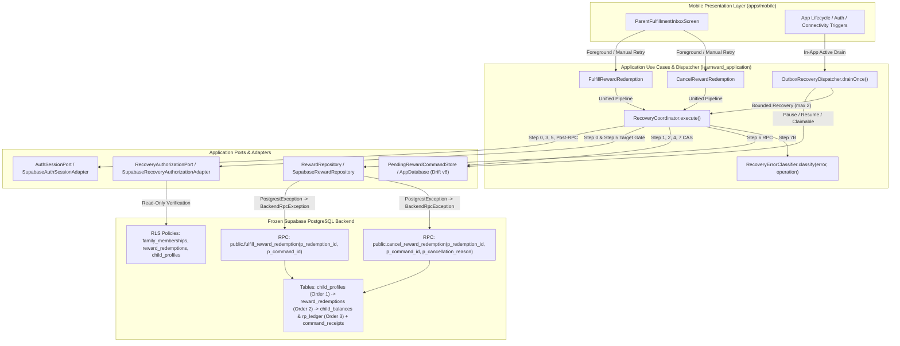
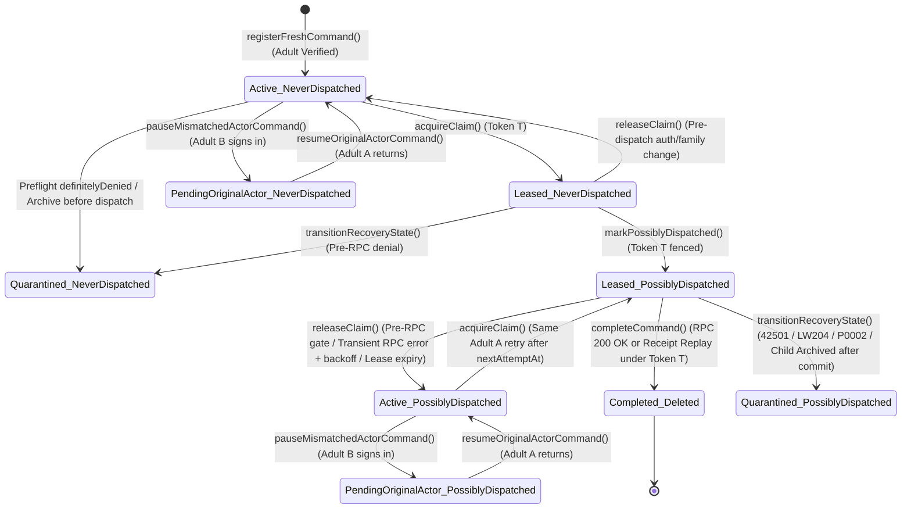

# LearnWard — Phase 6 Slice 4A-2 Detailed Design Contract: Adult Fulfill/Cancel Reliability

**Status:** DESIGN-ONLY — PENDING INDEPENDENT ARCHITECTURE REVIEW (**NOT IMPLEMENTED**)  
**Plan Date:** 2026-11-10  
**Repository:** `https://github.com/thedusk4203/LearnWard`  
**Authoritative Baseline `main`:** `f59061a555ab4e5e0df4116aa18de1be7b232a33`  
**Verified Baseline CI:** [`42737521175`](https://github.com/thedusk4203/LearnWard/actions/runs/42737521175) — **SUCCESS (4/4 jobs green)**  
**Prior Frozen Slices:**
- Phase 6 Slice 4A-0 (Drift v6 Foundation): Merge `88908ac309cda0eddcd549121ea0638c6979a384` ([Freeze Receipt](freezes/phase-6-slice-4a-0-drift-v6-foundation-freeze.md))
- Phase 6 Slice 4A-1 (Spin/Redeem Recovery Dispatcher): Merge `6b1d4da03254264ac180e4b1503de93e146c963e` ([Freeze Receipt](freezes/phase-6-slice-4a-1-recovery-dispatcher-freeze.md))
- Phase 6 Slice 4B-0 (Immediate Local Evidence Safety): Merge `f921bb67b67e4e0d528911f0da2b90f7b693fc00` ([Freeze Receipt](freezes/phase-6-slice-4b-0-local-evidence-safety-freeze.md))

**Governing Sources:**
- [Phase 6 Master Delivery and Pilot Gates](21-phase-6-master-delivery-and-pilot-gates.md) (§2 Slice 4A-2, §4 Cross-Cutting Mandatory Invariants)
- [Phase 6 Slice 4A-1 Final Implementation Contract](20-phase-6-slice-4a-1-final-implementation-contract.md)
- [ADR 0005 — Phase 4 Reward Economy and Wheel Experience](adr/0005-phase-4-reward-economy-wheel.md) (`ACCEPTED`)
- [ADR 0008 — Phase 6 Pilot Hardening Decisions](adr/0008-phase-6-pilot-hardening.md) (`ACCEPTED`)

---

## 1. Exact Source Inventory & Baseline Audit (WP0)

Every file below was audited directly against `main` @ `f59061a555ab4e5e0df4116aa18de1be7b232a33`. No invented paths or method names are used.

| File Path | Audited Symbols & Line Ranges | Verified Baseline Behavior & Identified Gaps for Slice 4A-2 |
|---|---|---|
| `packages/learnward_application/lib/src/services/recovery_coordinator.dart` | `CommandExecutionTrigger` (L19–L28), `CommandExecutionResult` hierarchy (L31–L164), `RecoveryCoordinator` (L168–L786), `execute()` (L203–L775) | Implements the 8-step locked pipeline for `spinWheel` and `redeemReward`. **Gaps:** (1) `execute()` lacks `redemptionId` and `cancellationReason` parameters; (2) Step 1 target matching (L308–L313) only checks `rewardId` for `redeemReward` and does not validate `redemptionId`, `cancellationReason`, or adult `actorRole` for `fulfillReward`/`cancelReward`; (3) Step 6 (L659–L661) throws `UnsupportedError('Operation ${command.operation} is out of scope for Slice 4A-1')` for `fulfillReward` and `cancelReward`; (4) Step 7B calls `RecoveryErrorClassifier.classify(e)` without operation context. |
| `packages/learnward_application/lib/src/services/outbox_recovery_dispatcher.dart` | `OutboxRecoveryDispatcher` (L12–L181), `drainOnce()` (L52–L180) | Scans mismatched active commands to pause, paused original-actor commands to resume, and claimable commands to execute with bounded concurrency (`maxConcurrentRpcs = 2`). **Gaps:** (1) L150–L157 invokes `_coordinator.execute(...)` passing `operation`, `familyId`, `childId`, `rewardId`, `requestedCommandId`, and `trigger`, omitting `redemptionId: cmd.redemptionId` and `cancellationReason: cmd.cancellationReason`; (2) must skip/quarantine any adult redemption command missing `redemptionId` or required `cancellationReason`. |
| `packages/learnward_application/lib/src/use_cases/fulfill_reward_redemption.dart` | `FulfillRewardRedemption` (L8–L81), `call()` (L19–L60), `_isTerminalError()` (L62–L71) | **Critical Gap:** Completely bypasses `RecoveryCoordinator`, `AuthSessionPort`, and `RecoveryAuthorizationPort`. Calls `findPendingRedemptionCommand`, writes a partial `PendingRewardCommand` via `savePendingCommand` (omitting `childId`, `actorUserId`, `actorRole`), calls `_repository.fulfillRewardRedemption` directly without a SQLite lease or `markPossiblyDispatched`, and uses `_isTerminalError()` substring matching (`msg.contains('LW204') \|\| msg.contains('42501')`) to call `deletePendingCommand()`. |
| `packages/learnward_application/lib/src/use_cases/cancel_reward_redemption.dart` | `CancelRewardRedemption` (L8–L85), `call()` (L19–L64), `_isTerminalError()` (L66–L75) | **Critical Gap:** Completely bypasses `RecoveryCoordinator`, `AuthSessionPort`, and `RecoveryAuthorizationPort`. Writes a partial `PendingRewardCommand` (omitting `childId`, `actorUserId`, `actorRole`), calls `_repository.cancelRewardRedemption` without a lease or `markPossiblyDispatched`, does not check for conflicting `fulfill_reward` rows on the same `redemptionId`, and deletes the journal on `LW204` or `42501` via substring matching. |
| `packages/learnward_application/lib/src/ports/pending_reward_command_store.dart` | `RewardCommandOperation` (L4–L19), `PendingRewardCommand` (L22–L153), `isCommandUnresolved()` (L177–L213), `RegisterFreshCommandResult` (L158–L227), `PendingRewardCommandStore` (L230–L393) | Defines the v6 command model and store interface. `RewardCommandOperation` already defines `fulfillReward('fulfill_reward')` and `cancelReward('cancel_reward')`. `PendingRewardCommand` already includes `redemptionId` (L51) and `cancellationReason` (L52). **Gaps:** Doc comments and contracts on `registerFreshCommand`, `acquireClaim`, `markPossiblyDispatched`, `pauseMismatchedActorCommand`, `resumeOriginalActorCommand`, `listClaimableCommands`, `listMismatchedActiveCommands`, and `listPausedOriginalActorCommands` specify `operation IN ('spin_wheel', 'redeem_reward')` only. |
| `packages/learnward_application/lib/src/ports/recovery_authorization_port.dart` | `TargetAuthorizationStatus` (L5–L17), `RecoveryAuthorizationPort` (L20–L29), `verifyTarget()` (L23–L28) | `verifyTarget()` accepts `{context, familyId, childId, operation}`. **Gap:** Lacks optional `String? redemptionId` parameter needed to resolve and verify the target redemption's authoritative `family_id` and `child_id` during adult `fulfill_reward` / `cancel_reward` preflight and pre-RPC checks. |
| `packages/learnward_data/lib/src/database/app_database.dart` | `AppDatabase` (L20–L1445), `schemaVersion => 6` (L25), `registerFreshCommand()` (L665–L739), `savePendingCommand()` (L741–L913), `acquireClaim()` (L1065–L1105), `releaseClaim()` (L1108–L1134), `markPossiblyDispatched()` (L1137–L1166), `completeCommand()` (L1169–L1183), `transitionRecoveryState()` (L1186–L1211), `pauseMismatchedActorCommand()` (L1214–L1254), `resumeOriginalActorCommand()` (L1257–L1294), `listClaimableCommands()` (L1297–L1337), `listMismatchedActiveCommands()` (L1340–L1379), `listPausedOriginalActorCommands()` (L1382–L1420) | Drift schema v6 already contains all required columns on `pending_reward_commands` (`redemption_id`, `cancellation_reason`, `actor_user_id`, `actor_role`, `recovery_state`, `dispatch_state`, `retry_count`, `next_attempt_at`, `last_error_message`, `lease_token`, `lease_expires_at`). **Gaps:** (1) `registerFreshCommand()` (L674–L685) filters by `familyId`, `operation`, `childId`, and `rewardId` — it does not scope by `redemption_id` for adult operations and does not detect cross-operation conflicts between `fulfill_reward` and `cancel_reward` on the same redemption; (2) `acquireClaim`, `markPossiblyDispatched`, `pauseMismatchedActorCommand`, `resumeOriginalActorCommand`, `listClaimableCommands`, `listMismatchedActiveCommands`, and `listPausedOriginalActorCommands` hardcode `AND operation IN ('spin_wheel', 'redeem_reward')`. |
| `packages/learnward_data/lib/src/repositories/supabase_reward_repository.dart` | `SupabaseRewardRepository` (L7–L268), `redeemStoreReward()` (L141–L164), `fulfillRewardRedemption()` (L167–L180), `cancelRewardRedemption()` (L183–L198) | `redeemStoreReward()` catches `PostgrestException` and rethrows `BackendRpcException(message: e.message, code: e.code, details: e.details)`. **Critical Gap:** `fulfillRewardRedemption()` (L167–L180) and `cancelRewardRedemption()` (L183–L198) do **not** catch `PostgrestException` or wrap it in `BackendRpcException`, preventing typed `BackendRpcError` classification in `RecoveryErrorClassifier`. |
| `apps/mobile/lib/app/bootstrap/supabase_recovery_authorization_adapter.dart` | `SupabaseRecoveryAuthorizationAdapter` (L22–L130), `verifyTarget()` (L29–L129) | **Critical Gap:** Step 1 (L39–L78) checks `public.child_device_grants` first and returns `TargetAuthorizationStatus.authorized` for any active paired-child grant + active child profile **without checking `operation`**! A paired-child account would erroneously pass preflight if `verifyTarget` were called for `fulfill_reward` or `cancel_reward`. Additionally, Step 2 (L80–L120) does not query `public.reward_redemptions` to verify that `redemptionId` belongs to `(familyId, childId)`. |
| `apps/mobile/lib/features/rewards/presentation/parent_fulfillment_inbox_screen.dart` | `ParentFulfillmentInboxScreen` (L11–L605), `_loadData()` (L36–L86), `_fulfill()` (L88–L133), `_cancelAndRefund()` (L135–L236), `_resolvePendingUpdate()` (L238–L293) | **Gaps:** (1) Instantiates `FulfillRewardRedemption` and `CancelRewardRedemption` without `RecoveryCoordinator`; (2) uses `e.toString().contains('LW204')` substring matching; (3) fabricates fallback `'Cancelled by parent'` at L265 if `pending.cancellationReason` is null; (4) displays one generic recovery banner without distinguishing scheduled retry, `pendingOriginalActor` pause, `quarantinedUnknownOutcome` quarantine, or terminal rejection. |
| `supabase/migrations/20261105120000_phase6_2_child_archive_concurrency.sql` | `public.fulfill_reward_redemption(uuid, uuid)` (L1421–L1528), `public.cancel_reward_redemption(uuid, uuid, text)` (L1530–L1679) | **Frozen Server Contract:** Both RPCs are `SECURITY DEFINER` and enforce: (1) `auth.uid()` non-null (`42501`); (2) non-null UUIDs and for cancel `char_length(trim(coalesce(p_cancellation_reason, ''))) >= 2` (`22000`); (3) resolve `(family_id, child_id)` from `public.reward_redemptions` (`P0002` if missing); (4) require `private.is_active_family_adult(v_family_id)` (`42501`); (5) **Order 1 lock:** `SELECT 1 FROM public.child_profiles WHERE id = v_child_id AND family_id = v_family_id AND status = 'active' FOR SHARE` (`42501: Child profile is archived` if archived — **executed BEFORE receipt replay!**); (6) **Order 2 lock:** `SELECT * FROM public.reward_redemptions WHERE id = p_redemption_id FOR UPDATE`; (7) **Receipt replay:** inspect `public.command_receipts WHERE command_id = p_command_id` (validating `operation`, `actor_user_id = v_user_id`, `family_id = v_family_id`, `resource_id = p_redemption_id`) and return `v_redemption` immediately if matched; (8) check `v_redemption.status = 'pending_fulfillment'` (`LW204` if already `fulfilled` or `cancelled`); (9) for cancel, **Order 3 lock:** `SELECT rp_balance_minor FROM public.child_balances WHERE child_id = v_redemption.child_id FOR UPDATE`, update redemption to `cancelled`, insert compensating `+rp_cost_minor` into `public.rp_ledger` with `idempotency_key = 'rp:refund:' \|\| p_redemption_id::text`, and increment `child_balances`; (10) insert `command_receipts` row and return `v_redemption`. |

### Additional Audited Supporting Files

| File Path | Audited Symbols & Line Ranges | Relevance to Slice 4A-2 |
|---|---|---|
| `packages/learnward_application/lib/src/services/recovery_error_classifier.dart` | `ClassifiedErrorAction` (L6–L22), `RecoveryErrorClassifier.classify()` (L66–L148) | Currently uses a single static `_terminalWhitelistedCodes = {'LW201', 'LW202', 'LW203', 'LW205', 'LW206'}`. Must become operation-aware so `LW201`–`LW206` are never treated as whitelisted terminal deletions for `fulfill_reward` or `cancel_reward`. |
| `packages/learnward_test_support/lib/src/in_memory_pending_reward_command_store.dart` | `InMemoryPendingRewardCommandStore` (L6–L569) | Must maintain 100% behavioral parity with `AppDatabase` for `registerFreshCommand` cross-operation redemption conflict detection and adult operation CAS predicates. |
| `apps/mobile/lib/app/bootstrap/in_memory_repositories.dart` | `InMemoryPendingRewardCommandStore` (L216–L779), `InMemoryRewardRepository` (L1336–L1556), `InMemoryRecoveryAuthorizationPort` (L2297–L2314) | Mobile demo/test in-memory implementations must maintain parity with `AppDatabase`, `SupabaseRewardRepository`, and `SupabaseRecoveryAuthorizationAdapter`. |
| `supabase/migrations/20261105000000_phase6_1_child_lifecycle_rls.sql` | `child_profiles_select` (L123–L136), `command_receipts_select` (L260–L297), `reward_redemptions_select` (L349–L357) | **Frozen RLS Contract:** All three SELECT policies require `status = 'active'` / `private.is_child_active_in_family(child_id, family_id)`. When a child is archived, direct PostgREST SELECT queries return 0 rows (`null`). |

---

## 2. Dependency and Call Graph



---

## 3. Frozen Architecture Decisions (WP1: D1–D8)

### D1. Unified Coordinator Execution Pipeline
Both `RewardCommandOperation.fulfillReward` and `RewardCommandOperation.cancelReward` execute exclusively through `RecoveryCoordinator.execute()`:
1. **Step 0 — Session, Active Family & Target Authorization Preflight:**
   - Validate authenticated actor via `AuthSessionPort.validateForMutation()`.
   - Verify active UI family matches `familyId` via `activeFamilyIdProvider`.
   - For existing retry (`requestedCommandId != null`), load the row first to enforce legacy completeness (A2-19) and actor-mismatch checks before any target mutation.
   - Verify adult target authorization via `RecoveryAuthorizationPort.verifyTarget(context: context, familyId: familyId, childId: childId, operation: operation, redemptionId: redemptionId)`.
2. **Step 1 — Immutable Command Registration or Validated Retry Lookup:**
   - Fresh foreground intent (`requestedCommandId == null`, `trigger == foreground`): validate required adult payload (`redemptionId != null`, and for `cancelReward`, `cancellationReason.trim().length >= 2`), confirm `context.role` (or verified membership role) is `'owner'` or `'parent'`, and atomically invoke `PendingRewardCommandStore.registerFreshCommand()`.
   - Retry/Recovery (`requestedCommandId != null`): load exact row by `commandId`; fail closed to `CommandQuarantinedResult` if missing, incomplete (`actorUserId == null`, `childId == null`, `redemptionId == null`, invalid `actorRole`, or missing `cancellationReason` on `cancelReward`), or mismatched with invocation arguments.
3. **Step 2 — Exclusive SQLite Lease Acquisition:**
   - Acquire a 30-second token-fenced lease via `acquireClaim(commandId, actorUserId: context.userId, leaseDuration, now)`.
4. **Step 3 — Post-Claim Session Generation Revalidation:**
   - Verify `_authSessionPort.currentSessionGeneration == context.sessionGeneration`. If changed, release claim without incrementing retry count or wait 1s and abort with zero RPC.
5. **Step 4 — Durable Pre-Dispatch Marker (`possibly_dispatched`):**
   - Commit token-fenced `markPossiblyDispatched(commandId, leaseToken, authenticatedActorId: context.userId, now)`. If CAS returns `false`, abort with zero RPC.
6. **Step 5 — Final Live Auth, Session Epoch, Active Family, Adult Membership & Target Gate:**
   - Immediately prior to network dispatch, re-run `validateForMutation()`, verify `freshContext.userId == context.userId` and unchanged `sessionGeneration`, re-verify `activeFamilyIdProvider() == command.familyId`, and re-run `_authorizationPort.verifyTarget(..., redemptionId: command.redemptionId)`.
7. **Step 6 — Authoritative Server RPC Execution:**
   - Invoke `RewardRepository.fulfillRewardRedemption(commandId: command.commandId, redemptionId: RewardRedemptionId(command.redemptionId!))` or `RewardRepository.cancelRewardRedemption(commandId: command.commandId, redemptionId: RewardRedemptionId(command.redemptionId!), cancellationReason: command.cancellationReason!)`.
8. **Step 7 — Post-RPC Session Check & Token-Fenced Outcome Disposition:**
   - Re-verify `validateForMutation()` matches `context.userId` and `context.sessionGeneration`. If session changed in flight, release claim and retain unresolved journal state for later reconciliation by the original adult.
   - On RPC success: execute token-fenced `completeCommand(commandId, leaseToken)` and return `CommandCommittedResult(commandId: command.commandId, redemption: result)`.
   - On RPC failure: classify via `RecoveryErrorClassifier.classify(e, operation: command.operation)` and execute token-fenced `releaseClaim` (for transient network/5xx errors) or `transitionRecoveryState(..., CommandRecoveryState.quarantinedUnknownOutcome)` (for `42501`, `LW204`, `P0002`, `22000`, or unknown errors).

### D2. Target Identity and Cross-Operation Conflict Control
- **Logical Target Key for Adult Redemption Operations:** `(family_id, redemption_id)` across `operation IN ('fulfill_reward', 'cancel_reward')`.
- **Single-Redemption Mutual Exclusion:** For any given `(family_id, redemption_id)`, at most **one** unresolved command (`isCommandUnresolved == true`) may exist in `pending_reward_commands` across **both** `fulfill_reward` and `cancel_reward`.
  - If an unresolved `fulfill_reward` row exists for `redemption_1`, a fresh `cancel_reward` attempt for `redemption_1` (or another `fulfill_reward` attempt) receives `PreexistingCommandFound(existingCommand)` from `registerFreshCommand()` and is rejected with `CommandAlreadyInFlightResult(commandId: existingCommand.commandId)` without allocating a new UUID or dispatching a second RPC.
  - Conversely, if an unresolved `cancel_reward` row exists for `redemption_1`, a fresh `fulfill_reward` attempt for `redemption_1` is blocked identically.
- **Cross-Redemption Independence:** Conflict detection for `fulfill_reward` and `cancel_reward` scopes strictly by `(family_id, redemption_id)` — **never** by `(family_id, child_id)` alone. Unresolved commands on `redemption_1` never block fresh or recovery execution on `redemption_2` (`redemption_2 != redemption_1`), even when both redemptions belong to the same child.
- **Immutable Command Payload:** Once persisted, `command_id`, `operation`, `family_id`, `child_id`, `reward_id`, `redemption_id`, `cancellation_reason`, `actor_user_id`, and `actor_role` are immutable. `cancellation_reason` is trimmed once before initial persistence and replayed verbatim on every retry.

### D3. Adult-Only Authorization
- Only an authenticated user with verified `status = 'active'` and `role IN ('owner', 'parent')` in `public.family_memberships` for `familyId` may execute `fulfill_reward` or `cancel_reward`.
- Paired-child devices (`public.child_device_grants` or `context.role == 'child'`) are **definitively denied** (`TargetAuthorizationStatus.definitelyDenied`, or `confirmedRevoked` if the grant is revoked) for `fulfill_reward` and `cancel_reward`.
- Target redemption identity is verified via authorized read-only query against `public.reward_redemptions(id, family_id, child_id, status)`:
  - If a row is returned and `row.family_id != familyId` or `row.child_id != childId`, return `TargetAuthorizationStatus.definitelyDenied`.
  - If `public.reward_redemptions` or `public.child_profiles` returns `null` (0 rows due to RLS filtering or network/visibility boundaries), return `TargetAuthorizationStatus.unverified` (unless positive archive/revocation evidence is available), never `authorized`.

### D4. Narrow SQLite CAS Extension (Drift Schema v6 — Zero Migration)
- Extend `acquireClaim`, `markPossiblyDispatched`, `pauseMismatchedActorCommand`, `resumeOriginalActorCommand`, `listClaimableCommands`, `listMismatchedActiveCommands`, and `listPausedOriginalActorCommands` using a compound operation-specific SQL predicate that preserves `spin_wheel` and `redeem_reward` unchanged while requiring full adult payload invariants for `fulfill_reward` and `cancel_reward` (see §6).

### D5. Fail-Closed Result Classification
- `SupabaseRewardRepository.fulfillRewardRedemption` and `cancelRewardRedemption` catch `PostgrestException` and throw `BackendRpcException(message: e.message, code: e.code, details: e.details)`.
- `RecoveryErrorClassifier.classify(Object error, {RewardCommandOperation? operation})` is operation-aware:
  - For `fulfill_reward` and `cancel_reward`, **zero** backend error codes are whitelisted for automatic journal deletion (`terminalWhitelisted` is empty for adult operations).
  - `LW204`, `42501`, `P0002`, `22000`, and any unwhitelisted `BackendRpcError` transition the command to `CommandRecoveryState.quarantinedUnknownOutcome` via token-fenced `transitionRecoveryState`, keeping the journal row intact and blocking conflicting fresh intents.
  - Transient transport/timeout/5xx errors release the claim with atomic `retry_count = retry_count + 1` and bounded jittered exponential backoff.

### D6. Child Archival and Reconciliation
- Because `public.fulfill_reward_redemption` and `public.cancel_reward_redemption` execute `Order 1: SELECT 1 FROM public.child_profiles WHERE id = v_child_id AND family_id = v_family_id AND status = 'active' FOR SHARE` (raising `42501: Child profile is archived`) **before** `Step 6: SELECT * FROM public.command_receipts`, and because RLS on `reward_redemptions` and `command_receipts` also requires `private.is_child_active_in_family(child_id, family_id)`, archiving a child after an unacknowledged RPC commit prevents standard receipt replay.
- When child archival occurs:
  - **Before dispatch (`never_dispatched`):** preflight denies/blocks execution with 0 RPCs; if an existing `never_dispatched` row is present and archive is positively confirmed (`definitelyDenied`), it transitions to `quarantined_unknown_outcome` (`dispatch_state = 'never_dispatched'`).
  - **After possible dispatch (`possibly_dispatched`):** when replay encounters `42501: Child profile is archived` (or positive archive confirmation), the command transitions to `quarantined_unknown_outcome` with `dispatch_state = 'possibly_dispatched'` preserved. The client never fabricates a receipt, never deletes the journal row, and never claims the server operation failed.

### D7. Server-Authoritative Economics
- Only `public.fulfill_reward_redemption` and `public.cancel_reward_redemption` mutate `public.reward_redemptions`, `public.rp_ledger`, and `public.child_balances`.
- The mobile client never computes or increments RP balances locally.
- Repeated `cancel_reward_redemption` calls with the same `p_command_id` return the committed redemption via `command_receipts` replay without inserting a second `rp_ledger` row or incrementing `child_balances` twice.
- Concurrent distinct `cancel_reward_redemption` commands on the same redemption serialize on `SELECT * FROM public.reward_redemptions WHERE id = p_redemption_id FOR UPDATE`; the first commits the status transition and `'rp:refund:' || p_redemption_id::text` ledger entry, while the second is rejected at Step 7 with `LW204`.

### D8. UI Safety in `ParentFulfillmentInboxScreen`
- All Fulfill, Cancel, and Retry actions route through `FulfillRewardRedemption` and `CancelRewardRedemption` backed by `recoveryCoordinatorProvider`.
- While any command for `redemption.id.value` satisfies `isCommandUnresolved`, both `"Cancel & Refund"` and `"Mark as Delivered"` buttons for that redemption are disabled.
- The UI renders distinct, non-misleading states for:
  1. **Confirmed Success (`CommandCommittedResult`):** Only state permitted to display `"Delivered ..."` or `"Cancelled. ... RP refunded to balance."`
  2. **Scheduled Retry (`CommandScheduledResult` / `active` unresolved):** Displays verification-pending banner/badge with explicit `"Retry"` action that reuses the exact stored `commandId`, `childId`, `redemptionId`, and `cancellationReason`.
  3. **Original-Actor Pause (`CommandPendingOriginalActorResult` / `pendingOriginalActor`):** Displays original-parent-required notice and disables retry and fresh actions for other signed-in adults.
  4. **Ambiguous Quarantine (`CommandQuarantinedResult` / `quarantinedUnknownOutcome` / `unknownLegacy`):** Displays quarantine warning and locks automatic/manual RPC retry and conflicting actions.
  5. **Definitive Rejection / Auth Unavailable / Family Mismatch:** Displays sanitized error feedback without leaking cross-family information.

---

## 4. Proposed Interface & Port Changes

### 4.1 `RecoveryAuthorizationPort` (`packages/learnward_application/lib/src/ports/recovery_authorization_port.dart`)

```dart
abstract interface class RecoveryAuthorizationPort {
  /// Verifies whether the [context] is authorized to perform [operation]
  /// for the specified [familyId] and [childId], and (for adult redemption
  /// operations) verifies that [redemptionId] resolves to [familyId] and [childId].
  Future<TargetAuthorizationStatus> verifyTarget({
    required ValidatedActorContext context,
    required String familyId,
    required String childId,
    required RewardCommandOperation operation,
    String? redemptionId,
  });
}
```

### 4.2 `RecoveryCoordinator` (`packages/learnward_application/lib/src/services/recovery_coordinator.dart`)

```dart
Future<CommandExecutionResult> execute({
  required RewardCommandOperation operation,
  required String familyId,
  required String childId,
  String? rewardId,
  String? redemptionId,
  String? cancellationReason,
  String? requestedCommandId,
  CommandExecutionTrigger trigger = CommandExecutionTrigger.foreground,
  Duration? overrideLeaseDuration,
})
```

**Coordinator Validation Rules for `fulfillReward` and `cancelReward`:**
1. **Legacy & Completeness Gate on Existing Commands (`requestedCommandId != null`):**
   - Before calling `verifyTarget` or `acquireClaim`, load `existing = await _commandStore.getPendingCommand(requestedCommandId)`.
   - If `existing == null`, return `CommandQuarantinedResult(commandId: requestedCommandId, reason: 'Pending command not found...')`.
   - If `existing.dispatchState == CommandDispatchState.unknownLegacy || existing.recoveryState == CommandRecoveryState.quarantinedUnknownOutcome || existing.recoveryState == CommandRecoveryState.terminalError`, return `CommandQuarantinedResult(...)`.
   - Check actor mismatch **before** `verifyTarget`: if `existing.actorUserId != null && existing.actorUserId!.isNotEmpty && existing.actorUserId != context.userId`:
     - If `trigger == CommandExecutionTrigger.recovery`, call `_commandStore.pauseMismatchedActorCommand(...)`.
     - Return `CommandPendingOriginalActorResult(commandId: existing.commandId, originalActorId: existing.actorUserId!, reason: 'Actor mismatch with authenticated session')`.
   - Enforce non-fabricated identity completeness (A2-19):
     - Require `existing.actorUserId != null && existing.actorUserId!.trim().isNotEmpty`.
     - Require `existing.childId != null && existing.childId!.trim().isNotEmpty`.
     - If `existing.operation == RewardCommandOperation.fulfillReward || existing.operation == RewardCommandOperation.cancelReward`:
       - Require `existing.redemptionId != null && existing.redemptionId!.trim().isNotEmpty`.
       - Require `existing.actorRole == 'owner' || existing.actorRole == 'parent'`.
     - If `existing.operation == RewardCommandOperation.cancelReward`:
       - Require `existing.cancellationReason != null && existing.cancellationReason!.trim().length >= 2`.
     - If any completeness check fails, return `CommandQuarantinedResult(commandId: existing.commandId, reason: 'Incomplete or legacy command identity')` with **zero** identity fabrication and **zero** RPCs.
   - Verify immutable target match between caller arguments and `existing`:
     ```dart
     final cleanRequestedReason = cancellationReason?.trim();
     final matchesTarget =
         existing.operation == operation &&
         existing.familyId == familyId &&
         existing.childId == childId &&
         (operation != RewardCommandOperation.redeemReward ||
             existing.rewardId == rewardId) &&
         ((operation != RewardCommandOperation.fulfillReward &&
                 operation != RewardCommandOperation.cancelReward) ||
             existing.redemptionId == redemptionId) &&
         (operation != RewardCommandOperation.cancelReward ||
             existing.cancellationReason == cleanRequestedReason);
     ```
     If `!matchesTarget`, return `CommandQuarantinedResult(commandId: existing.commandId, reason: 'Mismatched command payload...')`.

2. **Fresh Command Validation (`requestedCommandId == null`, `trigger == CommandExecutionTrigger.foreground`):**
   - If `childId.trim().isEmpty`, return `CommandQuarantinedResult(commandId: 'unassigned', reason: 'Missing target child ID.')`.
   - For `fulfillReward` and `cancelReward`:
     - If `redemptionId == null || redemptionId.trim().isEmpty`, return `CommandQuarantinedResult(commandId: 'unassigned', reason: 'Missing target redemption ID.')`.
     - If `context.role == 'child'`, return `CommandQuarantinedResult(commandId: 'unassigned', reason: 'Child actor cannot execute adult redemption operation.')`.
     - Resolve effective adult `actorRole = (context.role == 'owner' || context.role == 'parent') ? context.role! : 'parent'` (only after `verifyTarget` has positively confirmed active adult membership in `familyId`).
   - For `cancelReward`:
     - Let `cleanReason = cancellationReason?.trim() ?? ''`.
     - If `cleanReason.length < 2`, return `CommandQuarantinedResult(commandId: 'unassigned', reason: 'Cancellation reason must be at least 2 characters.')`.
   - Construct `PendingRewardCommand` with `redemptionId: redemptionId`, `cancellationReason: operation == RewardCommandOperation.cancelReward ? cleanReason : null`, `childId: childId`, `actorUserId: context.userId`, `actorRole: actorRole`, `recoveryState: CommandRecoveryState.active`, `dispatchState: CommandDispatchState.neverDispatched`.

### 4.3 `FulfillRewardRedemption` & `CancelRewardRedemption` Use Cases

Both use cases are refactored to match the `SpinRewardWheel` / `RedeemStoreReward` pattern:
- Require either an explicit `RecoveryCoordinator` or both `AuthSessionPort` and `RecoveryAuthorizationPort`.
- Remove direct `_commandStore.savePendingCommand`, `_commandStore.deletePendingCommand`, `_isTerminalError`, and direct `_repository` mutation calls.
- Expose both:
  - `Future<CommandExecutionResult> executeResult({required FamilyId familyId, required RewardRedemptionId redemptionId, required ChildId childId, String? commandId, CommandExecutionTrigger trigger = CommandExecutionTrigger.foreground})` (and `required String cancellationReason` on `CancelRewardRedemption`), returning the typed `CommandExecutionResult` directly for UI state handling.
  - `Future<RewardRedemption> call({required FamilyId familyId, required RewardRedemptionId redemptionId, ChildId? childId, String? commandId})` (and `required String cancellationReason` on `CancelRewardRedemption`), delegating to `executeResult` and unwrapping `CommandCommittedResult.redemption` or throwing the underlying/typed error for backward-compatible callers.
  - When `childId` is omitted by legacy unit-test callers of `call()`, resolve `childId` strictly from: (a) the stored command in `_commandStore.getPendingCommand(commandId)` if `commandId != null` (failing closed if `existing?.childId == null`), or (b) authorized read-only `_repository.listRedemptions(familyId: familyId)` lookup for `redemptionId` before coordinator execution (failing closed if not found). `ParentFulfillmentInboxScreen` and `OutboxRecoveryDispatcher` always supply `childId` explicitly.

### 4.4 `SupabaseRewardRepository` Error Normalization (`packages/learnward_data/lib/src/repositories/supabase_reward_repository.dart`)

```dart
@override
Future<RewardRedemption> fulfillRewardRedemption({
  required String commandId,
  required RewardRedemptionId redemptionId,
}) async {
  try {
    final response = await _client.rpc<Map<String, dynamic>>(
      'fulfill_reward_redemption',
      params: {
        'p_redemption_id': redemptionId.value,
        'p_command_id': commandId,
      },
    );

    return _mapRedemption(response);
  } on PostgrestException catch (e) {
    throw BackendRpcException(
      message: e.message,
      code: e.code,
      details: e.details,
    );
  }
}

@override
Future<RewardRedemption> cancelRewardRedemption({
  required String commandId,
  required RewardRedemptionId redemptionId,
  required String cancellationReason,
}) async {
  try {
    final response = await _client.rpc<Map<String, dynamic>>(
      'cancel_reward_redemption',
      params: {
        'p_redemption_id': redemptionId.value,
        'p_command_id': commandId,
        'p_cancellation_reason': cancellationReason,
      },
    );

    return _mapRedemption(response);
  } on PostgrestException catch (e) {
    throw BackendRpcException(
      message: e.message,
      code: e.code,
      details: e.details,
    );
  }
}
```

---

## 5. Immutable Command Identity & Conflict Control Contract

### 5.1 Logical Identity & Conflict Scope Matrix

| Operation | Required Non-Null Identity Columns in `pending_reward_commands` | Logical Conflict Scope in `registerFreshCommand()` | Conflicting Operations |
|---|---|---|---|
| `spin_wheel` | `command_id`, `operation`, `family_id`, `child_id`, `actor_user_id` | `family_id = :familyId AND child_id = :childId AND operation = 'spin_wheel'` | `spin_wheel` |
| `redeem_reward` | `command_id`, `operation`, `family_id`, `child_id`, `reward_id`, `actor_user_id` | `family_id = :familyId AND child_id = :childId AND reward_id = :rewardId AND operation = 'redeem_reward'` | `redeem_reward` |
| `fulfill_reward` | `command_id`, `operation`, `family_id`, `child_id`, `redemption_id`, `actor_user_id`, `actor_role IN ('owner', 'parent')` (`cancellation_reason IS NULL`) | `family_id = :familyId AND redemption_id = :redemptionId AND operation IN ('fulfill_reward', 'cancel_reward')` | `fulfill_reward`, `cancel_reward` |
| `cancel_reward` | `command_id`, `operation`, `family_id`, `child_id`, `redemption_id`, `cancellation_reason` (`length(trim) >= 2`), `actor_user_id`, `actor_role IN ('owner', 'parent')` | `family_id = :familyId AND redemption_id = :redemptionId AND operation IN ('fulfill_reward', 'cancel_reward')` | `fulfill_reward`, `cancel_reward` |

### 5.2 Immutability Rules Across Restarts and Retries
1. **No UUID Regeneration on Unresolved Intent:** Once `registerFreshCommand()` inserts a `PendingRewardCommand` for `(family_id, redemption_id)`, any subsequent foreground or background retry for that redemption MUST use the existing `command_id`.
2. **Cross-Operation Blocking:** While a `fulfill_reward` command for `redemption_id` has `isCommandUnresolved == true` (`active` + `never_dispatched`/`possibly_dispatched`, `pending_original_actor`, `quarantined_unknown_outcome`, or `unknown_legacy`), `registerFreshCommand()` for `cancel_reward` on the same `redemption_id` returns `PreexistingCommandFound(existingFulfillCommand)`. Neither a new `cancel_reward` row nor a new UUID can be created. The symmetric rule holds when `cancel_reward` is unresolved and a fresh `fulfill_reward` is attempted.
3. **8-Field Identity Guard in `savePendingCommand()`:** `AppDatabase.savePendingCommand()` (L792–L806 and SQL WHERE clause L872–L880) already enforces strict equality on all 8 identity columns (`operation`, `family_id`, `child_id`, `reward_id`, `redemption_id`, `cancellation_reason`, `actor_user_id`, `actor_role`). Any attempt to alter any of these fields on an existing `command_id` throws `StateError`.

---

## 6. SQLite CAS Predicate Matrix (Drift Schema v6 — Zero Migration)

Drift `schemaVersion` remains **6** with **zero** table or column changes.

### 6.1 Shared Operation-Eligibility SQL Predicate

All CAS and discovery queries in `AppDatabase` (`acquireClaim`, `markPossiblyDispatched`, `pauseMismatchedActorCommand`, `resumeOriginalActorCommand`, `listClaimableCommands`, `listMismatchedActiveCommands`, `listPausedOriginalActorCommands`) replace:
```sql
AND operation IN ('spin_wheel', 'redeem_reward')
```
with the scoped operation-eligibility predicate:
```sql
AND (
  operation IN ('spin_wheel', 'redeem_reward')
  OR (
    operation = 'fulfill_reward'
    AND child_id IS NOT NULL AND trim(child_id) <> ''
    AND redemption_id IS NOT NULL AND trim(redemption_id) <> ''
    AND cancellation_reason IS NULL
    AND actor_role IN ('owner', 'parent')
  )
  OR (
    operation = 'cancel_reward'
    AND child_id IS NOT NULL AND trim(child_id) <> ''
    AND redemption_id IS NOT NULL AND trim(redemption_id) <> ''
    AND cancellation_reason IS NOT NULL AND length(trim(cancellation_reason)) >= 2
    AND actor_role IN ('owner', 'parent')
  )
)
```

### 6.2 Complete SQLite Store Method Matrix

| Store Method | SQL Operation | Required Predicates / Guards | Mutation / Return Contract |
|---|---|---|---|
| `registerFreshCommand` | `SELECT` + `INSERT` inside `transaction()` | For `fulfill_reward` / `cancel_reward`: `SELECT * FROM pending_reward_commands WHERE family_id = ? AND redemption_id = ? AND operation IN ('fulfill_reward', 'cancel_reward')`. For `spin_wheel` / `redeem_reward`: existing `(family_id, operation, child_id, [reward_id])` filter. Evaluates `isCommandUnresolved()` on every candidate. | Returns `PreexistingCommandFound(existing)` if any candidate is unresolved; otherwise inserts with `lease_token = NULL, lease_expires_at = NULL` and returns `FreshCommandRegistered(command)`. |
| `acquireClaim` | `UPDATE` CAS | `command_id = ? AND actor_user_id = ? AND recovery_state = 'active'` + **Operation-Eligibility Predicate (§6.1)** + `dispatch_state IN ('never_dispatched', 'possibly_dispatched', 'confirmed_committed') AND (next_attempt_at IS NULL OR next_attempt_at <= ?) AND ((lease_token IS NULL AND lease_expires_at IS NULL) OR (lease_token IS NOT NULL AND lease_expires_at <= ?))` | Sets `lease_token = :newToken, lease_expires_at = :expiresAt`. Returns `newLeaseToken` iff `rowsAffected == 1`, else `null`. |
| `markPossiblyDispatched` | `UPDATE` CAS | `command_id = ? AND lease_token = ? AND lease_expires_at > ? AND actor_user_id = ? AND recovery_state = 'active'` + **Operation-Eligibility Predicate (§6.1)** + `dispatch_state IN ('never_dispatched', 'possibly_dispatched')` | Sets `dispatch_state = 'possibly_dispatched'`. Preserves `lease_token` and `lease_expires_at`. Returns `rowsAffected == 1`. |
| `releaseClaim` | `UPDATE` CAS | `command_id = ? AND lease_token = ?` | Sets `retry_count = retry_count + 1, next_attempt_at = ?, last_error_message = ?, lease_token = NULL, lease_expires_at = NULL`. Returns `rowsAffected == 1`. |
| `completeCommand` | `DELETE` CAS | `command_id = ? AND lease_token = ?` | Deletes row iff `lease_token` matches active claim. Returns `rowsAffected == 1`. |
| `transitionRecoveryState` | `UPDATE` CAS | `command_id = ? AND lease_token = ?` | Sets `recovery_state = ?, last_error_message = ?, lease_token = NULL, lease_expires_at = NULL`. Returns `rowsAffected == 1`. |
| `pauseMismatchedActorCommand` | `UPDATE` CAS | `command_id = ? AND family_id = ? AND actor_user_id IS NOT NULL AND actor_user_id <> ? AND recovery_state = 'active'` + **Operation-Eligibility Predicate (§6.1)** + `dispatch_state IN ('never_dispatched', 'possibly_dispatched', 'confirmed_committed') AND ((lease_token IS NULL AND lease_expires_at IS NULL) OR (lease_token IS NOT NULL AND lease_expires_at <= ?))` | Sets `recovery_state = 'pending_original_actor', last_error_message = ?, lease_token = NULL, lease_expires_at = NULL`. Returns `rowsAffected == 1`. |
| `resumeOriginalActorCommand` | `UPDATE` CAS | `command_id = ? AND family_id = ? AND actor_user_id = ? AND recovery_state = 'pending_original_actor'` + **Operation-Eligibility Predicate (§6.1)** + `dispatch_state IN ('never_dispatched', 'possibly_dispatched', 'confirmed_committed') AND ((lease_token IS NULL AND lease_expires_at IS NULL) OR (lease_token IS NOT NULL AND lease_expires_at <= ?))` | Sets `recovery_state = 'active', last_error_message = NULL, lease_token = NULL, lease_expires_at = NULL`. Returns `rowsAffected == 1`. |
| `listClaimableCommands` | `SELECT` | `actor_user_id = ? [AND family_id = ?] AND recovery_state = 'active'` + **Operation-Eligibility Predicate (§6.1)** + `dispatch_state IN ('never_dispatched', 'possibly_dispatched', 'confirmed_committed') AND (next_attempt_at IS NULL OR next_attempt_at <= ?) AND ((lease_token IS NULL AND lease_expires_at IS NULL) OR (lease_token IS NOT NULL AND lease_expires_at <= ?)) ORDER BY created_at ASC LIMIT ?` | Returns ordered list of eligible commands for `actorUserId` in `familyId`. |
| `listMismatchedActiveCommands` | `SELECT` | `family_id = ? AND actor_user_id IS NOT NULL AND actor_user_id <> ? AND recovery_state = 'active'` + **Operation-Eligibility Predicate (§6.1)** + `dispatch_state IN ('never_dispatched', 'possibly_dispatched', 'confirmed_committed') AND ((lease_token IS NULL AND lease_expires_at IS NULL) OR (lease_token IS NOT NULL AND lease_expires_at <= ?)) ORDER BY created_at ASC LIMIT ?` | Discovers active commands from another actor eligible for `pauseMismatchedActorCommand`. |
| `listPausedOriginalActorCommands` | `SELECT` | `family_id = ? AND actor_user_id = ? AND recovery_state = 'pending_original_actor'` + **Operation-Eligibility Predicate (§6.1)** + `dispatch_state IN ('never_dispatched', 'possibly_dispatched', 'confirmed_committed') AND ((lease_token IS NULL AND lease_expires_at IS NULL) OR (lease_token IS NOT NULL AND lease_expires_at <= ?)) ORDER BY created_at ASC LIMIT ?` | Discovers paused commands belonging to the returning actor eligible for `resumeOriginalActorCommand`. |

Both in-memory stores (`packages/learnward_test_support/lib/src/in_memory_pending_reward_command_store.dart` and `apps/mobile/lib/app/bootstrap/in_memory_repositories.dart`) must implement the exact same predicate logic.

---

## 7. State-Transition Diagram & 16-State Precedence Matrix

### 7.1 Command Lifecycle State Diagram



### 7.2 16-State Recovery × Dispatch Precedence Matrix (`R24-6-01` Preserved)

| `recovery_state` \ `dispatch_state` | `never_dispatched` | `possibly_dispatched` | `confirmed_committed` | `unknown_legacy` |
|---|---|---|---|---|
| **`active`** | **Unresolved (`true`)** — Claimable by original adult; blocks fresh Fulfill & Cancel on same redemption. | **Unresolved (`true`)** — Claimable by original adult when due; blocks fresh Fulfill & Cancel on same redemption. | **Resolved (`false`)** — Reconciled if row still present; does not block fresh intent on other redemptions. | **Unresolved (`true`)** — Quarantined legacy; NOT claimable; blocks fresh Fulfill & Cancel on same redemption. |
| **`pending_original_actor`** | **Unresolved (`true`)** — Paused; NOT claimable until resumed by original adult; blocks fresh Fulfill & Cancel. | **Unresolved (`true`)** — Paused; NOT claimable until resumed by original adult; blocks fresh Fulfill & Cancel. | **Unresolved (`true`)** — Paused for original actor; fails closed; blocks fresh Fulfill & Cancel. | **Unresolved (`true`)** — Quarantined legacy; fails closed; blocks fresh Fulfill & Cancel. |
| **`quarantined_unknown_outcome`** | **Unresolved (`true`)** — Quarantined; zero auto-retry; blocks fresh Fulfill & Cancel. | **Unresolved (`true`)** — Quarantined (e.g. post-dispatch archive `42501` or `LW204`); zero auto-retry; blocks fresh Fulfill & Cancel. | **Unresolved (`true`)** — Uncertain provenance takes precedence; fails closed. | **Unresolved (`true`)** — v4/v5 migrated quarantine; zero claim/RPC; blocks fresh Fulfill & Cancel. |
| **`terminal_error`** | **Resolved (`false`)** — Not claimable; permits fresh intent if non-legacy. | **Resolved (`false`)** — Not claimable; permits fresh intent if non-legacy. | **Resolved (`false`)** — Not claimable. | **Unresolved (`true`)** — Uncertain legacy provenance takes precedence; fails closed. |

---

## 8. Adult Authorization Decision Matrix

`SupabaseRecoveryAuthorizationAdapter.verifyTarget()` for `operation IN (RewardCommandOperation.fulfillReward, RewardCommandOperation.cancelReward)`:

| Check Order | Condition Observed | Returned `TargetAuthorizationStatus` | Coordinator Action (Fresh Intent) | Coordinator Action (Existing `active` Command) |
|---|---|---|---|---|
| **1. Input / Role** | `redemptionId == null \|\| redemptionId.isEmpty \|\| childId.isEmpty` | `definitelyDenied` | Return `CommandQuarantinedResult`; 0 SQLite writes; 0 RPCs | Acquire short claim -> transition to `quarantined_unknown_outcome`; 0 RPCs |
| **2. Context Role** | `context.role == 'child'` | `definitelyDenied` | Return `CommandQuarantinedResult`; 0 SQLite writes; 0 RPCs | Acquire short claim -> transition to `quarantined_unknown_outcome`; 0 RPCs |
| **3. Device Grant Check** | `child_device_grants` row for `(family_id, auth_user_id)` has `status = 'revoked' AND revoked_at != null` | `confirmedRevoked` | Return `CommandQuarantinedResult`; 0 SQLite writes; 0 RPCs | Acquire short claim -> transition to `quarantined_unknown_outcome`; 0 RPCs |
| **4. Device Grant Check** | `child_device_grants` row for `(family_id, auth_user_id)` has `status = 'active'` (caller is a paired-child device) | `definitelyDenied` | Return `CommandQuarantinedResult`; 0 SQLite writes; 0 RPCs | Acquire short claim -> transition to `quarantined_unknown_outcome`; 0 RPCs |
| **5. Adult Membership** | `family_memberships` query times out, throws error, or returns `null` (0 rows / RLS filtered) | `unverified` | Return `CommandAuthUnavailableResult`; 0 SQLite writes; 0 RPCs | If pre-claim: leave untouched; if post-claim (Step 5): `releaseClaim` (+5s backoff); 0 RPCs |
| **6. Adult Membership** | `family_memberships` row has `status = 'revoked'` or `role NOT IN ('owner', 'parent')` | `definitelyDenied` | Return `CommandQuarantinedResult`; 0 SQLite writes; 0 RPCs | Acquire short claim (or use active lease) -> transition to `quarantined_unknown_outcome`; 0 RPCs |
| **7. Redemption Lookup** | `reward_redemptions` query for `id = redemptionId` returns row with `family_id != familyId` or `child_id != childId` | `definitelyDenied` | Return `CommandQuarantinedResult`; 0 SQLite writes; 0 RPCs | Transition to `quarantined_unknown_outcome`; 0 RPCs |
| **8. Child Profile Check** | `child_profiles` query for `(id = childId, family_id = familyId)` returns row with `status = 'archived'` | `definitelyDenied` | Return `CommandQuarantinedResult`; 0 SQLite writes; 0 RPCs | Transition to `quarantined_unknown_outcome`; 0 RPCs |
| **9. Missing / RLS-Filtered Target** | `reward_redemptions` or `child_profiles` returns `null` (0 rows, e.g. RLS active-child filter or network timeout) | `unverified` | Return `CommandAuthUnavailableResult`; 0 SQLite writes; 0 RPCs | Hold command in SQLite without mutation or `releaseClaim` (+5s); 0 RPCs |
| **10. All Checks Pass** | Active `owner`/`parent` membership + redemption matches `(familyId, childId)` + child `status = 'active'` | `authorized` | Proceed to Step 1 (`registerFreshCommand`) / Step 6 (RPC) | Proceed to Step 2 (`acquireClaim`) / Step 6 (RPC) |

---

## 9. Error Classification and Retry Matrix

`RecoveryErrorClassifier.classify(Object error, {RewardCommandOperation? operation})`:

| Error Source / Code | Operation Scope | `ClassifiedErrorAction` | Coordinator SQLite Disposition | UI / Caller Result |
|---|---|---|---|---|
| **RPC 200 OK** (Fresh commit or same-ID `command_receipts` replay) | `fulfill_reward`, `cancel_reward`, `spin_wheel`, `redeem_reward` | N/A (Success) | Token-fenced `completeCommand(commandId, leaseToken)` deletes journal row | `CommandCommittedResult(commandId, redemption)` |
| **`BackendRpcError` (`code: 'LW204'`)** (`Reward redemption is already in a terminal state: fulfilled \| cancelled`) | `fulfill_reward`, `cancel_reward` | `quarantineUnknownOutcome` | Token-fenced `transitionRecoveryState(..., quarantinedUnknownOutcome, lastErrorMessage)`; row preserved; auto-retry halted | `CommandQuarantinedResult(commandId, reason, originalError)` |
| **`BackendRpcError` (`code: '42501'`)** (`Permission denied`, `Child profile is archived`, `Invalid command replay`, `Authentication required`) | `fulfill_reward`, `cancel_reward`, `spin_wheel`, `redeem_reward` | `quarantineUnknownOutcome` | Token-fenced `transitionRecoveryState(..., quarantinedUnknownOutcome, lastErrorMessage)`; row preserved; auto-retry halted | `CommandQuarantinedResult(commandId, reason, originalError)` |
| **`BackendRpcError` (`code: 'P0002'`)** (`Reward redemption not found`, `Child balance record not found`) | `fulfill_reward`, `cancel_reward`, `spin_wheel`, `redeem_reward` | `quarantineUnknownOutcome` | Token-fenced `transitionRecoveryState(..., quarantinedUnknownOutcome, lastErrorMessage)`; row preserved | `CommandQuarantinedResult(commandId, reason, originalError)` |
| **`BackendRpcError` (`code: '22000'`)** (`Command ID / Redemption ID / Cancellation reason is required`) | `fulfill_reward`, `cancel_reward`, `spin_wheel`, `redeem_reward` | `quarantineUnknownOutcome` | Token-fenced `transitionRecoveryState(..., quarantinedUnknownOutcome, lastErrorMessage)`; row preserved | `CommandQuarantinedResult(commandId, reason, originalError)` |
| **`BackendRpcError` (`code: 'LW201'`, `'LW202'`, `'LW203'`, `'LW206'`)** | `spin_wheel` only (`redeem_reward` allows `LW201`, `LW205`; **adult ops allow NONE**) | `terminalWhitelisted` for child ops; `quarantineUnknownOutcome` if ever returned on `fulfill_reward` / `cancel_reward` | For `spin_wheel`/`redeem_reward`: `completeCommand()`. For `fulfill_reward`/`cancel_reward`: `transitionRecoveryState(..., quarantinedUnknownOutcome)`. | `CommandTerminalRejectionResult` (child ops) / `CommandQuarantinedResult` (adult ops) |
| **Transient Transport / Timeout / 5xx** (`SocketException`, `TimeoutException`, `ClientException`, `HttpException`, `BackendRpcError` `500`/`502`/`503`/`504`) | All operations | `transientRetryable` | Token-fenced `releaseClaim()` atomically increments `retry_count = retry_count + 1` and sets `nextAttemptAt = postFailureNow + uniform(0, min(60s, 2s * 2^(n-1)))` (with 1s floor on non-deterministic jitter) | `CommandScheduledResult(commandId, nextAttemptAt, retryCount, errorMessage, originalError)` |
| **Post-RPC Session Invalidation** (`validateForMutation()` null, `userId` changed, or `sessionGeneration` changed during in-flight RPC) | All operations | Preempts classifier | Token-fenced `releaseClaim(nextAttemptAt: now + 1s)`; retains unresolved journal row for original actor reconciliation | `CommandAuthUnavailableResult` |

---

## 10. Fulfill/Cancel Concurrency and Server-Authoritative Refund Invariants

### 10.1 Two-Tier Concurrency Serialization
1. **Tier 1 — Client-Side Multi-Connection SQLite Serialization:**
   - Concurrent foreground taps or simultaneous foreground + `OutboxRecoveryDispatcher` sweeps on the same device serialize through SQLite transactions in `registerFreshCommand()` (preventing duplicate UUID creation for the same `(family_id, redemption_id)` across both `fulfill_reward` and `cancel_reward`) and atomic `UPDATE ... WHERE command_id = ? AND ((lease_token IS NULL AND lease_expires_at IS NULL) OR (lease_token IS NOT NULL AND lease_expires_at <= ?))` in `acquireClaim()`.
2. **Tier 2 — Server-Side PostgreSQL Lock Hierarchy (`20261105120000_phase6_2_child_archive_concurrency.sql`):**
   - When two different devices (e.g. Parent A on Device 1 and Parent B on Device 2) concurrently issue `fulfill_reward_redemption` or `cancel_reward_redemption` for the same `p_redemption_id`:
     - **Order 1:** Both acquire `FOR SHARE` on `public.child_profiles` (`status = 'active'`). (Serializes against `archive_child_profile` which requires `FOR UPDATE` at Order 1.)
     - **Order 2:** Both request `FOR UPDATE` on `public.reward_redemptions WHERE id = p_redemption_id`. One transaction wins the lock first; the second blocks until the first commits.
     - **Winner Transaction:** Sees `status = 'pending_fulfillment'`, transitions `status` to `'fulfilled'` or `'cancelled'`, (if cancel) locks `public.child_balances FOR UPDATE` at **Order 3**, inserts the compensating `+rp_cost_minor` row into `public.rp_ledger` with `idempotency_key = 'rp:refund:' || p_redemption_id::text`, increments `child_balances.rp_balance_minor`, inserts `public.command_receipts`, and commits.
     - **Loser Transaction:** Wakes from `FOR UPDATE` on `reward_redemptions`, checks `command_receipts` for its own `p_command_id` (not found), sees `v_redemption.status != 'pending_fulfillment'`, and aborts with `ERROR LW204: Reward redemption is already in a terminal state: fulfilled|cancelled`.

### 10.2 Refund & Economic Invariants
1. **At-Most-Once Refund per Redemption:**
   - Same-ID retry after response loss hits Step 6 (`command_receipts` lookup) and returns the already-cancelled `reward_redemptions` row without touching `rp_ledger` or `child_balances`.
   - Distinct-ID concurrent cancellation attempts hit Step 7 (`LW204`) after the first cancellation commits, and are additionally backstopped by the database unique constraint on `public.rp_ledger(idempotency_key)` where `idempotency_key = 'rp:refund:' || p_redemption_id::text`.
2. **Append-Only Ledger & Balance Projection Parity:**
   - Original debit (`-rp_cost_minor`, `reason_code = 'store_redemption'` or `'wheel_spin'`) is never deleted or modified.
   - Cancellation appends exactly one compensating row (`+rp_cost_minor`, `reason_code = 'redemption_refund'`, `source_type = 'reward_redemption'`, `source_id = p_redemption_id`).
   - $\text{child\_balances.rp\_balance\_minor} = \sum \text{rp\_ledger.amount\_minor}$ holds before and after every transaction.
3. **Wheel No-Reroll Invariant (ADR 0005 Decision 4):**
   - Cancelling a redemption with `origin = 'wheel'` refunds `rp_cost_minor` to `child_balances`, leaves the `public.wheel_spins` row intact, and does **not** decrement the child's daily spin count or grant a free spin.

---

## 11. Mandatory Deterministic Acceptance Test Matrix (WP2: A2-01 through A2-20)

All client/coordinator tests use injected `TestClock` and `DeterministicJitterSource`, real file-backed SQLite (`NativeDatabase(File(...))`) with two independent `AppDatabase` connections where concurrency is tested, and server-faithful RPC/repository harnesses (plus pgTAP / PostgreSQL concurrency scripts for database-level guarantees).

### A2-01: New Fulfill, confirmed success
- **Fixture:** Active family `fam-1`, active child `child-1`, authenticated adult `parent-A` (`role: 'parent'`, `sessionGeneration: 'gen-1'`), pending redemption `red-1` (`status: pending_fulfillment`, `rpCostMinor: 1500`).
- **Initial Durable State:** `pending_reward_commands` is empty (`0` rows).
- **Execution:** Invoke `FulfillRewardRedemption` / `RecoveryCoordinator.execute(operation: fulfillReward, familyId: 'fam-1', childId: 'child-1', redemptionId: 'red-1', trigger: foreground)`.
- **Expected SQLite State:** During execution, 1 row is inserted as `never_dispatched` (`actor_user_id: 'parent-A'`, `actor_role: 'parent'`, `child_id: 'child-1'`, `redemption_id: 'red-1'`), leased via `acquireClaim`, marked `possibly_dispatched` via `markPossiblyDispatched`, and removed upon completion via token-fenced `completeCommand`. Final SQLite row count: `0`.
- **RPC Invocation Count:** `1` (`fulfill_reward_redemption`).
- **Final Server State:** `red-1.status == 'fulfilled'`, `fulfilled_by_user_id == 'parent-A'`, `command_receipts` has 1 row for `commandId`, `child_balances` unchanged (`0` refunds).
- **Failure Evidence:** Fails if `markPossiblyDispatched` is skipped before RPC, if `actor_role` or `child_id` is null during in-flight inspection, or if journal row remains after success.

### A2-02: New Cancel, confirmed success, one refund
- **Fixture:** Active family `fam-1`, active child `child-1` (initial balance `3500` minor units after a `1500` minor unit redemption `red-2`), authenticated adult `parent-A` (`role: 'parent'`), `cancellationReason: 'Out of stock this week'`.
- **Initial Durable State:** `pending_reward_commands` is empty (`0` rows).
- **Execution:** Invoke `CancelRewardRedemption` / `RecoveryCoordinator.execute(operation: cancelReward, familyId: 'fam-1', childId: 'child-1', redemptionId: 'red-2', cancellationReason: 'Out of stock this week', trigger: foreground)`.
- **Expected SQLite State:** Row inserted as `never_dispatched` with `cancellation_reason == 'Out of stock this week'`, leased, marked `possibly_dispatched`, and deleted by `completeCommand` after RPC success. Final SQLite row count: `0`.
- **RPC Invocation Count:** `1` (`cancel_reward_redemption`).
- **Final Server State:** `red-2.status == 'cancelled'`, `red-2.cancellation_reason == 'Out of stock this week'`, `rp_ledger` has `1` new `'redemption_refund'` entry of `+1500`, `child_balances` is `5000` (`refundCount == 1`), `command_receipts` has `1` row for `commandId`.
- **Failure Evidence:** Fails if `refundCount != 1`, if client mutates balance locally, or if `cancellation_reason` is altered.

### A2-03: Fulfill commits, response lost, same-ID replay
- **Fixture:** Same as A2-01, with `simulateLossOnNextCommit = true` on the server repository.
- **Initial Durable State:** `pending_reward_commands` is empty (`0` rows).
- **Execution:**
  1. Call `execute(operation: fulfillReward, ...)` -> server commits `red-1.status = 'fulfilled'` and receipt for `cmd-1`, then throws `TimeoutException` / `SocketException`.
  2. Advance `TestClock` past `nextAttemptAt` backoff deadline.
  3. Call `OutboxRecoveryDispatcher.drainOnce()` (or `execute(..., requestedCommandId: 'cmd-1', trigger: recovery)`).
- **Expected SQLite State:** After Step 1: `1` row with `command_id == 'cmd-1'`, `recovery_state == 'active'`, `dispatch_state == 'possibly_dispatched'`, `retry_count == 1`, `next_attempt_at > t0`, `lease_token == null`. After Step 3: `0` rows (completed and removed).
- **RPC Invocation Count:** `2` total calls to `fulfill_reward_redemption`, both carrying the **exact same** `p_command_id = 'cmd-1'`.
- **Final Server State:** `red-1.status == 'fulfilled'`, `1` receipt in `command_receipts` for `'cmd-1'`, `0` `LW204` errors thrown.
- **Failure Evidence:** Fails if Step 3 generates a new UUID, if Step 3 fails with `LW204`, or if SQLite row is deleted after Step 1.

### A2-04: Cancel commits and refunds, response lost, same-ID replay, no duplicate refund
- **Fixture:** Same as A2-02 (`red-2`, `rpCostMinor: 1500`, initial balance `3500`), with `simulateLossOnNextCommit = true`.
- **Initial Durable State:** `pending_reward_commands` is empty (`0` rows).
- **Execution:**
  1. Call `execute(operation: cancelReward, redemptionId: 'red-2', cancellationReason: 'Item unavailable', ...)` -> server commits cancellation and `+1500` refund, records receipt for `cmd-cancel-1`, then throws `SocketException`.
  2. Advance `TestClock` past `nextAttemptAt`.
  3. Replay via `OutboxRecoveryDispatcher.drainOnce()` (or `execute(..., requestedCommandId: 'cmd-cancel-1', trigger: foregroundRetry)`).
- **Expected SQLite State:** After Step 1: `1` row (`command_id == 'cmd-cancel-1'`, `dispatch_state == 'possibly_dispatched'`, `retry_count == 1`, `cancellation_reason == 'Item unavailable'`). After Step 3: `0` rows.
- **RPC Invocation Count:** `2` total calls to `cancel_reward_redemption` with `p_command_id = 'cmd-cancel-1'`.
- **Final Server State:** `red-2.status == 'cancelled'`, `refundCount == 1`, `child_balances == 5000` (never `6500`), `1` `'redemption_refund'` row in `rp_ledger`.
- **Failure Evidence:** Fails if `refundCount > 1`, if balance exceeds `5000`, or if replay throws `LW204`.

### A2-05: Concurrent Fulfill/Fulfill for same redemption
- **Fixture:**
  - *Part A (Same-Device Multi-Connection SQLite Race):* Two `AppDatabase` connections (`db1`, `db2`) on the same SQLite file; two `RecoveryCoordinator` instances concurrently calling fresh `execute(operation: fulfillReward, redemptionId: 'red-5', ...)`.
  - *Part B (Cross-Device Server Race):* Two independent adult sessions/devices (`cmd-A`, `cmd-B`) concurrently calling `fulfill_reward_redemption` for `'red-5'`.
- **Initial Durable State:** `0` rows in SQLite; `'red-5'` is `pending_fulfillment` on server.
- **Expected SQLite State:**
  - *Part A:* `registerFreshCommand` serializes via SQLite transaction; only `1` UUID is inserted; Winner completes and deletes row (`0` rows remaining); Loser receives `CommandAlreadyInFlightResult` referencing Winner's `commandId`.
  - *Part B:* Winner completes (`0` rows on Device 1); Loser receives `BackendRpcException(code: 'LW204')` and transitions `cmd-B` on Device 2 to `quarantined_unknown_outcome` (`dispatch_state: 'possibly_dispatched'`).
- **RPC Invocation Count:** *Part A:* `1` RPC. *Part B:* `2` RPCs (`1` commits, `1` rejected with `LW204`).
- **Final Server State:** `red-5.status == 'fulfilled'`, `1` winning receipt in `command_receipts`.
- **Failure Evidence:** Fails if Part A allocates two UUIDs or dispatches 2 RPCs, or if Part B deletes `cmd-B` instead of quarantining on `LW204`.

### A2-06: Concurrent Cancel/Cancel for same redemption
- **Fixture:**
  - *Part A (Same-Device Multi-Connection SQLite Race):* Two `AppDatabase` connections concurrently calling fresh `execute(operation: cancelReward, redemptionId: 'red-6', cancellationReason: 'Duplicate claim', ...)`.
  - *Part B (Cross-Device Server Race):* Two independent adult devices (`cmd-cancel-A`, `cmd-cancel-B`) concurrently calling `cancel_reward_redemption` for `'red-6'` (`rpCostMinor: 2000`, initial balance `3000`).
- **Initial Durable State:** `0` rows in SQLite; `'red-6'` is `pending_fulfillment` on server.
- **Expected SQLite State:**
  - *Part A:* Exactly `1` command UUID inserted and executed; second connection gets `CommandAlreadyInFlightResult`; final SQLite rows: `0`.
  - *Part B:* Winner completes (`0` rows on Device 1); Loser receives `LW204` and transitions `cmd-cancel-B` on Device 2 to `quarantined_unknown_outcome`.
- **RPC Invocation Count:** *Part A:* `1` RPC. *Part B:* `2` RPCs (`1` commits refund, `1` rejected with `LW204`).
- **Final Server State:** `red-6.status == 'cancelled'`, `refundCount == 1`, `child_balances == 5000` (exactly `+2000` refunded once), `1` `'redemption_refund'` row in `rp_ledger`.
- **Failure Evidence:** Fails if `refundCount != 1` in either Part A or Part B, or if two UUIDs are created on the same device.

### A2-07: Concurrent Fulfill/Cancel, no conflicting fresh intent while unresolved
- **Fixture:**
  - *Scenario 1 (Unresolved Fulfill blocks fresh Cancel):* `cmd-fulfill-7` is unresolved in SQLite for `red-7` (tested across `active` + `never_dispatched`, `active` + `possibly_dispatched`, `pending_original_actor`, and `quarantined_unknown_outcome`). Adult invokes fresh `execute(operation: cancelReward, redemptionId: 'red-7', cancellationReason: 'Changed mind')`.
  - *Scenario 2 (Unresolved Cancel blocks fresh Fulfill):* `cmd-cancel-7` is unresolved in SQLite for `red-7`. Adult invokes fresh `execute(operation: fulfillReward, redemptionId: 'red-7')`.
  - *Scenario 3 (Simultaneous multi-connection Fulfill vs Cancel race on same SQLite file):* `db1` calls fresh `fulfillReward` and `db2` calls fresh `cancelReward` concurrently for `red-7`.
- **Initial Durable State:** Scenarios 1 & 2 have `1` unresolved row in SQLite; Scenario 3 starts with `0` rows.
- **Expected SQLite State:**
  - Scenarios 1 & 2: `registerFreshCommand` returns `PreexistingCommandFound` with the existing conflicting row; **zero** new rows inserted; existing row's `commandId`, `operation`, and state remain untouched; `execute()` returns `CommandAlreadyInFlightResult(commandId: existing.commandId)`.
  - Scenario 3: SQLite transaction serializes the race; exactly `1` operation wins registration and executes `1` RPC; the conflicting operation receives `CommandAlreadyInFlightResult`.
- **RPC Invocation Count:** Scenarios 1 & 2: `0` RPCs for the conflicting fresh attempt. Scenario 3: `1` RPC total.
- **Final Server State:** Scenarios 1 & 2: unchanged. Scenario 3: matches the single winning operation.
- **Failure Evidence:** Fails if a fresh `cancel_reward` bypasses an unresolved `fulfill_reward` (or vice versa) by using a different operation wire value and new UUID.

### A2-08: Independent redemptions proceed without false family-wide blocking
- **Fixture:** Active family `fam-1`, active child `child-1`, two distinct redemptions `red-8A` and `red-8B` for the same child `child-1`. `red-8A` has an unresolved command `cmd-8A` (`possibly_dispatched`, scheduled for retry or quarantined).
- **Initial Durable State:** `1` unresolved row (`cmd-8A` for `red-8A`) in `pending_reward_commands`.
- **Execution:** Adult invokes fresh `execute(operation: fulfillReward, familyId: 'fam-1', childId: 'child-1', redemptionId: 'red-8B', trigger: foreground)` (and in a second sub-case, concurrent `execute` for `red-8A` and `red-8B` via `OutboxRecoveryDispatcher.drainOnce()`).
- **Expected SQLite State:** `cmd-8B` registers as `FreshCommandRegistered`, claims lease, marks `possibly_dispatched`, executes RPC, and completes (`cmd-8B` removed; `cmd-8A` remains intact in its expected state).
- **RPC Invocation Count:** `1` RPC for `red-8B`.
- **Final Server State:** `red-8B.status == 'fulfilled'`; `red-8A` unchanged.
- **Failure Evidence:** Fails if `cmd-8A` blocks `cmd-8B` due to sharing `family_id` and `child_id`.

### A2-09: Adult A to Adult B account switch
- **Fixture:** Family `fam-1` has two active adults: `parent-A` (`userId: 'user-parent-A'`) and `parent-B` (`userId: 'user-parent-B'`). `parent-A` initiates `cancel_reward` (`cmd-9`, `redemptionId: 'red-9'`, `cancellationReason: 'Unavailable'`), which fails transiently after `markPossiblyDispatched` (`active`, `possibly_dispatched`, `actor_user_id: 'user-parent-A'`). `parent-A` signs out and `parent-B` signs in on the shared device.
- **Initial Durable State:** `1` row (`cmd-9`, `actor_user_id: 'user-parent-A'`, `recovery_state: 'active'`, `dispatch_state: 'possibly_dispatched'`).
- **Execution:**
  1. `OutboxRecoveryDispatcher.drainOnce()` runs under `parent-B`'s validated context.
  2. `parent-B` also attempts manual retry `execute(requestedCommandId: 'cmd-9')` and fresh `execute(operation: fulfillReward, redemptionId: 'red-9')`.
- **Expected SQLite State:** `cmd-9` transitions to `recovery_state == 'pending_original_actor'` with `actor_user_id == 'user-parent-A'` and `command_id == 'cmd-9'` preserved. `parent-B`'s manual retry returns `CommandPendingOriginalActorResult`; `parent-B`'s fresh conflicting Fulfill returns `CommandAlreadyInFlightResult(commandId: 'cmd-9')` with `0` new rows inserted.
- **RPC Invocation Count:** `0` RPCs executed under `parent-B`.
- **Final Server State:** `red-9` remains `pending_fulfillment` (no cross-actor replay, no `42501` triggered on server).
- **Failure Evidence:** Fails if `parent-B` claims or dispatches `cmd-9`, overwrites `actor_user_id`, or allocates a new UUID for `red-9`.

### A2-10: Original adult returns, original UUID retained
- **Fixture:** Continuation of A2-09: `cmd-9` is in `recovery_state == 'pending_original_actor'`, `dispatch_state == 'possibly_dispatched'`, `actor_user_id == 'user-parent-A'`, `cancellation_reason == 'Unavailable'`.
- **Initial Durable State:** `1` paused row (`cmd-9`) in SQLite.
- **Execution:** `parent-A` signs back in (`userId: 'user-parent-A'`, `sessionGeneration: 'gen-A2'`). `OutboxRecoveryDispatcher.drainOnce()` runs.
- **Expected SQLite State:** `resumeOriginalActorCommand` atomically transitions `cmd-9` from `pending_original_actor` to `active`; `listClaimableCommands` discovers `cmd-9`; `RecoveryCoordinator` claims, revalidates, dispatches `cancel_reward_redemption` with `p_command_id = 'cmd-9'` and `p_cancellation_reason = 'Unavailable'`, and completes `cmd-9` (`0` rows remaining).
- **RPC Invocation Count:** `1` RPC under `parent-A` using original `command_id = 'cmd-9'`.
- **Final Server State:** `red-9.status == 'cancelled'`, `cancellation_reason == 'Unavailable'`, `1` refund credited.
- **Failure Evidence:** Fails if `cmd-9` is not resumed, if a new UUID is generated, or if `cancellation_reason` is lost.

### A2-11: Paired-child account cannot execute adult operation
- **Fixture:** Active family `fam-1`, active child `child-1`, authenticated paired-child session `child-actor-1` (`role: 'child'`, active grant in `child_device_grants`).
- **Initial Durable State:**
  - *Subcase 11a (Fresh foreground attempt):* `0` rows in SQLite.
  - *Subcase 11b (Crafted/tampered SQLite row with `actor_user_id: 'child-actor-1'`, `actor_role: 'child'` or `'parent'`, `operation: 'fulfill_reward'`):* `1` row seeded in SQLite.
- **Execution:** Invoke `execute(operation: fulfillReward, ...)` and `execute(operation: cancelReward, ...)` and `OutboxRecoveryDispatcher.drainOnce()` as `child-actor-1`.
- **Expected SQLite State:**
  - *Subcase 11a:* `0` rows inserted (`verifyTarget` returns `definitelyDenied` at Step 0).
  - *Subcase 11b:* Row with `actor_role: 'child'` is rejected by SQLite CAS (`acquireClaim` returns `null`, `listClaimableCommands` returns empty); row with spoofed `actor_role: 'parent'` is rejected by `verifyTarget` (`definitelyDenied` via `child_device_grants` / non-adult membership check) and quarantined.
- **RPC Invocation Count:** `0` RPCs.
- **Final Server State:** `red-11` remains `pending_fulfillment`; `0` refunds.
- **Failure Evidence:** Fails if `SupabaseRecoveryAuthorizationAdapter` authorizes `fulfill_reward` or `cancel_reward` via `child_device_grants`, or if any RPC is sent.

### A2-12: Revoked adult membership
- **Fixture:** `parent-A` has an unresolved `fulfill_reward` command `cmd-12` (`possibly_dispatched`) for `red-12` in `fam-1`. Before retry (or between Step 4 `markPossiblyDispatched` and Step 5 pre-RPC check), `parent-A`'s membership in `public.family_memberships` is set to `status = 'revoked'`.
- **Initial Durable State:** `1` row (`cmd-12`, `active`, `possibly_dispatched`) in SQLite.
- **Execution:** `parent-A` triggers retry (and in a second sub-case, fresh `execute` on another redemption).
- **Expected SQLite State:** `verifyTarget` observes `memberStatus == 'revoked'`, returns `TargetAuthorizationStatus.definitelyDenied`, and `RecoveryCoordinator` transitions `cmd-12` to `CommandRecoveryState.quarantinedUnknownOutcome` via token-fenced `transitionRecoveryState`. Fresh attempt is rejected with `0` rows inserted.
- **RPC Invocation Count:** `0` RPCs after revocation is observable at preflight/Step 5 (or if revoked in-flight during Step 6, server returns `42501` which transitions `cmd-12` to `quarantined_unknown_outcome`).
- **Final Server State:** Unchanged by revoked actor.
- **Failure Evidence:** Fails if `cmd-12` is deleted, retried in a loop, or dispatched when membership is `revoked`.

### A2-13: Active family switched during an operation
- **Fixture:** `parent-A` belongs to both `fam-1` and `fam-2`. Active UI family is initially `fam-1`.
  - *Subcase 13a (Pre-claim mismatch):* `cmd-13` belongs to `fam-1`, active UI family is `fam-2`.
  - *Subcase 13b (Mid-flight switch between Step 4 `markPossiblyDispatched` and Step 5 pre-RPC check):* Active UI family switches from `fam-1` to `fam-2` while `execute()` is between Step 4 and Step 5.
- **Initial Durable State:** `cmd-13` in SQLite for `fam-1`.
- **Execution:** Run `RecoveryCoordinator.execute()` and `OutboxRecoveryDispatcher.drainOnce(activeFamilyId: 'fam-2')`.
- **Expected SQLite State:**
  - *Subcase 13a:* Returns `CommandFamilyMismatchResult` immediately without mutating `cmd-13` or releasing any other worker's lease (`R24-5-01`).
  - *Subcase 13b:* Step 5 detects `activeFamilyIdProvider() == 'fam-2' != 'fam-1'`, calls token-fenced `releaseClaim` (`nextAttemptAt: now`), and returns `CommandFamilyMismatchResult`. `cmd-13` remains `active` (dormant for `fam-1`, not quarantined or deleted).
- **RPC Invocation Count:** `0` RPCs for `fam-1` while `fam-2` is active.
- **Final Server State:** Unchanged.
- **Failure Evidence:** Fails if an RPC for `fam-1` fires while `fam-2` is active, or if `cmd-13` is quarantined/deleted due to a normal UI family switch.

### A2-14: Child archived before dispatch
- **Fixture:** Active adult `parent-A` in `fam-1`. Target child `child-14` is archived (`status = 'archived'`) **before** any RPC is dispatched.
  - *Subcase 14a:* Fresh foreground `fulfill_reward` / `cancel_reward` attempt when `child-14` is already archived.
  - *Subcase 14b:* Existing `cmd-14` (`recovery_state: 'active'`, `dispatch_state: 'never_dispatched'`) queued while offline; `child-14` is archived on server before `cmd-14` is ever dispatched.
- **Initial Durable State:** Subcase 14a: `0` rows; Subcase 14b: `1` row (`cmd-14`, `never_dispatched`).
- **Execution:** Run `execute()` for Subcase 14a and Subcase 14b.
- **Expected SQLite State:**
  - *Subcase 14a:* `verifyTarget` returns `definitelyDenied` (or `unverified` if RLS-filtered); `0` rows inserted in SQLite.
  - *Subcase 14b:* When `verifyTarget` returns `definitelyDenied`, `RecoveryCoordinator` claims `cmd-14` and transitions it to `quarantined_unknown_outcome` with `dispatch_state == 'never_dispatched'` preserved (or if archive occurs between Step 5 and Step 6, server RPC returns `42501: Child profile is archived` at Order 1 lock and Step 7B transitions `cmd-14` to `quarantined_unknown_outcome`).
- **RPC Invocation Count:** `0` RPCs when caught by preflight (or `1` rejected RPC returning `42501` if archived between Step 5 and Step 6).
- **Final Server State:** `red-14` remains `pending_fulfillment`; `0` refunds; `0` receipts.
- **Failure Evidence:** Fails if `cmd-14` is deleted as a terminal error or if a mutation commits on an archived child.

### A2-15: Child archived after RPC commit but before response/replay
- **Fixture:** Active adult `parent-A` in `fam-1`, active child `child-15`, redemption `red-15` (`rpCostMinor: 1000`).
- **Initial Durable State:** `0` rows in SQLite.
- **Execution:**
  1. `parent-A` executes `cancel_reward` (`cmd-15`) with `simulateLossOnNextCommit = true`. Server **commits** `red-15.status = 'cancelled'`, appends `+1000` refund to `rp_ledger`, and writes `command_receipts` for `cmd-15`, then network drops (`SocketException`).
  2. Server executes `archive_child_profile('child-15')` (`child_profiles.status = 'archived'`).
  3. Advance `TestClock` past `nextAttemptAt` and trigger replay for `cmd-15`.
- **Expected SQLite State:** After Step 1: `cmd-15` is `active` + `possibly_dispatched` (`retry_count: 1`). After Step 3: Because `cancel_reward_redemption` checks `child_profiles.status = 'active'` at Step 4 (raising `42501: Child profile is archived` before Step 6 `command_receipts` inspection) — or `verifyTarget` detects archive — `cmd-15` transitions to `recovery_state == 'quarantined_unknown_outcome'` with `dispatch_state == 'possibly_dispatched'`, `command_id == 'cmd-15'`, and `cancellation_reason` preserved in SQLite.
- **RPC Invocation Count:** `1` in Step 1; `0` or `1` (returning `42501`) in Step 3; `0` subsequent retries once quarantined.
- **Final Server State:** Historical committed cancellation and single `+1000` refund remain intact on server; client does not fabricate a receipt and does not delete `cmd-15`.
- **Failure Evidence:** Fails if `cmd-15` is deleted from SQLite, if client claims cancellation definitely failed, or if automatic retries continue after quarantine.

### A2-16: Stale lease takeover and stale worker response
- **Fixture:** Two independent SQLite connections (`db1`, `db2`) on the same file. `cmd-16` (`fulfill_reward`, `redemptionId: 'red-16'`) is in SQLite.
- **Initial Durable State:** `1` row (`cmd-16`, `active`, `possibly_dispatched`).
- **Execution:**
  1. Worker 1 (`db1`) acquires claim on `cmd-16` at `t0` with `leaseDuration = 30s` (`tokenA`) and starts a slow RPC.
  2. Clock advances to `t1 = t0 + 31s` (lease expired).
  3. Worker 2 (`db2`) acquires claim on `cmd-16` at `t1` (`tokenB != tokenA`), marks `possibly_dispatched`, and starts its RPC.
  4. Worker 1's slow RPC returns (tested for both success and error) and attempts `completeCommand`, `releaseClaim`, `markPossiblyDispatched`, and `transitionRecoveryState` with stale `tokenA`.
  5. Worker 2's RPC succeeds and calls `completeCommand` with `tokenB`.
- **Expected SQLite State:** All Worker 1 mutations with `tokenA` return `false` (`0` rows affected) and leave Worker 2's `tokenB` lease untouched. Worker 2's `completeCommand(tokenB)` returns `true` and deletes `cmd-16`.
- **RPC Invocation Count:** `2` (both with `p_command_id = 'cmd-16'`; server receipt guarantees idempotency).
- **Final Server State:** `red-16.status == 'fulfilled'`, `1` receipt.
- **Failure Evidence:** Fails if Worker 1's stale `tokenA` overwrites, releases, transitions, or deletes Worker 2's active lease.

### A2-17: Crash between command persistence, pre-dispatch marker and RPC
- **Fixture:** File-backed SQLite database `dbFile`.
  - *Subcase 17a (Crash after `registerFreshCommand` + `acquireClaim`, before `markPossiblyDispatched`):* Close DB before `markPossiblyDispatched`.
  - *Subcase 17b (Crash after `markPossiblyDispatched`, before network RPC is sent):* Commit `markPossiblyDispatched`, then close DB before RPC call.
- **Initial Durable State:** Created during Step 1 on `dbFile`.
- **Execution:**
  1. Reopen `AppDatabase(NativeDatabase(dbFile))` at `t0 + 5s` (while 30s lease is still unexpired) -> verify live lease is respected (`listClaimableCommands` empty, `acquireClaim` returns `null`, `deletePendingCommand` does not delete).
  2. Advance clock to `t0 + 31s` (lease expired) and run `OutboxRecoveryDispatcher.drainOnce()`.
- **Expected SQLite State:**
  - At `t0 + 5s`: `Subcase 17a` has `dispatch_state == 'never_dispatched'`, `Subcase 17b` has `dispatch_state == 'possibly_dispatched'`; both retain original `command_id` and unexpired lease.
  - At `t0 + 31s`: Both are reclaimed with a new `leaseToken`, preserve the exact original `command_id`, mark `possibly_dispatched`, execute `1` RPC, and complete (`0` rows remaining).
- **RPC Invocation Count:** `0` before crash; `1` after lease expiry and recovery.
- **Final Server State:** Committed once on recovery.
- **Failure Evidence:** Fails if reopen clears an unexpired lease prematurely or generates a second UUID.

### A2-18: Cancellation reason and immutable target survive restart
- **Fixture:** File-backed SQLite database `dbFile`. Adult `parent-A` initiates `cancel_reward` on `red-18` with `cancellationReason: '  Weather delay — rescheduled to next month  '`. First attempt fails with `SocketException` after `markPossiblyDispatched`.
- **Initial Durable State:** Persisted on `dbFile` during first attempt.
- **Execution:**
  1. Close and reopen `AppDatabase(NativeDatabase(dbFile))`.
  2. Inspect persisted row in SQLite.
  3. Attempt illegal mutations via `savePendingCommand`: changing `cancellationReason`, `redemptionId`, `childId`, `operation`, or `actorUserId`.
  4. Advance clock past `nextAttemptAt` and run `OutboxRecoveryDispatcher.drainOnce()`.
- **Expected SQLite State:** Persisted row has trimmed `cancellation_reason == 'Weather delay — rescheduled to next month'`, `redemption_id == 'red-18'`, `child_id == 'child-18'`, `actor_user_id == 'parent-A'`, `actor_role == 'parent'`. All mutation attempts in Step 3 throw `StateError` and leave the row byte-for-byte unchanged. Step 4 completes and removes the row.
- **RPC Invocation Count:** `2` calls (initial + post-restart recovery), both receiving the exact string `'Weather delay — rescheduled to next month'`.
- **Final Server State:** `red-18.status == 'cancelled'`, `red-18.cancellation_reason == 'Weather delay — rescheduled to next month'`, `1` refund.
- **Failure Evidence:** Fails if `cancellation_reason` is truncated, replaced with a default fallback (`'Cancelled by parent'`), or allowed to mutate.

### A2-19: Legacy rows with missing actor or child identity fail closed without fabricated identity
- **Fixture:** File-backed SQLite database seeded with legacy/incomplete `fulfill_reward` and `cancel_reward` rows:
  1. `cmd-leg-1`: `actor_user_id = NULL`, `dispatch_state = 'unknown_legacy'`, `recovery_state = 'quarantined_unknown_outcome'`, `redemption_id = 'red-19a'`.
  2. `cmd-leg-2`: `actor_user_id = 'parent-A'`, `actor_role = 'parent'`, `child_id = NULL`, `dispatch_state = 'never_dispatched'`, `recovery_state = 'active'`, `redemption_id = 'red-19b'`.
  3. `cmd-leg-3`: `actor_user_id = 'parent-A'`, `actor_role = NULL`, `child_id = 'child-1'`, `dispatch_state = 'never_dispatched'`, `recovery_state = 'active'`, `redemption_id = 'red-19c'`.
  4. `cmd-leg-4`: `operation = 'cancel_reward'`, `actor_user_id = 'parent-A'`, `actor_role = 'parent'`, `child_id = 'child-1'`, `redemption_id = 'red-19d'`, `cancellation_reason = NULL`.
- **Initial Durable State:** `4` rows in `pending_reward_commands`.
- **Execution:**
  1. Run `OutboxRecoveryDispatcher.drainOnce()`.
  2. Call `acquireClaim` and `markPossiblyDispatched` directly on `cmd-leg-1`..`cmd-leg-4`.
  3. Call `RecoveryCoordinator.execute(requestedCommandId: ...)` for each of `cmd-leg-1`..`cmd-leg-4`.
  4. Attempt fresh `execute(operation: cancelReward, redemptionId: 'red-19a', ...)` against the redemption with legacy unresolved `cmd-leg-1`.
- **Expected SQLite State:**
  - `listClaimableCommands` returns `0` rows; `acquireClaim` returns `null` for all `4` rows; `markPossiblyDispatched` returns `false` for all `4` rows.
  - `RecoveryCoordinator.execute(requestedCommandId: ...)` returns `CommandQuarantinedResult` for all `4` rows without backfilling or fabricating `actor_user_id`, `child_id`, `actor_role`, or `cancellation_reason`.
  - Step 4 returns `CommandAlreadyInFlightResult(commandId: 'cmd-leg-1')` because `cmd-leg-1` is unresolved for `'red-19a'`.
- **RPC Invocation Count:** `0` RPCs across all steps.
- **Final Server State:** Unchanged.
- **Failure Evidence:** Fails if any legacy/incomplete row is claimed, dispatched, deleted, or has missing identity fields fabricated.

### A2-20: Spin/Redeem regression matrix, Drift v6 zero diff and server economics unchanged
- **Fixture:** Full Slice 4A-1 acceptance suite (`A01`–`A24`), mixed-queue scenario containing `spin_wheel`, `redeem_reward`, `fulfill_reward`, and `cancel_reward` commands in the same SQLite database, Drift codegen verification (`dart run build_runner build --delete-conflicting-outputs` + `git diff --exit-code`), and Supabase pgTAP + 19 concurrency/parity scripts.
- **Initial Durable State:** Mixed queue of child and adult commands across active families.
- **Execution:** Execute mixed recovery drain under Adult A, switch to Paired Child, switch back to Adult A; run full test and verification suite.
- **Expected SQLite State:** `spin_wheel` and `redeem_reward` preserve 100% of A01–A24 behavior; Drift schema v6 (`app_database.g.dart`) has `0` diff; `supabase/migrations/` has `0` diff.
- **RPC Invocation Count:** Exact 1:1 parity with expected valid commands.
- **Final Server State:** All 659 pgTAP assertions and 19 concurrency/economic parity scripts pass with 0 modifications.
- **Failure Evidence:** Fails on any regression in `A01`–`A24`, any diff in `app_database.g.dart`, or any diff in `supabase/migrations/`.

---

## 12. Files-to-Change Table for the Implementation PR

> [!IMPORTANT]
> The current PR is **DESIGN-ONLY** and modifies **only** `docs/23-phase-6-slice-4a-2-adult-fulfill-cancel-design-contract.md`. The table below governs the **subsequent implementation PR** after independent design approval.

| File Path | Package / Layer | Planned Change in Implementation PR |
|---|---|---|
| `packages/learnward_application/lib/src/ports/recovery_authorization_port.dart` | `learnward_application` | Add optional `String? redemptionId` parameter to `RecoveryAuthorizationPort.verifyTarget()`. |
| `packages/learnward_application/lib/src/ports/pending_reward_command_store.dart` | `learnward_application` | Update `PendingRewardCommand.canAutoReplay` and store port documentation for `fulfill_reward` and `cancel_reward` CAS predicates and cross-operation redemption conflict rules. |
| `packages/learnward_application/lib/src/services/recovery_coordinator.dart` | `learnward_application` | Extend `execute()` with `String? redemptionId` and `String? cancellationReason`; enforce adult role & target completeness checks (A2-19); pass `redemptionId` to `verifyTarget()`; add Step 6 branches for `fulfillReward` and `cancelReward`; pass `operation: command.operation` to `RecoveryErrorClassifier.classify()`. |
| `packages/learnward_application/lib/src/services/recovery_error_classifier.dart` | `learnward_application` | Add optional `{RewardCommandOperation? operation}` to `classify()`; scope `_terminalWhitelistedCodes` strictly to `spinWheel` (`LW201`, `LW202`, `LW203`, `LW206`) and `redeemReward` (`LW201`, `LW205`); ensure `fulfillReward` and `cancelReward` never whitelist any backend code for automatic journal deletion. |
| `packages/learnward_application/lib/src/services/outbox_recovery_dispatcher.dart` | `learnward_application` | Pass `redemptionId: cmd.redemptionId` and `cancellationReason: cmd.cancellationReason` to `_coordinator.execute()` in `drainOnce()`. |
| `packages/learnward_application/lib/src/use_cases/fulfill_reward_redemption.dart` | `learnward_application` | Route through `RecoveryCoordinator.execute()`; add `executeResult()` returning `CommandExecutionResult`; remove direct store save/delete and substring `_isTerminalError()`. |
| `packages/learnward_application/lib/src/use_cases/cancel_reward_redemption.dart` | `learnward_application` | Route through `RecoveryCoordinator.execute()`; add `executeResult()` returning `CommandExecutionResult`; remove direct store save/delete and substring `_isTerminalError()`. |
| `packages/learnward_data/lib/src/database/app_database.dart` | `learnward_data` | Update `registerFreshCommand()` to enforce cross-operation `(family_id, redemption_id)` conflict detection for `fulfill_reward` and `cancel_reward`; extend `acquireClaim`, `markPossiblyDispatched`, `pauseMismatchedActorCommand`, `resumeOriginalActorCommand`, `listClaimableCommands`, `listMismatchedActiveCommands`, and `listPausedOriginalActorCommands` with the narrow adult operation-eligibility predicate (§6.1). Zero schema changes (`schemaVersion => 6` unchanged). |
| `packages/learnward_data/lib/src/repositories/supabase_reward_repository.dart` | `learnward_data` | Catch `PostgrestException` in `fulfillRewardRedemption()` and `cancelRewardRedemption()` and throw `BackendRpcException(message: e.message, code: e.code, details: e.details)`. |
| `apps/mobile/lib/app/bootstrap/supabase_recovery_authorization_adapter.dart` | `apps/mobile` | Enforce adult-only authorization for `fulfillReward` and `cancelReward` (reject paired-child grants as `definitelyDenied`, require active `owner`/`parent` in `family_memberships`, verify `reward_redemptions(id, family_id, child_id)` and active `child_profiles`). |
| `apps/mobile/lib/app/bootstrap/in_memory_repositories.dart` | `apps/mobile` | Sync `InMemoryPendingRewardCommandStore`, `InMemoryRewardRepository` (throw `BackendRpcException` with `LW204`/`P0002`), and `InMemoryRecoveryAuthorizationPort` with production contracts. |
| `apps/mobile/lib/features/rewards/presentation/parent_fulfillment_inbox_screen.dart` | `apps/mobile` | Route Fulfill, Cancel, and Retry through `RecoveryCoordinator`; block conflicting actions when any unresolved command exists for `redemption.id`; distinguish confirmed success, scheduled retry, `pendingOriginalActor` pause, `quarantinedUnknownOutcome` quarantine, and terminal rejection; never fabricate `cancellationReason`. |
| `packages/learnward_test_support/lib/src/in_memory_pending_reward_command_store.dart` | `learnward_test_support` | Sync `InMemoryPendingRewardCommandStore` with `AppDatabase` CAS and conflict predicates. |
| `packages/learnward_test_support/lib/src/mock_server_reward_repository.dart` | `learnward_test_support` | Throw typed `BackendRpcException(code: 'LW204', ...)` / `BackendRpcException(code: 'P0002', ...)` and support multi-actor receipt validation. |
| `packages/learnward_test_support/lib/src/fake_recovery_authorization_port.dart` | `learnward_test_support` | Accept optional `String? redemptionId` in `verifyTarget()`. |
| `packages/learnward_data/test/adult_fulfill_cancel_recovery_acceptance_test.dart` | `learnward_data` (New Test File) | Implement deterministic acceptance matrix `A2-01` through `A2-20` with multi-connection file-backed SQLite. |
| `packages/learnward_application/test/...` & `apps/mobile/test/...` | Test Suites | Add unit and widget tests for `FulfillRewardRedemption`, `CancelRewardRedemption`, and `ParentFulfillmentInboxScreen` state presentation. |

### Explicitly Untouched / Zero-Diff Assets
- `packages/learnward_data/lib/src/database/pending_reward_commands.dart` (**0 diff**)
- `packages/learnward_data/lib/src/database/app_database.g.dart` (**0 diff**)
- `supabase/migrations/*` (**0 diff** — all migrations frozen)
- `apps/mobile/lib/app/bootstrap/app_config.dart` (**0 diff** — `RECOVERY_DISPATCHER_ENABLED=false` default preserved)

---

## 13. Explicit Frozen Contracts and Exclusions

1. **No Drift Schema Migration:** Drift `schemaVersion` remains `6`. Existing columns `redemption_id`, `cancellation_reason`, `child_id`, `actor_user_id`, `actor_role`, `recovery_state`, `dispatch_state`, `retry_count`, `next_attempt_at`, `last_error_message`, `lease_token`, and `lease_expires_at` on `pending_reward_commands` satisfy all Slice 4A-2 requirements without schema alteration.
2. **No Supabase SQL, RPC, or RLS Changes:** `public.fulfill_reward_redemption`, `public.cancel_reward_redemption`, `public.archive_child_profile`, `public.command_receipts`, `public.rp_ledger`, and all RLS policies in `supabase/migrations/` are 100% frozen.
3. **Feature Flag Remains Off by Default:** `AppConfig.recoveryDispatcherEnabled` (`RECOVERY_DISPATCHER_ENABLED`) remains `false` by default in all builds.
4. **Out-of-Scope Slices Excluded:**
   - Assessment photo compression, upload resumability, and Storage HTTP 409 byte verification (Slice 4B-1).
   - Shared-device Child Mode route guard and Parent PIN throttling/lockout (Slice 4C-0).
   - Parent-facing manual quarantine resolution and JSON export UI (Slice 4C-1).
   - In-app coordination notifications and privacy telemetry (Slice 5).
   - Release signing, accessibility audit, and pilot deployment (Slice 6).

---

## 14. Risks & Architectural Decisions Requiring Independent Review

### R1. Post-Archive Visibility Boundary under Frozen RLS & Server RPC Ordering (D6 / A2-14 / A2-15)
- **Verified Contract Fact:**
  1. In `supabase/migrations/20261105120000_phase6_2_child_archive_concurrency.sql` (L1466–L1495 and L1583–L1612), `public.fulfill_reward_redemption` and `public.cancel_reward_redemption` execute `Order 1: PERFORM 1 FROM public.child_profiles WHERE id = v_child_id AND family_id = v_family_id AND status = 'active' FOR SHARE` (raising `42501: Child profile is archived`) at **Step 4**, prior to inspecting `public.command_receipts` at **Step 6**.
  2. In `supabase/migrations/20261105000000_phase6_1_child_lifecycle_rls.sql` (L123–L136, L260–L297, L349–L357), RLS `SELECT` policies on `child_profiles`, `command_receipts`, and `reward_redemptions` all require `status = 'active'` / `private.is_child_active_in_family(child_id, family_id)`.
- **Architectural Consequence:** Once a child profile is archived on the server, direct PostgREST `SELECT` queries for that child's profile, redemptions, and receipts return `0` rows (`null`), and replaying the mutation RPC returns `42501: Child profile is archived` even if the original command committed before archival.
- **Proposed Resolution (No SQL Change):**
  - Align with [ADR 0008 Decision 2](adr/0008-phase-6-pilot-hardening.md) (*"Post-Archive Replay & Command Quarantine (Explicit Deferral)"*):
  - When preflight or pre-RPC target verification observes positive archive status (`definitelyDenied`), or when the RPC returns `42501` (`Child profile is archived`), `RecoveryCoordinator` transitions the command to `CommandRecoveryState.quarantinedUnknownOutcome` (preserving `dispatch_state = 'possibly_dispatched'` if already marked, or `'never_dispatched'` if pre-dispatch).
  - If preflight observes a missing row (`null`) on `reward_redemptions` or `child_profiles` without positive archive proof, `verifyTarget()` returns `TargetAuthorizationStatus.unverified`, holding the command in SQLite with zero RPCs dispatched.
- **Decision Requested:** Confirm approval of this fail-closed quarantine behavior without introducing a new post-archive read-only reconciliation RPC in Slice 4A-2.

### R2. Cross-Device `LW204` Terminal-State Conflict Disposition (D5 / A2-05 / A2-06 / A2-07)
- **Verified Contract Fact:** When Device 1 commits a Fulfill or Cancel (`cmd-A`) and Device 2 subsequently dispatches a distinct command (`cmd-B`) for the same redemption, PostgreSQL sees `cmd-B` is not in `command_receipts` and `v_redemption.status != 'pending_fulfillment'`, raising `LW204`. Furthermore, if `cmd-B` had lost its prior response under an ambiguous state, `LW204` indicates the redemption is already terminal on the server.
- **Proposed Resolution:** `LW204` is **never** added to `RecoveryErrorClassifier._terminalWhitelistedCodes`. On `LW204`, `RecoveryCoordinator` transitions the command via token-fenced `transitionRecoveryState` to `CommandRecoveryState.quarantinedUnknownOutcome` (preserving the local journal row and blocking fresh conflicting intents on that redemption until manual resolution in Slice 4C-1).
- **Decision Requested:** Confirm that `LW204` must always transition to `quarantined_unknown_outcome` rather than auto-deleting the journal row.

### R3. Backward Compatibility for Legacy `FulfillRewardRedemption.call()` Signature
- **Verified Contract Fact:** Existing callers/tests invoke `FulfillRewardRedemption.call({required FamilyId familyId, required RewardRedemptionId redemptionId, String? commandId})` without passing `childId`. However, `RecoveryCoordinator.execute()` and `PendingRewardCommand` require a verified non-null `childId` (and A2-19 prohibits fabricating `childId` on legacy SQLite rows).
- **Proposed Resolution:**
  - `ParentFulfillmentInboxScreen` and `OutboxRecoveryDispatcher` always pass `childId` explicitly (`redemption.childId` / `cmd.childId!`).
  - `FulfillRewardRedemption` and `CancelRewardRedemption` accept `ChildId? childId` on `call()` (and `required ChildId childId` on `executeResult()`). When `call()` is invoked with `commandId != null`, it reads `existing = await _commandStore.getPendingCommand(commandId)` and uses `existing.childId` (failing closed to `CommandQuarantinedResult` if `existing?.childId == null`, satisfying A2-19). When `call()` is invoked for a fresh command (`commandId == null`) with `childId == null`, it resolves `childId` from `_repository.listRedemptions(familyId: familyId)` for `redemptionId` before calling `RecoveryCoordinator.execute()`.
- **Decision Requested:** Confirm approval of this dual `executeResult()` / `call()` API on `FulfillRewardRedemption` and `CancelRewardRedemption`.
