# LearnWard — Phase 6 Slice 4C-0: Auth, Child Mode & Device Containment

**Document status:** DESIGN DRAFT REVISED FOR INDEPENDENT FINAL APPROVAL (`R38-01`–`R38-06` & RFC 7914 §11 ADDRESSED) — NOT IMPLEMENTED / NOT FROZEN  
**Canonical repository path:** `docs/25-phase-6-slice-4c-0-auth-child-mode-containment-design-contract.md`  
**Reviewed baseline:** `main` at `d49e39af66978fe4315411789e367e8eb8a51233` (tree `ce7a81fd4c29d72fb77f0be705674642c093dcb1`; PR #37 WP6 merge; post-merge `main` CI run `45378350261`, 4/4 `SUCCESS`)  
**Prerequisites:** Slice 4A-0 (Drift v6 CAS foundation, frozen), Slice 4A-1 (actor-aware Spin/Redeem recovery runtime, frozen), Slice 4A-2 (adult Fulfill/Cancel reliability, frozen), Slice 4B-0 (immediate local evidence safety, frozen), Slice 4B-1 (evidence resumability & Storage 409 reconciliation, WP0–WP6 MERGED & FROZEN), and frozen Phase 0–6 Supabase migrations/RPC/RLS/Storage contracts.  
**Risk register targets:** `LW-AUD-03` (HIGH — Child Mode restored without verified actor) and `LW-AUD-05` (MEDIUM — PIN brute force / partial write).  
**Release status:** No pilot authorization, no production distribution signing, and no background dispatcher enablement (`RECOVERY_DISPATCHER_ENABLED=false` remains unchanged).

---

## 0. Evidence-Based Source-Level Audit (Verified at Baseline)

The following source behaviors have been verified directly against the repository at `d49e39af66978fe4315411789e367e8eb8a51233`:

### `AUDIT-01` (`LW-AUD-03`, HIGH) — Unbound Persisted Child Mode Restored Without Actor, Family, or Child Verification
- `apps/mobile/lib/main.dart:L29-L57`: Cold start opens `AppDatabase`, reads `local_metadata_entries['active_child_session']`, deserializes a bare `ChildProfile` JSON payload (`id`, `family_id`, `display_name`, `school_grade`, `birth_year`, `avatar_key`, `status`, `created_at`), and injects `initialChildModeSessionProvider.overrideWithValue(initialChild)` **without** checking any `actorUserId`, current Supabase auth session, family membership, child profile active status, or paired-child device grant status.
- `apps/mobile/lib/app/bootstrap/app_providers.dart:L361-L440` (`ActiveChildModeNotifier`):
  - `build()` (`L371-L379`) returns `initialChildModeSessionProvider` or invokes unawaited `_restorePersistedSession()`.
  - `_restorePersistedSession()` (`L381-L400`) parses any non-empty JSON stored under `active_child_session` and assigns `state` whenever `state == null`, regardless of auth state, signed-in user identity, actor switch, child archival, or device grant revocation.
  - `selectChild()` (`L402-L421`) persists only the bare `ChildProfile` fields (`id`, `family_id`, `display_name`, etc.) with zero actor provenance (`actorUserId`), zero mode discriminator (`shared_device_adult` vs `paired_child_device`), and hardcoded `DateTime.now().toUtc()`.
  - `exitChildMode()` (`L423-L431`) overwrites `active_child_session` with an empty string `''` and carries no concurrency guard against an in-flight `_restorePersistedSession()`.
- `apps/mobile/lib/features/family/presentation/family_home_screen.dart:L508-L534`: Entering Child Mode verifies `gateService.hasConfiguredPin()`, calls `ParentPinSetupDialog.show` if absent, and invokes `selectChild(child)` **without** calling `AuthSessionPort.validateForMutation()` or binding verified actor/family ownership into persisted state.
- Secondary restart consistency bug observed in `apps/mobile/lib/features/rewards/presentation/child_store_screen.dart:L37-L39,L85-L87` and `apps/mobile/lib/features/rewards/presentation/child_redemption_history_screen.dart:L31-L33`: both screens read `activeFamilyProvider` and return early if `activeFamilyProvider == null`, whereas `ActiveFamilyNotifier.build()` (`app_providers.dart:L349`) defaults to `null` and is never restored on a shared-device Child Mode cold restart.

### `AUDIT-02` (`LW-AUD-03`, HIGH) — GoRouter Guard Precedence Inversion, Implicit `ParentMode` Fallback & Prefix Matching Weakness
- `apps/mobile/lib/app/routing/app_router.dart:L60-L93` (`routerProvider.redirect`):
  - **Guard 1 (`L66-L71`) checks `if (activeChild != null)` BEFORE Guard 2 (`L79-L90`, auth guard).** When a persisted child session exists on a device whose adult session is signed out, expired, invalidated, or errored, GoRouter forces navigation onto `/child` and blocks `/auth` rather than enforcing authentication first.
  - **Implicit `default -> ParentMode` fallback (`L58,L74-L92`):** Whenever `activeChild == null` and `currentUserId != null`, GoRouter defaults to `AppRoutes.parentHome` (`/parent`) without verifying whether the signed-in actor holds an active `family_memberships` adult row (`owner`/`parent`), is a paired child (`child_device_grants`) whose verification timed out, or has no active family membership / invalid state.
  - `L67` and `L74` use prefix matching `location.startsWith(AppRoutes.childMode)` (`'/child'`) rather than strict path-segment matching.
  - `L31-L47` (`RouterListenable`): Watches `authStateProvider`, `currentUserIdProvider`, and `activeChildModeProvider`, omitting `AuthSessionPort.sessionGenerationStream` and a unified containment state; `routerListenableProvider` never registers `ref.onDispose(listenable.dispose)`.

### `AUDIT-03` (`LW-AUD-03`, HIGH) — Missing Riverpod Invalidation, Split-Brain `currentUserIdProvider`, Live Cross-Account Family Bleed & Missing Parent Session Controls
- **Split-brain auth truth (`apps/mobile/lib/app/bootstrap/app_providers.dart:L119-L135`):** `currentUserIdProvider` computes `authState.value?.session?.user.id ?? client?.auth.currentUser?.id`. This ignores `session.isExpired` and `authState.hasError`. By contrast, `SupabaseAuthSessionAdapter` (`apps/mobile/lib/app/bootstrap/supabase_auth_session_adapter.dart:L57-L84,L98-L136`) transitions into a sticky fail-closed invalid state (`_isStickyInvalid = true`, `_currentGeneration = null`) when `session == null`, `data.event == AuthChangeEvent.signedOut`, `session.isExpired`, token/user changes without matching generation, or auth stream errors occur. Thus, routing/UI can still treat a stale expired/errored session as signed in while domain orchestrators reject mutations.
- **Identity field limitation (`packages/learnward_application/lib/src/ports/auth_session_port.dart:L8-L54`, `supabase_auth_session_adapter.dart:L130-L135`):** `ValidatedActorContext` currently exposes only `(userId, sessionGeneration, observedAt, role)` where `SupabaseAuthSessionAdapter` populates `role` from optional `user.appMetadata['role'] as String?`, omitting `isAnonymous` even though GoTrue `User.isAnonymous` / JWT claim `is_anonymous` (`supabase/migrations/20261031131100_phase1_family_child_identity.sql:L263`) gates adult authority.
- **Adapter lifecycle leak (`app_providers.dart:L276-L287`):** `authSessionPortProvider` creates `SupabaseAuthSessionAdapter(client)` without registering `ref.onDispose(adapter.dispose)`.
- **Unscoped providers (`app_providers.dart:L347-L360,L437-L440`):** `activeFamilyProvider` and `activeChildModeProvider` have no listener/invalidation bridge on sign-out, account switch, or family switch. Repositories (`familyRepositoryProvider`, `childProfileRepositoryProvider`, `assessmentRepositoryProvider`, etc.) and `AppActiveRecoveryService` (`apps/mobile/lib/app/bootstrap/app_active_recovery_service.dart:L46-L59`) keep running inside the same container.
- **Confirmed live cross-account UI data-bleed bug (`apps/mobile/lib/features/family/presentation/family_home_screen.dart:L60-L69`):**
  - `_loadData()` executes `final currentActive = ref.read(activeFamilyProvider) ?? families.first;`.
  - If Adult A (`Family_A`) signs out without resetting `activeFamilyProvider`, and Adult B (who belongs to at least one family, `Family_B`) signs in on the same app process, `families` returns `[Family_B]`, `ref.read(activeFamilyProvider)` still returns `Family_A`, and `FamilyHomeScreen` leaves `activeFamilyProvider` set to `Family_A`, displaying `Family_A`'s title/timezone/locale and querying child/assessment/redemption lists with `Family_A.id`.
- **Stateful widget caches (`ConsumerStatefulWidget` screens):** `FamilyHomeScreen` (`family_home_screen.dart:L25-L32`), `ChildModeScreen` (`child_mode_screen.dart:L27-L37`), `ChildStoreScreen` (`child_store_screen.dart:L22-L29`), `ChildWheelScreen` (`child_wheel_screen.dart:L23-L40`), `ParentFulfillmentInboxScreen` (`parent_fulfillment_inbox_screen.dart:L25-L37`), `ParentRewardCatalogScreen` (`parent_reward_catalog_screen.dart:L22-L28`), `ParentWheelSettingsScreen` (`parent_wheel_settings_screen.dart:L22-L34`), `ChildRedemptionHistoryScreen` (`child_redemption_history_screen.dart:L18-L23`), and `AddAssessmentScreen` (`add_assessment_screen.dart:L54-L106`) store actor-/family-scoped state in widget `State` fields loaded in `initState`. Navigating back or swapping users without resetting scope retains stale in-memory data until reload.
- **Non-functional account controls (`family_home_screen.dart:L212-L216`):** The parent dashboard renders an `'Adult Auth'` icon button calling `context.go(AppRoutes.auth)`, which `app_router.dart:L87-L89` immediately redirects right back to `/parent`. There is no working Sign Out action, no Family Switcher for multi-family adults, and no Parent Mode control to manage the Parent PIN outside Child Mode entry.

### `AUDIT-04` (`LW-AUD-05`, MEDIUM) — Non-Atomic PIN+Salt Persistence, Weak Single-Round SHA-256, Race-Unsafe Lockout, Unfenced Async Unlock & Unowned PIN Metadata
- `apps/mobile/lib/features/shared_device/domain/parent_gate_service.dart:L23-L86`:
  - **Non-atomic write (`L73-L74`):** `setPin()` performs two separate sequential calls (`writeMetadata(key: pinSaltKey, ...)` then `writeMetadata(key: pinHashKey, ...)`). `LocalMetadataStore` (`packages/learnward_application/lib/src/ports/local_metadata_store.dart:L2-L12`) exposes only single-key `readMetadata` and `writeMetadata` with no atomic transaction or compare-and-swap (CAS) primitive. A process kill or I/O error between the two writes tears the salt/hash pair.
  - **Weak KDF (`L39-L42`):** Single-round `sha256.convert(utf8.encode('$salt:$pin'))` over a 4-digit PIN (10,000 candidates).
  - **Non-constant-time comparison (`L57`):** Uses `computedHash == storedHash`.
  - **Uninjected clock (`L71`):** Calls `DateTime.now().toUtc()` directly instead of injectable `Clock` + in-process monotonic timing.
  - **Zero throttling, zero concurrency safety, zero ownership binding, and unfenced UI unlock callback (`L48-L85`, `apps/mobile/lib/features/shared_device/presentation/parent_gate_dialog.dart:L56-L70`, `child_mode_screen.dart:L171-L180`):** Allows unlimited rapid guesses, loses read-modify-write state under concurrent `verifyPin()` calls, binds the PIN to neither an owning household (`ownerFamilyId`) nor an authorizing adult (`configuredByActorUserId`), and blindly runs `onGatePassed()` -> `exitChildMode()` + `context.go(AppRoutes.parentHome)` when async `verifyPin()` completes—even if the user signed out, rotated session generation, switched actors/families, or had the target child archived/revoked in the meantime.
- **Available workspace crypto primitives:** Checked `apps/mobile/pubspec.yaml:L13`, `packages/learnward_application/pubspec.yaml:L12`, and `packages/learnward_data/pubspec.yaml:L12`: `crypto: ^3.0.6` is already a direct dependency across all three packages (`Hmac(sha256, ...)` is available immediately for RFC 7914 / PKCS#5 PBKDF2-HMAC-SHA-256 without adding any external native or third-party package).

### `AUDIT-05` (HIGH) — Missing Runtime Containment, Phase 6.1 RLS Zero-Row Neutrality, Outbox Pause Sweep & Historical Design Contradiction
- **No runtime target/session containment loop:** `SupabaseRecoveryAuthorizationAdapter` (`apps/mobile/lib/app/bootstrap/supabase_recovery_authorization_adapter.dart:L22-L129`) verifies target grants/memberships/children strictly at mutation recovery time; nothing verifies or enforces persisted Child Mode or paired-child containment on boot, foreground resume, auth event, or session restoration.
- **Verified Phase 6.1 RLS visibility & zero-row neutrality (ADR 0008 Decision 9 static check):**
  - `public.child_profiles` RLS `child_profiles_select` (`supabase/migrations/20261105000000_phase6_1_child_lifecycle_rls.sql:L122-L136`) requires `status = 'active'` in `USING`. Consequently, when a child is archived via `public.archive_child_profile(uuid)` (`20261105120000_phase6_2_child_archive_concurrency.sql:L19-L81`), subsequent authenticated PostgREST `SELECT`s against `child_profiles` return **0 rows (`null`)**, not a row with `status = 'archived'`.
  - `public.family_memberships` RLS `family_memberships_select` (`supabase/migrations/20261031131100_phase1_family_child_identity.sql:L323-L328`) requires `private.is_active_family_adult(family_id)`. Therefore, a clean HTTP 200 `0`-row result on `public.family_memberships` is **indistinguishable via PostgREST SELECT** between a brand-new adult account (no family yet) and a former adult member whose only family membership was revoked. Zero rows MUST NOT be reported or interpreted as positively observed revocation, yet MUST NEVER grant `ParentMode`!
  - Conversely, `public.child_device_grants` RLS `child_device_grants_select` (`supabase/migrations/20261105000000_phase6_1_child_lifecycle_rls.sql:L138-L147`) preserves `or auth_user_id = auth.uid()` specifically so a revoked paired-child device can positively select its own grant (`status = 'revoked'` and `revoked_at IS NOT NULL`).
  - Therefore, containment logic MUST: (1) confirm paired-child revocation **only** upon positive proof (`status == 'revoked' && revoked_at != null`), (2) quarantine unverified paired-child or unknown-actor states in dedicated data-free restricted shells rather than falling through to `ParentMode`, (3) route clean zero-row `family_memberships` + `child_device_grants` accounts to neutral no-active-family onboarding without historical family PII or false revocation claims, (4) never automatically promote failed/legacy/archived Child Mode directly into `ParentMode` without explicit Parent PIN + positive adult verification or fresh adult reauthentication, and (5) **never** delete local drafts, pending reward commands, or evidence photos on any containment transition (`I06`, `I14`).
- **Dormant outbox actor-pause gap:** Because `AppConfig.recoveryDispatcherEnabled` defaults to `false` (`apps/mobile/lib/app/bootstrap/app_config.dart:L77-L80`), `OutboxRecoveryDispatcher` (`AppActiveRecoveryService:L35`) is dormant. When Actor A signs out or Actor B signs in, pending active reward commands owned by Actor A are not proactively stamped `pending_original_actor` in SQLite until a recovery pass runs (assessments already derive `waitingOriginalActor` dynamically via `draft.actorUserId != liveActor.userId`).
- **Historical documentation conflict resolved here:** `docs/17-phase-6-pilot-hardening-design-v0.1.md` §3.4 (`L233-L240`) listed `"Child Mode Exit"` as `"Purged"` for Parent PIN Hash & Salt, Assessment Drafts, Pending Reward Commands, and Local Evidence Photos. That table directly contradicts `docs/adr/0008-phase-6-pilot-hardening.md` Decision 2 (`L44-L47`), `docs/21-phase-6-master-delivery-and-pilot-gates.md` (`L71`), and frozen Slices 4B-0/4B-1 (`I14 Conservative retention`). Slice 4C-0 **explicitly supersedes `docs/17` §3.4** with a complete, invariant-aligned Per-Data-Class Lifecycle Matrix (`§4 D5`).

### `AUDIT-06` (LOW / Out-of-Scope Pre-Existing Finding Recorded Transparently)
- `packages/learnward_data/lib/src/repositories/supabase_child_profile_repository.dart:L52-L64`: `archiveChildProfile()` issues a direct `.from('child_profiles').update({'status': 'archived', ...})` instead of `.rpc('archive_child_profile', params: {'p_child_id': childId.value})`. Under `20261105000000_phase6_1_child_lifecycle_rls.sql:L46-L47` (which revoked table-wide `UPDATE` on `child_profiles` and granted column-level `UPDATE` only on `display_name, avatar_key, school_grade`), direct status mutation is blocked by Postgres (`42501`).
- **Scope discipline:** `SupabaseChildProfileRepository.archiveChildProfile()` has no active UI caller in `apps/mobile` today and modifies repository RPC wiring rather than containment itself; it is recorded transparently here and kept strictly separate unless explicitly scheduled in a focused child-management fix or Slice 4C-0 WP boundary approved during review.

---

## 1. Purpose, Scope, and Non-Goals

**Purpose:** Eliminate client-side auth/Child Mode bypasses, stale cross-account UI/Riverpod leakage, implicit `ParentMode` promotion from unverified/archived/legacy/zero-row states, weak/non-atomic/race-unsafe/unfenced Parent PIN handling, role-metadata spoofing, and unowned PIN replacement (`LW-AUD-03`, `LW-AUD-05`), while preserving every unsynced draft, pending command, and evidence photo under per-data-class retention rules so Slice 4C-1 can safely expose adult export and manual quarantine recovery.

**In scope:**
- `LocalMetadataStore` atomic multi-key batch (`applyMetadataBatch`) AND expected-value compare-and-swap (`compareAndSwapMetadataBatch`) APIs in `AppDatabase` (Drift transaction, zero schema change) and in-memory test stores.
- Hardened `ParentGateService` v2 (RFC 7914 PBKDF2-HMAC-SHA-256 with ≥ 100,000 production iterations, CSPRNG 16-byte salt, constant-time compare, isolate-offloaded hashing, dual UTC `Clock` + in-process `MonotonicClock`, three-phase pessimistic-reserve/CAS-finalize concurrent attempt accounting, persistent progressive lockout, atomic v1→v2 upgrade-on-verify, household `ownerFamilyId` + `configuredByActorUserId` ownership & explicit cross-family/corrupt recovery policy) explicitly decoupled from and fenced by `SessionLifecycleController` (`ParentGateOperationFence`).
- Backward-compatible `ValidatedActorContext.isAnonymous` propagation (`SupabaseAuthSessionAdapter`, `FakeAuthSessionPort`, `InMemoryAuthSessionPort`), strict 4-layer identity vs DB authorization separation (optional `appMetadata.role` never substitutes for or blocks positive `family_memberships` / `child_device_grants`), and actor-/family-/child-bound `PersistedChildModeSession` v2 with exhaustive `ContainmentVerificationOutcome` verification (`ContainmentAuthorizationVerifier`).
- Restricted, data-free containment shells eliminating every implicit or unverified path into `ParentMode`:
  - `/child/containment-locked` (`ChildModeContainmentLocked`: archived/RLS-0-row child, legacy/malformed envelope, corrupt PIN metadata, or revoked/absent adult membership while shared-device Child Mode persisted)
  - `/child/unverified` (`PairedChildUnverified`: timeout, uncertain `42501`, missing/0-row grant for paired child, unavailable/archived child under paired-child session)
  - `/child/revoked` (`PairedChildRevoked`: positive `status == 'revoked' && revoked_at != null` proof only)
  - `/account/unverified` (`AuthorizationUnverified`: transient network/timeout/uncertain `42501` preventing positive adult vs child verification, or offline PIN unlock while still disconnected)
  - `/account/access-restricted` (`AdultAccessRestricted`: positively observed non-active/non-adult membership or role inconsistency outside Child Mode)
  - `/family/onboarding` (`NoActiveFamilyMembership`: clean HTTP 200 `0` rows on both `child_device_grants` and `family_memberships`, non-anonymous, zero transport error — shared neutrally by brand-new adult accounts and former members of revoked families with zero historical family data leaked)
- Auth-first `GoRouter` guard precedence, strict `/child` segment matching, adapter/listener disposal, and unified `SessionLifecycleController` invalidating all Riverpod/screen state on sign-out, account switch, family switch, child archive, and grant revocation.
- Adult Sign Out, Family Switcher (for multi-family adults), and Parent PIN Settings controls in `FamilyHomeScreen`, plus fixing `FamilyHomeScreen`'s sticky `activeFamilyProvider` cross-account leak (`L60`) and Child Mode family resolution on cold restart.
- Non-destructive local `PendingRewardCommandStore.pauseMismatchedActorCommand` sweep on sign-out / account switch without dispatching remote RPCs.
- Deterministic acceptance and negative test suite (`C0-01`–`C0-36`).

**Out of scope:**
- Zero changes to Supabase SQL migrations, RLS policies, Postgres `SECURITY DEFINER` RPCs, or Storage bucket policies.
- Zero changes to Drift `schemaVersion => 6` (`local_metadata_entries`, `local_assessment_drafts`, `pending_reward_commands` table schemas remain bit-for-bit identical).
- Zero changes to frozen Slice 4A-2 / 4B-1 `SupabaseRecoveryAuthorizationAdapter` contracts.
- Zero change to `AppConfig.recoveryDispatcherEnabled` (`false` remains unchanged).
- No Slice 4C-1 manual export / quarantine abandonment / physical GC UX (`Export unsynced work`, `Abandon local copy`, orphan file GC remain deferred to 4C-1).
- No paired-child device QR / token-pairing issuance flow (pairing creation remains deferred per ADR 0002 Decision 4; 4C-0 implements defensive session/UI/grant containment so paired-child sessions and revocations cannot bypass containment or leak adult/family UI).

---

## 2. Threat Model

- **Hardware & Deployment Context:** LearnWard runs primarily on shared family phones/tablets operated by both adults (`owner`/`parent` in `family_memberships`) and children (ages 10–15 in Shared-Device Child Mode, plus dedicated Paired Child Devices authenticated via `child_device_grants`).
- **Authoritative Security Boundary:** Server-side PostgreSQL Row Level Security (RLS), column privileges, and `SECURITY DEFINER` RPCs (`auth.uid()`, `private.is_active_family_adult`, `private.is_active_child_device`, `private.is_child_active_in_family`) remain the sole authoritative boundary protecting server data and economics.
- **Client-Side Containment Role:** Client containment protects casual shared-hardware privacy/isolation, prevents cross-account UI cache contamination, stops children from bypassing Child Mode into Parent Mode via archival/corruption/offline toggles/PIN brute force/concurrent verification races/stale async unlock completion, separates unverified or RLS zero-row states cleanly without parent privileges or historical PII leaks, and ensures unsynced local work is preserved safely rather than destroyed or exposed to the wrong user.

| Threat ID | Actor & Precondition | Attack / Failure Vector | Consequence if Unmitigated | Required Mitigation in 4C-0 |
|---|---|---|---|---|
| `T1` | Anyone launching device after Parent Sign-Out or session expiry while `active_child_session` persisted | App boots via `main.dart` / `_restorePersistedSession()`, bypassing `/auth` (`app_router.dart:L66` before `L79`) | Unauthenticated `/child` access (`LW-AUD-03`) displaying cached UI / local drafts | Auth guard outranks all child/containment overlays (`C0-I01`); persisted child envelope bound to actor & verified (`C0-I02`) |
| `T2` | Adult A signs out; Adult B signs in on same device (or Adult switches Family F1 → F2) | `activeFamilyProvider` retains `Family_A` (`FamilyHomeScreen:L60`), stale `ConsumerStatefulWidget` state remains | Cross-account UI & family data bleed (`Family_A` title/queries under Adult B) | Clear & invalidate all actor-/family-scoped providers and reset `sessionScopeEpoch` (`C0-I04`) |
| `T3` | Child (10–15) holding shared device already in Child Mode switches on Airplane Mode and force-kills/restarts app | Cold start fails online child/membership verification and kicks user out to Parent Dashboard (`/parent`) without Parent PIN | Child defeats Parent Gate and enters Parent Mode merely by disabling Wi-Fi/cellular | Verified same-actor offline containment keeps UI in `ChildModeOfflineContained` requiring valid Parent PIN, then enters `AuthorizationUnverified` until online (`C0-I05`, `C0-I17`) |
| `T4` | Child (10–15) repeatedly guesses 4-digit Parent PIN interactively, or extracts `local_metadata_entries` on unlocked dev backup | Unlimited guesses in `ParentGateDialog` or offline dictionary cracking of single-round SHA-256 (10,000 PINs) | Child unlocks Parent Mode (`LW-AUD-05`) or recovers reusable adult PIN | Persistent progressive timed lockout (`C0-I11`) + RFC 7914 PBKDF2-HMAC-SHA-256 ≥100k iterations + constant-time verify (`C0-I10`) |
| `T5` | OS/battery kill or storage I/O error during `ParentGateService.setPin` or v1→v2 upgrade | Sequential `writeMetadata` leaves new `pinSaltKey` paired with old `pinHashKey` or empty hash (`L73-L74`) | Corrupted credential, silent lockout, or mismatched verification (`LW-AUD-05`) | Atomic SQLite CAS transaction `compareAndSwapMetadataBatch` storing versioned JSON credential + corrupt fail-closed recovery (`C0-I09`, `C0-I12`) |
| `T6` | Target child is archived by another parent (or RLS returns `0` rows), OR adult membership is revoked while local Child Mode persisted | Device keeps rendering `/child` for archived child OR automatically drops out of Child Mode into unrestricted `/parent` without Parent PIN | Either stale child data remains exposed OR child exploits remote child archival to unlock Parent Mode without PIN | Enter data-free `ChildModeContainmentLocked` (`/child/containment-locked`) preserving lock across restarts until Exit Path A (PIN + positive adult auth) or Exit Path B (fresh reauth) (`C0-I06`, `C0-I17`) |
| `T7` | Paired child device (`child_device_grants`) has timeout, uncertain `42501`, missing grant, unavailable child, or revoked grant — OR optional `appMetadata.role` is null/misleading | Client treats transient error as adult fallback (`default -> ParentMode`), trusts stale/missing `appMetadata.role` instead of DB grant/membership, reveals cached child PII, OR treats unconfirmed `42501`/`0`-row as permanent revocation | Paired child sees adult `/parent` screens, legitimate adults without custom `appMetadata.role` get locked out, stale PII leaks, OR false local wipe | Query `child_device_grants` & `family_memberships` authoritatively regardless of `appMetadata.role`; unverified paired-child -> `/child/unverified`; clean `0`-row `family_memberships` + `0`-row grants -> `/family/onboarding` (`NoActiveFamilyMembership`); revocation ONLY on positive `status == 'revoked' && revoked_at != null` (`C0-I07`, `C0-I08`, `C0-I17`, `C0-I20`) |
| `T8` | Blanket SQLite wipe or Child-Mode-exit wipe triggered on sign-out / account switch / revocation | Deletes `local_assessment_drafts`, `pending_reward_commands`, local evidence photos, or Parent PIN (`docs/17` §3.4 bug) | Permanent destruction of unsynced schoolwork & loss of Parent Gate containment (`I14`) | Strict per-data-class retention; PIN kept until explicit authorized reset; drafts/commands/photos kept non-destructively (`C0-I13`, `C0-I14`) |
| `T9` | Supabase token refresh error / stream disconnect / expired access token (`SupabaseAuthSessionAdapter` sticky invalid) | `currentUserIdProvider` falls back to stale `client.auth.currentUser?.id` (`app_providers.dart:L134`) | Router keeps user on `/parent` or `/child` despite dead/sticky-invalid auth port | Single fail-closed auth state provider synced with `AuthSessionPort` (`C0-I03`, `C0-I15`) |
| `T10` | Child corrupts or relies on legacy v1 `active_child_session`, malformed Child Mode envelope, or corrupt PIN metadata to escape Child Mode | App deletes malformed envelope on boot and lands in `ParentMode` without Parent PIN, or permits silent PIN reset from Child Mode | Trivial Child Mode escape directly into Parent Mode (`R38-01`) | Never auto-unlock to `ParentMode` on legacy/malformed/corrupt metadata; keep `ChildModeContainmentLocked` across restarts until Exit Path A or Exit Path B (`C0-I02`, `C0-I12`, `C0-I17`) |
| `T11` | Overlapping/concurrent `verifyPin()` calls across two dialogs, background isolates, or multiple service instances | Non-atomic read-modify-write drops failed attempts; slow PBKDF2 overlaps let a concurrent correct guess bypass a newly triggered lockout | Lockout evasion & lost failure counts (`R38-03`) | Two-phase pessimistic-reserve (`compareAndSwapMetadataBatch` BEFORE PBKDF2) + revision/lockout-owner-fenced finalize AFTER PBKDF2 (`C0-I09`, `C0-I18`) |
| `T12` | Shared-device user manipulates wall clock to defeat timed lockout, OR unrelated adult `Actor B` (`Family_B`) silently overwrites `Family_A`'s Parent PIN | Unprotected `lockoutUntilUtc - nowUtc` cleared by backward/forward clock shift; unowned PIN overwritten by another household | Lockout defeated cleanly in-process or cross-family hardware PIN hijacked (`R38-04`) | Dual UTC + in-process `MonotonicClock` (`Stopwatch`), honest cross-reboot wall-clock boundary, and `ownerFamilyId` PIN ownership policy (`C0-I11`, `C0-I13`, `C0-I18`) |
| `T13` | Auth sign-out, actor switch (`A → B`), session generation rotation, family switch (`F1 → F2`), child archival, or grant revocation occurs while an async isolate PBKDF2 `verifyPin` or PIN-mutation operation is suspended in flight | Stale post-PBKDF2 completion runs `onGatePassed()` -> `exitChildMode()`, clears `active_child_session`, resets another actor's lockout, mutates PIN across families, or navigates to `ParentMode` | Cross-actor lockout reset, stale navigation into `ParentMode`, orphaned `active_child_session` clear, or wrong-household PIN mutation (`R38-05`) | Capture immutable `ParentGateOperationFence` pre-KDF; revalidate epoch, live actor, `sessionGeneration`, and target auth BEFORE Phase 3 commit; call `abortFencedAttempt(attemptId)` (preserving pessimistic `failedAttempts`/lockout) whenever fence fails (`C0-I19`) |

- **Out of Scope:** Defeating a compromised/rooted/jailbroken OS kernel, kernel/memory hooking (e.g., Frida), hardware forensic extraction of unlocked SQLite files, bypassing OS device lock screens, or enforcing tamper-proof wall-clock integrity across offline full device/process restarts when the user owns OS system time settings without server time / MDM (`Android Family Link` / `iOS Screen Time`).

---

## 3. Security and Durability Invariants (`C0-I01`–`C0-I20`)

1. **`C0-I01` — Auth Guard Outranks All Containment Overlays:** Whenever authentication is required (`config.isSupabaseConfigured`) and no valid, non-expired, non-sticky-invalid session exists, `GoRouter` MUST redirect every route—including `/child`, `/child/containment-locked`, `/child/unverified`, `/child/revoked`, `/account/*`, `/family/onboarding`, and `/parent*`—to `/auth`. Persisted Child Mode or containment lock state MUST NEVER suppress authentication.
2. **`C0-I02` — Actor-, Family-, and Child-Bound Persisted Child Mode (Zero Silent Adoption or Auto-Unlock):** Persisted Child Mode metadata MUST be versioned (`v2`) and bind `modeKind`, `actorUserId`, `familyId`, and `childId`. Legacy v1 envelopes (`{id, family_id, ...}` lacking `version: 2` / `actorUserId`) and malformed JSON MUST NEVER enter active Child Mode, MUST NEVER be silently adopted or upgraded to `v2`, and—while an adult session remains signed in without verified Child Mode unlock—MUST transition to data-free `ChildModeContainmentLocked` (`/child/containment-locked`) **without** auto-clearing into unrestricted `ParentMode`.
3. **`C0-I03` — Single Fail-Closed Auth Source of Truth:** UI routing and lifecycle controllers MUST derive live authentication from the same fail-closed contract as `AuthSessionPort` (`session != null && !session.isExpired && !isStickyInvalid`). Stale `client.auth.currentUser?.id` fallbacks on expired or errored streams are prohibited.
4. **`C0-I04` — Deterministic Provider & Screen Isolation:** On sign-out, account switch (`A → B`), family switch (`F1 → F2`), child archive containment, or grant revocation, `activeFamilyProvider`, in-memory active child state, and all family-/actor-scoped caches/controllers MUST be cleared/invalidated synchronously via a monotonic `sessionScopeEpoch` before rendering the next scope. `FamilyHomeScreen` MUST NEVER retain a prior actor's `activeFamilyProvider` value.
5. **`C0-I05` — Offline Same-Actor Shared-Device Containment & Safe Post-PIN Unverified Hold:** If a valid persisted `v2` `shared_device_adult` session matches the live validated `actorUserId`, a valid non-corrupt Parent PIN credential exists, and remote verification fails transiently (`SessionAuthorizationUnverified`), the device MUST remain contained in `/child` (`ChildModeOfflineContained`). Solving the Parent Gate PIN while still offline (with fence still valid!) atomically clears `active_child_session` and lockout and transitions to restricted `AuthorizationUnverified` (`/account/unverified`), NOT unverified `ParentMode`, until positive adult verification succeeds upon reconnection.
6. **`C0-I06` — Archived Child / RLS 0-Row / Revoked Membership Containment (Zero Auto-Unlock):** Upon any clean server verification where `active_child_session` is present and EITHER the target child is confirmed `archived` / RLS `0`-row (`TargetChildNotActiveOrVisible` under `child_profiles_select`), OR no active adult membership is verified (`ConfirmedAdultMembershipRevoked` or `NoActiveFamilyMembershipObserved`), access to `/child` content MUST immediately stop, cached child/family PII MUST be cleared from memory, and the app MUST enter data-free `ChildModeContainmentLocked` (`/child/containment-locked`) **preserving** the containment lock across restarts until Exit Path A (verified PIN + positive active adult verification, disallowed if active adult membership absent) or Exit Path B (Sign Out -> fresh adult Magic Link reauthentication). Outside Child Mode, positively confirmed revoked adult membership enters `AdultAccessRestricted` (`/account/access-restricted`), while clean `0`-row absence enters neutral `NoActiveFamilyMembership` (`/family/onboarding`).
7. **`C0-I07` — Positive Paired-Child Revocation Proof Only & `PairedChildUnverified` Quarantine:** Paired-child device revocation is declared **if and only if** `public.child_device_grants` returns a row for `auth.uid()` with `status == 'revoked' && revoked_at != null`. Missing network, timeouts, generic `42501` errors, `0`-row grants, or child unavailability MUST NEVER revoke or wipe local state and MUST transition any paired-child identity/envelope (`modeKind == paired_child_device`, `context.role == 'child'`, `context.isAnonymous == true`, or observed grant) to data-free `PairedChildUnverified` (`/child/unverified`) with zero child/family PII and zero parent privileges. Confirmed revocation transitions to `/child/revoked` (*"Device access has been revoked by a family parent"* + explicit Sign Out action), retaining all local drafts, commands, photos, and PIN.
8. **`C0-I08` — Paired-Child Role & Route Isolation:** A session associated with an active or revoked `child_device_grants` row, `context.role == 'child'`, or `context.isAnonymous == true` MUST be barred from entering `ParentMode` (`/parent*`) and `NoActiveFamilyMembership` (`/family/onboarding`), and MUST NOT exit to `/parent` via the shared-device Parent Gate dialog under any online or offline condition.
9. **`C0-I09` — Atomic & Concurrency-Safe SQLite CAS Metadata Persistence:** Parent PIN credentials (`parent_gate_credential_v2`), lockout state (`parent_gate_lockout_v1`), attempt reservations, and atomic unlock clearing of `active_child_session` MUST use atomic SQLite transactions (`LocalMetadataStore.applyMetadataBatch` and `compareAndSwapMetadataBatch`). No SQLite transaction may be held open across slow PBKDF2 computation, yet overlapping `verifyPin()` calls MUST NOT drop failed attempts or allow a concurrent correct PIN to bypass an active/newly-triggered lockout.
10. **`C0-I10` — Resistant PIN KDF, Salt & Constant-Time Comparison:** New and migrated Parent PINs MUST use PBKDF2-HMAC-SHA-256 (PKCS#5 / RFC 8018 / RFC 7914 §11) with a 16-byte `Random.secure()` CSPRNG salt, ≥ 100,000 iterations in production (`kdf: 'pbkdf2-hmac-sha256'`), 32-byte derived key, execution off the Flutter UI isolate (`Isolate.run`), constant-time byte equality check, and zero plaintext PIN persistence. Implementations MUST validate against **RFC 7914 Section 11** PBKDF2-HMAC-SHA-256 test vectors.
11. **`C0-I11` — Dual-Clock In-Process Monotonic & Persistent Progressive Lockout:** Failed Parent Gate verification attempts MUST persist atomically in `parent_gate_lockout_v1` across dialog dismissals and app restarts (`5 -> 30s`, `6 -> 60s`, `7 -> 300s`, `8 -> 900s`, `9+ -> 1800s` cap), rejecting verification immediately while locked without invoking the KDF. Within a live process, dual UTC `Clock` + `MonotonicClock` (`Stopwatch`) MUST prevent both backward and forward wall-clock edits from bypassing active lockouts; backward clock jumps across restarts clamp remaining duration safely, while `failedAttempts` remains persisted monotonically (honest cross-reboot forward-clock threat boundary documented in `§4 D1.4`).
12. **`C0-I12` — Safe v1 → v2 PIN Upgrade & Non-Bypassable Corrupt Credential Recovery:** Legacy Phase 1 salted SHA-256 keys (`parent_gate_pin_salt` + `parent_gate_pin_hash`) verify once via concurrency-safe CAS + constant-time check (subject to lockout) and atomically upgrade in a single transaction to `parent_gate_credential_v2` (binding `ownerFamilyId` and `configuredByActorUserId` from positive active adult verification, and deleting legacy v1 keys). Missing-pair v1 keys or malformed/below-floor v2 JSON MUST fail closed (`corruptedCredential`); when `active_child_session` is present, corrupt PIN state enforces `ChildModeContainmentLocked` with PIN entry disabled and permits recovery **only** after explicit Sign Out -> fresh adult Magic Link reauthentication -> positive active adult verification.
13. **`C0-I13` — Parent PIN Retention Across Lifecycle Transitions & Household Ownership Policy:** Adult sign-out, account switch (`A → B`), family switch, normal PIN-verified Child Mode exit, and paired-child revocation MUST preserve `parent_gate_credential_v2` and `parent_gate_lockout_v1`. Replacing an existing PIN owned by `ownerFamilyId` from a different household (`Family_B != ownerFamilyId`) MUST NEVER succeed silently (`ParentPinOwnershipConflict`), permitting cross-family rebinding ONLY when the new adult is positively verified as active in `Family_B`, is in `ParentMode` with no unresolved `ChildModeContainmentLocked`, passes post-KDF/session fencing, and explicitly confirms gate replacement—while preserving 100% of `Family_A`'s local data.
14. **`C0-I14` — Zero Blanket SQLite Wipe & Conservative Data Retention:** `clearAllTables()` / bulk `DELETE FROM` on `local_assessment_drafts`, `pending_reward_commands`, or physical evidence files on any containment, sign-out, switch, archival, revocation, or PIN-recovery transition is **strictly prohibited**. Assessment drafts, pending reward commands, and canonical/original local photo files remain intact in SQLite/app storage, naturally isolated by `actorUserId`, `familyId`, and `childId` (plus Slice 4A/4B `pending_original_actor` / `waitingOriginalActor` / quarantine guards) until Slice 4C-1 manual export or verified completion. (`docs/17` §3.4 is superseded.)
15. **`C0-I15` — Strict Route Segment Matching & Resource Disposal:** Child content checks (`isActiveChildContentPath`) MUST match exact segments (`/child` or subpaths other than restricted shells `/child/revoked`, `/child/unverified`, `/child/containment-locked`) rather than blind prefixes. `SupabaseAuthSessionAdapter` and `RouterListenable` MUST be disposed via `ref.onDispose`.
16. **`C0-I16` — Zero Schema/RPC/RLS Drift & Redacted Diagnostics:** Drift `schemaVersion == 6`, all SQLite columns, all Supabase migrations/RLS/RPC/Storage contracts, frozen `SupabaseRecoveryAuthorizationAdapter`, and `RECOVERY_DISPATCHER_ENABLED=false` remain untouched. Logs, telemetry, and error messages MUST NEVER include entered/stored PINs, salts, derived keys, access tokens, local photo file paths, or child/cross-family PII.
17. **`C0-I17` — Positive Current Adult Verification Required for `ParentMode` (No Default Fallback):** Reaching `ParentMode` (`/parent`) requires positive, current, non-anonymous `family_memberships` verification (`auth_user_id == context.userId`, `status == 'active'`, `role IN ('owner', 'parent')`, matching verified `Family`, zero `child_device_grants` row, zero unresolved `ChildModeContainmentLocked`). No authenticated session may ever fall back implicitly (`default -> ParentMode`) when membership/grant state is unknown, zero-row, revoked, paired-child, or onboarding-empty.
18. **`C0-I18` — Concurrency-Safe Attempt Reservation Integrity:** Every interactive or programmatic call to `ParentGateService.verifyPin()` MUST reserve and pessimistically account its attempt via `compareAndSwapMetadataBatch` **before** executing PBKDF2, handle process-kill/cancellation cleanly via bounded `inFlightReservations` TTL pruning (`15s`) without decrementing `failedAttempts`, and re-verify revision & `lockoutOwnerAttemptId` upon completion. Both Drift `AppDatabase` and in-memory test stores MUST implement identical CAS semantics.
19. **`C0-I19` — Asynchronous PIN Operation Session & Containment-Epoch Fencing (`R38-05`):** Every UI-initiated Parent Gate verification, Child Mode Exit, PIN change, forgotten-PIN reset, cross-family reassignment, or corrupt-PIN recovery MUST capture a `ParentGateOperationFence` (`actorUserId`, `sessionGeneration`, `containmentEpoch`, `expectedContainmentStatus`, `verifiedFamilyId`, `expectedChildId`, `expectedCredentialRevision`) before KDF execution and MUST revalidate all fence conditions and live authorization **after** PBKDF2 completes BEFORE committing any lockout clear, `active_child_session` deletion, credential change, or navigation. Stale/superseded results MUST abort cleanly via `abortFencedAttempt(attemptId)` (preserving pessimistic `failedAttempts` and active lockouts) and MUST NEVER reset another actor's lockout, clear `active_child_session`, mutate the PIN, or navigate to `ParentMode`.
20. **`C0-I20` — Authoritative DB Membership/Grant Precedence & RLS Zero-Row Neutrality (`R38-06`):** `SupabaseAuthSessionAdapter` MUST propagate trusted `isAnonymous` (`user.isAnonymous || jwt['is_anonymous']`) via backward-compatible `ValidatedActorContext.isAnonymous`. `ContainmentAuthorizationVerifier` MUST verify `public.child_device_grants` first (authoritative over optional `user.appMetadata['role']` hints) and `public.family_memberships` second without requiring `appMetadata['role'] == family_memberships.role`. Clean HTTP 200 `0` rows from `public.family_memberships` MUST be classified neutrally as `NoActiveFamilyMembershipObserved` (never inferred as positive revocation and never granting `ParentMode`), distinct from transport uncertainty (`SessionAuthorizationUnverified`) and positive non-active membership denial (`ConfirmedAdultMembershipRevoked`).

---

## 4. Resolved Architectural Decisions (`D1`–`D6`)

### `D1` — Atomic & CAS `LocalMetadataStore`, Concurrency-Safe `ParentGateService` v2, Async Operation Fencing, Dual Clock Boundary & PIN Ownership (`R38-03`, `R38-04`, `R38-05`, `LW-AUD-05`)

#### 1. Atomic Batch + Compare-And-Swap Metadata Port (`packages/learnward_application` & `packages/learnward_data`)
Without altering Drift `schemaVersion => 6` (`LocalMetadataEntries(key, value, updatedAt)`):
```dart
abstract interface class LocalMetadataStore {
  Future<String?> readMetadata(String key);
  Future<void> writeMetadata({
    required String key,
    required String value,
    required DateTime updatedAt,
  });

  /// Executes all writes and deletes in one atomic transaction.
  Future<void> applyMetadataBatch({
    Map<String, String> writes = const {},
    Set<String> deletes = const {},
    required DateTime updatedAt,
  });

  /// Executes [writes] and [deletes] in one atomic SQLite transaction ONLY IF
  /// every entry in [expectedValues] currently equals the persisted value
  /// (`null` means the key must currently be absent from `local_metadata_entries`).
  /// Returns `true` iff every precondition matched and the batch committed;
  /// rolls back and returns `false` cleanly on any precondition mismatch.
  Future<bool> compareAndSwapMetadataBatch({
    required Map<String, String?> expectedValues,
    Map<String, String> writes = const {},
    Set<String> deletes = const {},
    required DateTime updatedAt,
  });
}
```
- **SQLite CAS (`AppDatabase.compareAndSwapMetadataBatch`):** Inside a single `transaction(() async { ... })`:
  1. For each `(key, expected)` in `expectedValues.entries`, verify the exact persisted state (`SELECT value FROM local_metadata_entries WHERE key = ?`: `null` iff `expected == null`, else `row.value == expected`). If any key mismatches, abort & roll back immediately returning `false`.
  2. Apply each `(key, value)` in `writes` via `insertOnConflictUpdate` and each `key` in `deletes` via `deleteWhere((e) => e.key.equals(key))`. Return `true`.
- **In-Memory CAS Parity (`InMemoryLocalMetadataStore`, `InMemoryMobileMetadataStore`):** Synchronously checks `expectedValues` against the backing `Map<String, String>` before mutating a copy and swapping atomically—supporting optional `Completer` test barriers to reproduce concurrent `verifyPin()` overlaps in `WP1`/`WP4`.

#### 2. Versioned Credential Schema (`parent_gate_credential_v2`) & RFC 7914 Test Vectors
Stored atomically in `local_metadata_entries['parent_gate_credential_v2']`:
```json
{
  "version": 2,
  "kdf": "pbkdf2-hmac-sha256",
  "iterations": 100000,
  "keyLengthBytes": 32,
  "saltHex": "<32-char lowercase hex (16 bytes CSPRNG)>",
  "hashHex": "<64-char lowercase hex (32 bytes derived key)>",
  "ownerFamilyId": "<families.id or null ONLY during transitional read prior to household bind>",
  "configuredByActorUserId": "<auth.users.id or null>",
  "credentialRevision": 1,
  "updatedAtUtc": "2026-11-24T12:00:00.000Z"
}
```
- Pure-Dart RFC 2898 / RFC 8018 PBKDF2-HMAC-SHA-256 built over workspace `package:crypto` (`Hmac(sha256, utf8.encode(pin))`) and constant-time comparison (`diff |= a[i] ^ b[i]`).
- Validated by headless unit tests against published **RFC 7914 Section 11** (*"Test Vectors for PBKDF2 with HMAC-SHA-256"*, including `P = "passwd"`, `S = "salt"`, `c = 1`, `dkLen = 64` -> `55 ac 04 6e ... d3 a1 97 83`) plus published multi-iteration PBKDF2-HMAC-SHA-256 test vectors (`c = 2`, `c = 4096`, `dkLen = 32`).
- Production `parentGateServiceProvider` enforces `productionMinIterations = 100000` and runs PBKDF2 inside `Isolate.run(...)`. Any v2 payload with missing required fields, non-hex salt/digest, unsupported `kdf`, `keyLengthBytes != 32`, or `iterations < productionMinIterations` (in production mode) fails closed as `corruptedCredential`.

#### 3. Exact Responsibility Split (`ParentGateService` vs `SessionLifecycleController`) & 5-Step Fenced Execution Protocol (`R38-03`, `R38-05`)

**Responsibility Split (Strict Separation of Concerns):**
- **`ParentGateService` (Pure Credential, KDF & Lockout CAS Store):**
  - Owns ONLY: credential inspection (`hasConfiguredPin`, `inspectCredentialOwnership`), `reserveAttempt`, off-transaction PBKDF2/SHA-256 + constant-time verify (`evaluateAttemptCandidate`), `finalizeFailedAttempt`, `abortFencedAttempt`, `finalizeAuthorizedUnlock`, `commitFencedPinChange`, `commitFencedHouseholdReassignment`, and `commitFencedCorruptRecovery`. (For unit testing `ParentGateService` directly without UI/routing, a convenience `verifyPin` facade may wrap `reserveAttempt` -> `evaluateAttemptCandidate` -> finalize strictly for local lockout/KDF unit tests, while **every production UI/router/containment flow MUST invoke the staged fenced methods from `SessionLifecycleController`**!)
  - **Prohibited inside `ParentGateService`:** NEVER calls `GoRouter`, NEVER reads or writes `activeFamilyProvider`, `activeChildModeProvider`, or `sessionContainmentProvider`, NEVER performs network auth/authorization calls, and NEVER commits a lockout reset or `active_child_session` clear on an aborted or unfenced attempt.
- **`SessionLifecycleController` (Sole Session, Authorization, Containment-Epoch & Navigation Coordinator):**
  - Maintains monotonic `int _containmentEpoch`, incremented synchronously upon every auth stream event, sign-out, actor change, session generation rotation, family switch, child archival/revocation containment update, and committed unlock.
  - `ParentGateDialog` and PIN setup/settings dialogs delegate strictly to `SessionLifecycleController` methods (`submitParentGateUnlock`, `submitParentPinChange`, `submitForgottenPinReset`, `submitCrossFamilyPinReassignment`, `submitCorruptPinRecovery`)—dialog callbacks NEVER directly call `exitChildMode()` or `context.go(...)`.

Persisted lockout JSON (`local_metadata_entries['parent_gate_lockout_v1']`):
```json
{
  "version": 1,
  "revision": 4,
  "failedAttempts": 5,
  "lockoutUntilUtc": "2026-11-24T12:00:30.000Z",
  "lockoutDurationSeconds": 30,
  "lockoutOwnerAttemptId": "att-uuid-5",
  "lastAttemptAtUtc": "2026-11-24T12:00:00.000Z",
  "credentialRevision": 1,
  "inFlightReservations": [
    {
      "attemptId": "att-uuid-5",
      "reservedAtUtc": "2026-11-24T12:00:00.000Z",
      "expiresAtUtc": "2026-11-24T12:00:15.000Z"
    }
  ]
}
```
Lockout schedule: failures `1..4` = unlocked (warnings on `3..4`); `#5 -> 30s`; `#6 -> 60s`; `#7 -> 300s`; `#8 -> 900s`; `#9+ -> 1800s` (30m cap).

**Exact 5-Step Fenced Execution Protocol (Child Mode Exit, Exit Path A, and PIN Mutations requiring current PIN):**
1. **Step 1 — Capture Immutable `ParentGateOperationFence` (`SessionLifecycleController`):**
   - Call `final actor = await authSessionPort.validateForMutation();`. Fail closed immediately if `actor == null` or `!actor.isValidAt(clock.now().toUtc())`.
   - Confirm operation eligibility in current containment state (e.g., reject unlock if not in `{childModeVerified, childModeOfflineContained, childModeContainmentLocked}`; reject Exit Path A if `ExitPathAAllowed == false` or `NoActiveFamilyMembershipObserved`/`ConfirmedAdultMembershipRevoked`; reject PIN change/reset while in Child Mode).
   - Capture:
     ```dart
     final class ParentGateOperationFence {
       const ParentGateOperationFence({
         required this.actorUserId,
         required this.sessionGeneration,
         required this.containmentEpoch,
         required this.expectedContainmentStatus,
         this.verifiedFamilyId,
         this.expectedChildId,
         this.expectedChildSessionRaw,
         required this.expectedCredentialRevision,
       });
       // Immutable snapshot fields...
     }
     ```
2. **Step 2 — Phase 1 Pessimistic Reserve (Fast SQLite CAS in `ParentGateService.reserveAttempt`):**
   - Bounded retry CAS loop over `compareAndSwapMetadataBatch` (zero long transaction across KDF):
     - Read `parent_gate_credential_v2`, legacy v1 keys, and `parent_gate_lockout_v1`.
     - Return immediately with zero mutation if credential missing (`notConfigured`) or corrupt (`corruptedCredential`), or if `effectiveRemaining > 0` (`lockedOut` — zero KDF work!).
     - Prune expired `inFlightReservations` (`expiresAtUtc <= nowUtc`, TTL `15s`).
     - Pessimistically increment `failedAttempts = current.failedAttempts + 1`, increment `revision`, set `lastAttemptAtUtc = nowUtc`, append `{attemptId, reservedAtUtc, expiresAtUtc}` to `inFlightReservations`, and if `nextFailed >= 5`, set `lockoutUntilUtc`, `lockoutDurationSeconds`, `lockoutOwnerAttemptId = attemptId`, and arm in-process `MonotonicClock` deadline.
     - Commit via `compareAndSwapMetadataBatch`. If CAS fails due to another overlapping caller, reload and re-check (immediately rejecting `lockedOut` if the overlapping caller pushed failures to `>= 5`).
3. **Step 3 — Phase 2 Off-Transaction Credential Check (`ParentGateService.evaluateAttemptCandidate`):**
   - Execute isolate-offloaded PBKDF2-HMAC-SHA-256 (or v1 SHA-256) against the `credentialSnapshot` captured in Step 2 using constant-time byte comparison (`pinMatched: bool`). Zero SQLite locks held during Step 3.
4. **Step 4 — Post-KDF Fence & Authorization Revalidation (`SessionLifecycleController` BEFORE Phase 3 Unlock/Mutation Commit):**
   Before committing ANY lockout clear, v1→v2 upgrade, `active_child_session` clear, credential mutation, or navigation:
   1. **Epoch & State Check:** Verify `_containmentEpoch == fence.containmentEpoch` AND `state.status == fence.expectedContainmentStatus`. (Any concurrent sign-out, actor switch, family switch, child archival, grant revocation, or completed unlock already incremented `_containmentEpoch`.)
   2. **Live Session & Generation Re-Check:** Verify `final rechecked = await authSessionPort.validateForMutation();` is non-null, `rechecked.isValidAt(now)`, `rechecked.userId == fence.actorUserId`, AND `rechecked.sessionGeneration == fence.sessionGeneration`, AND `authSessionPort.currentSessionGeneration == fence.sessionGeneration`.
   3. **Live Authorization & Target Continuity Check:**
      - *For PIN Change / Reassignment / Reset:* Verify `activeFamilyProvider?.id.value == fence.verifiedFamilyId` AND query `ContainmentAuthorizationVerifier` to re-confirm current active adult membership (`owner`/`parent`) in `fence.verifiedFamilyId` (and matching reauthenticated generation for forgotten/corrupt recovery).
      - *For Child Mode Unlock / Exit Path A:* Query `ContainmentAuthorizationVerifier`:
        - If adult membership was revoked (`ConfirmedAdultMembershipRevoked`) or vanished (`NoActiveFamilyMembershipObserved`), OR paired-child grant revocation arrived, OR target child was newly archived while unlock ran from active `ChildModeVerified` (`TargetChildNotActiveOrVisible`): **abort stale unlock AND transition containment state cleanly** (e.g., into `ChildModeContainmentLocked` or `PairedChildRevoked`), NEVER opening `ParentMode` and NEVER clearing `active_child_session`!
        - If `pinMatched == true` and live verifier returns `SessionAuthorizationUnverified` (offline) with unchanged actor/session/epoch: target post-unlock state is **`AuthorizationUnverified`** (`/account/unverified`), NEVER `ParentMode`!
   4. **Fence Failure Disposition (`abortFencedAttempt` — Zero Free Guesses!):**
      - If ANY check (1–3) failed: invoke `await parentGateService.abortFencedAttempt(attemptId: reservation.attemptId, now: now)`.
      - `abortFencedAttempt` runs a fast `compareAndSwapMetadataBatch` that **ONLY** deletes `reservation.attemptId` from `inFlightReservations` while **strictly preserving `failedAttempts`, `lockoutUntilUtc`, `lockoutDurationSeconds`, `lockoutOwnerAttemptId`, `parent_gate_credential_v2`, and `active_child_session`**.
      - `SessionLifecycleController` returns `ParentGateControllerResult.supersededOrUnauthorized` — zero navigation to `ParentMode`, zero clearing of `active_child_session`, zero reset of another actor's lockout, zero PIN change, zero stale family/child UI publication!
5. **Step 5 — Phase 3 Fenced Atomic CAS Commit (`ParentGateService`) & Guarded State Publication (`SessionLifecycleController`):**
   - Perform one final synchronous pre-commit check (`_containmentEpoch == fence.containmentEpoch && authSessionPort.currentSessionGeneration == fence.sessionGeneration`).
   - If `pinMatched == false`: call `parentGateService.finalizeFailedAttempt(attemptId)` -> removes `attemptId` from `inFlightReservations` via CAS, keeps pessimistic `failedAttempts` + any stamped `lockoutUntilUtc` intact -> returns `invalidPin` or `lockedOut`.
   - If `pinMatched == true` and post-KDF fence holds: call `parentGateService.finalizeAuthorizedUnlock(reservation, expectedChildSessionRaw: fence.expectedChildSessionRaw, ...)` (or `commitFencedPinChange(...)`):
     - Inside bounded CAS loop checking `parent_gate_lockout_v1`, `parent_gate_credential_v2`/v1, AND `active_child_session == fence.expectedChildSessionRaw`:
       - **Credential Rotation Guard:** If `currentCredentialRevision != reservation.credentialRevision` -> abort fail closed (`invalidPin`/`corruptedCredential`), preserving pessimistic count if invalid.
       - **Concurrent Lockout Bypass Guard (`R38-03`):** If another overlapping attempt already established an active lockout (`effectiveRemaining > 0 && current.lockoutOwnerAttemptId != reservation.attemptId`) or incremented failures into another lockout while KDF ran -> **FAIL CLOSED**: remove only `attemptId` from `inFlightReservations`, preserve the active lockout, and return `lockedOut`!
       - **Atomic Commit:** In **ONE** `compareAndSwapMetadataBatch` SQLite transaction: reset `failedAttempts = 0`, clear `lockoutUntilUtc`, clear `lockoutOwnerAttemptId`, empty `inFlightReservations`, upgrade v1→v2 if applicable (binding `ownerFamilyId` + `configuredByActorUserId`), AND atomically delete `active_child_session` (for Child Mode Exit / Exit Path A)!
     - Verify synchronously one last time `_containmentEpoch == fence.containmentEpoch && authSessionPort.currentSessionGeneration == fence.sessionGeneration`, then disarm `MonotonicClock`, increment `_containmentEpoch++`, clear active child state, set verified `Family` + `ParentMode` (or `AuthorizationUnverified` if offline), letting `GoRouter` reactively transition.
- **Crash / Cancellation Semantics:** Because Step 2 commits `failedAttempts += 1` before Step 3 PBKDF2 begins, UI dismissal, Future cancellation, or process crash mid-PBKDF2 cannot refund or cancel a counted attempt; the stale `inFlightReservations` entry auto-prunes cleanly after 15 seconds.

#### 4. Dual Clock Integrity & Honest Threat Boundary (`R38-04` Part A)
- `ParentGateService` accepts BOTH `Clock` (UTC wall clock) AND `MonotonicClock` (process-local elapsed duration backed by Dart `Stopwatch`).
- **Live-Process Guarantee:** Whenever a lockout is triggered OR hydrated from `parent_gate_lockout_v1` (`wallRemaining > Duration.zero || backwardClockSkew`), the controller arms an in-process monotonic expiry `monotonicDeadline = monotonicClock.elapsed + initialRemaining`. Effective remaining lockout is:
  $$\text{effectiveRemaining} = \min\Big(30\text{ min},\ \max(\text{wallRemaining},\ \text{monotonicRemaining})\Big)$$
  While the app process remains alive, **neither** moving system time backward **nor** moving system time forward expires an active lockout early.
- **Cross-Restart Wall-Clock Anomaly Handling & Honest Threat Boundary:**
  - *Backward wall-clock shift across restart (`nowUtc < lastAttemptAtUtc` while `lockoutDurationSeconds > 0`):* Detected immediately on Phase 1 load; preserves `min(Duration(seconds: lockoutDurationSeconds), 30 minutes)` from `nowUtc`, re-arms `MonotonicClock`, and clamps cleanly.
  - *Forward wall-clock shift across a full app kill / device reboot while offline:* Explicitly acknowledged as **outside a pure client-only trust boundary**. Without an online trusted server clock or OS device-management restrictions (e.g., Android Family Link / iOS Screen Time preventing children from editing system time), an offline child who force-kills the app, sets the OS clock forward +31 minutes, and reopens the app will cause `wallRemaining <= 0` when no `Stopwatch` state spans reboots. **Crucially:** `failedAttempts` and `lockoutDurationSeconds` are **NEVER reset** across expired timeouts (only cleared by a verified PIN under valid fence!), so the very next wrong guess increments to the higher failure tier, executes the full 100k-iteration PBKDF2 check, and re-arms the escalated lockout immediately. LearnWard makes **zero** claim of tamper-proof wall-clock enforcement across offline restarts.

#### 5. Shared-Device PIN Ownership, Change, Forgotten-PIN & Corrupt Recovery Policy (`R38-04` Part B)
`parent_gate_credential_v2` binds `ownerFamilyId` and `configuredByActorUserId` explicitly, with EVERY mutation executing through `SessionLifecycleController`'s post-KDF/post-reauth fence (`D1.3`):

| PIN Lifecycle Operation | Required Auth, Role & Containment Preconditions | Verification, Revalidation & Fencing Gate | Credential & Local Data Effect |
|---|---|---|---|
| **1. Initial PIN Setup** (`notConfigured`, neither v2 nor v1 exists) | State `ParentMode`, `!inChildMode`, live `validateForMutation()` valid (`!isAnonymous`), positive active adult (`owner`/`parent`) in `activeFamilyId` | Confirm 4-digit PIN + match in `ParentPinSetupDialog`; fenced by `(actor, sessionGeneration, containmentEpoch, activeFamilyId)` | Atomically write `parent_gate_credential_v2` (`ownerFamilyId = activeFamilyId`, `configuredByActorUserId = context.userId`, `credentialRevision = 1`) + reset lockout via CAS. Drafts/commands/photos untouched. |
| **2. Authenticated PIN Change** (`ownerFamilyId` matches active adult's verified family) | State `ParentMode`, `!inChildMode`, live positive active adult (`owner`/`parent`) in `ownerFamilyId` | **MUST verify current PIN** through full 5-step fenced `submitParentPinChange` protocol BEFORE accepting new PIN; aborts with zero mutation on family switch (`F1 → F2`) or session change mid-KDF | Atomically increment `credentialRevision`, write new salt+hash in `parent_gate_credential_v2`, delete any v1 keys, clear lockout via CAS. Local data untouched. |
| **3. Forgotten-PIN Recovery — Same Household** (exists for `ownerFamilyId`, current PIN forgotten) | `!inChildMode` (if in `ChildModeContainmentLocked` -> Exit Path B Sign Out first), **AND fresh post-sign-out adult reauthentication** (`new sessionGeneration` from `/auth`), positive active adult in `ownerFamilyId` | High-friction confirmation + live re-check of fresh `sessionGeneration` & active adult in `ownerFamilyId` at commit time | Atomically increment `credentialRevision`, write new `parent_gate_credential_v2`, clear `active_child_session` (if Exit Path B) & lockout via CAS. All drafts, commands, and photos preserved 100%. |
| **4. Cross-Family Device Takeover** (`ownerFamilyId != null && activeFamilyId != ownerFamilyId`) | State `ParentMode` in `Family_B`, `!inChildMode`, **zero unresolved `ChildModeContainmentLocked`**, live positive active adult (`owner`/`parent`) in `Family_B` | Silent `setPin()` **REJECTED** (`ParentPinOwnershipConflict`, zero `Family_A` PII shown). Requires explicit high-friction confirmation via `submitCrossFamilyPinReassignment(allowCrossFamilyReassignment: true)` fenced to `Family_B`, unchanged `containmentEpoch`, and unchanged `sessionGeneration` | Atomically rebind `ownerFamilyId = Family_B`, `configuredByActorUserId = Actor_B`, `credentialRevision++`, reset lockout via CAS. **ZERO** deletion of `Family_A`'s `local_assessment_drafts`, `pending_reward_commands`, or evidence photos! |
| **5. Corrupt Credential Recovery** (`corruptedCredential` or single orphaned v1 key) | **NEVER** permitted silently, unauthenticated, or from active Child Mode / `PairedChild*`. If `active_child_session` present -> `ChildModeContainmentLocked` (PIN entry disabled) | Requires explicit Sign Out -> fresh adult Magic Link sign-in on `/auth` (`new sessionGeneration`) -> positive active adult verification in `ParentMode` (if `ownerFamilyId` recoverable and differs -> confirm per #4; zero `Family_A` PII) fenced before commit | Atomically delete corrupt keys, write fresh `parent_gate_credential_v2`, reset lockout, clear stale `active_child_session` via CAS. Zero local data loss. |

- **Strictly Denied Actors:** `PairedChildActive`, `PairedChildUnverified`, `PairedChildRevoked`, `NoActiveFamilyMembership` (clean zero-row adult with no active family), `AdultAccessRestricted`, `AuthorizationUnverified`, anonymous sessions (`isAnonymous == true`), and unauthenticated sessions can **never** configure, change, reset, or overwrite `parent_gate_credential_v2`.

---

### `D2` — Identity Classification, Trusted `isAnonymous`, RLS-Null Neutrality, Persisted Child Mode (`v2`) & Non-Bypassable Containment (`R38-01`, `R38-02`, `R38-06`)

#### 1. Trusted `isAnonymous` Propagation & `ValidatedActorContext` Compatibility (`R38-06`)
- **`SupabaseAuthSessionAdapter.validateForMutation()` (`apps/mobile/lib/app/bootstrap/supabase_auth_session_adapter.dart`):**
  Verified directly against `gotrue-2.27.3` (`User.isAnonymous` in `user.dart:L29`, `'is_anonymous'` in `user.dart:L91`, and `Session.accessToken` JWT matching Postgres `auth.jwt() ->> 'is_anonymous'` in `20261031131100_phase1_family_child_identity.sql:L263`):
  ```dart
  final isAnonymous =
      user.isAnonymous || _extractJwtIsAnonymousClaim(session.accessToken);
  ```
  where `_extractJwtIsAnonymousClaim(String token)` safely decodes a 3-segment base64url JWT payload (`payloadMap['is_anonymous'] == true`) and returns `false` on non-JWT/malformed synthetic test tokens so unit tests using synthetic strings like `'test-token'` remain deterministic.
- **Backward-Compatible Application Port Extension (`packages/learnward_application/lib/src/ports/auth_session_port.dart`):**
  ```dart
  final class ValidatedActorContext {
    const ValidatedActorContext({
      required this.userId,
      required this.sessionGeneration,
      required this.observedAt,
      this.role,
      this.isAnonymous = false,
    });
    ...
    final bool isAnonymous;
  ```
  - All existing callers, use cases, orchestrators, and tests remain 100% source-compatible via defaulted `this.isAnonymous = false` (updating `operator ==`, `hashCode`, and `toString()`).
  - `FakeAuthSessionPort` (`packages/learnward_test_support/lib/src/fake_auth_session_port.dart`) and `InMemoryAuthSessionPort` (`apps/mobile/lib/app/bootstrap/in_memory_repositories.dart`) add optional defaulted `bool isAnonymous = false` (constructor + `setSession`/`switchActor`), and preserve `_currentContext!.isAnonymous` in `FakeAuthSessionPort.setSessionGeneration`.

#### 2. Remove Blind Cold-Start Override & Versioned `active_child_session` (`v2`)
- `apps/mobile/lib/main.dart` stops overriding `initialChildModeSessionProvider` with unverified JSON; app boots into `Hydrating` (`/containment-loading`, zero child/family PII) until `SessionLifecycleController` completes initial verification.
- `PersistedChildModeSession.tryParse(raw)` classifies `active_child_session` cleanly into: `absent` (null or `''`), `valid` (`version: 2`, `modeKind`, `actorUserId`, `familyId`, `childId`, matching `childProfileSnapshot`), or `legacyV1OrMalformed`.
- **`R38-01` Persistence Invariant:** On `legacyV1OrMalformed`, the app MUST NOT silently adopt v1 under any signed-in user or upgrade it to v2; while an authenticated user remains on a shared device with a pre-existing `active_child_session` lock, keep it intact as **`ChildModeContainmentLocked` (`/child/containment-locked`)** across restarts until Exit Path A or Exit Path B succeeds!

#### 3. Strict 4-Layer Identity & Authorization Separation (`R38-06`)
`ContainmentAuthorizationVerifier` enforces strict separation between untrusted/advisory JWT hints and database-confirmed authority:
1. **Layer 1 — Supabase Auth / Session Identity (`ValidatedActorContext`):** `userId` (`auth.uid()`), `sessionGeneration`, `observedAt`, `isAnonymous` (`user.isAnonymous || jwt['is_anonymous']`). Proves session identity and non-anonymity ONLY; never suffices alone for `ParentMode` or `PairedChildActive`.
2. **Layer 2 — Optional Auth Metadata Role Hint (`context.role` from `user.appMetadata['role']`):** **NON-AUTHORITATIVE HINT ONLY.**
   - `ContainmentAuthorizationVerifier` **NEVER** rejects an adult when `context.role` is `null`, `'authenticated'`, `'parent'`, `'owner'`, or any non-household string, and **NEVER** requires `context.role == family_memberships.role`! (Frozen Slice 4A-2/4B-1 `SupabaseRecoveryAuthorizationAdapter` remains unchanged.)
   - `context.role == 'child'` (and `context.isAnonymous == true`) act strictly as conservative fail-closed hints when `child_device_grants` returns `0` rows or fails transiently, routing into `PairedChildUnverified` (`/child/unverified`) rather than `NoActiveFamilyMembership` or `ParentMode`.
3. **Layer 3 — Authoritative Database Child-Device Grant (`public.child_device_grants`, Queried FIRST):**
   - `auth_user_id == context.userId`, `status IN ('active', 'revoked')`, `revoked_at`.
   - **Precedence over `appMetadata.role`:** Always queried BEFORE `family_memberships`. An active grant classifies the actor as a paired child (`PairedChildActive` / `PairedChildUnverified`) even if `context.role` is `null`, `'owner'`, or `'parent'`; a grant with `status == 'revoked' && revoked_at != null` ALWAYS emits `ConfirmedPairedChildGrantRevoked` (`/child/revoked`).
4. **Layer 4 — Authoritative Database Adult Membership (`public.family_memberships`, Queried ONLY when `!context.isAnonymous && grant == null`):**
   - `auth_user_id == context.userId`, `status == 'active'`, `role IN ('owner', 'parent')`, paired with verified `public.families` row. **Sole** authorization source for `ParentMode` and `ChildModeVerified` (`owner`/`parent` membership overrides null/unmatched `appMetadata.role`).

#### 4. Exhaustive 8-Way `ContainmentVerificationOutcome` & Precise RLS Zero-Row Semantics (`R38-01`, `R38-02`, `R38-06`)
Under frozen RLS (`family_memberships_select` requiring `private.is_active_family_adult(family_id)` and `child_profiles_select` requiring `status = 'active'`), a clean HTTP 200 `0`-row result NEVER proves positive revocation and NEVER substitutes for positive verification:

1. **`AuthorizedActiveAdult(VerifiedAdultRole verifiedRole, Family verifiedFamily, ChildProfile? verifiedChild)`:**
   - `!context.isAnonymous`, zero `child_device_grants` row, AND positive `family_memberships` (`status == 'active'`, `role IN ('owner', 'parent')`, regardless of `context.role`!) + verified `Family` row.
   - If valid shared-device `v2` session matches `context.userId`, `familyId`, and `verifiedChild?.status == active` -> **`ChildModeVerified` (`/child`)**.
   - Else if unresolved `active_child_session` lock exists (`legacyV1OrMalformed` or mismatched actor without Exit Path B reauth) -> **`ChildModeContainmentLocked` (`/child/containment-locked`)**; otherwise **`ParentMode` (`/parent`)**.
2. **`AuthorizedAdultChildUnavailable(VerifiedAdultRole verifiedRole, Family verifiedFamily, TargetChildUnavailabilityReason reason)`:**
   - Positive active adult membership confirmed, **but** target child in persisted `v2` `active_child_session` returned `status == 'archived'` OR clean HTTP 200 `0` rows (`TargetChildNotActiveOrVisible` under `child_profiles_select`) -> **`ChildModeContainmentLocked` (`/child/containment-locked`)** (zero child/family PII rendered; Exit Path A allowed if valid non-corrupt PIN exists; zero automatic unlock; `0` rows still preserves drafts/photos per `I06`).
3. **`NoActiveFamilyMembershipObserved()` *(Clean Zero-Row Neutral State — Never Confused With Positive Revocation!)*:**
   - `!context.isAnonymous`, `context.role != 'child'`, clean HTTP 200 `0` rows on `child_device_grants` AND clean HTTP 200 `0` rows on `family_memberships` (zero transport error). Applies equally to newly registered adults and former members whose sole family membership was revoked under RLS.
   - **Never grants `ParentMode` and never claims positive observed revocation.**
   - If `active_child_session` persists on disk -> **`ChildModeContainmentLocked` (`/child/containment-locked`)** with Exit Path A PIN unlock disabled (no active adult membership), requiring Exit Path B (Sign Out + fresh Magic Link reauth).
   - Else -> **`NoActiveFamilyMembership` (`/family/onboarding`)**: clears `activeFamilyProvider = null`, increments `sessionScopeEpoch++`, displays neutral non-leaking copy (*"No active family membership was found for this account. Create a new family or sign in with another parent account."*), offers ONLY Create Family (`public.create_family` RPC) and Sign Out; zero historical family PII shown; zero local data deleted.
4. **`AuthorizedPairedChild(ChildProfile verifiedChild, Family verifiedFamily)`:**
   - Active `child_device_grants` row (`status == 'active'`) AND matching active `child_profiles` row (`status == 'active'`, matching `family_id`, `id == grant.child_id`) — **regardless of absent/inconsistent `context.role`** -> **`PairedChildActive` (`/child`)**.
5. **`ConfirmedPairedChildGrantRevoked(DateTime revokedAt)`:**
   - `child_device_grants` returned row for `context.userId` with `status == 'revoked' && revoked_at != null` -> clears `active_child_session`, preserves drafts/commands/photos/PIN, transitions to **`PairedChildRevoked` (`/child/revoked`)**.
6. **`PairedChildUnverified(PairedChildUnverifiedReason reason)`:**
   - Any paired-child signal present (`persisted.modeKind == paired_child_device`, `context.role == 'child'`, `context.isAnonymous == true`, OR non-revoked `child_device_grants` row returned) AND positive active proof failed:
     - `grantVerificationTimeoutOrError` (timeout / network / 5xx on `child_device_grants`)
     - `grantUncertain42501` (`42501` without visible grant row proving revocation)
     - `grantMissingForPairedIdentity` (`0` rows returned for a session carrying paired-child identity/envelope/anonymous claim)
     - `childProfileUnavailableOrArchived` (active grant observed, but `child_profiles` query timed out, threw `42501`/transport error, or returned `0` rows / `archived`)
   - Transitions strictly to **`PairedChildUnverified` (`/child/unverified`)** — strictly data-free (zero cached child/family PII), zero parent privileges, zero deletion of local drafts/commands/photos, offering ONLY **"Retry Verification"** and **"Sign Out"**.
7. **`ConfirmedAdultMembershipRevoked(String reason)`:**
   - Emitted **ONLY** when an explicit non-active (`status == 'revoked'`) or non-adult membership row is positively observed (NEVER inferred from `0` rows!).
   - With `active_child_session` persisted -> **`ChildModeContainmentLocked` (`/child/containment-locked`)** with Exit Path A PIN unlock disabled (requires Exit Path B).
   - Else -> **`AdultAccessRestricted` (`/account/access-restricted`)** — data-free shell offering ONLY **"Retry Verification"** and **"Sign Out"** (zero `/parent` access).
8. **`SessionAuthorizationUnverified(String reason)`:**
   - Transport failure (`TimeoutException`, `SocketException`, HTTP 5xx, or uncertain `42501`) with no paired-child signal:
     - If valid `v2` `shared_device_adult` `active_child_session` matches `context.userId` AND `ParentGateService.hasConfiguredPin()` AND credential non-corrupt -> **`ChildModeOfflineContained` (`/child`)**.
     - Else if ANY `active_child_session` (`legacyV1OrMalformed`, corrupt-PIN `shared_device_adult`, or mismatched actor) exists -> **`ChildModeContainmentLocked` (`/child/containment-locked`)** (PIN disabled offline unless valid credential + matching actor).
     - Else -> **`AuthorizationUnverified` (`/account/unverified`)** — data-free shell offering ONLY **"Retry Connection"** and **"Sign Out"** (NEVER enters `/parent` or `/family/onboarding`).

---

### `D3` — Auth-First `GoRouter` Guard Precedence & Strict Path Containment (`R38-01`, `R38-02`, `LW-AUD-03`)

1. **Single Fail-Closed Auth State (`authSessionStateProvider` & `currentUserIdProvider`):**
   - Backed directly by `SupabaseAuthSessionAdapter` (with `ref.onDispose(adapter.dispose)`!) in Supabase mode: emits unauthenticated immediately on `session == null`, `session.isExpired`, `signedOut`, stream errors, or sticky invalidation—zero `?? client.auth.currentUser?.id` fallback.
   - `RouterListenable` listens to unified `sessionContainmentProvider` + `authSessionStateProvider`, registered with `ref.onDispose(listenable.dispose)`.

2. **Strict Non-Bypassable `GoRouter.redirect` Precedence Table (`app_router.dart`):**
   Evaluate top-to-bottom; ONLY `ContainmentStatus.parentMode` may access `/parent*`:
   1. **Unauthenticated (`config.isSupabaseConfigured && !auth.isAuthenticated`):** Allow ONLY `AppRoutes.auth` (`/auth`); redirect ALL other paths -> `/auth`. *(Outranks Child Mode & containment states — `C0-I01`.)*
   2. **`ContainmentStatus.hydrating`:** Allow ONLY `/containment-loading`; redirect others -> `/containment-loading`.
   3. **`ContainmentStatus.pairedChildRevoked`:** Allow ONLY `/child/revoked`; redirect others -> `/child/revoked`.
   4. **`ContainmentStatus.pairedChildUnverified`:** Allow ONLY `/child/unverified`; redirect others -> `/child/unverified`.
   5. **`ContainmentStatus.childModeContainmentLocked`:** Allow ONLY `/child/containment-locked`; redirect others -> `/child/containment-locked`. *(Requires Exit Path A or Exit Path B; restarting stays locked.)*
   6. **`ContainmentStatus.authorizationUnverified`:** Allow ONLY `/account/unverified`; redirect others -> `/account/unverified`.
   7. **`ContainmentStatus.adultAccessRestricted`:** Allow ONLY `/account/access-restricted`; redirect others -> `/account/access-restricted`.
   8. **`ContainmentStatus.noActiveFamilyMembership`:** Allow ONLY `/family/onboarding` or `/family/create`; redirect others -> `/family/onboarding`.
   9. **Active Contained Child Mode (`childModeVerified`, `childModeOfflineContained`, `pairedChildActive`):**
      - Exact segment check excluding restricted child shells:
        ```dart
        bool isActiveChildContentPath(String path) =>
            path == AppRoutes.childMode ||
            (path.startsWith('${AppRoutes.childMode}/') &&
             path != AppRoutes.childRevoked &&
             path != AppRoutes.childUnverified &&
             path != AppRoutes.childContainmentLocked);
        ```
      - If `!isActiveChildContentPath(location)` -> redirect to `/child`.
   10. **`ContainmentStatus.parentMode` (Positively Verified Active Adult ONLY):**
       - Redirect `/auth`, `/containment-loading`, `/child`, `/child/*`, `/account/*`, `/family/onboarding` -> `/parent`.

---

### `D4` — `SessionLifecycleController`, Invalidation Boundary & Adult Account Controls (`R38-05`, `R38-06`)

1. **`SessionLifecycleController` Serial & Fenced Coordination:**
   - Owns `_containmentEpoch`, bumped synchronously on EVERY auth event, sign-out, actor change, session generation change, family switch, child archival/grant containment transition, and verified unlock.
   - Implements the 5-step `ParentGateOperationFence` (`D1.3`) so suspended async PBKDF2 results are revalidated after completion and cleanly aborted (`abortFencedAttempt`) when superseded by sign-out, actor A→B, session generation rotation, family F1→F2, or in-flight child archival/revocation.
   - **Exit Path B (`ChildModeContainmentLocked` -> `/auth` Sign Out -> Fresh Reauthentication):**
     - Clicking *"Sign Out & Verify Parent Account"* preserves `active_child_session` while signing out (`auth.signOut()`), sets `_recoveryReauthRequired = true` (plus records pre-sign-out generation/actor cleanly), and redirects via auth guard to `/auth`.
     - When a **fresh** login (`new sessionGeneration` after sign-out) completes on `/auth`, `SessionLifecycleController` verifies the new authenticated identity: clears the stale `active_child_session` lock (prompting authorized PIN setup if PIN was corrupt and actor is verified active adult in `ownerFamilyId` / eligible family per `D1.5`), routing verified active adults to `ParentMode`, `0`-family adults to `NoActiveFamilyMembership` (`/family/onboarding`), and paired-child accounts strictly to `PairedChild*`—while keeping 100% of `Family_A`'s PIN (`ownerFamilyId = Family_A`) and SQLite drafts/commands/photos intact and isolated!
   - **Resolution Transitions Out of `PairedChildUnverified` (`/child/unverified`):**
     - *Reconnect / Retry Verification ->* `AuthorizedPairedChild` moves to `PairedChildActive` (`/child`); `ConfirmedPairedChildGrantRevoked` clears `active_child_session` and moves to `PairedChildRevoked` (`/child/revoked`); still unverified stays on `/child/unverified` with zero data loss.
     - *Sign Out ->* clears in-memory state & `active_child_session` (preserves drafts/commands/photos/PIN), calls `auth.signOut()` -> `Unauthenticated` (`/auth`).
     - *Actor Switch ->* clears caches & `active_child_session`, `sessionScopeEpoch++`, `_containmentEpoch++`, runs SQLite `pauseMismatchedActorCommand` sweep, transitions cleanly through `Hydrating`.
   - **Outbox Pause Sweep on Account Change / Sign-In (`Actor A -> Actor B`):** Non-dispatch SQLite CAS (`PendingRewardCommandStore.listMismatchedActiveCommands` + `pauseMismatchedActorCommand`) transitions Actor A's active reward commands to `pending_original_actor` with zero network RPCs.
   - **Adult Account Controls & `FamilyHomeScreen` Fix:**
     - Fix `FamilyHomeScreen._loadData()` (`L60`) to reject any stale `activeFamilyProvider` not in `families`: `current != null && families.any((f) => f.id == current.id) ? families.firstWhere(...) : families.first`.
     - Replace the broken `'Adult Auth'` app bar button (`L212-L216`) with explicit **Sign Out** (guarded outside active Child Mode except restricted recovery/unverified/revoked shells), **Family Switcher** (in `ParentMode` for multi-family adults), and **Parent PIN Settings** (fenced `D1.5` rules).
     - Fix `ChildStoreScreen` and `ChildRedemptionHistoryScreen` to resolve `verifiedFamily` / `activeChildModeProvider.familyId` cleanly on cold-start verified Child Mode restarts.
   - **Widget-Tree Epoch Isolation:** Root shell & stateful route builders key screens on `(actorUserId, activeFamilyId, status, sessionScopeEpoch)` so Flutter disposes prior `State` objects synchronously on every transition.

---

### `D5` — Authoritative Per-Data-Class Local Security & Containment Lifecycle Matrix (Supersedes `docs/17` §3.4)

| Data Class | Medium | Adult Sign-Out | Account Switch (`A → B`) | Family Switch (`F1 → F2`) | Normal Fenced PIN Exit | Entering `ChildModeContainmentLocked` | Stale Async Unlock Aborted (`abortFencedAttempt`) | Exiting Containment (Path A / Path B) | `PairedChildUnverified` / `NoActiveFamilyMembership` | `PairedChildRevoked` (`status=='revoked' AND revoked_at!=null`) | Fenced Cross-Family PIN Rebind / Corrupt Recovery |
|---|---|---|---|---|---|---|---|---|---|---|---|
| **Parent PIN Credential (`v2` PBKDF2)** | `local_metadata_entries` | **Retained** | **Retained** | **Retained** | **Retained** | **Retained** | **Untouched** (no rotation) | **Retained** (v1→v2 upgrade if Path A) | **Retained** | **Retained** | **Atomically rebound/replaced** via CAS only under valid `D1.5` fence |
| **PIN Lockout State (`parent_gate_lockout_v1`)** | `local_metadata_entries` | **Retained** | **Retained** | **Retained** | **Reset to 0** atomically with child exit | **Retained** | **Preserved** (`inFlightReservations` removed; `failedAttempts` + lockout KEPT!) | **Reset to 0** atomically on verified exit | **Retained** | **Retained** | **Reset to 0** in same CAS batch |
| **Persisted Child Session (`active_child_session`)** | `local_metadata_entries` | **Purged** | **Purged** | **Purged** | **Purged** atomically in CAS | **Retained (Locked!)** | **Untouched** (zero clear) | **Purged** atomically in CAS upon Path A / Path B | **Retained** if `paired_child_device`; absent otherwise | **Purged** (locked to `/child/revoked`) | **Purged** (blocked while Child Mode / Containment Lock active) |
| **Assessment Drafts (`local_assessment_drafts`)** | Drift SQLite v6 | **Retained** | **Retained** | **Retained** | **Retained** | **Retained** (hidden from locked screen) | **Retained** | **Retained** | **Retained** (hidden from shell) | **Retained** (for 4C-1 export) | **Retained** (zero `Family_A` deletions) |
| **Pending Reward Commands (`pending_reward_commands`)** | Drift SQLite v6 | **Retained** | **Paused (`pending_original_actor`)** via non-dispatch CAS sweep | **Retained** | **Retained** | **Retained** | **Retained** | **Retained** | **Retained** | **Retained** | **Retained** |
| **Local Evidence Photos (Original & Canonical)** | App Support / Docs Dir | **Retained** | **Retained** | **Retained** | **Retained** | **Retained** | **Retained** | **Retained** | **Retained** | **Retained** | **Retained** |
| **Riverpod & Screen `State` Caches** | In-Memory RAM | **Cleared** (`epoch++`) | **Cleared** (`epoch++`) | **Cleared** (`epoch++`) | **Child UI Cleared** | **Child/Family UI Cleared** (data-free shell) | **Zero stale UI/nav** | **Reloaded for verified adult** | **Cleared** (data-free shell) | **Cleared** (`/child/revoked` only) | Unchanged |

---

### `D6` — Static Schema & Policy Validation Receipt (ADR 0008 Decision 9)

All database relations and Drift tables referenced in this contract have been statically verified against `supabase/migrations/` and `packages/learnward_data/lib/src/database/` at baseline `d49e39af66978fe4315411789e367e8eb8a51233`:
- `public.families` (`id`, `name`, `timezone`, `locale`, `created_by_user_id`, `created_at`, `archived_at`) — RLS `families_select` (`20261031131100_phase1_family_child_identity.sql:L28-L36,L303-L314`).
- `public.family_memberships` (`family_id`, `auth_user_id`, `role IN ('owner','parent')`, `status IN ('active','invited','revoked')`, `joined_at`, `revoked_at`) — RLS `family_memberships_select` (`20261031131100_phase1_family_child_identity.sql:L40-L47,L323-L328`).
- `public.child_profiles` (`id`, `family_id`, `display_name`, `school_grade`, `birth_year`, `avatar_key`, `status IN ('active','archived')`, `created_at`, `archived_at`) — column-level `UPDATE` restriction + `child_profiles_select` enforcing `status = 'active'` (`20261105000000_phase6_1_child_lifecycle_rls.sql:L45-L47,L122-L136`).
- `public.child_device_grants` (`id`, `family_id`, `child_id`, `auth_user_id`, `device_label`, `status IN ('active','revoked')`, `paired_by_user_id`, `paired_at`, `last_seen_at`, `revoked_at`) — RLS `child_device_grants_select` allowing `auth_user_id = auth.uid()` (`20261031131100_phase1_family_child_identity.sql:L68-L80`, `20261105000000_phase6_1_child_lifecycle_rls.sql:L138-L147`).
- `auth.users` / GoTrue `User.isAnonymous` & JWT `is_anonymous` (`gotrue-2.27.3/lib/src/types/user.dart:L29`, `20261031131100_phase1_family_child_identity.sql:L263`).
- Drift v6 (`AppDatabase.schemaVersion == 6`): `LocalMetadataEntries` (`local_metadata_entries`: `key`, `value`, `updated_at`), `LocalAssessmentDrafts` (`local_assessment_drafts`, 30 columns), `PendingRewardCommands` (`pending_reward_commands`, 19 columns) — zero Drift table or column changes required.

---

## 5. Formal State Machine & Transition Decision Table

Every authenticated actor enters an explicit verified or restricted safe state—there is **zero** unguarded or default transition into `ParentMode`:

```mermaid
stateDiagram-v2
    [*] --> Hydrating : "App Boot"
    Hydrating --> Unauthenticated : "Signed out / expired / sticky invalid"
    Hydrating --> PairedChildRevoked : "Positive grant status=='revoked' AND revoked_at!=null"
    Hydrating --> PairedChildUnverified : "Paired-child session AND (timeout / 42501 / 0-row / archived child)"
    Hydrating --> PairedChildActive : "Positive active grant AND active child_profile"
    Hydrating --> ChildModeContainmentLocked : "Persisted v2/legacy/malformed child envelope cannot resume safely"
    Hydrating --> ChildModeVerified : "Persisted v2 shared session matches actor AND child & adult positively active"
    Hydrating --> ChildModeOfflineContained : "Persisted v2 shared session matches actor AND valid PIN AND transient offline"
    Hydrating --> AdultAccessRestricted : "No child lock AND positively observed revoked/non-adult membership"
    Hydrating --> NoActiveFamilyMembership : "No child lock AND clean 0-row grants & 0-row memberships (non-anon)"
    Hydrating --> AuthorizationUnverified : "No child lock AND non-child transient offline/42501"
    Hydrating --> ParentMode : "Positive active adult membership AND verified Family (no unresolved child lock)"

    Unauthenticated --> Hydrating : "SignedIn event (new sessionGeneration)"

    NoActiveFamilyMembership --> ParentMode : "create_family RPC succeeds -> positive Family"
    NoActiveFamilyMembership --> Unauthenticated : "Sign Out / Auth expired"

    AdultAccessRestricted --> Hydrating : "Retry Verification / Auth event"
    AdultAccessRestricted --> Unauthenticated : "Sign Out / Auth expired"

    AuthorizationUnverified --> Hydrating : "Retry Connection / Foreground resume"
    AuthorizationUnverified --> Unauthenticated : "Sign Out / Auth expired"

    ParentMode --> ChildModeVerified : "Parent enters Child Mode (valid PIN + live auth/target verified)"
    ParentMode --> ParentMode : "Family switch (epoch++) / Fenced PIN change (`D1.5`)"
    ParentMode --> Unauthenticated : "Sign Out / Session expired / Stream error / A->B switch"

    ChildModeVerified --> ParentMode : "Fenced PIN pass + positive active adult (same epoch/sessionGeneration)"
    ChildModeVerified --> AuthorizationUnverified : "Fenced PIN pass + transiently offline (same epoch/sessionGeneration)"
    ChildModeVerified --> ChildModeOfflineContained : "Foreground/resume network drop while active"
    ChildModeVerified --> ChildModeContainmentLocked : "Child archived/RLS-0-row OR corrupt PIN OR no active adult on resume (epoch++, abort in-flight PIN)"
    ChildModeVerified --> Unauthenticated : "Auth expired / signedOut / stream error"

    ChildModeOfflineContained --> ChildModeVerified : "Reconnect + child & adult verified active"
    ChildModeOfflineContained --> ChildModeContainmentLocked : "Reconnect finds child archived/RLS-0-row OR no active adult (abort in-flight PIN)"
    ChildModeOfflineContained --> ParentMode : "Fenced PIN pass AND online positive adult verification"
    ChildModeOfflineContained --> AuthorizationUnverified : "Fenced PIN pass while still offline (zero Parent Mode without positive adult check)"
    ChildModeOfflineContained --> Unauthenticated : "Auth expired / signedOut -> /auth"

    ChildModeContainmentLocked --> ParentMode : "Fenced Exit Path A (PIN + positive adult) OR Exit Path B (fresh reauth + positive adult)"
    ChildModeContainmentLocked --> NoActiveFamilyMembership : "Exit Path B fresh reauth cleanly shows 0 memberships (different/former adult, zero old PII)"
    ChildModeContainmentLocked --> AuthorizationUnverified : "Fenced Exit Path A PIN pass while transiently offline"
    ChildModeContainmentLocked --> Unauthenticated : "Exit Path B Sign Out -> /auth / Auth expired"

    PairedChildActive --> PairedChildUnverified : "Resume network drop / uncertain 42501 / child archived or 0-row (abort in-flight ops)"
    PairedChildActive --> PairedChildRevoked : "Positive proof: status=='revoked' AND revoked_at!=null"
    PairedChildActive --> Unauthenticated : "Auth expired / signedOut"

    PairedChildUnverified --> PairedChildActive : "Retry + positive active grant & active child"
    PairedChildUnverified --> PairedChildRevoked : "Retry + positive status=='revoked' AND revoked_at!=null"
    PairedChildUnverified --> Unauthenticated : "Sign Out / Auth expired / Actor switch -> Hydrating"

    PairedChildRevoked --> Unauthenticated : "User taps Sign Out on /child/revoked"
```



| Event / Observation | Verified Preconditions | Required Controller & Store Action | Resulting Containment State & Route | Forbidden Behavior |
|---|---|---|---|---|
| **Any launch/state with unauthenticated / expired / errored auth** | `config.isSupabaseConfigured && !auth.isAuthenticated` | Clear in-memory child/family caches; increment `_containmentEpoch`; preserve disk data, PIN, lockout, and persisted containment lock | `Unauthenticated` -> `/auth` | Showing `/child*`, `/parent*`, `/account/*`, or `/family/onboarding` (`C0-I01`) |
| **Cold start / resume with legacy v1 or malformed `active_child_session`** | Live session valid; `tryParse` yields `legacyV1OrMalformed` | Clear cached PII; **keep** `active_child_session` intact (do NOT adopt or auto-upgrade to v2); allow Exit Path A only if valid non-corrupt PIN + positive active adult, else Exit Path B | `ChildModeContainmentLocked` -> `/child/containment-locked` | Silently converting v1 -> v2 or auto-unlocking `ParentMode` (`R38-01`) |
| **Shared-device online check finds child `archived` or `0`-row (`child_profiles`)** | `AuthorizedAdultChildUnavailable` | Clear child PII from memory; bump `_containmentEpoch`; retain `active_child_session` lock, drafts, commands, photos, and PIN | `ChildModeContainmentLocked` -> `/child/containment-locked` | Auto-unlocking `ParentMode` without PIN/reauth or deleting local work (`R38-01`) |
| **Clean `0` rows on `child_device_grants` AND `family_memberships` (`!isAnonymous`, `role != 'child'`)** | `NoActiveFamilyMembershipObserved` | If `active_child_session` exists -> `ChildModeContainmentLocked` (PIN disabled); else clear `activeFamilyProvider = null`, `sessionScopeEpoch++`, show neutral non-PII copy & Sign Out / Create Family | `/child/containment-locked` OR `NoActiveFamilyMembership` (`/family/onboarding`) | Claiming positively observed revocation from `0` rows, leaking historical family PII, OR granting `ParentMode` (`R38-06`) |
| **Adult with `appMetadata.role == null` / non-household hint + positive `family_memberships` `'owner'/'parent'`** | `AuthorizedActiveAdult` (`!isAnonymous`, no `child_device_grants` row) | Ignore optional metadata hint mismatch; trust positive `family_memberships` row | `ParentMode` (`/parent`) or `ChildModeVerified` (`/child`) | Requiring `appMetadata.role == family_memberships.role` (`R38-06`) |
| **Actor with active `child_device_grants` row regardless of absent/mismatching `appMetadata.role`** | `AuthorizedPairedChild` | Query grants first; classify authoritatively as paired child | `PairedChildActive` (`/child`) | Treating missing `appMetadata.role` as adult onboarding/Parent Mode (`R38-06`) |
| **Positive non-active membership observed (e.g. `status == 'revoked'` row)** | `ConfirmedAdultMembershipRevoked` | With `active_child_session` -> lock (PIN disabled); without -> `AdultAccessRestricted`; `activeFamilyProvider = null`, `epoch++` | `/child/containment-locked` OR `/account/access-restricted` | Routing to `/parent` or exposing cached family/child data (`R38-01`, `R38-02`) |
| **Paired-child grant timeout / uncertain `42501` / `0`-row paired grant / unavailable child** | `PairedChildUnverified` | Clear child/family PII from memory; retain all drafts, commands, photos, and PIN | `PairedChildUnverified` -> `/child/unverified` | Inferring adult auth (`ParentMode`), exposing cached child PII, or confirming revocation without proof (`R38-02`) |
| **Async `verifyPin` or PIN mutation finishes AFTER sign-out, actor A→B, session rotation, family switch, or in-flight archive/revoke** | Any `ParentGateOperationFence` check fails (`_containmentEpoch` changed, actor/`sessionGeneration` changed, family changed, or auth/child revoked) | Call `ParentGateService.abortFencedAttempt(attemptId)` (removes `attemptId` from `inFlightReservations` ONLY, **preserving** pessimistic `failedAttempts` & lockout); execute newer transition cleanly | Newer containment state (`/auth`, `/child/containment-locked`, `ParentMode(B)`, etc.) | Clearing `active_child_session`, navigating to `/parent`, resetting another actor's lockout, or changing PIN (`R38-05`) |
| **Fenced offline Exit (`ChildModeOfflineContained` PIN pass while still offline)** | `pinMatched == true`, fence unchanged, verifier returns `SessionAuthorizationUnverified` | Commit atomic CAS unlock (`finalizeAuthorizedUnlock`) clearing `active_child_session` & lockout; bump `_containmentEpoch++` | `AuthorizationUnverified` -> `/account/unverified` | Dropping into unverified `/parent` while offline (`C0-I05`, `R38-02`) |
| **Concurrent `verifyPin()` overlaps** | Two callers invoke `verifyPin()` concurrently with `Completer` barriers | Phase 1 fast CAS pessimistically increments `failedAttempts` + stamps lockout; Phase 2 isolate PBKDF2; Phase 3 CAS rejects bypass if another caller triggered lockout | Total `failedAttempts` == sum of failures; overlapping correct PIN respects active lockout | Dropping attempts via read-modify-write race or holding long SQLite lock during PBKDF2 (`R38-03`) |
| **Cross-family PIN setup/change attempt (`Family_B != ownerFamilyId`)** | Verified active adult in `Family_B` cleanly in `ParentMode` (no `ChildModeContainmentLocked`) + unchanged fence | Default `setPin()` rejects with `ParentPinOwnershipConflict` (no `Family_A` PII shown); explicit confirmed `submitCrossFamilyPinReassignment` rebinds atomically | Remains `ParentMode`; `Family_B` becomes `ownerFamilyId`; `Family_A` local drafts/commands/photos preserved 100% | Silent PIN replacement across households or wiping `Family_A` data (`R38-04`) |

---

## 6. Migration and Compatibility Strategy

1. **Parent PIN Migration (`parent_gate_pin_salt` + `parent_gate_pin_hash` -> `parent_gate_credential_v2`):**
   - Zero Drift schema migration needed (`local_metadata_entries` stores JSON strings).
   - Users with existing v1 salted SHA-256 credentials verify via concurrency-safe 3-phase CAS (with full progressive lockout and session/epoch fencing enforced!). On verified pass, the single finalization `compareAndSwapMetadataBatch` atomically writes `parent_gate_credential_v2` (`kdf: 'pbkdf2-hmac-sha256'`, `iterations: 100000`, CSPRNG 16-byte salt, `ownerFamilyId` bound from positively verified household, `configuredByActorUserId` bound from verified actor, `credentialRevision: 1`), resets `parent_gate_lockout_v1`, clears `active_child_session` (if unlocking), and deletes `parent_gate_pin_salt` and `parent_gate_pin_hash`.
   - Corrupt/partial v1 (single orphaned key) or corrupt v2 JSON fails closed (`corruptedCredential`) and recovers strictly via `D1.5` rule #5 (Sign Out -> fresh adult reauth -> positive active adult verification in `ParentMode`).
2. **`ValidatedActorContext` & Test-Support Port Compatibility (`R38-06`):**
   - Adding defaulted `bool isAnonymous = false` to `ValidatedActorContext` preserves full source compatibility for every existing caller across `learnward_domain`, `learnward_application`, `learnward_data`, `apps/mobile`, and all WP2–WP5 unit/integration tests.
3. **Legacy Unbound `active_child_session` Handling (`R38-01`):**
   - Pre-4C-0 clients persisted bare `ChildProfile` JSON without `version == 2` or `actorUserId`.
   - On cold start under 4C-0 with a signed-in adult, `PersistedChildModeSession.tryParse` detects `legacyV1OrMalformed` and routes to `ChildModeContainmentLocked` (`/child/containment-locked`)—NEVER adopting v1 under the signed-in user, NEVER auto-converting to v2, and NEVER bypassing PIN/adult verification to open `/parent`. Exit Path A (if valid PIN + positive active adult matches + fence holds) or Exit Path B clears the legacy envelope cleanly while keeping all local drafts, commands, photos, and PIN intact.
4. **Drift v6 Schema & Legacy Outbox Preservation:**
   - `AppDatabase.schemaVersion` stays `6` (`local_metadata_entries`, `local_assessment_drafts`, `pending_reward_commands` unchanged).
   - Zero modifications to `unknown_legacy` or unbound-actor (`actor_user_id IS NULL`) rows in `local_assessment_drafts` and `pending_reward_commands`.

---

## 7. Work-Package Decomposition (`WP0`–`WP5`) & PR Boundaries

Each WP is reviewed and merged independently on its own focused scope—no combining unrelated Slice 4C-1 / Slice 5 / Slice 6 changes or altering frozen schema/SQL:

- **`WP0` — Design Contract & Master Ledger (Current Docs-Only PR #38):** Author and refine `docs/25-phase-6-slice-4c-0-auth-child-mode-containment-design-contract.md` and `docs/21-phase-6-master-delivery-and-pilot-gates.md`. Independent final design approval required before `WP1`.
- **`WP1` — Atomic & CAS `LocalMetadataStore`, Concurrency-Safe `ParentGateService` v2, Dual Clock & PIN Ownership:**
  - Add `applyMetadataBatch` and `compareAndSwapMetadataBatch` to `LocalMetadataStore`, `AppDatabase` (Drift SQLite transactions), and `InMemory*MetadataStore` (with deterministic CAS test barrier support).
  - Implement pure-Dart PBKDF2-HMAC-SHA-256 (≥ 100,000 production iterations, isolate offload, constant-time compare), `parent_gate_credential_v2` (with `ownerFamilyId`, `configuredByActorUserId`, `credentialRevision`), 3-phase reserve-before-KDF lockout (`parent_gate_lockout_v1` with `inFlightReservations`, `15s` TTL, `lockoutOwnerAttemptId`, `abortFencedAttempt`), dual `Clock` + `MonotonicClock` (`Stopwatch`), atomic v1→v2 upgrade-on-verify, household ownership enforcement & corrupt recovery APIs, and pure-boundary UI dialogs (`ParentGateDialog` / `ParentPinSetupDialog` delegating to controller actions).
  - Unit, concurrency (`Completer` barrier overlaps), crash/rollback, clock-skew, ownership, and **RFC 7914 Section 11 PBKDF2-HMAC-SHA-256** test vectors (`C0-14`–`C0-18`, `C0-22`, `C0-27`–`C0-30`).
- **`WP2` — `ValidatedActorContext.isAnonymous`, `PersistedChildModeSession` v2, Authoritative 8-Way `ContainmentAuthorizationVerifier` & Non-Bypassable Cold Start:**
  - Extend `ValidatedActorContext` (`isAnonymous = false` default), `SupabaseAuthSessionAdapter` (`user.isAnonymous || jwt['is_anonymous']`), `FakeAuthSessionPort`, and `InMemoryAuthSessionPort`.
  - Implement `PersistedChildModeSession` v2 parser distinguishing `absent`, `valid`, and `legacyV1OrMalformed` fail-closed containment.
  - Implement `ContainmentAuthorizationVerifier` + Supabase / In-Memory adapters returning exhaustive 8-way `ContainmentVerificationOutcome` against frozen tables/RLS (`child_device_grants` authoritative first, `family_memberships` second regardless of optional `appMetadata.role`, `NoActiveFamilyMembershipObserved` neutral zero-row separation, `child_profiles` active/0-row check).
  - Remove `initialChildModeSessionProvider` blind cold-start override from `apps/mobile/lib/main.dart`; boot cleanly through `Hydrating` (`/containment-loading`).
- **`WP3` — `SessionLifecycleController` (with `ParentGateOperationFence`), Fail-Closed Auth Providers, Restricted Shells, `GoRouter` Containment & Adult Controls:**
  - Remove stale `currentUserIdProvider` fallback; wire fail-closed `authSessionStateProvider` + `ref.onDispose` on `SupabaseAuthSessionAdapter` and `RouterListenable`.
  - Implement `SessionLifecycleController` owning `_containmentEpoch` and 5-step `ParentGateOperationFence` (`abortFencedAttempt` on stale/superseded KDF completion), restricted UI routes (`/child/containment-locked`, `/child/unverified`, `/child/revoked`, `/account/unverified`, `/account/access-restricted`, `/family/onboarding`), `sessionScopeEpoch` widget/provider invalidation, non-destructive `pauseMismatchedActorCommand` sweep, `FamilyHomeScreen._loadData` cross-account bleed fix, `ChildStoreScreen`/`ChildRedemptionHistoryScreen` family resolution, and Parent Mode Sign Out / Family Switcher / PIN Ownership UI.
- **`WP4` — Full Deterministic Acceptance Matrix (`C0-01`–`C0-36`), Concurrent/Async-Suspended Barriers & CI Verification:**
  - File-backed SQLite, `Completer`-barrier concurrency & async session-transition fencing, routing, and widget tests proving `C0-01`–`C0-36`.
  - All 6 workspace test suites, `dart format`, `dart analyze`, Drift codegen check, Android/iOS builds, and 659 pgTAP + 19 real Postgres/Storage scripts via GitHub Actions CI.
- **`WP5` — Docs-Only Freeze Receipt PR:** After `WP1`–`WP4` approval, squash-merge, and post-merge `main` CI verification, record `docs/freezes/phase-6-slice-4c-0-auth-child-mode-containment-freeze.md` and update `docs/21-phase-6-master-delivery-and-pilot-gates.md` closing `LW-AUD-03` and `LW-AUD-05`.

---

## 8. Deterministic Acceptance & Negative Test Matrix (`C0-01`–`C0-36`)

All tests verify zero blanket SQLite wipes, retained local evidence files, zero forbidden remote RPC dispatches, zero cached child/family PII on restricted routes, and zero implicit `default -> ParentMode` fallbacks:

| ID | Deterministic Scenario & Required Assertions |
|---|---|
| `C0-01` | **Signed-out boot with persisted Child Mode:** `active_child_session` v2 (and legacy v1) persisted while auth signed out (`isSupabaseConfigured == true`). App boots to `/auth`, never renders `ChildModeScreen` or child/family PII; PIN, drafts, commands, and photos remain intact. |
| `C0-02` | **Live session expiry / sticky stream error while in Child Mode:** Active `ChildModeVerified` receives expired session or auth stream `onError`. `authSessionStateProvider` & `currentUserIdProvider` fail closed (`null`), `GoRouter` immediately redirects `/child` -> `/auth`, zero remote RPCs fire. |
| `C0-03` | **Legacy v1 / malformed `active_child_session` containment lock (No Auto-Unlock — `R38-01`):** Pre-seed Phase 1 bare `ChildProfile` JSON (or malformed JSON) alongside valid PIN and valid adult session. App boots to `ChildModeContainmentLocked` (`/child/containment-locked`) showing **zero** child/family PII and **zero** access to `/child` or `/parent`; does NOT convert v1 to v2; force-killing and restarting stays `/child/containment-locked`; unlocks to `/parent` ONLY after fenced Exit Path A (PIN + active adult verification) or Exit Path B (fresh reauth). |
| `C0-04` | **Explicit Adult Sign-Out lifecycle:** Sign out from Parent Mode (blocked inside active `/child` content routes). Clears `active_child_session`, sets `activeFamilyProvider = null`, increments `sessionScopeEpoch`, redirects to `/auth`, preserves PIN, lockout, drafts, commands, and photos. |
| `C0-05` | **Actor A → Actor B account switch (cross-account UI & family bleed regression):** Actor A views `Family_A`, signs out; Actor B (`Family_B`) signs in. Proves `FamilyHomeScreen` drops `Family_A`, switches strictly to `Family_B`, resets widget state caches, blocks Actor A's Child Mode restoration for Actor B, and pauses Actor A's active reward commands cleanly (`pending_original_actor`, zero RPC). |
| `C0-06` | **Actor A → Actor B → Actor A local work recovery preservation:** Actor A creates draft (canonical photo) + reward command, switches to Actor B, returns as Actor A. Original `localDraftId`, `commandId`, `createCommandId`, `submitCommandId`, `sha256Checksum`, photo bytes, and `actorUserId` stay recoverable. |
| `C0-07` | **Family Switch (`Family 1` → `Family 2`):** Multi-family parent switches `F1 -> F2` in `ParentMode`. Verifies `sessionScopeEpoch++`, `active_child_session` cleared, stale `F1` children/rewards dropped, and cross-family SQLite rows preserved intact. |
| `C0-08` | **Shared-hardware cold restart (Same Actor, Online Verified):** Actor A enters Child Mode with PIN `8392`, closes app, restarts with Actor A authenticated and online active child/adult (`AuthorizedActiveAdult`). Lands on `/child`, blocks `/parent*`, resolves `activeFamilyId` on `ChildStoreScreen`/`ChildRedemptionHistoryScreen`, rejects `1234`, unlocks to `/parent` on `8392`. |
| `C0-09` | **Airplane-Mode / Offline shared-device restart & post-PIN `AuthorizationUnverified` hold (`R38-02`):** Actor A in Child Mode restarts offline (`SessionAuthorizationUnverified`) with valid PIN. Stays contained on `/child` (`ChildModeOfflineContained`) with `/parent` blocked. Solving PIN `8392` with valid fence while **still offline** clears `active_child_session` atomically and lands in data-free `AuthorizationUnverified` (`/account/unverified`), NEVER unverified `/parent`; upon reconnect + positive adult check -> `/parent`. |
| `C0-10` | **Child archived / Phase 6.1 RLS 0-row while in shared-device Child Mode (`R38-01`):** Active shared-device Child Mode receives `status == 'archived'` OR clean HTTP 200 `0`-row (`TargetChildNotActiveOrVisible` under `child_profiles_select`). Immediately hides child data/UI, enters data-free `ChildModeContainmentLocked` (`/child/containment-locked`), stays locked across restart, rejects unauthenticated/wrong-PIN `/parent` navigation, preserves PIN/drafts/commands/photos, and unlocks cleanly only on fenced Exit Path A or Exit Path B. |
| `C0-11` | **Positive revoked adult membership vs clean RLS `0`-row distinction (`R38-01`, `R38-06`):** (a) Positively observed revoked/non-adult membership (`ConfirmedAdultMembershipRevoked`) -> with `active_child_session` enters `ChildModeContainmentLocked` (PIN disabled); without enters `AdultAccessRestricted` (`/account/access-restricted`); (b) Clean HTTP 200 `0` rows on `family_memberships` and `child_device_grants` (`NoActiveFamilyMembershipObserved`, covering both new adults and former members of revoked families) -> **never** enters `ParentMode` and **never** claims positive observed revocation; with `active_child_session` enters `ChildModeContainmentLocked` (PIN disabled), else neutral `NoActiveFamilyMembership` (`/family/onboarding`) with zero historical family PII and zero local data deletion. |
| `C0-12` | **Active paired-child device isolation (`C0-I08`):** Session with active `child_device_grants` row (`status == 'active'`) and active child (`AuthorizedPairedChild`) routes strictly into `/child` (`PairedChildActive`). Navigation attempts to `/parent*` or `/family/*` redirect cleanly back inside `/child`. |
| `C0-13` | **Revoked paired-child device vs all `PairedChildUnverified` failure modes (`R38-02`):** (a) Positive `status == 'revoked' && revoked_at != null` -> clears `active_child_session`, locks to `/child/revoked`; (b) All four unverified causes — grant timeout/network, grant uncertain `42501`, missing/`0`-row grant for paired-child identity/envelope, AND active grant with timeout/42501/archived/`0`-row child — route strictly to `PairedChildUnverified` (`/child/unverified`) with ZERO cached child/family PII, ZERO `ParentMode` access, ZERO local data deletion; verifies reconnect recovery -> `/child` or `/child/revoked`, Sign Out -> `/auth`, and Actor Switch -> `Hydrating`. |
| `C0-14` | **Atomic SQLite `compareAndSwapMetadataBatch` & crash rollback:** Fault-injected `AppDatabase` throwing mid-transaction rolls back cleanly; mismatched `expectedValues` returns `false` with zero partial write across `parent_gate_credential_v2`, `parent_gate_lockout_v1`, and `active_child_session`. File-backed SQLite reopen proves durability. |
| `C0-15` | **RFC 7914 Section 11 PBKDF2-HMAC-SHA-256 vectors, salt CSPRNG & constant-time compare:** Independent pure-Dart test validates published **RFC 7914 Section 11** (`"passwd"`, `"salt"`, `c=1`, `dkLen=64`) and multi-iteration PBKDF2-HMAC-SHA-256 test vectors (`c=2`, `c=4096`, `dkLen=32`); distinct 16-byte CSPRNG salts per `setPin`; zero plaintext PIN in SQLite; iterations < 100,000 fail closed in production provider. |
| `C0-16` | **Legacy v1 → v2 atomic upgrade & corrupt PIN metadata containment (`R38-01`):** (a) Pre-seeded v1 salt+hash upgrades atomically to v2 (`ownerFamilyId` + `configuredByActorUserId` bound) and deletes v1 keys in one CAS transaction upon verified unlock; wrong PIN increments lockout without migrating; (b) Missing-pair v1 or malformed v2 fails closed (`corruptedCredential`); when paired with `active_child_session`, enters `ChildModeContainmentLocked` with PIN entry disabled and recovers **only** via Sign Out -> fresh adult Magic Link reauth (`Exit Path B`) preserving all drafts/commands/photos. |
| `C0-17` | **Sequential persistent PIN brute-force throttling across dismiss & restart:** Failures 1–4 increment count (warnings 3–4); #5 locks 30s, #6 locks 60s, #7 locks 5m, #8 locks 15m, #9+ caps at 30m. Closing dialog and reopening file-backed SQLite preserves lockout and rejects attempts immediately with zero KDF invocation (`kdfCallCount` unchanged). |
| `C0-18` | **PIN retention across lifecycle & adult-only authorized actions:** Sign-out, A→B switch, family switch, normal Child Mode exit, and grant revocation preserve `parent_gate_credential_v2` + lockout; authenticated PIN change requires current PIN first + valid fence; forgotten-PIN reset requires fresh post-sign-out adult reauth outside Child Mode. |
| `C0-19` | **Router strict segment matching, non-child-content exclusion & zero-row onboarding separation (`R38-06`):** Navigating to `/childish`, `/children`, `/child/revoked`, `/child/unverified`, or `/child/containment-locked` never satisfies `isActiveChildContentPath`. Clean `0`-row (`NoActiveFamilyMembershipObserved`) lands in `/family/onboarding`—never confused with transport failure `AuthorizationUnverified` (`/account/unverified`). |
| `C0-20` | **Adapter & listener disposal + zero stale `currentUserIdProvider`:** Disposing `ProviderContainer` invokes `dispose()` on `SupabaseAuthSessionAdapter` and `RouterListenable`. Expired/sticky-invalid session never falls back to cached `client.auth.currentUser?.id`. |
| `C0-21` | **Quarantined local work preserved across ALL containment events (`I14` / 4C-1 readiness):** End-to-end file-backed SQLite + file-store check across sign-out, A→B switch, child archival lock, Exit Path A/B recovery, stale async unlock abort, `PairedChildUnverified`, `PairedChildRevoked`, `NoActiveFamilyMembership`, and cross-family PIN reassignment proves `0` deleted draft/command rows and bit-identical evidence photo SHA-256 bytes. |
| `C0-22` | **Off-UI-thread PIN hashing & production minimum floor:** Widget test confirms `ParentGateDialog` / `ParentPinSetupDialog` stay responsive during isolate-offloaded 100k PBKDF2 run, and `parentGateServiceProvider` enforces `>= 100,000` iterations. |
| `C0-23` | **Full Regression & Frozen Boundary Verification:** Existing 4A-1 (`A01–A24`), 4A-2 (`A2-01–A2-20`), 4B-0 (`B01–B05`), 4B-1 (`B1-01–B1-30`), all 6 Dart/Flutter suites, `dart format`, `dart analyze`, Drift codegen check, Android/iOS builds, and 659 pgTAP + 19 Postgres/Storage scripts pass with `0` diff to `supabase/`, Drift v6, frozen `SupabaseRecoveryAuthorizationAdapter`, or `RECOVERY_DISPATCHER_ENABLED=false`. |
| `C0-24` | **Concurrent `verifyPin()` failure accounting (`Completer` barriers + SQLite/InMemory CAS — `R38-03`):** Overlap 5 concurrent wrong-PIN calls across independent `ParentGateService` instances / file-backed SQLite connections with async PBKDF2 barriers. Proves NO lost updates: all 5 attempts persist atomically (`failedAttempts == 5`), lockout engages for `#5`, and a 6th concurrent caller is immediately rejected with `lockedOut` and zero KDF execution. |
| `C0-25` | **Concurrent correct-vs-lockout & cancellation safety (`R38-03`):** (a) Call A starts PBKDF2 with correct PIN `8392`, paused at async barrier while concurrent Call B triggers failure `#5` lockout; when Call A resumes Phase 3, `lockoutOwnerAttemptId != A` causes Call A to **fail closed** (`lockedOut`), preserving lockout instead of bypassing it; (b) Cancelled/timed-out reservation during Phase 2 retains pessimistic `failedAttempts` increment and auto-prunes expired `inFlightReservations` after 15s TTL. |
| `C0-26` | **Dual clock anomaly tests (`R38-04` Part A):** (a) Within live process at `#5` 30s lockout, shifting UTC `Clock` backwards (-10m) OR forwards (+1h) does NOT shorten active lockout (`MonotonicClock` deadline still enforces remaining `30s`); (b) Across simulated restart (`Stopwatch` reset) with backward UTC clock jump (`-1h` before `lastAttemptAtUtc`), backward-skew clamp enforces `min(30s, 30m)` cleanly; (c) Across simulated restart with forward UTC jump (`+1h`), `failedAttempts == 5` stays persisted (never reset) so next wrong guess immediately triggers `#6` `60s` lockout. |
| `C0-27` | **Cross-family PIN ownership & reassignment isolation (`R38-04` Part B):** Adult A (`Family_A`) sets PIN `8392` (`ownerFamilyId = Family_A`) and stores local draft + evidence photo, then signs out. Adult B (`Family_B`) signs in cleanly: (a) silent `setPin()` rejects with `ParentPinOwnershipConflict` exposing zero `Family_A` names/data; (b) `NoActiveFamilyMembership` / `PairedChild*` cannot reset PIN; (c) explicit confirmed `submitCrossFamilyPinReassignment` in `ParentMode` rebinds `ownerFamilyId = Family_B` and keeps 100% of `Family_A` SQLite drafts/commands/photos intact on disk. |
| `C0-28` | **Unverified non-child actor (`AuthorizationUnverified`) isolation (`R38-02`):** Signed-in adult session with no child lock whose `family_memberships` and `child_device_grants` fail transiently (`SessionAuthorizationUnverified`) lands on `/account/unverified` with zero `/parent` routes accessible and zero data deletion; retries cleanly to `/parent` once `AuthorizedActiveAdult` succeeds. |
| `C0-29` | **Anonymous session & JWT claim defense (`R38-06`, `C0-I08`, `C0-I20`):** Authenticated session with `user.isAnonymous == true` OR JWT `is_anonymous: true` is propagated via `ValidatedActorContext.isAnonymous == true` and can NEVER access `ParentMode` or `NoActiveFamilyMembership` (`/family/onboarding`), mapping fail-closed to paired-child containment (`PairedChildActive` / `PairedChildUnverified` / `PairedChildRevoked`). |
| `C0-30` | **Fresh post-sign-out reauthentication requirement for forgotten/corrupt PIN Exit Path B (`R38-01`, `R38-04`):** From `ChildModeContainmentLocked` with corrupt/forgotten PIN, calling Exit Path B recovery without actually completing Sign Out + fresh `/auth` login (`new sessionGeneration`) fails closed; only post-sign-out verified active adult session clears containment lock cleanly and opens `ParentMode` / PIN setup with zero local data loss. |
| `C0-31` | **Async PIN unlock suspended across Sign-Out, Actor A→B & Session Rotation (`R38-05`):** Suspend `submitParentGateUnlock` with valid PIN `8392` inside async PBKDF2 barrier: (a) Actor A signs out -> post-KDF fence fails, `abortFencedAttempt` clears only `inFlightReservations`, zero `/parent` nav, `active_child_session`/lockout preserved; (b) Actor A → Actor B switches while KDF running (with Actor B's lockout/state active) -> Actor A's stale pass NEVER resets Actor B's lockout, NEVER opens `/parent` for Actor B, NEVER publishes Actor A family UI; (c) `sessionGeneration` rotates mid-KDF -> fence rejects and re-verifies cleanly without auto-unlocking `/parent`. |
| `C0-32` | **Async PIN change/reassignment suspended across Family Switch (`F1 → F2`) (`R38-05`):** Parent starts PIN change (or cross-family reassignment) in `Family_1`, paused inside async PBKDF2 barrier while user switches family to `Family_2` (or signs out). Post-KDF fence detects `verifiedFamilyId` / `_containmentEpoch` mismatch -> aborts cleanly with zero `parent_gate_credential_v2` write, zero owner mismatch mutation, and zero stale `Family_1` state publication. |
| `C0-33` | **In-flight Child Archival/Revocation & Newer Containment State Precedence during PIN Unlock (`R38-05`):** Child Mode unlock starts from `ChildModeVerified` with correct PIN `8392`, paused at PBKDF2 barrier while: (a) remote child archival or paired-child grant revocation finishes on resume/verifier check (`_containmentEpoch` advances to `ChildModeContainmentLocked` or `PairedChildRevoked`), OR (b) post-KDF `ContainmentAuthorizationVerifier` observes archival/revocation -> older completed verification aborts via `abortFencedAttempt`, NEVER overrides newer `ChildModeContainmentLocked`/`PairedChildRevoked` state, NEVER clears `active_child_session`, and NEVER grants `ParentMode`; additionally verifies wrong-PIN attempt counted in Step 2 stays persisted (no free retry cancellation). |
| `C0-34` | **Optional `appMetadata.role` independence for legitimate adults (`R38-06`):** Sign in verified active `owner` and `parent` accounts (`public.family_memberships.status == 'active'`) with (a) `appMetadata['role'] == null`, (b) `appMetadata['role'] == 'authenticated'`, and (c) `appMetadata['role'] == 'parent'` while `family_memberships.role == 'owner'`. Proves all three succeed into `ParentMode` / `ChildModeVerified` purely from positive `public.family_memberships` verification. |
| `C0-35` | **Authoritative `child_device_grants` precedence over null or adult-like `appMetadata.role` (`R38-06`):** Active `child_device_grants` row (`status == 'active'`) with `appMetadata['role'] == null` OR spoofed/stale `'owner'`/`'parent'` still classifies as `PairedChildActive` (`/child`, zero `/parent` access); revoked grant (`status == 'revoked' && revoked_at != null`) with `'parent'`/`null` hint still routes strictly to `PairedChildRevoked` (`/child/revoked`). |
| `C0-36` | **Former revoked-family adult vs newly created adult routing with `0` RLS rows (`R38-06`):** Verify `ContainmentAuthorizationVerifier` and `SessionLifecycleController` when `public.child_device_grants` returns `0` rows and `public.family_memberships` returns `0` rows (both newly created account and former member whose only family was revoked under Phase 1 RLS). Proves both route identically to `NoActiveFamilyMembership` (`/family/onboarding`) displaying neutral non-revocation copy, zero historical family names/children, zero `ParentMode` access, `activeFamilyProvider == null`, and all existing SQLite drafts/commands/photos preserved intact on disk. |

---

## 9. Merge & Release Gates and Remaining Risks

### Required Gates Before Proceeding
- **Design PR (`WP0`) Gate:** Independent final approval of this revised contract (`docs/25-phase-6-slice-4c-0-auth-child-mode-containment-design-contract.md`, resolving `R38-01`–`R38-06`) before writing any Slice 4C-0 runtime code in `apps/` or `packages/`.
- **Implementation PRs (`WP1`–`WP4`) Gate:** Every PR independently reviewed, CI 4/4 `SUCCESS`, `C0-01`–`C0-36` passing with concrete file-backed SQLite, `Completer`-concurrency/async-fencing, and widget evidence, and zero unintended schema/SQL/dispatcher diffs.
- **Freeze Gate (`WP5`):** Exact-HEAD squash merges verified on post-merge `main` CI followed by docs-only freeze receipt updating `docs/21-phase-6-master-delivery-and-pilot-gates.md` (`LW-AUD-03` and `LW-AUD-05`).
- **Pilot & Production Gates:** Remain strictly **CLOSED** until Slices `4C-1` (Manual Recovery & Export UX), `5` (Coordination Notifications & Privacy Telemetry), and `6` (Accessibility & Signed Release Distribution) complete with independent sign-off.

### Known Remaining Risks & Explicit Threat Boundaries
1. **Cross-reboot wall-clock forward jump while offline (`R38-04` honest boundary):** Without trusted online server time or OS-enforced time-change locks (`Android Family Link` / `iOS Screen Time`), a client-only offline restart cannot distinguish an intentional +1h OS clock forward adjustment from 1h of real elapsed time; `MonotonicClock` protects strictly in-process, while persisted `failedAttempts` ensures no failed attempt counter resets and escalates immediately on any subsequent wrong guess.
2. **Out-of-scope repository archival bug (`AUDIT-06`):** `SupabaseChildProfileRepository.archiveChildProfile()` still uses direct `.from('child_profiles').update(...)` instead of the frozen `public.archive_child_profile(p_child_id)` RPC; until updated in its own reviewed change, client-initiated archival through that method hits `42501` while server-initiated/SQL archival works and triggers `C0-10` containment cleanly.
3. **Paired-child pairing issuance UX:** Issuing and consuming `private.child_pairing_requests` / `public.child_device_grants` remains deferred per ADR 0002 Decision 4; Slice 4C-0 hardens containment, unverified quarantine, and revocation handling for any paired-child grant that exists without enabling self-service device pairing.
4. **Device PBKDF2 latency calibration:** 100,000 PBKDF2-HMAC-SHA-256 iterations in pure Dart inside an isolate should be benchmarked on low-end pilot Android hardware during `WP1` to confirm acceptable unlock UX (~150–400 ms target) without lowering the floor below 100,000.
5. **Open downstream pilot blockers:** `LW-AUD-06` (release signing), `LW-AUD-07` (release config validation), `LW-AUD-08` (privacy/consent sign-off), `LW-AUD-09` (accessibility/reduced-motion audit in Slice 6), and `LW-AUD-10` (adult export / safe GC UI in Slice 4C-1) remain open.
