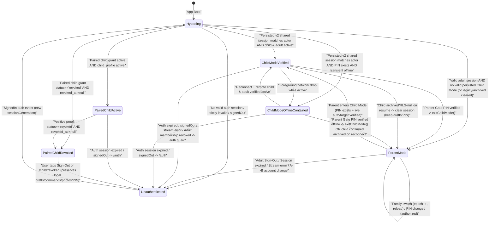

# LearnWard — Phase 6 Slice 4C-0: Auth, Child Mode & Device Containment

**Document status:** DESIGN DRAFT FOR INDEPENDENT APPROVAL — NOT IMPLEMENTED / NOT FROZEN  
**Canonical repository path:** `docs/25-phase-6-slice-4c-0-auth-child-mode-containment-design-contract.md`  
**Reviewed baseline:** `main` at `d49e39af66978fe4315411789e367e8eb8a51233` (tree `ce7a81fd4c29d72fb77f0be705674642c093dcb1`; PR #37 WP6 merge; post-merge `main` CI run `45378350261`, 4/4 `SUCCESS`)  
**Prerequisites:** Slice 4A-0 (Drift v6 CAS foundation, frozen), Slice 4A-1 (actor-aware Spin/Redeem recovery runtime, frozen), Slice 4A-2 (adult Fulfill/Cancel reliability, frozen), Slice 4B-0 (immediate local evidence safety, frozen), Slice 4B-1 (evidence resumability & Storage 409 reconciliation, WP0–WP6 MERGED & FROZEN), and frozen Phase 0–6 Supabase migrations/RPC/RLS/Storage contracts.  
**Risk register targets:** `LW-AUD-03` (HIGH — Child Mode restored without verified actor) and `LW-AUD-05` (MEDIUM — PIN brute force / partial write).  
**Release status:** No pilot authorization, no production distribution signing, and no background dispatcher enablement (`RECOVERY_DISPATCHER_ENABLED=false` remains unchanged).

---

## 0. Evidence-Based Source-Level Audit (Verified at Baseline)

The following source behaviors have been verified directly against the repository at `d49e39af66978fe4315411789e367e8eb8a51233`:

### `AUDIT-01` (`LW-AUD-03`, HIGH) — Unbound Persisted Child Mode Restored Without Actor, Family, or Child Verification
- `apps/mobile/lib/main.dart:L29-L57`: Cold start opens `AppDatabase`, reads `local_metadata_entries['active_child_session']`, deserializes a bare `ChildProfile` JSON payload (`id`, `family_id`, `display_name`, `school_grade`, `birth_year`, `avatar_key`, `status`, `created_at`), and injects `initialChildModeSessionProvider.overrideWithValue(initialChild)` **without** checking any `actorUserId`, current Supabase auth session, family membership, child profile active status, or paired-child device grant status.
- `apps/mobile/lib/app/bootstrap/app_providers.dart:L361-L440` (`ActiveChildModeNotifier`):
  - `build()` (`L371-L379`) returns `initialChildModeSessionProvider` or invokes unawaited `_restorePersistedSession()`.
  - `_restorePersistedSession()` (`L381-L400`) parses any non-empty JSON stored under `active_child_session` and assigns `state` whenever `state == null`, regardless of auth state, signed-in user identity, actor switch, child archival, or device grant revocation.
  - `selectChild()` (`L402-L421`) persists only the bare `ChildProfile` fields (`id`, `family_id`, `display_name`, etc.) with zero actor provenance (`actorUserId`), zero mode discriminator (`shared_device_adult` vs `paired_child_device`), and hardcoded `DateTime.now().toUtc()`.
  - `exitChildMode()` (`L423-L431`) overwrites `active_child_session` with an empty string `''` and carries no concurrency guard against an in-flight `_restorePersistedSession()`.
- `apps/mobile/lib/features/family/presentation/family_home_screen.dart:L508-L534`: Entering Child Mode verifies `gateService.hasConfiguredPin()`, calls `ParentPinSetupDialog.show` if absent, and invokes `selectChild(child)` **without** calling `AuthSessionPort.validateForMutation()` or binding a verified actor identity into persisted state.
- Secondary restart consistency bug observed in `apps/mobile/lib/features/rewards/presentation/child_store_screen.dart:L37-L39,L85-L87` and `apps/mobile/lib/features/rewards/presentation/child_redemption_history_screen.dart:L31-L33`: both screens read `activeFamilyProvider` and return early if `activeFamilyProvider == null`, whereas `ActiveFamilyNotifier.build()` (`app_providers.dart:L349`) defaults to `null` and is never restored on a shared-device Child Mode cold restart.

### `AUDIT-02` (`LW-AUD-03`, HIGH) — GoRouter Guard Precedence Inversion & Prefix Matching Weakness
- `apps/mobile/lib/app/routing/app_router.dart:L60-L93` (`routerProvider.redirect`):
  - **Guard 1 (`L66-L71`) checks `if (activeChild != null)` BEFORE Guard 2 (`L79-L90`, auth guard).** When a persisted child session exists on a device whose adult session is signed out, expired, invalidated, or errored, GoRouter forces navigation onto `/child` and blocks `/auth` rather than enforcing authentication first.
  - `L67` and `L74` use prefix matching `location.startsWith(AppRoutes.childMode)` (`'/child'`) rather than strict path-segment matching (`location == '/child' || location.startsWith('/child/')`).
  - `L31-L47` (`RouterListenable`): Watches `authStateProvider`, `currentUserIdProvider`, and `activeChildModeProvider`, omitting `AuthSessionPort.sessionGenerationStream` and a unified containment state; `routerListenableProvider` never registers `ref.onDispose(listenable.dispose)`.

### `AUDIT-03` (`LW-AUD-03`, HIGH) — Missing Riverpod Invalidation, Split-Brain `currentUserIdProvider`, Live Cross-Account Family Bleed & Missing Parent Session Controls
- **Split-brain auth truth (`apps/mobile/lib/app/bootstrap/app_providers.dart:L119-L135`):** `currentUserIdProvider` computes `authState.value?.session?.user.id ?? client?.auth.currentUser?.id`. This ignores `session.isExpired` and `authState.hasError`. By contrast, `SupabaseAuthSessionAdapter` (`apps/mobile/lib/app/bootstrap/supabase_auth_session_adapter.dart:L57-L84,L98-L136`) transitions into a sticky fail-closed invalid state (`_isStickyInvalid = true`, `_currentGeneration = null`) when `session == null`, `data.event == AuthChangeEvent.signedOut`, `session.isExpired`, token/user changes without matching generation, or auth stream errors occur. Thus, routing/UI can still treat a stale expired/errored session as signed in while domain orchestrators reject mutations.
- **Adapter lifecycle leak (`app_providers.dart:L276-L287`):** `authSessionPortProvider` creates `SupabaseAuthSessionAdapter(client)` without registering `ref.onDispose(adapter.dispose)`.
- **Unscoped providers (`app_providers.dart:L347-L360,L437-L440`):** `activeFamilyProvider` and `activeChildModeProvider` have no listener/invalidation bridge on sign-out, account switch, or family switch. Repositories (`familyRepositoryProvider`, `childProfileRepositoryProvider`, `assessmentRepositoryProvider`, etc.) and `AppActiveRecoveryService` (`apps/mobile/lib/app/bootstrap/app_active_recovery_service.dart:L46-L59`) keep running inside the same container.
- **Confirmed live cross-account UI data-bleed bug (`apps/mobile/lib/features/family/presentation/family_home_screen.dart:L60-L69`):**
  - `_loadData()` executes `final currentActive = ref.read(activeFamilyProvider) ?? families.first;`.
  - If Adult A (`Family_A`) signs out without resetting `activeFamilyProvider`, and Adult B (who belongs to at least one family, `Family_B`) signs in on the same app process, `families` returns `[Family_B]`, `ref.read(activeFamilyProvider)` still returns `Family_A`, and `FamilyHomeScreen` leaves `activeFamilyProvider` set to `Family_A`, displaying `Family_A`'s title/timezone/locale and querying child/assessment/redemption lists with `Family_A.id`.
- **Stateful widget caches (`ConsumerStatefulWidget` screens):** `FamilyHomeScreen` (`family_home_screen.dart:L25-L32`), `ChildModeScreen` (`child_mode_screen.dart:L27-L37`), `ChildStoreScreen` (`child_store_screen.dart:L22-L29`), `ChildWheelScreen` (`child_wheel_screen.dart:L23-L40`), `ParentFulfillmentInboxScreen` (`parent_fulfillment_inbox_screen.dart:L25-L37`), `ParentRewardCatalogScreen` (`parent_reward_catalog_screen.dart:L22-L28`), `ParentWheelSettingsScreen` (`parent_wheel_settings_screen.dart:L22-L34`), `ChildRedemptionHistoryScreen` (`child_redemption_history_screen.dart:L18-L23`), and `AddAssessmentScreen` (`add_assessment_screen.dart:L54-L106`) store actor-/family-scoped state in widget `State` fields loaded in `initState`. Navigating back or swapping users without resetting scope retains stale in-memory data until reload.
- **Non-functional account controls (`family_home_screen.dart:L212-L216`):** The parent dashboard renders an `'Adult Auth'` icon button calling `context.go(AppRoutes.auth)`, which `app_router.dart:L87-L89` immediately redirects right back to `/parent`. There is no working Sign Out action, no Family Switcher for multi-family adults, and no Parent Mode control to change/reset the Parent PIN outside Child Mode entry.

### `AUDIT-04` (`LW-AUD-05`, MEDIUM) — Non-Atomic PIN+Salt Persistence, Weak Single-Round SHA-256, Non-Constant-Time Check & Zero Lockout
- `apps/mobile/lib/features/shared_device/domain/parent_gate_service.dart:L23-L86`:
  - **Non-atomic write (`L73-L74`):** `setPin()` performs two separate sequential calls (`writeMetadata(key: pinSaltKey, ...)` then `writeMetadata(key: pinHashKey, ...)`). `LocalMetadataStore` (`packages/learnward_application/lib/src/ports/local_metadata_store.dart:L2-L12`) exposes only single-key `readMetadata` and `writeMetadata` with no atomic multi-key batch transaction. A process kill or I/O error between the two writes tears the salt/hash pair (`hasConfiguredPin()` later returns `true` if a stale hash remained paired with a newly written salt, permanently locking out the user or mismatched PIN).
  - **Weak KDF (`L39-L42`):** Single-round `sha256.convert(utf8.encode('$salt:$pin'))` over a 4-digit PIN ($10^4$ candidates). Offline brute force against extracted metadata requires microseconds per guess.
  - **Non-constant-time comparison (`L57`):** Uses `computedHash == storedHash`.
  - **Uninjected clock (`L71`):** Calls `DateTime.now().toUtc()` directly instead of accepting an injectable `Clock`.
  - **Zero throttling or persistent lockout (`L48-L58` & `apps/mobile/lib/features/shared_device/presentation/parent_gate_dialog.dart:L42-L78`):** Allows unlimited rapid guesses; closing and reopening `ParentGateDialog` or restarting the app resets nothing.
- **Available workspace crypto primitives:** Checked `apps/mobile/pubspec.yaml:L13`, `packages/learnward_application/pubspec.yaml:L12`, and `packages/learnward_data/pubspec.yaml:L12`: `crypto: ^3.0.6` is already a direct dependency across all three packages (`Hmac(sha256, ...)` is available immediately for RFC 2898 PBKDF2-HMAC-SHA256 without adding any external native or third-party package).

### `AUDIT-05` (HIGH) — Missing Runtime Containment for Child Archival, Paired-Child Revocation, Non-Destructive Outbox Pause Sweep & Historical Design Contradiction
- **No runtime target/session containment loop:** `SupabaseRecoveryAuthorizationAdapter` (`apps/mobile/lib/app/bootstrap/supabase_recovery_authorization_adapter.dart:L22-L129`) verifies target grants/memberships/children strictly at mutation recovery time; nothing verifies or enforces persisted Child Mode containment on boot, foreground resume, auth event, or session restoration.
- **Verified Phase 6.1 RLS visibility nuance (ADR 0008 Decision 9 static check):**
  - `public.child_profiles` RLS `child_profiles_select` (`supabase/migrations/20261105000000_phase6_1_child_lifecycle_rls.sql:L122-L136`) requires `status = 'active'` in `USING`. Consequently, when a child is archived via `public.archive_child_profile(uuid)` (`20261105120000_phase6_2_child_archive_concurrency.sql:L19-L81`), subsequent authenticated PostgREST `SELECT`s against `child_profiles` return **0 rows (`null`)**, not a row with `status = 'archived'`.
  - `public.family_memberships` RLS `family_memberships_select` (`supabase/migrations/20261031131100_phase1_family_child_identity.sql:L323-L328`) requires `private.is_active_family_adult(family_id)`. Thus a revoked adult queries 0 rows (`null`) on `family_memberships` rather than a visible `'revoked'` row.
  - Conversely, `public.child_device_grants` RLS `child_device_grants_select` (`supabase/migrations/20261105000000_phase6_1_child_lifecycle_rls.sql:L138-L147`) preserves `or auth_user_id = auth.uid()` specifically so a revoked paired-child device can positively select its own grant (`status = 'revoked'` and `revoked_at IS NOT NULL`).
  - Therefore, containment logic MUST: (1) confirm paired-child revocation **only** upon positive proof (`status == 'revoked' && revoked_at != null`), (2) fail closed out of active Child Mode upon confirmed denial OR clean HTTP 200 RLS 0-row miss for the child/membership on authenticated verification, and (3) **never** delete local drafts, pending reward commands, or evidence photos on any of these outcomes (`I06`, `I14`).
- **Dormant outbox actor-pause gap:** Because `AppConfig.recoveryDispatcherEnabled` defaults to `false` (`apps/mobile/lib/app/bootstrap/app_config.dart:L77-L80`), `OutboxRecoveryDispatcher` (`AppActiveRecoveryService:L35`) is dormant. When Actor A signs out or Actor B signs in, pending active reward commands owned by Actor A are not proactively stamped `pending_original_actor` in SQLite until a recovery pass runs (assessments already derive `waitingOriginalActor` dynamically via `draft.actorUserId != liveActor.userId`).
- **Historical documentation conflict resolved here:** `docs/17-phase-6-pilot-hardening-design-v0.1.md` §3.4 (`L233-L240`) listed `"Child Mode Exit"` as `"Purged"` for Parent PIN Hash & Salt, Assessment Drafts, Pending Reward Commands, and Local Evidence Photos. That table directly contradicts `docs/adr/0008-phase-6-pilot-hardening.md` Decision 2 (`L44-L47`), `docs/21-phase-6-master-delivery-and-pilot-gates.md` (`L71`), and frozen Slices 4B-0/4B-1 (`I14 Conservative retention`). Slice 4C-0 **explicitly supersedes `docs/17` §3.4** with a complete, invariant-aligned Per-Data-Class Lifecycle Matrix (§4.5).

### `AUDIT-06` (LOW / Out-of-Scope Pre-Existing Finding Recorded Transparently)
- `packages/learnward_data/lib/src/repositories/supabase_child_profile_repository.dart:L52-L64`: `archiveChildProfile()` issues a direct `.from('child_profiles').update({'status': 'archived', ...})` instead of `.rpc('archive_child_profile', params: {'p_child_id': childId.value})`. Under `20261105000000_phase6_1_child_lifecycle_rls.sql:L46-L47` (which revoked table-wide `UPDATE` on `child_profiles` and granted column-level `UPDATE` only on `display_name, avatar_key, school_grade`), direct status mutation is blocked by Postgres (`42501`).
- **Scope discipline:** `SupabaseChildProfileRepository.archiveChildProfile()` has no active UI caller in `apps/mobile` today and modifies repository RPC wiring rather than containment itself; it is recorded transparently here and kept strictly separate unless explicitly scheduled in a focused child-management fix or Slice 4C-0 WP boundary approved during review.

---

## 1. Purpose, Scope, and Non-Goals

**Purpose:** Eliminate client-side auth/Child Mode bypasses, stale cross-account UI/Riverpod leakage, weak/non-atomic Parent PIN handling, and unverified Child Mode restarts (`LW-AUD-03`, `LW-AUD-05`), while preserving every unsynced draft, pending command, and evidence photo under per-data-class retention rules so Slice 4C-1 can safely expose adult export and manual quarantine recovery.

**In scope:**
- `LocalMetadataStore` atomic multi-key batch API (`AppDatabase` Drift transaction + in-memory test stores) without changing Drift `schemaVersion => 6`.
- Hardened `ParentGateService` v2 (PBKDF2-HMAC-SHA256, CSPRNG 16-byte salt, constant-time compare, injectable `Clock`, isolate-offloaded hashing, persistent monotonic failed-attempt throttling & timed lockout, atomic v1→v2 upgrade-on-verify) + `ParentGateDialog` / `ParentPinSetupDialog` / Parent Mode PIN management controls.
- Actor-, family-, and child-bound `PersistedChildModeSession` v2 envelope with fail-closed deserialization and authenticated target containment verification (`ContainmentAuthorizationVerifier`) using frozen Supabase tables/RLS (`family_memberships`, `child_device_grants`, `child_profiles`).
- Auth-first `GoRouter` guard precedence, strict `/child` segment matching, dedicated paired-child `/child/revoked` unlinked shell, adapter/listener disposal, and unified `SessionLifecycleController` invalidating all Riverpod/screen state on sign-out, account switch, family switch, child archive, and grant revocation.
- Adult Sign Out, Family Switcher (for multi-family adults), and Parent PIN Settings controls in Parent Mode, plus fixing `FamilyHomeScreen`'s sticky `activeFamilyProvider` cross-account leak (`L60`).
- Non-destructive local `PendingRewardCommandStore.pauseMismatchedActorCommand` sweep on sign-out / account switch without dispatching remote RPCs.
- Deterministic acceptance and negative test suite (`C0-01`–`C0-23`).

**Out of scope:**
- Zero changes to Supabase SQL migrations, RLS policies, Postgres `SECURITY DEFINER` RPCs, or Storage bucket policies.
- Zero changes to Drift `schemaVersion => 6` (`local_metadata_entries`, `local_assessment_drafts`, `pending_reward_commands` table schemas remain bit-for-bit identical).
- Zero change to `AppConfig.recoveryDispatcherEnabled` (`false` remains unchanged).
- No Slice 4C-1 manual export / quarantine abandonment / physical GC UX (`Export unsynced work`, `Abandon local copy`, orphan file GC remain deferred to 4C-1).
- No paired-child device QR / token-pairing issuance flow (pairing creation remains deferred per ADR 0002 Decision 4; 4C-0 implements defensive session/UI/grant containment so paired-child sessions and revocations cannot bypass containment or leak adult/family UI).

---

## 2. Threat Model

- **Hardware & Deployment Context:** LearnWard runs primarily on shared family phones/tablets operated by both adults (`owner`/`parent` in `family_memberships`) and children (ages 10–15 in Shared-Device Child Mode, plus future dedicated Paired Child Devices authenticated via `child_device_grants`).
- **Authoritative Security Boundary:** Server-side PostgreSQL Row Level Security (RLS), column privileges, and `SECURITY DEFINER` RPCs (`auth.uid()`, `private.is_active_family_adult`, `private.is_active_child_device`, `private.is_child_active_in_family`) remain the sole authoritative boundary protecting server data and economics.
- **Client-Side Containment Role:** Client containment protects casual shared-hardware privacy/isolation, prevents cross-account UI cache contamination, stops children from bypassing Child Mode via restarts/offline toggles/guessing 4-digit PINs, and ensures unsynced local work is quarantined safely rather than destroyed or exposed to the wrong user.

| Threat ID | Actor & Precondition | Attack / Failure Vector | Consequence if Unmitigated | Required Mitigation in 4C-0 |
|---|---|---|---|---|
| `T1` | Anyone launching device after Parent Sign-Out or session expiry while `active_child_session` persisted | App boots via `main.dart` / `_restorePersistedSession()`, bypassing `/auth` (`app_router.dart:L66` before `L79`) | Unauthenticated `/child` access (`LW-AUD-03`) displaying cached UI / local drafts | Auth guard outranks child overlay (`C0-I01`); persisted child envelope bound to actor & verified (`C0-I02`) |
| `T2` | Adult A signs out; Adult B signs in on same device (or Adult switches Family F1 → F2) | `activeFamilyProvider` retains `Family_A` (`FamilyHomeScreen:L60`), stale `ConsumerStatefulWidget` state remains | Cross-account UI & family data bleed (`Family_A` title/queries under Adult B) | Clear & invalidate all actor-/family-scoped providers and reset `sessionScopeEpoch` (`C0-I04`) |
| `T3` | Child (10–15) holding shared device already in Child Mode switches on Airplane Mode and force-kills/restarts app | Cold start fails online child/membership verification and kicks user out to Parent Dashboard (`/parent`) without Parent PIN | Child defeats Parent Gate and enters Parent Mode merely by disabling Wi-Fi/cellular | Verified same-actor offline containment state keeps UI in `ChildModeOfflineContained` requiring valid Parent PIN (`C0-I05`) |
| `T4` | Child (10–15) repeatedly guesses 4-digit Parent PIN interactively, or extracts `local_metadata_entries` on unlocked dev backup | Unlimited guesses in `ParentGateDialog` or offline dictionary cracking of single-round SHA-256 (`10^4` PINs) | Child unlocks Parent Mode (`LW-AUD-05`) or recovers reusable adult PIN | Persistent exponential timed lockout (`C0-I11`) + PBKDF2-HMAC-SHA256 ≥100k iterations + constant-time verify (`C0-I10`) |
| `T5` | OS/battery kill or storage I/O error during `ParentGateService.setPin` or v1→v2 upgrade | Sequential `writeMetadata` leaves new `pinSaltKey` paired with old `pinHashKey` or empty hash (`L73-L74`) | Corrupted credential, silent lockout, or mismatched verification (`LW-AUD-05`) | Single atomic SQLite transaction `applyMetadataBatch` storing single versioned JSON credential (`C0-I09`, `C0-I12`) |
| `T6` | Target child profile is archived by another parent, or current adult membership is revoked while local session persisted | Device keeps rendering `/child` for archived child / revoked adult | Stale child profile/UI remains interactive after server revocation | Containment check on boot/resume/interval treats confirmed denial or RLS 0-row as exit from active Child Mode (`C0-I06`) |
| `T7` | Paired child device (`child_device_grants`) has its grant revoked by owner/parent, or sees transient `42501` | Transient `42501` mistaken for revocation, OR confirmed revoked grant continues accessing child/parent screens | False session wipe on transient error OR unauthorized continued use of revoked child device | Confirmed revocation ONLY when `status == 'revoked' && revoked_at != null` -> `/child/revoked`; active paired child barred from `/parent*` (`C0-I07`, `C0-I08`) |
| `T8` | Blanket SQLite wipe or Child-Mode-exit wipe triggered on sign-out / account switch / revocation | Deletes `local_assessment_drafts`, `pending_reward_commands`, local evidence photos, or Parent PIN (`docs/17` §3.4 bug) | Permanent destruction of unsynced schoolwork & loss of Parent Gate containment (`I14`) | Strict per-data-class retention; PIN kept until explicit authorized reset; drafts/commands/photos kept non-destructively (`C0-I13`, `C0-I14`) |
| `T9` | Supabase token refresh error / stream disconnect / expired access token (`SupabaseAuthSessionAdapter` sticky invalid) | `currentUserIdProvider` falls back to stale `client.auth.currentUser?.id` (`app_providers.dart:L134`) | Router keeps user on `/parent` or `/child` despite dead/sticky-invalid auth port | Single fail-closed auth state provider synced with `AuthSessionPort` (`C0-I03`, `C0-I15`) |

- **Out of Scope:** Defeating a compromised/rooted/jailbroken OS kernel, Frida memory hooking, hardware forensic extraction of unlocked SQLite files, or bypassing the OS lock screen.

---

## 3. Security and Durability Invariants (`C0-I01`–`C0-I16`)

1. **`C0-I01` — Auth Guard Outranks Child Mode Overlay:** Whenever authentication is required (`config.isSupabaseConfigured`) and no valid, non-expired, non-sticky-invalid session exists, `GoRouter` MUST redirect every route—including `/child` and `/child/*`—to `/auth` (`/child/revoked` is reachable only while that revoked paired-child auth session remains signed in until dismissed/signed out). Persisted Child Mode state MUST NEVER suppress authentication.
2. **`C0-I02` — Actor-, Family-, and Child-Bound Persisted Child Mode:** Cold start MUST NOT trust or restore bare `ChildProfile` metadata. Persisted Child Mode metadata MUST be versioned (`v2`) and bind `modeKind`, `actorUserId`, `familyId`, and `childId`. Legacy v1 (`{id, family_id, ...}` without `version: 2` and `actorUserId`), malformed JSON, empty payloads, or actor-mismatched envelopes MUST fail closed, clear the stale `active_child_session` key, and never enter Child Mode.
3. **`C0-I03` — Single Fail-Closed Auth Source of Truth:** UI routing and lifecycle controllers MUST derive live authentication from the same fail-closed contract as `AuthSessionPort` (`session != null && !session.isExpired && !isStickyInvalid`). Stale `client.auth.currentUser?.id` fallbacks on expired or errored streams are prohibited.
4. **`C0-I04` — Deterministic Provider & Screen Isolation:** On sign-out, account switch (`A → B`), family switch (`F1 → F2`), child archive containment exit, or grant revocation, `activeFamilyProvider`, in-memory child mode state, and all family-/actor-scoped caches/controllers MUST be cleared/invalidated synchronously via a monotonic `sessionScopeEpoch` before rendering the next scope. `FamilyHomeScreen` MUST NEVER retain a prior actor's `activeFamilyProvider` value.
5. **`C0-I05` — Offline Same-Actor Shared-Device Containment (Anti-Airplane-Mode Bypass):** If a valid persisted `v2` shared-device adult Child Mode session matches the live validated `actorUserId`, a valid Parent PIN credential exists, and remote verification fails transiently (offline/timeout/5xx with no positive denial and no RLS 0-row confirmation), the device MUST remain contained in `/child` (`ChildModeOfflineContained`) requiring Parent PIN unlock to reach `/parent`.
6. **`C0-I06` — Active-Child & Active-Membership Enforcement (Including RLS 0-Row):** Upon any clean server verification (no transport error) where the adult membership is `revoked` or RLS-filtered (`0` rows), OR the target child profile is `archived` or RLS-filtered (`0` rows under Phase 6.1 `child_profiles_select`), active Child Mode MUST NOT continue for that child: clear `active_child_session` (preserving all drafts/commands/evidence and Parent PIN), transition away from `/child`, and surface an explicit non-destructive notice.
7. **`C0-I07` — Positive Paired-Child Revocation Proof Only:** Paired-child device revocation is declared **if and only if** `public.child_device_grants` returns a row for `auth.uid()` with `status == 'revoked' && revoked_at != null`. Missing network, timeouts, generic `42501` errors, or transient HTTP errors MUST NOT revoke or wipe local state. Confirmed revocation clears `active_child_session`, quarantines the child UI into `/child/revoked` displaying *"Device access has been revoked by a family parent"* + explicit Sign Out action, and retains local drafts/commands/photos on disk.
8. **`C0-I08` — Paired-Child Role Route Isolation:** A session identified by an active `child_device_grants` row (`modeKind == pairedChildDevice` or `role == 'child'`) MUST be barred from entering Parent Mode (`/parent`, `/family/create`, `/parent/*`) and MUST NOT exit to `/parent` via the shared-device Parent Gate dialog.
9. **`C0-I09` — Atomic Parent PIN & Lockout Persistence:** Parent PIN credentials (`parent_gate_credential_v2`) and salt+hash+metadata MUST be persisted in a single SQLite database transaction (`LocalMetadataStore.applyMetadataBatch`). Partial or torn salt/hash writes are prohibited.
10. **`C0-I10` — Resistant PIN KDF, Salt & Constant-Time Comparison:** New and migrated Parent PINs MUST use PBKDF2-HMAC-SHA256 (RFC 2898) with a 16-byte `Random.secure()` CSPRNG salt, ≥ 100,000 iterations in production (`kdf: 'pbkdf2-hmac-sha256'`), 32-byte derived key, execution off the Flutter UI thread (`Isolate.run`), constant-time byte equality check, and zero plaintext PIN persistence.
11. **`C0-I11` — Persistent Monotonic Throttling & Timed Lockout:** Failed Parent Gate verification attempts MUST be tracked durably in `parent_gate_lockout_v1` across dialog dismissals and app restarts, enforcing progressive timed lockouts (`5 -> 30s`, `6 -> 60s`, `7 -> 5m`, `8 -> 15m`, `9+ -> 30m cap`), refusing verification calls immediately while locked without invoking the KDF, and clamping backward clock skew (`now < lastAttemptAtUtc`).
12. **`C0-I12` — Safe v1 → v2 PIN Compatibility & Fail-Closed Corruption Handling:** Existing Phase 1 salted SHA-256 credentials (`parent_gate_pin_salt` + `parent_gate_pin_hash`) verify once via constant-time compare (also subject to lockout rules) and atomically upgrade in a single transaction to `parent_gate_credential_v2` (and delete legacy v1 keys). Only one of the two v1 keys present, malformed v2 JSON, unsupported KDF/below-floor parameters, or mismatched salt/hash state MUST fail closed (`corruptedCredential` / `false`), NEVER silently falling back to a default PIN or no-PIN access.
13. **`C0-I13` — Parent PIN Survives Adult Sign-Out & Normal Child Mode Exit:** Adult sign-out, account switch (`A → B`), family switch, paired-child revocation, and normal PIN-verified Child Mode exit MUST preserve `parent_gate_credential_v2` (and `parent_gate_lockout_v1` so an attacker cannot clear a lockout by restarting or signing out). Parent PIN change or explicit reset is permitted **only** when authenticated as an active adult outside Child Mode (`!inChildMode`).
14. **`C0-I14` — Zero Blanket SQLite Wipe & Conservative Data Retention:** `clearAllTables()` / bulk `DELETE FROM` on `local_assessment_drafts`, `pending_reward_commands`, or physical evidence files on sign-out, account switch, family switch, Child Mode exit, child archival, or grant revocation is **strictly prohibited**. Assessment drafts, pending reward commands, and canonical/original local photo files remain intact in SQLite/app storage, naturally isolated by `actorUserId`, `familyId`, and `childId` (plus Slice 4A/4B `pending_original_actor` / `waitingOriginalActor` / quarantine guards) until Slice 4C-1 manual export or verified completion. (`docs/17` §3.4 is superseded.)
15. **`C0-I15` — Strict Route Segment Matching & Resource Disposal:** Route containment checks MUST match exact segments (`/child` or `/child/...`) rather than string prefixes that could match future sibling routes. `SupabaseAuthSessionAdapter` and `RouterListenable` MUST be disposed via `ref.onDispose`.
16. **`C0-I16` — Zero Schema/RPC/RLS Drift & Redacted Diagnostics:** Drift `schemaVersion == 6`, all SQLite columns, all Supabase migrations/RLS/RPC/Storage contracts, and `RECOVERY_DISPATCHER_ENABLED=false` remain untouched. Logs, telemetry, and error messages MUST NEVER include entered/stored PINs, salts, derived keys, access tokens, local photo file paths, or child PII.

---

## 4. Resolved Architectural Decisions (`D1`–`D6`)

### `D1` — Atomic `LocalMetadataStore.applyMetadataBatch` & Hardened `ParentGateService` v2 (`LW-AUD-05`)

1. **Extend `LocalMetadataStore` cleanly without changing Drift v6 schema (`packages/learnward_application/lib/src/ports/local_metadata_store.dart`):**
   - Keep `readMetadata(String key)` and `writeMetadata(...)` for backward compatibility, and add:
     ```dart
     Future<void> applyMetadataBatch({
       Map<String, String> writes = const {},
       Set<String> deletes = const {},
       required DateTime updatedAt,
     });
     ```
   - `AppDatabase.applyMetadataBatch(...)` (`packages/learnward_data/lib/src/database/app_database.dart`) executes all writes (`insertOnConflictUpdate`) and deletes (`deleteWhere((e) => e.key.isIn(...))`) inside a single SQLite `transaction(() async { ... })`. An error on any key rolls back the entire batch (`PRAGMA WAL` + atomic commit).
   - `InMemoryLocalMetadataStore` and `InMemoryMobileMetadataStore` copy the backing map and swap/commit only after validating all inputs atomically (supporting deterministic fault injection in tests).

2. **Versioned Credential Storage (`parent_gate_credential_v2`):**
   - Stored as a single JSON entry in `local_metadata_entries['parent_gate_credential_v2']`:
     ```json
     {
       "version": 2,
       "kdf": "pbkdf2-hmac-sha256",
       "iterations": 100000,
       "keyLengthBytes": 32,
       "saltHex": "<32-char lowercase hex (16 bytes CSPRNG)>",
       "hashHex": "<64-char lowercase hex (32 bytes derived key)>",
       "updatedAtUtc": "2026-11-24T12:00:00.000Z"
     }
     ```
   - Pure-Dart RFC 2898 PBKDF2-HMAC-SHA256 using `package:crypto` (`Hmac(sha256, utf8.encode(pin))`). Constant-time comparison iterates over fixed-length `Uint8List` digests (`diff |= a[i] ^ b[i]`), rejecting mismatched lengths without short-circuiting PIN verification timing.
   - `setPin()` / v2 verification compute PBKDF2 inside `Isolate.run(...)` in Flutter UI bindings so the 100,000-iteration derivation does not jank the 60/120fps main UI isolate (with synchronous or future-returning pluggable runner for deterministic fast unit tests when configured via an explicit `@visibleForTesting` constructor, while `parentGateServiceProvider` enforces `productionMinIterations = 100000` unconditionally and `ParentGateService.verifyPin` rejects stored v2 records whose `iterations < 100000` in production mode).

3. **Legacy v1 → v2 Migration (`parent_gate_pin_salt` + `parent_gate_pin_hash`):**
   - `hasConfiguredPin()` returns `true` if a **valid, well-formed** `parent_gate_credential_v2` exists **OR** both legacy keys (`parent_gate_pin_salt` and `parent_gate_pin_hash`) exist and are non-empty hex strings of expected format.
   - If `parent_gate_credential_v2` exists but fails schema/parameter validation (`corruptedCredential`), `hasConfiguredPin()` fails closed (`false`) and `verifyPin()` returns `ParentGateVerifyStatus.corruptedCredential` without falling back to v1 keys. Similarly, an orphaned single v1 key (`salt` without `hash` or vice versa) fails closed.
   - When no `v2` credential exists and both valid v1 keys exist, `verifyPin(enteredPin)` evaluates the persisted lockout first, checks `sha256(utf8.encode('$salt:$enteredPin'))` via constant-time comparison, and—**on exact match**—immediately derives a fresh 16-byte CSPRNG salt + PBKDF2-HMAC-SHA256 v2 credential and commits `{writes: {parent_gate_credential_v2: json, ...lockout reset}, deletes: {parent_gate_pin_salt, parent_gate_pin_hash}}` in **one `applyMetadataBatch` transaction** before returning `verified`. Legacy v1 keys never persist once verified.

4. **Attempt Throttling & Persistent Lockout (`parent_gate_lockout_v1`):**
   - Stored atomically in `local_metadata_entries['parent_gate_lockout_v1']`:
     ```json
     {
       "version": 1,
       "failedAttempts": 5,
       "lockoutUntilUtc": "2026-11-24T12:00:30.000Z",
       "lockoutDurationSeconds": 30,
       "lastAttemptAtUtc": "2026-11-24T12:00:00.000Z"
     }
     ```
   - **Lockout Schedule (persistent across dialog dismiss & restart):**
     - Attempts 1–4 failed: no timed lockout (`remainingAttemptsBeforeLockout = 5 - failedAttempts`); show non-alarming remaining-tries warning on failures 3 and 4.
     - Failure #5: locked `30s`.
     - Failure #6: locked `60s`.
     - Failure #7: locked `300s` (5 minutes).
     - Failure #8: locked `900s` (15 minutes).
     - Failure #9+: locked `1800s` (30 minutes cap).
   - **Immediate Lockout Short-Circuit:** If an active lockout exists at injected `_clock.now().toUtc()`, `verifyPin()` returns `ParentGateVerifyResult.lockedOut(remaining, retryAtUtc)` **before** executing PBKDF2 or increment counters.
   - **Backward Clock-Skew Defense:** If `_clock.now().toUtc().isBefore(lastAttemptAtUtc)` while `lockoutUntilUtc != null && lockoutDurationSeconds > 0`, treat remaining lockout conservatively as `min(Duration(seconds: lockoutDurationSeconds), Duration(minutes: 30))` from `now` rather than allowing the user to defeat a lockout by setting the device clock backward! If `now` jumps implausibly far ahead (`lockoutUntilUtc.difference(now)` > 30m), cap any effective lockout window at `30 minutes`.
   - **Reset Rules:** Successful `verifyPin` resets `failedAttempts = 0` and deletes/resets `parent_gate_lockout_v1` atomically. Failed non-locked attempts atomically increment `failedAttempts` + `lockoutUntilUtc` in `applyMetadataBatch`. Calling `ParentGateService.setPin` / `resetPinAuthorized` from Parent Mode updates `parent_gate_credential_v2`, deletes v1 keys, and resets `parent_gate_lockout_v1` in a single atomic batch—callable ONLY after verified adult auth outside Child Mode (`ParentPinManagementDialog` / settings). Malformed digits (`length != 4`) fail dialog client validation BEFORE invoking `verifyPin` (do not waste user lockout budget on an accidentally incomplete 3-digit tap).

---

### `D2` — Actor-, Family-, and Child-Bound Persisted Child Mode (`PersistedChildModeSession` v2) & Read-Only Containment Verifier

1. **Remove Blind Cold-Start Override (`apps/mobile/lib/main.dart`):**
   - `main.dart` MUST stop overriding `initialChildModeSessionProvider` with unverified JSON before auth initialization.
   - Instead, `main.dart` continues initializing Supabase + `AppDatabase`, and `LearnWardApp` routes through `sessionContainmentProvider` / `GoRouter` gate (`Hydrating` -> `/containment-loading` neutral screen containing no child/family data) until initial auth + containment verification resolves. (Widget tests needing synchronous seeded states use dedicated test provider overrides for `authSessionStateProvider` / `sessionContainmentProvider`, while `main.dart` itself has zero unverified bypass.)

2. **Versioned Persisted Envelope (`active_child_session` v2):**
   - Stored in `local_metadata_entries['active_child_session']`:
     ```json
     {
       "version": 2,
       "modeKind": "shared_device_adult",
       "actorUserId": "<auth.users.id>",
       "familyId": "<families.id>",
       "childId": "<child_profiles.id>",
       "enteredAtUtc": "2026-11-24T12:00:00.000Z",
       "childProfileSnapshot": {
         "id": "<child_profiles.id>",
         "family_id": "<families.id>",
         "display_name": "Leo",
         "school_grade": 5,
         "birth_year": null,
         "avatar_key": null,
         "status": "active",
         "created_at": "2026-10-31T00:00:00.000Z"
       }
     }
     ```
   - `modeKind` values: `'shared_device_adult'` (parent/owner handed shared hardware to child) or `'paired_child_device'` (paired child auth session).
   - **Fail-closed parser (`PersistedChildModeSession.tryParse`):** Rejects `version != 2`, unknown `modeKind`, empty `actorUserId`/`familyId`/`childId`, invalid `childProfileSnapshot`, or mismatched `childProfileSnapshot.id != childId` / `childProfileSnapshot.familyId != familyId`. On rejection (including legacy v1 envelopes from Phase 1), deletes `active_child_session` and transitions out of Child Mode without touching drafts, commands, photos, or PIN.
   - Also fixes `ChildStoreScreen` and `ChildRedemptionHistoryScreen` so shared-device Child Mode cold-start resolution (or Child Mode `FamilyId` sourcing from `activeChildModeProvider.familyId` when verified) does not break when `activeFamilyProvider` hasn't separately loaded `FamilyHomeScreen`.

3. **Read-Only `ContainmentAuthorizationVerifier` (`packages/learnward_application` port + `apps/mobile` Supabase & In-Memory adapters):**
   - Accepts `ValidatedActorContext context` + optional `({String familyId, String childId, ChildModeKind expectedKind})?` persisted hint, queries frozen RLS-protected relations (`public.child_device_grants`, `public.family_memberships`, `public.child_profiles`) with bounded timeout (5s) and returns typed `ContainmentVerificationOutcome`:
     - `authorizedSharedAdult(VerifiedAdultRole verifiedRole, ChildProfile freshChild)` — active adult in `family_memberships` (`status == 'active'`, `role in ('owner','parent')`) **and** `child_profiles` returned active row (`status == 'active'`). Updates in-memory/snapshot `ChildProfile` to the fresh server row and populates `activeFamilyId` safely.
     - `authorizedPairedChild(ChildProfile freshChild)` — active `child_device_grants` row (`status == 'active'`) for `context.userId` **and** `child_profiles` returned matching active row (`status == 'active'`, matching `family_id`, `id == grant.child_id`).
     - `confirmedGrantRevoked(DateTime revokedAt)` — `child_device_grants` returned row for `context.userId` with `status == 'revoked' && revoked_at != null`.
     - `deniedChildArchivedOrUnavailable(String reason)` — `child_profiles` query succeeded cleanly without transport error and returned `null` (0 rows, expected under Phase 6.1 `child_profiles_select` `status = 'active'` RLS policy upon archival) or `status == 'archived'`, while no transport error occurred.
     - `deniedAdultMembershipRevokedOrMissing(String reason)` — `family_memberships` query returned `status == 'revoked'`, non-adult role, inconsistent `context.role`, or `null` (0 rows under `family_memberships_select`) without transport error while no paired-child grant exists.
     - `transientOfflineUnverified(String reason)` — `TimeoutException`, `SocketException`, HTTP 5xx, or PostgREST transport failure.
   - **Safety Invariant on Verification Error:** Every ambiguous/network exception maps to `transientOfflineUnverified`—**never** to `confirmedGrantRevoked` and never triggering local data deletion.

4. **Shared-Device Offline Same-Actor Containment Rule (`C0-I05`):**
   - If the app cold-starts or resumes with a valid `v2` `shared_device_adult` envelope where:
     1. Live `AuthSessionPort.validateForMutation()` succeeds and returns `context` with `context.userId == persisted.actorUserId`, AND
     2. `ParentGateService.hasConfiguredPin()` is `true`, AND
     3. `ContainmentAuthorizationVerifier` returns `transientOfflineUnverified`:
   - The app enters **`ChildModeOfflineContained`** on `/child` with an informational offline banner. Attempting to go to `/parent` still redirects to `/child` and requires solving the Parent Gate PIN. Reconnecting / foregrounding re-runs `ContainmentAuthorizationVerifier`; if child archival or adult revocation is then observed (`deniedChildArchivedOrUnavailable` / `deniedAdultMembershipRevokedOrMissing`), active Child Mode clears safely.

---

### `D3` — Auth-First `GoRouter` Guard Precedence & Strict Path Containment (`LW-AUD-03`)

1. **Single Fail-Closed Auth State (`authSessionStateProvider` & `currentUserIdProvider`):**
   - Refactor `currentUserIdProvider` and introduce a reactive `authSessionStateProvider` backed directly by `SupabaseAuthSessionAdapter` (with `ref.onDispose(adapter.dispose)`!) in Supabase mode:
     - Emits `(isAuthenticated: false, userId: null, sessionGeneration: null, role: null, isHydrated: true)` whenever `session == null`, `session.isExpired`, `event == signedOut`, `auth stream onError`, or sticky invalid state triggers.
     - Removes the unsafe `?? client?.auth.currentUser?.id` stale fallback (`app_providers.dart:L134`) when auth is expired, errored, or signed out.
   - In development demo mode (`config.canUseLocalDemoRepositories && !config.isSupabaseConfigured`), `InMemoryAuthSessionPort` cleanly notifies `RouterListenable` on simulated sign-in/sign-out transitions so dev tests remain deterministic while staging/production fail strictly closed.

2. **Exact `GoRouter.redirect` Precedence Table (`app_router.dart`):**
   Evaluate in strict top-to-bottom order using a single `ContainmentSnapshot` (`status`, `activeChild`, `activeFamilyId`, `hasVerifiedAdultSession`):
   1. **Unauthenticated (when `config.isSupabaseConfigured`):** If `!auth.isAuthenticated` (signed out, expired, sticky invalid) -> redirect any route **other than** `AppRoutes.auth` (`/auth`) to `AppRoutes.auth`. Return `null` on `/auth`. *(Auth ALWAYS outranks persisted Child Mode overlay — `C0-I01`.)*
   2. **Hydrating / Verifying Gate:** While initial cold-start session/containment hydration (`status == hydrating`) is running -> redirect non-gate routes to `AppRoutes.containmentLoading` (`/containment-loading`, neutral branded spinner with zero family/child data).
   3. **Confirmed Paired-Child Grant Revoked (`status == pairedChildRevoked`):** Allow ONLY `AppRoutes.childRevoked` (`/child/revoked`); redirect everything else to `/child/revoked`. Paired child cannot reach `/parent*` or `/child` assessments/wheel/store.
   4. **Active Contained Child Mode (`status == childModeVerified || status == childModeOfflineContained || status == pairedChildActive` with `activeChild != null`):**
      - Strict segment check helper: `bool isChildContentPath(String path) => path == '/child' || (path.startsWith('/child/') && path != AppRoutes.childRevoked);`.
      - If `!isChildContentPath(location)` -> redirect to `AppRoutes.childMode` (`/child`). Otherwise return `null`. *(Covers `/auth`, `/parent`, `/parent/*`, `/family/create`, `/`, `/containment-loading`, `/child/revoked`.)*
   5. **Authenticated Adult Parent Mode (`status == parentMode`):**
      - If `location == AppRoutes.auth || location == AppRoutes.containmentLoading || location == AppRoutes.childMode || location.startsWith('/child/')` -> redirect to `AppRoutes.parentHome` (`/parent`).

3. **Dispose Listeners Cleanly:** Register `ref.onDispose` on both `RouterListenable` and `SupabaseAuthSessionAdapter`.

---

### `D4` — `SessionLifecycleController`, Riverpod Invalidation Boundary & Adult Account/Family Controls

1. **`SessionLifecycleController` (Single Coordination Authority):**
   Owns every lifecycle transition cleanly using serial async coordination (ignoring duplicate concurrent transition triggers / cancelling superseded checks via generation counter):
   - **Cold-start / Foreground Resume (`widgetsBindingObserver` or controller hook) / Auth Generation Change:**
     - Detects previous `actorUserId` -> next `actorUserId`:
       - If signed out (`nextUserId == null`) or account switched (`prevUserId != null && prevUserId != nextUserId`):
         1. Increment `sessionScopeEpochProvider`.
         2. Clear `activeFamilyProvider` (`null`) and clear in-memory `activeChildModeProvider` state (`null`).
         3. Clear persisted `active_child_session` **only if** unauthenticated/mismatched or expired-into-different-user (Wait: what about Parent signing out cleanly vs Parent A being replaced by Parent B? On explicit Adult Sign Out (`signOut()`), `active_child_session` is cleared per Decision 2 and §4.5! On transient crash while signed in as Actor A, Actor A reboots -> still Actor A -> `ChildModeVerified` / `ChildModeOfflineContained`!).
         4. If `nextUserId != null`, run non-destructive local SQLite pause sweep (`PendingRewardCommandStore.listMismatchedActiveCommands` + `pauseMismatchedActorCommand` across affected families) so any queued active reward command owned by Actor A transitions to `pending_original_actor` in SQLite with **zero** network RPCs (`C0-I04`, `C0-I14`). Assessment drafts remain untouched in SQLite and automatically evaluate `waitingOriginalActor` dynamically via `draft.actorUserId != liveActor.userId`.
         5. Preserve `parent_gate_credential_v2`, `parent_gate_lockout_v1`, all `local_assessment_drafts`, all `pending_reward_commands`, and all local evidence photos (`C0-I13`, `C0-I14`).
   - **Explicit Adult Sign Out (`signOut()`):**
     - Blocked completely inside Child Mode routes / active Child Mode (must unlock via Parent Gate first; exception: `/child/revoked` allows paired child Sign Out so the hardware isn't bricked if a parent revokes a phone and wants to sign into an adult account!).
     - Confirms sign-out with non-destructive notice if unsynced local drafts/commands exist (*"Any unsaved or pending local work remains safely preserved on this device under your account."*).
     - Clears `active_child_session`, resets `activeFamilyProvider` to `null`, increments `sessionScopeEpochProvider`, calls `supabaseClient.auth.signOut()` (or test auth port sign-out), letting `GoRouter` immediately transition to `/auth`.
   - **Family Switch (`switchFamily(Family targetFamily)`):**
     - Available ONLY in Parent Mode (blocked if `activeChildMode != null`).
     - Verifies `targetFamily` belongs to current actor's `listMyFamilies()` result.
     - Clears `active_child_session` / in-memory child mode (if any stale state existed), sets `activeFamilyProvider` to `targetFamily`, increments `sessionScopeEpochProvider` so all family-scoped widgets/providers rebuild cleanly without stale child/reward/assessment data.
   - **Authorized Parent PIN Change / Reset (Parent Mode Only):**
     - Added in Parent Mode (accessible from `FamilyHomeScreen` app bar / security menu) behind live `AuthSessionPort.validateForMutation()` + active adult check. Allows updating/replacing the 4-digit Parent PIN via `ParentPinSetupDialog` / `ParentGateService.setPin` cleanly even outside Child Mode entry.

2. **Widget-Tree / Provider Scope Isolation:**
   - Scope `MaterialApp.router` shell or parent/child feature providers using `sessionScopeEpochProvider` / key feature screen scaffolds cleanly or expose `ValueKey('scope-$actorUserId-${activeFamily?.id.value}-$scopeEpoch')` on stateful route builders (`FamilyHomeScreen`, `ChildModeScreen`, `ChildStoreScreen`, `ChildWheelScreen`, `ParentFulfillmentInboxScreen`, `ParentRewardCatalogScreen`, `ParentWheelSettingsScreen`, `ChildRedemptionHistoryScreen`, `AddAssessmentScreen`, `VerifiedHistoryScreen`, `LearningOverviewScreen`, `ChildMasteryScreen`, `NodeLearningDetailScreen`) so Flutter disposes old `State` objects and re-runs `initState` automatically whenever `actorUserId`, `activeFamily`, or `sessionScopeEpoch` changes!
   - Also fix `FamilyHomeScreen._loadData()` (`L60`): Replace `ref.read(activeFamilyProvider) ?? families.first` with:
     ```dart
     final current = ref.read(activeFamilyProvider);
     final currentActive = (current != null && families.any((f) => f.id == current.id))
         ? families.firstWhere((f) => f.id == current.id)
         : families.first;
     ```
     so even under direct method invocation without full router rebuild, Actor B never inherits Actor A's `Family`.

---

### `D5` — Authoritative Per-Data-Class Local Security & Containment Lifecycle Matrix (Supersedes `docs/17` §3.4)

| Data Class | Local Storage Medium | Adult Sign-Out | Account Switch (`A → B`) | Family Switch (`F1 → F2`) | Normal Child Mode Exit (PIN Verified) | Child Profile Archived | Paired Child Grant Revoked (`status='revoked' AND revoked_at!=null`) | Explicit Adult PIN Change / Reset (Parent Mode Only) |
|---|---|---|---|---|---|---|---|---|
| **Parent PIN Credential (`v2` PBKDF2)** | `local_metadata_entries` (`parent_gate_credential_v2`, plus `v1` until upgraded) | **Retained** (shared-hardware gate stays armed) | **Retained** | **Retained** | **Retained** (available for next Child Mode session; never deleted on exit) | **Retained** | **Retained** | **Replaced atomically** (after live adult check outside Child Mode) |
| **PIN Lockout State (`parent_gate_lockout_v1`)** | `local_metadata_entries` | **Retained** (anti-bypass across logout/restart) | **Retained** | **Retained** | **Reset to 0 atomically** on verified PIN pass | **Retained** | **Retained** | **Reset to 0 atomically** in same batch as new PIN |
| **Persisted Child Mode Session (`v2`)** | `local_metadata_entries` (`active_child_session`) | **Purged** | **Purged** | **Purged** | **Purged** | **Purged** (exit Child Mode safely) | **Purged** (route locked to `/child/revoked`) | N/A (blocked while in Child Mode) |
| **Assessment Drafts (`local_assessment_drafts`)** | Drift SQLite v6 | **Retained** (actor-bound; UI/orchestrator derives `waitingOriginalActor` for other actors) | **Retained** (read-only paused under Actor A; non-replayable by Actor B) | **Retained** (scoped by `family_id`, untouched on disk) | **Retained** (preserved for Parent / Child retry or Slice 4C-1 export) | **Retained** (existing `dispatchState`/quarantine preserved; non-replayable; ready for 4C-1 export) | **Retained** (quarantined/retained under revoked grant `actorUserId`; adult can recover/export later) | **Retained** |
| **Pending Reward Commands (`pending_reward_commands`)** | Drift SQLite v6 | **Retained** (local `active` rows -> paused if other actor signs in later) | **Paused (`pending_original_actor`)** via non-dispatch SQLite CAS sweep | **Retained** (family check prevents cross-family replay) | **Retained** (never deleted except confirmed commit or terminal business code) | **Retained** (`quarantined_unknown_outcome` on archive detection; zero auto-retry) | **Retained** (never deleted; stays safe until adult recovery / 4C-1) | **Retained** |
| **Local Evidence Photos (Original & Canonical)** | App Documents / Support Dir | **Retained** (never unlinked; Slice 4B `I04`/`I14`) | **Retained** | **Retained** | **Retained** | **Retained** (no GC in 4C-0; deferred to Slice 4C-1) | **Retained** | **Retained** |
| **Riverpod Providers & Screen `State` Caches** | In-Memory RAM | **Cleared / Invalidated** (`sessionScopeEpoch++`) | **Cleared / Invalidated** (`sessionScopeEpoch++`) | **Cleared / Invalidated** (`sessionScopeEpoch++`) | **Child-Mode UI Cleared**; Parent Dashboard reloads cleanly | **Invalidated & Reloaded** | **Invalidated; `/child/revoked` only** | Unchanged |

---

### `D6` — Static Schema & Policy Validation Receipt (ADR 0008 Decision 9)

All database relations and Drift tables referenced in this contract have been statically verified against `supabase/migrations/` and `packages/learnward_data/lib/src/database/` at baseline `d49e39af66978fe4315411789e367e8eb8a51233`:
- `public.families` (`id`, `name`, `timezone`, `locale`, `created_by_user_id`, `created_at`, `archived_at`) — RLS `families_select` (`20261031131100_phase1_family_child_identity.sql:L28-L36,L303-L314`).
- `public.family_memberships` (`family_id`, `auth_user_id`, `role IN ('owner','parent')`, `status IN ('active','invited','revoked')`, `joined_at`, `revoked_at`) — RLS `family_memberships_select` (`20261031131100_phase1_family_child_identity.sql:L40-L47,L323-L328`).
- `public.child_profiles` (`id`, `family_id`, `display_name`, `school_grade`, `birth_year`, `avatar_key`, `status IN ('active','archived')`, `created_at`, `archived_at`) — column-level `UPDATE` restriction + `child_profiles_select` enforcing `status = 'active'` (`20261105000000_phase6_1_child_lifecycle_rls.sql:L45-L47,L122-L136`).
- `public.child_device_grants` (`id`, `family_id`, `child_id`, `auth_user_id`, `device_label`, `status IN ('active','revoked')`, `paired_by_user_id`, `paired_at`, `last_seen_at`, `revoked_at`) — RLS `child_device_grants_select` allowing `auth_user_id = auth.uid()` (`20261031131100_phase1_family_child_identity.sql:L68-L80`, `20261105000000_phase6_1_child_lifecycle_rls.sql:L138-L147`).
- Drift v6 (`AppDatabase.schemaVersion == 6`): `LocalMetadataEntries` (`local_metadata_entries`: `key`, `value`, `updated_at`), `LocalAssessmentDrafts` (`local_assessment_drafts`, 30 columns), `PendingRewardCommands` (`pending_reward_commands`, 19 columns) — zero Drift table or column changes required.

---

## 5. Formal State Machine & Transition Decision Table



| Event / Observation | Verified Preconditions | Required Controller & Store Action | Resulting Containment State & Route | Forbidden Behavior |
|---|---|---|---|---|
| **Cold start with `active_child_session`, signed out** | `config.isSupabaseConfigured && !auth.isAuthenticated` | Keep `local_assessment_drafts`, `pending_reward_commands`, photos, PIN+lockout intact; clear/ignore child overlay when invalidated | `Unauthenticated` -> `/auth` | Restoring `/child` without valid auth session (`AUDIT-01`/`AUDIT-02`) |
| **Cold start / resume with legacy v1 or malformed `active_child_session`** | Valid session exists, `PersistedChildModeSession.tryParse` returns `null` | Atomically delete `active_child_session`; preserve PIN, drafts, commands, photos | `ParentMode` -> `/parent` (or `PairedChild*` if grant exists) | Parsing bare `{id, family_id}` without `version: 2` & `actorUserId` |
| **Cold start with v2 `shared_device_adult` belonging to Actor A while Actor B is signed in** | `persisted.actorUserId != context.userId` | Delete stale `active_child_session`; pause Actor A active reward commands cleanly; increment `sessionScopeEpoch` | `ParentMode` (Actor B) -> `/parent` | Restoring Actor A's Child Mode or adopting Actor A's drafts/commands/family |
| **Cold start with v2 `shared_device_adult`, Actor A signed in, online verified** | `persisted.actorUserId == context.userId`, adult active, child active | Refresh `ChildProfile` from server; select `Family`; keep PIN intact | `ChildModeVerified` -> `/child` | Skipping fresh active-child check when online |
| **Cold start / resume with v2 `shared_device_adult`, Actor A signed in, transient offline/timeout** | `persisted.actorUserId == context.userId`, valid PIN configured, verifier returns `transientOfflineUnverified` | Hold Child Mode with offline banner; do NOT clear `active_child_session` | `ChildModeOfflineContained` -> `/child` | Exposing `/parent` without Parent PIN unlock (Airplane-Mode bypass) |
| **Online check finds child `archived` OR clean HTTP 200 RLS 0-row** | Verifier returns `deniedChildArchivedOrUnavailable` | Clear `active_child_session`; preserve PIN, drafts, commands, photos; show non-destructive archive notice | `ParentMode` -> `/parent` | Calling `deleteLocalDraft` / `clearAllTables()` / resetting PIN |
| **Online check finds adult membership `revoked` OR missing (`0` rows)** | Verifier returns `deniedAdultMembershipRevokedOrMissing` | Clear `active_child_session`, reset `activeFamilyProvider = null`, increment `sessionScopeEpoch` | `ParentMode` (`No Family Found` / access denied UI) or signed-out prompt | Leaving child overlay active when adult lost family access |
| **Paired child grant returns `status == 'revoked' && revoked_at != null`** | Verifier returns `confirmedGrantRevoked` | Clear `active_child_session`, quarantine local drafts/commands/photos on disk, retain PIN | `PairedChildRevoked` -> `/child/revoked` | Treating transient timeout/`42501` without row proof as revocation; wiping SQLite |
| **Adult signs out (`ParentMode -> Unauthenticated`)** | In `ParentMode` (not Child Mode), user confirms Sign Out | Clear `active_child_session`, reset `activeFamilyProvider = null`, `sessionScopeEpoch++`, `auth.signOut()`, preserve PIN/lockout/drafts/commands/photos | `Unauthenticated` -> `/auth` | Blanket SQLite wipe; deleting PIN; failing to clear `activeFamilyProvider` |
| **Actor A -> Actor B switch (including on same app process)** | `auth` userId changes `A -> B` (`B != null`) | Clear `activeFamilyProvider = null` & child overlay; `sessionScopeEpoch++`; run SQLite `pauseMismatchedActorCommand` sweep; re-evaluate containment | `ParentMode` (or `PairedChild*`) scoped solely to Actor B | `FamilyHomeScreen:L60` retaining Actor A's `Family`; executing Actor A commands |
| **Family switch (`F1 -> F2`)** | Adult selects `F2` in Parent Mode from own `listMyFamilies()` | Clear any child overlay; set `activeFamilyProvider = F2`; `sessionScopeEpoch++` | `ParentMode` scoped solely to `F2` | Rendering cached `F1` children, rewards, or pending reviews under `F2` |
| **Parent Gate PIN attempt** | In `ChildModeVerified` or `ChildModeOfflineContained` | Check lockout first; if locked return `lockedOut`; else run PBKDF2-HMAC-SHA256 in isolate + constant-time verify; update lockout / v1→v2 batch atomically | On pass: clear `active_child_session` & lockout -> `/parent`; On fail: record failure -> stay `/child` | Skipping lockout check; running KDF while locked; sequential split writes; deleting drafts/PIN on exit |
| **Authorized Adult PIN Change / Reset** | Authenticated active adult outside Child Mode | Verify live session (`validateForMutation`); run `ParentPinSetupDialog`; write v2 JSON + reset lockout atomically | `ParentMode` (new PIN active) | Allowing PIN reset from Child Mode or without live auth check |

---

## 6. Migration and Compatibility Strategy

1. **Parent PIN Migration (`parent_gate_pin_salt` + `parent_gate_pin_hash` -> `parent_gate_credential_v2`):**
   - Zero Drift database migration needed (stores JSON string inside existing `local_metadata_entries`).
   - Users with pre-4C-0 v1 salted SHA-256 credentials do **not** lose their PIN after updating the app: on their first Parent Gate unlock, `ParentGateService.verifyPin` verifies the entered PIN against v1 (with lockout protection enforced immediately!), then upgrades atomically in SQLite `applyMetadataBatch` (`writes: {parent_gate_credential_v2: ...}`, `deletes: {parent_gate_pin_salt, parent_gate_pin_hash}`) and resets lockout.
   - Corrupt/partial v1 state (only salt or only hash, invalid hex) or corrupt v2 JSON fails closed cleanly (`corruptedCredential` / `hasConfiguredPin() == false`); in `ParentMode`, an authenticated parent can re-configure a fresh PIN cleanly without losing any family or child data.
2. **Legacy Unbound `active_child_session` Migration:**
   - Pre-4C-0 clients persisted bare `ChildProfile` JSON (`{id, family_id, display_name, ...}`) with no `version` or `actorUserId`.
   - Upon upgrade and cold start under 4C-0, `PersistedChildModeSession.tryParse` detects missing `version == 2` / `actorUserId`, clears `active_child_session`, and preserves all drafts, commands, photos, and Parent PIN credentials untouched (`C0-I02`, `C0-I14`).
3. **Drift v6 Schema & Legacy Outbox Preservation:**
   - `AppDatabase.schemaVersion` remains `6` (`local_metadata_entries`, `local_assessment_drafts`, `pending_reward_commands` unchanged).
   - No `UPDATE` or `DELETE` runs against `unknown_legacy` or unbound-actor (`actor_user_id IS NULL`) rows in `local_assessment_drafts` or `pending_reward_commands`; Slices 4A-0..4B-1 invariants (`I10`, `B1-26`) remain 100% preserved.

---

## 7. Work-Package Decomposition (`WP0`–`WP5`) & PR Boundaries

Each WP is reviewed and merged independently on its own focused scope—no combining unrelated Slice 4C-1 / Slice 5 / Slice 6 changes or altering frozen schema/SQL:

- **`WP0` — Design Contract & Master Ledger (Current Docs-Only PR):** Author `docs/25-phase-6-slice-4c-0-auth-child-mode-containment-design-contract.md` and update `docs/21-phase-6-master-delivery-and-pilot-gates.md` (plus recording Slice 4B-1 WP6 freeze merge provenance). Independent review and approval required before `WP1`.
- **`WP1` — Atomic `LocalMetadataStore.applyMetadataBatch` & Hardened `ParentGateService` v2:**
  - Extend `LocalMetadataStore` + `AppDatabase` + `InMemory*MetadataStore` with transactional `applyMetadataBatch`.
  - Implement PBKDF2-HMAC-SHA256 (100,000 iterations, isolate execution, constant-time compare), `parent_gate_credential_v2`, `parent_gate_lockout_v1`, backward clock-skew protection, v1→v2 atomic upgrade-on-verify, authorized PIN change/reset, and updated `ParentGateDialog` / `ParentPinSetupDialog` UI + countdown lockout presentation.
  - Unit & SQLite crash-atomicity + RFC 6070 / RFC 7914 PBKDF2-HMAC-SHA256 vector tests (`C0-14`–`C0-18`).
- **`WP2` — `PersistedChildModeSession` v2, `ContainmentAuthorizationVerifier` & Non-Bypassable Cold Start:**
  - Define `PersistedChildModeSession` v2 + fail-closed parser rejecting legacy v1 / malformed payloads.
  - Add `ContainmentAuthorizationVerifier` port + Supabase / In-Memory implementations reading frozen `child_device_grants`, `family_memberships`, `child_profiles` (handling explicit revocation, explicit archival, clean RLS 0-row misses, and transient offline containment).
  - Remove unverified `initialChildModeSessionProvider` cold-start bypass from `apps/mobile/lib/main.dart`; wire initial hydration cleanly.
- **`WP3` — `SessionLifecycleController`, Fail-Closed Auth Providers, `GoRouter` Containment & Adult Controls:**
  - Eliminate split-brain `currentUserIdProvider` fallback; expose fail-closed `authSessionStateProvider` synced with `SupabaseAuthSessionAdapter` (+ `ref.onDispose` on adapter and `RouterListenable`).
  - Implement `SessionLifecycleController` handling sign-out, account switch (`A → B`), family switch (`F1 → F2`), offline same-actor containment, child archival exit, `/child/revoked` paired-child containment shell, Riverpod/widget-scope epoch invalidation, and non-destructive SQLite `pauseMismatchedActorCommand` sweep.
  - Fix `GoRouter.redirect` precedence (Auth -> Hydrating -> Revoked -> Verified Child Mode -> Parent Mode) and strict `/child` segment matching; fix `FamilyHomeScreen._loadData` cross-account family bleed; add Parent Mode **Sign Out**, **Family Switcher**, and **Parent PIN Settings** controls; fix `ChildStoreScreen`/`ChildRedemptionHistoryScreen` family resolution on shared-device restart.
- **`WP4` — Full Deterministic Acceptance Matrix (`C0-01`–`C0-23`), Multi-Connection SQLite & CI Verification:**
  - Add file-backed SQLite, widget, and routing acceptance tests proving every scenario `C0-01`–`C0-23`.
  - Run all 6 workspace suites (`domain`, `application`, `data`, `design_system`, `test_support`, `mobile`), `dart format`, `dart analyze`, Drift codegen freshness check, and full GitHub Actions CI (4/4 jobs including real Postgres/RLS/pgTAP).
- **`WP5` — Docs-Only Freeze Receipt PR:** After `WP1`–`WP4` approval, squash-merge, and post-merge `main` CI verification, record `docs/freezes/phase-6-slice-4c-0-auth-child-mode-containment-freeze.md` and update `docs/21-phase-6-master-delivery-and-pilot-gates.md` closing `LW-AUD-03` and `LW-AUD-05`.

---

## 8. Deterministic Acceptance & Negative Test Matrix (`C0-01`–`C0-23`)

All tests verify zero blanket SQLite wipes, retained local evidence files, zero forbidden remote RPC dispatches on paused/revoked states, and exact route/provider containment:

| ID | Deterministic Scenario & Required Assertions |
|---|---|
| `C0-01` | **Signed-out boot with persisted Child Mode:** `active_child_session` v2 (and legacy v1) persisted while auth is signed out (`isSupabaseConfigured == true`). App boots to `/auth`, never renders `ChildModeScreen` or child balances; PIN, drafts, commands, and photos stay intact on disk. |
| `C0-02` | **Live session expiry / sticky stream error while in Child Mode:** Active `ChildModeVerified` receives expired session or auth stream `onError`. `authSessionStateProvider` & `currentUserIdProvider` fail closed to unauthenticated (`null`), `GoRouter` immediately redirects `/child` -> `/auth`, and zero remote RPCs fire. |
| `C0-03` | **Legacy v1 / malformed `active_child_session` fail-closed:** Boot with Phase 1 bare `ChildProfile` JSON (no `version` or `actorUserId`) and valid adult session -> parser rejects & clears `active_child_session`, lands on `/parent`, preserves PIN, drafts, commands, and photos. |
| `C0-04` | **Explicit Adult Sign-Out lifecycle:** Sign out from Parent Mode (blocked cleanly inside Child Mode). Verifies `active_child_session` cleared, `activeFamilyProvider == null`, `sessionScopeEpoch` incremented, redirects to `/auth`, PIN/lockout/drafts/commands/photos preserved. |
| `C0-05` | **Actor A → Actor B account switch (cross-account UI & family bleed regression):** Actor A selects `Family_A` and views children/pending reviews, signs out, then Actor B (with `Family_B`) signs in. Proves `FamilyHomeScreen` never retains `Family_A` (`activeFamilyProvider` switches strictly to Actor B's family), cached widget lists reset, Actor A's Child Mode cannot restore for Actor B, and Actor A's queued reward commands pause (`pending_original_actor`) with zero RPC. |
| `C0-06` | **Actor A → Actor B → Actor A local work recovery preservation:** Actor A creates local draft (with canonical photo) + pending reward command, switches to Actor B, then switches back to Actor A. Proves original `localDraftId`, `commandId`, `createCommandId`, `submitCommandId`, `sha256Checksum`, photo bytes, and `actorUserId` remain intact and recoverable when Actor A returns. |
| `C0-07` | **Family Switch (`Family 1` → `Family 2`):** Multi-family parent switches from `F1` to `F2` via UI switcher. Verifies `sessionScopeEpoch++`, `active_child_session` cleared, all parent/child screens drop cached `F1` data and load `F2`, and cross-family draft/command rows remain untouched in SQLite under their own `familyId`. |
| `C0-08` | **Shared-hardware cold restart (Same Actor, Online Verified):** Actor A enters Child Mode with valid PIN `8392`, closes app cleanly (new file-backed `AppDatabase` + `ProviderScope`), restarts with Actor A authenticated and online active child/membership -> lands directly on `/child`, blocks `/parent` navigation, rejects `1234`, allows `ChildStoreScreen`/`ChildRedemptionHistoryScreen` to resolve `activeFamilyId` cleanly, and unlocks on `8392`. |
| `C0-09` | **Airplane-Mode / Offline restart containment (Anti-bypass):** Actor A in Child Mode restarts with Airplane Mode / offline verifier throwing `TimeoutException` or `SocketException`. Because `persisted.actorUserId == context.userId`, mode is `shared_device_adult`, and valid PIN exists -> remains locked on `/child` (`ChildModeOfflineContained`) with offline notice; `/parent` blocked until `8392` entered; remote mutations fail closed; on subsequent reconnect with archived child, transitions cleanly to `/parent`. |
| `C0-10` | **Child profile archived containment (explicit `'archived'` + Phase 6.1 RLS 0-row):** Persisted Child Mode for Leo verifies against server returning either `status == 'archived'` OR clean HTTP 200 0-row (`null`) on `child_profiles`. Active Child Mode clears `active_child_session`, redirects to `/parent` with non-destructive archive notice, retains PIN, drafts, commands (non-replayed), and photos for export path. |
| `C0-11` | **Adult family membership revoked while in Child Mode:** Server returns `status == 'revoked'` or clean HTTP 200 0-row on `family_memberships` for signed-in adult. Child Mode clears, `activeFamilyProvider` clears, `/child` cannot stay mounted, local drafts/commands/photos remain intact on disk. |
| `C0-12` | **Active paired-child device isolation:** Session with active `child_device_grants` row (`status == 'active'`) and active child profile routes strictly into `/child` (`PairedChildActive`). Attempting navigation to `/parent`, `/family/create`, `/parent/rewards`, or Parent Gate routes stays contained inside `/child`; cannot load adult routes. |
| `C0-13` | **Confirmed revoked paired-child device containment vs transient `42501`:** (a) Grant query returns `status == 'revoked' && revoked_at != null` -> clears `active_child_session`, locks UI to `/child/revoked` (*"Device access has been revoked by a family parent"*) with Sign Out button, preserves drafts/commands/photos on disk; (b) Grant query times out / throws transport error -> MUST NOT enter `/child/revoked` or clear state. |
| `C0-14` | **Atomic SQLite PIN/salt/lockout batch & crash rollback:** Fault-injected `AppDatabase` throwing mid-batch rolls back `applyMetadataBatch` completely; previously committed `parent_gate_credential_v2` and `parent_gate_lockout_v1` remain 100% consistent with zero torn salt/hash. File-backed SQLite reopen proves durability across restarts. |
| `C0-15` | **PBKDF2-HMAC-SHA256 RFC test vectors, salt randomness & constant-time compare:** Independent pure-Dart test against published RFC 6070 / RFC 7914 PBKDF2-HMAC-SHA256 vectors passes; two `setPin('8392')` calls yield distinct 16-byte CSPRNG salts and distinct derived keys; plaintext `8392` never appears in SQLite; stored parameters < 100,000 iterations fail closed in production config. |
| `C0-16` | **Legacy v1 salted SHA-256 → v2 atomic upgrade & corrupt credential fail-closed:** (a) Pre-seed `parent_gate_pin_salt` + `parent_gate_pin_hash` for `8392`; wrong PIN `1234` increments lockout & rejects without migrating; correct PIN `8392` verifies and atomically writes `parent_gate_credential_v2` + deletes both legacy keys in one transaction; (b) Missing-pair v1 (only salt or only hash) or malformed v2 JSON fails closed (`hasConfiguredPin() == false`, `verifyPin` returns error/false without falling back). |
| `C0-17` | **Persistent PIN brute-force throttling, restart persistence & backward clock-skew defense:** Failures 1–4 fail with warning; #5 locks 30s, #6 locks 60s, #7 locks 5m, #8 locks 15m, #9+ caps at 30m. Closing dialog, dismissing/reopening app with file-backed SQLite, or shifting `Clock` backwards preserves remaining lockout; attempts during active lockout reject immediately with zero KDF invocation (`kdfCallCount` unchanged). |
| `C0-18` | **PIN retention across lifecycle & adult-only authorized reset:** Sign-out, account switch, family switch, normal Child Mode exit, and grant revocation NEVER delete `parent_gate_credential_v2`; PIN reset in Parent Mode succeeds only when live `AuthSessionPort.validateForMutation()` passes and `!inChildMode`, atomically replacing v2 credential and clearing lockout. |
| `C0-19` | **Router strict segment matching & auth precedence:** Navigating to `/childish` or `/children` when unauthenticated or outside Child Mode never matches `/child` child-mode bypass; auth guard overrides persisted child overlay when signed out. |
| `C0-20` | **Adapter & listener disposal + zero stale `currentUserIdProvider`:** Disposing `ProviderContainer` calls `dispose()` on `SupabaseAuthSessionAdapter` and `RouterListenable` (closing stream controllers/subscriptions cleanly). Expiring session never falls back to cached `client.auth.currentUser?.id`. |
| `C0-21` | **Quarantined local work preserved across all containment transitions for adult export path (`I14` / 4C-1 readiness):** End-to-end SQLite + file-store verification across sign-out, A→B switch, child archival, and grant revocation confirms pre-existing `local_assessment_drafts` (including `unknown_legacy` and canonical photo bytes on disk) and `pending_reward_commands` have 0 deleted rows and identical SHA-256 bytes afterwards. |
| `C0-22` | **Off-UI-thread PIN hashing & production minimum floor:** Widget test confirms `ParentGateDialog` / `ParentPinSetupDialog` stay responsive (loading spinner pumps during 100k PBKDF2 run) without blocking the UI isolate, and `parentGateServiceProvider` runs with >= 100,000 iterations. |
| `C0-23` | **Full Regression & Frozen Boundary Verification:** Existing 4A-1 (`A01–A24`), 4A-2 (`A2-01–A2-20`), 4B-0 (`B01–B05`), 4B-1 (`B1-01–B1-30`), all 6 Dart/Flutter workspace suites, `dart format`, `dart analyze`, Drift codegen parity check, Android debug build, iOS simulator compile, and 659 pgTAP + 19 real Postgres/Storage scripts pass with 0 changes to `supabase/`, Drift `schemaVersion => 6`, or `RECOVERY_DISPATCHER_ENABLED=false`. |

---

## 9. Merge & Release Gates and Remaining Risks

### Required Gates Before Proceeding
- **Design PR (`WP0`) Gate:** Independent review and explicit approval of this contract (`docs/25-phase-6-slice-4c-0-auth-child-mode-containment-design-contract.md`) before writing any Slice 4C-0 runtime code in `apps/` or `packages/`.
- **Implementation PRs (`WP1`–`WP4`) Gate:** Every PR independently reviewed, CI 4/4 `SUCCESS`, `C0-01`–`C0-23` passing with concrete file-backed SQLite and widget evidence, and zero unintended schema/SQL/dispatcher diffs.
- **Freeze Gate (`WP5`):** Exact-HEAD squash merges verified on post-merge `main` CI followed by docs-only freeze receipt updating `docs/21-phase-6-master-delivery-and-pilot-gates.md` (`LW-AUD-03` and `LW-AUD-05`).
- **Pilot & Production Gates:** Remain strictly **CLOSED** until Slices `4C-1` (Manual Recovery & Export UX), `5` (Coordination Notifications & Privacy Telemetry), and `6` (Accessibility & Signed Release Distribution) complete with independent sign-off.

### Known Remaining Risks Outside Slice 4C-0 Scope
1. **Out-of-scope repository archival bug (`AUDIT-06`):** `SupabaseChildProfileRepository.archiveChildProfile()` still uses direct `.from('child_profiles').update(...)` instead of the frozen `public.archive_child_profile(p_child_id)` RPC; until updated in its own reviewed change, client-initiated archival through that method hits `42501` while server-initiated/SQL archival works and triggers `C0-10` containment cleanly.
2. **Paired-child pairing issuance UX:** Issuing and consuming `private.child_pairing_requests` / `public.child_device_grants` remains deferred per ADR 0002 Decision 4; Slice 4C-0 hardens containment and revocation handling for any paired-child grant that exists without enabling self-service device pairing.
3. **Device PBKDF2 latency calibration:** 100,000 PBKDF2-HMAC-SHA256 iterations in pure Dart inside an isolate should be benchmarked on low-end pilot Android hardware during `WP1` to confirm acceptable unlock UX (~150–400 ms target) without lowering the floor below 100,000.
4. **Open downstream pilot blockers:** `LW-AUD-06` (release signing), `LW-AUD-07` (release config validation), `LW-AUD-08` (privacy/consent sign-off), `LW-AUD-09` (accessibility/reduced-motion audit in Slice 6), and `LW-AUD-10` (adult export / safe GC UI in Slice 4C-1) remain open.
