# LearnWard — Phase 6 Slice 4C-0: Auth, Child Mode & Device Containment

**Document status:** DESIGN DRAFT REVISED FOR INDEPENDENT APPROVAL (`R38-01`–`R38-04` ADDRESSED) — NOT IMPLEMENTED / NOT FROZEN  
**Canonical repository path:** `docs/25-phase-6-slice-4c-0-auth-child-mode-containment-design-contract.md`  
**Reviewed baseline:** `main` at `d49e39af66978fe4315411789e367e8eb8a51233` (tree `ce7a81fd4c29d72fb77f0be705674642c093dcb1`; PR #37 WP6 merge; post-merge `main` CI run `45378350261`, 4/4 `SUCCESS`)  
**Prerequisites:** Slice 4A-0 (Drift v6 CAS foundation, frozen), Slice 4A-1 (actor-aware Spin/Redeem recovery runtime, frozen), Slice 4A-2 (adult Fulfill/Cancel reliability, frozen), Slice 4B-0 (immediate local evidence safety, frozen), Slice 4B-1 (evidence resumability & Storage 409 reconciliation, WP0–WP6 MERGED & FROZEN), and frozen Phase 0–6 Supabase migrations/RPC/RLS/Storage contracts.  
**Risk register targets:** `LW-AUD-03` (HIGH — Child Mode restored without verified actor) and `LW-AUD-05` (MEDIUM — PIN brute force / partial write).  
**Release status:** No pilot authorization, no production distribution signing, and no background dispatcher enablement (`RECOVERY_DISPATCHER_ENABLED=false` remains unchanged).

---

## 0. Evidence-Based Source-Level Audit (Verified at Baseline)

The following source behaviors have been verified directly against the repository at `d49e39af66978fe4315411789e367e8eb8a51233`:

### `AUDIT-01` (`LW-AUD-03`, HIGH) — Unbound Persisted Child Mode Restored Without Actor, Family, or Child Verification
- `apps/mobile/lib/main.dart:L29-L57`: Cold start opens `AppDatabase`, reads `local_metadata_entries['active_child_session']`, deserializes a bare `ChildProfile` JSON payload (`id`, `family_id`, `display_name`, `school_grade`, `birth_year`, `avatar_key`, `status`, `created_at`), and injects `initialChildModeSessionProvider.overrideWithValue(initialChild)` **without** checking any `actorUserId`, current Supabase auth session, family membership, child profile active status, or paired-child device grant status.
- `apps/mobile/lib/app/bootstrap/app_providers.dart:L361-L440` (`ActiveChildModeNotifier`):
  - `build()` (`L371-L379`) returns `initialChildModeSessionProvider` or invokes unawaited `_restorePersistedSession()`.
  - `_restorePersistedSession()` (`L381-L400`) parses any non-empty JSON stored under `active_child_session` and assigns `state` whenever `state == null`, regardless of auth state, signed-in user identity, actor switch, child archival, or device grant revocation.
  - `selectChild()` (`L402-L421`) persists only the bare `ChildProfile` fields (`id`, `family_id`, `display_name`, etc.) with zero actor provenance (`actorUserId`), zero mode discriminator (`shared_device_adult` vs `paired_child_device`), and hardcoded `DateTime.now().toUtc()`.
  - `exitChildMode()` (`L423-L431`) overwrites `active_child_session` with an empty string `''` and carries no concurrency guard against an in-flight `_restorePersistedSession()`.
- `apps/mobile/lib/features/family/presentation/family_home_screen.dart:L508-L534`: Entering Child Mode verifies `gateService.hasConfiguredPin()`, calls `ParentPinSetupDialog.show` if absent, and invokes `selectChild(child)` **without** calling `AuthSessionPort.validateForMutation()` or binding verified actor/family ownership into persisted state.
- Secondary restart consistency bug observed in `apps/mobile/lib/features/rewards/presentation/child_store_screen.dart:L37-L39,L85-L87` and `apps/mobile/lib/features/rewards/presentation/child_redemption_history_screen.dart:L31-L33`: both screens read `activeFamilyProvider` and return early if `activeFamilyProvider == null`, whereas `ActiveFamilyNotifier.build()` (`app_providers.dart:L349`) defaults to `null` and is never restored on a shared-device Child Mode cold restart.

### `AUDIT-02` (`LW-AUD-03`, HIGH) — GoRouter Guard Precedence Inversion, Implicit `ParentMode` Fallback & Prefix Matching Weakness
- `apps/mobile/lib/app/routing/app_router.dart:L60-L93` (`routerProvider.redirect`):
  - **Guard 1 (`L66-L71`) checks `if (activeChild != null)` BEFORE Guard 2 (`L79-L90`, auth guard).** When a persisted child session exists on a device whose adult session is signed out, expired, invalidated, or errored, GoRouter forces navigation onto `/child` and blocks `/auth` rather than enforcing authentication first.
  - **Implicit `default -> ParentMode` fallback (`L58,L74-L92`):** Whenever `activeChild == null` and `currentUserId != null`, GoRouter defaults to `AppRoutes.parentHome` (`/parent`) without verifying whether the signed-in actor holds an active `family_memberships` adult row (`owner`/`parent`), is a paired child (`child_device_grants`) whose verification timed out, or has a revoked membership / invalid state.
  - `L67` and `L74` use prefix matching `location.startsWith(AppRoutes.childMode)` (`'/child'`) rather than strict path-segment matching.
  - `L31-L47` (`RouterListenable`): Watches `authStateProvider`, `currentUserIdProvider`, and `activeChildModeProvider`, omitting `AuthSessionPort.sessionGenerationStream` and a unified containment state; `routerListenableProvider` never registers `ref.onDispose(listenable.dispose)`.

### `AUDIT-03` (`LW-AUD-03`, HIGH) — Missing Riverpod Invalidation, Split-Brain `currentUserIdProvider`, Live Cross-Account Family Bleed & Missing Parent Session Controls
- **Split-brain auth truth (`apps/mobile/lib/app/bootstrap/app_providers.dart:L119-L135`):** `currentUserIdProvider` computes `authState.value?.session?.user.id ?? client?.auth.currentUser?.id`. This ignores `session.isExpired` and `authState.hasError`. By contrast, `SupabaseAuthSessionAdapter` (`apps/mobile/lib/app/bootstrap/supabase_auth_session_adapter.dart:L57-L84,L98-L136`) transitions into a sticky fail-closed invalid state (`_isStickyInvalid = true`, `_currentGeneration = null`) when `session == null`, `data.event == AuthChangeEvent.signedOut`, `session.isExpired`, token/user changes without matching generation, or auth stream errors occur. Thus, routing/UI can still treat a stale expired/errored session as signed in while domain orchestrators reject mutations.
- **Adapter lifecycle leak (`app_providers.dart:L276-L287`):** `authSessionPortProvider` creates `SupabaseAuthSessionAdapter(client)` without registering `ref.onDispose(adapter.dispose)`.
- **Unscoped providers (`app_providers.dart:L347-L360,L437-L440`):** `activeFamilyProvider` and `activeChildModeProvider` have no listener/invalidation bridge on sign-out, account switch, or family switch. Repositories (`familyRepositoryProvider`, `childProfileRepositoryProvider`, `assessmentRepositoryProvider`, etc.) and `AppActiveRecoveryService` (`apps/mobile/lib/app/bootstrap/app_active_recovery_service.dart:L46-L59`) keep running inside the same container.
- **Confirmed live cross-account UI data-bleed bug (`apps/mobile/lib/features/family/presentation/family_home_screen.dart:L60-L69`):**
  - `_loadData()` executes `final currentActive = ref.read(activeFamilyProvider) ?? families.first;`.
  - If Adult A (`Family_A`) signs out without resetting `activeFamilyProvider`, and Adult B (who belongs to at least one family, `Family_B`) signs in on the same app process, `families` returns `[Family_B]`, `ref.read(activeFamilyProvider)` still returns `Family_A`, and `FamilyHomeScreen` leaves `activeFamilyProvider` set to `Family_A`, displaying `Family_A`'s title/timezone/locale and querying child/assessment/redemption lists with `Family_A.id`.
- **Stateful widget caches (`ConsumerStatefulWidget` screens):** `FamilyHomeScreen` (`family_home_screen.dart:L25-L32`), `ChildModeScreen` (`child_mode_screen.dart:L27-L37`), `ChildStoreScreen` (`child_store_screen.dart:L22-L29`), `ChildWheelScreen` (`child_wheel_screen.dart:L23-L40`), `ParentFulfillmentInboxScreen` (`parent_fulfillment_inbox_screen.dart:L25-L37`), `ParentRewardCatalogScreen` (`parent_reward_catalog_screen.dart:L22-L28`), `ParentWheelSettingsScreen` (`parent_wheel_settings_screen.dart:L22-L34`), `ChildRedemptionHistoryScreen` (`child_redemption_history_screen.dart:L18-L23`), and `AddAssessmentScreen` (`add_assessment_screen.dart:L54-L106`) store actor-/family-scoped state in widget `State` fields loaded in `initState`. Navigating back or swapping users without resetting scope retains stale in-memory data until reload.
- **Non-functional account controls (`family_home_screen.dart:L212-L216`):** The parent dashboard renders an `'Adult Auth'` icon button calling `context.go(AppRoutes.auth)`, which `app_router.dart:L87-L89` immediately redirects right back to `/parent`. There is no working Sign Out action, no Family Switcher for multi-family adults, and no Parent Mode control to manage the Parent PIN outside Child Mode entry.

### `AUDIT-04` (`LW-AUD-05`, MEDIUM) — Non-Atomic PIN+Salt Persistence, Weak Single-Round SHA-256, Race-Unsafe Lockout & Unowned PIN Metadata
- `apps/mobile/lib/features/shared_device/domain/parent_gate_service.dart:L23-L86`:
  - **Non-atomic write (`L73-L74`):** `setPin()` performs two separate sequential calls (`writeMetadata(key: pinSaltKey, ...)` then `writeMetadata(key: pinHashKey, ...)`). `LocalMetadataStore` (`packages/learnward_application/lib/src/ports/local_metadata_store.dart:L2-L12`) exposes only single-key `readMetadata` and `writeMetadata` with no atomic transaction or compare-and-swap (CAS) primitive. A process kill or I/O error between the two writes tears the salt/hash pair.
  - **Weak KDF (`L39-L42`):** Single-round `sha256.convert(utf8.encode('$salt:$pin'))` over a 4-digit PIN (10,000 candidates).
  - **Non-constant-time comparison (`L57`):** Uses `computedHash == storedHash`.
  - **Uninjected clock (`L71`):** Calls `DateTime.now().toUtc()` directly instead of injectable `Clock` + in-process monotonic timing.
  - **Zero throttling, zero concurrency safety, zero ownership binding (`L48-L85` & `apps/mobile/lib/features/shared_device/presentation/parent_gate_dialog.dart:L42-L78`):** Allows unlimited rapid guesses, loses read-modify-write state under concurrent `verifyPin()` calls, and binds the PIN to neither an owning household (`ownerFamilyId`) nor an authorizing adult (`configuredByActorUserId`).
- **Available workspace crypto primitives:** Checked `apps/mobile/pubspec.yaml:L13`, `packages/learnward_application/pubspec.yaml:L12`, and `packages/learnward_data/pubspec.yaml:L12`: `crypto: ^3.0.6` is already a direct dependency across all three packages (`Hmac(sha256, ...)` is available immediately for RFC 7914 / PKCS#5 PBKDF2-HMAC-SHA-256 without adding any external native or third-party package).

### `AUDIT-05` (HIGH) — Missing Runtime Containment for Child Archival, Paired-Child Unverified/Revoked States, Outbox Pause Sweep & Historical Design Contradiction
- **No runtime target/session containment loop:** `SupabaseRecoveryAuthorizationAdapter` (`apps/mobile/lib/app/bootstrap/supabase_recovery_authorization_adapter.dart:L22-L129`) verifies target grants/memberships/children strictly at mutation recovery time; nothing verifies or enforces persisted Child Mode or paired-child containment on boot, foreground resume, auth event, or session restoration.
- **Verified Phase 6.1 RLS visibility nuance (ADR 0008 Decision 9 static check):**
  - `public.child_profiles` RLS `child_profiles_select` (`supabase/migrations/20261105000000_phase6_1_child_lifecycle_rls.sql:L122-L136`) requires `status = 'active'` in `USING`. Consequently, when a child is archived via `public.archive_child_profile(uuid)` (`20261105120000_phase6_2_child_archive_concurrency.sql:L19-L81`), subsequent authenticated PostgREST `SELECT`s against `child_profiles` return **0 rows (`null`)**, not a row with `status = 'archived'`.
  - `public.family_memberships` RLS `family_memberships_select` (`supabase/migrations/20261031131100_phase1_family_child_identity.sql:L323-L328`) requires `private.is_active_family_adult(family_id)`. Thus a revoked adult queries 0 rows (`null`) on `family_memberships` rather than a visible `'revoked'` row.
  - Conversely, `public.child_device_grants` RLS `child_device_grants_select` (`supabase/migrations/20261105000000_phase6_1_child_lifecycle_rls.sql:L138-L147`) preserves `or auth_user_id = auth.uid()` specifically so a revoked paired-child device can positively select its own grant (`status = 'revoked'` and `revoked_at IS NOT NULL`).
  - Therefore, containment logic MUST: (1) confirm paired-child revocation **only** upon positive proof (`status == 'revoked' && revoked_at != null`), (2) quarantine unverified paired-child or unknown-actor states in dedicated data-free restricted shells rather than falling through to `ParentMode`, (3) never automatically promote failed/legacy/archived Child Mode directly into `ParentMode` without explicit Parent PIN + positive adult verification or fresh adult reauthentication, and (4) **never** delete local drafts, pending reward commands, or evidence photos on any containment transition (`I06`, `I14`).
- **Dormant outbox actor-pause gap:** Because `AppConfig.recoveryDispatcherEnabled` defaults to `false` (`apps/mobile/lib/app/bootstrap/app_config.dart:L77-L80`), `OutboxRecoveryDispatcher` (`AppActiveRecoveryService:L35`) is dormant. When Actor A signs out or Actor B signs in, pending active reward commands owned by Actor A are not proactively stamped `pending_original_actor` in SQLite until a recovery pass runs (assessments already derive `waitingOriginalActor` dynamically via `draft.actorUserId != liveActor.userId`).
- **Historical documentation conflict resolved here:** `docs/17-phase-6-pilot-hardening-design-v0.1.md` §3.4 (`L233-L240`) listed `"Child Mode Exit"` as `"Purged"` for Parent PIN Hash & Salt, Assessment Drafts, Pending Reward Commands, and Local Evidence Photos. That table directly contradicts `docs/adr/0008-phase-6-pilot-hardening.md` Decision 2 (`L44-L47`), `docs/21-phase-6-master-delivery-and-pilot-gates.md` (`L71`), and frozen Slices 4B-0/4B-1 (`I14 Conservative retention`). Slice 4C-0 **explicitly supersedes `docs/17` §3.4** with a complete, invariant-aligned Per-Data-Class Lifecycle Matrix (`§4 D5`).

### `AUDIT-06` (LOW / Out-of-Scope Pre-Existing Finding Recorded Transparently)
- `packages/learnward_data/lib/src/repositories/supabase_child_profile_repository.dart:L52-L64`: `archiveChildProfile()` issues a direct `.from('child_profiles').update({'status': 'archived', ...})` instead of `.rpc('archive_child_profile', params: {'p_child_id': childId.value})`. Under `20261105000000_phase6_1_child_lifecycle_rls.sql:L46-L47` (which revoked table-wide `UPDATE` on `child_profiles` and granted column-level `UPDATE` only on `display_name, avatar_key, school_grade`), direct status mutation is blocked by Postgres (`42501`).
- **Scope discipline:** `SupabaseChildProfileRepository.archiveChildProfile()` has no active UI caller in `apps/mobile` today and modifies repository RPC wiring rather than containment itself; it is recorded transparently here and kept strictly separate unless explicitly scheduled in a focused child-management fix or Slice 4C-0 WP boundary approved during review.

---

## 1. Purpose, Scope, and Non-Goals

**Purpose:** Eliminate client-side auth/Child Mode bypasses, stale cross-account UI/Riverpod leakage, implicit `ParentMode` promotion from unverified/archived/legacy Child Mode states, weak/non-atomic/race-unsafe Parent PIN handling, and unowned PIN replacement (`LW-AUD-03`, `LW-AUD-05`), while preserving every unsynced draft, pending command, and evidence photo under per-data-class retention rules so Slice 4C-1 can safely expose adult export and manual quarantine recovery.

**In scope:**
- `LocalMetadataStore` atomic multi-key batch (`applyMetadataBatch`) AND expected-value compare-and-swap (`compareAndSwapMetadataBatch`) APIs in `AppDatabase` (Drift transaction, zero schema change) and in-memory test stores.
- Hardened `ParentGateService` v2 (RFC 7914 PBKDF2-HMAC-SHA-256 with ≥ 100,000 production iterations, CSPRNG 16-byte salt, constant-time compare, isolate-offloaded hashing, dual UTC `Clock` + in-process `MonotonicClock`, two-phase pessimistic-reserve/CAS-finalize concurrent attempt accounting, persistent progressive lockout, atomic v1→v2 upgrade-on-verify, household `ownerFamilyId` + `configuredByActorUserId` ownership & explicit cross-family/corrupt recovery policy) + updated dialogs and Parent Mode PIN settings controls.
- Actor-, family-, and child-bound `PersistedChildModeSession` v2 envelope with exhaustive 8-way `ContainmentVerificationOutcome` verification (`ContainmentAuthorizationVerifier`) using frozen Supabase tables/RLS (`family_memberships`, `child_device_grants`, `child_profiles`).
- Restricted, data-free containment shells eliminating every implicit or unverified path into `ParentMode`:
  - `/child/containment-locked` (`ChildModeContainmentLocked`: archived/RLS-0-row child, legacy/malformed envelope, corrupt PIN metadata, or revoked adult membership while shared-device Child Mode persisted)
  - `/child/unverified` (`PairedChildUnverified`: timeout, uncertain `42501`, missing/0-row grant for paired child, unavailable/archived child under paired-child session)
  - `/child/revoked` (`PairedChildRevoked`: positive `status == 'revoked' && revoked_at != null` proof only)
  - `/account/unverified` (`AuthorizationUnverified`: transient network/timeout/uncertain `42501` preventing positive adult vs child verification, or offline PIN unlock while still disconnected)
  - `/account/access-restricted` (`AdultAccessRestricted`: adult membership revoked or role-inconsistent outside Child Mode)
  - `/family/onboarding` (`AdultNoFamilyOnboarding`: cleanly verified non-anonymous, non-paired-child adult with 0 families and 0 child-device grants)
- Auth-first `GoRouter` guard precedence, strict `/child` segment matching, adapter/listener disposal, and unified `SessionLifecycleController` invalidating all Riverpod/screen state on sign-out, account switch, family switch, child archive, and grant revocation.
- Adult Sign Out, Family Switcher (for multi-family adults), and Parent PIN Settings controls in `FamilyHomeScreen`, plus fixing `FamilyHomeScreen`'s sticky `activeFamilyProvider` cross-account leak (`L60`) and Child Mode family resolution on cold restart.
- Non-destructive local `PendingRewardCommandStore.pauseMismatchedActorCommand` sweep on sign-out / account switch without dispatching remote RPCs.
- Deterministic acceptance and negative test suite (`C0-01`–`C0-30`).

**Out of scope:**
- Zero changes to Supabase SQL migrations, RLS policies, Postgres `SECURITY DEFINER` RPCs, or Storage bucket policies.
- Zero changes to Drift `schemaVersion => 6` (`local_metadata_entries`, `local_assessment_drafts`, `pending_reward_commands` table schemas remain bit-for-bit identical).
- Zero change to `AppConfig.recoveryDispatcherEnabled` (`false` remains unchanged).
- No Slice 4C-1 manual export / quarantine abandonment / physical GC UX (`Export unsynced work`, `Abandon local copy`, orphan file GC remain deferred to 4C-1).
- No paired-child device QR / token-pairing issuance flow (pairing creation remains deferred per ADR 0002 Decision 4; 4C-0 implements defensive session/UI/grant containment so paired-child sessions and revocations cannot bypass containment or leak adult/family UI).

---

## 2. Threat Model

- **Hardware & Deployment Context:** LearnWard runs primarily on shared family phones/tablets operated by both adults (`owner`/`parent` in `family_memberships`) and children (ages 10–15 in Shared-Device Child Mode, plus dedicated Paired Child Devices authenticated via `child_device_grants`).
- **Authoritative Security Boundary:** Server-side PostgreSQL Row Level Security (RLS), column privileges, and `SECURITY DEFINER` RPCs (`auth.uid()`, `private.is_active_family_adult`, `private.is_active_child_device`, `private.is_child_active_in_family`) remain the sole authoritative boundary protecting server data and economics.
- **Client-Side Containment Role:** Client containment protects casual shared-hardware privacy/isolation, prevents cross-account UI cache contamination, stops children from bypassing Child Mode into Parent Mode via archival/corruption/offline toggles/PIN brute force/concurrent verification races, restricts unverified paired-child sessions without parent privileges, and ensures unsynced local work is preserved safely rather than destroyed or exposed to the wrong user.

| Threat ID | Actor & Precondition | Attack / Failure Vector | Consequence if Unmitigated | Required Mitigation in 4C-0 |
|---|---|---|---|---|
| `T1` | Anyone launching device after Parent Sign-Out or session expiry while `active_child_session` persisted | App boots via `main.dart` / `_restorePersistedSession()`, bypassing `/auth` (`app_router.dart:L66` before `L79`) | Unauthenticated `/child` access (`LW-AUD-03`) displaying cached UI / local drafts | Auth guard outranks all child/containment overlays (`C0-I01`); persisted child envelope bound to actor & verified (`C0-I02`) |
| `T2` | Adult A signs out; Adult B signs in on same device (or Adult switches Family F1 → F2) | `activeFamilyProvider` retains `Family_A` (`FamilyHomeScreen:L60`), stale `ConsumerStatefulWidget` state remains | Cross-account UI & family data bleed (`Family_A` title/queries under Adult B) | Clear & invalidate all actor-/family-scoped providers and reset `sessionScopeEpoch` (`C0-I04`) |
| `T3` | Child (10–15) holding shared device already in Child Mode switches on Airplane Mode and force-kills/restarts app | Cold start fails online child/membership verification and kicks user out to Parent Dashboard (`/parent`) without Parent PIN | Child defeats Parent Gate and enters Parent Mode merely by disabling Wi-Fi/cellular | Verified same-actor offline containment keeps UI in `ChildModeOfflineContained` requiring valid Parent PIN, then enters `AuthorizationUnverified` until online (`C0-I05`, `C0-I17`) |
| `T4` | Child (10–15) repeatedly guesses 4-digit Parent PIN interactively, or extracts `local_metadata_entries` on unlocked dev backup | Unlimited guesses in `ParentGateDialog` or offline dictionary cracking of single-round SHA-256 (10,000 PINs) | Child unlocks Parent Mode (`LW-AUD-05`) or recovers reusable adult PIN | Persistent progressive timed lockout (`C0-I11`) + RFC 7914 PBKDF2-HMAC-SHA-256 ≥100k iterations + constant-time verify (`C0-I10`) |
| `T5` | OS/battery kill or storage I/O error during `ParentGateService.setPin` or v1→v2 upgrade | Sequential `writeMetadata` leaves new `pinSaltKey` paired with old `pinHashKey` or empty hash (`L73-L74`) | Corrupted credential, silent lockout, or mismatched verification (`LW-AUD-05`) | Atomic SQLite CAS transaction `compareAndSwapMetadataBatch` storing versioned JSON credential + corrupt fail-closed recovery (`C0-I09`, `C0-I12`) |
| `T6` | Target child is archived by another parent (or RLS returns `0` rows), OR adult membership is revoked while local Child Mode persisted | Device keeps rendering `/child` for archived child OR automatically drops out of Child Mode into unrestricted `/parent` without Parent PIN | Either stale child data remains exposed OR child exploits remote child archival to unlock Parent Mode without PIN | Enter data-free `ChildModeContainmentLocked` (`/child/containment-locked`) preserving lock across restarts until Exit Path A (PIN + positive adult auth) or Exit Path B (fresh reauth) (`C0-I06`, `C0-I17`) |
| `T7` | Paired child device (`child_device_grants`) has timeout, uncertain `42501`, missing grant, unavailable child, or revoked grant | Client treats transient error as adult fallback (`default -> ParentMode`), reveals cached child PII, OR treats unconfirmed `42501` as permanent revocation | Paired child sees adult `/parent` screens, stale PII leaks while unauthorized, OR false local wipe | Unverified paired-child / unknown sessions enter restricted data-free `PairedChildUnverified` (`/child/unverified`); revocation ONLY on positive `status == 'revoked' && revoked_at != null` (`C0-I07`, `C0-I08`, `C0-I17`) |
| `T8` | Blanket SQLite wipe or Child-Mode-exit wipe triggered on sign-out / account switch / revocation | Deletes `local_assessment_drafts`, `pending_reward_commands`, local evidence photos, or Parent PIN (`docs/17` §3.4 bug) | Permanent destruction of unsynced schoolwork & loss of Parent Gate containment (`I14`) | Strict per-data-class retention; PIN kept until explicit authorized reset; drafts/commands/photos kept non-destructively (`C0-I13`, `C0-I14`) |
| `T9` | Supabase token refresh error / stream disconnect / expired access token (`SupabaseAuthSessionAdapter` sticky invalid) | `currentUserIdProvider` falls back to stale `client.auth.currentUser?.id` (`app_providers.dart:L134`) | Router keeps user on `/parent` or `/child` despite dead/sticky-invalid auth port | Single fail-closed auth state provider synced with `AuthSessionPort` (`C0-I03`, `C0-I15`) |
| `T10` | Child corrupts or relies on legacy v1 `active_child_session`, malformed Child Mode envelope, or corrupt PIN metadata to escape Child Mode | App deletes malformed envelope on boot and lands in `ParentMode` without Parent PIN, or permits silent PIN reset from Child Mode | Trivial Child Mode escape directly into Parent Mode (`R38-01`) | Never auto-unlock to `ParentMode` on legacy/malformed/corrupt metadata; keep `ChildModeContainmentLocked` across restarts until Exit Path A or Exit Path B (`C0-I02`, `C0-I12`, `C0-I17`) |
| `T11` | Overlapping/concurrent `verifyPin()` calls across two dialogs, background isolates, or multiple service instances | Non-atomic read-modify-write drops failed attempts; slow PBKDF2 overlaps let a concurrent correct guess bypass a newly triggered lockout | Lockout evasion & lost failure counts (`R38-03`) | Two-phase pessimistic-reserve (`compareAndSwapMetadataBatch` BEFORE PBKDF2) + revision/lockout-owner-fenced finalize AFTER PBKDF2 (`C0-I09`, `C0-I18`) |
| `T12` | Shared-device user manipulates wall clock to defeat timed lockout, OR unrelated adult `Actor B` (`Family_B`) silently overwrites `Family_A`'s Parent PIN | Unprotected `lockoutUntilUtc - nowUtc` cleared by backward/forward clock shift; unowned PIN overwritten by another household | Lockout defeated cleanly in-process or cross-family hardware PIN hijacked (`R38-04`) | Dual UTC + in-process `MonotonicClock` (`Stopwatch`), honest cross-reboot wall-clock boundary, and `ownerFamilyId` PIN ownership policy (`C0-I11`, `C0-I13`, `C0-I18`) |

- **Out of Scope:** Defeating a compromised/rooted/jailbroken OS kernel, kernel/memory hooking (e.g., Frida), hardware forensic extraction of unlocked SQLite files, bypassing OS device lock screens, or enforcing tamper-proof wall-clock integrity across offline full device/process restarts when the user owns OS system time settings without server time / MDM (`Android Family Link` / `iOS Screen Time`).

---

## 3. Security and Durability Invariants (`C0-I01`–`C0-I18`)

1. **`C0-I01` — Auth Guard Outranks All Containment Overlays:** Whenever authentication is required (`config.isSupabaseConfigured`) and no valid, non-expired, non-sticky-invalid session exists, `GoRouter` MUST redirect every route—including `/child`, `/child/containment-locked`, `/child/unverified`, `/child/revoked`, `/account/*`, and `/parent*`—to `/auth`. Persisted Child Mode or containment lock state MUST NEVER suppress authentication.
2. **`C0-I02` — Actor-, Family-, and Child-Bound Persisted Child Mode (Zero Silent Adoption or Auto-Unlock):** Persisted Child Mode metadata MUST be versioned (`v2`) and bind `modeKind`, `actorUserId`, `familyId`, and `childId`. Legacy v1 envelopes (`{id, family_id, ...}` lacking `version: 2` / `actorUserId`) and malformed JSON MUST NEVER enter active Child Mode, MUST NEVER be silently adopted or upgraded to `v2`, and—while an adult session remains signed in without verified Child Mode unlock—MUST transition to data-free `ChildModeContainmentLocked` (`/child/containment-locked`) **without** auto-clearing into unrestricted `ParentMode`.
3. **`C0-I03` — Single Fail-Closed Auth Source of Truth:** UI routing and lifecycle controllers MUST derive live authentication from the same fail-closed contract as `AuthSessionPort` (`session != null && !session.isExpired && !isStickyInvalid`). Stale `client.auth.currentUser?.id` fallbacks on expired or errored streams are prohibited.
4. **`C0-I04` — Deterministic Provider & Screen Isolation:** On sign-out, account switch (`A → B`), family switch (`F1 → F2`), child archive containment, or grant revocation, `activeFamilyProvider`, in-memory active child state, and all family-/actor-scoped caches/controllers MUST be cleared/invalidated synchronously via a monotonic `sessionScopeEpoch` before rendering the next scope. `FamilyHomeScreen` MUST NEVER retain a prior actor's `activeFamilyProvider` value.
5. **`C0-I05` — Offline Same-Actor Shared-Device Containment & Safe Post-PIN Unverified Hold:** If a valid persisted `v2` `shared_device_adult` session matches the live validated `actorUserId`, a valid non-corrupt Parent PIN credential exists, and remote verification fails transiently (`SessionAuthorizationUnverified`), the device MUST remain contained in `/child` (`ChildModeOfflineContained`). Solving the Parent Gate PIN while still offline clears `active_child_session` and transitions to restricted `AuthorizationUnverified` (`/account/unverified`), NOT unverified `ParentMode`, until positive adult verification succeeds upon reconnection.
6. **`C0-I06` — Archived Child / RLS 0-Row / Adult Membership Revocation Containment (Zero Auto-Unlock):** Upon any clean server verification where `active_child_session` is present and EITHER the target child is confirmed `archived` / RLS `0`-row (`child_profiles_select`), OR adult membership is revoked/missing (`family_memberships_select` `0` rows or `'revoked'`), access to `/child` content MUST immediately stop, cached child/family PII MUST be cleared from memory, and the app MUST enter data-free `ChildModeContainmentLocked` (`/child/containment-locked`) **preserving** the containment lock across restarts until Exit Path A (verified PIN + positive active adult verification, disallowed if membership revoked) or Exit Path B (Sign Out -> fresh adult Magic Link reauthentication + positive adult verification). Outside Child Mode, revoked/inconsistent adult membership enters `AdultAccessRestricted` (`/account/access-restricted`).
7. **`C0-I07` — Positive Paired-Child Revocation Proof Only & `PairedChildUnverified` Quarantine:** Paired-child device revocation is declared **if and only if** `public.child_device_grants` returns a row for `auth.uid()` with `status == 'revoked' && revoked_at != null`. Missing network, timeouts, generic `42501` errors, `0`-row grants, or child unavailability MUST NEVER revoke or wipe local state and MUST transition any paired-child identity/envelope (`modeKind == paired_child_device`, `context.role == 'child'`, `is_anonymous == true`, or observed grant) to data-free `PairedChildUnverified` (`/child/unverified`) with zero child/family PII and zero parent privileges. Confirmed revocation transitions to `/child/revoked` (*"Device access has been revoked by a family parent"* + explicit Sign Out action), retaining all local drafts, commands, photos, and PIN.
8. **`C0-I08` — Paired-Child Role & Route Isolation:** A session associated with `child_device_grants`, `context.role == 'child'`, or `is_anonymous == true` MUST be barred from entering `ParentMode` (`/parent*`) and `AdultNoFamilyOnboarding`, and MUST NOT exit to `/parent` via the shared-device Parent Gate dialog under any online or offline condition.
9. **`C0-I09` — Atomic & Concurrency-Safe SQLite CAS Metadata Persistence:** Parent PIN credentials (`parent_gate_credential_v2`), lockout state (`parent_gate_lockout_v1`), and attempt reservations MUST use atomic SQLite transactions (`LocalMetadataStore.applyMetadataBatch` and `compareAndSwapMetadataBatch`). No SQLite transaction may be held open across slow PBKDF2 computation, yet overlapping `verifyPin()` calls MUST NOT drop failed attempts or allow a concurrent correct PIN to bypass an active/newly-triggered lockout.
10. **`C0-I10` — Resistant PIN KDF, Salt & Constant-Time Comparison:** New and migrated Parent PINs MUST use PBKDF2-HMAC-SHA-256 (PKCS#5 / RFC 8018 / RFC 7914 §11) with a 16-byte `Random.secure()` CSPRNG salt, ≥ 100,000 iterations in production (`kdf: 'pbkdf2-hmac-sha256'`), 32-byte derived key, execution off the Flutter UI isolate (`Isolate.run`), constant-time byte equality check, and zero plaintext PIN persistence. Implementations MUST validate against RFC 7914 Section 11 PBKDF2-HMAC-SHA-256 test vectors.
11. **`C0-I11` — Dual-Clock In-Process Monotonic & Persistent Progressive Lockout:** Failed Parent Gate verification attempts MUST persist atomically in `parent_gate_lockout_v1` across dialog dismissals and app restarts (`5 -> 30s`, `6 -> 60s`, `7 -> 5m`, `8 -> 15m`, `9+ -> 30m cap`), rejecting verification immediately while locked without invoking the KDF. Within a live process, dual UTC `Clock` + `MonotonicClock` (`Stopwatch`) MUST prevent both backward and forward wall-clock edits from bypassing active lockouts; backward clock jumps across restarts clamp remaining duration safely, while `failedAttempts` remains persisted monotonically (honest cross-reboot forward-clock threat boundary documented in `§4 D1.5`).
12. **`C0-I12` — Safe v1 → v2 PIN Upgrade & Non-Bypassable Corrupt Credential Recovery:** Legacy Phase 1 salted SHA-256 keys (`parent_gate_pin_salt` + `parent_gate_pin_hash`) verify once via concurrency-safe CAS + constant-time check (subject to lockout) and atomically upgrade in a single transaction to `parent_gate_credential_v2` (binding `ownerFamilyId` and `configuredByActorUserId` from positive active adult verification, and deleting legacy v1 keys). Missing-pair v1 keys or malformed/below-floor v2 JSON MUST fail closed (`corruptedCredential`); when `active_child_session` is present, corrupt PIN state enforces `ChildModeContainmentLocked` with PIN entry disabled and permits recovery **only** after explicit Sign Out -> fresh adult Magic Link reauthentication -> positive active adult verification.
13. **`C0-I13` — Parent PIN Retention Across Lifecycle Transitions & Household Ownership Policy:** Adult sign-out, account switch (`A → B`), family switch, normal PIN-verified Child Mode exit, and paired-child revocation MUST preserve `parent_gate_credential_v2` and `parent_gate_lockout_v1`. Replacing an existing PIN owned by `ownerFamilyId` from a different household (`Family_B != ownerFamilyId`) MUST NEVER succeed silently (`ParentPinOwnershipConflict`), permitting cross-family rebinding ONLY when the new adult is positively verified as active in `Family_B`, is in `ParentMode` with no unresolved `ChildModeContainmentLocked`, and explicitly confirms gate replacement—while preserving 100% of `Family_A`'s local data.
14. **`C0-I14` — Zero Blanket SQLite Wipe & Conservative Data Retention:** `clearAllTables()` / bulk `DELETE FROM` on `local_assessment_drafts`, `pending_reward_commands`, or physical evidence files on any containment, sign-out, switch, archival, revocation, or PIN-recovery transition is **strictly prohibited**. Assessment drafts, pending reward commands, and canonical/original local photo files remain intact in SQLite/app storage, naturally isolated by `actorUserId`, `familyId`, and `childId` (plus Slice 4A/4B `pending_original_actor` / `waitingOriginalActor` / quarantine guards) until Slice 4C-1 manual export or verified completion. (`docs/17` §3.4 is superseded.)
15. **`C0-I15` — Strict Route Segment Matching & Resource Disposal:** Child content checks (`isChildContentPath`) MUST match exact segments (`/child` or subpaths other than restricted shells `/child/revoked`, `/child/unverified`, `/child/containment-locked`) rather than blind prefixes. `SupabaseAuthSessionAdapter` and `RouterListenable` MUST be disposed via `ref.onDispose`.
16. **`C0-I16` — Zero Schema/RPC/RLS Drift & Redacted Diagnostics:** Drift `schemaVersion == 6`, all SQLite columns, all Supabase migrations/RLS/RPC/Storage contracts, and `RECOVERY_DISPATCHER_ENABLED=false` remain untouched. Logs, telemetry, and error messages MUST NEVER include entered/stored PINs, salts, derived keys, access tokens, local photo file paths, or child PII (`display_name`, cross-family names).
17. **`C0-I17` — Positive Current Adult Verification Required for `ParentMode` (No Default Fallback):** Reaching `ParentMode` (`/parent`) requires positive, current, non-anonymous `family_memberships` verification (`auth_user_id == context.userId`, `status == 'active'`, `role in ('owner', 'parent')`, matching verified `Family`, zero `child_device_grants` row, zero unresolved `ChildModeContainmentLocked`). No authenticated session may ever fall back implicitly (`default -> ParentMode`) when membership/grant state is unknown, revoked, paired-child, or onboarding-empty.
18. **`C0-I18` — Concurrency-Safe Attempt Reservation Integrity:** Every interactive or programmatic call to `ParentGateService.verifyPin()` MUST reserve and pessimistically account its attempt via `compareAndSwapMetadataBatch` **before** executing PBKDF2, handle process-kill/cancellation cleanly via bounded `inFlightReservations` TTL pruning (`15s`) without decrementing `failedAttempts`, and re-verify revision & `lockoutOwnerAttemptId` upon completion. Both Drift `AppDatabase` and in-memory test stores MUST implement identical CAS semantics.

---

## 4. Resolved Architectural Decisions (`D1`–`D6`)

### `D1` — Atomic & CAS `LocalMetadataStore`, Concurrency-Safe `ParentGateService` v2, Dual Clock Boundary & PIN Ownership Policy (`R38-03`, `R38-04`, `LW-AUD-05`)

#### 1. Atomic Batch + Compare-And-Swap Metadata Port (`packages/learnward_application` & `packages/learnward_data`)
Without altering Drift `schemaVersion => 6` (`LocalMetadataEntries(key, value, updatedAt)`):
```dart
abstract interface class LocalMetadataStore {
  Future<String?> readMetadata(String key);
  Future<void> writeMetadata({
    required String key,
    required String value,
    required DateTime updatedAt,
  });

  /// Executes all writes and deletes in one atomic transaction.
  Future<void> applyMetadataBatch({
    Map<String, String> writes = const {},
    Set<String> deletes = const {},
    required DateTime updatedAt,
  });

  /// Executes [writes] and [deletes] in one atomic SQLite transaction ONLY IF
  /// every entry in [expectedValues] currently equals the persisted value
  /// (`null` means the key must currently be absent from `local_metadata_entries`).
  /// Returns `true` iff every precondition matched and the batch committed;
  /// rolls back and returns `false` cleanly on any precondition mismatch.
  Future<bool> compareAndSwapMetadataBatch({
    required Map<String, String?> expectedValues,
    Map<String, String> writes = const {},
    Set<String> deletes = const {},
    required DateTime updatedAt,
  });
}
```
- **SQLite CAS (`AppDatabase.compareAndSwapMetadataBatch`):** Inside a single `transaction(() async { ... })` (taking an immediate write lock cleanly when needed or retrying on `SQLITE_BUSY` with bounded backoff):
  1. For each `(key, expected)` in `expectedValues.entries`, verify the exact persisted state (`SELECT value FROM local_metadata_entries WHERE key = ?`: `null` iff `expected == null`, else `row.value == expected`). If any key mismatches, abort & roll back immediately returning `false`.
  2. Apply each `(key, value)` in `writes` via `insertOnConflictUpdate` and each `key` in `deletes` via `deleteWhere((e) => e.key.equals(key))`. Return `true`.
- **In-Memory CAS Parity (`InMemoryLocalMetadataStore`, `InMemoryMobileMetadataStore`):** Synchronously checks `expectedValues` against the backing `Map<String, String>` before mutating a copy and swapping atomically—supporting optional `Completer` pre-read/post-read test barriers to deterministically reproduce concurrent `verifyPin()` overlaps in `WP1`/`WP4`.

#### 2. Versioned Credential Schema (`parent_gate_credential_v2`) & RFC 7914 Test Vectors
Stored atomically in `local_metadata_entries['parent_gate_credential_v2']`:
```json
{
  "version": 2,
  "kdf": "pbkdf2-hmac-sha256",
  "iterations": 100000,
  "keyLengthBytes": 32,
  "saltHex": "<32-char lowercase hex (16 bytes CSPRNG)>",
  "hashHex": "<64-char lowercase hex (32 bytes derived key)>",
  "ownerFamilyId": "<families.id or null ONLY during transitional offline read of pre-migrated v1 until next authorized bind>",
  "configuredByActorUserId": "<auth.users.id or null>",
  "credentialRevision": 1,
  "updatedAtUtc": "2026-11-24T12:00:00.000Z"
}
```
- Pure-Dart RFC 2898 / RFC 8018 PBKDF2-HMAC-SHA-256 built over workspace `package:crypto` (`Hmac(sha256, utf8.encode(pin))`) and constant-time comparison (`diff |= a[i] ^ b[i]`).
- Validated by headless unit tests against published **RFC 7914 Section 11** (*"Test Vectors for PBKDF2 with HMAC-SHA-256"*, including `P = "passwd"`, `S = "salt"`, `c = 1`, `dkLen = 64` -> `55 ac 04 6e ... d3 a1 97 83`) plus multi-iteration published PBKDF2-HMAC-SHA-256 test vectors (`c = 2`, `c = 4096`, `dkLen = 32`).
- Production `parentGateServiceProvider` enforces `productionMinIterations = 100000` and runs PBKDF2 inside `Isolate.run(...)`. Any v2 payload with missing required fields, non-hex salt/digest, unsupported `kdf`, `keyLengthBytes != 32`, or `iterations < productionMinIterations` (in production mode) fails closed as `corruptedCredential`.

#### 3. Concurrency-Safe Lockout Schema (`parent_gate_lockout_v1`) & 3-Phase Reserve-Before-KDF Protocol (`R38-03`)
Stored in `local_metadata_entries['parent_gate_lockout_v1']`:
```json
{
  "version": 1,
  "revision": 4,
  "failedAttempts": 5,
  "lockoutUntilUtc": "2026-11-24T12:00:30.000Z",
  "lockoutDurationSeconds": 30,
  "lockoutOwnerAttemptId": "att-uuid-5",
  "lastAttemptAtUtc": "2026-11-24T12:00:00.000Z",
  "credentialRevision": 1,
  "inFlightReservations": [
    {
      "attemptId": "att-uuid-5",
      "reservedAtUtc": "2026-11-24T12:00:00.000Z",
      "expiresAtUtc": "2026-11-24T12:00:15.000Z"
    }
  ]
}
```
Lockout schedule: failures `1..4` = unlocked (warnings on `3..4`); `#5 -> 30s`; `#6 -> 60s`; `#7 -> 300s`; `#8 -> 900s`; `#9+ -> 1800s` (30m cap).

Every call to `verifyPin(enteredPin, ...)` executes the **Three-Phase Non-Blocking CAS Protocol** (NEVER holding a SQLite transaction open during PBKDF2):
1. **Phase 1 — Pessimistic Attempt Reservation (Fast CAS Loop, bounded retries on concurrent conflict):**
   - Read current `parent_gate_credential_v2`, legacy v1 keys, and `parent_gate_lockout_v1`.
   - If credential is absent (`notConfigured`) or invalid/orphaned (`corruptedCredential`), return immediately without touching lockout state.
   - Prune expired entries from `inFlightReservations` where `expiresAtUtc <= nowUtc` (`reservationTtl = 15s`).
   - Compute effective remaining lockout (`§4 D1.4`) from both `lockoutUntilUtc` AND in-process `MonotonicClock` deadline. If locked -> return `ParentGateVerifyResult.lockedOut(remaining, retryAtUtc)` immediately with **zero KDF execution**.
   - Otherwise, allocate fresh `attemptId = uuid()`, calculate `nextFailed = current.failedAttempts + 1`, and compute whether `nextFailed >= 5` triggers a lockout duration (`30s..1800s`):
     - **Pessimistically write BEFORE KDF:** increment `failedAttempts = nextFailed`, increment `revision = current.revision + 1`, set `lastAttemptAtUtc = nowUtc`, append `{attemptId, reservedAtUtc: nowUtc, expiresAtUtc: nowUtc + 15s}` to `inFlightReservations`, and if `nextFailed >= 5`, set `lockoutUntilUtc = nowUtc + duration`, `lockoutDurationSeconds = duration.inSeconds`, `lockoutOwnerAttemptId = attemptId`, and arm the in-process `MonotonicClock` deadline!
     - Commit via `compareAndSwapMetadataBatch(expectedValues: {'parent_gate_lockout_v1': rawLockout, ...}, writes: {'parent_gate_lockout_v1': updatedJson})`. If CAS returns `false`, reload cleanly and re-evaluate (if another concurrent worker just pushed `failedAttempts` into lockout, the reload immediately rejects with `lockedOut`!).
2. **Phase 2 — Out-of-Transaction Credential Derivation:**
   - Run PBKDF2-HMAC-SHA-256 (`Isolate.run`) or v1 SHA-256 check strictly using the credential snapshot captured in Phase 1, followed by constant-time comparison. No SQLite lock is held during Phase 2.
3. **Phase 3 — Revision- & Lockout-Fenced Finalization (Fast CAS Loop):**
   - Read current `parent_gate_lockout_v1` and credential keys via bounded CAS loop:
     - Check whether **another overlapping verification** modified state unsafely:
       - Did credential change (`currentCredentialRevision != snapshot.credentialRevision` or become missing/corrupt)? -> Fail closed (`corruptedCredential` / `invalidPin`), removing `attemptId` from `inFlightReservations` without clearing any new state.
       - If the PIN check returned **FALSE (wrong PIN):** Keep the pessimistically reserved `failedAttempts` and any stamped `lockoutUntilUtc` intact! Simply remove `attemptId` from `inFlightReservations` (and clear `lockoutOwnerAttemptId` only after leaving `lockoutUntilUtc` unchanged), increment `revision`, commit via CAS, and return `lockedOut` (if locked) or `invalidPin(remainingBeforeLockout)`.
       - If the PIN check returned **TRUE (correct PIN):** Inspect whether any active lockout exists whose owner is **NOT** `attemptId` (`effectiveRemaining > 0 && current.lockoutOwnerAttemptId != attemptId`), OR whether another concurrent worker bumped `failedAttempts` after `attemptId` reserved (`current.failedAttempts > reservedFailedAttempts`) while locked:
         - **Concurrency Bypass Guard (`R38-03`):** If another overlapping attempt triggered an active lockout before `attemptId` finished PBKDF2, **FAIL CLOSED**: remove `attemptId` from `inFlightReservations`, preserve the active lockout intact, commit via CAS, and return `ParentGateVerifyResult.lockedOut(...)`! A late correct guess CANNOT undo an active lockout established by an overlapping brute-force attempt.
         - **Valid Unlock:** Otherwise, in **one atomic `compareAndSwapMetadataBatch`**, clear `failedAttempts = 0`, clear `lockoutUntilUtc = null`, clear `lockoutDurationSeconds = 0`, clear `lockoutOwnerAttemptId = null`, empty `inFlightReservations`, disarm the in-process `MonotonicClock` deadline, AND (if snapshot was legacy v1 and positive active adult binding is supplied or verified) atomically upgrade `parent_gate_credential_v2` + delete `parent_gate_pin_salt` and `parent_gate_pin_hash`! Return `verified`.
- **Crash / Cancellation Semantics:** If the dialog closes, Future cancels, Isolate aborts, or app crashes during Phase 2, `failedAttempts` was already durably counted in Phase 1 (an attacker cannot cancel mid-KDF for free guesses!), and the stale entry in `inFlightReservations` auto-expires after 15 seconds without blocking subsequent legitimate unlocks cleanly.

#### 4. Dual Clock Integrity & Honest Threat Boundary (`R38-04` Part A)
- `ParentGateService` accepts BOTH `Clock` (UTC wall clock) AND `MonotonicClock` (process-local elapsed duration backed by Dart `Stopwatch`).
- **Live-Process Guarantee:** Whenever a lockout is triggered OR hydrated from `parent_gate_lockout_v1` (`wallRemaining > Duration.zero || backwardClockSkew`), the controller arms an in-process monotonic expiry `monotonicDeadline = monotonicClock.elapsed + initialRemaining`. Effective remaining lockout is:
  $$\text{effectiveRemaining} = \min\Big(30\text{ min},\ \max(\text{wallRemaining},\ \text{monotonicRemaining})\Big)$$
  While the app process remains alive, **neither** moving system time backward **nor** moving system time forward expires an active lockout early.
- **Cross-Restart Wall-Clock Anomaly Handling & Honest Threat Boundary:**
  - *Backward wall-clock shift across restart (`nowUtc < lastAttemptAtUtc` while `lockoutDurationSeconds > 0`):* Detected immediately on Phase 1 load; preserves `min(Duration(seconds: lockoutDurationSeconds), 30 minutes)` from `nowUtc`, re-arms `MonotonicClock`, and clamps cleanly.
  - *Forward wall-clock shift across a full app kill / device reboot while offline:* Explicitly acknowledged as **outside a pure client-only trust boundary**. Without an online trusted server clock or OS device-management restrictions (e.g., Android Family Link / iOS Screen Time preventing children from editing system time), an offline child who force-kills the app, sets the OS clock forward +31 minutes, and reopens the app will cause `wallRemaining <= 0` when no `Stopwatch` state spans reboots. **Crucially:** `failedAttempts` and `lockoutDurationSeconds` are **NEVER reset** across expired timeouts (only cleared by a verified PIN!), so the very next wrong guess increments to the higher failure tier, executes the full 100k-iteration PBKDF2 check, and re-arms the escalated lockout immediately. LearnWard makes **zero** claim of tamper-proof wall-clock enforcement across offline restarts.

#### 5. Shared-Device PIN Ownership, Change, Forgotten-PIN & Corrupt Recovery Policy (`R38-04` Part B)
`parent_gate_credential_v2` binds `ownerFamilyId` and `configuredByActorUserId` explicitly:

| PIN Lifecycle Operation | Required Auth, Role & Containment Preconditions | Verification & Authorization Gate | Credential & Local Data Effect |
|---|---|---|---|
| **1. Initial PIN Setup** (`notConfigured`, neither v2 nor v1 exists) | State `ParentMode`, `!inChildMode`, live `AuthSessionPort.validateForMutation()` valid, active adult (`owner`/`parent`) in `activeFamilyId` | Confirm 4-digit PIN + match in `ParentPinSetupDialog` | Atomically write `parent_gate_credential_v2` (`ownerFamilyId = activeFamilyId`, `configuredByActorUserId = context.userId`, `credentialRevision = 1`) + reset lockout via CAS. Drafts/commands/photos untouched. |
| **2. Authenticated PIN Change** (`ownerFamilyId` exists & matches active adult's verified family) | State `ParentMode`, `!inChildMode`, live `validateForMutation()` valid, positive active adult (`owner`/`parent`) in `ownerFamilyId` | **MUST verify current PIN** via 3-phase concurrency-safe `verifyPin()` before accepting new PIN | Atomically increment `credentialRevision`, write new salt+hash in `parent_gate_credential_v2`, delete any v1 keys, clear lockout via CAS. Local data untouched. |
| **3. Forgotten-PIN Recovery — Same Household** (exists for `ownerFamilyId`, current PIN forgotten) | `!inChildMode` (or if in `ChildModeContainmentLocked` -> Exit Path B Sign Out first), **AND fresh post-sign-out adult reauthentication** (`sessionReauthenticatedInRun == true` / fresh `sessionGeneration` from `/auth`), positively verified active adult in `ownerFamilyId` | High-friction confirmation (*"Reset forgotten Parent PIN for \<Family\>"*); cached prior session without explicit reauth is insufficient | Atomically increment `credentialRevision`, write new `parent_gate_credential_v2`, clear `active_child_session` (if exiting Exit Path B) & lockout via CAS. All drafts, commands, and photos preserved 100%. |
| **4. Cross-Family Device Takeover** (`ownerFamilyId != null && activeFamilyId != ownerFamilyId`) | State `ParentMode` in `Family_B`, `!inChildMode`, **zero unresolved `ChildModeContainmentLocked`** (i.e., `Family_A` already signed out cleanly / exited Child Mode), live positive active adult (`owner`/`parent`) in `Family_B` | `setPin()` **REJECTS silent overwrite** (`ParentPinOwnershipConflict` with zero `Family_A` PII). Requires explicit high-friction confirmation via `reassignPinForNewHousehold(allowCrossFamilyReassignment: true)` (optionally fresh auth check if same-process switch) | Atomically rebind `ownerFamilyId = Family_B`, `configuredByActorUserId = Actor_B`, `credentialRevision++`, reset lockout via CAS. **ZERO** deletion of `Family_A`'s `local_assessment_drafts`, `pending_reward_commands`, or evidence photos! |
| **5. Corrupt Credential Recovery** (`corruptedCredential` or single orphaned v1 key) | **NEVER** permitted silently, unauthenticated, or from active Child Mode / `PairedChild*`. If `active_child_session` present -> `ChildModeContainmentLocked` (PIN entry disabled) | Requires explicit Sign Out -> fresh adult Magic Link sign-in on `/auth` -> positive active adult verification in `ParentMode` (if `ownerFamilyId` was recoverable and differs -> same confirmation as #4; never leaks `Family_A` PII) | Atomically delete corrupt keys, write fresh `parent_gate_credential_v2`, reset lockout, clear stale `active_child_session` via CAS. Zero local data loss. |

- **Strictly Denied Actors:** `PairedChildActive`, `PairedChildUnverified`, `PairedChildRevoked`, `AdultNoFamilyOnboarding`, `AdultAccessRestricted`, `AuthorizationUnverified`, and unauthenticated sessions can **never** configure, change, reset, or overwrite `parent_gate_credential_v2`.
- **Legacy v1 Upgrade Ownership Rule:** If `parent_gate_pin_salt` + `parent_gate_pin_hash` exists without `v2`: on a verified Child Mode unlock (when `verifiedAdultFamilyId` is positively resolved or bound cleanly on next online `ParentMode` sync), atomically write `v2` (`ownerFamilyId = verifiedAdultFamilyId` or existing persisted shared-child `familyId` strictly when verified adult belongs to that family, `configuredByActorUserId = context.userId`) and delete v1 keys in the same CAS transaction.

---

### `D2` — Actor-, Family-, and Child-Bound Persisted Child Mode (`v2`), Exhaustive Verification Taxonomy & Non-Bypassable Containment (`R38-01`, `R38-02`)

1. **Remove Blind Cold-Start Override (`apps/mobile/lib/main.dart`):**
   - `main.dart` MUST NOT pre-override `initialChildModeSessionProvider` with raw JSON before auth/containment checks.
   - `LearnWardApp` boots directly into `Hydrating` (`/containment-loading`, zero child/family PII rendered) until `SessionLifecycleController` evaluates live `AuthSessionPort` + persisted metadata + `ContainmentAuthorizationVerifier`.

2. **Versioned Persisted Envelope (`active_child_session` v2):**
   - Stored in `local_metadata_entries['active_child_session']`:
     ```json
     {
       "version": 2,
       "modeKind": "shared_device_adult",
       "actorUserId": "<auth.users.id>",
       "familyId": "<families.id>",
       "childId": "<child_profiles.id>",
       "enteredAtUtc": "2026-11-24T12:00:00.000Z",
       "childProfileSnapshot": { ... }
     }
     ```
   - `PersistedChildModeSession.tryParse(raw)`: Returns a structured parse result distinguishing:
     - `absent` (null or empty string `''`)
     - `valid(PersistedChildModeSession envelope)` (`version == 2`, valid `modeKind`, non-empty IDs matching snapshot `id` and `familyId`)
     - `legacyV1OrMalformed(String reason)` (e.g., Phase 1 bare JSON `{id, family_id, display_name, ...}` without `version: 2` / `actorUserId`, or unparseable JSON).
   - **Critical `R38-01` Rule:** When `tryParse` yields `legacyV1OrMalformed`, the app MUST NOT silently upgrade it to `v2`, MUST NOT render any child UI/snapshot, and MUST **retain** the invalid/containment lock state across restarts—entering **`ChildModeContainmentLocked` (`/child/containment-locked`)** rather than deleting the key and opening unrestricted `ParentMode`! Clearing `active_child_session` happens **only** via Exit Path A (verified Parent PIN + positive adult verification) or Exit Path B (Sign Out -> fresh adult reauth + positive adult verification).

3. **Exhaustive `ContainmentVerificationOutcome` (Zero Implicit Fallback to `ParentMode` — `R38-02`):**
   `ContainmentAuthorizationVerifier` queries frozen relations (`public.child_device_grants`, `public.family_memberships`, `public.child_profiles`, `public.families`) using `ValidatedActorContext` (plus optional `persistedSession` hint and `hasValidPin` status) and emits ONE of 8 mutually exclusive sealed outcomes:
   1. **`AuthorizedActiveAdult(VerifiedAdultRole verifiedRole, Family verifiedFamily, ChildProfile? verifiedChild)`:**
      - Non-anonymous adult (`context.role != 'child'`, `is_anonymous != true`), **zero** `child_device_grants` row for `context.userId`, **positively confirmed** `family_memberships` (`status == 'active'`, `role in ('owner', 'parent')`, consistent with non-null `context.role`), AND resolved `public.families` row.
      - If shared-device `v2` session matches `context.userId`, `familyId`, and `verifiedChild != null` (`status == 'active'`) -> **`ChildModeVerified` (`/child`)**.
      - If no `active_child_session` and no unresolved containment lock -> **`ParentMode` (`/parent`)**.
   2. **`AuthorizedAdultChildUnavailable(VerifiedAdultRole verifiedRole, Family verifiedFamily, String reason)`:**
      - Adult positively active in `familyId`, **but** target child in persisted `v2` `active_child_session` returned `status == 'archived'` OR clean HTTP 200 `0` rows (`null` under Phase 6.1 `child_profiles_select`) -> **`ChildModeContainmentLocked` (`/child/containment-locked`)** (data-free UI; Exit Path A PIN unlock IS permitted since active adult membership & non-corrupt PIN hold; clearing child overlay moves to `ParentMode`).
   3. **`AuthorizedOnboardingAdultNoFamily`:**
      - `is_anonymous != true`, `context.role != 'child'`, clean HTTP 200 `0` rows on `child_device_grants`, AND clean HTTP 200 `0` rows on `family_memberships` (zero transport error).
      - If any `active_child_session` (v2/legacy/malformed) exists -> **`ChildModeContainmentLocked` (`/child/containment-locked`)** with PIN unlock disabled unless valid PIN owner matches; requires Exit Path B (Sign Out + verification) before clearing stale lock.
      - Else -> **`AdultNoFamilyOnboarding` (`/family/onboarding` / `/family/create`)**, permitting ONLY Create Family (`public.create_family` RPC) or Sign Out—NEVER rendering `/parent` child/family lists.
   4. **`AuthorizedPairedChild(ChildProfile verifiedChild, Family verifiedFamily)`:**
      - Active `child_device_grants` row (`auth_user_id == context.userId`, `status == 'active'`) AND matching active `child_profiles` row (`id == grant.child_id`, `family_id == grant.family_id`, `status == 'active'`) -> **`PairedChildActive` (`/child`)**.
   5. **`ConfirmedPairedChildGrantRevoked(DateTime revokedAt)`:**
      - `child_device_grants` row returned for `context.userId` with `status == 'revoked' && revoked_at != null` -> clears `active_child_session`, preserves drafts/commands/photos/PIN, transitions to **`PairedChildRevoked` (`/child/revoked`)**.
   6. **`PairedChildUnverified(PairedChildUnverifiedReason reason)`:**
      - Entered when any paired-child signal is present (`persisted.modeKind == paired_child_device`, `context.role == 'child'`, `is_anonymous == true`, OR `child_device_grants` row was returned non-revoked) AND authorization cannot be positively proven:
        - `grantVerificationTimeoutOrError` (timeout / network / 5xx on `child_device_grants`)
        - `grantUncertain42501` (`42501` without a visible grant row proving revocation)
        - `grantMissingForPairedIdentity` (grant query cleanly returned `0` rows while session/envelope identifies a paired-child identity)
        - `childProfileUnavailableOrArchived` (active grant observed, but `child_profiles` query timed out, threw `42501`/transport error, or returned `0` rows / `archived`)
      - Transitions to **`PairedChildUnverified` (`/child/unverified`)** — strictly data-free (zero child name/RP/XP/family name), zero parent privileges, zero deletion of local drafts/commands/photos, offering ONLY **"Retry Verification"** and **"Sign Out"**.
   7. **`DeniedAdultMembershipRevokedOrInconsistent(String reason)`:**
      - Non-paired-child actor whose `family_memberships` row returned explicit `status == 'revoked'`, non-adult role, or `inconsistentRoleClaim` (OR had `persisted.modeKind == shared_device_adult` with `persisted.actorUserId == context.userId` and clean `0` rows returned for `persisted.familyId`).
      - If `active_child_session` persisted -> **`ChildModeContainmentLocked` (`/child/containment-locked`)** with Exit Path A PIN unlock disabled (revoked adult cannot unlock into `ParentMode`), requiring Exit Path B (Sign Out).
      - Else -> **`AdultAccessRestricted` (`/account/access-restricted`)**, data-free shell offering ONLY **"Retry Verification"** and **"Sign Out"** (zero access to `/parent`).
   8. **`SessionAuthorizationUnverified(String reason)`:**
      - Non-paired-child actor where `family_memberships` / `child_device_grants` failed with `TimeoutException`, `SocketException`, HTTP 5xx, or uncertain `42501` (with zero positive proof of either adult membership or paired-child grant):
        - If valid `v2` `shared_device_adult` `active_child_session` matches `context.userId` AND `ParentGateService.hasConfiguredPin()` AND credential is non-corrupt -> **`ChildModeOfflineContained` (`/child`)**.
        - Else if ANY `active_child_session` (`legacyV1`, malformed, or corrupt-PIN `shared_device_adult`) exists -> **`ChildModeContainmentLocked` (`/child/containment-locked`)**.
        - Else -> **`AuthorizationUnverified` (`/account/unverified`)** — data-free shell offering ONLY **"Retry Connection"** and **"Sign Out"**.

---

### `D3` — Auth-First `GoRouter` Guard Precedence & Strict Path Containment (`R38-01`, `R38-02`, `LW-AUD-03`)

1. **Single Fail-Closed Auth State (`authSessionStateProvider` & `currentUserIdProvider`):**
   - Backed directly by `SupabaseAuthSessionAdapter` (with `ref.onDispose(adapter.dispose)`!) in Supabase mode: emits unauthenticated immediately on `session == null`, `session.isExpired`, `signedOut`, stream errors, or sticky invalidation—zero `?? client.auth.currentUser?.id` fallback.
   - `RouterListenable` listens to unified `sessionContainmentProvider` + `authSessionStateProvider`, registered with `ref.onDispose(listenable.dispose)`.

2. **Strict Non-Bypassable `GoRouter.redirect` Precedence Table (`app_router.dart`):**
   Evaluate top-to-bottom; ONLY `ContainmentStatus.parentMode` may access `/parent*`:
   1. **Unauthenticated (`config.isSupabaseConfigured && !auth.isAuthenticated`):** Allow ONLY `AppRoutes.auth` (`/auth`); redirect ALL other paths -> `/auth`. *(Outranks Child Mode & containment states — `C0-I01`.)*
   2. **`ContainmentStatus.hydrating`:** Allow ONLY `/containment-loading`; redirect others -> `/containment-loading`.
   3. **`ContainmentStatus.pairedChildRevoked`:** Allow ONLY `/child/revoked`; redirect others -> `/child/revoked`.
   4. **`ContainmentStatus.pairedChildUnverified`:** Allow ONLY `/child/unverified`; redirect others -> `/child/unverified`.
   5. **`ContainmentStatus.childModeContainmentLocked`:** Allow ONLY `/child/containment-locked`; redirect others -> `/child/containment-locked`. *(Requires Exit Path A or Exit Path B; restarting app stays here.)*
   6. **`ContainmentStatus.authorizationUnverified`:** Allow ONLY `/account/unverified`; redirect others -> `/account/unverified`.
   7. **`ContainmentStatus.adultAccessRestricted`:** Allow ONLY `/account/access-restricted`; redirect others -> `/account/access-restricted`.
   8. **`ContainmentStatus.adultNoFamilyOnboarding`:** Allow ONLY `/family/onboarding` or `/family/create`; redirect others -> `/family/onboarding`.
   9. **Active Contained Child Mode (`childModeVerified`, `childModeOfflineContained`, `pairedChildActive`):**
      - Exact segment check excluding restricted child subroutes:
        ```dart
        bool isActiveChildContentPath(String path) =>
            path == AppRoutes.childMode ||
            (path.startsWith('${AppRoutes.childMode}/') &&
             path != AppRoutes.childRevoked &&
             path != AppRoutes.childUnverified &&
             path != AppRoutes.childContainmentLocked);
        ```
      - If `!isActiveChildContentPath(location)` -> redirect to `/child`. (Blocks `/parent`, `/parent/*`, `/family/*`, `/auth`, `/account/*`, `/child/revoked`, `/child/unverified`, `/child/containment-locked`.)
   10. **`ContainmentStatus.parentMode` (Positively Verified Active Adult ONLY):**
       - Redirect `/auth`, `/containment-loading`, `/child`, `/child/*`, `/account/*`, `/family/onboarding` -> `/parent`.

---

### `D4` — `SessionLifecycleController`, Riverpod Invalidation Boundary & Adult Account/Family Controls

1. **`SessionLifecycleController` Serial Coordination (Generation-Fenced):**
   - Coordinates cold-start hydration, foreground resume re-verification (`WidgetsBindingObserver`), manual **"Retry Verification"** on restricted shells, **Exit Path A / Exit Path B** out of `ChildModeContainmentLocked`, explicit **Sign Out**, **Actor A → Actor B** switch, and **Family F1 → F2** switch.
   - Tracks `lastVerifiedSessionGeneration` vs `sessionSignedOutInCurrentRun` so **Exit Path B (Forgotten-PIN / Corrupt-PIN Recovery)** distinguishes an unrefreshed prior session from a **fresh post-sign-out Magic Link login** on `/auth`.
   - **Resolution Transitions Out of `PairedChildUnverified` (`/child/unverified`):**
     - *Reconnect / Retry Verification ->* `AuthorizedPairedChild` moves to `PairedChildActive` (`/child`); `ConfirmedPairedChildGrantRevoked` clears `active_child_session` and moves to `PairedChildRevoked` (`/child/revoked`); still unverified stays on `/child/unverified` with zero data loss.
     - *Sign Out ->* clears in-memory state & `active_child_session` (preserves drafts/commands/photos/PIN), calls `auth.signOut()` -> `Unauthenticated` (`/auth`).
     - *Actor Switch ->* clears caches & `active_child_session`, `sessionScopeEpoch++`, runs SQLite `pauseMismatchedActorCommand` sweep, transitions cleanly through `Hydrating` for new actor.
   - **Outbox Pause Sweep on Account Change / Sign-In (`Actor A -> Actor B`):** Non-dispatch SQLite CAS (`PendingRewardCommandStore.listMismatchedActiveCommands` + `pauseMismatchedActorCommand`) transitions Actor A's active reward commands to `pending_original_actor` with zero network RPCs.
   - **Adult Account Controls & `FamilyHomeScreen` Fix:**
     - Fix `FamilyHomeScreen._loadData()` (`L60`) to reject any stale `activeFamilyProvider` not in `families`: `current != null && families.any((f) => f.id == current.id) ? families.firstWhere(...) : families.first`.
     - Replace the broken `'Adult Auth'` app bar button (`L212-L216`) with explicit **Sign Out** (guarded outside active Child Mode except `/child/revoked`, `/child/unverified`, `/child/containment-locked` Exit Path B, `/account/*`, `/family/onboarding`), **Family Switcher** (in `ParentMode` for multi-family adults), and **Parent PIN Settings** (implementing `D1.5` ownership/change/forgotten-PIN rules).
     - Fix `ChildStoreScreen` and `ChildRedemptionHistoryScreen` to use `verifiedFamily` / `activeChildModeProvider.familyId` cleanly on cold-start verified Child Mode restarts.
   - **Widget-Tree Epoch Isolation:** Root shell & stateful route builders key screens on `(actorUserId, activeFamilyId, status, sessionScopeEpoch)` so Flutter disposes prior `State` objects synchronously on every actor, family, or containment transition.

---

### `D5` — Authoritative Per-Data-Class Local Security & Containment Lifecycle Matrix (Supersedes `docs/17` §3.4)

| Data Class | Medium | Adult Sign-Out | Account Switch (`A → B`) | Family Switch (`F1 → F2`) | Normal PIN Child Exit | Entering `ChildModeContainmentLocked` | Exiting Containment (Path A PIN / Path B Reauth) | `PairedChildUnverified` | `PairedChildRevoked` (`status=='revoked' AND revoked_at!=null`) | Cross-Family PIN Rebind / Corrupt Recovery |
|---|---|---|---|---|---|---|---|---|---|---|
| **Parent PIN Credential (`v2` PBKDF2)** | `local_metadata_entries` | **Retained** | **Retained** | **Retained** | **Retained** | **Retained** | **Retained** (v1→v2 upgrade if Path A) | **Retained** | **Retained** | **Atomically rebound/replaced** via CAS only after `D1.5` adult gate |
| **PIN Lockout State (`parent_gate_lockout_v1`)** | `local_metadata_entries` | **Retained** | **Retained** | **Retained** | **Reset to 0** on verified pass | **Retained** | **Reset to 0** (Path A verified pass / Path B adult recovery) | **Retained** | **Retained** | **Reset to 0** in same CAS batch |
| **Persisted Child Session (`active_child_session`)** | `local_metadata_entries` | **Purged** | **Purged** | **Purged** | **Purged** | **Retained (Locked!)** so restart stays `/child/containment-locked` | **Purged** ONLY upon Path A or Path B verification | **Retained** if `paired_child_device`; cleared on Sign Out / Switch | **Purged** (locked to `/child/revoked`) | **Purged** (blocked while Child Mode / Containment Lock active) |
| **Assessment Drafts (`local_assessment_drafts`)** | Drift SQLite v6 | **Retained** (`waitingOriginalActor` if other actor) | **Retained** (read-only under Actor A) | **Retained** (`family_id` isolated) | **Retained** | **Retained** (hidden from locked screen, untouched in SQLite) | **Retained** | **Retained** (hidden from `/child/unverified`) | **Retained** (for later adult recovery / 4C-1 export) | **Retained** (zero `Family_A` deletions!) |
| **Pending Reward Commands (`pending_reward_commands`)** | Drift SQLite v6 | **Retained** | **Paused (`pending_original_actor`)** via non-dispatch CAS sweep | **Retained** | **Retained** | **Retained** (quarantined if archive detected on RPC) | **Retained** | **Retained** | **Retained** | **Retained** |
| **Local Evidence Photos (Original & Canonical)** | App Support / Docs Dir | **Retained** | **Retained** | **Retained** | **Retained** | **Retained** | **Retained** | **Retained** | **Retained** | **Retained** |
| **Riverpod & Screen `State` Caches** | In-Memory RAM | **Cleared** (`epoch++`) | **Cleared** (`epoch++`) | **Cleared** (`epoch++`) | **Child UI Cleared** | **Child/Family UI Cleared** (data-free shell) | **Reloaded for verified adult** | **Cleared** (data-free shell) | **Cleared** (`/child/revoked` only) | Unchanged |

---

### `D6` — Static Schema & Policy Validation Receipt (ADR 0008 Decision 9)

All database relations and Drift tables referenced in this contract have been statically verified against `supabase/migrations/` and `packages/learnward_data/lib/src/database/` at baseline `d49e39af66978fe4315411789e367e8eb8a51233`:
- `public.families` (`id`, `name`, `timezone`, `locale`, `created_by_user_id`, `created_at`, `archived_at`) — RLS `families_select` (`20261031131100_phase1_family_child_identity.sql:L28-L36,L303-L314`).
- `public.family_memberships` (`family_id`, `auth_user_id`, `role IN ('owner','parent')`, `status IN ('active','invited','revoked')`, `joined_at`, `revoked_at`) — RLS `family_memberships_select` (`20261031131100_phase1_family_child_identity.sql:L40-L47,L323-L328`).
- `public.child_profiles` (`id`, `family_id`, `display_name`, `school_grade`, `birth_year`, `avatar_key`, `status IN ('active','archived')`, `created_at`, `archived_at`) — column-level `UPDATE` restriction + `child_profiles_select` enforcing `status = 'active'` (`20261105000000_phase6_1_child_lifecycle_rls.sql:L45-L47,L122-L136`).
- `public.child_device_grants` (`id`, `family_id`, `child_id`, `auth_user_id`, `device_label`, `status IN ('active','revoked')`, `paired_by_user_id`, `paired_at`, `last_seen_at`, `revoked_at`) — RLS `child_device_grants_select` allowing `auth_user_id = auth.uid()` (`20261031131100_phase1_family_child_identity.sql:L68-L80`, `20261105000000_phase6_1_child_lifecycle_rls.sql:L138-L147`).
- Drift v6 (`AppDatabase.schemaVersion == 6`): `LocalMetadataEntries` (`local_metadata_entries`: `key`, `value`, `updated_at`), `LocalAssessmentDrafts` (`local_assessment_drafts`, 30 columns), `PendingRewardCommands` (`pending_reward_commands`, 19 columns) — zero Drift table or column changes required.

---

## 5. Formal State Machine & Transition Decision Table

Every authenticated actor enters an explicit verified or restricted safe state—there is **zero** unguarded or default transition into `ParentMode`:

```mermaid
stateDiagram-v2
    [*] --> Hydrating : "App Boot"
    Hydrating --> Unauthenticated : "Signed out / expired / sticky invalid"
    Hydrating --> PairedChildRevoked : "Positive grant status=='revoked' AND revoked_at!=null"
    Hydrating --> PairedChildUnverified : "Paired-child session AND (timeout / 42501 / 0-row / archived child)"
    Hydrating --> PairedChildActive : "Positive active grant AND active child_profile"
    Hydrating --> ChildModeContainmentLocked : "Persisted v2/legacy/malformed child envelope cannot safely resume (archived/0-row/corrupt-PIN/mismatch/revoked-adult)"
    Hydrating --> ChildModeVerified : "Persisted v2 shared session matches actor AND child & adult positively active"
    Hydrating --> ChildModeOfflineContained : "Persisted v2 shared session matches actor AND valid PIN AND transient offline"
    Hydrating --> AdultAccessRestricted : "No child lock AND adult membership revoked / role inconsistent"
    Hydrating --> AuthorizationUnverified : "No child lock AND non-child transient offline/42501"
    Hydrating --> AdultNoFamilyOnboarding : "No child lock AND clean 0 families AND clean 0 grants (non-anon)"
    Hydrating --> ParentMode : "Positive active adult membership AND verified Family (no unresolved child lock)"

    Unauthenticated --> Hydrating : "SignedIn event (new sessionGeneration)"

    AdultNoFamilyOnboarding --> ParentMode : "create_family RPC succeeds -> positive Family"
    AdultNoFamilyOnboarding --> Unauthenticated : "Sign Out / Auth expired"

    AdultAccessRestricted --> Hydrating : "Retry Verification / Auth event"
    AdultAccessRestricted --> Unauthenticated : "Sign Out / Auth expired"

    AuthorizationUnverified --> Hydrating : "Retry Connection / Foreground resume"
    AuthorizationUnverified --> Unauthenticated : "Sign Out / Auth expired"

    ParentMode --> ChildModeVerified : "Parent enters Child Mode (valid PIN + live auth/target verified)"
    ParentMode --> ParentMode : "Family switch (epoch++) / Authorized PIN change (`D1.5`)"
    ParentMode --> Unauthenticated : "Sign Out / Session expired / Stream error / A->B switch"

    ChildModeVerified --> ParentMode : "Parent Gate PIN verified AND positive active adult verified"
    ChildModeVerified --> AuthorizationUnverified : "Parent Gate PIN verified AND online check transiently offline"
    ChildModeVerified --> ChildModeOfflineContained : "Foreground/resume network drop while active"
    ChildModeVerified --> ChildModeContainmentLocked : "Child archived/RLS-0-row OR corrupt PIN OR adult revoked on resume (keep lock, clear PII)"
    ChildModeVerified --> Unauthenticated : "Auth expired / signedOut / stream error"

    ChildModeOfflineContained --> ChildModeVerified : "Reconnect + child & adult verified active"
    ChildModeOfflineContained --> ChildModeContainmentLocked : "Reconnect finds child archived/RLS-0-row OR adult revoked"
    ChildModeOfflineContained --> ParentMode : "Parent Gate PIN verified AND online adult verification passes"
    ChildModeOfflineContained --> AuthorizationUnverified : "Parent Gate PIN verified while still offline (zero Parent Mode without positive adult check)"
    ChildModeOfflineContained --> Unauthenticated : "Auth expired / signedOut -> /auth"

    ChildModeContainmentLocked --> ParentMode : "Exit Path A (valid PIN + positive active adult) OR Exit Path B (fresh reauth + positive active adult)"
    ChildModeContainmentLocked --> AuthorizationUnverified : "Exit Path A PIN pass while transiently offline"
    ChildModeContainmentLocked --> Unauthenticated : "Exit Path B Sign Out -> /auth / Auth expired"

    PairedChildActive --> PairedChildUnverified : "Resume network drop / uncertain 42501 / child archived or 0-row"
    PairedChildActive --> PairedChildRevoked : "Positive proof: status=='revoked' AND revoked_at!=null"
    PairedChildActive --> Unauthenticated : "Auth expired / signedOut"

    PairedChildUnverified --> PairedChildActive : "Retry + positive active grant & active child"
    PairedChildUnverified --> PairedChildRevoked : "Retry + positive status=='revoked' AND revoked_at!=null"
    PairedChildUnverified --> Unauthenticated : "Sign Out / Auth expired / Actor switch -> Hydrating"

    PairedChildRevoked --> Unauthenticated : "User taps Sign Out on /child/revoked"
```



| Event / Observation | Verified Preconditions | Required Controller & Store Action | Resulting Containment State & Route | Forbidden Behavior |
|---|---|---|---|---|
| **Any launch/state with unauthenticated / expired / errored auth** | `config.isSupabaseConfigured && !auth.isAuthenticated` | Clear in-memory child/family caches; preserve disk data, PIN, lockout, and persisted containment lock | `Unauthenticated` -> `/auth` | Showing `/child*`, `/parent*`, or `/account/*` (`C0-I01`) |
| **Cold start / resume with legacy v1 or malformed `active_child_session`** | Live session valid; `tryParse` yields `legacyV1OrMalformed` | Clear cached PII; **keep** `active_child_session` intact (do NOT adopt or auto-upgrade to v2); allow Exit Path A only if valid non-corrupt PIN + active adult, else Exit Path B | `ChildModeContainmentLocked` -> `/child/containment-locked` | Silently converting v1 -> v2 or auto-unlocking `ParentMode` (`R38-01`) |
| **Shared-device online check finds child `archived` or `0`-row (`child_profiles`)** | `AuthorizedAdultChildUnavailable` | Clear child PII from memory; retain `active_child_session` lock, drafts, commands, photos, and PIN | `ChildModeContainmentLocked` -> `/child/containment-locked` | Auto-unlocking `ParentMode` without PIN/reauth or deleting local work (`R38-01`) |
| **Shared-device Child Mode check with corrupt/orphaned PIN** | `hasValidPin == false` (`corruptedCredential` / missing key pair) while `active_child_session` present | Disable PIN unlock UI cleanly; retain lock & all local data | `ChildModeContainmentLocked` -> `/child/containment-locked` | Permitting silent PIN reset from Child Mode or auto-opening `/parent` (`R38-01`, `R38-04`) |
| **Exit Path A on `ChildModeContainmentLocked`** | Valid PIN exists + adult positively active (`AuthorizedActiveAdult*`) matching `D1.5` ownership | Run concurrency-safe `verifyPin()` (3-phase CAS); on pass atomically clear `active_child_session` & lockout | Online active adult -> `ParentMode` (`/parent`); Offline -> `AuthorizationUnverified` (`/account/unverified`) | Dropping into `/parent` while offline or if adult membership revoked |
| **Exit Path B on `ChildModeContainmentLocked`** | User clicks Sign Out -> fresh Magic Link login on `/auth` (`new sessionGeneration`) | Sign out preserving drafts/commands/photos/PIN; after fresh reauth + positive adult check (Prompt PIN setup if corrupt & matching `D1.5`), clear lock | Active adult -> `ParentMode` (`/parent`); Revoked adult -> `AdultAccessRestricted` | Allowing stale pre-sign-out session to clear forgotten/corrupt PIN |
| **Adult membership `revoked` or inconsistent role** | `DeniedAdultMembershipRevokedOrInconsistent` | With `active_child_session` -> lock; without -> `AdultAccessRestricted`; `activeFamilyProvider = null`, `epoch++` | `/child/containment-locked` (PIN disabled) OR `/account/access-restricted` | Routing to `/parent` or exposing cached family/child data (`R38-01`, `R38-02`) |
| **Paired-child grant timeout / uncertain `42501` / missing row / unavailable child** | `PairedChildUnverified` | Clear child/family PII from memory; retain all drafts, commands, photos, and PIN | `PairedChildUnverified` -> `/child/unverified` | Inferring adult auth (`ParentMode`), exposing cached child PII, or confirming revocation without proof (`R38-02`) |
| **`PairedChildUnverified` recovery / exit** | Reconnect / Retry / Sign Out / Actor Switch | On retry: verify again -> `PairedChildActive` / `PairedChildRevoked` / stay; on Sign Out / Switch: clear caches + `active_child_session`, `epoch++`, pause sweep | `/child`, `/child/revoked`, `/auth`, or `Hydrating` | Dropping paired child into `/parent` |
| **Clean new adult onboarding (`0` families, `0` grants, non-anon)** | `AuthorizedOnboardingAdultNoFamily` and no child lock | Render Create Family / Sign Out shell; create via `create_family` RPC | `AdultNoFamilyOnboarding` -> `/family/onboarding` | Confusing unverified offline network failure with clean onboarding |
| **Offline same-actor restart (`v2` `shared_device_adult` + valid PIN)** | `SessionAuthorizationUnverified` + actor matches + valid PIN | Hold Child Mode with offline banner; on Parent Gate unlock while still offline -> clear `active_child_session`, transition to `AuthorizationUnverified` | Locked: `ChildModeOfflineContained` (`/child`); Post-PIN offline: `AuthorizationUnverified` (`/account/unverified`) | Allowing Airplane-Mode toggle to open `/parent` (`C0-I05`, `R38-02`) |
| **Concurrent `verifyPin()` overlaps** | Two callers invoke `verifyPin()` concurrently with `Completer` barriers | Phase 1 fast CAS pessimistically increments `failedAttempts` + stamps lockout; Phase 2 isolate PBKDF2; Phase 3 CAS rejects bypass if another caller triggered lockout | Total `failedAttempts` == sum of failures; overlapping correct PIN respects active lockout | Dropping attempts via read-modify-write race or holding long SQLite lock during PBKDF2 (`R38-03`) |
| **Cross-family PIN setup/change attempt (`Family_B != ownerFamilyId`)** | Verified active adult in `Family_B` cleanly in `ParentMode` (no `ChildModeContainmentLocked`) | Default `setPin()` rejects with `ParentPinOwnershipConflict` (no `Family_A` PII shown); explicit confirmed `reassignPinForNewHousehold` rebinds atomically | Remains `ParentMode`; `Family_B` becomes `ownerFamilyId`; `Family_A` local drafts/commands/photos preserved 100% | Silent PIN replacement across households or wiping `Family_A` data (`R38-04`) |

---

## 6. Migration and Compatibility Strategy

1. **Parent PIN Migration (`parent_gate_pin_salt` + `parent_gate_pin_hash` -> `parent_gate_credential_v2`):**
   - Zero Drift schema migration needed (`local_metadata_entries` stores JSON strings).
   - Users with existing v1 salted SHA-256 credentials verify via concurrency-safe 3-phase CAS (with full progressive lockout enforced before hash checks!). On verified pass, the single finalization `compareAndSwapMetadataBatch` atomically writes `parent_gate_credential_v2` (`kdf: 'pbkdf2-hmac-sha256'`, `iterations: 100000`, CSPRNG 16-byte salt, `ownerFamilyId` bound from positively verified household, `configuredByActorUserId` bound from verified actor, `credentialRevision: 1`), resets `parent_gate_lockout_v1`, and deletes `parent_gate_pin_salt` and `parent_gate_pin_hash`.
   - Corrupt/partial v1 (single orphaned key) or corrupt v2 JSON fails closed (`corruptedCredential`) and recovers strictly via `D1.5` rule #5 (Sign Out -> fresh adult reauth -> positive active adult verification in `ParentMode`).
2. **Legacy Unbound `active_child_session` Handling (`R38-01`):**
   - Pre-4C-0 clients persisted bare `ChildProfile` JSON without `version == 2` or `actorUserId`.
   - On cold start under 4C-0 with a signed-in adult, `PersistedChildModeSession.tryParse` detects `legacyV1OrMalformed` and routes to `ChildModeContainmentLocked` (`/child/containment-locked`)—NEVER adopting v1 under the signed-in user, NEVER auto-converting to v2, and NEVER bypassing PIN/adult verification to open `/parent`. Exit Path A (if valid PIN + active adult matches) or Exit Path B clears the legacy envelope cleanly while keeping all local drafts, commands, photos, and PIN intact.
3. **Drift v6 Schema & Legacy Outbox Preservation:**
   - `AppDatabase.schemaVersion` stays `6` (`local_metadata_entries`, `local_assessment_drafts`, `pending_reward_commands` unchanged).
   - Zero modifications to `unknown_legacy` or unbound-actor (`actor_user_id IS NULL`) rows in `local_assessment_drafts` and `pending_reward_commands`.

---

## 7. Work-Package Decomposition (`WP0`–`WP5`) & PR Boundaries

Each WP is reviewed and merged independently on its own focused scope—no combining unrelated Slice 4C-1 / Slice 5 / Slice 6 changes or altering frozen schema/SQL:

- **`WP0` — Design Contract & Master Ledger (Current Docs-Only PR #38):** Author and refine `docs/25-phase-6-slice-4c-0-auth-child-mode-containment-design-contract.md` and `docs/21-phase-6-master-delivery-and-pilot-gates.md`. Independent final design approval required before `WP1`.
- **`WP1` — Atomic & CAS `LocalMetadataStore`, Concurrency-Safe `ParentGateService` v2, Dual Clock & PIN Ownership:**
  - Add `applyMetadataBatch` and `compareAndSwapMetadataBatch` to `LocalMetadataStore`, `AppDatabase` (Drift SQLite transactions), and `InMemory*MetadataStore` (with deterministic CAS test barrier support).
  - Implement pure-Dart PBKDF2-HMAC-SHA-256 (≥ 100,000 production iterations, isolate offload, constant-time compare), `parent_gate_credential_v2` (with `ownerFamilyId`, `configuredByActorUserId`, `credentialRevision`), 3-phase reserve-before-KDF lockout (`parent_gate_lockout_v1` with `inFlightReservations`, `15s` TTL, `lockoutOwnerAttemptId`), dual `Clock` + `MonotonicClock` (`Stopwatch`), atomic v1→v2 upgrade-on-verify, household ownership enforcement & corrupt recovery APIs, and updated `ParentGateDialog` / `ParentPinSetupDialog`.
  - Unit, concurrency (`Completer` barrier overlaps), crash/rollback, clock-skew, ownership, and **RFC 7914 Section 11 PBKDF2-HMAC-SHA-256** test vectors (`C0-14`–`C0-18`, `C0-22`, `C0-27`–`C0-30`).
- **`WP2` — `PersistedChildModeSession` v2, 8-Way `ContainmentAuthorizationVerifier` & Non-Bypassable Cold Start:**
  - Implement `PersistedChildModeSession` v2 parser distinguishing `absent`, `valid`, and `legacyV1OrMalformed` fail-closed containment.
  - Implement `ContainmentAuthorizationVerifier` + Supabase / In-Memory adapters returning exhaustive 8-way `ContainmentVerificationOutcome` against frozen tables/RLS (`child_device_grants`, `family_memberships`, `child_profiles`, `families`).
  - Remove `initialChildModeSessionProvider` blind cold-start override from `apps/mobile/lib/main.dart`; boot cleanly through `Hydrating` (`/containment-loading`).
- **`WP3` — `SessionLifecycleController`, Fail-Closed Auth Providers, Restricted Shells, `GoRouter` Containment & Adult Controls:**
  - Remove stale `currentUserIdProvider` fallback; wire fail-closed `authSessionStateProvider` + `ref.onDispose` on `SupabaseAuthSessionAdapter` and `RouterListenable`.
  - Implement `SessionLifecycleController` handling all transitions and restricted UI routes (`/child/containment-locked` with Exit Path A & Exit Path B, `/child/unverified`, `/child/revoked`, `/account/unverified`, `/account/access-restricted`, `/family/onboarding`), `sessionScopeEpoch` widget/provider invalidation, non-destructive `pauseMismatchedActorCommand` sweep, `FamilyHomeScreen._loadData` cross-account bleed fix, `ChildStoreScreen`/`ChildRedemptionHistoryScreen` family resolution, and Parent Mode Sign Out / Family Switcher / PIN Ownership UI.
- **`WP4` — Full Deterministic Acceptance Matrix (`C0-01`–`C0-30`), Concurrent SQLite Barriers & CI Verification:**
  - File-backed SQLite, `Completer`-barrier concurrency, routing, and widget tests proving `C0-01`–`C0-30`.
  - All 6 workspace test suites, `dart format`, `dart analyze`, Drift codegen check, Android/iOS builds, and 659 pgTAP + 19 real Postgres/Storage scripts via GitHub Actions CI.
- **`WP5` — Docs-Only Freeze Receipt PR:** After `WP1`–`WP4` approval, squash-merge, and post-merge `main` CI verification, record `docs/freezes/phase-6-slice-4c-0-auth-child-mode-containment-freeze.md` and update `docs/21-phase-6-master-delivery-and-pilot-gates.md` closing `LW-AUD-03` and `LW-AUD-05`.

---

## 8. Deterministic Acceptance & Negative Test Matrix (`C0-01`–`C0-30`)

All tests verify zero blanket SQLite wipes, retained local evidence files, zero forbidden remote RPC dispatches, zero cached child/family PII on restricted routes, and zero implicit `default -> ParentMode` fallbacks:

| ID | Deterministic Scenario & Required Assertions |
|---|---|
| `C0-01` | **Signed-out boot with persisted Child Mode:** `active_child_session` v2 (and legacy v1) persisted while auth signed out (`isSupabaseConfigured == true`). App boots to `/auth`, never renders `ChildModeScreen` or child/family PII; PIN, drafts, commands, and photos remain intact. |
| `C0-02` | **Live session expiry / sticky stream error while in Child Mode:** Active `ChildModeVerified` receives expired session or auth stream `onError`. `authSessionStateProvider` & `currentUserIdProvider` fail closed (`null`), `GoRouter` immediately redirects `/child` -> `/auth`, zero remote RPCs fire. |
| `C0-03` | **Legacy v1 / malformed `active_child_session` containment lock (No Auto-Unlock — `R38-01`):** Pre-seed Phase 1 bare `ChildProfile` JSON (or malformed JSON) alongside valid PIN and valid adult session. App boots to `ChildModeContainmentLocked` (`/child/containment-locked`) showing **zero** child/family PII and **zero** access to `/child` or `/parent`; does NOT convert v1 to v2; force-killing and restarting stays `/child/containment-locked`; unlocks to `/parent` ONLY after Exit Path A (PIN + active adult verification) or Exit Path B (fresh reauth). |
| `C0-04` | **Explicit Adult Sign-Out lifecycle:** Sign out from Parent Mode (blocked inside active `/child` content routes). Clears `active_child_session`, sets `activeFamilyProvider = null`, increments `sessionScopeEpoch`, redirects to `/auth`, preserves PIN, lockout, drafts, commands, and photos. |
| `C0-05` | **Actor A → Actor B account switch (cross-account UI & family bleed regression):** Actor A views `Family_A`, signs out; Actor B (`Family_B`) signs in. Proves `FamilyHomeScreen` drops `Family_A`, switches strictly to `Family_B`, resets widget state caches, blocks Actor A's Child Mode restoration for Actor B, and pauses Actor A's active reward commands cleanly (`pending_original_actor`, zero RPC). |
| `C0-06` | **Actor A → Actor B → Actor A local work recovery preservation:** Actor A creates draft (canonical photo) + reward command, switches to Actor B, returns as Actor A. Original `localDraftId`, `commandId`, `createCommandId`, `submitCommandId`, `sha256Checksum`, photo bytes, and `actorUserId` stay recoverable. |
| `C0-07` | **Family Switch (`Family 1` → `Family 2`):** Multi-family parent switches `F1 -> F2` in `ParentMode`. Verifies `sessionScopeEpoch++`, `active_child_session` cleared, stale `F1` children/rewards dropped, and cross-family SQLite rows preserved intact. |
| `C0-08` | **Shared-hardware cold restart (Same Actor, Online Verified):** Actor A enters Child Mode with PIN `8392`, closes app, restarts with Actor A authenticated and online active child/adult (`AuthorizedActiveAdult`). Lands on `/child`, blocks `/parent*`, resolves `activeFamilyId` on `ChildStoreScreen`/`ChildRedemptionHistoryScreen`, rejects `1234`, unlocks to `/parent` on `8392`. |
| `C0-09` | **Airplane-Mode / Offline shared-device restart & post-PIN `AuthorizationUnverified` hold (`R38-02`):** Actor A in Child Mode restarts offline (`SessionAuthorizationUnverified`) with valid PIN. Stays contained on `/child` (`ChildModeOfflineContained`) with `/parent` blocked. Solving PIN `8392` while **still offline** clears `active_child_session` and lands in data-free `AuthorizationUnverified` (`/account/unverified`), NEVER unverified `/parent`; upon reconnect + positive adult check -> `/parent`. |
| `C0-10` | **Child archived / Phase 6.1 RLS 0-row while in shared-device Child Mode (`R38-01`):** Active shared-device Child Mode receives `status == 'archived'` OR clean HTTP 200 `0`-row (`null`) on `child_profiles`. Immediately hides child data/UI, enters data-free `ChildModeContainmentLocked` (`/child/containment-locked`), stays locked across restart, rejects unauthenticated/wrong-PIN `/parent` navigation, preserves PIN/drafts/commands/photos, and unlocks cleanly only on verified Exit Path A or Exit Path B. |
| `C0-11` | **Adult membership revoked / inconsistent role containment (`R38-01`, `R38-02`):** Server returns `DeniedAdultMembershipRevokedOrInconsistent`: (a) while shared-device `active_child_session` persisted -> `ChildModeContainmentLocked` with Exit Path A PIN unlock disabled, requiring Sign Out / Exit Path B; (b) without child lock -> `AdultAccessRestricted` (`/account/access-restricted`), zero privileged `/parent` routes reachable, local drafts/commands/photos preserved. |
| `C0-12` | **Active paired-child device isolation (`C0-I08`):** Session with active `child_device_grants` row (`status == 'active'`) and active child (`AuthorizedPairedChild`) routes strictly into `/child` (`PairedChildActive`). Navigation attempts to `/parent*` or `/family/*` redirect cleanly back inside `/child`. |
| `C0-13` | **Revoked paired-child device vs all `PairedChildUnverified` failure modes (`R38-02`):** (a) Positive `status == 'revoked' && revoked_at != null` -> clears `active_child_session`, locks to `/child/revoked`; (b) All four unverified causes — grant timeout/network, grant uncertain `42501`, missing/`0`-row grant for paired-child identity/envelope, AND active grant with timeout/42501/archived/`0`-row child — route strictly to `PairedChildUnverified` (`/child/unverified`) with ZERO cached child/family PII, ZERO `ParentMode` access, ZERO local data deletion; verifies reconnect recovery -> `/child` or `/child/revoked`, Sign Out -> `/auth`, and Actor Switch -> `Hydrating`. |
| `C0-14` | **Atomic SQLite `compareAndSwapMetadataBatch` & crash rollback:** Fault-injected `AppDatabase` throwing mid-transaction rolls back cleanly; mismatched `expectedValues` returns `false` with zero partial write across `parent_gate_credential_v2` and `parent_gate_lockout_v1`. File-backed SQLite reopen proves durability. |
| `C0-15` | **RFC 7914 Section 11 PBKDF2-HMAC-SHA-256 vectors, salt CSPRNG & constant-time compare:** Independent pure-Dart test validates published **RFC 7914 Section 11** (`"passwd"`, `"salt"`, `c=1`, `dkLen=64`) and multi-iteration PBKDF2-HMAC-SHA-256 test vectors (`c=2`, `c=4096`, `dkLen=32`); distinct 16-byte CSPRNG salts per `setPin`; zero plaintext PIN in SQLite; iterations < 100,000 fail closed in production provider. |
| `C0-16` | **Legacy v1 → v2 atomic upgrade & corrupt PIN metadata containment (`R38-01`):** (a) Pre-seeded v1 salt+hash upgrades atomically to v2 (`ownerFamilyId` + `configuredByActorUserId` bound) and deletes v1 keys in one CAS transaction upon verified unlock; wrong PIN increments lockout without migrating; (b) Missing-pair v1 or malformed v2 fails closed (`corruptedCredential`); when paired with `active_child_session`, enters `ChildModeContainmentLocked` with PIN entry disabled and recovers **only** via Sign Out -> fresh adult Magic Link reauth (`Exit Path B`) preserving all drafts/commands/photos. |
| `C0-17` | **Sequential persistent PIN brute-force throttling across dismiss & restart:** Failures 1–4 increment count (warnings 3–4); #5 locks 30s, #6 locks 60s, #7 locks 5m, #8 locks 15m, #9+ caps at 30m. Closing dialog and reopening file-backed SQLite preserves lockout and rejects attempts immediately with zero KDF invocation (`kdfCallCount` unchanged). |
| `C0-18` | **PIN retention across lifecycle & adult-only authorized actions:** Sign-out, A→B switch, family switch, normal Child Mode exit, and grant revocation preserve `parent_gate_credential_v2` + lockout; authenticated PIN change requires current PIN first; forgotten-PIN reset requires fresh post-sign-out adult reauth outside Child Mode. |
| `C0-19` | **Router strict segment matching, non-child-content exclusion & clean onboarding:** Navigating to `/childish`, `/children`, `/child/revoked`, `/child/unverified`, or `/child/containment-locked` never satisfies `isActiveChildContentPath`. Clean `0`-family / `0`-grant adult lands in `AdultNoFamilyOnboarding` (`/family/onboarding`)—never confused with offline transient errors (`AuthorizationUnverified`). |
| `C0-20` | **Adapter & listener disposal + zero stale `currentUserIdProvider`:** Disposing `ProviderContainer` invokes `dispose()` on `SupabaseAuthSessionAdapter` and `RouterListenable`. Expired/sticky-invalid session never falls back to cached `client.auth.currentUser?.id`. |
| `C0-21` | **Quarantined local work preserved across ALL containment events (`I14` / 4C-1 readiness):** End-to-end file-backed SQLite + file-store check across sign-out, A→B switch, child archival lock, Exit Path A/B recovery, `PairedChildUnverified`, `PairedChildRevoked`, and cross-family PIN reassignment proves `0` deleted draft/command rows and bit-identical evidence photo SHA-256 bytes. |
| `C0-22` | **Off-UI-thread PIN hashing & production minimum floor:** Widget test confirms `ParentGateDialog` / `ParentPinSetupDialog` stay responsive during isolate-offloaded 100k PBKDF2 run, and `parentGateServiceProvider` enforces `>= 100,000` iterations. |
| `C0-23` | **Full Regression & Frozen Boundary Verification:** Existing 4A-1 (`A01–A24`), 4A-2 (`A2-01–A2-20`), 4B-0 (`B01–B05`), 4B-1 (`B1-01–B1-30`), all 6 Dart/Flutter suites, `dart format`, `dart analyze`, Drift codegen check, Android/iOS builds, and 659 pgTAP + 19 Postgres/Storage scripts pass with `0` diff to `supabase/`, Drift v6, or `RECOVERY_DISPATCHER_ENABLED=false`. |
| `C0-24` | **Concurrent `verifyPin()` failure accounting (`Completer` barriers + SQLite/InMemory CAS — `R38-03`):** Overlap 5 concurrent wrong-PIN calls across independent `ParentGateService` instances / file-backed SQLite connections with async PBKDF2 barriers. Proves NO lost updates: all 5 attempts persist atomically (`failedAttempts == 5`), lockout engages for `#5`, and a 6th concurrent caller is immediately rejected with `lockedOut` and zero KDF execution. |
| `C0-25` | **Concurrent correct-vs-lockout & cancellation safety (`R38-03`):** (a) Call A starts PBKDF2 with correct PIN `8392`, paused at async barrier while concurrent Call B triggers failure `#5` lockout; when Call A resumes Phase 3, `lockoutOwnerAttemptId != A` causes Call A to **fail closed** (`lockedOut`), preserving lockout instead of bypassing it; (b) Cancelled/timed-out reservation during Phase 2 retains pessimistic `failedAttempts` increment and auto-prunes expired `inFlightReservations` after 15s TTL. |
| `C0-26` | **Dual clock anomaly tests (`R38-04` Part A):** (a) Within live process at `#5` 30s lockout, shifting UTC `Clock` backwards (-10m) OR forwards (+1h) does NOT shorten active lockout (`MonotonicClock` deadline still enforces remaining `30s`); (b) Across simulated restart (`Stopwatch` reset) with backward UTC clock jump (`-1h` before `lastAttemptAtUtc`), backward-skew clamp enforces `min(30s, 30m)` cleanly; (c) Across simulated restart with forward UTC jump (`+1h`), `failedAttempts == 5` stays persisted (never reset) so next wrong guess immediately triggers `#6` `60s` lockout. |
| `C0-27` | **Cross-family PIN ownership & reassignment isolation (`R38-04` Part B):** Adult A (`Family_A`) sets PIN `8392` (`ownerFamilyId = Family_A`) and stores local draft + evidence photo, then signs out. Adult B (`Family_B`) signs in cleanly: (a) silent `setPin()` rejects with `ParentPinOwnershipConflict` exposing zero `Family_A` names/data; (b) `AdultNoFamilyOnboarding` / `PairedChild*` cannot reset PIN; (c) explicit confirmed `reassignPinForNewHousehold` in `ParentMode` rebinds `ownerFamilyId = Family_B` and keeps 100% of `Family_A` SQLite drafts/commands/photos intact on disk. |
| `C0-28` | **Unverified non-child actor (`AuthorizationUnverified`) isolation (`R38-02`):** Signed-in adult session with no child lock whose `family_memberships` and `child_device_grants` fail transiently (`SessionAuthorizationUnverified`) lands on `/account/unverified` with zero `/parent` routes accessible and zero data deletion; retries cleanly to `/parent` once `AuthorizedActiveAdult` succeeds. |
| `C0-29` | **Anonymous session defense (`C0-I08`):** Authenticated session with `is_anonymous == true` can NEVER access `ParentMode` or `AdultNoFamilyOnboarding`; maps fail-closed to paired-child containment (`PairedChildActive` / `PairedChildUnverified` / `PairedChildRevoked`). |
| `C0-30` | **Fresh post-sign-out reauthentication requirement for forgotten/corrupt PIN Exit Path B (`R38-01`, `R38-04`):** From `ChildModeContainmentLocked` with corrupt/forgotten PIN, calling Exit Path B recovery without actually completing Sign Out + fresh `/auth` login (`new sessionGeneration`) fails closed; only post-sign-out verified active adult session clears containment lock cleanly and opens `ParentMode` / PIN setup with zero local data loss. |

---

## 9. Merge & Release Gates and Remaining Risks

### Required Gates Before Proceeding
- **Design PR (`WP0`) Gate:** Independent final approval of this revised contract (`docs/25-phase-6-slice-4c-0-auth-child-mode-containment-design-contract.md`, resolving `R38-01`–`R38-04`) before writing any Slice 4C-0 runtime code in `apps/` or `packages/`.
- **Implementation PRs (`WP1`–`WP4`) Gate:** Every PR independently reviewed, CI 4/4 `SUCCESS`, `C0-01`–`C0-30` passing with concrete file-backed SQLite, `Completer`-concurrency, and widget evidence, and zero unintended schema/SQL/dispatcher diffs.
- **Freeze Gate (`WP5`):** Exact-HEAD squash merges verified on post-merge `main` CI followed by docs-only freeze receipt updating `docs/21-phase-6-master-delivery-and-pilot-gates.md` (`LW-AUD-03` and `LW-AUD-05`).
- **Pilot & Production Gates:** Remain strictly **CLOSED** until Slices `4C-1` (Manual Recovery & Export UX), `5` (Coordination Notifications & Privacy Telemetry), and `6` (Accessibility & Signed Release Distribution) complete with independent sign-off.

### Known Remaining Risks & Explicit Threat Boundaries
1. **Cross-reboot wall-clock forward jump while offline (`R38-04` honest boundary):** Without trusted online server time or OS-enforced time-change locks (`Android Family Link` / `iOS Screen Time`), a client-only offline restart cannot distinguish an intentional +1h OS clock forward adjustment from 1h of real elapsed time; `MonotonicClock` protects strictly in-process, while persisted `failedAttempts` ensures no failed attempt counter resets and escalates immediately on any subsequent wrong guess.
2. **Out-of-scope repository archival bug (`AUDIT-06`):** `SupabaseChildProfileRepository.archiveChildProfile()` still uses direct `.from('child_profiles').update(...)` instead of the frozen `public.archive_child_profile(p_child_id)` RPC; until updated in its own reviewed change, client-initiated archival through that method hits `42501` while server-initiated/SQL archival works and triggers `C0-10` containment cleanly.
3. **Paired-child pairing issuance UX:** Issuing and consuming `private.child_pairing_requests` / `public.child_device_grants` remains deferred per ADR 0002 Decision 4; Slice 4C-0 hardens containment, unverified quarantine, and revocation handling for any paired-child grant that exists without enabling self-service device pairing.
4. **Device PBKDF2 latency calibration:** 100,000 PBKDF2-HMAC-SHA-256 iterations in pure Dart inside an isolate should be benchmarked on low-end pilot Android hardware during `WP1` to confirm acceptable unlock UX (~150–400 ms target) without lowering the floor below 100,000.
5. **Open downstream pilot blockers:** `LW-AUD-06` (release signing), `LW-AUD-07` (release config validation), `LW-AUD-08` (privacy/consent sign-off), `LW-AUD-09` (accessibility/reduced-motion audit in Slice 6), and `LW-AUD-10` (adult export / safe GC UI in Slice 4C-1) remain open.
