# LearnWard — Phase 6 Slice 4C-1: Manual Recovery, Quarantine Management & Export UX

**Document status:** WP0 DESIGN DRAFT REVISED FOR FINAL INDEPENDENT REVIEW (`R44-01`–`R44-05` & `Q1`–`Q4` RESOLVED) — RUNTIME NOT IMPLEMENTED / NOT FROZEN  
**Canonical repository path:** `docs/27-phase-6-slice-4c-1-manual-recovery-and-export-design-contract.md`  
**Verified baseline (`main`):** `a23cdd907cc27a781c50c4cb382508986142b89e` (tree `8983f28ad36624fe8b08da8114f89c16d1aec370`; PR `#43` Slice 4C-0 WP5 squash merge; post-merge `main` CI run [`46104397435`](https://github.com/thedusk4203/LearnWard/actions/runs/46104397435), 4/4 `SUCCESS`)  
**Prerequisites (all MERGED & FROZEN):** Slice 4A-0 (Drift v6 CAS), Slice 4A-1 (Spin/Redeem recovery runtime), Slice 4A-2 (Adult Fulfill/Cancel reliability), Slice 4B-0 (Immediate local evidence safety), Slice 4B-1 (Evidence resumability & Storage 409 reconciliation), Slice 4C-0 (Auth, Child Mode & device containment), and frozen Phase 0–6 Supabase migrations/RPC/RLS/Storage contracts (`20261031000000`–`20261106000000`).  
**Risk register target:** `LW-AUD-10` (MEDIUM — Unimplemented family export UI & manual quarantine management).  
**Release status:** Pilot and production release gates remain strictly **CLOSED** (`LW-AUD-06`–`LW-AUD-10` open; `RECOVERY_DISPATCHER_ENABLED=false` unchanged).

---

## 0. Baseline Validation & `DOC-POST43-01` Documentation Reconciliation

1. **Verified Slice 4C-0 Freeze Provenance:**
   - `origin/main` is `a23cdd907cc27a781c50c4cb382508986142b89e` (parent: WP4 merge `a4bc931b989dbb5b88367eb108bad499e06ee470`, approved WP4 code tree `807e7c265fa3d7f15a95525f6b59351a82d05a9f`; WP5 tree `8983f28ad36624fe8b08da8114f89c16d1aec370`).
   - Post-merge `main` CI [`46104397435`](https://github.com/thedusk4203/LearnWard/actions/runs/46104397435) passed **4/4 `SUCCESS`** (`Format, analyze and test`, `Supabase migrations & RLS security`, `iOS simulator compile`, `Android debug build`).
   - Zero unreviewed changes exist against frozen Slice 4A/4B/4C-0 runtime, Drift v6 schema, or Supabase SQL/RPC/RLS/Storage contracts.
2. **`DOC-POST43-01` — Pre-Merge Freeze Status Lag (Resolved — Approved Decision `Q4`):**
   - `docs/freezes/phase-6-slice-4c-0-auth-child-mode-containment-freeze.md` and `docs/21-phase-6-master-delivery-and-pilot-gates.md` were authored before PR `#43` merged and described Slice 4C-0 WP5 as pending review/merge.
   - **Approved Resolution (`Q4`):** `docs/21-phase-6-master-delivery-and-pilot-gates.md` is updated narrowly in this WP0 PR to record Slice 4C-0 as **MERGED / FROZEN** with exact WP5 PR `#43` merge commit `a23cdd907cc27a781c50c4cb382508986142b89e`, tree `8983f28ad36624fe8b08da8114f89c16d1aec370`, and post-merge `main` CI `46104397435` (4/4 `SUCCESS`). `docs/freezes/phase-6-slice-4c-0-auth-child-mode-containment-freeze.md` remains **untouched (`0` diff)** as an immutable historical pre-merge freeze snapshot; no additional closeout addendum file is required.

---

## 1. Evidence-Based Source Audit (Verified at `a23cdd907cc27a781c50c4cb382508986142b89e`)

### 1.1 Verified Persistence Schema & Status Inventory

| Store / Relation | Source & Exact Lines | Verified Columns / Structure | Verified Statuses / Codes |
|---|---|---|---|
| **Drift `PendingRewardCommands`** (`schemaVersion => 6`) | `packages/learnward_data/lib/src/database/pending_reward_commands.dart:L5-L47`, `packages/learnward_application/lib/src/ports/pending_reward_command_store.dart:L4-L68`, `command_lifecycle_states.dart:L20-L70` | **19 columns:** `id`, `operation`, `commandId` (unique), `familyId`, `childId?`, `rewardId?`, `redemptionId?`, `cancellationReason?`, `createdAt`, `actorUserId?`, `actorRole?`, `schemaVersion`, `recoveryState`, `dispatchState`, `retryCount`, `nextAttemptAt?`, `lastErrorMessage?`, `leaseToken?`, `leaseExpiresAt?` | `RewardCommandOperation`: `redeem_reward`, `fulfill_reward`, `cancel_reward`, `spin_wheel`. `CommandRecoveryState`: `active`, `quarantined_unknown_outcome`, `pending_original_actor`, `terminal_error`. `CommandDispatchState`: `unknown_legacy`, `never_dispatched`, `possibly_dispatched`, `confirmed_committed`. `lastErrorMessage` may carry `[UNVERIFIED_TARGET_MISS:1..3/3] ...`. |
| **Drift `LocalAssessmentDrafts`** (`schemaVersion => 6`) | `packages/learnward_data/lib/src/database/local_assessment_drafts.dart:L5-L73`, `packages/learnward_application/lib/src/ports/local_draft_store.dart:L7-L228`, `command_lifecycle_states.dart:L73-L242` | **30 columns:** `localDraftId` (PK), `familyId`, `childId`, `createCommandId?`, `submitCommandId?`, `evidenceId?`, `serverAssessmentId?`, `subjectKey`, `subject`, `title`, `assessmentType`, `difficulty`, `rawScore`, `maxScore`, `localPhotoPath?`, `entryContext`, `occurredAt`, `updatedAt`, `serverEvidenceId?`, `sha256Checksum?`, `localCompressedPhotoPath?`, `submissionStatus`, `retryCount`, `dispatchState`, `lastErrorMessage?`, `actorUserId?`, `actorRole?`, `nextAttemptAt?`, `leaseToken?`, `leaseExpiresAt?` | `DraftSubmissionStatus`: `draft`, `uploading_evidence`, `submitting_assessment`, `failed_retryable`, `terminal_error`. `DraftRecoveryCode`: 21 `LW4B1:*` codes (17 in `quarantineCodes` plus `WAITING_ORIGINAL_ACTOR`, `RETRY_SCHEDULED`, `AUTH_CONTEXT_EXPIRED_OR_MISMATCHED`, `TERMINAL_POLICY_DENIAL`). `DraftRecoveryDisposition`: 12 derived values (`editableDraft`, `inProgressSameSession`, `retryScheduled`, `verificationPending`, `waitingOriginalActor`, `quarantinedUnknownOutcome`, `quarantinedMissingSnapshot`, `quarantinedCorruptedSnapshot`, `quarantinedConflict`, `quarantinedLegacyUnknown`, `terminalPolicyDenial`, `confirmedSubmitted`). |
| **Drift `LocalMetadataEntries`** | `packages/learnward_data/lib/src/database/local_metadata_entries.dart:L9-L18`, `app_database.dart:L341-L476` | **3 columns:** `key` (PK), `value`, `updatedAt` | Used by Slice 4C-0 for `active_child_session`, `parent_gate_credential_v2`, `parent_gate_lockout_v1`, `containment_fence_v1`, `containment_recovery_lock_v1`, `last_containment_recovery_audit_v1` via atomic `applyMetadataBatch` and `compareAndSwapMetadataBatch` (with `preCommitGuard` + Barrier 1/2 hooks). |
| **Local Evidence File Store** | `apps/mobile/lib/features/assessments/services/local_evidence_file_store.dart:L96-L775`, `packages/learnward_application/lib/src/ports/canonical_evidence_snapshot.dart:L30-L219` | Directory: `<getApplicationDocumentsDirectory()>/draft_evidence/`. Original files: `${localDraftId}_${ts}_${uuid}.(jpg|png)`. Canonical snapshots: `${localDraftId}_canonical_${ts}_${uuid}.(jpg|png)` (JPEG/PNG magic-byte verified, `<= 10 MiB`, `exclusive: true` + `flushSync` + re-read SHA-256). | `EvidenceFileDeletionStatus`: `deleted`, `alreadyAbsent`, `preservedReferenced`, `preservedConservative`, `rejectedOutOfBounds`, `deletionFailed`. |
| **Frozen Server Export RPC** | `supabase/migrations/20261106000000_phase6_3_family_data_export.sql:L24-L240` | `public.export_family_data_json(p_family_id uuid) returns jsonb` (`SECURITY DEFINER`, `authenticated` only, requires `auth.uid() IS NOT NULL` AND `private.is_active_family_adult(p_family_id)`). | Returns `export_version: 1`, `exported_at`, `family`, `children`, `child_balances`, `assessments` (`status != 'draft'`), `assessment_evidence` (`storage_path`, **never** base64 bytes), `verified_learning_events`, `mastery_states`, `growth_events`, `xp_ledger`, `rp_ledger`, `reward_redemptions`, `wheel_spins`. |
| **Authorization & Containment** | `packages/learnward_application/lib/src/ports/containment_authorization_verifier.dart:L24-L184`, `recovery_authorization_port.dart:L5-L158`, `apps/mobile/lib/app/bootstrap/cold_start_containment_bootstrap.dart:L836-L865`, `apps/mobile/lib/app/routing/app_router.dart:L99-L332` | 8-way `ContainmentVerificationOutcome`, `SessionLifecycleController` (`_arbiter`, `sessionScopeEpoch`, `containmentEpoch`, `verifiedParentMode`, `verifiedFamily`, `verifiedFamilies`, `_clearInMemoryProtectedState` at `L3736`, test-only `runSerializedForTest` at `L863`). | `AppRoutes.parentHome` guarded via `Consumer` rendering `SizedBox.shrink()` whenever `status != verifiedParentMode` (`WP4-DEF-07`, `app_router.dart:L237-L240,L321-L324`). |

### 1.2 Exhaustive Audit of All `local_assessment_drafts` Write, Import & Migration Paths (`R44-01` Requirement #3)

Every code path in the entire monorepo capable of writing to `local_assessment_drafts` was statically audited at `a23cdd907cc27a781c50c4cb382508986142b89e`:

| Write Path | File & Exact Lines | Can Create or Modify `local_photo_path` / `local_compressed_photo_path`? | Transaction Boundary | Required WP1 Tombstone Fence |
|---|---|---|---|---|
| `AppDatabase.saveLocalDraft` | `packages/learnward_data/lib/src/database/app_database.dart:L586-L604` | **YES** (`insertOnConflictUpdate(_draftToCompanion(draft))`) | Own SQLite `transaction` (`_withSqliteBusyRetry`) — does NOT participate in `_ContainmentArbiter` | **MANDATORY IN WP1:** Atomically reject any write whose normalized `localPhotoPath` or `localCompressedPhotoPath` matches an active `pending_evidence_gc_v1` tombstone (`DraftWriteConflictException(code: 'evidence_path_tombstoned_for_gc')`). |
| `AppDatabase.registerOrUpdateDraftIfUnchanged` | `packages/learnward_data/lib/src/database/app_database.dart:L941-L1004` | **YES** (`insert` at `L972`, `replace` at `L977`) | Own SQLite `transaction` (`_withSqliteBusyRetry`) — does NOT participate in `_ContainmentArbiter` | **MANDATORY IN WP1:** Atomically reject any write whose normalized `localPhotoPath` or `localCompressedPhotoPath` matches an active `pending_evidence_gc_v1` tombstone (`DraftCasResult(status: DraftCasStatus.casConflict, reason: 'evidence_path_tombstoned_for_gc')`). |
| Lease / stage / server-ID / retry / quarantine / pause / resume `UPDATE`s (`_claimOrResumeDraftLease`, `markDraftStageAndDispatch`, `persistServerAssessmentId`, `persistServerEvidenceId`, `scheduleDraftRetry`, `quarantineDraftOutcome`, `completeDraftSubmission`, `releaseDraftClaim`, `pauseMismatchedActorDraft`, `resumeOriginalActorDraft`) | `packages/learnward_data/lib/src/database/app_database.dart:L1071,L1171,L1222,L1283,L1354,L1420,L1476,L1541,L1588,L1643` | **NO** — verified none of these 10 `UPDATE` statements touch `local_photo_path` or `local_compressed_photo_path`. | Single SQLite `customUpdate` statements | None needed (read-only w.r.t. file paths). |
| Drift Schema Migrations (`v1 -> v6`) | `packages/learnward_data/lib/src/database/app_database.dart:L45-L337` | **NO** — only `addColumn` and `UPDATE local_assessment_drafts SET dispatch_state = 'unknown_legacy'` (`L237`). | `onUpgrade` transaction | Frozen (`0` diff). |
| Local Draft Import / Restore Paths | Entire monorepo (`apps/`, `packages/`) | **NONE EXIST** (`0` import writers in codebase). | N/A | Any future import API MUST route through `registerOrUpdateDraftIfUnchanged` and honor `pending_evidence_gc_v1`. |
| In-Memory & Test Parity Stores (`InMemoryLocalDraftStore`, `TestLocalDraftStore`) | `apps/mobile/lib/app/bootstrap/in_memory_repositories.dart`, `packages/learnward_test_support/lib/src/test_local_draft_store.dart` | **YES** (`saveLocalDraft`, `registerOrUpdateDraftIfUnchanged`) | In-memory synchronous maps | **MANDATORY IN WP1:** Must accept shared `LocalMetadataStore` / tombstone checker and mirror exact SQLite tombstone rejection semantics. |

### 1.3 Concrete Source Audit Findings (`AUDIT-4C1-01` – `AUDIT-4C1-08`)

1. **`AUDIT-4C1-01` (HIGH) — Missing Family-Scoped Draft Listing Hides Archived-Child & Unsynced Drafts:**
   - `LocalDraftStore` (`local_draft_store.dart:L598`, `app_database.dart:L617-L624`) exposes **only** `listLocalDrafts(ChildId childId)`. Because Phase 6.1 RLS (`child_profiles_select`) hides `status = 'archived'` child profiles, iterating active `child_profiles` cannot discover quarantined drafts for archived children. A read-only `listLocalDraftsForFamily({required String familyId})` query is required.
2. **`AUDIT-4C1-02` (HIGH) — `PendingRewardCommandStore.deletePendingCommand` Is Unguarded Against Unsafe Abandonment:**
   - `AppDatabase.deletePendingCommand(String commandId)` (`app_database.dart:L2084-L2095`) checks ONLY `command_id` + null lease (`0` checks on `family_id`, `recovery_state`, `dispatch_state`, `actor_user_id`, or full-row CAS). It must **never** be used for manual abandonment; a dedicated full-row CAS `abandonCommandAtomically(...)` method is required.
3. **`AUDIT-4C1-03` (HIGH) — `LocalDraftStore.deleteDraftSafely` Lacks Auth/Family Guard, Excludes Eligible Terminal/Confirmed Cleanup & Leaves Physical Files Orphaned:**
   - `evaluateDeleteDraftSafelyPreconditions` (`draft_store_rules.dart:L12-L50`) and `AppDatabase.deleteDraftSafely` (`app_database.dart:L680-L826`) currently allow deleting **only** plain `neverDispatched` + `draft` rows with no frozen snapshot/server IDs, omit `verifiedFamilyId` / `preCommitGuard()`, omit 5 columns in SQL `WHERE` (`L713-L809`), and leave physical files orphaned (`child_mode_screen.dart:L640-L645`).
4. **`AUDIT-4C1-04` (HIGH) — Evidence File Store Unlinking Disabled & `readEvidenceBytes` Unconfined:**
   - `DefaultLocalEvidenceFileStore.deleteDurableEvidence` (`L658-L664`), `deleteEvidence` (`L667-L668`), and `deleteEvidenceIfUnreferenced` (`L671-L775`) intentionally perform **zero** physical file unlinking (`preservedConservative`) because uncoordinated reference-check-to-unlink races are unsafe across connections.
   - `readEvidenceBytes(String filePath)` (`L645-L651`) reads `File(filePath)` directly **without** calling `_inspectConfinedPath(filePath)`. Export reads MUST enforce `_inspectConfinedPath` + regular-file + `<= 10 MiB` bounds.
5. **`AUDIT-4C1-05` (MEDIUM) — Frozen `export_family_data_json` RPC Has Zero Dart Client Callers (`LW-AUD-10`):**
   - `supabase/migrations/20261106000000_phase6_3_family_data_export.sql:L24-L240` defines `public.export_family_data_json(p_family_id uuid)`, yet zero Dart callers exist (`FamilyRepository` at `family_repository.dart:L7-L22` exposes only `createFamily`, `listMyFamilies`, `getMyMembership`).
6. **`AUDIT-4C1-06` (MEDIUM) — Missing Platform Share Infrastructure & Manifest Entries:**
   - `apps/mobile/pubspec.yaml:L12-L32` includes `crypto`, `path`, `path_provider`, `drift`, `flutter_riverpod`, `go_router`, `image_picker`, `supabase_flutter` — and no share/archive plugins.
   - `AndroidManifest.xml:L1-L52` declares no `FileProvider`, and `Info.plist:L1-L81` declares no sharing keys. Per approved decision `Q3`, Slice 4C-1 will use a dedicated native Android/iOS `MethodChannel` behind `ExportSharePort` with Android `FileProvider` narrowly scoped to `cacheDir/exports/ready/` (zero new third-party share plugins).
7. **`AUDIT-4C1-07` (HIGH) — Fragmented Recovery Visibility Leaves Reward Commands & Quarantined Drafts Without Parent Controls:**
   - `ParentFulfillmentInboxScreen` (`parent_fulfillment_inbox_screen.dart:L113-L122`) lists only `fulfill_reward`/`cancel_reward`; quarantined `spin_wheel`/`redeem_reward` commands and parent-mode draft recovery have zero parent UI.
8. **`AUDIT-4C1-08` (HIGH) — No Durable SQLite GC Tombstone/Ticket Journal & No Production Abandonment Arbiter Method:**
   - No `pending_evidence_gc_v1` tombstone/ticket journal exists in `local_metadata_entries`, and `SessionLifecycleController` exposes only `@visibleForTesting` `runSerializedForTest` (`cold_start_containment_bootstrap.dart:L863`) rather than production-grade arbiter methods (`R44-02`).

---

## 2. Purpose, Scope, and Non-Goals

**Purpose:** Deliver the adult-only Manual Recovery, Quarantine Management & Export UX required by `ADR 0008` Decisions 1–3 & 6 and `docs/21` (`LW-AUD-10`), enabling positively verified active parents (`owner`/`parent`) to inspect every unsynced or quarantined local record scoped strictly to their verified family, explicitly **Keep quarantined**, **Export unsynced work** (plus optional online **Server Family Data Export** via frozen `export_family_data_json`), or conservatively **Abandon local copy** with race-free, tombstone-fenced, crash-safe physical cleanup of unreferenced local evidence files—without leaking cross-household data, rewriting unknown legacy provenance, mutating remote server state during read-only inspection/export, or deleting uncertain outcomes.

**In scope:**
- Adult-only Parent Recovery & Export Dashboard (`/parent/recovery`) reachable from `FamilyHomeScreen` strictly inside `ColdStartContainmentStatus.verifiedParentMode`.
- Family-scoped read-only inspection across `pending_reward_commands` (all 4 operations) and `local_assessment_drafts` (including archived-child drafts via `listLocalDraftsForFamily`), with strict `family_id == verifiedFamily.id` isolation.
- Three parent actions with formal state machines, production `SessionLifecycleController` arbiter fencing, and fail-closed gates:
  1. **Keep quarantined** (explicit non-destructive, idempotent hold with zero remote RPCs and zero data mutation).
  2. **Export unsynced work** (off-UI-thread streaming pure-Dart Store-mode `.zip` bundle `learnward_local_export_v1` with opaque safe archive paths, SHA-256 `manifest.json`, redacted metadata JSON, byte-verified canonical/confined original evidence photos, explicit resource limits, `ExportScopeToken` revalidation across every async boundary, atomic staging/rename, cold-start & scope-transition cache purge, native `MethodChannel` Android `FileProvider` / iOS `UIActivityViewController` share sheet via `ExportSharePort`), plus optional online **Export Server Family Data** (`export_family_data_json`).
  3. **Abandon local copy** (high-friction confirmation, fresh online active-adult verification, production `SessionLifecycleController` `_arbiter` serialization with Slice 4C-0 Barrier 1/Barrier 2 semantics, full-column SQLite CAS deletion, and cross-connection race-free durable **SQLite GC Tombstone & Typed Ticket** protocol in `pending_evidence_gc_v1` enforced atomically in ALL draft writers in WP1).
- Screen-reader semantics, deterministic focus order, `>= 48 x 48 dp` touch targets, dynamic text scaling, and zero-flash scope invalidation.
- Deterministic acceptance and negative test matrix `C1-01`–`C1-39`.

**Non-goals (strictly prohibited in Slice 4C-1):**
- Zero changes to Supabase migrations, SQL, RPC signatures (`export_family_data_json`, etc.), RLS policies, or Storage bucket policies.
- Zero changes to Drift `schemaVersion => 6` or table schemas (`pending_reward_commands` 19 cols, `local_assessment_drafts` 30 cols, `local_metadata_entries` 3 cols).
- Zero remote Supabase Storage deletion (`AssessmentEvidenceStorage.deleteEvidence` remains forbidden).
- Zero enablement of `RECOVERY_DISPATCHER_ENABLED` (`false` remains unchanged).
- Zero automatic deletion of quarantined/unknown records, zero automatic retry of quarantined records, and zero `runSerializedForTest()` usage in production code.
- Zero Slice 5 or Slice 6 changes; Pilot and production release gates remain strictly **CLOSED**.

---

## 3. Threat Model & Mandatory Security Invariants (`C1-I01`–`C1-I20`)

### 3.1 Threat Model (`T4C1-01`–`T4C1-15`)

| Threat ID | Actor & Precondition | Attack / Failure Vector | Consequence if Unmitigated | Required Mitigation |
|---|---|---|---|---|
| `T4C1-01` | Adult B (`Family_B`) on shared device previously used by Adult A (`Family_A`) | Unfiltered queries or leftover export ZIP in shared cache | Cross-household PII, schoolwork, photo, or reward leakage | Strict `familyId == verifiedFamily.id` SQL filter (`C1-I02`), cold-start & scope-transition export cache purge (`C1-I09`), zero-flash `SizedBox.shrink()` guard (`C1-I01`). |
| `T4C1-02` | Adult signs into device with pre-v5 `unknown_legacy` or `actorUserId == null` rows | App adopts `actorUserId = liveActor.userId` or exposes empty/unmatched `familyId` rows | Unauthorized household claims or mutates unknown legacy work | Never rewrite `actorUserId` or `unknown_legacy` (`C1-I03`); empty/mismatched `familyId` stays hidden (`C1-I02`); matched-family legacy rows remain strictly read-only & exportable with `unbound_legacy` provenance (`C1-I03`). |
| `T4C1-03` | Parent abandons `possibly_dispatched`, `quarantined_unknown_outcome`, `42501`, timeout, RLS 0-row, `LW109`, or any `quarantined*` record | Local journal deleted while remote outcome is unknown | Duplicate RP debit/spin on reissue or lost submission proof | `Abandon local copy` is **fail-closed DISABLED** for ALL unknown/ambiguous/dispatched/leased/legacy/`quarantined*` states (`C1-I10`, `Q1`). |
| `T4C1-04` | Adult A2 in `Family_A` abandons Adult A1's `editableDraft`, `waitingOriginalActor`, or `pendingOriginalActor` work | Second adult deletes another member's unsent/paused work | Cross-actor data loss & broken idempotent recovery | `waitingOriginalActor`, `pendingOriginalActor`, and another actor's `editableDraft` (`actorUserId != liveActor.userId`) forbid abandonment (`C1-I11`, `Q2`). |
| `T4C1-05` | Session expires, actor switches (`A -> B`), family switches (`F1 -> F2`), or membership is revoked during confirmation or export | Stale worker writes `ready/` ZIP after cache purge, opens share sheet under wrong user, or commits stale deletion | Cross-household export leakage or unauthorized deletion (`R44-03`, `R44-02`) | Immutable `ExportScopeToken` + `exportCacheEpoch` mutex gate before rename & share (`C1-I09`, `C1-I19`); production `SessionLifecycleController` `_arbiter` + Barrier 1/2 fencing on abandonment (`C1-I04`, `C1-I12`). |
| `T4C1-06` | Tampered SQLite `localPhotoPath` / `localCompressedPhotoPath` points outside `draft_evidence/` or via symlink | Export reads SQLite DB / auth tokens into ZIP, or GC unlinks arbitrary file | Secret exfiltration or destructive file deletion | Every export read and GC unlink MUST pass `_inspectConfinedPath` (strictly inside `draft_evidence/`, regular non-symlink file, `<= 10 MiB`) (`C1-I06`, `C1-I15`). |
| `T4C1-07` | Process kill or disk-full error mid-export, OR force-kill leaves old ZIP in `ready/` | Partial/corrupt ZIP shared, or prior user's `ready/` ZIP survives reboot | Corrupt export or cross-user exposure after restart (`R44-03`) | Off-UI-thread streaming staging in `cacheDir/exports/staging/<id>.tmp` -> `flushSync()` -> re-read verify -> atomic `renameSync()` (`C1-I08`); mandatory cold-start purge of `cacheDir/exports/` during `Hydrating` before any protected UI (`C1-I19`). |
| `T4C1-08` | Concurrent SQLite connection (`saveLocalDraft` or `registerOrUpdateDraftIfUnchanged`) references an abandoned photo path AFTER GC's final reference check and BEFORE `File.deleteSync()` | Uncoordinated reference-check-to-unlink race (`R44-01`) | Physical file deleted while new draft references it | Atomic SQLite **GC Tombstone (`pending_evidence_gc_v1`)** committed inside abandonment transaction + mandatory atomic tombstone rejection in **ALL** draft writers (`saveLocalDraft`, `registerOrUpdateDraftIfUnchanged`, and in-memory parity stores) in WP1 (`C1-I13`, `C1-I14`). |
| `T4C1-09` | Caller passes forged boolean or stale/mismatched path to physical GC, OR process crashes between `File.deleteSync()` and ticket cleanup | Unauthorized arbitrary file deletion or wedged GC ticket (`R44-02`) | Destruction of valid evidence or stuck GC queue | Zero caller boolean authority: GC loads & validates a typed durable `EvidenceGcTicketV1` directly from SQLite (`ticketId`, confined path identity, provenance), transitions CAS `tombstoned_pending_unlink -> unlinking_in_progress`, and idempotently finalizes on `alreadyAbsent` after crash (`C1-I14`). |
| `T4C1-10` | Untrusted `localDraftId` (`../../evil`, `a\b`, Unicode control chars, case collisions) concatenated into ZIP entry paths, or huge bundle exhausts RAM | ZIP-slip extraction attack or OOM crash (`R44-04`) | Arbitrary overwrite on parent's computer or app OOM | Deterministic opaque archive paths (`evidence/item_0001/canonical.jpg`), strict ASCII/segment/case-insensitive uniqueness validator, streaming chunked writer, and hard limits (`10 MiB`/file, `500` entries, `100 MiB` total) (`C1-I20`). |
| `T4C1-11` | Export filenames, logs, banners, or share intents embed child/family names, JWTs, lease tokens, or raw paths | OS share sheet / logs leak child PII or auth secrets | Privacy violation (`C0-I16`) | Opaque short-hash filenames, `leaseToken` & absolute paths redacted from JSON/logs, zero PII in diagnostics (`C1-I07`, `C1-I16`). |
| `T4C1-12` | Canonical snapshot missing/corrupted while mutable `localPhotoPath` exists | Export silently substitutes mutable photo under canonical SHA-256 | Forged evidence provenance | Flag canonical as `missing_on_disk` / `corrupted_checksum_mismatch` in `manifest.json`; confined original exported strictly as separate `included_unverified_original` (`C1-I06`). |
| `T4C1-13` | Scope changes while OS share sheet is already open | Subsequent app reads cached export via stale `FileProvider` URI or open iOS sheet | Post-sign-out file access (`R44-03`) | Native `MethodChannel` revokes Android URI permissions (`revokeUriPermission`), dismisses presented iOS `UIActivityViewController`, and deletes `cacheDir/exports/`; honest disclosure that copies already saved by external recipient apps cannot be revoked (`C1-I19`). |
| `T4C1-14` | Child in Shared-Device Child Mode or Paired Child Device deep-links to `/parent/recovery` | Child accesses parent recovery dashboard or triggers export/abandonment | Containment bypass (`C0-I01`, `C0-I08`) | `/parent/recovery` restricted strictly to `verifiedParentMode` in `GoRouter` redirect AND `Consumer` builder (`SizedBox.shrink()`) (`C1-I01`). |
| `T4C1-15` | Stale editor or later draft writer (`saveLocalDraft` / `registerOrUpdateDraftIfUnchanged`) passes former path `P` AFTER `File.deleteSync(P)` and GC ticket finalization, OR another process recreates/mutates a file at `P` | No active ticket exists in `pending_evidence_gc_v1`, allowing SQLite to persist a draft referencing a deleted or replaced evidence file (`R44-05`) | Silent persistence of broken, missing, or substituted evidence paths across restarts | **Two-layer defense-in-depth (`C1-I13`, `C1-I14`):** (1) Atomic `T_finalize` moves `P` from `pending_evidence_gc_v1` into durable `retired_evidence_paths_v1` in one SQLite transaction (0-gap retirement blocking all future reattachment of `P`), AND (2) `EvidenceWriterIntegrityValidator` enforces on-disk confinement, existence, magic bytes, size cap, and canonical SHA-256 match inside every draft write. |

### 3.2 Mandatory Security & Durability Invariants (`C1-I01`–`C1-I20`)

1. **`C1-I01` — Verified Active Adult Mode Only & Zero-Flash Guard:** `/parent/recovery` is accessible **only** when `ColdStartContainmentStatus == verifiedParentMode`. Its `GoRouter` `Consumer` builder MUST return `SizedBox.shrink()` unless `status == verifiedParentMode`, and `State` loads MUST verify `mounted`, `verifiedParentMode`, `sessionScopeEpoch`, `actorUserId`, and `verifiedFamily.id` before `setState`.
2. **`C1-I02` — Strict Single-Household Tenant Isolation:** Every SQLite query, dashboard projection, export bundle, server export RPC call, and abandonment check MUST filter strictly by `record.familyId == verifiedFamily.id.value`. Foreign-family or empty/corrupt `familyId` rows MUST NEVER be listed, counted, exported, or abandoned.
3. **`C1-I03` — Immutable Legacy & Unbound Provenance (Zero Ownership Reassignment):** `unknown_legacy` rows and rows with `actorUserId == null` MUST NEVER have `actorUserId`, `dispatchState`, or command/evidence IDs rewritten or adopted by the signed-in adult. Matched-family legacy/unbound rows remain strictly read-only (`Keep quarantined` / `Export unsynced work` only, explicitly tagged `unbound_legacy`).
4. **`C1-I04` — Fresh Post-Action Authorization & Production Arbiter Serialization (`R44-02`):** Every abandonment and server export MUST verify live `AuthSessionPort.validateForMutation()` (`sessionGeneration` unchanged), `verifiedParentMode` (`sessionScopeEpoch` & `containmentEpoch` unchanged), and fresh online `ContainmentAuthorizationVerifier.verifySession(...)` confirming `AuthorizedActiveAdult` for `verifiedFamily.id`. Destructive SQLite writes MUST execute through dedicated production methods on `SessionLifecycleController` (`ManualRecoveryArbiterPort`) — **never** `runSerializedForTest()`.
5. **`C1-I05` — Non-Destructive, Zero-RPC `Keep quarantined` & Read-Only Export:** Neither `Keep quarantined` nor `Export unsynced work` may mutate SQLite journals, `draft_evidence/`, or invoke mutating remote RPCs. `Server Family Export` invokes strictly read-only `public.export_family_data_json(p_family_id)`.
6. **`C1-I06` — Confined Evidence Reads & Honest Canonical vs Original Distinction:** Export reads MUST pass `_inspectConfinedPath` (inside `draft_evidence/`, regular non-symlink, `<= 10 MiB`). Canonical snapshots MUST pass `verifyCanonicalEvidenceSnapshot`; missing/corrupted canonical snapshots are flagged honestly in `manifest.json` and NEVER substituted with mutable `localPhotoPath`.
7. **`C1-I07` — Redacted Export Metadata & Opaque Filenames:** Export JSON redacts `leaseToken` (`has_active_lease` boolean + `lease_expires_at`) and absolute device paths. Filenames contain zero child/family names, emails, or tokens; diagnostics satisfy `C0-I16` / `I16`.
8. **`C1-I08` — Off-UI-Thread Streaming Export Staging & Atomic Publication:** Export ZIP assembly, CRC-32, and SHA-256 verification execute off the Flutter UI isolate (`Isolate.run`), streaming directly to `cacheDir/exports/staging/<exportId>.tmp` -> `flushSync()` -> re-read verify -> atomic `renameSync()` to `cacheDir/exports/ready/`.
9. **`C1-I09` — Immediate Export Cache Purge & Anti-Recreation Epoch Guard (`R44-03`):** Sign-out, actor switch (`A -> B`), family switch (`F1 -> F2`), revocation, or entering Child Mode synchronously bumps `exportCacheEpoch` inside `SessionLifecycleController._clearInMemoryProtectedState()`, revokes active native share grants, dismisses any presented iOS share sheet, and purges `cacheDir/exports/`. No stale export worker may publish into `ready/` after `exportCacheEpoch` advances.
10. **`C1-I10` — No Abandonment on Uncertain/Ambiguous or Quarantined Outcomes (`Q1`):** Timeout, transport error, HTTP `42501`, RLS 0-row, missing receipt, `possibly_dispatched`, `unknown_legacy`, `quarantined_unknown_outcome`, `LW109`, and **ALL five `quarantined*` draft dispositions** (`quarantinedUnknownOutcome`, `quarantinedConflict`, `quarantinedMissingSnapshot`, `quarantinedCorruptedSnapshot`, `quarantinedLegacyUnknown`) MUST keep `Abandon local copy` **DISABLED fail-closed**.
11. **`C1-I11` — Cross-Actor & Lease Protection (`Q2`):** Records with `waitingOriginalActor`, `pendingOriginalActor`, any non-null `leaseToken`/`leaseExpiresAt`, or any ordinary `editableDraft` where `actorUserId != liveActor.userId` MUST NEVER be abandoned by another session.
12. **`C1-I12` — Full-Row SQLite CAS & Slice 4C-0 Two-Barrier Fencing (`R44-02`):** Abandonment verifies exact full-row CAS (all 30 draft cols / all 19 command cols), `family_id == verifiedFamilyId`, null lease, eligible state predicate, and synchronous `preCommitGuard()` inside a single SQLite `BEGIN IMMEDIATE` transaction. Barrier 1 (`onBeforePreCommitGuard`) rolls back with `0` deletions/tickets/unlinks; Barrier 2 (`onAfterGuardBeforeCommit`) completes cleanly (`t_commit < t_event`, zero compensating re-insert) while suppressing stale UI publication and deferring physical GC to the next safe sweep.
13. **`C1-I13` — Atomic SQLite Tombstone Reservation, Post-GC Retired Path Ledger & Universal Draft Writer Integrity Fence (`R44-01`, `R44-05`):** Inside the SAME SQLite abandonment transaction that deletes an eligible draft row, every `0`-reference confined evidence path is atomically recorded as an active tombstone ticket (`status: 'tombstoned_pending_unlink'`) in `local_metadata_entries['pending_evidence_gc_v1']`. Upon physical unlink completion, ticket finalization atomically transfers the normalized path identity into `local_metadata_entries['retired_evidence_paths_v1']` in a single SQLite `BEGIN IMMEDIATE` transaction (zero gap between active tombstone and retired tombstone). **Every** draft writer capable of creating or modifying `localPhotoPath` or `localCompressedPhotoPath` (`AppDatabase.saveLocalDraft`, `AppDatabase.registerOrUpdateDraftIfUnchanged`, `InMemoryLocalDraftStore`, `TestLocalDraftStore`) MUST atomically reject writes referencing any path in `pending_evidence_gc_v1` (`evidence_path_tombstoned_for_gc`) OR `retired_evidence_paths_v1` (`evidence_path_retired_after_gc`) AND enforce `EvidenceWriterIntegrityValidator` (confined regular file exists on disk, `0 < len <= 10 MiB`, valid JPEG/PNG magic bytes, and exact canonical `sha256Checksum` match) before persisting (assigned explicitly to **WP1**). If full writer coordination and post-GC protection cannot be proven without altering frozen contracts, physical unlinking MUST remain disabled (`preservedConservative`).
14. **`C1-I14` — SQLite-Verified Typed GC Ticket Authority & Crash-Safe Idempotent Unlink/Retirement (`R44-02`, `R44-05`):** Physical unlinking has **zero** caller-supplied boolean trust flags. `executeCommittedGcTicket` MUST load and validate the durable `EvidenceGcTicketV1` directly from SQLite (`ticketId`, normalized confined path identity, source provenance), verify `_inspectConfinedPath` + `countDraftReferencesToFile == 0`, CAS-transition `tombstoned_pending_unlink -> unlinking_in_progress`, execute `File.deleteSync()`, and atomically CAS-remove the ticket from `pending_evidence_gc_v1` while inserting `RetiredEvidencePathEntry` into `retired_evidence_paths_v1`. Crash between `File.deleteSync()` and finalization keeps `unlinking_in_progress` active (blocking writers) and resolves idempotently on restart (`alreadyAbsent` -> atomic retirement).
15. **`C1-I15` — Zero Remote Storage Deletion & Preservation of Slice 4B-0 Legacy Guards:** Slice 4C-1 MUST NEVER invoke remote Storage `DELETE`. Existing `LocalEvidenceFileStore.deleteDurableEvidence`, `deleteEvidence`, and `deleteEvidenceIfUnreferenced` remain conservatively disabled (`preservedConservative`).
16. **`C1-I16` — Zero Blanket SQLite Wipes & Redacted Local Recovery Audit:** Zero `clearAllTables()` / bulk `DELETE`. Every completed abandonment appends a redacted entry to `local_metadata_entries['last_manual_recovery_audit_v1']` (25-entry ring buffer; zero PII, photo paths, or tokens).
17. **`C1-I17` — Explicit High-Friction Destructive Confirmation & Non-Destructive Defaults:** Confirmation requires exact item summary, local-only / remote-effect caveat, unchecked-by-default acknowledgement checkbox, `Export Before Abandoning` shortcut, and non-destructive default button (`Keep Quarantined / Cancel`).
18. **`C1-I18` — Zero Frozen Contract Drift:** Drift `schemaVersion => 6`, all SQLite columns, all Supabase migrations/RPCs/RLS/Storage policies, frozen `SupabaseRecoveryAuthorizationAdapter`, Slice 4C-0 invariants (`C0-I01`–`C0-I22`), and `RECOVERY_DISPATCHER_ENABLED=false` remain untouched.
19. **`C1-I19` — Immutable Export Scope Revalidation, Cold-Start Purge & Scoped Native Share (`R44-03`):** `ExportScopeToken` (`actorUserId`, `sessionGeneration`, `verifiedFamilyId`, `containmentEpoch`, `sessionScopeEpoch`, `exportCacheEpoch`) is revalidated across every async boundary, immediately before ZIP rename into `ready/`, and immediately before native share invocation. Cold-start `Hydrating` purges all stale `cacheDir/exports/` files before rendering any protected UI. Native sharing uses a dedicated Android/iOS `MethodChannel` (`Q3`) with Android `FileProvider` restricted solely to `cacheDir/exports/ready/` and iOS `UIActivityViewController` with valid iPad anchor and backup exclusion.
20. **`C1-I20` — Opaque Safe ZIP Entry Paths & Bounded Streaming Resource Limits (`R44-04`):** Untrusted record IDs/fields are NEVER concatenated into ZIP entry paths (opaque `evidence/item_NNNN/{canonical,original}.<ext>` used instead, with original IDs only in JSON). `ZipStoreBundleWriter` rejects `..`, absolute paths, `\`, Unicode control chars, and duplicate/case-colliding paths, enforces strict resource limits (`10 MiB`/evidence file, `5 MiB`/JSON entry, `500` entries, `100 MiB` total), and streams chunked I/O (`< 16 MiB` heap).

---

## 4. Per-Data-Class Security & Lifecycle Matrix (Task 2)

**Household Isolation Rule (applies to ALL 6 classes):** An adult authenticated in `Family_B` (`verifiedFamily.id != record.familyId`) receives **ZERO visibility, ZERO count, ZERO export, and ZERO abandonment** on any `Family_A` record.

### 4.1 Class 1 — Pending Reward Commands (`pending_reward_commands`, 19 columns)

| Subclass / Persisted State | Auth & Family Requirement | Visibility & Export Scope | Read-Only Quarantine? | Remote Reconciliation Possible? | `Abandon local copy` Eligibility | Crash / Restart Behavior |
|---|---|---|---|---|---|---|
| **Active `never_dispatched` or `possibly_dispatched`** (`recoveryState == active`, valid `actorUserId`, matching `familyId`) | `verifiedParentMode` + `familyId == verifiedFamily.id` | Visible as `Queued for Retry` (`nextAttemptAt`, `retryCount`, duplicate-charge warning if `possibly_dispatched`); **Exportable** (read-only JSON). | No (foreground retry by original actor via Slice 4A-1/4A-2; zero auto-retry from dashboard). | Yes — by **original actor** via `RecoveryCoordinator` idempotent `p_command_id` replay. | **PROHIBITED (Disabled)** (`C1-I10`). | Survives restart identically. |
| **Paused for original actor** (`recoveryState == pending_original_actor`) | `verifiedParentMode` + `familyId == verifiedFamily.id` | Visible as `Waiting for Original Account` (redacted short actor hint); **Exportable** by verified active adult in same family. | Yes (read-only for non-author; resumes only on original actor sign-in). | Yes — after original actor re-authenticates. | **PROHIBITED (Disabled)** (`C1-I11`). | Survives restart paused. |
| **Quarantined unknown outcome** (`recoveryState == quarantined_unknown_outcome`) | `verifiedParentMode` + `familyId == verifiedFamily.id` | Visible as `Unknown Remote Outcome — Quarantined` with **Duplicate-Charge Warning**; **Exportable**. | **Yes (permanent read-only quarantine)**. | No automatic replay (`ADR 0008` Decision 2; manual ledger check via `export_family_data_json`). | **PROHIBITED (Disabled)** (`C1-I10`). | Survives restart permanently. |
| **Confirmed terminal failure (`never_dispatched`)** (`recoveryState == terminal_error`, `dispatchState == never_dispatched`, non-legacy, null lease) | Fresh online `AuthorizedActiveAdult` (`owner`/`parent`) for `familyId` + production arbiter fence | Visible as `Confirmed Failure (No Server Effect)`; **Exportable**. | Read-only (no retry). | Not needed — proven never transmitted. | **ELIGIBLE** (high-friction confirmation + full 19-col CAS + redacted audit). | Atomic commit or clean rollback. |
| **Terminal failure with `possibly_dispatched` / `unknown_legacy` vs `confirmed_committed`** | `verifiedParentMode` + `familyId == verifiedFamily.id` | Visible with exact persisted state; **Exportable**. | Yes (`unknown_legacy`/`possibly_dispatched`). | `confirmed_committed` already confirmed; `unknown_legacy`/`possibly_dispatched` unknown. | `possibly_dispatched`/`unknown_legacy`: **PROHIBITED (Disabled)**. `confirmed_committed` (non-legacy, null lease, non-quarantined): **ELIGIBLE** for local journal cleanup with confirmation. | Survives restart without silent deletion. |

### 4.2 Class 2 — Assessment Drafts & Submission Journals (`local_assessment_drafts`, 30 columns)

| Subclass / `DraftRecoveryDisposition` | Auth & Family Requirement | Visibility & Export Scope | Read-Only Quarantine? | Remote Reconciliation Possible? | `Abandon local copy` Eligibility | Crash / Restart Behavior |
|---|---|---|---|---|---|---|
| **`editableDraft`** (`neverDispatched`, `draft`, `actorUserId != null`, no server IDs, no frozen snapshot, null lease) | `verifiedParentMode` + `familyId == verifiedFamily.id`; **abandonment strictly requires `actorUserId == liveActor.userId` (`Q2`)** | Visible as `Editable Local Draft`; **Exportable** (JSON + confined original photo). | No (editable by original author). | Not yet dispatched. | **ELIGIBLE ONLY WHEN `actorUserId == liveActor.userId`** (`Q2`), fresh online `AuthorizedActiveAdult`, full 30-col CAS, & confirmation (enqueues `EvidenceGcTicketV1` tombstone). Another household adult sees `Abandon` **DISABLED**. | Atomic SQLite CAS + tombstone GC. |
| **`inProgressSameSession` / `retryScheduled` / `verificationPending`** | `verifiedParentMode` + `familyId == verifiedFamily.id` | Visible as `Sync In Progress` / `Queued for Retry` / `Verification Pending`; **Exportable** (`leaseToken` redacted). | Read-only in dashboard (retry exclusively via Slice 4B-1 orchestrator for original actor). | Yes — by original actor via Slice 4B-1 orchestrator (`0` RPC from dashboard). | **PROHIBITED (Disabled)** (`C1-I10`, `C1-I11`). | Survives restart. |
| **`waitingOriginalActor`** (`LW4B1:WAITING_ORIGINAL_ACTOR`) | `verifiedParentMode` + `familyId == verifiedFamily.id` | Visible as `Waiting for Original Account`; **Exportable** by verified active adult in same family. | Yes (paused for original actor). | Yes — when original actor signs back in. | **PROHIBITED (Disabled)** (`C1-I11`). | Survives restart paused. |
| **`terminalPolicyDenial` (strictly pre-dispatch)** (`recoveryCode == LW4B1:TERMINAL_POLICY_DENIAL` AND `dispatchState == neverDispatched` AND `serverAssessmentId == null` AND `serverEvidenceId == null` AND null lease) | Fresh online `AuthorizedActiveAdult` (`owner`/`parent`) for `familyId` + production arbiter fence | Visible as `Confirmed Failure — Permission Denied (No Server Effect)`; **Exportable**. | Read-only. | No — denied before first remote mutation (`B1-17`). | **ELIGIBLE** (high-friction confirmation + full 30-col CAS + tombstone GC; zero remote Storage delete). | Atomic SQLite CAS + tombstone GC. |
| **ALL 5 `quarantined*` Dispositions** (`quarantinedUnknownOutcome`, `quarantinedConflict`, `quarantinedMissingSnapshot`, `quarantinedCorruptedSnapshot`, `quarantinedLegacyUnknown`) — **Approved Decision `Q1`** | `verifiedParentMode` + `familyId == verifiedFamily.id` | Visible with redacted `LW4B1:*` code, plain-language explanation, and **Duplicate-Submission Warning**; **Exportable** (manifest flags missing/corrupt snapshots honestly). | **Yes (permanent read-only quarantine)**. | Only manual parent review of server history (`export_family_data_json` / `VerifiedHistoryScreen`); zero automated replay. | **PROHIBITED (Disabled) FOR ALL 5 `quarantined*` DISPOSITIONS (`Q1`, `C1-I10`)** — including pre-dispatch missing/corrupted snapshots! | Survives restart unmodified across all reopens. |
| **`confirmedSubmitted`** (`dispatchState == confirmedCommitted` AND `serverAssessmentId != null` AND `!isReadOnlyQuarantined` AND null lease) | Fresh online `AuthorizedActiveAdult` (`owner`/`parent`) for `familyId` + production arbiter fence | Visible under `Confirmed on Server (Local Cache)` showing `serverAssessmentId`; **Exportable**. | Read-only (server authoritative). | Already confirmed on server. | **ELIGIBLE** (`Clear Local Cache` / `Abandon local copy` — explicitly states server assessment & remote Storage remain untouched; 30-col CAS + tombstone GC). | Atomic SQLite CAS + tombstone GC; server unaffected. |

### 4.3 Class 3 — Original (`localPhotoPath`) & Canonical (`localCompressedPhotoPath`) Evidence Files

| Subclass | Auth & Access Rule | Export Handling | Physical Deletion / GC Rule | Crash / Restart Behavior |
|---|---|---|---|---|
| **Verified Canonical Snapshot** | Only via owning draft where `draft.familyId == verifiedFamily.id`. | Verified via `verifyCanonicalEvidenceSnapshot` (confined inside `draft_evidence/`, no symlink, magic bytes, `<= 10 MiB`, exact SHA-256). Exported at opaque path `evidence/item_NNNN/canonical.<ext>` (`included_verified`). | **Never unlinked** while ANY SQLite draft references it. Unlinked **only** post-commit via a SQLite-verified `EvidenceGcTicketV1` tombstone (`C1-I13`, `C1-I14`). Zero remote Storage delete (`C1-I15`). | Tombstone blocks concurrent writers; post-commit GC replays idempotently on restart. |
| **Original Photo (`localPhotoPath`)** | Only via owning draft where `draft.familyId == verifiedFamily.id`. | Read via `readConfinedEvidenceForExport` (`_inspectConfinedPath`, regular non-symlink, `<= 10 MiB`). Exported at opaque path `evidence/item_NNNN/original.<ext>` (`included_unverified_original` + computed `actual_sha256`). Never substituted for canonical snapshot (`C1-I06`). | Same strict SQLite tombstone & typed ticket rule. | Same cross-connection & crash safety. |
| **Missing / Corrupted / Out-of-Bounds / Symlink File** | Same family scope. | **Omitted** from ZIP binaries; flagged in `manifest.json` as `missing_on_disk`, `corrupted_checksum_mismatch`, or `rejected_out_of_bounds` (redacted basename only). | Out-of-bounds/symlink **strictly rejected** (`rejectedOutOfBounds`); missing resolves idempotently (`alreadyAbsent`). | Fail-closed; never deletes outside `draft_evidence/`. |

### 4.4 Class 4 — Legacy (`unknown_legacy`) & Unbound (`actorUserId == null`) Records
- **Matched Family (`record.familyId == verifiedFamily.id`):** Visible in **Legacy & Unbound Quarantine** for verified `owner`/`parent` adults in `verifiedFamily.id`; **Exportable** read-only with `"provenance": "unbound_legacy"` and `"actor_user_id": null` (zero ownership reassignment, `C1-I03`); **`Abandon local copy` PROHIBITED (Disabled)** (`C1-I10`, `Q1`).
- **Unmatched or Empty/Corrupt `familyId`:** **100% hidden, non-exportable, non-abandonable** (`C1-I02`).

### 4.5 Class 5 — Confirmed Terminal Failures vs. Unknown Remote Outcomes
- **Confirmed No-Server-Effect / Confirmed-Committed (Abandon Eligible):**
  1. `DraftRecoveryCode.terminalPolicyDenial` with `neverDispatched` + `serverAssessmentId == null` + `serverEvidenceId == null` + null lease.
  2. `PendingRewardCommand` with `terminalError` + `neverDispatched` + non-legacy + null lease (or `confirmedCommitted` + non-legacy + null lease).
  3. `LocalAssessmentDraft` with `confirmedCommitted` + `serverAssessmentId != null` + non-quarantined + null lease (clears local cache only).
  4. `LocalAssessmentDraft` `editableDraft` strictly where `actorUserId == liveActor.userId` (`Q2`) + `neverDispatched` + null lease.
- **Unknown / Ambiguous Remote Outcomes (Abandon Strictly PROHIBITED — Disabled):**
  Timeout, network/5xx error, HTTP `42501`, RLS `0`-row (`200 []`), missing `command_receipts`, `LW109`, `LW204`, `P0002`, `possibly_dispatched`, `unknown_legacy`, `quarantined_unknown_outcome`, and ALL 5 `quarantined*` draft dispositions (`Q1`).

### 4.6 Class 6 — Archived Children & Revoked Family Memberships
- **Archived Child (`status == 'archived'` / RLS 0-row) with Active Parent Membership:** Parent remains in `verifiedParentMode`; local drafts (`listLocalDraftsForFamily`) and reward commands remain visible under neutral `Archived Child (ID: <short8>)`, exportable locally, and historical committed server data remains reviewable via `export_family_data_json`; any `possibly_dispatched` / `quarantined*` archived-child record keeps `Abandon local copy` **DISABLED**.
- **Revoked Membership (`ConfirmedAdultMembershipRevoked`) or Clean 0-Row (`NoActiveFamilyMembershipObserved`):** Slice 4C-0 routes immediately out of `verifiedParentMode`; `/parent/recovery` renders `SizedBox.shrink()`, open dialogs dismiss, active exports/abandonments abort, native share grants revoke, `cacheDir/exports/` purges immediately, and all SQLite/evidence files remain 100% preserved (`C0-I14`).

---

## 5. Formal Specifications, Concurrency Protocols & State Machines (Task 3, `R44-01`–`R44-05`)

### 5.1 Action A — `Keep quarantined`
- Explicit, idempotent, non-destructive acknowledgement: `0` SQLite writes, `0` file mutations, `0` remote RPC calls. Preserves every original UUID, state column, and evidence SHA-256 byte-for-byte.

### 5.2 Action B — `Export unsynced work` & Export Scope / Cache / ZIP Security (`R44-03`, `R44-04`)

#### Immutable `ExportScopeToken` & Anti-Recreation Cache Guard (`R44-03`)
- `ExportScopeToken(actorUserId, sessionGeneration, verifiedFamilyId, containmentEpoch, sessionScopeEpoch, exportCacheEpoch, capturedAtUtc)` is captured synchronously from `SessionLifecycleController.captureVerifiedExportScope()` at export start.
- **Revalidation Checkpoints:**
  1. Start of export (`verifiedParentMode` + `AuthSessionPort.validateForMutation()`).
  2. After SQLite reads and after every confined evidence file inspection.
  3. Immediately **before** atomic `renameSync(stagingTmp, readyZip)` — acquired inside `ExportCacheLock` (`_exportCacheMutex`) verifying `isExportScopeStillValid(token)` (`exportCacheEpoch` unchanged). Because `SessionLifecycleController._clearInMemoryProtectedState()` synchronously increments `exportCacheEpoch` AND enqueues `purgeExportCache()` under `_exportCacheMutex`, a stale export worker finishing after sign-out or family switch can **never** recreate a `ready/` file; it unlinks its own `.tmp` and returns `ExportOutcome.abortedScopeChanged`.
  4. Immediately **before** invoking `ExportSharePort.shareExportFile(...)` on the UI isolate.
- **Cold-Start Export Cache Purge (`R44-03` #5):** During `ColdStartContainmentStatus.hydrating` (before exposing any protected route), `UnsyncedWorkExportService.purgeExportCacheOnColdStart()` deletes ALL files under `cacheDir/exports/staging/` and `cacheDir/exports/ready/`.
- **Off-UI-Thread Streaming Execution (`R44-03` #4):** Binary evidence verification, SHA-256/CRC-32 computation, and PKZIP writing run in a worker isolate (`Isolate.run`), streaming 64 KiB chunks directly to `staging/<exportId>.tmp` so the UI isolate never stalls and synchronous `0-await` fail-closed containment transitions execute instantaneously.

#### Opaque Safe Archive Layout, Path Sanitization & Resource Limits (`R44-04`)
- **Zero Untrusted Record Fields in ZIP Entry Paths:** Drafts are sorted deterministically `(updatedAt DESC, localDraftId ASC)` and assigned strictly opaque archive paths:
  - `manifest.json`
  - `README.txt`
  - `records/pending_reward_commands.json`
  - `records/local_assessment_drafts.json`
  - `evidence/item_0001/canonical.<jpg|png>` (strictly verified canonical snapshot)
  - `evidence/item_0001/original.<jpg|png>` (confined original photo, strictly distinct from canonical)
  - Original IDs (`localDraftId`, `familyId`, `childId`, `createCommandId`, `submitCommandId`, `evidenceId`, `serverAssessmentId`, `serverEvidenceId`, `commandId`) are stored **exclusively inside JSON metadata** (`manifest.json` & `records/*.json`), never concatenated into archive paths!
- **Strict ZIP Entry Path Validator (`validateSafeZipEntryPath`):**
  - Enforced by `ZipStoreBundleWriter` on every entry: ASCII-only `^[a-zA-Z0-9_./-]+$`; rejects empty path, leading/trailing `/`, `.` or `..` segments, `//`, `\`, `:`, Unicode control chars (`U+0000`–`U+001F`, `U+007F`), bidi overrides, length `> 128`, exact duplicates, and **case-insensitive collisions** (`path.toLowerCase()` uniqueness).
- **Hard Resource Limits (Streaming / `< 16 MiB` Peak Heap):**
  - `maxEvidenceEntryBytes = 10 MiB` (`10,485,760` bytes — matches `AssessmentEvidenceStorage.maxFileSizeBytes`).
  - `maxJsonEntryBytes = 5 MiB` (`5,242,880` bytes).
  - `maxEntryCount = 500` entries per ZIP.
  - `maxTotalBundleBytes = 100 MiB` (`104,857,600` bytes) total uncompressed payload.
  - Exceeding any limit aborts fail-closed (`ExportBundleLimitExceededException`), deletes `staging/<id>.tmp`, leaves `ready/` untouched, and mutates `0` SQLite/evidence rows.
- **Archive Format & Integrity:** Standard PKZIP (Store method `0`, IEEE CRC-32, UTF-8 flag bit 11). `manifest.json` records `export_schema_version: 1`, `export_kind: "local_unsynced_recovery_bundle"`, `exported_at_utc`, `family_id`, `exported_by_actor_user_id`, `containment_fence_epoch`, `record_counts`, `evidence_files[]` (with `archive_path`, `local_draft_id`, `evidence_kind`, `integrity_status`: `included_verified` | `included_unverified_original` | `missing_on_disk` | `corrupted_checksum_mismatch` | `rejected_out_of_bounds`, `media_type`, `byte_length`, `recorded_sha256`, `actual_sha256`), `archive_entries_sha256`, and `non_mutation_notice`. Re-read ZIP structure + SHA-256 verification runs before `renameSync()`.

```mermaid
stateDiagram-v2
    [*] --> Idle
    Idle --> CaptureScope : "Parent taps Export Unsynced Work"
    CaptureScope --> FailedClosed : "Not verifiedParentMode / auth invalid"
    CaptureScope --> CollectRecords : "ExportScopeToken captured (actor, gen, fam, epochs)"
    CollectRecords --> AbortedScopeChanged : "Scope token invalidated"
    CollectRecords --> IsolateStreamingZip : "Run ZipStoreBundleWriter in Isolate.run (64 KiB chunks, opaque paths, limits)"
    IsolateStreamingZip --> CleanupStaging : "Limit exceeded / I/O error / scope changed"
    IsolateStreamingZip --> PublishGate : "flushSync() + re-read CRC32/SHA-256 verified"
    PublishGate --> AbortedScopeChanged : "exportCacheEpoch changed under _exportCacheMutex (0 ready/ write!)"
    PublishGate --> ReadyToShare : "Atomic renameSync() -> cacheDir/exports/ready/<opaque>.zip"
    ReadyToShare --> PreShareCheck : "Revalidate ExportScopeToken on UI isolate"
    PreShareCheck --> PurgedOnScopeChange : "Scope invalidated -> delete ready/ before share!"
    PreShareCheck --> NativeShareSheet : "ExportSharePort.shareExportFile (MethodChannel)"
    NativeShareSheet --> Completed : "Shared or dismissed (honest external-copy notice)"
    NativeShareSheet --> PurgedOnScopeChange : "Scope changed while open -> revoke URI / dismiss iOS VC / purge cache"
    CleanupStaging --> Idle : "Delete staging/<id>.tmp; 0 DB/evidence changes"
    AbortedScopeChanged --> PurgedOnScopeChange : "Delete staging/<id>.tmp"
```



- **Online Server Family Data Export (`export_family_data_json`):** Revalidates `ExportScopeToken` + fresh online `ContainmentAuthorizationVerifier.verifySession(...)` (`AuthorizedActiveAdult`), calls frozen `public.export_family_data_json(verifiedFamily.id)`, stages & publishes `ready/learnward-family-export-<shortFamilyHash>-<utcTimestamp>.json` through the identical `PublishGate` + `ExportSharePort`.

---

### 5.3 Action C — `Abandon local copy`, Cross-Connection Tombstone Protocol, Typed GC Tickets & Post-GC Path Retirement (`R44-01`, `R44-02`, `R44-05`)

#### 1. Canonical Evidence Path Identity (`EvidencePathIdentity`)
Every path compared across `pending_evidence_gc_v1` tickets, `countDraftReferencesToFile`, and draft writers (`saveLocalDraft`, `registerOrUpdateDraftIfUnchanged`) is normalized identically via a shared `EvidencePathNormalizer`:
- Extracts/validates the normalized POSIX path strictly relative to `draft_evidence/` (`confinedRelativePath`, e.g., `d1_canonical_1730000000_uuid.jpg`, with `/` separators and zero `.`/`..` segments), alongside `canonicalAbsolutePath` (`p.canonicalize(path)`) and `resolvedAbsolutePath` (`resolveSymbolicLinksSync()`).
- Two path strings refer to the same managed evidence file iff ANY of their normalized `{confinedRelativePath, canonicalAbsolutePath, resolvedAbsolutePath}` identities match (exact match + case-folded match on case-insensitive OS platforms, though LearnWard generates lowercase ASCII filenames).

#### 2. Durable Typed GC Ticket Schema (`local_metadata_entries['pending_evidence_gc_v1']`, `R44-02`)
```json
{
  "schemaVersion": 1,
  "tickets": [
    {
      "ticketId": "550e8400-e29b-41d4-a716-446655440000",
      "confinedRelativePath": "d1_canonical_1730000000_uuid.jpg",
      "canonicalAbsolutePath": "/app/docs/draft_evidence/d1_canonical_1730000000_uuid.jpg",
      "resolvedAbsolutePath": "/app/docs/draft_evidence/d1_canonical_1730000000_uuid.jpg",
      "sourceDraftId": "d1",
      "sourceFamilyId": "fam-a",
      "abandonedByActorUserId": "adult-a",
      "commitFenceEpoch": 42,
      "abandonmentAuditId": "audit-uuid",
      "status": "tombstoned_pending_unlink",
      "createdAtUtc": "2026-11-28T07:00:00Z",
      "attemptCount": 0,
      "lastAttemptAtUtc": null
    }
  ]
}
```
- Valid `status` values: `'tombstoned_pending_unlink'` (newly committed tombstone; blocks all draft writers; eligible for GC pickup) and `'unlinking_in_progress'` (claimed by a single GC sweeper via CAS; still blocks all draft writers; resumable idempotently on restart if crash occurred mid-unlink).

#### 3. Multi-Connection Ordering Proof (`R44-01` — Eliminating the Reference-Check-to-Unlink Race)
Consider Connection `C1` executing draft abandonment + GC and concurrent Connection `C2` executing `saveLocalDraft` or `registerOrUpdateDraftIfUnchanged` referencing file `P`:
1. Both `C1`'s abandonment transaction (`abandonDraftAtomicallyWithGc`) and `C2`'s draft write transaction (`saveLocalDraft` / `registerOrUpdateDraftIfUnchanged`) execute inside SQLite `BEGIN IMMEDIATE` write transactions (`PRAGMA journal_mode = WAL`, `PRAGMA busy_timeout = 5000`, `_withSqliteBusyRetry`). SQLite guarantees strict total ordering between them:
   - **Case 1 (`C2` commits BEFORE `C1`):** When `C1` acquires the SQLite write lock, `C1`'s in-transaction `countDraftReferencesToFile(P)` sees `C2`'s committed row (`count >= 1`). `C1` deletes ONLY the abandoned draft row and **does NOT mint a tombstone or `EvidenceGcTicketV1`** for `P`. Result: `P` is preserved (`preservedReferenced`).
   - **Case 2 (`C1` commits BEFORE `C2` — including when `C2` runs AFTER `C1`'s final reference check and BEFORE `File.deleteSync()`!):** `C1` commits BOTH the draft deletion AND the active tombstone `EvidenceGcTicketV1(P, status: tombstoned_pending_unlink)` in one atomic SQLite transaction before releasing the write lock. When `C2` subsequently executes its write transaction, `C2` reads `local_metadata_entries['pending_evidence_gc_v1']` **inside the same SQLite write transaction**, observes the active tombstone matching `P`'s normalized path identity, and **REJECTS the write (`ROLLBACK`, `evidence_path_tombstoned_for_gc`)**! Because `C2` cannot commit a reference to `P` while the tombstone exists, `C1`'s post-commit `File.deleteSync()` can **NEVER** delete a referenced file!
2. **Fail-Closed Safety Clause (`R44-01` #6, `R44-05` #5):** Every write path audited in `§1.2` (`AppDatabase.saveLocalDraft`, `AppDatabase.registerOrUpdateDraftIfUnchanged`, `InMemoryLocalDraftStore`, `TestLocalDraftStore`) MUST implement both the active/retired tombstone checks AND `EvidenceWriterIntegrityValidator` in **WP1**. If full writer coordination and post-GC path protection cannot be proven without modifying frozen contracts, physical unlinking MUST stay disabled (`preservedConservative` / deferred-safe).

#### 3a. Post-GC Stale Path Retirement & Writer Integrity Validation (`R44-05`)
Ticket finalization NEVER authorizes reattaching a formerly unlinked path `P` (original `localPhotoPath` OR canonical `localCompressedPhotoPath`). LearnWard enforces a **two-layer fail-closed post-GC defense** across all SQLite connections, restarts, and stale UI editors (zero Drift schema change):

1. **Layer 1 — Atomic Durable Retired-Path Ledger (`local_metadata_entries['retired_evidence_paths_v1']`):**
   - Schema (`RetiredEvidencePathsV1`):
     ```json
     {
       "schemaVersion": 1,
       "entries": [
         {
           "confinedRelativePath": "d1_canonical_1730000000_uuid.jpg",
           "canonicalAbsolutePath": "/app/docs/draft_evidence/d1_canonical_1730000000_uuid.jpg",
           "resolvedAbsolutePath": "/app/docs/draft_evidence/d1_canonical_1730000000_uuid.jpg",
           "retiredAtUtc": "2026-11-28T07:05:00Z",
           "sourceTicketId": "550e8400-e29b-41d4-a716-446655440000",
           "sourceDraftId": "d1"
         }
       ]
     }
     ```
   - **Zero-Gap Atomic Handoff (`T_finalize`):** Removing a completed ticket from `pending_evidence_gc_v1` AND inserting its `RetiredEvidencePathEntry` into `retired_evidence_paths_v1` execute inside a **single atomic SQLite `BEGIN IMMEDIATE` transaction** (`compareAndSwapMetadataBatch`). There is `0` window across any connection or process kill where `P` is absent from both `pending_evidence_gc_v1` and `retired_evidence_paths_v1`.
   - **Safe Retention & Compaction Policy:** Because LearnWard allocates every new evidence file with a fresh CSPRNG UUIDv4 filename via `createSync(exclusive: true)`, legitimate new evidence never collides with a retired path. `retired_evidence_paths_v1` enforces `minRetentionWindow = 180 days` AND `maxRetiredEntries = 2,000`: entries are **never** pruned while either `< 180 days` old OR total count `<= 2,000`. If both thresholds are exceeded simultaneously, only oldest-first entries older than `180 days` are compacted—and **Layer 2** below independently continues blocking missing/replaced/mismatched files even after compaction.
2. **Layer 2 — Atomic Writer-Side Evidence Path-Identity & On-Disk File Integrity Validation (`EvidenceWriterIntegrityValidator`):**
   - Inside `AppDatabase.saveLocalDraft` and `AppDatabase.registerOrUpdateDraftIfUnchanged` (and in-memory/test parity stores), whenever a draft inserts or persists any non-empty `localPhotoPath` or `localCompressedPhotoPath`:
     1. Inside SQLite `BEGIN IMMEDIATE`: check `pending_evidence_gc_v1` (`evidence_path_tombstoned_for_gc`) AND `retired_evidence_paths_v1` (`evidence_path_retired_after_gc`) by unified `EvidencePathNormalizer` identity (`confinedRelativePath`, `canonicalAbsolutePath`, `resolvedAbsolutePath`). Reject atomically (`ROLLBACK`) on any match — even if an external actor recreated a file at former path `P`!
     2. Validate via `EvidenceWriterIntegrityValidator` (mandatory in production `apps/mobile` bootstrap and all 4C-1 file-backed tests; fail-closed if omitted in production):
        - `_inspectConfinedPath(path)` passes strictly inside `draft_evidence/`, regular non-symlink file, **currently exists on disk** (else `evidence_file_missing_on_disk`), `0 < byteLength <= 10 MiB`, valid JPEG/PNG magic bytes (`detectEvidenceMagicBytes`, else `evidence_file_corrupted`).
        - For `localCompressedPhotoPath` (canonical snapshot): on-disk SHA-256 MUST equal `desired.sha256Checksum` verbatim (else `evidence_sha256_mismatch`).
     3. Legitimate replacement of evidence MUST allocate a brand-new unique UUID filename via `saveDurableEvidence` / `saveCanonicalEvidenceSnapshot` (`exclusive: true`); overwriting or reusing a deleted/retired path is strictly prohibited.

#### 3b. Transaction Linearization Points (`R44-05` Requirement #4)

| Point | Transaction / Operation | SQLite Isolation Boundary | Exact State Invariant Established | Concurrent Writer Outcome |
|---|---|---|---|---|
| **`L1` (`T_abandon`)** | `abandonDraftAtomicallyWithGc` | Single SQLite `BEGIN IMMEDIATE` txn (`_arbiter`) | Deletes eligible draft (30-col CAS + `preCommitGuard()`) + verifies `countDraftReferencesToFile(P) == 0` + writes `EvidenceGcTicketV1(P, tombstoned_pending_unlink)` into `pending_evidence_gc_v1`. | Writer `W` committing before `L1` yields `count >= 1` (no ticket minted, `P` preserved). Writer `W` starting after `L1` sees `P` in `pending_evidence_gc_v1` -> `ROLLBACK` (`evidence_path_tombstoned_for_gc`). |
| **`L2` (`T_claim` → `T_unlink`)** | `executeCommittedGcTicket` claim + `File.deleteSync(P)` | Claim: single SQLite `BEGIN IMMEDIATE` CAS; Unlink: disk syscall while `unlinking_in_progress` persists | CAS transitions `tombstoned_pending_unlink -> unlinking_in_progress` (re-verifying `count == 0` & `_inspectConfinedPath`); disk unlink executes while `unlinking_in_progress` stays durable in `pending_evidence_gc_v1`. | Any concurrent writer `W` during `T_claim` or `T_unlink` (or after crash before `L3`) sees `unlinking_in_progress` in `pending_evidence_gc_v1` -> `ROLLBACK` (`evidence_path_tombstoned_for_gc`). |
| **`L3` (`T_finalize`)** | `executeCommittedGcTicket` finalization | Single SQLite `BEGIN IMMEDIATE` CAS batch (`pending_evidence_gc_v1` + `retired_evidence_paths_v1`) | Atomically removes `ticketId` from `pending_evidence_gc_v1` AND inserts `RetiredEvidencePathEntry(P)` into `retired_evidence_paths_v1`. Zero gap between active & retired states. | Any writer `W` starting before `L3` hits `pending_evidence_gc_v1`; any writer `W` starting after `L3` hits `retired_evidence_paths_v1` -> `ROLLBACK` (`evidence_path_retired_after_gc`). |
| **`L4` (`T_write`)** | Subsequent or stale `saveLocalDraft` / `registerOrUpdateDraftIfUnchanged` | Single SQLite `BEGIN IMMEDIATE` txn + `EvidenceWriterIntegrityValidator` | Rejects `P` in `pending_evidence_gc_v1` or `retired_evidence_paths_v1`; rejects stale `expected` row via `notFound`; rejects missing/non-image/SHA-256-mismatched on-disk files. | Stale editor or new draft attaching deleted `P` fails closed (`0` rows persisted across single/multi-connection & SQLite reopen). |
| **`L5` (`T_replace`)** | Same-path recreation or in-place file replacement | `T_write` SQLite retired-ledger check + on-disk SHA-256/magic-byte check | Same-path recreation after `L3` still fails `retired_evidence_paths_v1` (`evidence_path_retired_after_gc`); in-place mutation of an unretired canonical path fails `evidence_sha256_mismatch`. | Only freshly generated UUID paths (`exclusive: true`) with verified on-disk bytes can be attached. |

#### 4. Production `SessionLifecycleController` Abandonment & Barrier 1 / Barrier 2 Semantics (`R44-02`)

```mermaid
stateDiagram-v2
    [*] --> EligibilityCheck
    EligibilityCheck --> DisabledFailClosed : "Ineligible (unknown/possibly_dispatched/quarantined*/leased/other-actor/legacy)"
    EligibilityCheck --> ConfirmationDialog : "Eligible (pre-dispatch own editableDraft / pre-dispatch terminalPolicyDenial / confirmedCommitted cache / pre-dispatch terminalError cmd)"
    ConfirmationDialog --> Cancelled : "Keep Quarantined / Cancel / scope changed"
    ConfirmationDialog --> FreshOnlineVerify : "Checkbox checked + Confirm (captures ManualAbandonmentFence)"
    FreshOnlineVerify --> RejectedFailClosed : "Offline / revoked / sessionGeneration or family changed / not AuthorizedActiveAdult"
    FreshOnlineVerify --> ProductionArbiterTxn : "SessionLifecycleController.submitManual*Abandonment -> _arbiter.run()"
    ProductionArbiterTxn --> Barrier1Rollback : "Event arrived before preCommitGuard() -> ROLLBACK (0 rows, 0 tickets, 0 unlinks)"
    ProductionArbiterTxn --> Barrier2Committed : "preCommitGuard() true -> SQLite COMMIT (delete row + enqueue EvidenceGcTicketV1 + redact audit)"
    Barrier2Committed --> DeferredOnScopeChange : "Event arrived during COMMIT -> t_commit < t_event; suppress UI, leave ticket durable for next sweep"
    Barrier2Committed --> TicketBackedGc : "Fence still valid -> executeCommittedGcTicket(ticketId) loads & validates SQLite ticket"
    TicketBackedGc --> TicketClaimCas : "CAS ticket tombstoned_pending_unlink -> unlinking_in_progress (re-verifies 0 refs & confined path)"
    TicketClaimCas --> UnlinkDisk : "File.deleteSync() (alreadyAbsent treated idempotently)"
    UnlinkDisk --> FinalizeTicketCas : "Atomic CAS batch: remove ticket from pending_evidence_gc_v1 + insert RetiredEvidencePathEntry into retired_evidence_paths_v1 (L3)"
    UnlinkDisk --> RevertTicketOnIoError : "I/O error -> CAS revert to tombstoned_pending_unlink (attemptCount++); retry on restart"
    FinalizeTicketCas --> Completed : "Clean completion (crash before L3 resolves idempotently via alreadyAbsent -> L3 retirement on restart)"
```


#### 5. Crash & Failure Mode Matrix (Metadata, Tickets, Retired Ledger & Files)

| Failure / Race Scenario | SQLite Draft / Command | `pending_evidence_gc_v1` / `retired_evidence_paths_v1` | Physical File (`draft_evidence/`) | Recovery Behavior |
|---|---|---|---|---|
| **Barrier 1 abort / CAS conflict / crash BEFORE SQLite `COMMIT`** | **Intact** (rolled back) | **None created** | **Intact (0 unlink attempted)** | Clean rollback; zero inconsistency. |
| **Barrier 2 invalidation during SQLite `COMMIT`** | **Deleted (`t_commit < t_event`)** | **Active (`tombstoned_pending_unlink`)** | Still on disk (tombstone protects against reuse) | UI flips fail-closed immediately (`0` stale Parent UI); zero compensating re-insert; next safe sweeper pass executes ticket cleanly. |
| **Concurrent draft writer (`C2`) runs AFTER final ref check & BEFORE `File.deleteSync()`** | `C2` **REJECTED (`ROLLBACK`, `evidence_path_tombstoned_for_gc`)** | Active (`tombstoned_pending_unlink` / `unlinking_in_progress`) | Safely unlinked by `C1` | **Zero** referenced-file deletion (`R44-01`). |
| **Crash AFTER `File.deleteSync()` and BEFORE `L3` ticket-finalization CAS** | **Deleted** | Remains `unlinking_in_progress` (blocks writers!) | Already absent | Next startup/sweep resumes `unlinking_in_progress`, observes `alreadyAbsent`, and runs atomic `L3` handoff to `retired_evidence_paths_v1` (`R44-02`, `R44-05`). |
| **Stale editor or new writer attaches `P` AFTER `L3` finalization (or after SQLite reopen / same-path file recreation)** | **REJECTED (`ROLLBACK`, `evidence_path_retired_after_gc` or `notFound`)** | `P` durably recorded in `retired_evidence_paths_v1` | Absent (or recreated externally — still rejected!) | **Zero** silently persisted deleted/replaced evidence references (`R44-05`). |
| **`File.deleteSync()` fails with I/O error** | **Deleted** (never re-inserted) | CAS-reverted to `tombstoned_pending_unlink` (`attemptCount++`) | Still on disk (tombstoned) | Non-fatal UI notice; retries idempotently on next sweep without allowing writer reuse. |
| **Forged / missing / consumed `ticketId` or mismatched path** | N/A | Rejected by SQLite ticket lookup/validation | **Intact (0 unlink!)** | Returns `rejectedMissingOrInvalidTicket` / `rejectedTicketPathMismatch` (`R44-02`). |

---

## 6. Additive API & Port Contracts (Grounded in Existing Codebase)

All contracts below are **strictly additive** with **zero** Drift schema changes (`schemaVersion => 6` unchanged) and **zero** Supabase SQL/RPC/RLS/Storage changes:

### 6.1 `LocalDraftStore` Extensions (`packages/learnward_application/lib/src/ports/local_draft_store.dart` + `AppDatabase`)
- `Future<List<LocalAssessmentDraft>> listLocalDraftsForFamily({required String familyId});`
- `Future<DraftAbandonmentOutcome> abandonDraftAtomicallyWithGc({required String localDraftId, required String verifiedFamilyId, required String authenticatedActorId, required LocalAssessmentDraft expectedDraft, required DraftAbandonmentReason reason, required int commitFenceEpoch, required DateTime now, bool Function()? preCommitGuard, Future<void> Function()? onBeforePreCommitGuard, Future<void> Function()? onAfterGuardBeforeCommit});`
  - Inside ONE SQLite `BEGIN IMMEDIATE` transaction: validates 30-col CAS, `familyId == verifiedFamilyId`, null lease, strict eligibility (`Q1`, `Q2`), Barrier 1 hook + `preCommitGuard()`, deletes row (`affectedRows == 1`), checks `countDraftReferencesToFile` across normalized path variants, mints durable `EvidenceGcTicketV1` entries in `local_metadata_entries['pending_evidence_gc_v1']` for `0`-ref confined paths, appends redacted audit in `last_manual_recovery_audit_v1`, and invokes optional Barrier 2 hook before commit.
  - Returns `DraftAbandonmentOutcome(status, localDraftId, mintedTicketIds, reason)`.
- **Mandatory WP1 Writer Hardening (`R44-01`, `R44-05`):** `AppDatabase.saveLocalDraft` (`L586`), `AppDatabase.registerOrUpdateDraftIfUnchanged` (`L941`), `InMemoryLocalDraftStore`, and `TestLocalDraftStore` read BOTH `local_metadata_entries['pending_evidence_gc_v1']` AND `local_metadata_entries['retired_evidence_paths_v1']` inside their write transaction, rejecting any `localPhotoPath` / `localCompressedPhotoPath` matching an active (`evidence_path_tombstoned_for_gc`) or retired (`evidence_path_retired_after_gc`) normalized path identity, AND run `EvidenceWriterIntegrityValidator` (confined regular file exists on disk, `0 < len <= 10 MiB`, JPEG/PNG magic bytes, and exact canonical `sha256Checksum` match; mandatory in production `apps/mobile` wiring).

### 6.2 `PendingRewardCommandStore` Extensions (`packages/learnward_application/lib/src/ports/pending_reward_command_store.dart` + `AppDatabase`)
- `Future<CommandAbandonmentOutcome> abandonCommandAtomically({required String commandId, required String verifiedFamilyId, required String authenticatedActorId, required PendingRewardCommand expectedCommand, required int commitFenceEpoch, required DateTime now, bool Function()? preCommitGuard, Future<void> Function()? onBeforePreCommitGuard, Future<void> Function()? onAfterGuardBeforeCommit});`
  - Validates 19-col CAS, `familyId == verifiedFamilyId`, null lease, `!isLegacyUnknown`, strict eligibility (`(terminalError && neverDispatched)` OR `(active && confirmedCommitted)`), `preCommitGuard()`, deletes row, and writes redacted audit. Existing unguarded `deletePendingCommand` is never called (`AUDIT-4C1-02`).

### 6.3 `FamilyRepository` Extension (`packages/learnward_application/lib/src/ports/family_repository.dart` + `SupabaseFamilyRepository`)
- `Future<Map<String, dynamic>> exportFamilyDataJson(FamilyId familyId);` calling frozen `.rpc('export_family_data_json', params: {'p_family_id': familyId.value})` (`20261106000000_phase6_3_family_data_export.sql:L24`), validating `export_version == 1` and `family.id == familyId.value`.

### 6.4 `LocalEvidenceFileStore` Extensions (`apps/mobile/lib/features/assessments/services/local_evidence_file_store.dart`)
- `Future<ConfinedEvidenceExportRead> readConfinedEvidenceForExport(String filePath);` (`_inspectConfinedPath` + regular file + `<= 10 MiB` + SHA-256 + magic-byte MIME).
- `Future<EvidenceGcExecutionResult> executeCommittedGcTicket({required String ticketId, required LocalMetadataStore metadataStore, required LocalDraftStore draftStore, Future<void> Function(EvidenceGcTicketV1 ticket)? onPreUnlinkForTest, Future<void> Function(EvidenceGcTicketV1 ticket)? onAfterUnlinkBeforeFinalizeForTest});`
  - Loads & validates the durable `EvidenceGcTicketV1` directly from `metadataStore` (`pending_evidence_gc_v1`) — **zero caller boolean parameter (`R44-02`)**!
  - Verifies `_inspectConfinedPath` + path-identity match against ticket + `countDraftReferencesToFile == 0` + CAS claim `tombstoned_pending_unlink -> unlinking_in_progress` + `File.deleteSync()` + atomic `L3` CAS batch removing the ticket from `pending_evidence_gc_v1` AND inserting `RetiredEvidencePathEntry` into `retired_evidence_paths_v1` (`R44-05`).
  - Existing `deleteDurableEvidence`, `deleteEvidence`, and `deleteEvidenceIfUnreferenced` remain **100% unchanged** (`preservedConservative`).

### 6.5 Production `SessionLifecycleController` & Application Ports (`R44-02`, `R44-03`)
- `ManualRecoveryArbiterPort` (implemented directly by `SessionLifecycleController` using its internal `_arbiter` — zero `runSerializedForTest()` in production!):
  - `Future<ManualAbandonmentResult> submitManualDraftAbandonment(...)`
  - `Future<ManualAbandonmentResult> submitManualCommandAbandonment(...)`
  - `Future<GcSweepSummary> runPendingEvidenceGcSweep()`
  - `ExportScopeToken? captureVerifiedExportScope()`
  - `bool isExportScopeStillValid(ExportScopeToken token)`
- `ManualRecoveryInspectionService`: Read-only family-scoped projection (`ParentRecoveryDashboardSnapshot`).
- `ZipStoreBundleWriter` & `UnsyncedWorkExportService`: Streaming pure-Dart Store-mode ZIP writer with opaque entry paths, strict path sanitization, hard resource limits (`R44-04`), `Isolate.run` offload, `ExportScopeToken` + `_exportCacheMutex` publication gate, cold-start purge, and scope-change cache purge (`R44-03`).
- `ExportSharePort`: Native `MethodChannel('com.learnward.app/recovery_export_share')` adapter (`Q3`) exposing `shareExportFile(...)` and `revokeActiveGrantsAndPurge(...)`.

---

## 7. Error & Recovery Semantics

| Scenario | Detection Mechanism | System Behavior | User-Facing Message (Redacted) | Local Data & Remote Impact |
|---|---|---|---|---|
| **Offline / Unverified during Abandon** | `ContainmentAuthorizationVerifier` -> `SessionAuthorizationUnverified` | Fail-closed abort before `_arbiter`; `0` DB writes. | `"Cannot abandon local copy while offline or unverified. Connect to verify parent permissions, or keep/export locally."` | 0 local or remote changes. |
| **Revoked Membership / `42501` during Abandon or Server Export** | `ConfirmedAdultMembershipRevoked` or RPC `42501` | Abort immediately; `rehydrate()` routes out of `/parent/recovery`; `revokeActiveGrantsAndPurge()` clears `cacheDir/exports/`. | Handled by Slice 4C-0 restricted shell. | 0 local deletions; export cache purged. |
| **Actor Switch / Sign-Out / Family Switch Mid-Dialog, Mid-Export, or While Share Sheet Open** | `sessionScopeEpoch` / `containmentEpoch` / `exportCacheEpoch` change + `preCommitGuard() == false` | Dismiss dialog synchronously; abort export & delete `.tmp`; block `ready/` rename; rollback Barrier 1 SQLite txn; revoke Android URI grants / dismiss iOS VC; purge `cacheDir/exports/`. | None flashed on closed screen (transitions immediately to new scope). | 0 cross-household leakage; 0 partial deletes. |
| **Concurrent Modification / Active Lease / Tombstoned, Retired, Missing, or Corrupted Path** | `concurrencyConflict`, `blockedIneligibleState`, `evidence_path_tombstoned_for_gc`, `evidence_path_retired_after_gc`, `evidence_file_missing_on_disk`, or `evidence_sha256_mismatch` | SQLite `ROLLBACK`; reload fresh snapshot (`0` broken/replaced evidence references persisted). | `"This item or its attached photo changed or is no longer available. Please refresh or capture a new photo."` | 0 rows or referenced files deleted; 0 stale paths reattached. |
| **Missing / Corrupted Canonical Snapshot or Out-of-Bounds Path during Export** | `verifyCanonicalEvidenceSnapshot` / `readConfinedEvidenceForExport` | Omit bad binary from ZIP; record exact status & expected vs actual SHA-256 in `manifest.json`; complete ZIP cleanly. | `"Export created with integrity warnings: N evidence photo(s) were missing, corrupted, or blocked (see manifest.json)."` | 0 DB/file mutations; never substitutes mutable photo. |
| **Archive Resource Limit Exceeded or Disk Full during Export** | `ExportBundleLimitExceededException` or `FileSystemException` | Delete `staging/<id>.tmp`; leave `ready/` clean. | `"Export could not be completed because the bundle exceeded safe size/item limits or storage is full. Try exporting individual items."` | 0 DB or `draft_evidence/` mutations. |
| **Post-Commit Unlink I/O Failure or Crash Before Ticket Finalize** | `deletionFailed` or restart finding `unlinking_in_progress` | Keep durable ticket in `pending_evidence_gc_v1` (still blocking writers!); retry idempotently on next sweep (`alreadyAbsent` finalizes cleanly). | `"Local record removed. Cleanup of cached photo file will complete automatically."` | Record deleted; safe retry queued. |
| **Share Sheet Completed / Dismissed** | `ExportShareResult.shared` / `dismissed` | Keep verified file in `ready/` until TTL (24h) or scope change; display notice that external copies cannot be revoked by LearnWard. | `"Export ready. Note: copies saved to other apps cannot be revoked after sharing; temporary local copies are cleared on sign-out or family switch."` | 0 DB mutations. |

---

## 8. Parent UX, Accessibility & Android/iOS Platform File Handling (Task 4, `Q3`, `R44-03`)

### 8.1 Navigation & Zero-Flash Containment Guard
- **Route:** `AppRoutes.parentRecovery = '/parent/recovery'` (`parentRecoveryName = 'parentRecovery'`).
- **Router Guard (`app_router.dart`):** Restricted strictly to `ColdStartContainmentStatus.verifiedParentMode`; `Consumer` builder renders `SizedBox.shrink()` whenever `status != verifiedParentMode` (`WP4-DEF-07`), keyed with `ValueKey('parent_recovery_${_scopeKeyPrefix(containment, null)}')`. Open confirmation dialogs dismiss synchronously on `sessionScopeEpoch` or `verifiedFamily.id` change.
- **Entry Point:** `FamilyHomeScreen` action tile (*"Recovery & Export"*) with non-PII badge showing count of unresolved/quarantined items strictly for `activeFamily.id`.

### 8.2 Parent Recovery & Export Dashboard UX
- **Header & Scope Banner:** Active verified family name, online/offline verification badge, **Export Unsynced Work (Local Bundle)** button, and **Export Family Server Data (JSON)** button (disabled offline).
- **Distinct Segmented Tabs:**
  1. **Assessment Drafts (`N`):** Subject, title, score, occurred date, child name (or neutral `Archived Child (ID: <short8>)`), short `localDraftId`, photo integrity badge (`Canonical Verified`, `Original Only`, `Snapshot Missing`, `Snapshot Corrupted`, `No Photo`), and semantic status chip.
  2. **Reward & Wheel Commands (`M`):** Operation (`Spin Wheel`, `Redeem Reward`, `Fulfill Reward`, `Cancel Reward`), short `commandId`, created timestamp, child label, retry count / next attempt, and semantic status chip.
- **Status Differentiation (Icon + Text + Semantic Label — Never Color-Only):**
  - `Confirmed Failure (No Server Effect)` — red outline/icon (`Icons.error_outline`).
  - `Queued for Retry` — amber schedule icon (`Icons.schedule`), notes `No background auto-retry active`.
  - `Waiting for Original Account` — amber person icon (`Icons.person_outline`).
  - `Unknown Remote Outcome — Quarantined` — high-contrast warning banner (`Icons.warning_amber_rounded`) with mandatory **Duplicate-Charge / Duplicate-Submission Warning**.
  - `Confirmed on Server (Local Cache)` — green check icon (`Icons.check_circle_outline`).
- **Non-Destructive Default Action Hierarchy:** Primary (default focus) = `Keep Quarantined`; Secondary = `Export Unsynced Work`; Tertiary = `Abandon Local Copy` (disabled with explicit inline reason whenever ineligible).
- **High-Friction Confirmation Dialog:** Item summary, local-only / remote-effect caveat, `Export Before Abandoning` button, unchecked-by-default acknowledgement checkbox enabling the destructive button, default focus on `Keep Quarantined / Cancel`.

### 8.3 Accessibility (`ADR 0008` Decision 7)
- `Semantics(container: true)` card summaries, `Semantics(button: true, enabled: false, hint: "<blocked reason>")` on disabled Abandon controls, `>= 48 x 48 dp` tap targets, explicit `FocusTraversalGroup` order, `SemanticsService.announce(...)` live updates, bounded scrollable layouts verified at `2.0x` text scale and `320px` width with zero `RenderFlex` overflow.

### 8.4 Native Android & iOS Platform File Handling (`Q3`, `R44-03`)
- **Dedicated Native `MethodChannel('com.learnward.app/recovery_export_share')` behind `ExportSharePort` (Zero Third-Party Share Plugins — Approved Decision `Q3`):**
  - **Android:**
    - Files stored strictly under `context.cacheDir/exports/staging/` and `context.cacheDir/exports/ready/` — **zero** `READ_EXTERNAL_STORAGE` / `WRITE_EXTERNAL_STORAGE` permissions in `AndroidManifest.xml`.
    - `AndroidManifest.xml` registers `<provider android:name="androidx.core.content.FileProvider" android:authorities="${applicationId}.recovery_export_provider" android:exported="false" android:grantUriPermissions="true">` with `res/xml/recovery_export_paths.xml` exposing **exclusively** `<cache-path name="recovery_exports" path="exports/ready/" />` (zero broad root; `draft_evidence/` and Drift SQLite are completely unreachable).
    - Native handler rejects any path not canonicalizing directly inside `cacheDir/exports/ready/`, builds `FileProvider.getUriForFile(...)`, launches `Intent.createChooser(Intent.ACTION_SEND)` with `FLAG_GRANT_READ_URI_PERMISSION`, and tracks active content URIs so `revokeActiveGrantsAndPurge()` calls `context.revokeUriPermission(uri, FLAG_GRANT_READ_URI_PERMISSION)` immediately upon scope change.
  - **iOS:**
    - Files stored strictly under `NSTemporaryDirectory()/exports/ready/` with `URLResourceValues.isExcludedFromBackup = true`; `UIFileSharingEnabled` and `LSSupportsOpeningDocumentsInPlace` remain absent/`false`.
    - Native handler rejects any path outside `NSTemporaryDirectory()/exports/ready/`, presents `UIActivityViewController` with mandatory non-zero `popoverPresentationController.sourceRect` (from Flutter `sharePositionOrigin`, falling back to bounded viewport center rect on iPad), and stores a weak reference to the active controller so `revokeActiveGrantsAndPurge()` dismisses it (`dismiss(animated: false)`) immediately on scope change.
  - **External Recipient Disclosure (`R44-03` #7):** LearnWard revokes active in-app share grants and deletes cached local exports on scope change/cold start, but **cannot** revoke copies already saved to external apps or cloud storage once the parent completes sharing.

---

## 9. Deterministic Acceptance & Negative Test Matrix (`C1-01`–`C1-39`)

All tests verify zero blanket SQLite wipes, zero forbidden remote RPCs, zero remote Storage deletes, zero cross-household PII leakage, and zero Drift/Supabase contract drift:

| ID | Category | Deterministic Scenario & Required Assertions |
|---|---|---|
| `C1-01` | Auth & Containment | Deep-linking to `/parent/recovery` in every non-`verifiedParentMode` state redirects away immediately and renders `0` recovery widgets or family PII. |
| `C1-02` | Cross-Family Isolation | Real file-backed SQLite with `Family_A` & `Family_B` drafts/commands/photos. Adult B (`verifiedParentMode(Family_B)`) sees `0` `Family_A` rows/counts, exports `0` `Family_A` records/photos, and direct service calls on `Family_A` IDs return `blockedFamilyMismatch`. |
| `C1-03` | Archived Child Discovery | File-backed SQLite with draft & quarantined command for archived child (`child_profiles` returns `0` rows). Adult A sees both via `listLocalDraftsForFamily` under neutral `Archived Child` label, can export, and cannot abandon `quarantined*` states. |
| `C1-04` | Scope Transition Zero-Flash | Adult A views `/parent/recovery` with open confirmation dialog; trigger sign-out, actor switch (`A -> B`), family switch (`F1 -> F2`), or revocation -> dialog closes synchronously, `SizedBox.shrink()` renders (`0` `Family_A` text), and `cacheDir/exports/` is purged immediately. |
| `C1-05` | Legacy `unknown_legacy` Quarantine | Drift-v4 migrated `unknown_legacy` draft & reward command matching `Family_A`: read-only visible, exportable with `provenance: "unbound_legacy"`, `Abandon` disabled, original columns unchanged across SQLite reopen. |
| `C1-06` | Unbound Actor (`actorUserId == null`) | Draft & reward command with `actorUserId == null` and `familyId == Family_A`: read-only visible & exportable with `actor_user_id: null` (zero ownership adoption!), `Abandon` disabled. |
| `C1-07` | Empty / Corrupt `familyId` | Empty/corrupt `familyId` SQLite row: hidden from all families, excluded from exports, rejected fail-closed by abandonment. |
| `C1-08` | `Keep quarantined` Idempotence | Repeated `Keep quarantined` taps perform `0` SQLite updates, `0` file mutations, `0` RPCs, preserving UUIDs & photo SHA-256 across DB reopen. |
| `C1-09` | Zero Auto-Retry / Zero RPC | Opening `/parent/recovery`, switching tabs, refreshing, and keeping quarantined fires `0` mutating RPCs and `0` Storage uploads/deletes. |
| `C1-10` | Duplicate-Charge Warning UX | Quarantined `spin_wheel`, `redeem_reward`, `fulfill_reward`, `cancel_reward`, and `ambiguous42501Outcome` / `possibly_dispatched` items render explicit duplicate-charge/submission warnings distinct from `Confirmed Failure (No Server Effect)`. |
| `C1-11` | Local Export Bundle Integrity (JPEG + PNG) | Real file-backed SQLite + `DefaultLocalEvidenceFileStore` with JPEG & PNG canonical snapshots + reward commands -> valid PKZIP with opaque `evidence/item_NNNN/...` paths, verified CRC-32 & SHA-256 in `manifest.json`, bit-identical extracted photos, preserved original IDs in JSON, redacted `leaseToken`, zero raw device paths. |
| `C1-12` | Export Missing & Corrupted Canonical Snapshot | Draft 1 canonical deleted externally; Draft 2 canonical mutated by 1 byte while mutable `localPhotoPath` exists -> export succeeds cleanly, omits bad binaries, flags `missing_on_disk` / `corrupted_checksum_mismatch` + expected vs actual SHA-256 in `manifest.json`, never substitutes `localPhotoPath` as canonical. |
| `C1-13` | Export Path Traversal / Symlink Defense | Tampered `localPhotoPath` (`../app.sqlite`) or symlink outside `draft_evidence/` -> `readConfinedEvidenceForExport` returns `outOfBoundsOrSymlink`, excluded from ZIP and flagged `rejected_out_of_bounds`, zero external bytes read. |
| `C1-14` | Export Atomic Staging & Crash Recovery | Fault injected mid-write in `staging/<id>.tmp` -> `0` partial file in `ready/`; next startup sweeps leftover `.tmp` without touching `draft_evidence/`. |
| `C1-15` | Export Cache Purge & Opaque Filenames | Filename contains zero child/family names or tokens; sign-out, actor switch, and family switch immediately purge `cacheDir/exports/`. |
| `C1-16` | Server Family Data Export (`export_family_data_json`) | Online active adult exports JSON via frozen `export_family_data_json(p_family_id)` through `PublishGate` + `ExportSharePort`; offline or `42501` fails closed with `0` file written and triggers containment rehydration on `42501`. |
| `C1-17` | Abandon Blocked on Uncertain / Ambiguous States | Negative matrix across ALL blocked states (`possibly_dispatched`, `unknown_legacy`, `quarantined_unknown_outcome`, `42501`, timeout, RLS 0-row, `LW109`, all 5 `quarantined*` draft dispositions, `malformedLeaseMetadata`): UI disabled AND direct calls return `blockedIneligibleState` (`0` deletions). |
| `C1-18` | Abandon Blocked on Other Actor & Leases | `waitingOriginalActor`, `pendingOriginalActor`, active lease, and expired unreleased lease all reject abandonment fail-closed (`0` deletions). |
| `C1-19` | Abandon Blocked When Offline or Revoked | Eligible `terminalPolicyDenial` draft when `ContainmentAuthorizationVerifier` returns `SessionAuthorizationUnverified` or `ConfirmedAdultMembershipRevoked` -> aborts before `_arbiter`, `0` SQLite/file mutations. |
| `C1-20` | Abandon Eligible Pre-Dispatch `terminalPolicyDenial` Draft | Fresh online active adult confirms checkbox + Abandon -> production `SessionLifecycleController.submitManualDraftAbandonment` executes 30-col CAS delete, records redacted audit, mints durable `EvidenceGcTicketV1`, unlinks unreferenced local photo via `executeCommittedGcTicket`, `0` remote Storage deletes. |
| `C1-21` | Abandon Eligible `confirmedCommitted` Draft Cache | Fresh online active adult clears local cache for `confirmedCommitted` draft (`serverAssessmentId != null`) -> deletes local row + unreferenced photo via ticketed GC, `0` remote mutations. |
| `C1-22` | Abandon Eligible Pre-Dispatch `terminalError` Command | Fresh online active adult abandons `terminalError` + `neverDispatched` + null lease command -> 19-col CAS delete + redacted audit via `submitManualCommandAbandonment`. |
| `C1-23` | Abandon CAS Conflict & Stale Lease Fencing | Modify any column or acquire lease between read & confirm -> full-column SQLite CAS rolls back (`concurrencyConflict` / `blockedIneligibleState`), `0` rows deleted, `0` tickets minted, `0` files unlinked. |
| `C1-24` | Abandon Barrier 1 & Barrier 2 Arbiter Fencing (`R44-02`) | (a) Barrier 1 (`onBeforePreCommitGuard`): sign-out / actor switch / family switch flips UI fail-closed synchronously, `preCommitGuard()` returns `false` -> `ROLLBACK` (`0` rows, `0` tickets, `0` unlinks); (b) Barrier 2 (`onAfterGuardBeforeCommit`): event during commit flips UI fail-closed immediately, commit finishes (`t_commit < t_event`, zero compensating re-insert), stale UI suppressed, durable ticket preserved for next safe sweep. |
| `C1-25` | Crash-Safe Two-Phase GC (Commit OK, Unlink I/O Failure) | Inject I/O error during `File.deleteSync()` -> SQLite row stays deleted, ticket reverts `unlinking_in_progress -> tombstoned_pending_unlink` (`attemptCount == 1`, still blocking writers!), next sweep unlinks cleanly and removes ticket. |
| `C1-26` | Cross-Connection Concurrent Writer vs Physical GC (`R44-01`) | (a) Connection `C2` (`saveLocalDraft` AND `registerOrUpdateDraftIfUnchanged`) attempts to reference abandoned file **AFTER** final ref check (`onPreUnlinkForTest`) and **BEFORE** `File.deleteSync()` -> `C2` is rejected atomically by SQLite tombstone (`evidence_path_tombstoned_for_gc`), proving `0` referenced-file deletion; (b) `C2` commits a reference **BEFORE** `C1` abandonment txn -> `C1` sees `count == 1`, mints `0` tickets, preserves file (`preservedReferenced`). |
| `C1-27` | GC Path Confinement & Legacy 4B-0 Preservation | `executeCommittedGcTicket` rejects out-of-bounds/symlink paths (`rejectedOutOfBounds`); existing `deleteDurableEvidence`/`deleteEvidence`/`deleteEvidenceIfUnreferenced` remain `preservedConservative` (`0` Slice 4B-0 regressions). |
| `C1-28` | High-Friction Confirmation & Non-Destructive Default UX | `Keep Quarantined` is default action; destructive button stays disabled until checkbox ticked; `Export Before Abandoning` exports without deleting; Cancel performs `0` writes. |
| `C1-29` | Accessibility & Bounded Layout Audit | `2.0x` text scale & `320px` width: `0` overflows, `>= 48 x 48 dp` tap targets, `Semantics` labels/hints on enabled & disabled controls, deterministic focus order. |
| `C1-30` | Full 6-Workspace Regression & Frozen Contract Zero-Diff | All 6 workspaces (`format`, `analyze`, tests, Drift `build_runner` 0 diff), 659 pgTAP + 19 backend scripts, Android/iOS builds pass with `0` diff to `supabase/`, Drift v6, existing freeze receipts, `SupabaseRecoveryAuthorizationAdapter`, and `RECOVERY_DISPATCHER_ENABLED=false`. |
| `C1-31` | Typed GC Ticket Negative & Crash Matrix (`R44-02`) | Forged/non-existent `ticketId`, missing SQLite ticket, path-mismatched ticket, already-consumed ticket, overlapping concurrent GC sweeps on same ticket (single CAS winner), and simulated crash **between** `File.deleteSync()` and ticket-finalization CAS (`onAfterUnlinkBeforeFinalizeForTest`) resolving idempotently via `alreadyAbsent` on restart. |
| `C1-32` | Export Scope Race & Share-Sheet Cancellation Matrix (`R44-03`) | Actor switch (`A -> B`) / sign-out / family switch triggered: (a) during off-isolate ZIP staging, (b) after staging before atomic rename (`_exportCacheMutex` blocks `ready/` recreation!), (c) after rename before share invocation (`ExportSharePort` NOT called, `ready/` purged), and (d) while OS share sheet is open (`revokeActiveGrantsAndPurge` invoked + `ready/` purged). |
| `C1-33` | Cold-Start Stale Export Purge (`R44-03`) | Pre-seed `cacheDir/exports/ready/stale.zip` and `staging/partial.tmp`; simulate force-kill + cold restart -> `Hydrating` deletes ALL stale export files BEFORE rendering any protected route. |
| `C1-34` | ZIP Entry Sanitization & ZIP-Slip Negative Matrix (`R44-04`) | Malformed legacy `localDraftId` (`../../etc/passwd`, `a\b`, `\u0000`, `\u202E`, spaces) exports cleanly using opaque `evidence/item_0001/...` paths with raw ID in JSON only; `ZipStoreBundleWriter` rejects `..`, `/abs`, `a\b`, control chars, exact duplicates, and case-colliding entries fail-closed. |
| `C1-35` | Export Resource Limits & Streaming Memory Bounds (`R44-04`) | Exceeding `maxEntryCount` (`500`), `maxEvidenceEntryBytes` (`10 MiB`), `maxJsonEntryBytes` (`5 MiB`), or `maxTotalBundleBytes` (`100 MiB`) throws `ExportBundleLimitExceededException`, deletes staging `.tmp`, leaves `ready/` clean, and mutates `0` DB/evidence rows. |
| `C1-36` | Locked `Q1` & `Q2` Policy Enforcement | (a) Pre-dispatch `neverDispatched` draft with missing or corrupted canonical snapshot (`quarantinedMissingSnapshot` / `quarantinedCorruptedSnapshot`, `serverAssessmentId == null`) keeps `Abandon local copy` **DISABLED** (`Q1`); (b) Adult A2 (`owner` in `Family_A`) cannot abandon Adult A1's ordinary `editableDraft` (`actorUserId != liveActor.userId`, returns `blockedActorMismatch`, `Q2`). |
| `C1-37` | Post-GC Stale Path Reattachment & SQLite Reopen (`R44-05`) | Abandon draft `d1` (original `P_orig` + canonical `P_canon`), run `executeCommittedGcTicket` through `L3` finalization (`pending_evidence_gc_v1` -> `retired_evidence_paths_v1`), **close and reopen file-backed `AppDatabase`**: (a) `saveLocalDraft` AND `registerOrUpdateDraftIfUnchanged(expected: null)` attaching `P_orig` or `P_canon` to new draft `d2` fail closed (`evidence_path_retired_after_gc`, `0` rows persisted); (b) stale editor holding pre-abandonment `d1` fails `registerOrUpdateDraftIfUnchanged(expected: staleD1)` with `notFound` and fails `saveLocalDraft(staleD1)` with `evidence_path_retired_after_gc` (`0` rows persisted). |
| `C1-38` | Concurrent Writers Across `T_unlink` → `T_finalize` (`R44-05`) | Multi-connection file-backed SQLite test firing concurrent `saveLocalDraft` and `registerOrUpdateDraftIfUnchanged` calls during `unlinking_in_progress`, paused at `onAfterUnlinkBeforeFinalizeForTest`, and immediately after `L3` `T_finalize` -> proves zero window where `P_orig` or `P_canon` can be silently persisted across connections. |
| `C1-39` | Same-Path Replacement & Writer File-Integrity Rejection (`R44-05`) | (a) Externally recreating a new file at retired path `P_orig` or `P_canon` after `L3` is still rejected by `retired_evidence_paths_v1` (`evidence_path_retired_after_gc`); (b) unretired path whose file is missing on disk (`evidence_file_missing_on_disk`), non-image/corrupt (`evidence_file_corrupted`), or whose canonical bytes fail `desired.sha256Checksum` (`evidence_sha256_mismatch`) is rejected fail-closed by `EvidenceWriterIntegrityValidator` in both `saveLocalDraft` and `registerOrUpdateDraftIfUnchanged` (`0` silently accepted missing/corrupted references). |

---

## 10. Work-Package Decomposition (`WP0`–`WP5`)

Each work package is delivered as an independently reviewed, narrowly scoped PR:

- **`WP0` (Current Docs-Only PR #44):** Author & refine `docs/27-phase-6-slice-4c-1-manual-recovery-and-export-design-contract.md` (`R44-01`–`R44-05`, `Q1`–`Q4`) and update `docs/21-phase-6-master-delivery-and-pilot-gates.md` (`DOC-POST43-01` + 4C-1 WP0 pending review). Independent design approval required before `WP1`.
- **`WP1` — Additive Drift v6 Store Queries, Full-Row CAS Abandonment, Universal Draft Writer Tombstone/Retirement/Integrity Hardening, Typed GC Tickets, Confined Reader & Server Export Port:**
  - `EvidencePathNormalizer`, typed `EvidenceGcTicketV1` (`pending_evidence_gc_v1`), and durable `RetiredEvidencePathsV1` (`retired_evidence_paths_v1`, `180d` / `2,000`-entry safe compaction policy).
  - **Mandatory WP1 writer hardening (`R44-01`, `R44-05` — MUST complete before any physical GC unlink is enabled):** Atomic SQLite active-tombstone AND retired-path rejection + `EvidenceWriterIntegrityValidator` (confinement, existence, magic-byte, canonical SHA-256 check) inside `AppDatabase.saveLocalDraft`, `AppDatabase.registerOrUpdateDraftIfUnchanged`, `InMemoryLocalDraftStore`, and `TestLocalDraftStore`.
  - `LocalDraftStore.listLocalDraftsForFamily` & `abandonDraftAtomicallyWithGc` (`AppDatabase` + in-memory/test parity; Barrier 1 & Barrier 2 hooks; `Q1`/`Q2` rules enforced).
  - `PendingRewardCommandStore.abandonCommandAtomically` (`AppDatabase` + in-memory parity).
  - `FamilyRepository.exportFamilyDataJson` (`SupabaseFamilyRepository` + `InMemoryFamilyRepository`).
  - `LocalEvidenceFileStore.readConfinedEvidenceForExport` & `executeCommittedGcTicket` (SQLite-verified typed ticket authority; zero boolean trust flags; atomic `L3` ticket removal + `retired_evidence_paths_v1` insertion; legacy 4B-0 `delete*` methods unchanged).
  - Production `ManualRecoveryArbiterPort` methods on `SessionLifecycleController` (zero `runSerializedForTest()` in production!).
  - File-backed SQLite concurrency/tombstone/retirement/ticket/integrity tests (`C1-02`, `C1-03`, `C1-13`, `C1-17`–`C1-27`, `C1-31`, `C1-36`–`C1-39`).
- **`WP2` — Off-Isolate Streaming Export Engine (`ZipStoreBundleWriter`, `UnsyncedWorkExportService`) & `ManualAbandonmentCoordinator`:**
  - Pure-Dart streaming Store-mode ZIP writer with opaque entry paths, strict path/case-collision validator, hard resource limits (`R44-04`), and `Isolate.run` execution (`R44-03`).
  - `ExportScopeToken` + `_exportCacheMutex` publication gate, cold-start purge in `Hydrating`, and `SessionLifecycleController._clearInMemoryProtectedState()` cache purge & share revocation hooks.
  - `ManualRecoveryInspectionService` & `ManualAbandonmentCoordinator`.
  - Deterministic export/integrity/race/ZIP-slip/limit tests (`C1-05`–`C1-16`, `C1-32`–`C1-35`).
- **`WP3` — Adult-Only `ParentRecoveryScreen` UX, Accessibility & Native Android/iOS `MethodChannel` Share Sheet (`Q3`):**
  - Add `/parent/recovery` route (`app_routes.dart`, `app_router.dart` with `SizedBox.shrink()` guard) & `FamilyHomeScreen` entry tile/badge.
  - Build `ParentRecoveryScreen` (draft/command tabs, distinct chips, duplicate-charge warnings, Keep/Export/Abandon flows, high-friction confirmation dialog, Server Family Export button, accessibility semantics/focus/48dp/2x-scale compliance).
  - Implement native `MethodChannel('com.learnward.app/recovery_export_share')` behind `ExportSharePort`: Android `FileProvider` (`res/xml/recovery_export_paths.xml` scoped strictly to `cacheDir/exports/ready/`, `revokeUriPermission`) + iOS `UIActivityViewController` (valid iPad `sourceRect`, `isExcludedFromBackup = true`, scope-change dismiss).
  - Widget & accessibility tests (`C1-01`, `C1-04`, `C1-10`, `C1-28`, `C1-29`).
- **`WP4` — Full Deterministic Acceptance Matrix (`C1-01`–`C1-39`), Traceability Ledger & Remediation:**
  - End-to-end file-backed SQLite + live `LearnWardApp`/`GoRouter` + ZIP extraction + cross-connection tombstone/post-GC retirement race + crash-restart GC suite (`C1-01`–`C1-39`) + traceability matrix `docs/28-phase-6-slice-4c-1-wp4-acceptance-traceability-matrix.md` + 4/4 CI.
- **`WP5` — Docs-Only Freeze Receipt & Master Ledger Closeout:**
  - Create `docs/freezes/phase-6-slice-4c-1-manual-recovery-and-export-freeze.md` and update `docs/21-phase-6-master-delivery-and-pilot-gates.md` closing `LW-AUD-10` at implementation-evidence level while keeping `LW-AUD-06`–`LW-AUD-09` and Pilot/Production gates **CLOSED**.

---

## 11. Freeze & Release Gates

- **WP0 Gate:** Independent final approval of this revised contract (`docs/27`, resolving `R44-01`–`R44-05` and locking `Q1`–`Q4`) before starting `WP1`.
- **WP1–WP4 Gate:** Sequential independent reviews, exact-HEAD squash merges, 4/4 `SUCCESS` pre- and post-merge CI, `39/39` `C1-01`–`C1-39` PASS, and `0` diff to frozen Supabase SQL/RPC/RLS/Storage, Drift schema v6, existing freeze receipts, `SupabaseRecoveryAuthorizationAdapter`, and `RECOVERY_DISPATCHER_ENABLED=false`.
- **WP5 Freeze Gate:** Docs-only freeze receipt approved, squash-merged, and verified 4/4 green on post-merge `main` CI.
- **Pilot & Production Distribution Gates:** Remain strictly **CLOSED** after Slice 4C-1 until **Slice 5** (`LW-AUD-08`) and **Slice 6** (`LW-AUD-06`, `LW-AUD-07`, `LW-AUD-09`) complete with independent sign-off.

---

## 12. Resolved Architectural Decisions (`Q1`–`Q4`) & Residual Limitations

### Resolved Architectural Decisions (Approved During WP0 Review of PR #44)
1. **`Q1` (LOCKED) — `Abandon local copy` Disabled for ALL `quarantined*` Draft Dispositions:** `Abandon local copy` remains **DISABLED** for all 5 `quarantined*` draft dispositions (`quarantinedUnknownOutcome`, `quarantinedConflict`, `quarantinedMissingSnapshot`, `quarantinedCorruptedSnapshot`, `quarantinedLegacyUnknown`), including pre-dispatch missing/corrupted snapshots. They remain strictly read-only and exportable where safe.
2. **`Q2` (LOCKED) — Exact Original-Actor Ownership for Ordinary Editable Drafts:** Abandoning an ordinary `editableDraft` strictly requires `actorUserId == liveActor.userId`. Same-family adult ownership alone is insufficient to abandon another household member's editable draft.
3. **`Q3` (LOCKED) — Dedicated Native Android/iOS `MethodChannel` Behind `ExportSharePort`:** Platform sharing uses a dedicated native Android/iOS `MethodChannel('com.learnward.app/recovery_export_share')` with Android `FileProvider` restricted exclusively to `cacheDir/exports/ready/` and iOS `UIActivityViewController` using `NSTemporaryDirectory()/exports/ready/` (`isExcludedFromBackup = true`) + valid iPad anchor—avoiding unverified plugin-managed cache copies and overly broad provider roots.
4. **`Q4` (LOCKED) — `DOC-POST43-01` Reconciliation Scope:** Master ledger reconciliation in `docs/21-phase-6-master-delivery-and-pilot-gates.md` is sufficient. The historical pre-merge Slice 4C-0 WP5 freeze receipt (`docs/freezes/phase-6-slice-4c-0-auth-child-mode-containment-freeze.md`) remains unchanged; no additional closeout addendum file is required.

### Residual Limitations Carried Forward
1. **Unreconcilable Quarantined Local Rows Stay Permanently Until Future Server Reconciliation:** Because `ADR 0008` Decision 2 defers post-archive read-only command reconciliation RPCs post-pilot and `C1-I10`/`Q1` forbid abandoning uncertain or quarantined rows, those records stay durably preserved (inspectable & exportable) on-device in Slice 4C-1.
2. **External Recipient Share Copies Cannot Be Revoked (`R44-03` #7):** Once a parent completes sharing an export archive to an external app or cloud service, LearnWard cannot recall or revoke copies already saved by that external recipient app.
3. **Remote Storage Objects Are Never Deleted Locally:** Abandoning local `confirmedCommitted` cache or eligible pre-dispatch records removes only local SQLite/disk artifacts; remote Supabase Storage objects remain governed exclusively by server policy.
4. **Physical Device Share-Sheet Verification Deferred to Slice 6:** Automated WP1–WP4 tests verify ZIP structure, SHA-256 byte integrity, native channel contracts, `FileProvider`/manifest config, and scope-change revocation; interactive physical Android/iOS share-sheet verification remains part of Slice 6 pilot verification.
5. **Pre-existing Out-of-Scope `AUDIT-06`:** `SupabaseChildProfileRepository.archiveChildProfile()` direct `.update(...)` bug (`docs/25 §9 #4`) remains out of scope for Slice 4C-1.
