# LearnWard — Phase 6 Slice 4C-1: Manual Recovery, Quarantine Management & Export UX

**Document status:** WP0 DESIGN DRAFT — PENDING INDEPENDENT ARCHITECTURAL REVIEW (RUNTIME NOT IMPLEMENTED / NOT FROZEN)  
**Canonical repository path:** `docs/27-phase-6-slice-4c-1-manual-recovery-and-export-design-contract.md`  
**Verified baseline (`main`):** `a23cdd907cc27a781c50c4cb382508986142b89e` (tree `8983f28ad36624fe8b08da8114f89c16d1aec370`; PR `#43` Slice 4C-0 WP5 squash merge; post-merge `main` CI run [`46104397435`](https://github.com/thedusk4203/LearnWard/actions/runs/46104397435), 4/4 `SUCCESS`)  
**Prerequisites (all MERGED & FROZEN):** Slice 4A-0 (Drift v6 CAS), Slice 4A-1 (Spin/Redeem recovery runtime), Slice 4A-2 (Adult Fulfill/Cancel reliability), Slice 4B-0 (Immediate local evidence safety), Slice 4B-1 (Evidence resumability & Storage 409 reconciliation), Slice 4C-0 (Auth, Child Mode & device containment), and frozen Phase 0–6 Supabase migrations/RPC/RLS/Storage contracts (`20261031000000`–`20261106000000`).  
**Risk register target:** `LW-AUD-10` (MEDIUM — Unimplemented family export UI & manual quarantine management).  
**Release status:** Pilot and production release gates remain strictly **CLOSED** (`LW-AUD-06`–`LW-AUD-10` open; `RECOVERY_DISPATCHER_ENABLED=false` unchanged).

---

## 0. Baseline Validation & `DOC-POST43-01` Documentation Reconciliation

1. **Verified Slice 4C-0 Freeze Provenance:**
   - `origin/main` is `a23cdd907cc27a781c50c4cb382508986142b89e` (parent: WP4 merge `a4bc931b989dbb5b88367eb108bad499e06ee470`, approved WP4 code tree `807e7c265fa3d7f15a95525f6b59351a82d05a9f`; WP5 tree `8983f28ad36624fe8b08da8114f89c16d1aec370`).
   - Post-merge `main` CI [`46104397435`](https://github.com/thedusk4203/LearnWard/actions/runs/46104397435) passed **4/4 `SUCCESS`** (`Format, analyze and test`, `Supabase migrations & RLS security`, `iOS simulator compile`, `Android debug build`).
   - Zero unreviewed changes exist against frozen Slice 4A/4B/4C-0 runtime, Drift v6 schema, or Supabase SQL/RPC/RLS/Storage contracts.
2. **`DOC-POST43-01` — Pre-Merge Freeze Status Lag:**
   - Because `docs/freezes/phase-6-slice-4c-0-auth-child-mode-containment-freeze.md` and `docs/21-phase-6-master-delivery-and-pilot-gates.md` were authored before PR `#43` merged, both documents still described Slice 4C-0 WP5 as pending review/merge.
   - **Resolution in this WP0 PR:**
     - `docs/21-phase-6-master-delivery-and-pilot-gates.md` is updated narrowly to record Slice 4C-0 as **MERGED / FROZEN** with exact WP5 PR `#43` merge commit `a23cdd907cc27a781c50c4cb382508986142b89e`, tree `8983f28ad36624fe8b08da8114f89c16d1aec370`, and post-merge `main` CI `46104397435` (4/4 `SUCCESS`), and to record Slice 4C-1 WP0 as `DESIGN PR PENDING REVIEW`.
     - `docs/freezes/phase-6-slice-4c-0-auth-child-mode-containment-freeze.md` is preserved **untouched (`0` diff)** as a historical pre-merge freeze snapshot. If the reviewer wants an explicit post-merge closeout pointer alongside the receipt, an optional separate immutable addendum (`docs/freezes/phase-6-slice-4c-0-closeout-addendum.md`) is proposed in Section 12 rather than silently rewriting a frozen receipt.

---

## 1. Evidence-Based Source Audit (Verified at `a23cdd907cc27a781c50c4cb382508986142b89e`)

### 1.1 Verified Persistence Schema & Status Inventory

| Store / Relation | Source & Exact Lines | Verified Columns / Structure | Verified Statuses / Codes |
|---|---|---|---|
| **Drift `PendingRewardCommands`** (`schemaVersion => 6`) | `packages/learnward_data/lib/src/database/pending_reward_commands.dart:L5-L47`, `packages/learnward_application/lib/src/ports/pending_reward_command_store.dart:L4-L68`, `command_lifecycle_states.dart:L20-L70` | **19 columns:** `id`, `operation`, `commandId` (unique), `familyId`, `childId?`, `rewardId?`, `redemptionId?`, `cancellationReason?`, `createdAt`, `actorUserId?`, `actorRole?`, `schemaVersion`, `recoveryState`, `dispatchState`, `retryCount`, `nextAttemptAt?`, `lastErrorMessage?`, `leaseToken?`, `leaseExpiresAt?` | `RewardCommandOperation`: `redeem_reward`, `fulfill_reward`, `cancel_reward`, `spin_wheel`. `CommandRecoveryState`: `active`, `quarantined_unknown_outcome`, `pending_original_actor`, `terminal_error`. `CommandDispatchState`: `unknown_legacy`, `never_dispatched`, `possibly_dispatched`, `confirmed_committed`. `lastErrorMessage` may carry `[UNVERIFIED_TARGET_MISS:1..3/3] ...`. |
| **Drift `LocalAssessmentDrafts`** (`schemaVersion => 6`) | `packages/learnward_data/lib/src/database/local_assessment_drafts.dart:L5-L73`, `packages/learnward_application/lib/src/ports/local_draft_store.dart:L7-L228`, `command_lifecycle_states.dart:L73-L242` | **30 columns:** `localDraftId` (PK), `familyId`, `childId`, `createCommandId?`, `submitCommandId?`, `evidenceId?`, `serverAssessmentId?`, `subjectKey`, `subject`, `title`, `assessmentType`, `difficulty`, `rawScore`, `maxScore`, `localPhotoPath?`, `entryContext`, `occurredAt`, `updatedAt`, `serverEvidenceId?`, `sha256Checksum?`, `localCompressedPhotoPath?`, `submissionStatus`, `retryCount`, `dispatchState`, `lastErrorMessage?`, `actorUserId?`, `actorRole?`, `nextAttemptAt?`, `leaseToken?`, `leaseExpiresAt?` | `DraftSubmissionStatus`: `draft`, `uploading_evidence`, `submitting_assessment`, `failed_retryable`, `terminal_error`. `DraftRecoveryCode`: 21 `LW4B1:*` codes (17 in `quarantineCodes` plus `WAITING_ORIGINAL_ACTOR`, `RETRY_SCHEDULED`, `AUTH_CONTEXT_EXPIRED_OR_MISMATCHED`, `TERMINAL_POLICY_DENIAL`). `DraftRecoveryDisposition`: 12 derived values (`editableDraft`, `inProgressSameSession`, `retryScheduled`, `verificationPending`, `waitingOriginalActor`, `quarantinedUnknownOutcome`, `quarantinedMissingSnapshot`, `quarantinedCorruptedSnapshot`, `quarantinedConflict`, `quarantinedLegacyUnknown`, `terminalPolicyDenial`, `confirmedSubmitted`). |
| **Drift `LocalMetadataEntries`** | `packages/learnward_data/lib/src/database/local_metadata_entries.dart:L9-L18`, `app_database.dart:L341-L476` | **3 columns:** `key` (PK), `value`, `updatedAt` | Used by Slice 4C-0 for `active_child_session`, `parent_gate_credential_v2`, `parent_gate_lockout_v1`, `containment_fence_v1`, `containment_recovery_lock_v1`, `last_containment_recovery_audit_v1` via atomic `applyMetadataBatch` and `compareAndSwapMetadataBatch` (with `preCommitGuard` + Barrier 1/2 hooks). |
| **Local Evidence File Store** | `apps/mobile/lib/features/assessments/services/local_evidence_file_store.dart:L96-L775`, `packages/learnward_application/lib/src/ports/canonical_evidence_snapshot.dart:L30-L219` | Directory: `<getApplicationDocumentsDirectory()>/draft_evidence/`. Original files: `${localDraftId}_${ts}_${uuid}.(jpg|png)`. Canonical snapshots: `${localDraftId}_canonical_${ts}_${uuid}.(jpg|png)` (JPEG/PNG magic-byte verified, `<= 10 MiB`, `exclusive: true` + `flushSync` + re-read SHA-256). | `EvidenceFileDeletionStatus`: `deleted` (deprecated/unused), `alreadyAbsent`, `preservedReferenced`, `preservedConservative`, `rejectedOutOfBounds`, `deletionFailed`. |
| **Frozen Server Export RPC** | `supabase/migrations/20261106000000_phase6_3_family_data_export.sql:L24-L240` | `public.export_family_data_json(p_family_id uuid) returns jsonb` (`SECURITY DEFINER`, `authenticated` only, requires `auth.uid() IS NOT NULL` AND `private.is_active_family_adult(p_family_id)`). | Returns `export_version: 1`, `exported_at`, `family`, `children`, `child_balances`, `assessments` (`status != 'draft'`), `assessment_evidence` (`storage_path`, **never** base64 bytes), `verified_learning_events`, `mastery_states`, `growth_events`, `xp_ledger`, `rp_ledger`, `reward_redemptions`, `wheel_spins`. |
| **Authorization & Containment** | `packages/learnward_application/lib/src/ports/containment_authorization_verifier.dart:L24-L184`, `recovery_authorization_port.dart:L5-L158`, `apps/mobile/lib/app/routing/app_router.dart:L99-L332` | 8-way `ContainmentVerificationOutcome`, `SessionLifecycleController` (`_ContainmentArbiter`, `sessionScopeEpoch`, `containmentEpoch`, `verifiedParentMode`, `verifiedFamily`, `verifiedFamilies`), `RecoveryAuthorizationPort` (`verifyTarget`, `verifyAdultRedemptionTarget`, `verifyAssessmentTarget`). | `AppRoutes.parentHome` guarded via `Consumer` rendering `SizedBox.shrink()` whenever `status != verifiedParentMode` (`WP4-DEF-07`, `app_router.dart:L237-L240,L321-L324`). |

### 1.2 Concrete Source Audit Findings (`AUDIT-4C1-01` – `AUDIT-4C1-08`)

1. **`AUDIT-4C1-01` (HIGH) — Missing Family-Scoped Draft Listing Hides Archived-Child & Unsynced Drafts:**
   - `LocalDraftStore` (`packages/learnward_application/lib/src/ports/local_draft_store.dart:L598`, `app_database.dart:L617-L624`) exposes **only** `listLocalDrafts(ChildId childId)`.
   - Because Phase 6.1 RLS (`child_profiles_select`, `20261105000000_phase6_1_child_lifecycle_rls.sql:L122-L136`) hides `status = 'archived'` child profiles from PostgREST queries, a parent dashboard iterating only active `child_profiles` cannot discover quarantined drafts belonging to an archived child (or drafts whose child profile is currently unverified offline). A read-only `listLocalDraftsForFamily({required String familyId})` query on `LocalDraftStore` is required.
2. **`AUDIT-4C1-02` (HIGH) — `PendingRewardCommandStore.deletePendingCommand` Is Unguarded Against Unsafe Abandonment:**
   - `AppDatabase.deletePendingCommand(String commandId)` (`packages/learnward_data/lib/src/database/app_database.dart:L2084-L2095`) executes `DELETE FROM pending_reward_commands WHERE command_id = ? AND lease_token IS NULL AND lease_expires_at IS NULL`.
   - It checks **zero** `family_id`, **zero** `recovery_state`, **zero** `dispatch_state`, **zero** `actor_user_id`, and **zero** full-row CAS equality. Calling it for manual abandonment would allow deleting `possibly_dispatched`, `quarantined_unknown_outcome`, `unknown_legacy`, `pending_original_actor`, or foreign-family rows. It must **never** be called from Slice 4C-1 abandonment paths; a dedicated full-row CAS + eligibility-gated `abandonPendingCommandAtomically(...)` method is required.
3. **`AUDIT-4C1-03` (HIGH) — `LocalDraftStore.deleteDraftSafely` Lacks Actor/Family Auth Guard, Excludes Eligible Terminal/Confirmed Cleanup & Leaves Physical Files Orphaned:**
   - `evaluateDeleteDraftSafelyPreconditions` (`draft_store_rules.dart:L12-L50`) and `AppDatabase.deleteDraftSafely` (`app_database.dart:L680-L826`) currently allow deleting **only** plain pre-dispatch `neverDispatched` + `draft` rows with no frozen snapshot or server IDs (blocking even pre-dispatch `terminalPolicyDenial` and `confirmedCommitted` local-cache cleanup), do not verify caller `verifiedFamilyId` or synchronous `preCommitGuard()`, and rely on Dart-side `hasConflictWith` rather than asserting all 30 columns in the SQL `WHERE` clause (`serverEvidenceId`, `retryCount`, `lastErrorMessage`, `nextAttemptAt`, `leaseExpiresAt` are absent from the SQL `WHERE` predicate at `L713-L809`).
   - Its only current UI caller is `child_mode_screen.dart:L632` (for plain editable child drafts), which explicitly leaves physical files orphaned (`L640-L645`).
4. **`AUDIT-4C1-04` (HIGH) — Evidence File Store Unlinking Disabled & `readEvidenceBytes` Unconfined:**
   - `DefaultLocalEvidenceFileStore.deleteDurableEvidence` (`local_evidence_file_store.dart:L658-L664`), `deleteEvidence` (`L667-L668`), and `deleteEvidenceIfUnreferenced` (`L671-L775`) intentionally perform **zero** physical file unlinking (`preservedConservative`) under Slice 4B-0.
   - `readEvidenceBytes(String filePath)` (`L645-L651`) reads `File(filePath)` directly **without** calling `_inspectConfinedPath(filePath)`. Only `verifyCanonicalEvidenceSnapshot` (`L447`) and `deleteEvidenceIfUnreferenced` (`L676`) check directory confinement and symlink rejection. Any 4C-1 export reading original (`localPhotoPath`) or canonical (`localCompressedPhotoPath`) files MUST enforce `_inspectConfinedPath` + regular-file + `<= 10 MiB` bounds so tampered SQLite paths cannot exfiltrate SQLite databases or auth files into an export bundle.
5. **`AUDIT-4C1-05` (MEDIUM) — Frozen `export_family_data_json` RPC Has Zero Dart Client Callers (`LW-AUD-10`):**
   - `supabase/migrations/20261106000000_phase6_3_family_data_export.sql:L24-L240` defines `public.export_family_data_json(p_family_id uuid)`, and `docs/adr/0008-phase-6-pilot-hardening.md:L55` designates it for adult historical review (including archived children).
   - Zero occurrences of `export_family_data_json` exist anywhere under `packages/` or `apps/` (`FamilyRepository` at `packages/learnward_application/lib/src/ports/family_repository.dart:L7-L22` exposes only `createFamily`, `listMyFamilies`, and `getMyMembership`).
6. **`AUDIT-4C1-06` (MEDIUM) — Missing Platform Share / Archive Tooling & Manifest Entries:**
   - `apps/mobile/pubspec.yaml:L12-L32` includes `crypto: ^3.0.6`, `path: ^1.9.0`, `path_provider: ^2.1.5`, `drift`, `flutter_riverpod`, `go_router`, `image_picker`, `supabase_flutter` — and **no** `share_plus`, `archive`, or `file_picker`.
   - `apps/mobile/android/app/src/main/AndroidManifest.xml:L1-L52` declares no `FileProvider` for sharing cached export files, and `apps/mobile/ios/Runner/Info.plist:L1-L81` declares no export/sharing configuration.
7. **`AUDIT-4C1-07` (HIGH) — Fragmented Recovery Visibility Leaves Reward Commands & Quarantined Drafts Without Parent Controls:**
   - `ParentFulfillmentInboxScreen` (`parent_fulfillment_inbox_screen.dart:L113-L122`) lists only `fulfill_reward` and `cancel_reward` commands; `spin_wheel` and `redeem_reward` commands quarantined in `pending_reward_commands` have **zero** parent inspection UI.
   - `AssessmentRecoveryPresentation` (`assessment_recovery_presentation.dart:L140-L699`) renders read-only banners on `AddAssessmentScreen` (inside Child Mode!) with `manualReviewNotice: 'Manual review required...'` (`L234, L251, L275, L292, L309, L603, L620, L637, L654, L672, L689`), yet `FamilyHomeScreen` (`family_home_screen.dart:L276-L315`) and `AppRoutes` (`app_routes.dart:L40-L93`) expose **zero** parent-facing quarantine dashboard, export action, or abandonment flow.
8. **`AUDIT-4C1-08` (HIGH) — No Durable Two-Phase Physical Evidence GC Journal:**
   - `RecoveryCoordinator` (`recovery_coordinator.dart:L1108-L1294`) deletes `pending_reward_commands` rows only on confirmed commit or whitelisted `spin_wheel`/`redeem_reward` terminal rejection (`LW201`, `LW202`, `LW203`, `LW205`, `LW206`; adult `fulfill_reward`/`cancel_reward` have an **empty** terminal whitelist at `recovery_error_classifier.dart:L89-L91`).
   - There is currently no durable `pending_evidence_gc_v1` journal in `local_metadata_entries` to coordinate post-commit physical unlinking safely across process kills, I/O errors, or concurrent draft reference creation.

---

## 2. Purpose, Scope, and Non-Goals

**Purpose:** Deliver the adult-only Manual Recovery, Quarantine Management & Export UX required by `ADR 0008` Decisions 1–3 & 6 and `docs/21` (`LW-AUD-10`), enabling positively verified active parents (`owner`/`parent`) to inspect every unsynced or quarantined local record scoped strictly to their verified family, explicitly **Keep quarantined**, **Export unsynced work** (plus optional online **Server Family Data Export** via frozen `export_family_data_json`), or conservatively **Abandon local copy** with crash-safe physical cleanup of unreferenced local evidence files—without ever leaking cross-household data, rewriting unknown legacy provenance, mutating remote server state during read-only inspection/export, or deleting uncertain outcomes.

**In scope:**
- Adult-only Parent Recovery & Export Dashboard (`/parent/recovery`) reachable from `FamilyHomeScreen` strictly inside `ColdStartContainmentStatus.verifiedParentMode`.
- Family-scoped read-only inspection across `pending_reward_commands` (all 4 operations) and `local_assessment_drafts` (including drafts for archived children via new `listLocalDraftsForFamily`), with strict `family_id == verifiedFamily.id` isolation.
- Three parent actions with formal state machines and fail-closed gates:
  1. **Keep quarantined** (explicit non-destructive, idempotent hold with zero remote RPCs and zero data mutation).
  2. **Export unsynced work** (read-only verified local recovery bundle `learnward_local_export_v1` in a portable pure-Dart Store-mode `.zip` archive with SHA-256 `manifest.json`, redacted metadata JSON, and byte-verified canonical/confined original evidence photos; atomic temp->rename creation; interrupted-staging sweep; sign-out/switch cache purge; OS Share Sheet via `ExportSharePort`), plus optional online **Export Server Family Data** calling frozen `public.export_family_data_json(p_family_id)`.
  3. **Abandon local copy** (high-friction explicit confirmation, fresh post-confirmation auth/containment/family verification, full-column SQLite CAS deletion serialized through `_ContainmentArbiter`, strict conservative eligibility matrix rejecting all unknown/ambiguous/in-flight/leased/other-actor states, and crash-safe two-phase local physical evidence GC via `local_metadata_entries['pending_evidence_gc_v1']`).
- Screen-reader semantics, deterministic focus order, `>= 48 x 48 dp` touch targets, dynamic text scaling, and zero-flash scope invalidation on actor switch, family switch, sign-out, revocation, or offline transitions.
- Deterministic acceptance and negative test matrix `C1-01`–`C1-30`.

**Non-goals (strictly prohibited in Slice 4C-1):**
- Zero changes to Supabase migrations, SQL, RPC signatures (`export_family_data_json`, `submit_assessment`, `spin_reward_wheel`, etc.), RLS policies, or Storage bucket policies.
- Zero changes to Drift `schemaVersion => 6` or table schemas (`pending_reward_commands` 19 cols, `local_assessment_drafts` 30 cols, `local_metadata_entries` 3 cols).
- Zero remote Supabase Storage deletion (`deleteEvidence` on remote bucket remains strictly forbidden).
- Zero enablement of `RECOVERY_DISPATCHER_ENABLED` (`false` remains unchanged).
- Zero automatic deletion of quarantined/unknown records and zero automatic retry of quarantined records.
- Zero Slice 5 (notifications/telemetry) or Slice 6 (production signing, `APP_ENV` release config, full pilot sign-off) changes.

---

## 3. Threat Model & Mandatory Security Invariants (`C1-I01`–`C1-I18`)

### 3.1 Threat Model (`T4C1-01`–`T4C1-12`)

| Threat ID | Actor & Precondition | Attack / Failure Vector | Consequence if Unmitigated | Required Mitigation |
|---|---|---|---|---|
| `T4C1-01` | Adult B (`Family_B`) uses shared device previously used by Adult A (`Family_A`) | Dashboard queries `listPendingCommands()` or `listLocalDrafts()` without `verifiedFamily.id` filter, or reads leftover export ZIP in shared cache | Cross-household PII, schoolwork, photo, or reward leakage (`LW-AUD-03` regression) | Strict `familyId == verifiedFamily.id` SQL filter (`C1-I02`), per-family export cache purge on scope transition (`C1-I09`), and zero-flash `SizedBox.shrink()` route guard (`C1-I01`). |
| `T4C1-02` | Adult signs into device with pre-v5 `unknown_legacy` or `actorUserId == null` rows | App auto-assigns `actorUserId = liveActor.userId` or exposes rows whose `familyId` is empty/unmatched | Unauthorized household claims or mutates unknown legacy work | Never rewrite `actorUserId` or `unknown_legacy` (`C1-I03`); rows with empty/mismatched `familyId` stay hidden and fail closed (`C1-I02`); matched-family legacy rows are read-only & exportable with explicit `unbound_legacy` provenance (`C1-I03`). |
| `T4C1-03` | Parent abandons a `possibly_dispatched`, `quarantined_unknown_outcome`, `42501`, timeout, RLS 0-row, or `LW109` record | Client deletes local journal row, removing the unresolved-command guard (`isCommandUnresolved`) or evidence provenance | Duplicate RP debit/spin on reissue, or irreversible loss of proof for an already-committed assessment | `Abandon local copy` is **fail-closed DISABLED** for every unknown/ambiguous/dispatched/leased/legacy outcome (`C1-I10`, `C1-I11`). |
| `T4C1-04` | Adult A deletes Adult C's (`waitingOriginalActor` / `pendingOriginalActor`) in-flight work on shared household tablet | Second adult in same family abandons work belonging to another actor whose session paused | Cross-actor data loss & broken idempotent recovery when original author returns | `waitingOriginalActor` and `pendingOriginalActor` rows forbid abandonment (`C1-I11`); original-actor provenance preserved intact. |
| `T4C1-05` | Session expires, actor switches (`A -> B`), family switches (`F1 -> F2`), or membership is revoked while confirmation dialog is open | Post-confirmation handler executes deletion/export against stale UI `activeFamilyProvider` | Unauthorized deletion or export under stale/wrong household | Revalidate live `AuthSessionPort`, `sessionScopeEpoch`, `containmentEpoch`, and fresh `ContainmentAuthorizationVerifier` AFTER confirmation AND inside `_ContainmentArbiter` `preCommitGuard()` (`C1-I04`, `C1-I12`). |
| `T4C1-06` | Tampered SQLite `localPhotoPath` / `localCompressedPhotoPath` points to `../learnward.sqlite`, symlink, or external path | Export service reads arbitrary file into shared ZIP, or GC unlinks arbitrary file | Exfiltration of SQLite DB / auth tokens / PIN hashes or destructive file deletion | All export reads and GC unlinks MUST pass `_inspectConfinedPath` (strictly inside `draft_evidence/`, regular non-symlink file, `<= 10 MiB`) (`C1-I06`, `C1-I15`). |
| `T4C1-07` | Process kill or disk-full error mid-export | Partial/corrupt ZIP left in shareable path or corrupts `draft_evidence/` | Corrupt parent export or orphaned disk exhaustion | Atomic staging in `cacheDir/exports/staging/<id>.tmp` -> `flushSync()` -> verify SHA-256 -> atomic `renameSync()` to `exports/ready/`; sweep stale `.tmp` on startup (`C1-I08`). |
| `T4C1-08` | Crash or I/O error between SQLite row delete and physical file unlink | Either file deleted before SQLite commit (broken reference on rollback!) OR file permanently orphaned after commit | Data loss on rollback or unbounded orphan accumulation | SQLite transaction commits row CAS delete + `countDraftReferencesToFile == 0` check + `pending_evidence_gc_v1` enqueue FIRST; physical unlink runs strictly post-commit with re-check and restart replay (`C1-I13`, `C1-I14`). |
| `T4C1-09` | Concurrent sync worker or second SQLite connection creates/references same photo or acquires lease during abandonment | Abandonment deletes active leased row or unlinks a file now referenced by another draft | Active submission corruption or evidence loss | Full-column SQLite CAS (`lease_token IS NULL AND lease_expires_at IS NULL`) inside `BEGIN IMMEDIATE` transaction + pre-unlink SQLite reference re-check inside `_ContainmentArbiter` (`C1-I12`, `C1-I14`). |
| `T4C1-10` | Export filenames, logs, error banners, or share intents embed child names, family names, JWTs, lease tokens, or absolute paths | OS share sheet / logcat / crash logs leak child PII or auth secrets | Privacy violation (`ADR 0008` Decision 5 / `C0-I16`) | Filenames use opaque short hash + UTC timestamp; `leaseToken` and raw device paths are scrubbed from export JSON and logs; zero PII/tokens in diagnostics (`C1-I07`, `C1-I16`). |
| `T4C1-11` | Canonical snapshot is missing or corrupted on disk while mutable `localPhotoPath` still exists | Export silently substitutes `localPhotoPath` as if it were the verified canonical snapshot | Parent receives forged/mismatched evidence under the canonical SHA-256 | Never substitute mutable `localPhotoPath` for canonical snapshot (`I01`); record canonical as `missing_on_disk` / `corrupted_checksum_mismatch` in `manifest.json`, and label any confined original file distinctly as `included_unverified_original` (`C1-I06`). |
| `T4C1-12` | Child in Shared-Device Child Mode or Paired Child Device deep-links to `/parent/recovery` | Child inspects parent recovery dashboard, exports family records, or abandons drafts | Containment bypass (`C0-I01`, `C0-I08`, `C0-I17`) | `/parent/recovery` requires `verifiedParentMode` in `GoRouter` redirect AND `Consumer` builder (`SizedBox.shrink()` fallback), zero child-mode access (`C1-I01`). |

### 3.2 Mandatory Security & Durability Invariants (`C1-I01`–`C1-I18`)

1. **`C1-I01` — Verified Active Adult Mode Only & Zero-Flash Guard:** `/parent/recovery` is accessible **only** when `ColdStartContainmentStatus == verifiedParentMode` (non-anonymous, active `owner`/`parent` in `family_memberships`, zero `child_device_grants`, zero unresolved containment/recovery lock). Its `GoRouter` `Consumer` builder MUST return `SizedBox.shrink()` unless `status == verifiedParentMode`, and `State` loads MUST verify `mounted`, `verifiedParentMode`, `sessionScopeEpoch`, `actorUserId`, and `verifiedFamily.id` before `setState` (`WP4-DEF-07` pattern).
2. **`C1-I02` — Strict Single-Household Tenant Isolation:** Every SQLite query, dashboard projection, export bundle, server export RPC call, and abandonment check MUST filter strictly by `record.familyId == verifiedFamily.id.value`. Records belonging to any other `familyId` (or empty/corrupt `familyId`) MUST NEVER be listed, counted, exported, or abandoned by an adult in `Family_B`.
3. **`C1-I03` — Immutable Legacy & Unbound Provenance (Zero Ownership Reassignment):** `unknown_legacy` rows and rows with `actorUserId == null` MUST NEVER have `actorUserId`, `dispatchState`, `commandId`, `createCommandId`, `submitCommandId`, or `evidenceId` rewritten or adopted by the signed-in adult. Matched-family legacy/unbound rows remain strictly read-only (`Keep quarantined` / `Export unsynced work` only, explicitly tagged `unbound_legacy` in manifest).
4. **`C1-I04` — Fresh Post-Action Authorization & Arbiter Fencing:** Every `Export unsynced work` and `Abandon local copy` execution MUST verify live `AuthSessionPort.validateForMutation()` (`sessionGeneration` unchanged), `ColdStartContainmentStatus.verifiedParentMode` (`sessionScopeEpoch` & `containmentEpoch` unchanged), and—for `Abandon local copy` and `Server Family Export`—a fresh online `ContainmentAuthorizationVerifier.verifySession(...)` confirming `AuthorizedActiveAdult` for `verifiedFamily.id`. Destructive SQLite writes MUST serialize through `_ContainmentArbiter` with a synchronous `preCommitGuard()`.
5. **`C1-I05` — Non-Destructive, Zero-RPC `Keep quarantined` & Read-Only Export:** Neither `Keep quarantined` nor `Export unsynced work` may mutate `pending_reward_commands`, `local_assessment_drafts`, `draft_evidence/`, or invoke any remote mutating RPC (`spin_reward_wheel`, `redeem_store_reward`, `fulfill_reward_redemption`, `cancel_reward_redemption`, `create_assessment_draft`, `register_assessment_evidence`, `submit_assessment`). `Server Family Export` calls strictly read-only `public.export_family_data_json(p_family_id)`.
6. **`C1-I06` — Confined Evidence Reads & Honest Canonical vs Original Distinction:** Export reads MUST pass `_inspectConfinedPath` (within `draft_evidence/`, regular non-symlink file, `<= 10 MiB`). Canonical snapshots MUST be verified by magic-byte MIME, byte length, and lowercase 64-hex SHA-256 (`verifyCanonicalEvidenceSnapshot`). Missing or corrupted canonical snapshots MUST be flagged explicitly in `manifest.json` and NEVER substituted with mutable `localPhotoPath`; confined `localPhotoPath` files are exported only under a separate `original.<ext>` entry marked `included_unverified_original` with computed `actual_sha256`.
7. **`C1-I07` — Redacted Export Metadata & Opaque Filenames:** Export JSON MUST redact `leaseToken` (exporting only `hasLease: bool` + `leaseExpiresAt`) and strip absolute device directory paths (exporting basename + archive relative path only). Export filenames MUST contain zero child/family names, zero emails, and zero tokens. Logs and error messages MUST satisfy `C0-I16` / `I16` (`sanitizeStorageError`, `redactStoragePath`).
8. **`C1-I08` — Atomic Export Staging & Crash Cleanup:** Exports MUST write to `cacheDir/exports/staging/<exportId>.tmp`, call `flushSync()`, re-read and verify ZIP integrity/SHA-256, and atomically `renameSync()` into `cacheDir/exports/ready/`. Startup sweeps delete orphaned `staging/*.tmp` files without ever touching `draft_evidence/`.
9. **`C1-I09` — Immediate Export Cache Purge on Scope Transition:** Sign-out, actor switch (`A -> B`), family switch (`F1 -> F2`), revocation, or entering Child Mode MUST synchronously clear in-memory export state and purge `cacheDir/exports/` so no subsequent user on shared hardware can inspect a prior family's exported ZIP/JSON file.
10. **`C1-I10` — No Abandonment on Uncertain/Ambiguous Remote Outcomes:** Timeout, transport error, HTTP `42501`, RLS 0-row result, missing receipt, `possibly_dispatched`, `unknown_legacy`, `quarantined_unknown_outcome`, `LW109`, `registrationUnresolvedRemoteRetained`, `ambiguous42501Outcome`, `ambiguousSubmitOutcome`, `storageContentConflict`, `versionConflict`, `unreconstructableExpectedVersion`, and `malformedLeaseMetadata` MUST NEVER permit `Abandon local copy` (UI disabled fail-closed + store CAS rejects).
11. **`C1-I11` — Cross-Actor & Lease Protection:** Records with `waitingOriginalActor`, `pendingOriginalActor`, any non-null `leaseToken` or `leaseExpiresAt`, or belonging to another household member's editable draft MUST NEVER be abandoned by another session (`actorUserId` rules enforced in Section 4).
12. **`C1-I12` — Full-Row SQLite CAS Deletion Under Single Transaction:** Every authorized local abandonment MUST verify exact full-row CAS equality (all 30 columns for `LocalAssessmentDraft`, all 19 columns for `PendingRewardCommand`), `family_id == verifiedFamilyId`, null lease, eligible state predicate, and synchronous `preCommitGuard()` inside a single SQLite `BEGIN IMMEDIATE` transaction. Any concurrent mutation causes `ROLLBACK` with `concurrencyConflict` and `0` file unlinks.
13. **`C1-I13` — Commit-Before-Unlink Two-Phase Physical GC:** Physical evidence unlinking MUST NEVER occur before the SQLite abandonment transaction commits. Inside the same SQLite transaction that deletes an eligible draft row, paths with `0` remaining SQLite references are atomically enqueued into `local_metadata_entries['pending_evidence_gc_v1']`.
14. **`C1-I14` — Crash-Safe, Reference-Verified Post-Commit Physical Unlink:** Post-commit GC (and startup replay of `pending_evidence_gc_v1`) MUST re-verify `_inspectConfinedPath` (strictly inside `draft_evidence/`, regular file, no symlink) AND re-verify `countDraftReferencesToFile == 0` across raw/canonical/resolved paths inside `_ContainmentArbiter` immediately prior to `File.deleteSync()`. Missing files resolve idempotently (`alreadyAbsent`); I/O failures retain the `pending_evidence_gc_v1` entry for later retry without rolling back or re-inserting the abandoned record.
15. **`C1-I15` — Zero Remote Storage Deletion & Preservation of Legacy Slice 4B-0 Guards:** Slice 4C-1 MUST NEVER invoke `AssessmentEvidenceStorage.deleteEvidence` or remote Storage `DELETE`. Existing `LocalEvidenceFileStore.deleteDurableEvidence`, `deleteEvidence`, and `deleteEvidenceIfUnreferenced` remain conservatively disabled (`preservedConservative`) so all Slice 4B-0 tests remain 100% intact; physical unlinking occurs **only** through a new explicitly authorized `executeAuthorizedGcUnlink(...)` method bound to `pending_evidence_gc_v1`.
16. **`C1-I16` — Zero Blanket SQLite Wipes & Redacted Local Recovery Audit:** Zero `clearAllTables()` or bulk `DELETE`. Every completed abandonment appends a redacted audit record to `local_metadata_entries['last_manual_recovery_audit_v1']` (ring buffer capped at 25 entries: `recordKind`, `recordId`, `familyId`, `actedByActorUserId`, `priorDisposition`, `abandonedAtUtc`, `enqueuedGcCount` — zero child names, scores, photo paths, or tokens).
17. **`C1-I17` — Explicit High-Friction Destructive Confirmation & Non-Destructive Defaults:** Every destructive confirmation requires explicit record identification, clear explanation of local-only scope & remote-effect caveat, an unchecked-by-default acknowledgement checkbox, and a non-destructive default button (`Cancel` / `Keep Quarantined` / `Export First`).
18. **`C1-I18` — Zero Frozen Contract Drift:** Drift `schemaVersion => 6`, all SQLite columns, all Supabase migrations/RPCs/RLS/Storage policies, frozen `SupabaseRecoveryAuthorizationAdapter`, Slice 4C-0 containment invariants (`C0-I01`–`C0-I22`), and `RECOVERY_DISPATCHER_ENABLED=false` remain untouched.

---

## 4. Per-Data-Class Security & Lifecycle Matrix (Task 2)

Every local record class is governed strictly by the matrix below. **Household Rule (applies to ALL 6 classes):** An adult authenticated in `Family_B` (`verifiedFamily.id != record.familyId`) receives **ZERO visibility, ZERO count, ZERO export, and ZERO abandonment** on any `Family_A` record.

### 4.1 Class 1 — Pending Reward Commands (`pending_reward_commands`, 19 columns)

| Subclass / Persisted State | Auth & Family Requirement | Visibility & Export Scope | Read-Only Quarantine? | Remote Reconciliation Possible? | `Abandon local copy` Eligibility | Crash / Restart Behavior |
|---|---|---|---|---|---|---|
| **Active `never_dispatched` or `possibly_dispatched`** (`recoveryState == active`, valid `actorUserId`, matching `familyId`) | `verifiedParentMode` + `familyId == verifiedFamily.id` | Visible in Parent Recovery as `Queued for Retry` (with `nextAttemptAt`, `retryCount`, duplicate-charge notice if `possibly_dispatched`); **Exportable** (read-only JSON). | No (eligible for authorized foreground retry by original actor via existing Slice 4A-1/4A-2 flows; zero auto-retry from recovery dashboard). | Yes — by **original actor** via existing `RecoveryCoordinator` idempotent `p_command_id` replay. | **PROHIBITED (Disabled)** — active/in-flight command must not be abandoned while unresolved (`C1-I10`). | Survives restart identically; unexpired/expired leases preserved. |
| **Paused for original actor** (`recoveryState == pending_original_actor`, `actorUserId != liveActor.userId` or prior switch) | `verifiedParentMode` + `familyId == verifiedFamily.id` | Visible as `Waiting for Original Account` (shows redacted short actor hint, no email/PII); **Exportable** by verified active adult in same family. | Yes (read-only for non-author; auto-resumes only when original actor signs in via `resumeOriginalActorCommand`). | Yes — only after original actor re-authenticates (`ADR 0008` Decision 1 #4). | **PROHIBITED (Disabled)** — prevents cross-actor data loss (`C1-I11`). | Survives restart in `pending_original_actor`. |
| **Quarantined unknown outcome** (`recoveryState == quarantined_unknown_outcome`: `42501`, archived child, non-whitelisted `LW204`/`P0002`, 3x unverified target misses, revoked grant) | `verifiedParentMode` + `familyId == verifiedFamily.id` | Visible as `Unknown Remote Outcome — Quarantined` with explicit **Duplicate-Charge Warning**; **Exportable** (JSON + advice to check `export_family_data_json` / server ledger). | **Yes (permanent read-only quarantine)**. | No automatic replay (`ADR 0008` Decision 2: archived-child post-archive reconciliation RPCs deferred post-pilot; manual ledger check via `export_family_data_json`). | **PROHIBITED (Disabled)** — remote RP debit/spin/refund state cannot be disproved locally (`C1-I10`). | Survives restart permanently in `quarantined_unknown_outcome`. |
| **Confirmed terminal failure (`never_dispatched`)** (`recoveryState == terminal_error`, `dispatchState == never_dispatched`, non-legacy, null lease) | Fresh online `AuthorizedActiveAdult` (`owner`/`parent`) for `familyId` + `_ContainmentArbiter` fence | Visible as `Confirmed Failure (No Server Effect)`; **Exportable**. | Read-only (no retry). | Not needed — proven never transmitted to server. | **ELIGIBLE** (with high-friction confirmation + full 19-col CAS + redacted audit). | If crash before commit: intact. If crash after commit: durably removed + audited. |
| **Terminal failure with `possibly_dispatched` or `unknown_legacy` or `confirmed_committed`** | `verifiedParentMode` + `familyId == verifiedFamily.id` | Visible with exact persisted states (`Unknown Remote Outcome` if `possibly_dispatched`/`unknown_legacy`, `Confirmed` if `confirmed_committed`); **Exportable**. | Yes (`unknown_legacy`/`possibly_dispatched`). | `confirmed_committed` already confirmed; `unknown_legacy`/`possibly_dispatched` unknown. | `possibly_dispatched` / `unknown_legacy`: **PROHIBITED (Disabled)**. `confirmed_committed` (non-legacy, null lease, not quarantined): **ELIGIBLE** for local journal cleanup with confirmation. | Survives restart without silent deletion. |

### 4.2 Class 2 — Assessment Drafts & Submission Journals (`local_assessment_drafts`, 30 columns)

| Subclass / `DraftRecoveryDisposition` | Auth & Family Requirement | Visibility & Export Scope | Read-Only Quarantine? | Remote Reconciliation Possible? | `Abandon local copy` Eligibility | Crash / Restart Behavior |
|---|---|---|---|---|---|---|
| **`editableDraft`** (`neverDispatched`, `draft`, `actorUserId != null`, no server IDs, no frozen snapshot, null lease) | `verifiedParentMode` + `familyId == verifiedFamily.id`; abandonment requires `actorUserId == liveActor.userId` (or explicit same-family adult rule — see §12 Q2) | Visible as `Editable Local Draft` (subject, title, score, timestamp, photo status); **Exportable** (JSON + confined original photo). | No (editable by original author). | Not yet dispatched. | **ELIGIBLE** when `actorUserId == liveActor.userId`, fresh online `AuthorizedActiveAdult`, full 30-col CAS, & confirmation (triggers two-phase GC for unreferenced photo). | Atomic SQLite CAS + `pending_evidence_gc_v1`. |
| **`inProgressSameSession` / `retryScheduled` / `verificationPending`** (active lease, transient backoff, or `possibly_dispatched` awaiting reconcile) | `verifiedParentMode` + `familyId == verifiedFamily.id` | Visible as `Sync In Progress` / `Queued for Retry` / `Verification Pending`; **Exportable** (read-only; `leaseToken` redacted). | Read-only in recovery dashboard (retry remains exclusively via Slice 4B-1 `AssessmentSubmissionOrchestrator` for original actor). | Yes — by original actor via Slice 4B-1 idempotent orchestrator (`C1-I05`: zero RPC from dashboard). | **PROHIBITED (Disabled)** — active lease, pending retry, or uncertain in-flight remote state (`C1-I10`, `C1-I11`). | Survives restart; expired leases reclaimable only by Slice 4B-1 orchestrator. |
| **`waitingOriginalActor`** (`LW4B1:WAITING_ORIGINAL_ACTOR`) | `verifiedParentMode` + `familyId == verifiedFamily.id` | Visible as `Waiting for Original Account`; **Exportable** by verified active adult in same family. | Yes (paused for original actor). | Yes — when original actor signs back in. | **PROHIBITED (Disabled)** — protects original author's work (`C1-I11`). | Survives restart paused. |
| **`terminalPolicyDenial` (strictly pre-dispatch)** (`recoveryCode == LW4B1:TERMINAL_POLICY_DENIAL` AND `dispatchState == neverDispatched` AND `serverAssessmentId == null` AND `serverEvidenceId == null` AND null lease) | Fresh online `AuthorizedActiveAdult` (`owner`/`parent`) for `familyId` + `_ContainmentArbiter` fence | Visible as `Confirmed Failure — Permission Denied (No Server Effect)`; **Exportable** (JSON + verified snapshot/original if present). | Read-only (no auto-retry). | No — denied before first remote mutation (`B1-17` non-archive pre-dispatch rule). | **ELIGIBLE** (high-friction confirmation + full 30-col CAS + two-phase local evidence GC; zero remote Storage delete). | Atomic SQLite CAS + `pending_evidence_gc_v1`. |
| **Quarantined (`quarantinedUnknownOutcome`, `quarantinedConflict`, `quarantinedMissingSnapshot`, `quarantinedCorruptedSnapshot`, `quarantinedLegacyUnknown`)** | `verifiedParentMode` + `familyId == verifiedFamily.id` | Visible with exact redacted `LW4B1:*` code, plain-language explanation, and **Duplicate-Submission Warning**; **Exportable** (manifest flags missing/corrupt snapshots honestly). | **Yes (permanent read-only quarantine)**. | Only via manual parent review of server history (`export_family_data_json` / `VerifiedHistoryScreen`); zero automated replay. | **PROHIBITED (Disabled)** whenever `dispatchState != neverDispatched`, `serverAssessmentId != null`, `serverEvidenceId != null`, `hasUnboundActor`, `hasMalformedLease`, or any conflict/ambiguous code (`C1-I10`). *(Conservative fail-closed rule: ALL 5 `quarantined*` dispositions disable Abandon in Slice 4C-1; see §12 Q1 for pre-dispatch missing-snapshot option.)* | Survives restart unmodified across all reopens. |
| **`confirmedSubmitted`** (`dispatchState == confirmedCommitted` AND `serverAssessmentId != null` AND `!isReadOnlyQuarantined` AND null lease) | Fresh online `AuthorizedActiveAdult` (`owner`/`parent`) for `familyId` + `_ContainmentArbiter` fence | Visible under `Confirmed on Server (Local Cache)` showing `serverAssessmentId` & evidence status; **Exportable** (local copy + verified snapshot). | Read-only (server authoritative). | Already confirmed on server. | **ELIGIBLE** (`Clear Local Cache` / `Abandon local copy` — explicitly states server assessment & remote Storage remain untouched; deletes SQLite row via 30-col CAS + enqueues unreferenced local photo into `pending_evidence_gc_v1`). | Atomic SQLite CAS + `pending_evidence_gc_v1`; server unaffected. |

### 4.3 Class 3 — Original (`localPhotoPath`) & Canonical (`localCompressedPhotoPath`) Evidence Files

| Subclass | Auth & Access Rule | Export Handling | Physical Deletion / GC Rule | Crash / Restart Behavior |
|---|---|---|---|---|
| **Verified Canonical Snapshot (`localCompressedPhotoPath` + `sha256Checksum`)** | Only via owning draft where `draft.familyId == verifiedFamily.id`. | Verified via `verifyCanonicalEvidenceSnapshot` (confined inside `draft_evidence/`, no symlink, magic bytes, `<= 10 MiB`, exact SHA-256). Included as `evidence/<draftId>/canonical.<ext>` (`included_verified`). | **Never unlinked** while ANY SQLite draft references it (`countDraftReferencesToFile > 0`). Unlinked **only** post-commit via `pending_evidence_gc_v1` after eligible draft abandonment + pre-unlink SQLite re-check (`C1-I13`, `C1-I14`). Zero remote Storage delete (`C1-I15`). | Survives crash before commit; post-commit GC replays idempotently on restart. |
| **Original Photo (`localPhotoPath`)** | Only via owning draft where `draft.familyId == verifiedFamily.id`. | Read via new `readConfinedEvidenceForExport` (must pass `_inspectConfinedPath` inside `draft_evidence/`, regular non-symlink, `<= 10 MiB`). Included as `evidence/<draftId>/original.<ext>` (`included_unverified_original` + computed `actual_sha256`). Never substituted for missing/corrupt canonical snapshot (`C1-I06`). | Same strict two-phase `pending_evidence_gc_v1` rule as canonical snapshot; never unlinked if referenced by any draft. | Same two-phase crash safety. |
| **Missing / Corrupted / Out-of-Bounds / Symlink File** | Same family scope. | **Omitted** from ZIP binaries; recorded in `manifest.json` with `missing_on_disk`, `corrupted_checksum_mismatch`, or `rejected_out_of_bounds` (redacted basename only; zero raw device path). | Out-of-bounds/symlink **strictly rejected** (`rejectedOutOfBounds`); missing resolves idempotently (`alreadyAbsent`). | Fail-closed; never crashes export or deletes outside `draft_evidence/`. |

### 4.4 Class 4 — Legacy (`unknown_legacy`) & Unbound (`actorUserId == null`) Records

- **Matched Family (`record.familyId == verifiedFamily.id`):**
  - Visible in a clearly labeled **Legacy & Unbound Quarantine** section for positively verified `owner`/`parent` adults in `verifiedFamily.id`.
  - **Exportable** read-only with explicit `"provenance": "unbound_legacy"` and `"actor_user_id": null` — ownership is **never** reassigned to the exporting adult (`C1-I03`).
  - **`Abandon local copy` is PROHIBITED (Disabled)** because pre-v5 network dispatch history is permanently unprovable (`ADR 0008` Decision 1 #2, `C1-I10`).
- **Unmatched or Empty/Corrupt `familyId` (`record.familyId != verifiedFamily.id` or `record.familyId.trim().isEmpty`):**
  - **100% hidden, non-exportable, non-abandonable** (`C1-I02`). Neither `Family_B` nor any arbitrary logged-in adult can view, infer counts of, export, or delete unattributed/cross-family rows.

### 4.5 Class 5 — Confirmed Terminal Failures vs. Unknown Remote Outcomes (Bright-Line Separation)

| Signal | Classification | Automatic Retry? | Duplicate-Effect Risk? | `Abandon local copy` Allowed? |
|---|---|---|---|---|
| `DraftRecoveryCode.terminalPolicyDenial` with `neverDispatched` + `serverAssessmentId == null` + `serverEvidenceId == null` | **Confirmed Terminal Failure (No Server Effect)** | No | **None** (proven 0 remote calls) | **YES** (fresh online adult + 30-col CAS + confirmation) |
| `PendingRewardCommand` with `terminalError` + `neverDispatched` + null lease (or `confirmedCommitted` + non-legacy + null lease) | **Confirmed Terminal / Confirmed Committed** | No | **None** (never sent, or already confirmed) | **YES** (fresh online adult + 19-col CAS + confirmation) |
| `LocalAssessmentDraft` with `confirmedCommitted` + `serverAssessmentId != null` + non-quarantined + null lease | **Confirmed on Server (Local Cache)** | No | **None** (server already committed) | **YES** (clears local cache only; server & remote Storage untouched) |
| Timeout, Socket/HTTP 5xx, `42501`, RLS `0`-row (`200 []`), missing `command_receipts`, `LW109`, `LW204`, `P0002`, `possibly_dispatched`, `unknown_legacy`, `quarantined_unknown_outcome`, `storageContentConflict`, `registrationUnresolvedRemoteRetained`, `ambiguous42501Outcome`, `ambiguousSubmitOutcome`, `unreconstructableExpectedVersion`, `malformedLeaseMetadata` | **Unknown / Ambiguous Remote Outcome** | No (quarantined) or Original-Actor-Only (retryable) | **HIGH — Server may have already debited RP, spun wheel, or committed assessment** | **NO — STRICTLY PROHIBITED (Fail-Closed Disabled)** |

### 4.6 Class 6 — Records Tied to Archived Children or Revoked Family Memberships

- **Archived Child (`child_profiles.status == 'archived'`, hidden by Phase 6.1 RLS `0`-row) while Parent Membership Remains Active:**
  - Parent remains in `verifiedParentMode` for `verifiedFamily.id`.
  - Local drafts (`listLocalDraftsForFamily`) and local reward commands (`listPendingCommands(familyId: ...)`) referencing the archived `childId` remain **visible** under a neutral pseudonymized label (`Archived Child (ID: <short8>)` — never crashing when `child_profiles` returns `0` rows!).
  - **Exportable** locally via `Export unsynced work`, AND historical committed server records remain reviewable via `export_family_data_json` (`ADR 0008` Decision 2).
  - Any `possibly_dispatched` / `quarantined_unknown_outcome` / `ambiguous42501Outcome` archived-child record keeps **`Abandon local copy` DISABLED** (`C1-I10`). Pre-dispatch `neverDispatched` drafts/commands follow Section 4.1/4.2 rules (and `confirmedSubmitted` local cache follows Section 4.2).
- **Revoked Family Membership (`ConfirmedAdultMembershipRevoked`) or Clean 0-Row (`NoActiveFamilyMembershipObserved`):**
  - Slice 4C-0 containment immediately routes the actor out of `verifiedParentMode` into `/account/access-restricted`, `/family/onboarding`, or `/child/containment-locked`.
  - `/parent/recovery` is **inaccessible**, any in-flight export or abandonment aborts immediately via `preCommitGuard()` / `sessionScopeEpoch` check, `cacheDir/exports/` is purged (`C1-I09`), and all SQLite rows and `draft_evidence/` files remain **100% preserved** (`C0-I14`).

---

## 5. Formal Specifications & State Machines for the Three Parent Actions (Task 3)

### 5.1 Action A — `Keep quarantined`
- **Behavior:** Explicit, idempotent, non-destructive acknowledgement.
- **Mutations:** `0` SQLite writes, `0` file writes/unlinks, `0` remote RPC calls.
- **Guarantees:** Preserves every original `commandId`, `createCommandId`, `submitCommandId`, `evidenceId`, `serverAssessmentId`, `serverEvidenceId`, `actorUserId`, `dispatchState`, `recoveryState`, and local evidence bytes. Displays concise, state-specific guidance (e.g., why remote state is uncertain, whether original actor sign-in is needed, or how to compare against server export).

### 5.2 Action B — `Export unsynced work` (and Online `Server Family Data Export`)

#### State Machine (Local Unsynced Recovery Bundle Export)

```mermaid
stateDiagram-v2
    [*] --> Idle
    Idle --> Authorizing : "Parent taps Export Unsynced Work"
    Authorizing --> FailedClosed : "Not verifiedParentMode / auth invalid / family mismatch"
    Authorizing --> Collecting : "Live actor & verifiedFamily confirmed (scopeEpoch captured)"
    Collecting --> AbortedScopeChanged : "sessionScopeEpoch / containmentEpoch changed"
    Collecting --> StagingZip : "Query family-scoped drafts & commands; verify confined evidence bytes"
    StagingZip --> CleanupStagingError : "Disk full / I/O error / scope changed"
    StagingZip --> VerifyingArchive : "Write manifest.json + JSON + binaries to staging/<id>.tmp + flushSync()"
    VerifyingArchive --> CleanupStagingError : "Re-read SHA-256 / ZIP structural check fails"
    VerifyingArchive --> ReadyToShare : "Atomic renameSync() -> ready/learnward-recovery-<famHash>-<ts>.zip"
    ReadyToShare --> Sharing : "Invoke ExportSharePort.shareFile (Android FileProvider / iOS UIActivityVC)"
    Sharing --> Completed : "Share sheet returned (shared or dismissed; file kept in ready/ until TTL or scope change)"
    ReadyToShare --> PurgedOnScopeChange : "Sign-out / actor switch / family switch -> delete cacheDir/exports/"
    CleanupStagingError --> Idle : "Delete staging/<id>.tmp; surface redacted error; 0 DB/evidence changes"
    AbortedScopeChanged --> PurgedOnScopeChange : "Delete staging/<id>.tmp immediately"
```

#### Portable Bundle Specification (`learnward_local_export_v1`)
- **Archive Format:** Standard **PKZIP (Store method `0`, CRC-32, UTF-8 filenames)** written in pure Dart (`ZipStoreBundleWriter` in `packages/learnward_application` or `apps/mobile` — zero native compression plugins, zero lossy image re-encoding, directly openable on Android Files, iOS Files, macOS, Windows, and Linux).
- **Bundle Contents:**
  - `manifest.json`:
    - `export_schema_version`: `1`
    - `export_kind`: `"local_unsynced_recovery_bundle"`
    - `exported_at_utc`: ISO-8601 UTC timestamp (`Clock`)
    - `family_id`: verified `FamilyId`
    - `exported_by_actor_user_id`: verified `ValidatedActorContext.userId`
    - `containment_fence_epoch`: integer epoch observed at export start
    - `record_counts`: `{ "pending_reward_commands": N, "local_assessment_drafts": M, "included_evidence_files": K, "missing_or_corrupted_evidence_files": E }`
    - `evidence_files[]`: array of `{ "archive_path": "...", "local_draft_id": "...", "evidence_kind": "canonical" | "original", "integrity_status": "included_verified" | "included_unverified_original" | "missing_on_disk" | "corrupted_checksum_mismatch" | "rejected_out_of_bounds", "media_type": "image/jpeg" | "image/png" | null, "byte_length": int?, "recorded_sha256": string?, "actual_sha256": string?, "diagnostic_note": string? }`
    - `archive_entries_sha256`: map of every bundled entry path -> lowercase 64-hex SHA-256 digest (excluding `manifest.json` itself; companion `manifest.sha256` sidecar entry optional or verified over ZIP bytes).
    - `non_mutation_notice`: `"Read-only local device snapshot. Exporting does not submit, retry, confirm, or cancel any server operation."`
  - `records/pending_reward_commands.json`: deterministic ordering (`createdAt DESC, commandId ASC`); preserves all original IDs/states/timestamps/provenance; replaces `leaseToken` with `has_active_lease` (boolean) + `lease_expires_at`; sanitizes `last_error_message`.
  - `records/local_assessment_drafts.json`: deterministic ordering (`updatedAt DESC, localDraftId ASC`); preserves all original IDs (`localDraftId`, `createCommandId`, `submitCommandId`, `evidenceId`, `serverAssessmentId`, `serverEvidenceId`, `sha256Checksum`, `actorUserId`, `actorRole`, `dispatchState`, `submissionStatus`, `recoveryDisposition`, `derivedQuarantineCode`, assessment fields/scores); strips absolute device paths to basename + `archive_path`; replaces `leaseToken` with `has_active_lease` + `lease_expires_at`.
  - `evidence/<localDraftId>/canonical.<jpg|png>` (strictly verified via `verifyCanonicalEvidenceSnapshot`).
  - `evidence/<localDraftId>/original.<jpg|png>` (strictly confined inside `draft_evidence/`, regular non-symlink, `<= 10 MiB`, labeled `included_unverified_original`).
  - `README.txt`: concise human-readable guide explaining record statuses and duplicate-charge caution.
- **Offline vs Online Export Availability:**
  - **Local Unsynced Work Export:** Requires live `verifiedParentMode` (`sessionScopeEpoch` valid, `AuthSessionPort.validateForMutation()` valid). Works on already-verified Parent Mode sessions (and if offline after parent mode was already verified, re-checks local auth validity + `verifiedParentMode` without failing solely on missing internet; however if containment transitioned to `authorizationUnverified` or `unauthenticated`, fails closed!).
  - **Server Family Data Export (`export_family_data_json`):** Online-only; revalidates fresh `ContainmentAuthorizationVerifier.verifySession(...)` (`AuthorizedActiveAdult`) + calls frozen `public.export_family_data_json(verifiedFamily.id)`, writes atomic `learnward-family-export-<shortFamilyHash>-<utcTimestamp>.json` into `cacheDir/exports/ready/`, and invokes `ExportSharePort`. Server RPC `42501` fails closed with zero partial file and triggers containment rehydration.

### 5.3 Action C — `Abandon local copy` (Transactional Deletion & Two-Phase Physical GC)

#### State Machine

```mermaid
stateDiagram-v2
    [*] --> EligibilityCheck
    EligibilityCheck --> DisabledFailClosed : "Ineligible (unknown/possibly_dispatched/quarantined/leased/other-actor/legacy)"
    EligibilityCheck --> ConfirmationDialog : "Eligible pre-dispatch / pre-dispatch terminalPolicyDenial / confirmedCommitted cache"
    ConfirmationDialog --> Cancelled : "User taps Keep Quarantined / Cancel / scope changes"
    ConfirmationDialog --> FreshReauthCheck : "User checks acknowledgement + confirms Abandon"
    FreshReauthCheck --> RejectedFailClosed : "Offline / revoked / sessionGeneration or family changed / not AuthorizedActiveAdult"
    FreshReauthCheck --> ArbiterTransaction : "Fresh AuthorizedActiveAdult confirmed -> enter _ContainmentArbiter"
    ArbiterTransaction --> RolledBack : "preCommitGuard() false / CAS mismatch / lease appeared / state changed"
    ArbiterTransaction --> PostCommitGcSweep : "SQLite COMMIT: row deleted + 0-ref paths enqueued in pending_evidence_gc_v1 + audit recorded"
    PostCommitGcSweep --> CompletedClean : "All enqueued files verified 0-ref & unlinked (or alreadyAbsent) -> cleared from pending_evidence_gc_v1"
    PostCommitGcSweep --> CompletedGcDeferred : "I/O unlink error -> SQLite row stays deleted; entry kept in pending_evidence_gc_v1 for restart sweep"
```

#### Failure Mode Matrix (Metadata vs Physical File Consistency)

| Failure Point | SQLite Record State | `pending_evidence_gc_v1` | Physical File (`draft_evidence/`) | Recovery on Next Restart / Sweep |
|---|---|---|---|---|
| **Crash / error BEFORE SQLite `COMMIT`** (or `preCommitGuard` false / CAS mismatch) | **Intact** (rolled back) | **Unchanged** | **Intact (0 unlink attempted)** | No inconsistency; record remains safely visible. |
| **Crash AFTER SQLite `COMMIT`, BEFORE `File.deleteSync()`** | **Deleted** | **Contains confined path entry** | Still on disk (temporarily orphaned) | Next startup/recovery sweep re-checks `_inspectConfinedPath` + `countDraftReferencesToFile == 0` under `_ContainmentArbiter`, unlinks file, and removes entry from `pending_evidence_gc_v1`. |
| **`File.deleteSync()` throws I/O error (e.g. file busy)** | **Deleted** (never re-inserted) | **Retains entry** (increments `attemptCount`) | Preserved on disk | UI reports `"Local copy removed; cached photo cleanup will retry automatically"`. Retries idempotently on next sweep. |
| **File already missing before `File.deleteSync()`** | **Deleted** | **Entry cleared** (`alreadyAbsent`) | Absent | Clean idempotent completion. |
| **Concurrent draft references same file before sweep runs** | Abandoned draft deleted; other draft intact | **Entry cleared without unlink** (`preservedReferenced`) | **Preserved intact** | Zero loss of still-referenced evidence (`C1-I14`). |

---

## 6. Additive API & Port Contracts (Grounded in Existing Codebase)

All contracts below are **strictly additive** and require **zero** Drift schema changes (`schemaVersion => 6` unchanged) and **zero** Supabase SQL/RPC/RLS/Storage changes:

### 6.1 `LocalDraftStore` Extensions (`packages/learnward_application/lib/src/ports/local_draft_store.dart` + `AppDatabase`)
- `Future<List<LocalAssessmentDraft>> listLocalDraftsForFamily({required String familyId});`
  - Read-only `SELECT * FROM local_assessment_drafts WHERE family_id = ? ORDER BY updated_at DESC, local_draft_id ASC`. Discovers all family drafts including archived children (`AUDIT-4C1-01`).
- `Future<DraftAbandonmentOutcome> abandonDraftAtomicallyWithGc({required String localDraftId, required String verifiedFamilyId, required String authenticatedActorId, required LocalAssessmentDraft expectedDraft, required DraftAbandonmentReason reason, required DateTime now, bool Function()? preCommitGuard, Future<void> Function()? onBeforePreCommitGuard});`
  - Executes inside a single Drift `transaction` (`BEGIN IMMEDIATE` semantics):
    1. Re-reads persisted draft row and validates exact 30-column CAS (`matchesPersistedRowForCas(expectedDraft, secondPrecisionTimestamps: true)`), `familyId == verifiedFamilyId`, `leaseToken == null && leaseExpiresAt == null`, and strict Slice 4C-1 abandonment eligibility (`C1-I10`, `C1-I11`).
    2. Invokes optional `onBeforePreCommitGuard` (deterministic Barrier 1 test seam) and synchronous `preCommitGuard()`.
    3. Executes SQL `DELETE FROM local_assessment_drafts WHERE local_draft_id = ? AND family_id = ? ...` checking `affectedRows == 1`.
    4. Checks `countDraftReferencesToFile` inside the **same** transaction for `expectedDraft.localPhotoPath` and `expectedDraft.localCompressedPhotoPath`; appends `0`-reference paths into `local_metadata_entries['pending_evidence_gc_v1']` and appends a redacted entry into `local_metadata_entries['last_manual_recovery_audit_v1']`.
  - Typed outcomes (`DraftAbandonmentStatus`): `abandoned`, `blockedIneligibleState`, `blockedActorMismatch`, `blockedFamilyMismatch`, `concurrencyConflict`, `fencedAbort`, `notFound`.

### 6.2 `PendingRewardCommandStore` Extensions (`packages/learnward_application/lib/src/ports/pending_reward_command_store.dart` + `AppDatabase`)
- `Future<CommandAbandonmentOutcome> abandonCommandAtomically({required String commandId, required String verifiedFamilyId, required String authenticatedActorId, required PendingRewardCommand expectedCommand, required DateTime now, bool Function()? preCommitGuard, Future<void> Function()? onBeforePreCommitGuard});`
  - Executes inside a single Drift `transaction`:
    1. Re-reads row and validates exact 19-column CAS equality, `familyId == verifiedFamilyId`, `leaseToken == null && leaseExpiresAt == null`, `!isLegacyUnknown`, `recoveryState != quarantinedUnknownOutcome`, `recoveryState != pendingOriginalActor`, AND strictly (`(recoveryState == terminalError && dispatchState == neverDispatched)` OR `(recoveryState == active && dispatchState == confirmedCommitted)`).
    2. Evaluates `onBeforePreCommitGuard` + synchronous `preCommitGuard()`.
    3. Deletes row (`affectedRows == 1`) and appends a redacted entry into `local_metadata_entries['last_manual_recovery_audit_v1']`.
  - Existing low-level `deletePendingCommand(String commandId)` is **never** called by Slice 4C-1 (`AUDIT-4C1-02`).

### 6.3 `FamilyRepository` Extension (`packages/learnward_application/lib/src/ports/family_repository.dart` + `SupabaseFamilyRepository`)
- `Future<Map<String, dynamic>> exportFamilyDataJson(FamilyId familyId);`
  - `SupabaseFamilyRepository` invokes `.rpc('export_family_data_json', params: {'p_family_id': familyId.value})` (exact frozen signature from `20261106000000_phase6_3_family_data_export.sql:L24`).
  - Validates returned map contains `'export_version': 1` and matching `family.id == familyId.value`; maps Postgres `42501` to typed `BackendRpcError(code: '42501', ...)` without leaking tokens.

### 6.4 `LocalEvidenceFileStore` Extensions (`apps/mobile/lib/features/assessments/services/local_evidence_file_store.dart`)
- `Future<ConfinedEvidenceExportRead> readConfinedEvidenceForExport(String filePath);`
  - Enforces `_inspectConfinedPath(filePath)` (within `draft_evidence/`, no symlink, regular file, `<= 10 MiB`), computes `sha256Checksum` + magic-byte `mediaType`, and returns typed status (`readOk`, `missing`, `outOfBoundsOrSymlink`, `oversizedOrInvalid`, `ioError`) — fixing `AUDIT-4C1-04` for export reads.
- `Future<EvidenceFileDeletionResult> executeAuthorizedGcUnlink({required String confinedFilePath, required LocalDraftStore draftStore, required bool hasCommittedGcTicket});`
  - Refuses (`preservedConservative`) unless `hasCommittedGcTicket == true`.
  - Re-verifies `_inspectConfinedPath(confinedFilePath)` + `countDraftReferencesToFile` (raw, canonical, resolved) == `0`, invokes optional `onPreUnlink` test seam, re-checks `countDraftReferencesToFile == 0`, then executes `File(resolved).deleteSync()` returning `deleted` / `alreadyAbsent` / `preservedReferenced` / `rejectedOutOfBounds` / `deletionFailed`.
  - Existing `deleteDurableEvidence`, `deleteEvidence`, and `deleteEvidenceIfUnreferenced` remain **100% unchanged** (`preservedConservative`).

### 6.5 New Application & Mobile Ports/Services
- `ManualRecoveryInspectionService`: Read-only aggregator projecting family-scoped `LocalAssessmentDraft` + `PendingRewardCommand` + `PendingEvidenceGcEntry` snapshots into redacted `ParentRecoveryDashboardSnapshot` (zero RPCs, zero mutations).
- `UnsyncedWorkExportService`: Pure-Dart Store-mode ZIP builder + atomic staging/verification/rename + `purgeExportCache()` hook wired into `SessionLifecycleController._clearInMemoryProtectedState()`.
- `ManualAbandonmentCoordinator`: Coordinates fresh `AuthSessionPort` + `ContainmentAuthorizationVerifier` + `_ContainmentArbiter` serialized SQLite abandonment + post-commit `PendingEvidenceGcSweeper`.
- `ExportSharePort`: Platform abstraction (`Future<ExportShareResult> shareExportFile({required String filePath, required String mimeType, required String subject, Rect? sharePositionOrigin})`) enabling deterministic headless widget/unit tests without native share sheets.

---

## 7. Error & Recovery Semantics

| Scenario | Detection Mechanism | System Behavior | User-Facing Message (Redacted) | Local Data & Remote Impact |
|---|---|---|---|---|
| **Offline / Unverified during Abandon** | `ContainmentAuthorizationVerifier` returns `SessionAuthorizationUnverified` | Fail-closed abort before `_ContainmentArbiter`; `0` DB writes. | `"Cannot abandon local copy while offline or unverified. Connect to verify parent permissions, or keep/export locally."` | 0 local or remote changes. |
| **Revoked Membership / `42501` during Abandon or Server Export** | `ConfirmedAdultMembershipRevoked` or RPC `42501` | Abort immediately; trigger `SessionLifecycleController.rehydrate()` -> routes out of `/parent/recovery` and purges `cacheDir/exports/`. | Handled by Slice 4C-0 restricted shell (`/account/access-restricted` or `/family/onboarding`). | 0 local deletions; export cache purged. |
| **Actor Switch / Sign-Out / Family Switch Mid-Dialog or Mid-Export** | `sessionScopeEpoch` / `containmentEpoch` / `sessionGeneration` change + `preCommitGuard() == false` | Dismiss dialog synchronously; abort export and delete staging `.tmp`; rollback SQLite transaction; purge `cacheDir/exports/`. | None flashed on closed screen (transitions immediately to new scope). | 0 cross-household leakage; 0 partial deletes. |
| **Concurrent Modification / Active Lease Appeared** | `DraftAbandonmentStatus.concurrencyConflict` or `blockedIneligibleState` | SQLite `ROLLBACK`; reload fresh snapshot. | `"This item changed while you were confirming. Review its updated status before taking action."` | 0 rows or files deleted. |
| **Missing or Corrupted Canonical Snapshot during Export** | `verifyCanonicalEvidenceSnapshot` throws `missingSnapshot` / `corruptedOrTamperedSnapshot` | Omit bad binary from ZIP; record exact status (`missing_on_disk` / `corrupted_checksum_mismatch`) + recorded vs actual SHA-256 in `manifest.json`; complete ZIP export cleanly. | `"Export created with integrity warnings: N evidence photo(s) were missing or failed checksum verification (see manifest.json)."` | 0 DB/file mutations; never substitutes mutable photo. |
| **Disk Full / I/O Write Failure during Export** | `FileSystemException` in staging write | Delete `staging/<id>.tmp`; leave `ready/` clean. | `"Could not save export file due to insufficient storage or I/O error. No records were changed."` | 0 DB or `draft_evidence/` mutations. |
| **Post-Commit Physical File Unlink Failure** | `EvidenceFileDeletionStatus.deletionFailed` | Keep entry in `pending_evidence_gc_v1` for next restart/sweep. | `"Local record removed. Cleanup of cached photo file will complete automatically."` | Record deleted; safe retry queued. |
| **Share Sheet Dismissed / Cancelled** | `ExportShareResult.dismissed` | Keep verified file in `ready/` until TTL (24h) or scope transition; allow re-share. | `"Export saved temporarily for sharing. It will be cleared automatically on sign-out or family switch."` | 0 DB mutations. |

---

## 8. Parent UX, Accessibility & Android/iOS Platform File Handling (Task 4)

### 8.1 Navigation & Zero-Flash Containment Guard
- **Route:** `AppRoutes.parentRecovery = '/parent/recovery'` (`parentRecoveryName = 'parentRecovery'`).
- **Router Guard (`app_router.dart`):**
  - Redirect table already restricts `/parent/*` strictly to `ColdStartContainmentStatus.verifiedParentMode` (`app_router.dart:L151-L221`).
  - Route `Consumer` builder MUST mirror `WP4-DEF-07`: `if (containment.status != ColdStartContainmentStatus.verifiedParentMode) return const SizedBox.shrink();`, keyed with `ValueKey('parent_recovery_${_scopeKeyPrefix(containment, null)}')`.
  - Any open confirmation `AlertDialog` closes synchronously when `containment.sessionScopeEpoch` or `verifiedFamily.id` changes.
- **Entry Point:** Action button/tile on `FamilyHomeScreen` (*"Recovery & Export"*) displaying a non-PII count badge of unresolved/quarantined items belonging strictly to `activeFamily.id`.

### 8.2 Parent Recovery & Export Dashboard UX
- **Header & Family Scope Banner:** Shows active verified family name, current online/offline verification badge, and a top-level **Export Unsynced Work (Local Bundle)** button plus **Export Family Server Data (JSON)** button (disabled when offline).
- **Distinct Segmented Tabs / Sections:**
  1. **Assessment Drafts (`N`):** Each card displays subject, title, score, occurred date, child display name (or neutral `Archived Child (ID: <short8>)`), short `localDraftId`, photo integrity indicator (`Canonical Verified`, `Original Only`, `Snapshot Missing`, `Snapshot Corrupted`, `No Photo`), and distinct status badge.
  2. **Reward & Wheel Commands (`M`):** Each card displays operation (`Spin Wheel`, `Redeem Reward`, `Fulfill Reward`, `Cancel Reward`), short `commandId`, created timestamp, child label, retry count / next scheduled attempt, and distinct status badge.
- **Visual & Copy Differentiation (Never Color-Only — Icon + Text + Semantic Label):**
  - `Confirmed Failure (No Server Effect)` — red outline/icon (`Icons.error_outline`), clearly states zero server changes occurred.
  - `Queued for Retry` — amber info icon (`Icons.schedule`), shows `nextAttemptAt` and explicitly notes `No background auto-retry active`.
  - `Waiting for Original Account` — amber person icon (`Icons.person_outline`), explains original author must sign in.
  - `Unknown Remote Outcome — Quarantined` — high-contrast warning banner (`Icons.warning_amber_rounded`) with **mandatory Duplicate-Charge / Duplicate-Submission Warning**: *"The server may have already processed this action. Do not assume it failed—export this record and verify family history before reissuing."*
  - `Confirmed on Server (Local Cache)` — green check icon (`Icons.check_circle_outline`), notes server holds the authoritative copy.
- **Action Hierarchy (Non-Destructive Defaults):**
  1. **Primary (Default Focus):** `Keep Quarantined` (filled tonal / safe neutral button).
  2. **Secondary:** `Export Unsynced Work` (outlined button; also available per-item or full-family bundle).
  3. **Tertiary (Destructive):** `Abandon Local Copy` (error-styled outlined button; **disabled** with explicit inline reason text whenever ineligible!).
- **High-Friction Destructive Confirmation Dialog:**
  - Shows exact record title/operation, short ID, current status, and remote-effect caveat.
  - Includes an **Export Before Abandoning** button directly in the dialog.
  - Requires tapping an initially unchecked checkbox (*"I understand this deletes only the local copy on this device and does not verify or undo remote changes"*) before the destructive `Abandon Local Copy` button enables.
  - Default focused action is `Keep Quarantined / Cancel`.

### 8.3 Accessibility Requirements (`ADR 0008` Decision 7 Alignment)
- Every card wrapped in `Semantics(container: true)` with a concise screen-reader summary (`"<Kind>, <Title/Operation>, status <Badge>, <Abandon eligible or blocked reason>"`).
- Every disabled `Abandon Local Copy` button exposes `Semantics(button: true, enabled: false, hint: "<exact blocked reason>")` so TalkBack/VoiceOver users hear *why* deletion is blocked.
- All interactive controls enforce `>= 48 x 48 dp` minimum tap targets (`BoxConstraints(minWidth: 48, minHeight: 48)`).
- Explicit `FocusTraversalGroup` ordering: Scope Banner -> Global Export Actions -> Tabs -> Item Cards (Keep -> Export -> Abandon) -> Dialog (Cancel -> Export First -> Checkbox -> Confirm).
- Live announcements via `SemanticsService.announce(...)` upon export completion (with integrity warning count), abandonment completion, or permission/scope denial.
- Bounded `SingleChildScrollView` / `ListView` + `Flexible`/`Wrap` layouts tested at `2.0x` text scale (`MediaQuery.textScalerOf`) and `320px` logical width with zero `RenderFlex` overflow.

### 8.4 Android & iOS Platform File Handling
- **Android (Scoped Storage / Zero Legacy Storage Permissions):**
  - Staging & ready export files live strictly inside app-private `getTemporaryDirectory()` (`cacheDir/exports/staging/` and `cacheDir/exports/ready/`). **Zero** `READ_EXTERNAL_STORAGE` or `WRITE_EXTERNAL_STORAGE` permissions are requested in `AndroidManifest.xml`.
  - Sharing uses `Intent.ACTION_SEND` with `FLAG_GRANT_READ_URI_PERMISSION` via `androidx.core.content.FileProvider` (`authorities="${applicationId}.recovery_export_provider"`), whose `res/xml/recovery_export_paths.xml` exposes **strictly** `<cache-path name="recovery_exports" path="exports/ready/" />` — `draft_evidence/` and Drift SQLite databases are **never** exposed to `FileProvider`.
- **iOS (`UIActivityViewController` + Backup Exclusion):**
  - Export files live inside app-private temporary directory (`NSTemporaryDirectory()/exports/ready/`), automatically excluded from iCloud Backup and iTunes File Sharing (`UIFileSharingEnabled` remains absent/`false`).
  - Sharing invokes `UIActivityViewController` supplying a non-zero `sharePositionOrigin` anchor `Rect` from the triggering button's `RenderBox` (mandatory for iPad popover stability).
- **Platform Share Implementation (`ExportSharePort`):**
  - Proposed dependency (`§12 Q3`): either add `share_plus` (which manages `FileProvider` and `UIActivityViewController` cleanly) OR a thin ~80-line native `MethodChannel('com.learnward.app/recovery_export_share')` backed by Android `FileProvider` + iOS `UIActivityViewController` with zero new pub dependencies. Either option sits strictly behind `ExportSharePort`.

---

## 9. Deterministic Acceptance & Negative Test Matrix (`C1-01`–`C1-30`)

All tests verify zero blanket SQLite wipes, zero forbidden remote RPCs, zero remote Storage deletes, zero cross-household PII leakage, and zero Drift/Supabase contract drift:

| ID | Category | Deterministic Scenario & Required Assertions |
|---|---|---|
| `C1-01` | Auth & Containment | Deep-linking to `/parent/recovery` while signed out, hydrating, `authorizationUnverified`, `adultAccessRestricted`, `noActiveFamilyMembership`, `containmentLocked`, `verifiedChildMode`, or `pairedChildActive` redirects away immediately and renders `0` recovery widgets or family PII. |
| `C1-02` | Cross-Family Isolation | Real file-backed SQLite seeded with `Family_A` drafts/commands/photos and `Family_B` drafts/commands. Adult B in `verifiedParentMode(Family_B)` opens `/parent/recovery`: sees `0` `Family_A` rows, badge counts only `Family_B`, export ZIP contains `0` `Family_A` records/photos, and direct service calls targeting `Family_A` IDs return `blockedFamilyMismatch`. |
| `C1-03` | Archived Child Discovery | Real file-backed SQLite with draft & quarantined command for `child-archived` while `child_profiles` returns `0` rows (Phase 6.1 RLS). Adult in `verifiedParentMode(Family_A)` sees both items via `listLocalDraftsForFamily` under neutral `Archived Child` label, can export them, and cannot abandon `quarantined_unknown_outcome` / `ambiguous42501Outcome`. |
| `C1-04` | Scope Transition Zero-Flash | Adult A views `/parent/recovery` with `Family_A` items and an open confirmation dialog; trigger sign-out, actor switch (`A -> B`), family switch (`F1 -> F2`), or membership revocation -> dialog closes synchronously, `SizedBox.shrink()` renders on transition frame (`0` `Family_A` text), and `cacheDir/exports/` is purged immediately. |
| `C1-05` | Legacy `unknown_legacy` Quarantine | File-backed SQLite with Drift-v4 migrated `unknown_legacy` draft & reward command matching `Family_A`. Adult A sees both marked `Legacy Quarantine`, can export with `provenance: "unbound_legacy"`, `Abandon local copy` is disabled, and `actorUserId` / `dispatchState` / UUIDs remain bit-for-bit unchanged across DB reopen. |
| `C1-06` | Unbound Actor (`actorUserId == null`) | Draft & reward command with `actorUserId == null` and `familyId == Family_A`: read-only visible & exportable with `actor_user_id: null` (zero ownership adoption!), `Abandon local copy` disabled. |
| `C1-07` | Empty / Corrupt `familyId` | Corrupted/empty `familyId` row in SQLite: hidden from all families, excluded from every export, and rejected fail-closed by abandonment service. |
| `C1-08` | `Keep quarantined` Idempotence | Tapping `Keep quarantined` repeatedly on quarantined draft & reward command produces `0` SQLite updates, `0` file changes, `0` RPC calls, and preserves exact UUIDs and photo SHA-256 across SQLite reopen. |
| `C1-09` | Zero Auto-Retry / Zero RPC | Opening `/parent/recovery`, switching tabs, refreshing, and keeping quarantined fires `0` mutating reward/assessment RPCs and `0` Storage uploads/deletes. |
| `C1-10` | Duplicate-Charge Warning UX | Quarantined `spin_wheel`, `redeem_reward`, `fulfill_reward`, `cancel_reward`, and `ambiguous42501Outcome` / `possibly_dispatched` records all display explicit duplicate-charge / server-effect warning copy distinct from `Confirmed Failure (No Server Effect)`. |
| `C1-11` | Local Export Bundle Integrity (JPEG + PNG) | Real file-backed SQLite + `DefaultLocalEvidenceFileStore` with JPEG & PNG canonical snapshots + reward commands. Export produces valid PKZIP readable by standard ZIP parser; `manifest.json` counts/digests match; extracted JPEG/PNG bytes match `sha256Checksum` bit-for-bit; all original command/draft/server IDs preserved; `leaseToken` redacted; zero absolute device paths. |
| `C1-12` | Export Missing & Corrupted Canonical Snapshot | Draft 1 canonical file deleted externally; Draft 2 canonical file mutated by 1 byte (while mutable `localPhotoPath` still exists). Export succeeds without crashing, omits both bad canonical binaries, flags `missing_on_disk` and `corrupted_checksum_mismatch` in `manifest.json` with expected vs actual SHA-256, and NEVER labels `localPhotoPath` as canonical. |
| `C1-13` | Export Path Traversal / Symlink Defense | Draft with tampered `localPhotoPath` (`../app.sqlite`) or symlink pointing outside `draft_evidence/`: `readConfinedEvidenceForExport` returns `outOfBoundsOrSymlink`, file is excluded from ZIP and flagged `rejected_out_of_bounds` in `manifest.json`, zero external bytes read. |
| `C1-14` | Export Atomic Staging & Crash Recovery | Inject fault mid-write in `staging/<id>.tmp`: zero partial file appears in `ready/`; next startup sweeps leftover `.tmp` file without touching `draft_evidence/`. |
| `C1-15` | Export Cache Purge & Opaque Filenames | Verified export filename contains zero child/family names or tokens; sign-out, actor switch, and family switch immediately delete files in `cacheDir/exports/`. |
| `C1-16` | Server Family Data Export (`export_family_data_json`) | Online active adult invokes `Export Family Server Data`: calls `export_family_data_json(p_family_id)`, writes atomic JSON in `ready/`, invokes `ExportSharePort`; offline or `42501` fails closed with `0` file written and triggers containment rehydration on `42501`. |
| `C1-17` | Abandon Blocked on Uncertain / Ambiguous States | Negative matrix across ALL blocked states (`possibly_dispatched`, `unknown_legacy`, `quarantined_unknown_outcome`, `42501`, timeout, RLS 0-row, `LW109`, `storageContentConflict`, `registrationUnresolvedRemoteRetained`, `ambiguous42501Outcome`, `ambiguousSubmitOutcome`, `unreconstructableExpectedVersion`, `malformedLeaseMetadata`): UI `Abandon` disabled AND direct store/coordinator calls reject with `blockedIneligibleState` (`0` deletions). |
| `C1-18` | Abandon Blocked on Other Actor & Leases | `waitingOriginalActor`, `pendingOriginalActor`, active lease, and expired unreleased lease all reject abandonment fail-closed (`0` deletions). |
| `C1-19` | Abandon Blocked When Offline or Revoked | Eligible `terminalPolicyDenial` draft when `ContainmentAuthorizationVerifier` returns `SessionAuthorizationUnverified` or `ConfirmedAdultMembershipRevoked`: coordinator aborts before `_ContainmentArbiter`, `0` SQLite/file mutations. |
| `C1-20` | Abandon Eligible Pre-Dispatch `terminalPolicyDenial` Draft | Fresh online active adult confirms checkbox + Abandon on pre-dispatch `terminalPolicyDenial` draft (`neverDispatched`, `serverAssessmentId == null`): full 30-col CAS deletes row, records redacted audit in `last_manual_recovery_audit_v1`, unlinks unreferenced local photo via `pending_evidence_gc_v1`, `0` remote Storage deletes, persists cleanly across SQLite reopen. |
| `C1-21` | Abandon Eligible `confirmedCommitted` Draft Local Cache | Fresh online active adult clears local cache for `confirmedCommitted` draft (`serverAssessmentId != null`): deletes local SQLite row + unreferenced local photo via two-phase GC while asserting `0` remote assessment/Storage mutations. |
| `C1-22` | Abandon Eligible Pre-Dispatch `terminalError` Reward Command | Fresh online active adult abandons `terminalError` + `neverDispatched` + null lease reward command: full 19-col CAS deletes row, records redacted audit, preserves other commands untouched. |
| `C1-23` | Abandon CAS Conflict & Stale Lease Fencing | Modify 1 field (e.g., `title`, `retryCount`, `lastErrorMessage`, or acquire lease) between snapshot read and confirmation: full-column SQLite CAS returns `concurrencyConflict` / `blockedIneligibleState` (`ROLLBACK`), `0` rows deleted, `0` files unlinked. |
| `C1-24` | Abandon Barrier 1 Pre-Commit Guard Abort | Pause `abandonDraftAtomicallyWithGc` at `onBeforePreCommitGuard` while firing sign-out, actor switch (`A -> B`), or family switch (`F1 -> F2`): `preCommitGuard()` returns `false`, SQLite rolls back (`fencedAbort`), `0` rows deleted, `0` `pending_evidence_gc_v1` entries, `0` files unlinked. |
| `C1-25` | Crash-Safe Two-Phase Physical GC (Commit OK, Unlink Fails / Crashes) | Inject I/O failure or simulated process kill after SQLite abandonment commit before `File.deleteSync()`: SQLite row stays deleted, `pending_evidence_gc_v1` survives DB reopen; next `PendingEvidenceGcSweeper` run re-checks `countDraftReferencesToFile == 0`, unlinks file cleanly, and clears GC ticket (idempotent on second run). |
| `C1-26` | Shared / Newly-Referenced Evidence File Protection | Two drafts reference the same file path (or a second draft inserts a reference during `onPreUnlink`): abandoning Draft 1 preserves the physical file (`preservedReferenced`, `referenceCount == 1`), `0` data loss for Draft 2. |
| `C1-27` | Physical GC Confinement & Legacy 4B-0 Preservation | `executeAuthorizedGcUnlink` rejects out-of-bounds/symlink paths (`rejectedOutOfBounds`) and refuses calls with `hasCommittedGcTicket == false`; existing `deleteDurableEvidence`/`deleteEvidence`/`deleteEvidenceIfUnreferenced` still return `preservedConservative` (`0` Slice 4B-0 regressions). |
| `C1-28` | High-Friction Confirmation & Non-Destructive Default UX | Widget test proves `Keep Quarantined` is default action, confirmation button stays disabled until checkbox is ticked, `Export Before Abandoning` launches export without deleting, and cancelling performs `0` writes. |
| `C1-29` | Accessibility & Bounded Layout Audit | Widget test at `2.0x` text scale & `320px` width proves `0` overflow errors, `>= 48 x 48 dp` tap targets on all interactive controls, non-empty `Semantics` labels/hints on enabled & disabled buttons, and deterministic focus traversal. |
| `C1-30` | Full 6-Workspace Regression & Frozen Contract Zero-Diff | All 6 Dart/Flutter workspaces (`dart format`, `dart/flutter analyze`, tests, Drift `build_runner` 0 diff), 659 pgTAP + 19 real-backend scripts, iOS simulator & Android debug builds pass with `0` diff to `supabase/`, Drift schema v6, existing freeze receipts, `SupabaseRecoveryAuthorizationAdapter`, and `RECOVERY_DISPATCHER_ENABLED=false`. |

---

## 10. Work-Package Decomposition (`WP0`–`WP5`)

Each work package will be delivered as an independently reviewed, narrowly scoped PR:

- **`WP0` (Current Docs-Only PR):** Author `docs/27-phase-6-slice-4c-1-manual-recovery-and-export-design-contract.md` and update `docs/21-phase-6-master-delivery-and-pilot-gates.md` (`DOC-POST43-01` reconciliation + 4C-1 WP0 pending review). Independent design approval required before `WP1`.
- **`WP1` — Additive Drift v6 Store Queries, Full-Row CAS Abandonment, Confined File Reader, Authorized GC & Server Export Port:**
  - `LocalDraftStore.listLocalDraftsForFamily` & `abandonDraftAtomicallyWithGc` (`AppDatabase` + `InMemory` + `TestLocalDraftStore` parity).
  - `PendingRewardCommandStore.abandonCommandAtomically` (`AppDatabase` + `InMemory` parity).
  - `FamilyRepository.exportFamilyDataJson` (`SupabaseFamilyRepository` + `InMemoryFamilyRepository`).
  - `LocalEvidenceFileStore.readConfinedEvidenceForExport` & `executeAuthorizedGcUnlink` (keeping legacy Slice 4B-0 `delete*` methods conservatively disabled).
  - Unit & file-backed SQLite CAS/GC tests (`C1-02`, `C1-03`, `C1-13`, `C1-17`–`C1-27`).
- **`WP2` — Export Bundle Engine (`ZipStoreBundleWriter`, `UnsyncedWorkExportService`) & `ManualAbandonmentCoordinator`:**
  - Pure-Dart Store-mode ZIP writer + SHA-256 `manifest.json` + atomic staging/rename + startup staging sweep + `purgeExportCache()` hooked into `SessionLifecycleController`.
  - `ManualRecoveryInspectionService` & `ManualAbandonmentCoordinator` wired through `_ContainmentArbiter` + `PendingEvidenceGcSweeper`.
  - Deterministic export/integrity/crash/race tests (`C1-05`–`C1-16`, `C1-24`, `C1-25`).
- **`WP3` — Adult-Only `ParentRecoveryScreen` UX, Accessibility & Android/iOS Share Sheet Wiring:**
  - Add `/parent/recovery` route (`app_routes.dart`, `app_router.dart` with `WP4-DEF-07` `SizedBox.shrink()` guard) & `FamilyHomeScreen` entry tile/badge.
  - Build `ParentRecoveryScreen` with distinct draft/command tabs, status chips, duplicate-charge warnings, Keep/Export/Abandon flows, high-friction confirmation dialog, Server Family Export button, accessibility semantics/focus/48dp/2x-scale compliance, and `ExportSharePort` Android `FileProvider` / iOS `UIActivityViewController` implementation.
  - Widget & accessibility tests (`C1-01`, `C1-04`, `C1-10`, `C1-28`, `C1-29`).
- **`WP4` — Full Deterministic Acceptance Matrix (`C1-01`–`C1-30`), Traceability Ledger & Remediation:**
  - End-to-end file-backed SQLite + live `LearnWardApp`/`GoRouter` + ZIP extraction + crash-restart GC suite (`C1-01`–`C1-30`) + traceability matrix `docs/28-phase-6-slice-4c-1-wp4-acceptance-traceability-matrix.md` + 4/4 CI.
- **`WP5` — Docs-Only Freeze Receipt & Master Ledger Closeout:**
  - Create `docs/freezes/phase-6-slice-4c-1-manual-recovery-and-export-freeze.md`, update `docs/21-phase-6-master-delivery-and-pilot-gates.md` closing `LW-AUD-10` at implementation-evidence level, while keeping `LW-AUD-06`–`LW-AUD-09` and Pilot/Production release gates **CLOSED**.

---

## 11. Freeze & Release Gates

- **WP0 Gate:** Independent architectural approval of `docs/27` and resolution of Open Design Decisions (`§12`) before starting `WP1`.
- **WP1–WP4 Gate:** Sequential independent reviews, exact-HEAD squash merges, 4/4 `SUCCESS` pre- and post-merge CI, `30/30` `C1-01`–`C1-30` PASS, and `0` diff to frozen Supabase SQL/RPC/RLS/Storage, Drift schema v6, existing freeze receipts, `SupabaseRecoveryAuthorizationAdapter`, and `RECOVERY_DISPATCHER_ENABLED=false`.
- **WP5 Freeze Gate:** Docs-only freeze receipt approved, squash-merged, and verified 4/4 green on post-merge `main` CI.
- **Pilot & Production Distribution Gates:** Remain strictly **CLOSED** after Slice 4C-1 until **Slice 5** (Coordination Notifications & Privacy Telemetry, `LW-AUD-08`) and **Slice 6** (Accessibility audit, physical Android/iOS device verification, production `APP_ENV` validation, and signed release distribution, `LW-AUD-06`, `LW-AUD-07`, `LW-AUD-09`) complete with independent sign-off.

---

## 12. Residual Limitations & Unresolved Design Decisions (For WP0 Independent Review)

### Residual Limitations Carried Forward
1. **Unreconcilable Quarantined Local Rows Stay Permanently Until Future Server Reconciliation:** Because `ADR 0008` Decision 2 explicitly defers post-archive read-only command reconciliation RPCs post-pilot and `C1-I10` forbids abandoning unknown remote outcomes, `quarantined_unknown_outcome` / `unknown_legacy` / `ambiguous42501Outcome` rows remain durably preserved on-device (exportable & inspectable) rather than deletable in Slice 4C-1.
2. **Remote Storage Objects Are Never Deleted Locally:** Abandoning a local `confirmedCommitted` cache or pre-dispatch draft removes only local SQLite/disk artifacts; remote Supabase Storage objects remain governed exclusively by server RLS/retention policy.
3. **Physical Device Share-Sheet Verification Deferred to Slice 6:** Automated WP1–WP4 tests verify ZIP structure, SHA-256 byte integrity, `FileProvider`/manifest config, and `ExportSharePort` invocations; interactive Android/iOS OS share-sheet smoke testing on physical devices remains part of Slice 6 pilot verification.
4. **Pre-existing Out-of-Scope `AUDIT-06`:** `SupabaseChildProfileRepository.archiveChildProfile()` direct `.update(...)` bug documented in `docs/25 §9 #4` remains out of scope for Slice 4C-1.

### Unresolved Design Decisions Requiring Reviewer Sign-Off Before `WP1`
1. **`Q1` — Pre-Dispatch Missing/Corrupted Snapshot Abandonment:** Under our conservative default (`§4.2`), **all 5 `quarantined*` dispositions** disable `Abandon local copy`. However, if a draft is proven `dispatchState == neverDispatched && serverAssessmentId == null && serverEvidenceId == null && actorUserId != null` yet its local snapshot was deleted or corrupted externally (`quarantinedMissingSnapshot` / `quarantinedCorruptedSnapshot`), zero remote mutation ever occurred. **Question:** Should Slice 4C-1 keep `Abandon local copy` **disabled** for all `quarantined*` dispositions (maximum conservatism), or allow abandoning strictly `neverDispatched && serverAssessmentId == null && serverEvidenceId == null` missing/corrupted-snapshot drafts after export?
2. **`Q2` — Same-Family Second Adult Abandoning Another Household Adult's Plain `editableDraft`:** Under `C1-I11`, `waitingOriginalActor` and `pendingOriginalActor` are strictly protected from cross-actor abandonment. For a plain `editableDraft` (`neverDispatched`, no server IDs, no quarantine), should abandonment require `actorUserId == liveActor.userId` strictly (recommended default), or allow any verified `owner` in the same `verifiedFamilyId` to abandon another family member's unsent draft?
3. **`Q3` — Platform Share Sheet Implementation (`share_plus` vs Zero-Dependency `MethodChannel`):** `apps/mobile/pubspec.yaml` has no `share_plus` today (`AUDIT-4C1-06`). **Recommended:** Add pinned `share_plus` behind `ExportSharePort` (minimizing custom Kotlin/Swift boilerplate while still scoping Android `FileProvider` strictly to `cacheDir/exports/ready/`), OR approve a thin native `MethodChannel` if zero new pub dependencies are preferred.
4. **`Q4` — Optional Immutable Addendum for `DOC-POST43-01`:** `docs/21-phase-6-master-delivery-and-pilot-gates.md` is updated in this PR to record PR `#43` (`a23cdd907cc27a781c50c4cb382508986142b89e`, CI `46104397435`) while leaving `docs/freezes/phase-6-slice-4c-0-auth-child-mode-containment-freeze.md` untouched as a historical pre-merge snapshot. **Question:** Is updating `docs/21` sufficient, or should a separate immutable addendum file (`docs/freezes/phase-6-slice-4c-0-closeout-addendum.md`) be opened in its own mini-PR?
