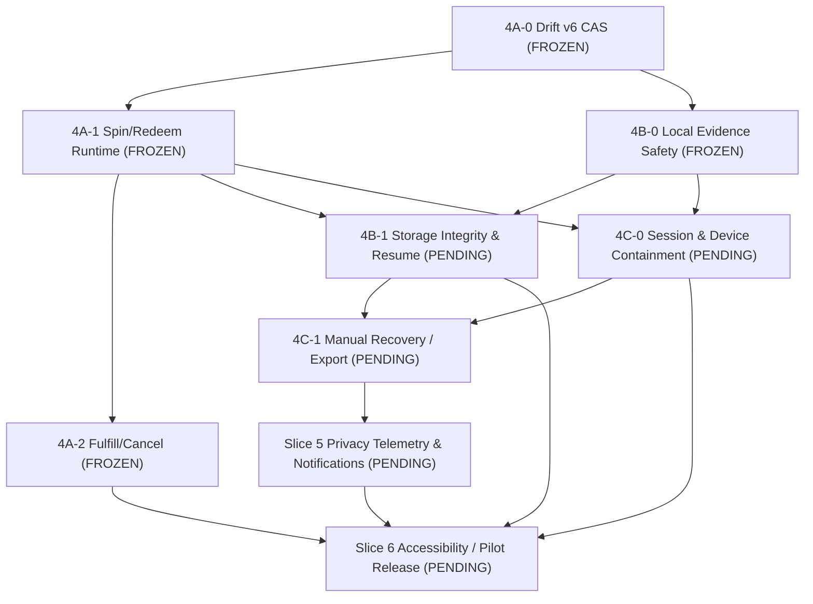

# Phase 6 Freeze Receipt — Adult Fulfill/Cancel Reliability (Slice 4A-2)

**Implementation Status:** MERGED & FROZEN  
**Documentation Status:** RECORDED (tracked in documentation PR #30; see GitHub for authoritative merge status and commit SHA)  
**Target:** Phase 6 Slice 4A-2 — Adult Fulfill/Cancel Reliability (`Verified Adult Role Provenance, Strict Server-Authoritative Fulfill & Cancel RPC Routing, Replay-Safe Idempotent UUID Preservation, Server-Authoritative RP Refunds with Zero Duplicate Credit, Atomic SQLite Cross-Operation Mutual Exclusion, Stale Lease CAS Fencing, Bounded Unverified-Target Miss Budget, Actor-Aware Pause and Resume, Bounded Non-Overflowing Presentation Banners with Dynamic Due-Time Promotion, Drift Schema v6 Immutability Preservation, Acceptance Criteria A2-01–A2-20, Review Dispositions R29-01 through R29-07`)  
**Design PR:** [#28 — docs(phase-6): add Slice 4A-2 adult fulfill/cancel reliability design contract](https://github.com/thedusk4203/LearnWard/pull/28)  
**Approved Design HEAD:** `f616f382857d41306557a9038a941baf03741f76`  
**Design Merge SHA:** `d48fe4bc331c724a6ff262bf8594e2aca554c2d7`  
**Design Merge Timestamp:** `2026-11-10T06:00:09Z`  
**Implementation PR:** [#29 — feat(phase-6): implement Slice 4A-2 adult fulfill/cancel reliability](https://github.com/thedusk4203/LearnWard/pull/29)  
**Approved Implementation HEAD:** `805ede7186f9a174eac2db53a763ef3902a38848`  
**PR CI Run ID:** [`42837350733`](https://github.com/thedusk4203/LearnWard/actions/runs/42837350733) — **SUCCESS (4/4 green)**  
**Implementation Merge SHA:** `9b253a268be01498266f86013d7db903f6cb01b9`  
**Resulting Main Tree SHA:** `18dd5a980c727747dff49f2eb4dbdea30c8a6ffc`  
**Post-Merge Main CI:** Run ID [`42844354262`](https://github.com/thedusk4203/LearnWard/actions/runs/42844354262) — **SUCCESS (4/4 green)**  
**Merge Timestamp:** `2026-11-10T15:26:32Z`  
**Freeze Date:** `2026-11-10`  
**Documentation PR:** [#30 — docs(phase-6): record Slice 4A-2 adult fulfill/cancel reliability freeze receipt](https://github.com/thedusk4203/LearnWard/pull/30)  
**ADR:** [ADR 0008 — Phase 6 Pilot Hardening](../adr/0008-phase-6-pilot-hardening.md) (`ACCEPTED`)  
**Upstream Contracts:**
- [ADR 0001–0007](../adr/)
- [Phase 1–5.2 Freeze Receipts](.)
- [Phase 6 Drift v5 Foundation Freeze](phase-6-drift-v5-foundation-freeze.md)
- [Phase 6 Slice 4A-0 Drift v6 Foundation Freeze](phase-6-slice-4a-0-drift-v6-foundation-freeze.md)
- [Phase 6 Slice 4A-1 Recovery Dispatcher Freeze](phase-6-slice-4a-1-recovery-dispatcher-freeze.md)
- [Phase 6 Slice 4B-0 Local Evidence Safety Freeze](phase-6-slice-4b-0-local-evidence-safety-freeze.md)
- [Phase 6 Master Delivery and Pilot Gates](../21-phase-6-master-delivery-and-pilot-gates.md)
- [Phase 6 Slice 4A-2 Design Contract](../23-phase-6-slice-4a-2-adult-fulfill-cancel-design-contract.md)

---

## 1. Verified CI & Test Suite Totals

Final verified test totals from post-merge main CI run [`42844354262`](https://github.com/thedusk4203/LearnWard/actions/runs/42844354262) on exact merge commit `9b253a268be01498266f86013d7db903f6cb01b9`:

| Test Suite / Job | Total Tests | Passed | Result | Duration |
|---|---|---|---|---|
| **Format, analyze and test** | All workspace suites | All | **PASS** | 2m 31s |
| - *learnward_domain* | 16 | 16 | **PASS** | — |
| - *learnward_application* (incl. R29-01 auth defaults & R29-04 canonical unverified-miss marker tests) | 83 | 83 | **PASS** | — |
| - *learnward_data* (incl. 20 acceptance suites A2-01–A2-20 & SQLite CAS barrier tests) | 187 | 187 | **PASS** | — |
| - *learnward_test_support* | 14 | 14 | **PASS** | — |
| - *learnward_design_system* | 6 | 6 | **PASS** | — |
| - *apps/mobile* widget & flow tests (incl. R29-05 layout, R29-06 eligibility, R29-07 scheduling) | 143 | 143 | **PASS** | — |
| - *Drift build_runner diff assertion* | Clean (0 diff) | Clean | **PASS** | — |
| **Supabase migrations & RLS security** | 659 pgTAP + 19 scripts | All | **PASS** | 2m 32s |
| - *pgTAP Test Files* (11 files) | 659 | 659 | **PASS** | — |
| - *Concurrency & Integration Scripts* | 19 | 19 | **PASS** | — |
| **iOS simulator compile** | Flutter build ios --simulator | Success | **PASS** | 5m 20s |
| **Android debug build** | Gradle assembleDebug | Success | **PASS** | 4m 57s |

---

## 2. Verified Acceptance Criteria Matrix (A2-01 through A2-20)

Every acceptance requirement specified in `docs/23-phase-6-slice-4a-2-adult-fulfill-cancel-design-contract.md` is covered by deterministic regression tests in `packages/learnward_data/test/adult_fulfill_cancel_recovery_acceptance_test.dart`:

| ID | Specification Requirement | Verification Evidence / Test Assertion | Status |
|---|---|---|---|
| **A2-01** | New Fulfill executes cleanly with confirmed success, recording single RPC dispatch and verifying authoritative adult role provenance. | Verified for both `owner` and `parent` roles. Command registers in SQLite under `neverDispatched`, marks `possiblyDispatched`, dispatches exact RPC, and safely deletes journal entry upon success. | **PASS** |
| **A2-02** | New Cancel executes cleanly with confirmed success, triggering exactly one server-side compensating RP refund and verifying adult role provenance. | Verified for both `owner` and `parent` roles. RPC returns refunded balance, client avoids local credit speculation, journal entry cleans up safely. | **PASS** |
| **A2-03** | Fulfill commit-response-loss resumption reuses original command UUID and completes without duplicate status progression. | Simulated transport drop after server commit. Subsequent replay passes exact command ID, recognizes committed state, and cleans up journal without re-transitioning redemption. | **PASS** |
| **A2-04** | Cancel commit-response-loss resumption reuses original command UUID and produces zero duplicate RP refund. | Simulated network drop after RPC refund commit. Recovery replay re-submits exact command ID; server contract guarantees idempotency, producing 0 additional RP refund. | **PASS** |
| **A2-05** | Concurrent Fulfill/Fulfill attempts for same redemption encounter deterministic SQLite CAS barriers. | One operation wins lease and commits; concurrent competitor is rejected with in-flight concurrency conflict or blocked by existing command predicate. | **PASS** |
| **A2-06** | Concurrent Cancel/Cancel attempts for same redemption encounter deterministic SQLite CAS barriers. | First worker obtains lease and dispatches; second worker fails CAS or receives already-in-flight result; zero duplicate refund credit. | **PASS** |
| **A2-07** | Cross-operation conflict prevention: concurrent Fulfill and Cancel for the same `(family_id, redemption_id)` mutually exclude each other. | Evaluated at SQLite registration level (`AppDatabase.registerFreshCommand`). Unresolved Fulfill blocks new Cancel; unresolved Cancel blocks new Fulfill. | **PASS** |
| **A2-08** | Independent redemptions for the same child proceed concurrently without false family-wide serialization or starvation. | Commands targeting distinct `redemption_id`s register, claim, and dispatch independently without blocking one another. | **PASS** |
| **A2-09** | Adult A to Adult B account switch safely pauses mismatched active command. | When actor identity changes, coordinator halts dispatch, sets `pendingOriginalActor`, clears lease, and preserves journal row without leaking mutation authority to new adult. | **PASS** |
| **A2-10** | Original adult returns: original command UUID, actor, role, and parameters are retained, dispatch proceeds and completes. | When original authenticated adult session resumes, non-dispatch CAS resumes command, acquires lease, dispatches to server, and completes. | **PASS** |
| **A2-11** | Paired-child account or inconsistent session role claims cannot execute adult operations. | Sessions claiming child role or paired-child identity fail Step 0 authorization closed; seed rows with child roles are quarantined or rejected. | **PASS** |
| **A2-12** | Revoked adult membership or missing RLS visibility fails closed without unauthorized dispatch. | Revoked membership fails closed; membership visibility failure fails closed; journal remains fenced until authorized adult session confirms. | **PASS** |
| **A2-13** | Active family switched during an in-flight operation halts command and rejects cross-family dispatch. | Operation detecting family mismatch aborts dispatch, fences lease, and returns `CommandFamilyMismatchResult`. | **PASS** |
| **A2-14** | Child archived before dispatch bounds consecutive unverified-target misses to exactly 3 attempts. | Positive archive proof (`childConfirmedArchived`) triggers immediate definitive denial and quarantine transition without retries; missing/RLS-filtered rows (`rlsFilteredOrMissingTargetRow` or `missingOrUnverifiedMembership`) increment consecutive misses via `[UNVERIFIED_TARGET_MISS:m/3]` and quarantine on the 3rd consecutive miss. | **PASS** |
| **A2-15** | Target miss streak resets upon positive target verification or successful RPC commit. | Intermediate missing-target status increments streak, but subsequent valid Step 0 verification clears the miss count; streak reset is durably persisted to SQLite via the subsequent token-fenced state transition (`markPossiblyDispatched`), preventing false quarantine on transient RLS gaps. | **PASS** |
| **A2-16** | Stale lease takeover and late worker response handling preserves active fence. | Expired worker attempting `markPossiblyDispatched` or completion after lease takeover is rejected by CAS lease token verification; winning worker's lease remains valid. | **PASS** |
| **A2-17** | Process crash between persistence, pre-dispatch marker, and RPC recovers deterministically. | Re-initialized SQLite database preserves exact command UUID, payload, and `possiblyDispatched` marker; restart drain executes idempotent resolution. | **PASS** |
| **A2-18** | Cancellation reason and immutable target survive restart and reject client-side mutation. | Non-empty cancellation reason (≥ 2 chars) and target redemption ID remain durable across restarts; modification attempts reject with state conflict. | **PASS** |
| **A2-19** | Legacy rows with missing actor or child identity fail closed without fabricated identity. | Verified in `packages/learnward_data/test/adult_fulfill_cancel_recovery_acceptance_test.dart`. Malformed command rows lacking valid adult actor IDs (`actorUserId == null`), child identity (`childId == null`), role, or cancellation reason fail direct `acquireClaim` closed (returning `null` because `_operationEligibilityPredicate` conditions are not met). When executed via the coordinator, they return `CommandQuarantinedResult` in memory, strictly preventing RPC dispatch without fabricating default adult identities or roles (`repo.fulfillCallCount == 0`, `repo.cancelCallCount == 0`). (Distinction: Rows are prevented from executing and quarantined from dispatch in memory; active malformed rows are not rewritten in SQLite because `acquireClaim` fails closed before any claim lease can be established). | **PASS** |
| **A2-20** | Mixed queue with spin, redeem, fulfill, and cancel drains cleanly; Drift schema remains v6. | Heterogeneous pending command queue drains correctly under multi-operation coordinator; Drift database schema version remains strictly 6. | **PASS** |

---

## 3. Independent Review Findings & Dispositions (R29-01 through R29-07)

During independent review rounds 1 through 3, all security, concurrency, and presentation edge cases were systematically hardened and regression-tested:

| Finding ID | Severity | Root Cause / Risk | Corrective Implementation & Fencing | Verification Status |
|---|---|---|---|---|
| **R29-01** | **P1** | Production authentication bypass defaults in `FulfillRewardRedemption` and `CancelRewardRedemption` constructors. | Removed default fallback port instances (`_DefaultAuthSessionPort`, `_DefaultRecoveryAuthorizationPort`). Constructors fail closed with `ArgumentError` if trusted `RecoveryCoordinator` or explicit trusted ports are omitted. | **PASS** |
| **R29-02** | **P1** | Missing `pendingOriginalActor` manual resume path in UI and coordinator when original adult returns with background recovery disabled. | Implemented positive original adult identity and role verification (`currentUserId == pending.actorUserId`, verified `owner`/`parent` role); wired CAS-based `resumeOriginalActorCommand` preserving exact command UUID; added multi-connection deterministic RPC barrier tests (`A2-05`, `A2-06`, `A2-07`) proving successful foreground manual retry and resolution. (Note: Unverified-target streak budgeting was defined under design findings R28-02/R28-05). | **PASS** |
| **R29-03** | **P2** | Recovery banner rendering in `ParentFulfillmentInboxScreen` dropped or masked active banners behind quarantined banners. | Updated UI to render every unresolved command in a distinct banner; quarantined commands do not hide or drop retryable active or paused commands. | **PASS** |
| **R29-04** | **P2** | Marker regex parsing for unverified target misses was loose and could misparse arbitrary error strings. | Implemented strict canonical parsing and formatting directly on `PendingRewardCommand`: `PendingRewardCommand.parseUnverifiedTargetMisses(lastErrorMessage)`, `PendingRewardCommand.formatUnverifiedTargetMissMessage()`, and getter `consecutiveUnverifiedTargetMisses` requiring exact `[UNVERIFIED_TARGET_MISS:m/3]` prefix; rejected malformed, truncated, or noncanonical strings. | **PASS** |
| **R29-05** | **P2** | Unbounded column layout of recovery banners caused RenderFlex overflow on small screens and landscape viewports. | Constrained recovery banners to a bounded, scrollable region (`BoxConstraints(maxHeight: maxRecoveryHeight)`) capped at 40% height / 220px; wrapped button rows; wrapped empty state in `SingleChildScrollView`. | **PASS** |
| **R29-06** | **P2** | Retry affordance displayed without positive verification of authenticated adult user identity. | Implemented strict actor matching (`currentUserId == pending.actorUserId`). Foreign actors, unauthenticated sessions, quarantined, terminal, and legacy commands are strictly forbidden from retrying. Original adult can retry both active and paused commands once due. | **PASS** |
| **R29-07** | **P2** | Presentation retry availability conflicted with durable scheduling backoff; future-scheduled commands offered Retry that silently dropped. | Aligned presentation and execution branches: future-scheduled commands suppress the Retry button and show an accurate delay notice. Implemented `_scheduleNextDueCheck()` timer that dynamically promotes commands to due state without navigation once deadline arrives. | **PASS** |

---

## 4. Immutable Command Identity & Adult Authorization Guarantees

1. **Strict Verified Adult Role Provenance (R28-01, R30-02):**
   - Adult role is verified exclusively via `RecoveryAuthorizationPort.verifyAdultRedemptionTarget()`, which queries authoritative `public.family_memberships`.
   - Returns a strongly-typed `AdultTargetAuthorizationResult` specifying preflight status (`authorized`, `definitelyDenied`, `confirmedRevoked`, `unverified`) and an explicit `AdultTargetVerificationReason` (`authorizedActiveAdultAndChild`, `childConfirmedArchived`, `rlsFilteredOrMissingTargetRow`, `missingOrUnverifiedMembership`, `inconsistentRoleClaim`, `pairedChildSessionDenied`, `transientVerificationFailure`).
   - A non-null `VerifiedAdultRole` (`owner` or `parent`) is carried strictly when `status == TargetAuthorizationStatus.authorized`.
   - Authoritative membership role is derived directly from `public.family_memberships`, not fabricated from session metadata. If session metadata claims a role that conflicts with database membership, authorization fails closed (`inconsistentRoleClaim`).
   - Missing session role is **never** fabricated or defaulted to `'parent'`.
   - Paired-child accounts fail closed (`pairedChildSessionDenied`) and are prevented from executing adult fulfill or cancel operations.
2. **Immutable Target & Parameter Preservation:**
   - Command UUID (`commandId`), redemption ID (`redemptionId`), child profile ID (`childId`), cancellation reason (`cancellationReason`), and actor ID (`actorUserId`) are immutable once written to SQLite.
   - Replay attempts strictly reuse the original command UUID.
   - A missing or blank cancellation reason (< 2 chars) on a cancel command fails closed and cannot be replayed or defaulted to arbitrary text.

---

## 5. SQLite Lease/CAS Fencing & Server-Authoritative Refund Invariants

1. **Cross-Operation Mutual Exclusion:**
   - In `AppDatabase.registerFreshCommand` and in-memory test stores, registration of a command checks for any existing unresolved command for the same `(family_id, redemption_id)`.
   - An active or unresolved `fulfill_reward` command prevents registering a `cancel_reward` command, and vice versa, preventing conflicting concurrent operations.
2. **Actual Granular CAS Conditions (R30-03):**
   Rather than claiming identical predicates across all operations, the implementation enforces distinct, tailored CAS conditions per method:
   - **`acquireClaim`**: Verifies matching `actor_user_id`, `recovery_state == 'active'`, `_operationEligibilityPredicate`, valid `dispatch_state`, due-time check (`next_attempt_at IS NULL OR next_attempt_at <= now`), and lease availability or expiration (`(lease_token IS NULL AND lease_expires_at IS NULL) OR (lease_token IS NOT NULL AND lease_expires_at <= now)`).
   - **`markPossiblyDispatched`**: Verifies matching `command_id`, matching `lease_token`, unexpired active lease (`lease_expires_at > now`), matching `actor_user_id`, `recovery_state == 'active'`, `_operationEligibilityPredicate`, and valid `dispatch_state`. Clears any stale unverified target miss marker upon successful pre-dispatch marker write.
   - **`releaseClaim`**: Token-fenced update verifying matching `command_id AND lease_token = ?`. Increments `retry_count`, updates `next_attempt_at` and `last_error_message`, and clears `lease_token` and `lease_expires_at`.
   - **`completeCommand`**: Token-fenced deletion verifying matching `command_id AND lease_token = ?`.
   - **`transitionRecoveryState`**: Token-fenced update verifying matching `command_id AND lease_token = ?`. Updates `recovery_state` and `last_error_message`, and clears `lease_token` and `lease_expires_at`.
   - **`pauseMismatchedActorCommand`**: Non-dispatch CAS verifying matching `command_id`, matching `family_id`, foreign actor (`actor_user_id IS NOT NULL AND actor_user_id <> authenticatedActorId`), `recovery_state == 'active'`, `_operationEligibilityPredicate`, valid `dispatch_state`, and no active unexpired lease (`lease_token IS NULL OR lease_expires_at <= now`). Sets `recovery_state = 'pending_original_actor'` and clears lease.
   - **`resumeOriginalActorCommand`**: Non-dispatch CAS verifying matching `command_id`, matching `family_id`, matching original actor (`actor_user_id == authenticatedActorId`), `recovery_state == 'pending_original_actor'`, `_operationEligibilityPredicate`, valid `dispatch_state`, and no active unexpired lease (`lease_token IS NULL OR lease_expires_at <= now`). Sets `recovery_state = 'active'` and clears lease.
   - **Stale-Token and Lease-Takeover Guarantees**: A stale worker whose lease expired cannot execute `markPossiblyDispatched` because `lease_expires_at > now` evaluates to false. A stale worker attempting token-fenced release, completion, or state transition after a subsequent worker has claimed the row is rejected because `acquireClaim` overwrote `lease_token`.
3. **Server-Authoritative Economics & Compensating Refunds:**
   - Client code **never** credits RP locally on reward cancellation.
   - Compensating refund is executed strictly within server RPC `cancel_reward_redemption`, which verifies that the redemption is in `pending_fulfillment` status and updates the ledger within a single database transaction.
   - In the event of a commit-response loss (network drop after RPC commit), client replay with the same command UUID returns the idempotent success receipt with 0 duplicate refund.

---

## 6. Zero-Diff Contracts & Schema Immutability Confirmation

| Asset / Boundary | Verification Result | Confirmation Details |
|---|---|---|
| **Drift Schema v6** | **0 diff (100% frozen)** | `packages/learnward_data/lib/src/database/app_database.dart` generated schema `app_database.g.dart` matches baseline identically. Zero schema mutations, zero migration files added. |
| **SQLite Migrations** | **0 diff (100% frozen)** | Multi-version migration matrix (`v1..v5 -> v6`) remains structurally unchanged. |
| **Supabase Migrations** | **0 diff (100% frozen)** | `supabase/migrations/` has zero diff; no new tables, triggers, functions, or storage policies. |
| **Server-Authoritative Economics** | **0 diff (100% frozen)** | All reward, assessment, and ledger RPC contracts remain 100% unchanged. |
| **RLS Policies** | **0 diff (100% frozen)** | 659 pgTAP tests and 19 concurrency scripts pass with zero modifications. |

---

## 7. Feature Flag Configuration

- **`RECOVERY_DISPATCHER_ENABLED=false` Enforced:**
  - `AppConfig.recoveryDispatcherEnabled` remains `false` by default across all builds.
  - Automated background recovery dispatcher loop is kept dormant.
  - In `ParentFulfillmentInboxScreen`, when dispatcher is disabled and a command is in backoff delay, the UI accurately indicates:  
    `'Manual retry will become available after the retry delay.'`  
    preventing misleading promises of automatic background completion.

---

## 8. Remaining Known Limitations & Architectural Boundaries

1. **Archived-Child Reconciliation & Target Visibility (R30-05):**
   - **Positive Archive Proof (`childConfirmedArchived`)**: When preflight verification provides positive proof that a child profile has been archived (`child_profiles.status == 'archived'`), the coordinator immediately treats this as a definitive denial (`TargetAuthorizationStatus.definitelyDenied`) and transitions the active command to `quarantinedUnknownOutcome` on the first attempt without waiting for multiple retries.
   - **Missing / RLS-Filtered Visibility (`rlsFilteredOrMissingTargetRow` or `missingOrUnverifiedMembership`)**: When the target child or membership row returns `null` without positive proof of archival (e.g. RLS filtering or transient replication lag), the command bounds recovery to exactly 3 consecutive verification attempts via canonical marker `[UNVERIFIED_TARGET_MISS:m/3]` with exponential backoff delay, quarantining only upon the 3rd consecutive miss.
   - **Transport Failure (`transientVerificationFailure`)**: PostgREST connection errors, timeouts, and network exceptions trigger transient exponential backoff retries via `releaseClaim` without incrementing the unverified-target miss streak, avoiding false quarantine on network glitches.
   - **Persistence of Streak Reset**: When an unverified command later achieves positive verification, the miss streak reset is persisted to SQLite via the subsequent token-fenced state transition (`markPossiblyDispatched` or completion CAS), rather than assuming a read-only authorization check mutates SQLite.
2. **No Real Background Execution Without Native WorkManager:**
   - Mobile operating systems (iOS/Android) may suspend the app process when backgrounded.
   - True background headless recovery requires platform-specific background tasks (Slice 6), not promised under Slice 4A-2.
3. **Storage Byte Reconciliation:**
   - Storage upload resumability, private byte SHA-256 verification, and HTTP 409 handling belong strictly to Slice 4B-1.
4. **Auth & Child Mode Containment:**
   - Multi-account switching, PIN lockout rate limiting, and session invalidation across Riverpod belong to Slice 4C-0.

---

## 9. Implementation Frozen vs. Production/Pilot Ready Distinction

> [!WARNING]
> **Implementation Frozen ≠ Production/Pilot Ready**
>
> 1. Slice 4A-2 is **IMPLEMENTATION FROZEN**: its Dart code, SQLite CAS logic, presentation layer, and deterministic acceptance matrix are fully implemented, independently reviewed, and verified by CI.
> 2. Slice 4A-2 is **NOT PRODUCTION OR PILOT READY**:
>    - Verification was conducted exclusively using automated unit/widget tests and simulated server environments. No physical Android or iOS device verification has occurred.
>    - Distribution signing (Android release keystore, iOS distribution certificates/provisioning profiles) has not been configured or tested.
>    - Slices 4B-1 (Storage 409 / Evidence Resume), 4C-0 (Auth & Child Mode Containment), 4C-1 (Manual Recovery & Export UX), Slice 5 (Privacy Telemetry & Notifications), and Slice 6 (Accessibility & Release Verification) must be completed before any production deployment or pilot cohort onboarding.

---

## 10. Pending Phase 6 Delivery Slices & Release Gates

1. **Next Target:** **Slice 4B-1** — *Evidence Resumability and Storage 409 Reconciliation*.
2. **Subsequent Targets:** **Slice 4C-0** (*Auth, Child Mode & Device Containment*), **Slice 4C-1** (*Manual Recovery & Export UX*), **Slice 5** (*Coordination Notifications & Privacy Telemetry*), and **Slice 6** (*Accessibility & Actual Release Readiness*).
