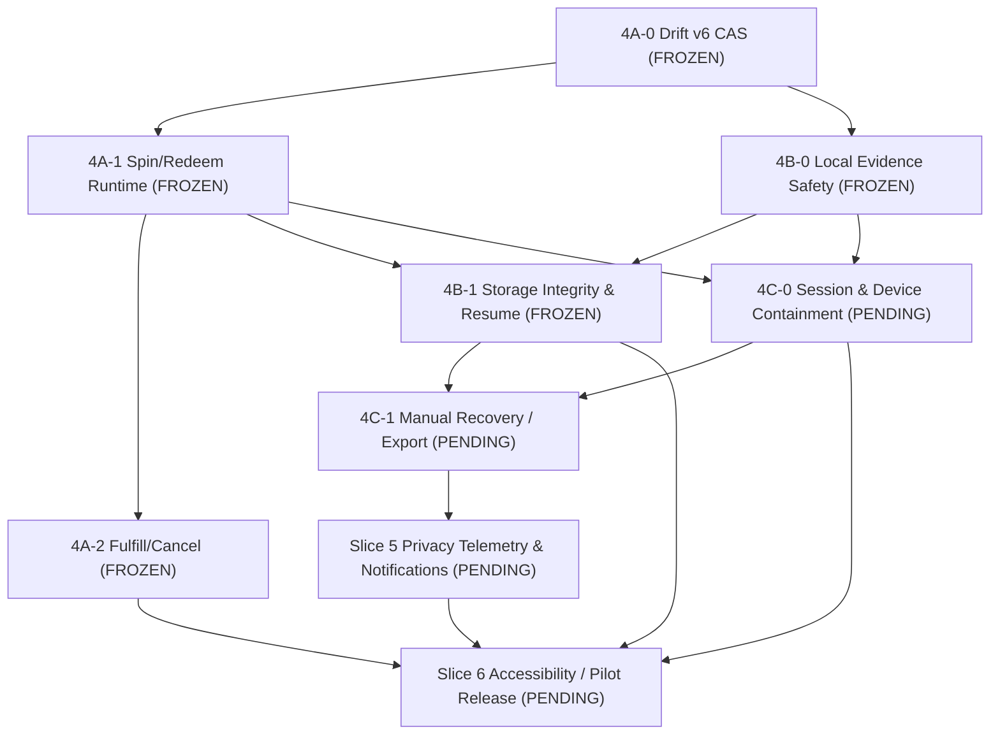

# Phase 6 Freeze Receipt — Evidence Resumability & Storage 409 Reconciliation (Slice 4B-1)

**Implementation Status:** MERGED & FROZEN  
**Documentation Status:** RECORDED (tracked in WP6 documentation PR; see GitHub for authoritative merge status and commit SHA)  
**Target:** Phase 6 Slice 4B-1 — Evidence Resumability & Storage 409 Reconciliation (`Byte-Identity Canonical Snapshots (JPEG & PNG), No-Upsert Private Storage Upload & 409 Byte/SHA-256 Reconciliation, Non-Destructive Read-Only LW109 Reconciliation, Distinct serverEvidenceId vs Client evidenceId Namespaces, Token-Fenced Drift v6 Local Draft CAS & Multi-Connection Leases, Derived Read-Only Quarantine for Unbound/Unknown/Tampered Drafts, Staged Durable AssessmentSubmissionOrchestrator with Per-Stage Session & Target Revalidation, Authorized Foreground Recovery UI & Immutable Payload Guards, Acceptance Criteria B1-01–B1-30, Invariants I01–I16, Design Decisions D1–D5, Review Dispositions R31 through R36`)  
**Design PR:** [#31 — docs(phase-6): propose Slice 4B-1 evidence resumability design contract](https://github.com/thedusk4203/LearnWard/pull/31)  
**Approved Design HEAD:** `b6bf3658cb1dd08e8513480e7e8ff8a211d4aea0`  
**Implementation PRs:**
- [#32 — feat(phase-6): slice 4b-1 safe storage foundation and 409 reconciliation (WP1)](https://github.com/thedusk4203/LearnWard/pull/32)
- [#33 — feat(assessments): Phase 6 Slice 4B-1 WP2 — Canonical evidence snapshot & local draft CAS foundation](https://github.com/thedusk4203/LearnWard/pull/33)
- [#34 — feat(phase-6): Slice 4B-1 WP3 — Durable Assessment Evidence Orchestrator](https://github.com/thedusk4203/LearnWard/pull/34)
- [#35 — feat(phase-6): Slice 4B-1 WP4 assessment recovery UI and authorized foreground retry](https://github.com/thedusk4203/LearnWard/pull/35)
- [#36 — Phase 6 Slice 4B-1 WP5: Acceptance Matrix & CI Verification](https://github.com/thedusk4203/LearnWard/pull/36)  
**Final Approved Implementation HEAD (WP5):** `5b375b551ea0bb0dc0e3450747f41e95a23c492c`  
**Final PR CI Run ID (WP5):** [`43991597214`](https://github.com/thedusk4203/LearnWard/actions/runs/43991597214) — **SUCCESS (4/4 green)**  
**Final Implementation Merge SHA (WP5 -> `main`):** `06d4d7253c1b234ab11e51ab7a7e53d7739a5a1c`  
**Resulting Main Tree SHA:** `85c21e4d74ce39d57e2f54b9bc89124530dae6e5`  
**Post-Merge Main CI:** Run ID [`43999993238`](https://github.com/thedusk4203/LearnWard/actions/runs/43999993238) — **SUCCESS (4/4 green)**  
**Final Merge Timestamp:** `2026-11-17T02:02:06Z`  
**Freeze Date:** `2026-11-17`  
**ADR:** [ADR 0008 — Phase 6 Pilot Hardening](../adr/0008-phase-6-pilot-hardening.md) (`ACCEPTED`)  
**Upstream Contracts:**
- [ADR 0001–0007](../adr/)
- [Phase 1–5.2 Freeze Receipts](.)
- [Phase 6 Drift v5 Foundation Freeze](phase-6-drift-v5-foundation-freeze.md)
- [Phase 6 Slice 4A-0 Drift v6 Foundation Freeze](phase-6-slice-4a-0-drift-v6-foundation-freeze.md)
- [Phase 6 Slice 4A-1 Recovery Dispatcher Freeze](phase-6-slice-4a-1-recovery-dispatcher-freeze.md)
- [Phase 6 Slice 4A-2 Adult Fulfill/Cancel Freeze](phase-6-slice-4a-2-adult-fulfill-cancel-freeze.md)
- [Phase 6 Slice 4B-0 Local Evidence Safety Freeze](phase-6-slice-4b-0-local-evidence-safety-freeze.md)
- [Phase 6 Master Delivery and Pilot Gates](../21-phase-6-master-delivery-and-pilot-gates.md)
- [Phase 6 Slice 4B-1 Evidence Resumability Design Contract](../24-phase-6-slice-4b-1-evidence-resumability-design-contract.md)

---

## 1. Work Package Merge Provenance (WP0–WP5)

All six prerequisite work packages (`WP0` through `WP5`) were merged sequentially onto `main` using exact-HEAD guards, with post-merge `main` CI verified 4/4 green after each merge:

| Work Package | PR | Scope | Approved HEAD SHA | PR CI Run | Merge Commit SHA (`main`) | Resulting Tree SHA (`main`) | Merged At (UTC) | Post-Merge `main` CI Run |
|---|---|---|---|---|---|---|---|---|
| **WP0** | [#31](https://github.com/thedusk4203/LearnWard/pull/31) | Design Contract (`D1–D5`, `I01–I16`, `B1-01–B1-30`) | `b6bf3658cb1dd08e8513480e7e8ff8a211d4aea0` | [`43139511145`](https://github.com/thedusk4203/LearnWard/actions/runs/43139511145) (4/4) | `2fc02ac10bf7b994d28274c23a52c134c182a3a7` | `ad19f2cc5e48fb7867e603f41e8fffad46ef193c` | `2026-11-12T02:22:18Z` | [`43140935306`](https://github.com/thedusk4203/LearnWard/actions/runs/43140935306) (4/4) |
| **WP1** | [#32](https://github.com/thedusk4203/LearnWard/pull/32) | Safe Storage Port, Download & 409 Byte/SHA Reconciliation | `f45be91c3eae0f385f8f18f1fa92556d669fb7b4` | [`43541325188`](https://github.com/thedusk4203/LearnWard/actions/runs/43541325188) (4/4) | `2d2369a57c7b9ba4f19b227c88592b8e86a83f42` | `24992b4721b253284a4c4fe4876da9e45114e8b7` | `2026-11-14T01:53:22Z` | [`43543216532`](https://github.com/thedusk4203/LearnWard/actions/runs/43543216532) (4/4) |
| **WP2** | [#33](https://github.com/thedusk4203/LearnWard/pull/33) | Canonical Evidence Snapshot & Drift v6 Local Draft CAS/Leases | `09a4eb81b455cae167237f8214421b192c0f92ab` | [`43574992581`](https://github.com/thedusk4203/LearnWard/actions/runs/43574992581) (4/4) | `d226f1b043ebcb9b13d19287bffa327251af8704` | `1adcc6187ab21865038d93725395f6e9d8f0accc` | `2026-11-14T08:34:42Z` | [`43576485704`](https://github.com/thedusk4203/LearnWard/actions/runs/43576485704) (4/4) |
| **WP3** | [#34](https://github.com/thedusk4203/LearnWard/pull/34) | Durable Staged `AssessmentSubmissionOrchestrator` | `50dd0e8b673add540849432d31c2aa391b6bd32c` | [`43588986247`](https://github.com/thedusk4203/LearnWard/actions/runs/43588986247) (4/4) | `eb7cef1ef52e3e15b4a4de967da017839c9716a9` | `ce7a7a06f4a754691a7f88cd200dc3e4a95c3dfe` | `2026-11-14T11:26:37Z` | [`43590045915`](https://github.com/thedusk4203/LearnWard/actions/runs/43590045915) (4/4) |
| **WP4** | [#35](https://github.com/thedusk4203/LearnWard/pull/35) | Assessment Recovery UI, Draft Listings & Foreground Retry | `86c89bc9f132a62f6168a921934dd15bdc9e81bd` | [`43600500369`](https://github.com/thedusk4203/LearnWard/actions/runs/43600500369) (4/4) | `a24b391514720dafaa487188f06624d2815bad25` | `cf2884ff912873a9a808f75903876bcb3a180100` | `2026-11-16T01:42:31Z` | [`43787821155`](https://github.com/thedusk4203/LearnWard/actions/runs/43787821155) (4/4) |
| **WP5** | [#36](https://github.com/thedusk4203/LearnWard/pull/36) | Full `B1-01`–`B1-30` Acceptance Matrix & Real-Backend Security | `5b375b551ea0bb0dc0e3450747f41e95a23c492c` | [`43991597214`](https://github.com/thedusk4203/LearnWard/actions/runs/43991597214) (4/4) | `06d4d7253c1b234ab11e51ab7a7e53d7739a5a1c` | `85c21e4d74ce39d57e2f54b9bc89124530dae6e5` | `2026-11-17T02:02:06Z` | [`43999993238`](https://github.com/thedusk4203/LearnWard/actions/runs/43999993238) (4/4) |

---

## 2. Verified CI & Test Suite Totals

Final verified totals from post-merge `main` CI run [`43999993238`](https://github.com/thedusk4203/LearnWard/actions/runs/43999993238) on exact merge commit `06d4d7253c1b234ab11e51ab7a7e53d7739a5a1c` (matching WP5 PR CI run [`43991597214`](https://github.com/thedusk4203/LearnWard/actions/runs/43991597214) on `5b375b551ea0bb0dc0e3450747f41e95a23c492c`):

| Test Suite / CI Job | Scope / Count | Passed | Result | Duration & Job ID |
|---|---|---|---|---|
| **Format, analyze and test** | 833 workspace tests + format + analyze + Drift | All | **PASS** | 3m 08s ([`133761352204`](https://github.com/thedusk4203/LearnWard/actions/runs/43999993238/job/133761352204)) |
| - `dart format --output=none --set-exit-if-changed .` | 245 files (0 changed) | 245 | **PASS** | — |
| - `flutter analyze` | Clean static analysis (0 issues) | Clean | **PASS** | — |
| - *learnward_domain* | Domain models & parity suites | 196 | **PASS** | — |
| - *learnward_application* | Orchestrator (`R34-01`–`R34-06`), 4A-1, 4A-2, 4B-0 tests | 159 | **PASS** | — |
| - *learnward_data* | SQLite CAS, Storage 409, `B1-01`–`B1-30` acceptance suite | 251 | **PASS** | — |
| - *learnward_test_support* | Fake stores & invariant parity tests | 14 | **PASS** | — |
| - *learnward_design_system* | Design theme & tokens tests | 2 | **PASS** | — |
| - *apps/mobile* | Widget & flow suites (4B-0, WP2 `R33-09`, WP4 `R35`, WP5 UI) | 211 | **PASS** | — |
| - *Drift build_runner diff assertion* | `Built with build_runner/aot` (64 outputs, 0 git diff) | Clean | **PASS** | — |
| **Supabase migrations & RLS security** | 659 pgTAP + 19 real-backend scripts | All | **PASS** | 2m 27s ([`133761352594`](https://github.com/thedusk4203/LearnWard/actions/runs/43999993238/job/133761352594)) |
| - `supabase db reset` | 11 migrations (`20261031000000`–`20261106000000`) + `seed.sql` | Clean | **PASS** | — |
| - *pgTAP Test Files* (`supabase test db`, 11 files) | 659 assertions | 659 | **PASS** | — |
| - *Concurrency, Security, Vertical-Slice & Parity Scripts* | 19 scripts (incl. `test_storage_evidence_security.mjs` Tests A–T) | 19 | **PASS** | — |
| **Android debug build** | Gradle `assembleDebug` + verified SQLite binaries | Success | **PASS** | 5m 20s ([`133762659699`](https://github.com/thedusk4203/LearnWard/actions/runs/43999993238/job/133762659699)) |
| **iOS simulator compile** | `flutter build ios --simulator` | Success | **PASS** | 3m 59s ([`133762659827`](https://github.com/thedusk4203/LearnWard/actions/runs/43999993238/job/133762659827)) |

---

## 3. Verified Acceptance Criteria Matrix (`B1-01` through `B1-30`)

Every requirement `B1-01`–`B1-30` defined in `docs/24-phase-6-slice-4b-1-evidence-resumability-design-contract.md` is verified against real file-backed SQLite (`NativeDatabase`), multi-connection CAS barriers, `_DurableDiskCanonicalSnapshotStore` (`exclusive: true` + `RandomAccessFile.flushSync()` + re-read SHA-256), `TestClock`, `DeterministicJitterSource`, `SupabaseAssessmentEvidenceStorage` (`MockClient`), `SupabaseAssessmentRepository` (`MockClient`), Flutter UI widget flows (`apps/mobile/test/wp5_slice_4b1_ui_acceptance_test.dart`), and real Supabase Postgres/Storage execution (`scripts/test_storage_evidence_security.mjs` Tests A–T):

| ID | Invariants | Verification Evidence / Assertions | Primary & Companion Tests | Status |
|---|---|---|---|---|
| **B1-01** | `I01, I08, I14` | Fresh JPEG bytes frozen once via exclusive snapshot; caller buffer mutations ignored; SHA-256 & byte length survive SQLite reopen. | `wp5_slice_4b1_acceptance_matrix_test.dart`, `wp5_slice_4b1_ui_acceptance_test.dart`, `wp2_canonical_evidence_snapshot_test.dart` | **PASS** |
| **B1-02** | `I01, I02, I14` | PNG evidence preserved with `image/png` MIME, `.png` Storage path extension, and exact bytes without fake JPEG conversion. | `wp5_slice_4b1_acceptance_matrix_test.dart`, `wp5_slice_4b1_ui_acceptance_test.dart`, `test_storage_evidence_security.mjs` (`Test S`) | **PASS** |
| **B1-03** | `I01, I04, I08` | Missing, truncated, or mutated canonical snapshot fails closed with 0 remote uploads and zero fallback to raw mutable photo. | `wp5_slice_4b1_acceptance_matrix_test.dart`, `wp5_slice_4b1_ui_acceptance_test.dart` | **PASS** |
| **B1-04** | `I02, I03` | Canonical path uses `${familyId}/${childId}/${serverAssessmentId}/${evidenceId}.(jpg\|png)` and never rotates UUID across retries. | `wp5_slice_4b1_acceptance_matrix_test.dart`, `wp3_assessment_submission_orchestrator_test.dart` | **PASS** |
| **B1-05** | `I02, I11` | `register_assessment_evidence` persists DB-generated `serverEvidenceId != evidenceId` while preserving distinct client `evidenceId`. | `wp5_slice_4b1_acceptance_matrix_test.dart`, `test_storage_evidence_security.mjs` (`Test S`) | **PASS** |
| **B1-06** | `I01, I03, I05` | HTTP 409 with identical remote bytes & size downloads private object via `SupabaseAssessmentEvidenceStorage`, verifies SHA-256, and completes. | `wp5_slice_4b1_acceptance_matrix_test.dart`, `test_storage_evidence_security.mjs` (`Test N`) | **PASS** |
| **B1-07** | `I01, I03, I04, I05` | HTTP 409 with matching byte length and differing SHA-256 quarantines (`storageContentConflict`) with zero overwrite/delete/UUID rotation. | `wp5_slice_4b1_acceptance_matrix_test.dart`, `test_storage_evidence_security.mjs` (`Test O`) | **PASS** |
| **B1-08** | `I01, I03, I04, I05` | HTTP 409 with differing remote byte length fails closed (`storageContentConflict`), preserving both remote object and local file. | `wp5_slice_4b1_acceptance_matrix_test.dart`, `supabase_assessment_evidence_storage_test.dart` | **PASS** |
| **B1-09** | `I04, I06, I07` | HTTP 409 followed by download `401` or `403`/RLS denial stays `UnknownOutcome` (`retryScheduled`), retaining remote and local bytes. | `wp5_slice_4b1_acceptance_matrix_test.dart`, `supabase_assessment_evidence_storage_test.dart` | **PASS** |
| **B1-10** | `I02, I04, I06` | HTTP 409 followed by remote `404` remains unknown and never authorizes destructive cleanup or UUID rotation. | `wp5_slice_4b1_acceptance_matrix_test.dart`, `supabase_assessment_evidence_storage_test.dart` | **PASS** |
| **B1-11** | `I03, I05` | Attempt 1 commits Storage `POST` (`x-upsert: false`) then loses HTTP response (`ClientException`); reopened SQLite + disk store resume through orchestrator (`uploadCallCount == 2`, `successfulUploadWrites == 1`, `rejectedNoUpsertUploadAttempts == 1`, `overwriteCount == 0`, `downloadCallCount == 1`, `deleteCallCount == 0`) with preserved IDs, length, and SHA-256. | `wp5_slice_4b1_acceptance_matrix_test.dart` (`B1-11`), `wp3_assessment_submission_orchestrator_test.dart` (`B1-11`) | **PASS** |
| **B1-12** | `I02, I05, I11` | Lost registration response reconciles by `(assessmentId, familyId, storagePath)` + SHA-256 and enforces `serverEvidenceId` equality (`evidenceIdMismatch` on mismatch). | `wp5_slice_4b1_acceptance_matrix_test.dart`, `test_storage_evidence_security.mjs` (`Test S`) | **PASS** |
| **B1-13** | `I04, I12, I13` | Distinctly verifies: **Subcase A** active `LW109` on `registerEvidence` (`registerEvidenceCalls == 1`, `nextRegisterError` thrown/consumed) reconciles read-only; **Subcase B** pre-committed non-draft assessment reconciles read-only before `registerEvidence` (`uploadCallCount == 0`, `registerEvidenceCalls == 0`). | `wp5_slice_4b1_acceptance_matrix_test.dart` (`B1-13`), `wp3_assessment_submission_orchestrator_test.dart` (`B1-13`, `R34-03`), `test_storage_evidence_security.mjs` (`Test S`, `Test Q`) | **PASS** |
| **B1-14** | `I04, I06, I12` | Non-draft assessment with no positively proven evidence row quarantines (`REGISTRATION_UNRESOLVED_REMOTE_RETAINED`) and preserves remote bytes. | `wp5_slice_4b1_acceptance_matrix_test.dart`, `wp3_assessment_submission_orchestrator_test.dart` (`B1-14`) | **PASS** |
| **B1-15** | `I02, I04, I06` | RLS-null (`200 []`) on assessment/evidence reads never infers absence, never deletes bytes, and never mints replacement UUIDs. | `wp5_slice_4b1_acceptance_matrix_test.dart`, `test_storage_evidence_security.mjs` (`Test R`) | **PASS** |
| **B1-16** | `I02, I07, I10` | Authoritative `validateForMutation()` ignores stale cached UI providers; actor switch `A->B` pauses (`WAITING_ORIGINAL_ACTOR`) until `A` returns; unbound drafts quarantine read-only; revocation/session-generation rotation halts with 0 RPCs. | `wp5_slice_4b1_acceptance_matrix_test.dart`, `wp5_slice_4b1_ui_acceptance_test.dart`, `wp3_assessment_submission_orchestrator_test.dart` (`R34-06`) | **PASS** |
| **B1-17** | `I04, I06, I07, I13` | Child archived before dispatch fails closed (`terminalPolicyDenial`); child archived after lost submit (Step 4 `42501` before Step 6 receipt check) quarantines `AMBIGUOUS_42501_OUTCOME` without declaring absence. | `wp5_slice_4b1_acceptance_matrix_test.dart`, `test_storage_evidence_security.mjs` (`Test T.3`) | **PASS** |
| **B1-18** | `I07, I08, I14` | Deterministic hard-crash/restart coverage across all **5 crash boundaries** (`Case 1` before marker, `Case 2a` after marker before `createDraft`, `Case 2b` after marker + `persistServerAssessmentId` before upload bytes, `Case 3` during uncertain upload, `Case 4` after HTTP 200 upload before `registerEvidence`, `Case 5` after `createDraft` committed with lost response) + `Part 0` auth abort; each proves SQLite/disk reopen, pre-expiry `leaseConflict`, stale-token CAS fencing across all 6 CAS ops, stable IDs, no duplicate RPCs, and 0 deletions. | `wp5_slice_4b1_acceptance_matrix_test.dart` (`B1-18`), `wp5_slice_4b1_ui_acceptance_test.dart`, `wp3_assessment_submission_orchestrator_test.dart` (`R34-01`, `R34-04`), `wp3_supabase_and_sqlite_concurrency_test.dart`, `wp2_draft_cas_sqlite_and_parity_test.dart` | **PASS** |
| **B1-19** | `I02, I05, I11` | Crash after `registerEvidence` (`row.id != evidenceId`) before local persistence reconciles exact row & bytes via SQLite reopen and persists `serverEvidenceId = row.id`. | `wp5_slice_4b1_acceptance_matrix_test.dart`, `test_storage_evidence_security.mjs` (`Test S`) | **PASS** |
| **B1-20** | `I11, I13, I14` | Lost submit response preserves original `submitCommandId`: idempotent retry confirms; Step 3/4 `42501` preserves `AMBIGUOUS_42501_OUTCOME` and remote state. | `wp5_slice_4b1_acceptance_matrix_test.dart`, `test_storage_evidence_security.mjs` (`Test T.1, T.2, T.3`) | **PASS** |
| **B1-21** | `I08, I09` | Multi-connection SQLite contention with `Completer` barriers elects single lease winner and dispatches at most one stage RPC. | `wp5_slice_4b1_acceptance_matrix_test.dart`, `wp3_supabase_and_sqlite_concurrency_test.dart` | **PASS** |
| **B1-22** | `I09` | Expired lease takeover rotates `leaseToken` and fences stale worker across every CAS operation (`markDraftStageAndDispatch`, `persistServer*`, `scheduleDraftRetry`, `completeDraftSubmission`, `releaseDraftClaim`). | `wp5_slice_4b1_acceptance_matrix_test.dart`, `wp2_draft_cas_sqlite_and_parity_test.dart` | **PASS** |
| **B1-23** | `I10, I15` | Concurrent UI editor/autosave and `saveLocalDraft`/`deleteDraftSafely` cannot overwrite leased, dispatched, confirmed, unbound, or quarantined state or immutable IDs/hashes. | `wp5_slice_4b1_acceptance_matrix_test.dart`, `wp2_r33_submission_matrix_test.dart`, `wp4_assessment_recovery_ui_test.dart` | **PASS** |
| **B1-24** | `I01, I02, I07, I09` | Cross-family, cross-child, and cross-assessment mismatches reject fail closed with 0 mutations. | `wp5_slice_4b1_acceptance_matrix_test.dart`, `test_storage_evidence_security.mjs` (`Tests B–F`) | **PASS** |
| **B1-25** | `I11, I13` | `submit_assessment` enforces `expectedVersion: 1`; remote `draft` with `version > 1` quarantines `UNRECONSTRUCTABLE_EXPECTED_VERSION`; `LW101`/`LW107` quarantine without speculative version adoption. | `wp5_slice_4b1_acceptance_matrix_test.dart`, `wp3_assessment_submission_orchestrator_test.dart` | **PASS** |
| **B1-26** | `I07, I10, I15` | `unknownLegacy`, unbound (`actorUserId == null`), unverified in-flight, and unknown wire statuses derive read-only quarantine in memory without rewriting SQLite across restart. | `wp5_slice_4b1_acceptance_matrix_test.dart`, `wp5_slice_4b1_ui_acceptance_test.dart`, `wp4_assessment_recovery_ui_test.dart` | **PASS** |
| **B1-27** | `I02, I09` | Transient retry backoff (`TestClock` + `DeterministicJitterSource`) is bounded, persisted across SQLite restart, and preserves IDs and canonical bytes. | `wp5_slice_4b1_acceptance_matrix_test.dart`, `wp2_draft_cas_sqlite_and_parity_test.dart` | **PASS** |
| **B1-28** | `I04, I14` | Confirmed submission transitions to `confirmedCommitted`, retains canonical local bytes and SQLite receipt across restart, and blocks deletion. | `wp5_slice_4b1_acceptance_matrix_test.dart`, `wp5_slice_4b1_ui_acceptance_test.dart` | **PASS** |
| **B1-29** | `I03..I07, I12, I16` | Wire contract enforces `x-upsert: false`, bounded download, `LW109`/`42501` mapping, real Postgres/Storage Tests `A–T`, and `I16` redaction of JWTs/Bearer tokens/signed URLs. | `wp5_slice_4b1_acceptance_matrix_test.dart`, `test_storage_evidence_security.mjs` (`Tests A–T`), `supabase_assessment_evidence_storage_test.dart` | **PASS** |
| **B1-30** | `I15` | Drift `schemaVersion == 6` (`local_assessment_drafts` 30 cols, `pending_reward_commands` 19 cols) unchanged; reward and assessment CAS stores operate in strict isolation. | `wp5_slice_4b1_acceptance_matrix_test.dart`, `pending_reward_commands_atomic_cas_test.dart` | **PASS** |

---

## 4. Security & Durability Invariants (`I01`–`I16`) and Decisions (`D1`–`D5`)

| Invariant / Decision | Enforcement Summary | Verified Proof |
|---|---|---|
| **I01 / D4 (Byte Identity & Platform-Safe Snapshot)** | `CanonicalEvidenceSnapshotStore` / `DefaultLocalEvidenceFileStore` validates magic headers (JPEG `FF D8 FF`, PNG `89 50 4E 47 0D 0A 1A 0A`), 10 MiB max, `createSync(exclusive: true)`, `RandomAccessFile.flushSync()`, re-read length + SHA-256 verification before binding `localCompressedPhotoPath` + `sha256Checksum`. | `B1-01`, `B1-02`, `B1-03`, `B1-06`–`B1-08` |
| **I02 (Stable IDs) / D3 (`serverEvidenceId` Namespace)** | `localDraftId`, `createCommandId`, `submitCommandId`, `evidenceId`, `actorUserId` immutable once staged; `serverEvidenceId` (`public.assessment_evidence.id`) stored distinctly from client path `evidenceId`. | `B1-04`, `B1-05`, `B1-12`, `B1-19` |
| **I03 / I04 (No Overwrite, No Uncertain Cleanup)** | `upsert: false` enforced on every Storage upload; unconditional `deleteEvidence` removed from `UploadAssessmentEvidence` and `SubmitAssessmentDraft`; local files conservatively retained. | `B1-06`–`B1-10`, `B1-14`, `B1-28`, `Tests H–Q` |
| **I05 (Positive Byte Proof)** | Storage HTTP 409 or lost upload response requires authorized download + byte-length + SHA-256 equality (`MatchingBytesOutcome`); size-only or exists-only checks forbidden. | `B1-06`, `B1-07`, `B1-08`, `B1-11`, `Tests N–O` |
| **I06 / I12 / I13 (Fail Closed on Missing Visibility & Outcome Attribution)** | RLS-null `[]`, HTTP 401/403/404, timeouts, `LW109`, and Step 3/4 `42501` never infer server absence; `expectedVersion == 1` only; `draft` `v > 1` quarantines `UNRECONSTRUCTABLE_EXPECTED_VERSION`. | `B1-09`, `B1-10`, `B1-13`–`B1-15`, `B1-17`, `B1-20`, `B1-25`, `Tests R, S, T` |
| **I07 / D2 (Authoritative Auth & Per-Stage Revalidation)** | `_authorizeRemoteStage` validates live `AuthSessionPort.validateForMutation()`, session generation, and `RecoveryAuthorizationPort.verifyAssessmentTarget()` before and after async verification prior to every mutating/reading stage. | `B1-16`, `B1-18`, `R34-01`, `R34-06`, `B1-16 UI` |
| **I08 / I09 (Crash-Before-Dispatch & Race Fencing)** | Direct submit commits SQLite draft + snapshot before lease/RPC; `markDraftStageAndDispatch` writes `possiblyDispatched` before first RPC; single-winner leases + rotated `leaseToken` CAS fence stale workers. | `B1-18`, `B1-21`, `B1-22`, `wp3_supabase_and_sqlite_concurrency_test.dart` |
| **I10 / I15 / D1 / D5 (Editing Isolation & Derived Read-Only Quarantine)** | Hardened `saveLocalDraft`/`deleteDraftSafely` throw `DraftWriteConflictException` on leased/dispatched/confirmed/unbound/quarantined rows; `actorUserId == null`, `unknownLegacy`, and unknown wire statuses derive read-only quarantine in memory without SQLite rewrite; Drift stays v6 (`30` + `19` cols). | `B1-23`, `B1-26`, `B1-30`, `wp2_r33_submission_matrix_test.dart` |
| **I11 (Server Authoritative)** | Frozen server RPCs (`create_assessment_draft`, `register_assessment_evidence`, `submit_assessment`) remain sole remote mutators. | `B1-05`, `B1-20`, `B1-25` |
| **I14 (Conservative Retention)** | Confirmed drafts transition to `confirmedCommitted` keeping canonical photo + SQLite receipt across restarts; UI filters confirmed rows from unsent list. | `B1-01`, `B1-28`, `wp5_slice_4b1_ui_acceptance_test.dart` |
| **I16 (Secrets & Privacy Redaction)** | `sanitizeStorageError` strips JWTs, Bearer tokens, signed URL tokens, and Storage paths from exceptions, persisted `lastErrorMessage`, and UI messages. | `B1-29`, `supabase_assessment_evidence_storage_test.dart` |

---

## 5. Independent Review Dispositions (`R31`–`R36`)

All independent review rounds across WP0 through WP5 were resolved and verified by CI:

| Round | Work Package | Findings Resolved | Core Hardening Summary |
|---|---|---|---|
| **R31** | WP0 (PR #31) | `R31-01`–`R31-08` | Distinct `serverEvidenceId` namespace, SQL `submit_assessment` Steps 1–11 attribution, v4/unbound read-only quarantine without rewrite, direct-submit atomic CAS, platform-safe `createSync(exclusive: true)` snapshots, per-stage authoritative session revalidation. |
| **R32** | WP1 (PR #32) | `R32-01`–`R32-08` | Bounded stream download (10 MiB cap + early abort), `upsert: false`, `AuthFailureOutcome`/`UnknownOutcome`/`ContentConflictOutcome` classification, non-destructive `UploadAssessmentEvidence`, Storage secret redaction (`I16`). |
| **R33** | WP2 (PR #33) | `R33-01`–`R33-10` | Complete multi-field CAS predicates in `AppDatabase`, `TestLocalDraftStore` parity, `unknownLegacy`/unbound preservation, UI payload immutability on dispatched/locked/leased/quarantined drafts with persisted state recheck before edits/retries. |
| **R34** | WP3 (PR #34) | `R34-01`–`R34-06` | `_authorizeRemoteStage` validating live session before **and** after async `verifyAssessmentTarget()` across create, upload, register, submit, and private reconciliation; read-only non-draft reconciliation; `42501` pre- vs post-dispatch discrimination; blocking unjournaled production execution. |
| **R35** | WP4 (PR #35) | `R35-01`–`R35-04` | Unified fail-closed authorization eligibility treating both `definitelyDenied` and `confirmedRevoked` as denial; single consistent Retry Now eligibility gate shared between `buildAssessmentRecoveryPresentation()` and `AddAssessmentScreen` button/submit handler. |
| **R36** | WP5 (PR #36) | `R36-01`–`R36-03` | `B1-11` rewritten end-to-end through `AssessmentSubmissionOrchestrator` + `SupabaseAssessmentEvidenceStorage` (`uploadCallCount == 2`, `successfulUploadWrites == 1`, `rejectedNoUpsertUploadAttempts == 1`, `overwriteCount == 0`); `B1-18` expanded to all 5 deterministic crash/restart cases with SQLite CAS/lease fencing; `B1-13` split cleanly into active `LW109` execution vs pre-committed non-draft read-only pre-reconciliation; UI acceptance clock stabilized against current UTC seconds. |

---

## 6. Real Storage/Postgres & Concurrency Verification Evidence

Executed against the real local Supabase Postgres + Storage stack in CI job [`133761352594`](https://github.com/thedusk4203/LearnWard/actions/runs/43999993238/job/133761352594) (`2m 27s`, **PASS**; note local Windows workstation does not run Docker/Supabase containers):
- **`supabase/tests/database/*.sql` (pgTAP):** `Files=11, Tests=659 ... Result: PASS` covering family/child RLS isolation, assessment capture/submission/verification security, growth ledger, reward store, celebration wheel, learning mastery, skill graph, child lifecycle RLS, child archival concurrency, and family data export.
- **`scripts/test_storage_evidence_security.mjs` (`Tests A–T PASSED`):**
  - `Tests A–M`: Authorized draft upload, cross-family/mismatched/arbitrary-child denials, anonymous/public URL denials, overwrite/upsert rejection, MIME allowlist enforcement (`image/jpeg`, `image/png`), and 10 MiB oversize rejection.
  - `Tests N–Q`: Duplicate HTTP 409 byte/size preservation, differing-content conflict preservation without overwrite, active vs revoked vs restored member download RLS, post-submit upload/delete denials, `LW109` rejection with remote object retention and 0 DB evidence rows.
  - `Test S`: PNG (`image/png`) upload with `x-upsert: false`, DB-generated `serverEvidenceId != client evidenceId`, idempotent draft registration, `submit_assessment`, `LW109` read-only reconciliation (`GET /rest/v1/assessment_evidence`), and byte-for-byte SHA-256 verification.
  - `Test R`: PostgREST RLS returns `[]` for foreign family & revoked member while preserving owner visibility and Storage bytes.
  - `Test T.1 / T.2 / T.3`: Proves real Postgres `submit_assessment` execution ordering (`Step 3` revoked actor `42501` before `Step 6` receipt check, `Step 4` archived child `42501` before `Step 6` receipt check while `pending_review:1:1` remains intact, `Step 6` foreign-adult command replay rejection `42501`).
- **`scripts/test_assessment_vertical_slice_retry.mjs`:** Passed (`=== ALL ASSESSMENT VERTICAL SLICE & RETRY TESTS PASSED CLEANLY ===`).
- **`scripts/test_child_archive_concurrency.mjs`:** Passed (`100` parallel conflicting writers completed with `0` deadlocks, `69` succeeded / `31` expected `42501`, full ledger consistency).

---

## 7. Zero-Diff Frozen Boundaries & Schema Immutability Confirmation

| Asset / Boundary | Verification Result | Confirmation Details |
|---|---|---|
| **Drift Schema v6** | **0 diff (100% frozen)** | `packages/learnward_data/lib/src/database/app_database.dart`, `local_assessment_drafts.dart` (`30` cols), and `pending_reward_commands.dart` (`19` cols) unchanged; `build_runner` diff assertion clean (`0` diff). |
| **SQLite Migrations** | **0 diff (100% frozen)** | Multi-version SQLite schema upgrade path (`v1..v6`) unchanged. |
| **Supabase Migrations, RPCs & RLS** | **0 diff (100% frozen)** | `supabase/migrations/` (`20261031000000`–`20261106000000`) unchanged; 659 pgTAP tests and 19 backend scripts pass untouched. |
| **Storage Bucket & Object Policies** | **0 diff (100% frozen)** | `assessment-evidence` bucket limits (10 MiB, JPEG/PNG) and storage RLS policies unchanged. |
| **Reward/Wheel CAS Contracts** | **0 diff (100% frozen)** | `PendingRewardCommandStore` operates in strict isolation from `LocalDraftStore`. |
| **Background Dispatcher Feature Flag** | **0 diff (`false` default)** | `RECOVERY_DISPATCHER_ENABLED=false` enforced in `apps/mobile/lib/app/bootstrap/app_config.dart`. |

---

## 8. Implementation Frozen vs. Production/Pilot Ready Distinction & Remaining Gates

> [!WARNING]
> **Implementation Frozen != Production/Pilot Ready**
>
> 1. **Phase 6 Slice 4B-1 is IMPLEMENTATION FROZEN:** Its canonical snapshot storage, no-upsert Storage 409 byte/SHA-256 reconciliation, Drift v6 draft CAS/lease state machine, `AssessmentSubmissionOrchestrator`, recovery presentation UI, and `B1-01`–`B1-30` acceptance matrix are merged to `main` and verified by CI.
> 2. **Slice 4B-1 is NOT PRODUCTION OR PILOT READY:**
>    - `RECOVERY_DISPATCHER_ENABLED=false` remains default; headless native OS background execution (`WorkManager` / `BGTaskScheduler`) is not activated or promised.
>    - Conservative physical retention keeps canonical local files after confirmation (`confirmedCommitted`); explicit user export and safe physical garbage collection remain deferred to **Slice 4C-1**.
>    - Child Mode actor-bound containment, session invalidation across Riverpod providers, and Parent PIN lockouts remain pending **Slice 4C-0**.
>    - Coordination notifications, privacy telemetry, accessibility audit, real physical Android/iOS device verification, production environment checks, and release signing remain pending **Slice 5** and **Slice 6**.

1. **Next Planning Target:** **Slice 4C-0** — *Auth, Child Mode & Device Containment*.
2. **Subsequent Targets:** **Slice 4C-1** (*Manual Recovery & Export UX*), **Slice 5** (*Coordination Notifications & Privacy Telemetry*), and **Slice 6** (*Accessibility, Physical Device Verification & Production Signing*).
3. **Production / Pilot Gate:** Remains strictly **CLOSED**.
