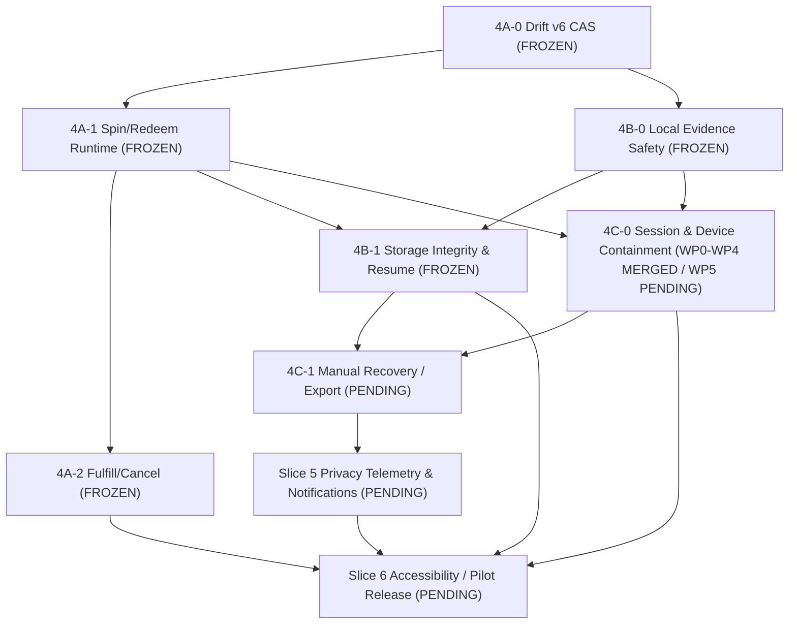

# Phase 6 Freeze Receipt — Auth, Child Mode & Device Containment (Slice 4C-0)

**Implementation Status:** WP0–WP4 MERGED & VERIFIED ON `main`  
**Freeze Receipt Status:** WP5 PROPOSED — PENDING INDEPENDENT REVIEW & MERGE (tracked in docs-only WP5 freeze [PR #43](https://github.com/thedusk4203/LearnWard/pull/43); no WP5 merge commit SHA or post-merge WP5 CI receipt exists yet; Slice 4C-0 transitions to **FROZEN** only after independent approval, merge, and green post-merge `main` CI of PR #43)  
**Pilot & Production Gates:** CLOSED  
**Target:** Phase 6 Slice 4C-0 — Auth, Child Mode & Device Containment (`Atomic LocalMetadataStore CAS & Pre-Commit Guards, Hardened ParentGateService v2 (RFC 7914 §11 PBKDF2-HMAC-SHA-256 >= 100k Isolate Offload, Dual Clock Lockout, 3-Phase Pessimistic Reserve, Household Ownership & 3-Level Legacy Provenance), Trusted ValidatedActorContext.isAnonymous & 8-Way DB-Authoritative ContainmentAuthorizationVerifier (RLS 0-Row Neutrality), PersistedChildModeSession v2 & Fail-Closed Cold Start, Single-Writer _ContainmentArbiter & Two-Barrier Commit Linearization, Separated Normal vs Exit Path B Recovery Sign Out (containment_recovery_lock_v1), Unified Auth-First GoRouter & Six Data-Free Restricted Shells, Non-Destructive Data Preservation & Outbox Actor-Pause Sweep, Acceptance Criteria C0-01–C0-39, Invariants C0-I01–C0-I22, Review Dispositions R38–R43`)  
**Risk Register Closure Targets (Implementation Evidence Verified):** `LW-AUD-03` (HIGH — Child Mode restored without verified actor) and `LW-AUD-05` (MEDIUM — PIN brute force / partial write)  
**Design PR (WP0):** [#38 — docs(phase-6): Slice 4C-0 Auth, Child Mode & Device Containment design contract (WP0)](https://github.com/thedusk4203/LearnWard/pull/38)  
**Approved Design HEAD (WP0):** `23c99aa26b35ba91905eba1d23266ce2774a190c`  
**Implementation PRs (WP1–WP4):**
- [#39 — feat(shared-device): Slice 4C-0 WP1 — Atomic Metadata CAS & Hardened ParentGate v2](https://github.com/thedusk4203/LearnWard/pull/39)
- [#40 — feat(containment): Slice 4C-0 WP2 — Trusted Actor Identity, 8-Way Verifier & Fail-Closed Cold Start](https://github.com/thedusk4203/LearnWard/pull/40)
- [#41 — feat(mobile): Slice 4C-0 WP3 — SessionLifecycleController, Parent Gate & auth-first GoRouter](https://github.com/thedusk4203/LearnWard/pull/41)
- [#42 — Phase 6 Slice 4C-0 WP4: Acceptance Matrix (C0-01..C0-39) & Remediation](https://github.com/thedusk4203/LearnWard/pull/42)  
**Final Approved Implementation HEAD (WP4):** `9861515138db807e320bb8dea9ede14386178a82`  
**Final Pre-Merge PR CI Run ID (WP4):** [`46089084763`](https://github.com/thedusk4203/LearnWard/actions/runs/46089084763) — **SUCCESS (4/4 green)**  
**Final Implementation Merge SHA (WP4 -> `main`):** `a4bc931b989dbb5b88367eb108bad499e06ee470`  
**Approved WP4 Implementation Git Tree SHA (`main`):** `807e7c265fa3d7f15a95525f6b59351a82d05a9f`  
**Post-Merge `main` CI (WP4):** Run ID [`46090821311`](https://github.com/thedusk4203/LearnWard/actions/runs/46090821311) — **SUCCESS (4/4 green)**  
**Final Implementation Merge Timestamp (UTC):** `2026-11-28T00:59:48Z`  
**Receipt Authored Date:** `2026-11-28`  
**ADR:** [ADR 0008 — Phase 6 Pilot Hardening](../adr/0008-phase-6-pilot-hardening.md) (`ACCEPTED`)  
**Authoritative Contracts & Upstream Dependencies:**
- [ADR 0001–0007](../adr/)
- [Phase 1–5.2 Freeze Receipts](.)
- [Phase 6 Drift v5 Foundation Freeze](phase-6-drift-v5-foundation-freeze.md)
- [Phase 6 Slice 4A-0 Drift v6 Foundation Freeze](phase-6-slice-4a-0-drift-v6-foundation-freeze.md)
- [Phase 6 Slice 4A-1 Recovery Dispatcher Freeze](phase-6-slice-4a-1-recovery-dispatcher-freeze.md)
- [Phase 6 Slice 4A-2 Adult Fulfill/Cancel Freeze](phase-6-slice-4a-2-adult-fulfill-cancel-freeze.md)
- [Phase 6 Slice 4B-0 Local Evidence Safety Freeze](phase-6-slice-4b-0-local-evidence-safety-freeze.md)
- [Phase 6 Slice 4B-1 Evidence Resumability Freeze](phase-6-slice-4b-1-evidence-resumability-freeze.md) (baseline `main` `d49e39af66978fe4315411789e367e8eb8a51233`)
- [Phase 6 Master Delivery and Pilot Gates](../21-phase-6-master-delivery-and-pilot-gates.md)
- [Phase 6 Slice 4C-0 Auth, Child Mode & Device Containment Design Contract](../25-phase-6-slice-4c-0-auth-child-mode-containment-design-contract.md)
- [Phase 6 Slice 4C-0 WP4 Acceptance Traceability Matrix (`C0-01`–`C0-39`)](../26-phase-6-slice-4c-0-wp4-acceptance-traceability-matrix.md)

---

## 1. Work Package Merge Provenance (WP0–WP4)

All five prerequisite Slice 4C-0 work packages (`WP0` through `WP4`) were reviewed independently, squash-merged sequentially onto `main` from Slice 4B-1 freeze baseline `d49e39af66978fe4315411789e367e8eb8a51233` using exact-HEAD guards, and verified 4/4 green on post-merge `main` CI after each merge:

| Work Package | PR | Scope | Approved HEAD SHA | Pre-Merge PR CI Run | Merge Commit SHA (`main`) | Resulting Tree SHA (`main`) | Merged At (UTC) | Post-Merge `main` CI Run |
|---|---|---|---|---|---|---|---|---|
| **WP0** | [#38](https://github.com/thedusk4203/LearnWard/pull/38) | Design Contract (`D1–D6`, `C0-I01–C0-I22`, `C0-01–C0-39`, `R38-01–R38-10`) | `23c99aa26b35ba91905eba1d23266ce2774a190c` | [`45540563496`](https://github.com/thedusk4203/LearnWard/actions/runs/45540563496) (4/4) | `0a55cf9f6ed62fa9918fd6f7358b59766e8be73f` | `da99eee8bcc5d3034b7fd6c9c245b203484c580f` | `2026-11-25T04:19:10Z` | [`45545959508`](https://github.com/thedusk4203/LearnWard/actions/runs/45545959508) (4/4) |
| **WP1** | [#39](https://github.com/thedusk4203/LearnWard/pull/39) | Atomic Metadata CAS, Hardened `ParentGateService` v2, Dual Clock & Legacy Provenance | `80c51b5327982bf6afb4c5f4f038e77d9941312f` | [`45597089271`](https://github.com/thedusk4203/LearnWard/actions/runs/45597089271) (4/4) | `ce9fdbd7cd8023f14765942d203fc6b4c9c3e988` | `16b238c916c791a56f14f4e2aaab613c24a1fb56` | `2026-11-25T11:59:40Z` | [`45609523303`](https://github.com/thedusk4203/LearnWard/actions/runs/45609523303) (4/4) |
| **WP2** | [#40](https://github.com/thedusk4203/LearnWard/pull/40) | Trusted `isAnonymous`, 8-Way Verifier, `PersistedChildModeSession` v2 & Fail-Closed Cold Start | `c1db8ea15544c64857756ecab7c303915ecafc03` | [`46005683128`](https://github.com/thedusk4203/LearnWard/actions/runs/46005683128) (4/4) | `a2d32a5ff091b30c8443bd8f99252a5219b58184` | `3428a47ebbfa091f8bccf1b0e30b0984e9e0475a` | `2026-11-27T13:43:51Z` | [`46009624441`](https://github.com/thedusk4203/LearnWard/actions/runs/46009624441) (4/4) |
| **WP3** | [#41](https://github.com/thedusk4203/LearnWard/pull/41) | `SessionLifecycleController` (`_ContainmentArbiter`), Parent Gate Integration & Auth-First `GoRouter` | `9126a5e4b3a71c10d4bae502b2da4d91065c264a` | [`46041960077`](https://github.com/thedusk4203/LearnWard/actions/runs/46041960077) (4/4) | `32d8ddb9bc09cc604a3d142735f21acd4b74f29a` | `39f4022fd19b6f4ad3863caef585de8b99b4e00a` | `2026-11-27T18:16:01Z` | [`46048159616`](https://github.com/thedusk4203/LearnWard/actions/runs/46048159616) (4/4) |
| **WP4** | [#42](https://github.com/thedusk4203/LearnWard/pull/42) | Full `C0-01`–`C0-39` Acceptance Matrix (`Groups A–F`), Remediation (`WP4-DEF-01`–`07`) & `R42-01`/`R42-02` Hardening | `9861515138db807e320bb8dea9ede14386178a82` | [`46089084763`](https://github.com/thedusk4203/LearnWard/actions/runs/46089084763) (4/4) | `a4bc931b989dbb5b88367eb108bad499e06ee470` | `807e7c265fa3d7f15a95525f6b59351a82d05a9f` | `2026-11-28T00:59:48Z` | [`46090821311`](https://github.com/thedusk4203/LearnWard/actions/runs/46090821311) (4/4) |

---

## 2. Approved WP4 Code Tree, Post-Merge `main` CI & Six-Workspace Test Totals

Final verified implementation tree on `main`:
- **Merge Commit SHA:** `a4bc931b989dbb5b88367eb108bad499e06ee470` (parent: `32d8ddb9bc09cc604a3d142735f21acd4b74f29a`)
- **Exact Approved Code Tree SHA:** `807e7c265fa3d7f15a95525f6b59351a82d05a9f`
- **Post-Merge `main` CI Run:** [`46090821311`](https://github.com/thedusk4203/LearnWard/actions/runs/46090821311) — **4/4 `SUCCESS`** (matching pre-merge WP4 PR CI run [`46089084763`](https://github.com/thedusk4203/LearnWard/actions/runs/46089084763) on approved HEAD `9861515138db807e320bb8dea9ede14386178a82`)

| Test Suite / CI Job | Scope / Count | Passed | Result | Duration & Job ID (`46090821311`) |
|---|---|---|---|---|
| **Format, analyze and test** | 974 workspace tests + format + analyze + Drift codegen | All | **PASS** | 3m 14s ([`140811064832`](https://github.com/thedusk4203/LearnWard/actions/runs/46090821311/job/140811064832)) |
| - `dart format --output=none --set-exit-if-changed packages apps` | 263 files (0 changed) | 263 | **PASS** | — |
| - `dart analyze` / `flutter analyze` | Clean static analysis across all 6 workspaces (0 issues) | Clean | **PASS** | — |
| - *learnward_domain* | Domain models & parity suites | 196 | **PASS** | — |
| - *learnward_application* | Slice 4A-1, 4A-2, 4B-0, 4B-1, 4C-0 ports/codecs/verifier contracts | 167 | **PASS** | — |
| - *learnward_data* | Drift v6 SQLite CAS (`wp1_metadata_cas_sqlite_and_parity_test.dart`), 4B-1 & reward suites | 262 | **PASS** | — |
| - *learnward_test_support* | Fake stores, clocks & invariant parity tests | 14 | **PASS** | — |
| - *learnward_design_system* | Design theme & tokens tests | 2 | **PASS** | — |
| - *apps/mobile* | Widget, router, controller & security suites (incl. **40/40** in `wp4_slice_4c0_acceptance_matrix_test.dart` across Groups A–F) | 333 | **PASS** | — |
| - *Drift `build_runner` diff assertion* | `dart run build_runner build --delete-conflicting-outputs` (0 outputs / 0 git diff) | Clean | **PASS** | — |
| **Supabase migrations & RLS security** | Full local Supabase stack, 11 migrations, 659 pgTAP assertions + 19 real-backend scripts | All | **PASS** | 2m 34s ([`140811065051`](https://github.com/thedusk4203/LearnWard/actions/runs/46090821311/job/140811065051)) |
| **iOS simulator compile** | `flutter build ios --simulator` | Success | **PASS** | 2m 44s ([`140811978449`](https://github.com/thedusk4203/LearnWard/actions/runs/46090821311/job/140811978449)) |
| **Android debug build** | Gradle `assembleDebug` + SHA-256 verified native SQLite & Kotlin binaries | Success | **PASS** | 5m 01s ([`140811978461`](https://github.com/thedusk4203/LearnWard/actions/runs/46090821311/job/140811978461)) |

---

## 3. Verified Acceptance Coverage Summary (`C0-01`–`C0-39` — 39/39 PASS)

Every deterministic acceptance criterion `C0-01` through `C0-39` defined in [docs/25 §8](../25-phase-6-slice-4c-0-auth-child-mode-containment-design-contract.md) is verified **39/39 PASS** across real file-backed SQLite (`NativeDatabase`), `DefaultLocalEvidenceFileStore`, multi-connection CAS barriers, live mounted `LearnWardApp` + `GoRouter` widget tests, and full workspace CI. Full row-by-row test-name, assertion, storage-mode, and Checkpoint 1/2 evidence is recorded in [docs/26-phase-6-slice-4c-0-wp4-acceptance-traceability-matrix.md](../26-phase-6-slice-4c-0-wp4-acceptance-traceability-matrix.md):

| Acceptance Group | Criteria IDs | Count | Primary Verification Suites | Status |
|---|---|---|---|---|
| **Auth-First Boot, Expiry & Restricted Shells** | `C0-01`, `C0-02`, `C0-03`, `C0-11`, `C0-19`, `C0-20`, `C0-28`, `C0-29`, `C0-36` | 9 | `wp4_slice_4c0_acceptance_matrix_test.dart` (`Group A`), `wp3_session_lifecycle_and_router_test.dart`, `wp2_containment_verifier_and_cold_start_test.dart` | **9/9 PASS** |
| **Lifecycle Isolation, Switches, Offline & Archival Containment** | `C0-04`, `C0-05`, `C0-06`, `C0-07`, `C0-08`, `C0-09`, `C0-10`, `C0-21` | 8 | `wp4_slice_4c0_acceptance_matrix_test.dart` (`Groups A, C, D`), `wp3_session_lifecycle_and_router_test.dart`, `wp2_containment_verifier_and_cold_start_test.dart` | **8/8 PASS** |
| **Paired-Child Isolation & DB-Authoritative Verifier** | `C0-12`, `C0-13`, `C0-34`, `C0-35` | 4 | `wp4_slice_4c0_acceptance_matrix_test.dart` (`Group A`), `wp2_containment_verifier_and_cold_start_test.dart`, `wp3_session_lifecycle_and_router_test.dart` | **4/4 PASS** |
| **Atomic CAS, PBKDF2-HMAC-SHA-256, Lockout, Clocks & PIN Ownership** | `C0-14`, `C0-15`, `C0-16`, `C0-17`, `C0-18`, `C0-22`, `C0-24`, `C0-25`, `C0-26`, `C0-27` | 10 | `wp1_metadata_cas_sqlite_and_parity_test.dart`, `wp1_parent_gate_v2_test.dart`, `wp4_slice_4c0_acceptance_matrix_test.dart` (`Group B`), `wp3_session_lifecycle_and_router_test.dart` | **10/10 PASS** |
| **Async Fencing, Privilege Monotonicity & Two-Barrier Commit Ordering** | `C0-31`, `C0-32`, `C0-33`, `C0-37` | 4 | `wp4_slice_4c0_acceptance_matrix_test.dart` (`Group B`, `Group C` 16-case SQLite matrix, `Group E` `R42-01` 4 tests, `Group F` `R42-02` 8 live `GoRouter` Barrier 2 + Checkpoint 1/2 SQLite tests), `wp3_session_lifecycle_and_router_test.dart` | **4/4 PASS** |
| **Separated Sign-Out, Durable Recovery Lock & Legacy Provenance** | `C0-30`, `C0-38`, `C0-39` | 3 | `wp4_slice_4c0_acceptance_matrix_test.dart` (`Group D` incl. `C0-39(a)`–`(g)`), `wp3_session_lifecycle_and_router_test.dart`, `wp1_parent_gate_v2_test.dart` | **3/3 PASS** |
| **Full Workspace Regression & Zero-Diff Frozen Boundaries** | `C0-23` | 1 | All 6 Dart/Flutter suites (`974` tests), `dart format`, `dart/flutter analyze`, Drift `build_runner`, `46090821311` (659 pgTAP + 19 backend scripts + Android/iOS builds) | **1/1 PASS** |

---

## 4. Security & Durability Invariants Compliance (`C0-I01`–`C0-I22`)

| Invariant | Implementation & Enforcement Summary | Verified Acceptance Coverage |
|---|---|---|
| **`C0-I01` Auth Guard Outranks Containment** | Unified `MaterialApp.router` (`app_router.dart`) checks fail-closed auth state before every Child Mode or containment route, redirecting all protected paths to `/auth` when unauthenticated. | `C0-01`, `C0-02`, `C0-20` |
| **`C0-I02` Actor-/Family-/Child-Bound v2 Session** | `PersistedChildModeSession` v2 (`containment_session_models.dart`) classifies `absent` / `validV2` / `legacyV1OrMalformed`; legacy v1 or malformed payloads never adopt Child Mode or auto-unlock to `ParentMode`. | `C0-01`, `C0-03`, `C0-08`, `C0-39` |
| **`C0-I03` Single Fail-Closed Auth Truth** | `authSessionStateProvider` & `currentUserIdProvider` (`app_providers.dart`, `supabase_auth_session_adapter.dart`) bind strictly to validated non-expired non-sticky-invalid sessions (`0` fallback to `client.auth.currentUser`). | `C0-02`, `C0-20` |
| **`C0-I04` Deterministic Provider & Screen Isolation** | Synchronous `_clearInMemoryProtectedState()` + monotonic `sessionScopeEpoch++` + keyed `Consumer` route builders (`app_router.dart`) + guarded `FamilyHomeScreen._loadData()` (`WP4-DEF-07`) eliminate cross-account family bleed. | `C0-04`, `C0-05`, `C0-07`, `C0-37` |
| **`C0-I05` Offline Shared-Device Containment & Unverified Hold** | Offline restart with matching same-actor v2 session + valid PIN stays in `ChildModeOfflineContained`; solving PIN offline (`WP4-DEF-01`) clears `active_child_session` into `/account/unverified` (never `/parent`). | `C0-08`, `C0-09` |
| **`C0-I06` Archived Child / RLS 0-Row / Revoked Membership Lock** | Clean server verification observing archived/0-row child or non-active/absent adult membership while a Child Mode session or recovery/containment lock persists enters data-free `/child/containment-locked` preserving lock metadata across restarts (clean HTTP 200 0-row with no persisted child session or lock routes neutrally to `/family/onboarding` without inferring confirmed revocation). | `C0-10`, `C0-11`, `C0-30`, `C0-36` |
| **`C0-I07` Positive Paired-Child Revocation Proof Only** | Revocation requires `status == 'revoked' && revoked_at != null`; timeouts, uncertain `42501`, `0`-row grants, and unavailable child route strictly to data-free `/child/unverified` with 0 data loss. | `C0-13`, `C0-35` |
| **`C0-I08` Paired-Child Role & Route Isolation** | Active/revoked `child_device_grants`, `role == 'child'`, or `isAnonymous == true` (`WP4-DEF-05`) are blocked from `/parent*`, `/family/onboarding`, and shared-device Parent Gate exit (`Exit` button hidden). | `C0-12`, `C0-13`, `C0-29`, `C0-35` |
| **`C0-I09` Atomic CAS & `_ContainmentArbiter` Serialization** | `LocalMetadataStore.applyMetadataBatch` and `compareAndSwapMetadataBatch` (Drift transaction in `AppDatabase`, parity in-memory stores) + single-writer `_ContainmentArbiter` serialize PIN, lockout, fence, and recovery commits without holding SQLite locks across KDF. | `C0-14`, `C0-24`, `C0-25`, `C0-37` |
| **`C0-I10` Resistant PBKDF2-HMAC-SHA-256 KDF** | Pure-Dart PBKDF2-HMAC-SHA-256 (`parent_gate_crypto.dart`) with 16-byte CSPRNG salt, `>= 100,000` production floor, 32-byte DK, `Isolate.run` offload, constant-time compare, and RFC 7914 §11 vectors (`WP4-GAP-01`). | `C0-15`, `C0-22` |
| **`C0-I11` Dual-Clock Monotonic & Persistent Progressive Lockout** | `parent_gate_lockout_v1` persists progressive lockout (`5->30s, 6->60s, 7->300s, 8->900s, 9+->1800s` cap), rejects while locked with 0 KDF calls, uses `Clock` + `MonotonicClock` in-process, and clamps backward restart skew. | `C0-17`, `C0-26` |
| **`C0-I12` Safe `v1 -> v2` Upgrade & Corrupt PIN Containment** | Legacy salted SHA-256 keys upgrade atomically to `parent_gate_credential_v2` on authorized Exit Path A (deleting v1 keys); corrupt/below-floor credentials fail closed and block PIN entry while locked. | `C0-16`, `C0-22`, `C0-39` |
| **`C0-I13` PIN Retention & Household Ownership Policy** | Parent PIN credentials and lockout metadata are durable and protected against unauthorized deletion across sign-out, account/family switch, archival lock, and revocation (with lockout reset atomically on verified exit/PIN change/reset/recovery); cross-household `setPin` rejects with `ParentPinOwnershipConflict` requiring explicit confirmed reassignment in `ParentMode`, while legitimate verified operations may atomically upgrade, replace, rebind, or reset PIN/lockout metadata. | `C0-18`, `C0-27` |
| **`C0-I14` Zero Blanket SQLite Wipe & Conservative Retention** | Zero bulk `DELETE` / `clearAllTables()` across all containment and recovery transitions (`docs/17` §3.4 superseded); `local_assessment_drafts`, `pending_reward_commands`, and canonical/original local evidence photo files (bit-identical SHA-256 bytes) are preserved non-destructively, and mismatched-actor reward commands are paused non-destructively (`pending_original_actor`, 0 RPCs). | `C0-05`, `C0-06`, `C0-21`, `C0-27`, `C0-39` |
| **`C0-I15` Strict Route Segment Matching & Resource Disposal** | `isActiveChildContentPath` matches exact segments excluding `/child/{revoked,unverified,containment-locked}`; `SupabaseAuthSessionAdapter` and `RouterListenable` dispose via `ref.onDispose`. | `C0-19`, `C0-20` |
| **`C0-I16` Zero Schema/SQL Drift & Redacted Diagnostics** | Drift v6, Supabase migrations/RPC/RLS/Storage, frozen adapter, and `RECOVERY_DISPATCHER_ENABLED=false` untouched; zero PINs, salts, keys, tokens, or cross-family PII in restricted shells or audit metadata. | `C0-23`, `C0-27`, `C0-39` |
| **`C0-I17` Positive Current Adult Verification for `ParentMode`** | `/parent` requires verified non-anonymous active `owner`/`parent` membership, zero `child_device_grants` row, and zero unresolved containment/recovery lock; zero `default -> ParentMode` fallback. | `C0-11`, `C0-28`, `C0-33`, `C0-36` |
| **`C0-I18` Concurrency-Safe Attempt Reservation Integrity** | Pre-KDF `compareAndSwapMetadataBatch` pessimistic reservation + `15s` `inFlightReservations` TTL pruning + `lockoutOwnerAttemptId` guard across file-backed SQLite and in-memory parity stores. | `C0-24`, `C0-25` |
| **`C0-I19` Immediate-Fail-Closed & Arbiter-Linearized Fencing** | `ParentGateOperationFence` + synchronous `0-await` fail-closed mask + Barrier 1 `preCommitGuard()` `ROLLBACK`/`abortFencedAttempt` + Barrier 2 commit-wins (`t_commit < t_event`, zero stale `ParentMode`, zero compensating rewrite) + `R42-01` fail-closed invalidation allowlist. | `C0-31`, `C0-32`, `C0-33`, `C0-37` |
| **`C0-I20` DB-Authoritative Precedence & RLS 0-Row Neutrality** | `SupabaseAuthSessionAdapter` propagates `isAnonymous`; `SupabaseContainmentAuthorizationVerifier` queries `child_device_grants` first, `family_memberships` second regardless of `appMetadata.role`, classifying clean 0-row neutrally as `NoActiveFamilyMembershipObserved`. | `C0-11`, `C0-29`, `C0-34`, `C0-35`, `C0-36` |
| **`C0-I21` Separated Normal vs Exit Path B Recovery Sign Out** | `signOutNormal` allowed strictly in `ParentMode` with 0 unresolved lock; `signOutFromContainmentRecovery` persists `containment_recovery_lock_v1` + retains `active_child_session` across sign-out, restart, failed login, stale generation, and non-owning logins until fresh owning adult login. | `C0-04`, `C0-30`, `C0-38` |
| **`C0-I22` Correlated Legacy Provenance & Restricted Manual Recovery** | 4-conjunct `(family_id, child_id)` `CorroboratedLegacyOwner` resolver rejects absent/malformed/conflicting/child-uncorrelated provenance to `UnresolvableLegacyOwnership`; no automatic `requiredOwnerFamilyId == null` unlock; high-friction `commitRestrictedManualUnboundRecovery` writes redacted audit and retains 100% local data. | `C0-16`, `C0-39` |

---

## 5. Independent Review Finding & WP4 Remediation Dispositions (`R38`–`R43`, `WP4-DEF-01`–`07`, `WP4-GAP-01`)

| Review / Batch | Scope | Findings Resolved | Core Hardening Summary |
|---|---|---|---|
| **R38** | WP0 (PR #38) | `R38-01`–`R38-10` + RFC 7914 §11 | Eliminated legacy/archived/corrupt auto-unlock (`R38-01`); added data-free restricted shells & offline post-PIN unverified hold (`R38-02`); 3-phase CAS attempt reservation (`R38-03`); dual-clock + `ownerFamilyId` ownership (`R38-04`); async PIN operation fencing (`R38-05`); `isAnonymous`, `child_device_grants`-first & RLS 0-row neutrality (`R38-06`); `_ContainmentArbiter` two-barrier commit linearization (`R38-07`); separated Normal vs Exit Path B Recovery Sign Out (`R38-08`); 3-level legacy ownership & Restricted Manual Unbound Recovery (`R38-09`); strict 4-conjunct `(family_id, child_id)` `CorroboratedLegacyOwner` predicate (`R38-10`); RFC 7914 §11 PBKDF2-HMAC-SHA-256 requirement. |
| **R39** | WP1 (PR #39) | `R39-01`–`R39-05` | Deadlock-free SQLite `compareAndSwapMetadataBatch` transaction guard & atomic `v1 -> v2` gating (`R39-01`, `R39-02`); fail-closed `setPin` ownership/corrupt restrictions (`R39-03`); fail-closed PIN setup & authorized exit context gating (`R39-04`, `R39-05`). |
| **R40** | WP2 (PR #40) | `R40-01`–`R40-06` | Working Create Family navigation from `noActiveFamilyMembership` restricted shell (`R40-01`); cold-start containment & error-path hardening (`R40-02`, `R40-03`); `SupabaseAuthSessionAdapter` disposal lifecycle (`R40-04`); actor-bound pending created family preventing cross-account PII leaks (`R40-05`); accurate invited, revoked & malformed membership classification (`R40-06`). |
| **R41** | WP3 (PR #41) | `R41-01`–`R41-02` | Fenced `switchActiveFamily`, `signOutNormal`, and `signOutFromContainmentRecovery` checking `compareAndSwapMetadataBatch` boolean results (`R41-01`); hardened router/lifecycle transition handling (`R41-02`). |
| **WP4 Remediation** | WP4 (PR #42) | `WP4-DEF-01`–`WP4-DEF-07`, `WP4-GAP-01` | Offline v2 PIN unlock -> `/account/unverified` (`WP4-DEF-01`); family-switch & Barrier 1/2 fencing on `submitParentPinChange` / `submitCrossFamilyPinReassignment` (`WP4-DEF-02`); synchronous `applyContainmentInvalidation` & verifier ordering ahead of outbox pause (`WP4-DEF-03`); RFC 7914 §11 64-byte vectors + `99999`-iteration corrupt rejection (`WP4-GAP-01`); Barrier 2 pre-increment fence check preventing epoch masking (`WP4-DEF-04`); defense-in-depth `isAnonymous || role == 'child'` guard (`WP4-DEF-05`); in-arbiter `containment_fence_v1` re-read for Exit Path B auto-unlock (`WP4-DEF-06`); `AppRoutes.home`/`parentHome` & `FamilyHomeScreen._loadData()` scope/actor guards eliminating transient frame family bleed (`WP4-DEF-07`). |
| **R42** | WP4 (PR #42) | `R42-01`–`R42-03` | Monotonic fail-closed target allowlist on `applyContainmentInvalidation` rejecting privilege elevations/positive outcomes via `ArgumentError` with 0 state/DB mutation + audit of all 17 other `state = ...` sites (`R42-01`, `Group E`); 8 live mounted `LearnWardApp` + `GoRouter` Barrier 2 + Checkpoint 1/2 SQLite durability tests catching & locking down `WP4-DEF-07` (`R42-02`, `Group F`); PR #42 description synchronized to exact final metrics and CI `46089084763` (`R42-03`). |
| **R43** | WP5 (PR #43) | `R43-01`–`R43-02` | Clarified conditional zero-row containment routing in §6.1 & `C0-I06` (`/family/onboarding` only when no persisted `active_child_session` or unresolved lock exists; `/child/containment-locked` otherwise; never inferring confirmed revocation from clean zero-row, `R43-01`); separated non-destructive user-work/evidence retention (`local_assessment_drafts`, `pending_reward_commands`, evidence files) from durable but authorized-mutable PIN/lockout security metadata across §6.3, `C0-I13`, and `C0-I14` (`R43-02`); linked stable WP5 [PR #43](https://github.com/thedusk4203/LearnWard/pull/43) URL in receipt and master ledger. |

---

## 6. Runtime Security & Containment Guarantees Summary

### 6.1 Auth-First Routing & Fail-Closed Child Mode Containment
- `LearnWardApp` runs on a single unified `MaterialApp.router` (`GoRouter` never recreated on containment updates) with 10-step redirect precedence where authentication outranks every Child Mode or containment route (`C0-I01`, `C0-I03`).
- Boot proceeds fail-closed through `Hydrating` (`/containment-loading`) with zero blind `initialChildModeSessionProvider` override; `SupabaseContainmentAuthorizationVerifier` queries `public.child_device_grants` first and `public.family_memberships` second regardless of optional `appMetadata.role`, enforcing strict RLS 0-row neutrality (never inferring confirmed revocation from a clean HTTP 200 zero-row result):
  - Clean HTTP 200 zero-row with **no** persisted `active_child_session` or unresolved recovery/containment lock routes neutrally to `NoActiveFamilyMembership` (`/family/onboarding`) with zero prior-family PII (`C0-11`, `C0-36`).
  - Clean HTTP 200 zero-row **with** a persisted Child Mode session or unresolved containment/recovery lock routes to `ChildModeContainmentLocked` (`/child/containment-locked`), retaining durable containment metadata and blocking `ParentMode` (`C0-I06`, `C0-11`, `C0-36`).
- Unverified, revoked, archived, legacy, corrupt, and zero-row states route strictly to six data-free restricted shells (`/child/containment-locked`, `/child/unverified`, `/child/revoked`, `/account/unverified`, `/account/access-restricted`, `/family/onboarding`), with zero implicit `default -> ParentMode` fallback and monotonic fail-closed `applyContainmentInvalidation` enforcement (`R42-01`).
- Every auth/containment/family transition clears protected in-memory providers synchronously (`activeFamilyProvider = null`), increments `sessionScopeEpoch`, and blocks transient `FamilyHomeScreen` post-frame reloads (`WP4-DEF-07`).

### 6.2 PIN Ownership, Lockout, Atomic SQLite/CAS & Dual-Barrier Commit Guarantees
- `ParentGateService` v2 executes pure-Dart PBKDF2-HMAC-SHA-256 (`>= 100,000` production iterations, 16-byte CSPRNG salt, 32-byte DK, constant-time equality) off the UI isolate (`Isolate.run`), validated against RFC 7914 §11 vectors.
- Verification uses a three-phase protocol: (1) fast pre-KDF SQLite `compareAndSwapMetadataBatch` pessimistic reservation (`15s` TTL, zero SQLite lock held across KDF), (2) off-isolate PBKDF2 / legacy `v1` evaluation, and (3) `_ContainmentArbiter`-serialized finalize CAS asserting `containment_fence_v1`, `lockoutOwnerAttemptId`, and synchronous `preCommitGuard()`.
- Overlapping auth/containment events engage an immediate `0-await` fail-closed UI mask. Events arriving before `preCommitGuard()` (**Barrier 1**) force SQLite `ROLLBACK` + `abortFencedAttempt(attemptId)` (preserving pessimistic failure counts and any Actor B lockout). Already-admitted SQLite commits past `preCommitGuard()` (**Barrier 2**) complete cleanly at `t_commit < t_event` ahead of queued `_persistFenceTransition()` with zero stale `ParentMode` publication and zero best-effort compensating rewrites, proven across all 16 `Group C` SQLite cases and all 8 `Group F` live `LearnWardApp` + `GoRouter` Checkpoint 1/2 tests (`C0-37`).
- Normal Adult Sign Out (`signOutNormal`, `ParentMode` only when 0 lock exists) is strictly separated from Exit Path B Recovery Sign Out (`signOutFromContainmentRecovery`, writing durable `containment_recovery_lock_v1` and retaining `active_child_session` until fresh verified `BoundOwner` or 4-conjunct `(family_id, child_id)` `CorroboratedLegacyOwner` adult login; `UnresolvableLegacyOwnership` requires explicit high-friction Restricted Manual Unbound Recovery with mandatory new `v2` PIN setup and redacted audit).

### 6.3 Data Preservation, Quarantine & Evidence SHA-256 Integrity
- Slice 4C-0 supersedes `docs/17` §3.4: bulk SQLite wipes (`clearAllTables()` / bulk `DELETE`) are prohibited across every sign-out, account switch, family switch, archival lock, grant revocation, cross-family PIN reassignment, Barrier 1/2 race abort, and manual unbound recovery transition (`C0-I14`, `C0-21`).
- User work and local evidence (`local_assessment_drafts`, `pending_reward_commands`, and canonical/original local evidence photo files—verified bit-identical by SHA-256 across file-backed `AppDatabase` reopens) are preserved non-destructively across all containment and recovery transitions; mismatched-actor reward commands are paused non-destructively (`pending_original_actor`, 0 remote RPCs) for downstream **Slice 4C-1** adult export and manual quarantine management (`docs/25 §4 D5`, `C0-I14`).
- Security metadata follows its explicit lifecycle policy (`docs/25 §4 D5`, `C0-I12`, `C0-I13`, `C0-I22`) rather than immutable user-work retention: Parent PIN credentials (`parent_gate_credential_v2`) and lockout state (`parent_gate_lockout_v1`) are durable and protected against unauthorized deletion or silent cross-household replacement across sign-out, account/family switch, archival lock, and revocation, while legitimate verified adult operations may atomically upgrade (`v1 -> v2`, deleting legacy v1 keys), replace, rebind (`ownerFamilyId`), or reset them via `_ContainmentArbiter` CAS. Verified Child Mode exit resets lockout atomically, and Restricted Manual Unbound Recovery (`D1.6`, `C0-I22`) creates a new `parent_gate_credential_v2`, resets lockout, records a redacted `last_containment_recovery_audit_v1`, and removes legacy/corrupt PIN and containment lock metadata as specified—while keeping 100% of drafts, reward commands, and evidence files intact.

---

## 7. Protected-Path & Frozen-Contract Zero-Diff Verification

Verified across the full Slice 4C-0 range (`d49e39af66978fe4315411789e367e8eb8a51233..a4bc931b989dbb5b88367eb108bad499e06ee470`, WP0–WP4):

| Asset / Protected Boundary | Verification Result | Confirmation Details |
|---|---|---|
| **Supabase Migrations, SQL, RPCs & RLS** | **0 diff (100% frozen)** | `git diff d49e39af..a4bc931b -- supabase` empty; all 11 migrations, 659 pgTAP assertions, and 19 backend scripts pass untouched in CI `46090821311`. |
| **Storage Bucket & Object Policies** | **0 diff (100% frozen)** | `assessment-evidence` bucket policies & security tests (`Tests A–T`) unchanged. |
| **Drift Schema v6 & Generated DB Code** | **0 schema/codegen diff** | `AppDatabase.schemaVersion => 6`, `app_database.g.dart` (`0` diff, `build_runner` wrote `0` outputs), and all table schemas (`local_metadata_entries`, `local_assessment_drafts` 30 cols, `pending_reward_commands` 19 cols) preserved bit-for-bit. WP1 added transaction-backed `applyMetadataBatch`, `compareAndSwapMetadataBatch`, and read-only `listActorBoundRecords()` methods in `packages/learnward_data/lib/src/database/app_database.dart` without altering schema v6; WP2–WP4 had `0` diff across `packages/learnward_data/`. |
| **Existing Freeze Receipts (`docs/freezes/*`)** | **0 diff (100% frozen)** | All 12 prior Phase 1–6 freeze receipts untouched across WP0–WP4 (and untouched by WP5). |
| **Frozen Recovery Authorization Adapter** | **0 diff (100% frozen)** | `apps/mobile/lib/app/bootstrap/supabase_recovery_authorization_adapter.dart` unchanged (`0` diff). |
| **Background Dispatcher Feature Flag** | **0 diff (`false` default)** | `apps/mobile/lib/app/bootstrap/app_config.dart` unchanged (`RECOVERY_DISPATCHER_ENABLED=false` preserved). |

---

## 8. Residual Limitations Carried Forward (`docs/25 §9` — Unresolved / Explicit Boundaries)

The following documented limitations from [docs/25 §9](../25-phase-6-slice-4c-0-auth-child-mode-containment-design-contract.md) and WP4 test-harness observations are carried forward transparently and are **NOT** claimed as resolved by Slice 4C-0:

1. **Cross-reboot wall-clock forward jump while offline (`R38-04` honest boundary):** Without trusted online server time or OS-enforced time-change locks (`Android Family Link` / `iOS Screen Time`), a client-only offline restart cannot distinguish an intentional +1h OS clock forward adjustment from 1h of real elapsed time; `MonotonicClock` protects strictly in-process, while persisted `failedAttempts` never resets and escalates immediately on any subsequent wrong guess.
2. **Local Arbiter Commit-Slot Ordering vs Concurrent Remote Server Mutations (`R38-07` explicit boundary):** `_ContainmentArbiter` + immediate synchronous fail-closed UI updates + `preCommitGuard()` + `containment_fence_v1` CAS guarantee client-local total commit ordering, but client-side SQLite transactions cannot preempt an already-running SQLite write lock or atomically synchronize with independent remote Postgres mutations committed on another device after verifier checks; server-side PostgreSQL RLS and `SECURITY DEFINER` RPCs remain authoritative (`42501` / `0` rows).
3. **Deliberate Residual Limitations in Legacy Unbound Recovery (`R38-08`, `R38-09`, `R38-10`):**
   - *Bound/Corroborated Household (`Family_A`) vs Dissolved Membership:* If an active recovery lock resolves to `Family_A` and no active adult in `Family_A` can reauthenticate (`NoActiveFamilyMembershipObserved`), unrelated/`0`-family accounts remain blocked until `Family_A` adult access is restored or OS-level storage is cleared outside Slice 4C-0.
   - *Manual Unbound Recovery on Pre-4C-0 Shared Hardware Without Secure Enclave Attestation (`UnresolvableLegacyOwnership`):* On genuinely unresolvable legacy devices lacking `v2` ownership or correlated `actor_user_id`-bound SQLite provenance, high-friction Restricted Manual Unbound Recovery (`D1.6`) prevents permanently bricking the device while blocking silent auto-clear on login, showing zero prior-family PII, and retaining 100% of quarantined local data—though another verified household adult can explicitly reclaim the locked UI shell manually because pre-4C-0 SQLite has no hardware device-to-family attestation.
4. **Out-of-scope pre-existing repository archival bug (`AUDIT-06`):** `SupabaseChildProfileRepository.archiveChildProfile()` still issues a direct `.from('child_profiles').update(...)` instead of the frozen `public.archive_child_profile(p_child_id)` RPC; until fixed in its own reviewed change, client-initiated archival via that repository method hits `42501` while server-initiated/SQL archival works and triggers `C0-10` containment cleanly.
5. **Paired-child pairing issuance UX:** Issuing and consuming `private.child_pairing_requests` / `public.child_device_grants` remains deferred per ADR 0002 Decision 4; Slice 4C-0 hardens containment, unverified quarantine, and revocation handling without enabling self-service device pairing.
6. **Device PBKDF2 latency calibration & headless test doubles:** Pure-Dart 100,000-iteration PBKDF2-HMAC-SHA-256 isolate execution has not yet been benchmarked on physical low-end pilot Android hardware (target ~150–400 ms without lowering the 100k floor). Automated widget/controller suites use injected `FakeAuthSessionPort`, `MockClient`, and stream-backed `SupabaseClient` doubles in place of live Supabase Auth network sessions; Checkpoint 1 pre-fence SQLite reads execute via an independent `AppDatabase` reader strictly after Barrier 2 commits (`t_commit < t < t_fence`) per [docs/26 §2](../26-phase-6-slice-4c-0-wp4-acceptance-traceability-matrix.md).
7. **Open downstream pilot release blockers:** `LW-AUD-06`–`LW-AUD-10` remain open (see Section 9).

---

## 9. Remaining Release Blockers, Downstream Dependencies & WP5 Review Status

### Remaining Open Risk Register Blockers
- **`LW-AUD-06` (RELEASE BLOCKER — OPEN, Slice 6):** Android production release signing (non-debug keystore) and iOS distribution signing/provisioning proof absent.
- **`LW-AUD-07` (RELEASE BLOCKER — OPEN, Slice 6):** Mandatory fail-closed production `APP_ENV` and release configuration validation not yet enforced.
- **`LW-AUD-08` (RELEASE BLOCKER — OPEN, Slice 5/6):** Pilot privacy, consent, retention, and incident-handling sign-off not completed.
- **`LW-AUD-09` (MEDIUM — OPEN, Slice 6):** TalkBack/VoiceOver semantics, touch-target audit, and reduced-motion accessibility verification pending.
- **`LW-AUD-10` (MEDIUM — OPEN, Slice 4C-1):** Parent-facing manual quarantine recovery, unsynced work export (`Export unsynced work`), and guarded local cleanup UX not yet implemented.

> [!WARNING]
> **Implementation Merged (`WP0`–`WP4`) != Frozen (`WP5` Pending) != Production/Pilot Ready**
>
> 1. **Slice 4C-0 Implementation (`WP0`–`WP4`) is MERGED & VERIFIED ON `main`:** PRs `#38`–`#42` are merged onto `main` at `a4bc931b989dbb5b88367eb108bad499e06ee470` (tree `807e7c265fa3d7f15a95525f6b59351a82d05a9f`) with post-merge `main` CI [`46090821311`](https://github.com/thedusk4203/LearnWard/actions/runs/46090821311) 4/4 `SUCCESS`, `39/39` `C0-01`–`C0-39` PASS, and `974` workspace tests passing. Implementation-level closure evidence for `LW-AUD-03` and `LW-AUD-05` is verified.
> 2. **WP5 Freeze Receipt ([PR #43](https://github.com/thedusk4203/LearnWard/pull/43)) is PROPOSED — PENDING INDEPENDENT REVIEW & MERGE:** No WP5 merge commit SHA or final post-merge WP5 CI receipt exists yet. Slice 4C-0 becomes **FROZEN** only after independent review approval, squash-merge of docs-only PR #43, and green 4/4 post-merge `main` CI.
> 3. **Pilot & Production Release Gates Remain Strictly CLOSED:** `RECOVERY_DISPATCHER_ENABLED=false` remains default, real physical Android/iOS device verification has not been executed, and **Slice 4C-1**, **Slice 5**, and **Slice 6** remain **NOT IMPLEMENTED**.

1. **Immediate Next Gate:** Independent review, approval, squash-merge, and post-merge `main` CI verification of this **Slice 4C-0 WP5** docs-only freeze receipt ([PR #43](https://github.com/thedusk4203/LearnWard/pull/43)).
2. **Next Implementation Target (After WP5 Freeze):** **Slice 4C-1** — *Manual Recovery & Export UX* (`LW-AUD-10`).
3. **Subsequent Targets:** **Slice 5** (*Coordination Notifications & Privacy Telemetry*) and **Slice 6** (*Accessibility, Physical Device Verification & Production Release Signing*).
4. **Production / Pilot Gate:** Remains strictly **CLOSED**.
